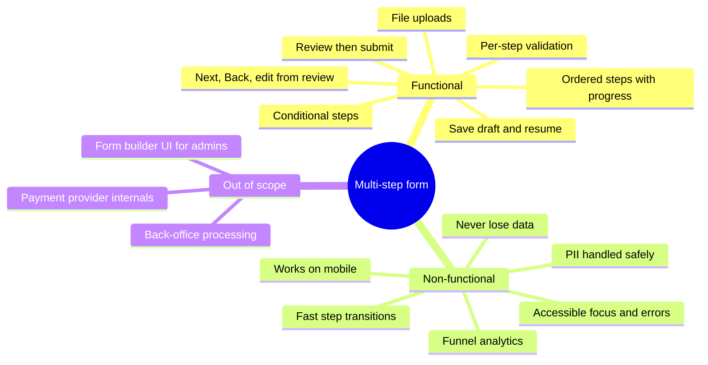
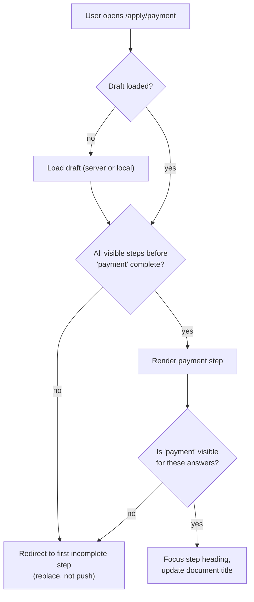
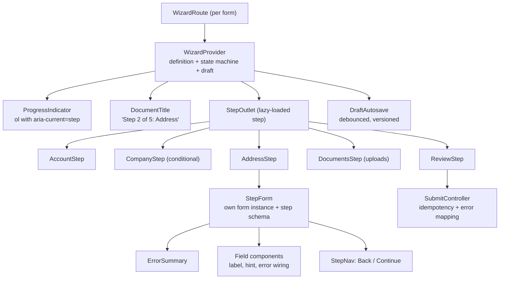
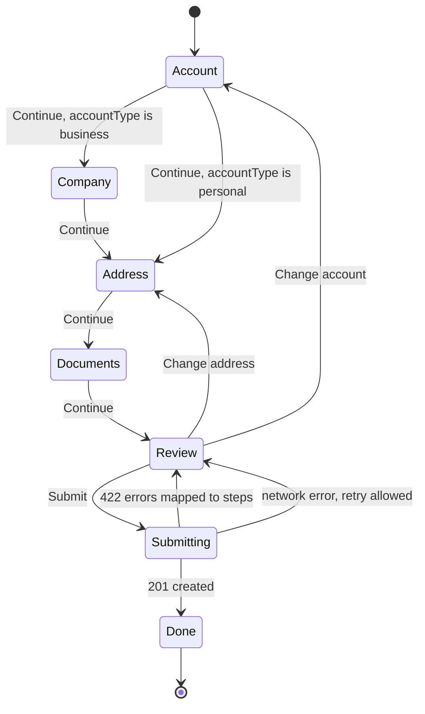
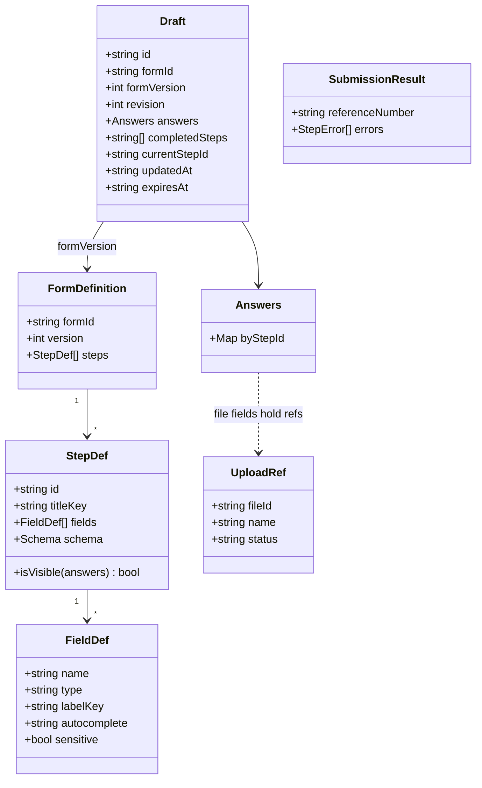
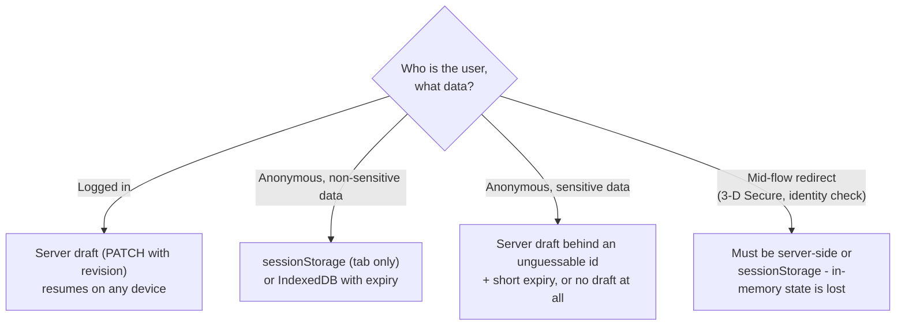
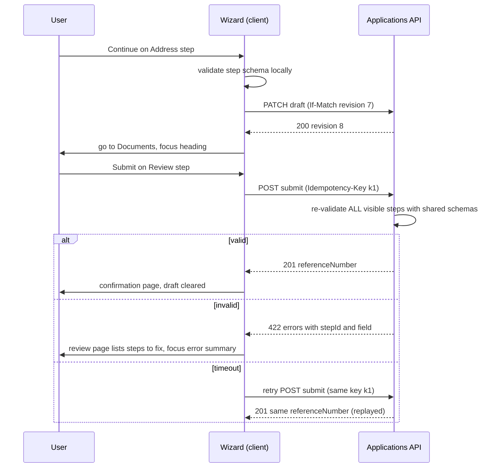
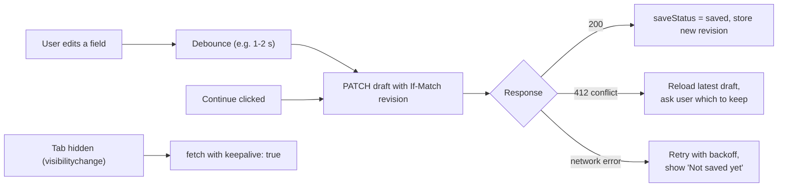

# Design a Multi-Step Form / Wizard

> **Date:** 2026-11-06 · **Last updated:** 2026-11-06
> **Category:** Frontend System Design
> **Sub-Topic:** System Design Cases / Multi-Step Forms and Wizards
> **Level:** Advanced · **Reading time:** ~32 min
> **Informs:** wizard state machine and conditional (branching) steps, URL-per-step routing and Back-button behavior, per-step vs final validation and shared client/server schemas, draft autosave and resume (server vs browser storage for PII), submit idempotency and server error mapping to steps, focus management and progress semantics, form schema versioning, funnel analytics without PII

> **Pre-requisite:** [Accessible Forms & Error Handling](../06-accessibility-and-i18n/accessible-forms-and-error-handling.md) and [Controlled vs Uncontrolled Components](../05-design-systems-and-components/controlled-vs-uncontrolled-components.md).
> This note designs a **multi-step form (wizard)** — e.g. an insurance quote, account onboarding or loan application — with the RADIO framework, then shows how to present it in a 45-minute interview.

**Previous:** [Design a Dashboard with Real-Time Data](./design-a-dashboard-with-real-time-data.md) · **Next:** [Design a Notification System UI](./design-a-notification-system-ui.md)

---

## Table of Contents

1. [ELI5 — Simple Explanation](#eli5--simple-explanation)
2. [Section 1: Requirements (R)](#section-1-requirements-r)
3. [Section 2: Architecture (A)](#section-2-architecture-a)
4. [Section 3: Data Model (D)](#section-3-data-model-d)
5. [Section 4: Interface (I)](#section-4-interface-i)
6. [Section 5: Optimizations (O)](#section-5-optimizations-o)
7. [Framework Comparison](#framework-comparison)
8. [Interview Walkthrough](#interview-walkthrough)
9. [Real-World Examples](#real-world-examples)
10. [Key Points Summary](#key-points-summary)
11. [Test Your Understanding (with answers)](#test-your-understanding)
12. [Cheat Sheet](#cheat-sheet)
13. [References & Further Reading](#references--further-reading)

---

## ELI5 — Simple Explanation

Think of applying for a **passport at a counter**:
- The clerk doesn't hand you a 12-page booklet at once. You fill in **one page at a time**, and the clerk checks it before giving you the next one (**per-step validation**).
- If you say "I'm applying for a child", the clerk hands you **an extra page** about parental consent; adults never see it (**conditional steps**).
- You can flip **back** to earlier pages without losing what you wrote.
- If you have to leave, the clerk keeps your folder in a **drawer with your name on it**, so tomorrow you continue where you stopped (**draft and resume**).
- At the end the clerk shows you **everything on one sheet** — "Check your answers" — and only then **stamps it**. The stamp office re-checks the whole folder anyway (**server validation on submit**), and stamping twice by accident doesn't create two passports (**idempotency**).

> **A wizard is a state machine over a single draft: validate each step locally, persist the draft safely, re-validate everything on the server at submit, and never lose the user's answers or their place.**

---

## Core Concept — Step by Step

### Section 1: Requirements (R)



**Functional requirements (core):**

| # | Requirement | Notes |
|---|---|---|
| F1 | Ordered steps with a progress indicator ("Step 2 of 5") | Count must update when conditional steps appear/disappear |
| F2 | Next / Back, and browser Back works the same way | URL per step |
| F3 | Validate each step before advancing; async checks (email taken, address lookup) | Client validation is UX; server validation is the truth |
| F4 | Conditional steps and fields (branching on earlier answers) | Hidden steps must not block or pollute the submission |
| F5 | Save draft automatically; resume later (same or other device) | Logged-in → server drafts; anonymous → limited local drafts |
| F6 | File uploads (ID documents, receipts) | Upload early, store references |
| F7 | Review step with "Change" links, then a single final submit | Confirmation page with a reference number |

**Non-functional requirements:**

| Area | Target / constraint |
|---|---|
| **No data loss** | Survive refresh, Back, tab close, session expiry, network drops |
| **Accessibility** | WCAG 2.2 AA: focus moves to each new step, error summary, `aria-current="step"`, no unexplained disabled buttons, redundant entry avoided (3.3.7), timeouts adjustable (2.2.1) |
| **Performance** | Step changes feel instant (INP ≤ 200 ms); only the current step's code loaded up front |
| **Security & privacy** | Server-side validation and authorization of drafts; sensitive PII not kept in `localStorage`; uploads scanned |
| **Correctness** | Exactly one application per final submit, even with retries/double clicks |
| **Evolvability** | Steps and fields change over time; old drafts must still open |
| **Observability** | Funnel per step (views, completions, validation errors, abandonment) without logging field values |

**Questions to ask the interviewer:**

```text
Shape       How many steps? Linear or branching? Can users jump to any completed step?
Ownership   Hard-coded in the frontend, or server-driven (schema from a backend/CMS)?
Persistence Are users logged in? Must drafts resume on another device? How long do drafts live?
Data        Any sensitive data (government ids, health, payment)? File uploads?
Submission  One final submit, or does each step call a backend (e.g. credit check after step 2)?
External    Redirects mid-flow (3-D Secure, identity verification, OAuth)? Must state survive them?
Scale       One form or a platform for dozens of forms (a form engine)?
Platforms   Web only, or native apps sharing the same backend?
```

---

### Section 2: Architecture (A)

#### 2.1 Rendering and routing

- **Rendering:** server-render the first step (fast first paint, works before JS for simple steps), then navigate between steps on the client. For logged-in back-office style flows, a CSR SPA is fine. Frameworks with **progressive enhancement** (form actions in Remix/React Router, SvelteKit, Next.js Server Actions) can even work without JS: each step is a real `<form method="post">`.
- **URL per step** (`/apply/address`, or `?step=address`): browser Back/Forward, refresh and analytics all work naturally. Use `push` navigation when the user advances, so Back returns to the previous step.
- **Route guard:** a step is reachable only if all **visible** steps before it are complete; deep links to later steps redirect to the first incomplete step.



#### 2.2 Component architecture



**Key separation:**
- **Wizard state** (which step, what's completed, committed answers, draft version) lives in one provider / store — or a state machine (XState, a reducer).
- **Step form state** (dirty fields, touched, current errors) lives in a **per-step form instance** (React Hook Form, TanStack Form, VeeValidate, Angular `FormGroup`, Superforms). On Continue, the step validates, then **commits** its values into wizard state. This keeps each step's validation scoped to its own fields.
- **Definition** (steps, fields, schemas, conditions) is data — ideally shared with the server so both sides agree on what's required.

#### 2.3 The wizard as a state machine



Modelling the flow explicitly (statechart, reducer or a table of transitions) makes **impossible states impossible**: you can't be "submitting" while on step 2, and branching rules live in one place instead of `if` statements scattered across step components.

---

### Section 3: Data Model (D)



**Design decisions:**

| Decision | Recommendation | Why |
|---|---|---|
| **Answers keyed by step** | `answers[stepId] = { ...fields }` | Easy to prune a hidden step, re-validate one step, show a per-step review |
| **Visibility is derived** | `visibleSteps = steps.filter(s => s.isVisible(answers))` — never stored | One source of truth; progress count updates automatically |
| **Completion is stored** | `completedSteps` = steps that passed validation with the current answers | Route guard and progress use it; invalidate a step when an earlier answer changes what it requires |
| **Hidden-step answers** | Exclude from submission (and usually prune) when a step becomes hidden | Prevents submitting data the user can no longer see or change |
| **Schemas shared** | One schema per step (Zod, Valibot, JSON Schema) used by client **and** server | Client gives fast feedback; server enforces the same rules |
| **Files** | Upload immediately (often via presigned URL); answers store `fileId` only | Drafts stay small; uploads don't block the final submit |
| **Draft revision** | Integer `revision` (or ETag) checked on every save | Detects two tabs/devices overwriting each other |
| **Form version** | Draft records the `formVersion` it was created with | When the definition changes, migrate the draft or re-open affected steps |
| **Sensitive fields** | Flag in the definition (`sensitive: true`) | Excluded from local drafts, analytics and logs |

**Where the draft lives:**



`localStorage` is readable by any script on the origin (an XSS turns into a data leak) and persists on shared computers — keep government ids, health or financial data out of it. See [Browser Storage Mechanisms](../01-web-fundamentals/browser-storage-mechanisms.md) and [Secure Token Storage](../07-security/secure-token-storage.md).

---

### Section 4: Interface (I)

#### 4.1 Component APIs

```tsx
type WizardProps<A> = {
  definition: FormDefinition;              // steps, schemas, visibility rules
  draft?: Draft<A>;                        // resume state (from server or storage)
  onSaveDraft: (draft: Draft<A>) => Promise<{ revision: number }>;
  onSubmit: (answers: A, idempotencyKey: string) => Promise<SubmissionResult>;
};

// What steps and navigation read from context
type WizardApi<A> = {
  visibleSteps: StepDef[];
  current: StepDef;
  index: number;                           // 0-based within visibleSteps
  answers: A;
  isCompleted: (stepId: string) => boolean;
  commit: (stepId: string, values: unknown) => void;  // validated values from the step form
  next: () => void;                        // guarded: current step must be complete
  back: () => void;
  goTo: (stepId: string, opts?: { returnTo?: 'review' }) => void; // "Change" links from review
  saveStatus: 'idle' | 'saving' | 'saved' | 'error' | 'conflict';
};

type ProgressIndicatorProps = {
  steps: { id: string; label: string }[];
  currentId: string;
  completedIds: string[];
  onNavigate?: (id: string) => void;       // only completed steps are links
};

type ErrorSummaryProps = {
  errors: { fieldId: string; message: string }[]; // in field order
  title?: string;                          // "There is a problem"
};
```

#### 4.2 Server API contract

| Endpoint | Purpose | Notes |
|---|---|---|
| `POST /api/applications` | Create draft → `{ id, revision, formVersion }` | Id is unguessable; bound to user or session |
| `GET /api/applications/{id}` | Resume draft | `Cache-Control: private, no-store` (contains PII) |
| `PATCH /api/applications/{id}` with `If-Match: "7"` | Save step answers | `412` on revision conflict; returns new revision |
| `POST /api/applications/{id}/steps/{stepId}/validate` | Optional server checks (address verification, eligibility) | Keeps business rules server-side |
| `POST /api/uploads` | Get presigned upload URL → upload → `fileId` | Size/type limits, malware scan, status polling |
| `POST /api/applications/{id}/submit` with `Idempotency-Key` | Final submit | `201 { referenceNumber }` or `422 { errors }` |

**Validation error contract (maps errors back to steps):**

```json
{
  "type": "https://example.org/problems/validation",
  "title": "Your application has problems",
  "status": 422,
  "errors": [
    { "stepId": "address", "field": "postcode", "code": "INVALID_POSTCODE", "message": "Enter a real postcode" },
    { "stepId": "documents", "field": "proofOfAddress", "code": "FILE_REJECTED", "message": "The file could not be read" }
  ]
}
```

The shape follows **Problem Details for HTTP APIs** ([RFC 9457](https://www.rfc-editor.org/rfc/rfc9457)) with an `errors` extension. Including `stepId` lets the review page show which steps need attention and link straight to them.



---

### Section 5: Optimizations (O)

#### 5.1 Accessibility

| Concern | Approach |
|---|---|
| **Step change** | Move focus to the new step's heading (`tabindex="-1"`), update `document.title` ("Step 2 of 5: Address – Apply"). Without this, screen-reader users stay on a button that no longer exists |
| **Progress** | `<ol>` of steps, current item `aria-current="step"`, plus visible text "Step 2 of 5". Completed steps may be links; future steps are plain text |
| **Validation timing** | Validate on Continue (and on blur for format errors), not on every keystroke |
| **Errors** | Error summary at the top with links to fields, focused after a failed Continue; inline message linked via `aria-describedby`; `aria-invalid="true"` on the field |
| **Continue button** | Keep it **enabled**; a disabled button explains nothing and isn't focusable |
| **Redundant entry (3.3.7)** | Don't ask again for data already given in this process — prefill or offer "Same as shipping address" |
| **Input purpose (1.3.5)** | `autocomplete` tokens (`given-name`, `postal-code`, `email`, `tel`) so browsers and assistive tech can fill them |
| **Review (3.3.4)** | For legal/financial submissions, let users review and correct before final submit |
| **Timeouts (2.2.1)** | Warn before the session expires and let users extend; autosave so a timeout doesn't lose data |
| **Grouping** | Radio/checkbox groups in `fieldset` + `legend`; one main question per step where possible |

The GOV.UK Design System's **"question pages"** and **"check answers"** patterns are a well-researched reference for this style of form. See [Accessible Forms & Error Handling](../06-accessibility-and-i18n/accessible-forms-and-error-handling.md) and [Keyboard Navigation & Focus Management](../06-accessibility-and-i18n/keyboard-navigation-and-focus-management.md).

#### 5.2 Draft persistence and data safety



- **Save on Continue** (always) and **debounced while typing** (optional, for long steps).
- **`visibilitychange` → hidden** is the last reliable moment on mobile; use `fetch(..., { keepalive: true })` or `navigator.sendBeacon`. Don't rely on `unload`.
- **Unsaved-changes warning:** add a `beforeunload` listener **only while there are unsaved changes**, and remove it after saving — a permanent listener is annoying and can hurt bfcache eligibility in some browsers.
- **Two tabs, same draft:** revision conflicts (`412`) surface the problem; optionally warn the other tab via `BroadcastChannel`.
- **Show save state** in text ("Saved 10:42" / "Not saved — retrying"), in a polite live region at most when it changes from saved to error.

#### 5.3 Performance

- **Lazy-load step components** (code splitting per step) and **prefetch the next step's chunk** when the current step mounts — transitions stay instant without a big up-front bundle. See [Code Splitting & Lazy Loading](../04-performance-engineering/code-splitting-and-lazy-loading.md).
- Use **uncontrolled/registered inputs** (React Hook Form, native form data) or fine-grained reactivity so typing doesn't re-render the whole wizard.
- **Debounce async validation** (email availability, address lookup) and cancel stale requests with `AbortController`. See [Debouncing & Throttling](../04-performance-engineering/debouncing-and-throttling.md).
- Heavy widgets (address autocomplete, document scanner, signature pad) load only on the step that uses them.

#### 5.4 i18n, security, edge cases

- **i18n:** labels and errors from translation keys (the schema returns **codes**, the UI translates them); address fields vary by country (render a country-specific field set); don't force "first name / last name"; phone numbers via a library and E.164 storage; dates as ISO strings; RTL layouts with logical CSS properties. See [Internationalization (i18n) Architecture](../06-accessibility-and-i18n/internationalization-i18n-architecture.md).
- **Security:** client validation is a convenience — the server **re-evaluates visibility rules and validates every visible step** at submit, so skipping steps via DevTools gains nothing. Authorize every draft read/write (draft ids are not secrets on their own), protect cookie-authenticated mutations against CSRF, validate uploads server-side (type sniffing, size, malware scan), and mark draft responses `no-store`. See [CSRF Protection](../07-security/csrf-protection.md).
- **Analytics:** track `step_viewed`, `step_completed`, `validation_failed` (field **names** and error codes only — never values), `draft_resumed`, `submitted`. See [Analytics Architecture](../09-monitoring-and-observability/analytics-architecture.md).

| Edge case | Handling |
|---|---|
| User changes an earlier answer that removes a step | Recompute visible steps, prune that step's answers, keep progress consistent |
| User changes an earlier answer that changes a later step's rules | Mark the later step incomplete; the guard sends them back through it |
| Deep link / bookmark to step 4 | Guard redirects (replace) to first incomplete step |
| Browser Back from step 3 | Router shows step 2 with its committed answers |
| Session expires mid-step | Autosaved draft; re-authenticate; resume at the same step |
| Payment / identity redirect mid-flow | State must be on the server (or `sessionStorage`); return URL includes the draft id |
| Form definition changed since draft | Migrate known fields; re-open steps whose schema changed; tell the user why |
| Double click on Submit | Pending state + same `Idempotency-Key` → one application |
| Upload still in progress at Continue | Block that step's completion with a clear message, keep the upload running |

---

## Framework Comparison

| Concern | React | Vue | Angular | Svelte / SvelteKit |
|---|---|---|---|---|
| Step form state | React Hook Form or TanStack Form, one instance per step | VeeValidate or FormKit | Reactive Forms: a `FormGroup` per step (optionally inside a parent `FormGroup`) | Superforms or native `<form>` with SvelteKit form actions |
| Schema validation | Zod / Valibot / Yup via resolvers | Same libraries via VeeValidate adapters | Built-in validators, or a schema library | Superforms adapters for Zod, Valibot and others |
| Stepper component | Custom (headless) | Custom or UI-kit steppers | Angular CDK `CdkStepper` / Material `mat-stepper` (`linear` mode enforces order) | Custom |
| Progressive enhancement | Remix / React Router actions, Next.js Server Actions | Nuxt server routes + native forms | SSR + native forms | Form actions + `use:enhance` |
| Flow logic | Reducer or XState | Composable with a reducer, or XState | Service with signals, or XState | Store/rune-based reducer, or XState |

**Native mobile:** each step is a screen on a navigation stack (the system Back gesture maps to "previous step"), the draft is persisted on device (encrypted storage for sensitive data — Keychain on iOS, Keystore-backed storage on Android) and synced to the same draft API, and OS autofill hints (`textContentType` on iOS, autofill hints on Android) play the role of `autocomplete`.

---

## Interview Walkthrough

### How to spend 45 minutes

```mermaid
gantt
    title 45-minute wizard interview plan
    dateFormat X
    axisFormat %M min
    section Clarify
    Requirements and scope            :r, 0, 5m
    section Design
    Architecture, routing, state machine :a, after r, 9m
    Data model and draft storage       :d, after a, 7m
    Interface - components and API     :i, after d, 7m
    section Deep dive
    Validation, a11y, autosave, submit :o, after i, 12m
    section Close
    Trade-offs and wrap-up             :w, after o, 5m
```



| Minutes | What you do | What to say / draw |
|---|---|---|
| 0–5 | Clarify | Number of steps, branching, logged-in vs anonymous, sensitive data, mid-flow redirects, server-driven or hard-coded |
| 5–14 | Architecture | URL per step + route guard; component tree; the **state machine** with branching; per-step form instances committing into wizard state |
| 14–21 | Data model | Answers keyed by step, derived visibility, stored completion, draft revision and form version; where drafts live |
| 21–28 | Interface | `useWizard()` API, `ProgressIndicator`, `ErrorSummary`; draft PATCH with `If-Match`; submit with idempotency; 422 errors carrying `stepId` |
| 28–40 | Deep dive | Focus management and error summary, autosave lifecycle and conflicts, hidden-step pruning, server re-validation, schema versioning |
| 40–45 | Wrap-up | Trade-offs, funnel metrics, how it generalizes to a form engine |

### Trade-offs to discuss

| Decision | Option A | Option B | Say this |
|---|---|---|---|
| Step in URL? | URL per step | Single URL, in-memory step | "URL per step: Back button, refresh and analytics work; guard against skipping" |
| Form state | One big form for all steps | One form per step + wizard store | "Per step keeps validation scoped; the wizard store holds committed answers" |
| Validation | Client only | Shared schema client + server | "Client for UX, server for truth — same schema avoids drift" |
| Draft storage | Server | Browser storage | "Server for logged-in and sensitive data; sessionStorage for anonymous, non-sensitive" |
| Save timing | Every keystroke (debounced) | On Continue only | "Always on Continue; debounced autosave on long steps" |
| Submission | Per-step backend calls | One final submit | "Final submit unless a step needs a server decision (eligibility, pricing)" |
| Definition | Hard-coded components | Server-driven schema | "Hard-code one or two forms; a schema-driven engine pays off with many forms — at the cost of flexibility and harder custom UX" |
| Progress | Show all steps | "Step N of M" only | "With branching, M can change — show it honestly and update it" |

**Likely follow-ups:** "How would you build a form engine for 50 forms?" (JSON definition + field registry + shared validation + versioning + preview tooling), "How do you test it?" (unit tests for the reducer/state machine and schemas, component tests per step, E2E for main paths and Back/refresh/resume — see [E2E Testing (Playwright, Cypress)](../08-testing/e2e-testing-playwright-cypress.md)), "How do you measure success?" (completion rate, drop-off per step, time per step, error rate per field).

---

## Real-World Examples

**Example 1 — Form definition with per-step schemas and conditions (TypeScript + Zod):**
```typescript
import { z } from 'zod';

export const accountSchema = z.object({
  accountType: z.enum(['personal', 'business']),
  email: z.email(), // Zod 4; in Zod 3 use z.string().email()
});
export const companySchema = z.object({
  companyName: z.string().trim().min(1, 'COMPANY_NAME_REQUIRED'),
  registrationNumber: z.string().regex(/^[A-Z0-9]{6,12}$/, 'REG_NUMBER_INVALID'),
});
export const addressSchema = z.object({
  country: z.string().length(2),
  line1: z.string().trim().min(1, 'ADDRESS_REQUIRED'),
  postcode: z.string().trim().min(1, 'POSTCODE_REQUIRED'),
});

export type Answers = {
  account?: z.infer<typeof accountSchema>;
  company?: z.infer<typeof companySchema>;
  address?: z.infer<typeof addressSchema>;
};

export type StepDef = {
  id: keyof Answers | 'review';
  titleKey: string;
  schema?: z.ZodType;
  isVisible: (a: Answers) => boolean;
};

export const definition: { formId: string; version: number; steps: StepDef[] } = {
  formId: 'business-onboarding',
  version: 4,
  steps: [
    { id: 'account', titleKey: 'steps.account', schema: accountSchema, isVisible: () => true },
    { id: 'company', titleKey: 'steps.company', schema: companySchema, isVisible: (a) => a.account?.accountType === 'business' },
    { id: 'address', titleKey: 'steps.address', schema: addressSchema, isVisible: () => true },
    { id: 'review',  titleKey: 'steps.review', isVisible: () => true },
  ],
};
// The same module is imported by the server to re-validate at submit.
```

**Example 2 — Wizard reducer: derived visibility, guarded navigation, pruning hidden steps:**
```typescript
type State = { answers: Answers; completed: string[]; currentId: string; revision: number };
type Action =
  | { type: 'COMMIT'; stepId: keyof Answers; values: unknown }
  | { type: 'NEXT' } | { type: 'BACK' }
  | { type: 'GO_TO'; stepId: string }
  | { type: 'SAVED'; revision: number };

export const visibleSteps = (a: Answers) => definition.steps.filter((s) => s.isVisible(a));

function firstIncomplete(s: State) {
  return visibleSteps(s.answers).find((st) => st.id !== 'review' && !s.completed.includes(st.id))?.id ?? 'review';
}

export function wizardReducer(s: State, action: Action): State {
  switch (action.type) {
    case 'COMMIT': {
      const answers = { ...s.answers, [action.stepId]: action.values };
      const visible = new Set(visibleSteps(answers).map((st) => st.id));
      // Drop answers and completion for steps that just became hidden
      for (const key of Object.keys(answers) as (keyof Answers)[]) if (!visible.has(key)) delete answers[key];
      const completed = [...new Set([...s.completed, action.stepId])].filter((id) => visible.has(id as keyof Answers));
      return { ...s, answers, completed };
    }
    case 'NEXT': {
      if (!s.completed.includes(s.currentId)) return s; // guard: current step must be complete
      const steps = visibleSteps(s.answers);
      const i = steps.findIndex((st) => st.id === s.currentId);
      return { ...s, currentId: steps[Math.min(i + 1, steps.length - 1)].id };
    }
    case 'BACK': {
      const steps = visibleSteps(s.answers);
      const i = steps.findIndex((st) => st.id === s.currentId);
      return { ...s, currentId: steps[Math.max(i - 1, 0)].id };
    }
    case 'GO_TO': {
      const target = visibleSteps(s.answers).find((st) => st.id === action.stepId);
      if (!target) return { ...s, currentId: firstIncomplete(s) };
      const blockedBy = firstIncomplete(s);
      const order = visibleSteps(s.answers).map((st) => st.id);
      // Can't jump past the first incomplete step
      return { ...s, currentId: order.indexOf(target.id) <= order.indexOf(blockedBy) ? target.id : blockedBy };
    }
    case 'SAVED':
      return { ...s, revision: action.revision };
  }
}
```
In a router-based app, `currentId` comes from the URL; the reducer's guard logic runs in the route loader/guard instead (React Router loader, Vue Router `beforeEach`, Angular `CanActivateFn`, SvelteKit `load` + `redirect`).

**Example 3 — A step with its own form instance, error summary and focus management (React Hook Form):**
```tsx
import { useEffect, useRef } from 'react';
import { useForm } from 'react-hook-form';
import { zodResolver } from '@hookform/resolvers/zod';
import { addressSchema } from './definition';
import { useWizard } from './WizardProvider';

export function AddressStep() {
  const { answers, commit, next, back, index, visibleSteps } = useWizard();
  const headingRef = useRef<HTMLHeadingElement>(null);
  const summaryRef = useRef<HTMLDivElement>(null);
  const { register, handleSubmit, formState: { errors, submitCount } } = useForm({
    resolver: zodResolver(addressSchema),
    defaultValues: answers.address,           // Back keeps committed values
  });

  useEffect(() => {
    document.title = `Step ${index + 1} of ${visibleSteps.length}: Address – Apply`;
    headingRef.current?.focus();              // announce the new step
  }, [index, visibleSteps.length]);

  useEffect(() => {
    if (submitCount > 0 && Object.keys(errors).length) summaryRef.current?.focus();
  }, [submitCount, errors]);

  const errorList = Object.entries(errors).map(([field, e]) => ({ field, message: t(String(e?.message)) }));

  return (
    <form noValidate onSubmit={handleSubmit((values) => { commit('address', values); next(); })}>
      <h1 ref={headingRef} tabIndex={-1}>Your address</h1>
      <p>Step {index + 1} of {visibleSteps.length}</p>

      {errorList.length > 0 && (
        <div ref={summaryRef} tabIndex={-1} role="group" aria-labelledby="error-summary-title" className="error-summary">
          <h2 id="error-summary-title">There is a problem</h2>
          <ul>{errorList.map((e) => <li key={e.field}><a href={`#${e.field}`}>{e.message}</a></li>)}</ul>
        </div>
      )}

      <label htmlFor="line1">Address line 1</label>
      {errors.line1 && <p id="line1-error" className="error">{t(String(errors.line1.message))}</p>}
      <input id="line1" autoComplete="address-line1" aria-invalid={!!errors.line1}
             aria-describedby={errors.line1 ? 'line1-error' : undefined} {...register('line1')} />

      <label htmlFor="postcode">Postcode</label>
      {errors.postcode && <p id="postcode-error" className="error">{t(String(errors.postcode.message))}</p>}
      <input id="postcode" autoComplete="postal-code" aria-invalid={!!errors.postcode}
             aria-describedby={errors.postcode ? 'postcode-error' : undefined} {...register('postcode')} />

      <div className="step-nav">
        <button type="button" onClick={back}>Back</button>
        <button type="submit">Continue</button> {/* never disabled */}
      </div>
    </form>
  );
}
```
(`t()` is your i18n function; the schema returns error **codes** that are translated here. The `country` field is omitted for brevity.)

**Example 4 — Progress indicator with `aria-current="step"`:**
```html
<nav aria-label="Application progress">
  <ol class="progress">
    <li class="done"><a href="/apply/account">Account <span class="visually-hidden">(completed)</span></a></li>
    <li class="done"><a href="/apply/company">Company <span class="visually-hidden">(completed)</span></a></li>
    <li aria-current="step">Address</li>
    <li>Documents</li>
    <li>Check your answers</li>
  </ol>
</nav>
<p>Step 3 of 5</p>
```

**Example 5 — Autosave with revision checks and a last-chance save on hide:**
```typescript
import { useEffect, useRef, useState } from 'react';

export function useDraftAutosave(draftId: string, answers: Answers, revision: number, onSaved: (rev: number) => void) {
  const [status, setStatus] = useState<'idle' | 'saving' | 'saved' | 'error' | 'conflict'>('idle');
  const latest = useRef({ answers, revision });
  latest.current = { answers, revision };

  const save = async (keepalive = false) => {
    setStatus('saving');
    try {
      const res = await fetch(`/api/applications/${draftId}`, {
        method: 'PATCH',
        keepalive,                                   // lets the request outlive the page
        credentials: 'include',
        headers: { 'Content-Type': 'application/json', 'If-Match': `"${latest.current.revision}"` },
        body: JSON.stringify({ answers: latest.current.answers }),
      });
      if (res.status === 412) return setStatus('conflict'); // another tab/device saved first
      if (!res.ok) throw new Error(String(res.status));
      const { revision: next } = await res.json();
      onSaved(next);
      setStatus('saved');
    } catch {
      setStatus('error');                            // UI shows "Not saved yet - retrying"
    }
  };

  useEffect(() => {                                  // debounced save while editing
    const id = setTimeout(() => save(), 1500);
    return () => clearTimeout(id);
  }, [answers]);

  useEffect(() => {                                  // last reliable moment on mobile
    const onHide = () => { if (document.visibilityState === 'hidden') save(true); };
    document.addEventListener('visibilitychange', onHide);
    return () => document.removeEventListener('visibilitychange', onHide);
  }, []);

  useEffect(() => {                                  // warn only while there is something unsaved
    if (status === 'saved' || status === 'idle') return;
    const warn = (e: BeforeUnloadEvent) => { e.preventDefault(); };
    addEventListener('beforeunload', warn);
    return () => removeEventListener('beforeunload', warn);
  }, [status]);

  return status;
}
```
`keepalive` requests have a small body-size budget (shared across in-flight keepalive requests, 64 KiB per the Fetch spec), so keep drafts compact and upload files separately.

**Example 6 — Final submit with idempotency and server errors mapped back to steps:**
```typescript
export async function submitApplication(draftId: string, key: string) {
  const res = await fetch(`/api/applications/${draftId}/submit`, {
    method: 'POST',
    credentials: 'include',
    headers: { 'Idempotency-Key': key },             // same key for every retry of this submission
  });
  if (res.status === 201) return { ok: true as const, ...(await res.json()) };
  if (res.status === 422) {
    const problem = await res.json() as { errors: { stepId: string; field: string; code: string }[] };
    const byStep = Map.groupBy(problem.errors, (e) => e.stepId); // ES2024; use reduce() for older targets
    return { ok: false as const, byStep };           // review page: "2 steps need attention" + links
  }
  throw new Error(`Submit failed: ${res.status}`);   // unknown outcome → allow retry with the same key
}
```

**Example 7 — The same flow as an XState v5 machine (optional):**
```typescript
import { setup, assign } from 'xstate';

export const wizardMachine = setup({
  types: {} as { context: { answers: Answers }; events: { type: 'NEXT'; values?: unknown } | { type: 'BACK' } | { type: 'SUBMIT' } },
  guards: { isBusiness: ({ context }) => context.answers.account?.accountType === 'business' },
}).createMachine({
  id: 'wizard',
  initial: 'account',
  context: { answers: {} },
  states: {
    account: {
      on: {
        NEXT: [
          { guard: 'isBusiness', target: 'company' },
          { target: 'address' },
        ],
      },
    },
    company: { on: { NEXT: 'address', BACK: 'account' } },
    address: { on: { NEXT: 'review', BACK: [{ guard: 'isBusiness', target: 'company' }, { target: 'account' }] } },
    review: { on: { SUBMIT: 'submitting', BACK: 'address' } },
    submitting: {}, // invoke the submit promise actor here; onDone → done, onError → review
  },
});
```
(Committing values with `assign` is omitted for brevity.) A statechart is worth it when flows have many branches, async steps and error states; for a linear 3-step form a reducer is enough.

---

## Key Points Summary

| Concept | One-Line Explanation |
|---|---|
| **State machine** | Steps and transitions modelled explicitly; branching lives in one place |
| **URL per step** | Back/Forward, refresh and analytics work; a guard prevents skipping ahead |
| **Per-step form + wizard store** | Each step validates its own fields, then commits values to the shared draft |
| **Derived visibility** | Visible steps computed from answers, never stored; progress updates automatically |
| **Prune hidden answers** | Data from steps the user can no longer see is not submitted |
| **Shared schemas** | Same rules on client (UX) and server (truth) |
| **Server draft + revision** | Resume anywhere; `If-Match` detects concurrent edits |
| **No PII in localStorage** | XSS-readable and persistent on shared devices |
| **Save on Continue + on hide** | `visibilitychange` + `keepalive` is the last reliable moment |
| **Idempotent submit** | Same key for retries → exactly one application |
| **Errors carry stepId** | Server validation errors link back to the right step |
| **Focus the step heading** | Screen-reader users hear the new step; title says "Step N of M" |
| **Error summary** | Linked list of problems at the top, focused after a failed Continue |
| **Form versioning** | Drafts record the definition version; migrate or re-open changed steps |

---

## Test Your Understanding

**Q1 (Basic):**
Why put each step in the URL instead of keeping the current step only in component state?

<details>
<summary>Answer</summary>

With in-memory state, the browser **Back button leaves the whole wizard** (often losing everything), **refresh** returns to step 1, and analytics can't see step views as page views. A URL per step makes Back/Forward move between steps, lets refresh restore the same step (with the draft reloaded), and makes deep links possible. The cost is a **route guard**: a user can type `/apply/review` directly, so the router must redirect to the first incomplete visible step.
</details>

**Q2 (Application):**
Step 1 asks "Personal or business?". A user picks business, completes the Company step, goes back and switches to personal. What should happen to the company data, and why?

<details>
<summary>Answer</summary>

The Company step is now **hidden**, so its answers should be **pruned** (or at least excluded from submission) and it should be removed from the completed list and the progress count. Otherwise the application could include company data the user can no longer see or correct — a privacy and correctness problem — and the server might reject it or process it wrongly. The server must apply the same visibility rules at submit, ignoring or rejecting fields of hidden steps. Some products keep the pruned data in memory for the session so switching back restores it — fine, as long as it's never submitted while hidden.
</details>

**Q3 (Tricky):**
Your client-side validation is thorough, so a teammate proposes skipping server validation at submit "to avoid duplicating logic". What's wrong with that, and how do you avoid duplication?

<details>
<summary>Answer</summary>

Client validation runs on the user's machine — anyone can bypass it with DevTools, a script or by calling the API directly, skipping steps and sending invalid or malicious data. Server validation is the **only enforcement**. To avoid duplicated rules, **share the schemas** (e.g. the same Zod/Valibot module or a JSON Schema validated by both sides) and the **visibility rules**, so the server re-evaluates which steps apply and validates all of them. Business checks that need private data (eligibility, fraud rules) stay server-only, exposed through a step-validation endpoint.
</details>

**Q4 (Tricky):**
A screen-reader user reports that after pressing Continue "nothing happens", though sighted users see step 3 render. What's happening and how do you fix it?

<details>
<summary>Answer</summary>

In an SPA, the Continue button that had focus is removed when step 2 unmounts. Focus falls back to `<body>`, and nothing announces the new content, so the user hears nothing. Fix: after the step renders, **move focus to the new step's heading** (`tabindex="-1"` on the `h1`), update `document.title` to "Step 3 of 5: …", and keep the visible "Step 3 of 5" text. If Continue failed validation, focus the **error summary** instead so the problems are read out.
</details>

**Q5 (Application):**
Users on mobile lose their answers when they switch to their email app to fetch a verification code and the browser discards the tab. How do you prevent it?

<details>
<summary>Answer</summary>

Mobile browsers may freeze or discard background tabs, and `unload`/`beforeunload` are unreliable there. Save the draft on **Continue** and when the page becomes hidden (**`visibilitychange` → `hidden`**) using `fetch(..., { keepalive: true })` or `sendBeacon`, plus debounced autosave on long steps. On load, **restore** from the server draft (or `sessionStorage`/IndexedDB for anonymous, non-sensitive drafts) and route to the saved step. The verification step itself should accept a pasted or autofilled code (`autocomplete="one-time-code"`), so the user doesn't need to remember it.
</details>

**Q6 (System design):**
Your company wants 40 different application forms (loans, insurance, onboarding) built by product teams without frontend engineers for each. How do you evolve this design?

<details>
<summary>Answer</summary>

Build a **schema-driven form engine**: a versioned JSON definition (steps, fields, conditions, validation rules, copy keys) stored on the server; a **field registry** mapping field types to accessible components (text, address, date, file, consent); a **condition language** that's safe to evaluate on client and server (a small expression DSL or JSON Logic — not `eval`); validation derived from the definition on both sides; **draft and submission APIs** shared by all forms; **versioning and migration** so in-flight drafts survive definition changes; a preview/testing tool with automated a11y checks; and funnel analytics per form/step. Keep an **escape hatch** for custom step components, because some flows need bespoke UX. The trade-off: big consistency and speed gains, but less design flexibility and a platform to maintain.
</details>

---

## Cheat Sheet

**Key Definitions:**
- **Wizard:** A form split into ordered steps with navigation, validation and a final submission
- **Conditional step:** A step shown only when earlier answers meet a rule
- **Route guard:** Logic that prevents visiting a step before the steps it depends on are complete
- **Draft:** The saved, partially completed answers plus progress metadata
- **Revision / `If-Match`:** Optimistic concurrency check that prevents silent overwrites
- **Error summary:** A focused list of all errors at the top of a step, linking to each field
- **Idempotency key:** Client-generated id so retried submissions create one result

**Quick Reference:**
```text
RADIO for a multi-step form
R  F: steps + progress, Next/Back (+ browser Back), per-step validation, branching, drafts, uploads, review, submit
   NF: no data loss, WCAG 2.2 AA (focus, errors, 3.3.7, 2.2.1), instant steps, PII safety, versioning, funnel metrics
A  SSR first step / SPA steps, URL per step + guard, wizard store or state machine,
   per-step form instance -> commit -> wizard answers, lazy step chunks
D  answers[stepId], visibleSteps derived, completedSteps stored, draft {revision, formVersion}, files as fileId
I  useWizard() {visibleSteps, current, commit, next, back, goTo, saveStatus}
   PATCH draft If-Match -> 412 | POST submit Idempotency-Key -> 201 ref | 422 errors[{stepId, field, code}]
O  focus step heading + document.title, error summary, enabled Continue, autocomplete tokens
   save on Continue + visibilitychange (keepalive), beforeunload only while dirty
   server re-validates all visible steps, prune hidden answers, no PII in localStorage
```

**Common Mistakes to Avoid:**

| Mistake | Why Wrong | Fix |
|---|---|---|
| Step only in memory | Back leaves the wizard, refresh restarts | URL per step + guard |
| One giant form validating everything | Errors from unseen steps block Continue | Per-step schema and form instance |
| Storing "visible steps" in state | Gets out of sync with answers | Derive from answers every time |
| Submitting hidden-step data | Privacy and correctness issues | Prune or exclude; server enforces |
| Client-only validation | Trivially bypassed | Shared schemas, server re-validates |
| Disabled Continue button | No explanation, not focusable | Enabled button + error summary |
| No focus management on step change | Screen-reader users hear nothing | Focus heading, update title |
| PII drafts in `localStorage` | XSS-readable, persists on shared devices | Server drafts or sessionStorage for non-sensitive data |
| Saving only on `unload` | Unreliable, especially on mobile | Save on Continue + `visibilitychange` |
| Permanent `beforeunload` handler | Annoying prompts, can hurt bfcache | Add only while unsaved changes exist |
| New idempotency key per retry | Duplicate applications | Reuse the key until a known outcome |
| Ignoring form-definition changes | Old drafts crash or submit invalid data | Store `formVersion`, migrate or re-open steps |
| Logging field values in analytics | Leaks PII | Log field names and error codes only |

---

## References & Further Reading

**Core docs**
- MDN: [`aria-current`](https://developer.mozilla.org/en-US/docs/Web/Accessibility/ARIA/Reference/Attributes/aria-current)
- MDN: [`autocomplete` attribute](https://developer.mozilla.org/en-US/docs/Web/HTML/Reference/Attributes/autocomplete)
- MDN: [`Window: beforeunload` event](https://developer.mozilla.org/en-US/docs/Web/API/Window/beforeunload_event) · [`Document: visibilitychange` event](https://developer.mozilla.org/en-US/docs/Web/API/Document/visibilitychange_event)
- MDN: [`RequestInit.keepalive`](https://developer.mozilla.org/en-US/docs/Web/API/RequestInit#keepalive) · [`Navigator.sendBeacon()`](https://developer.mozilla.org/en-US/docs/Web/API/Navigator/sendBeacon)
- Chrome for Developers: [Page Lifecycle API](https://developer.chrome.com/docs/web-platform/page-lifecycle-api) · web.dev: [Back/forward cache](https://web.dev/articles/bfcache)

**Accessibility and patterns**
- W3C WAI: [Multi-page forms tutorial](https://www.w3.org/WAI/tutorials/forms/multi-page/)
- W3C: [Understanding WCAG 2.2 — Redundant Entry (3.3.7)](https://www.w3.org/WAI/WCAG22/Understanding/redundant-entry.html) · [Error Prevention (3.3.4)](https://www.w3.org/WAI/WCAG22/Understanding/error-prevention-legal-financial-data.html) · [Timing Adjustable (2.2.1)](https://www.w3.org/WAI/WCAG22/Understanding/timing-adjustable.html) · [Identify Input Purpose (1.3.5)](https://www.w3.org/WAI/WCAG22/Understanding/identify-input-purpose.html)
- GOV.UK Design System: [Question pages](https://design-system.service.gov.uk/patterns/question-pages/) · [Check answers](https://design-system.service.gov.uk/patterns/check-answers/) · [Error summary](https://design-system.service.gov.uk/components/error-summary/)

**Specs**
- IETF: [RFC 9457 — Problem Details for HTTP APIs](https://www.rfc-editor.org/rfc/rfc9457)
- IETF: [RFC 9110 — HTTP Semantics (`If-Match`, `412`)](https://www.rfc-editor.org/rfc/rfc9110)
- IETF draft: [The Idempotency-Key HTTP Header Field](https://datatracker.ietf.org/doc/draft-ietf-httpapi-idempotency-key-header/)
- WHATWG: [Fetch Standard — keepalive](https://fetch.spec.whatwg.org/#request-keepalive-flag)

**Framework docs**
- React Hook Form: [Get started](https://react-hook-form.com/get-started) · Zod: [Documentation](https://zod.dev/)
- TanStack Form: [Overview](https://tanstack.com/form/latest/docs/overview)
- VeeValidate: [Getting started (Composition API)](https://vee-validate.logaretm.com/v4/guide/composition-api/getting-started/)
- Angular: [Reactive forms](https://angular.dev/guide/forms/reactive-forms) · Angular Material: [Stepper](https://material.angular.dev/components/stepper/overview)
- SvelteKit: [Form actions](https://svelte.dev/docs/kit/form-actions) · Superforms: [Examples (client- and server-side multi-step forms)](https://superforms.rocks/examples)
- XState: [Documentation (v5)](https://stately.ai/docs/xstate)

---

> **Previous Topic:** [Design a Dashboard with Real-Time Data](./design-a-dashboard-with-real-time-data.md)
> — Snapshot + delta streams, batching per frame, Canvas charts and staleness UX

> **Next Topic:** [Design a Notification System UI](./design-a-notification-system-ui.md)
> — Toasts, inbox, unread counts, real-time delivery and accessible announcements

*Saved on: 2026-11-06 | Repo: Frontend System Design Learning Notes*
