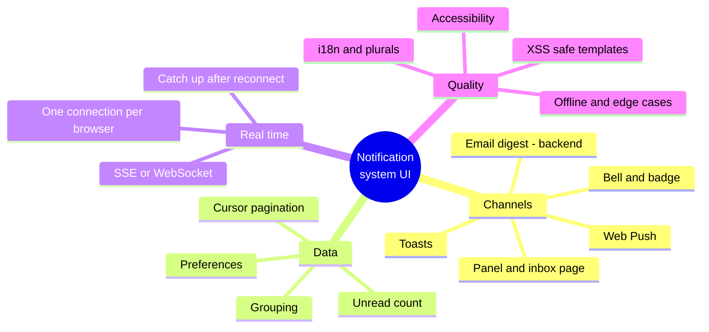
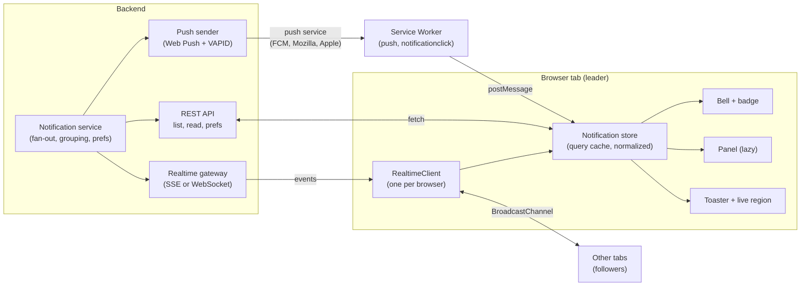
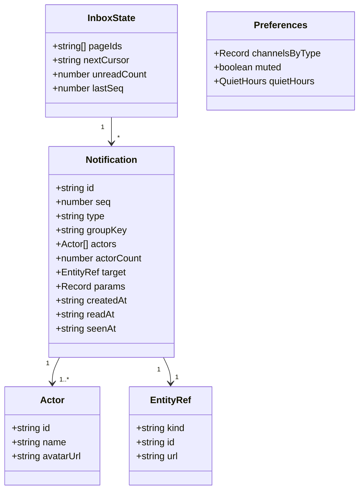
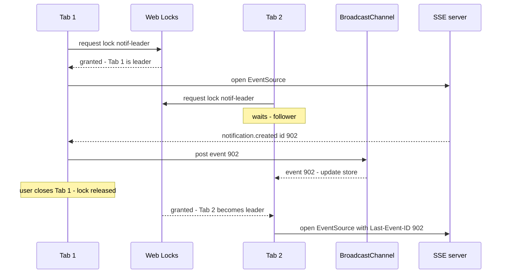
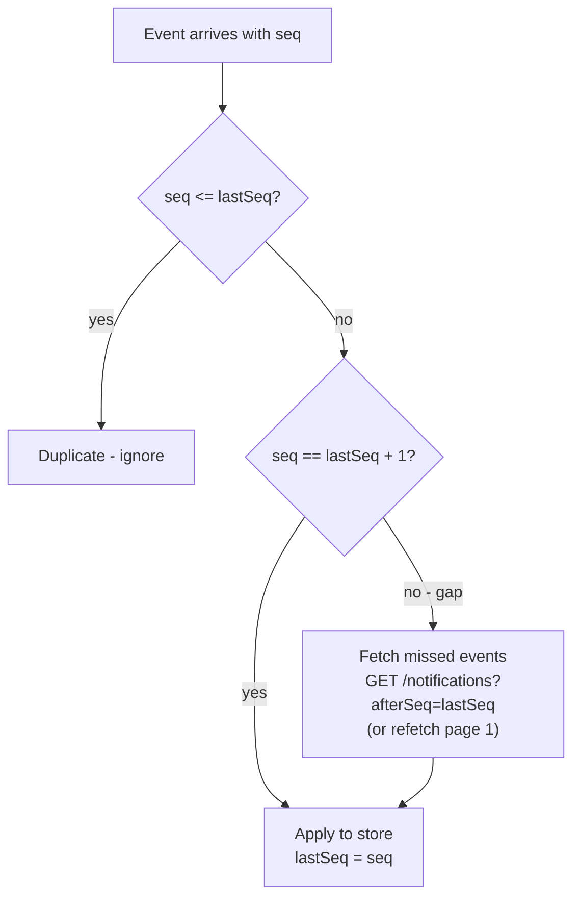
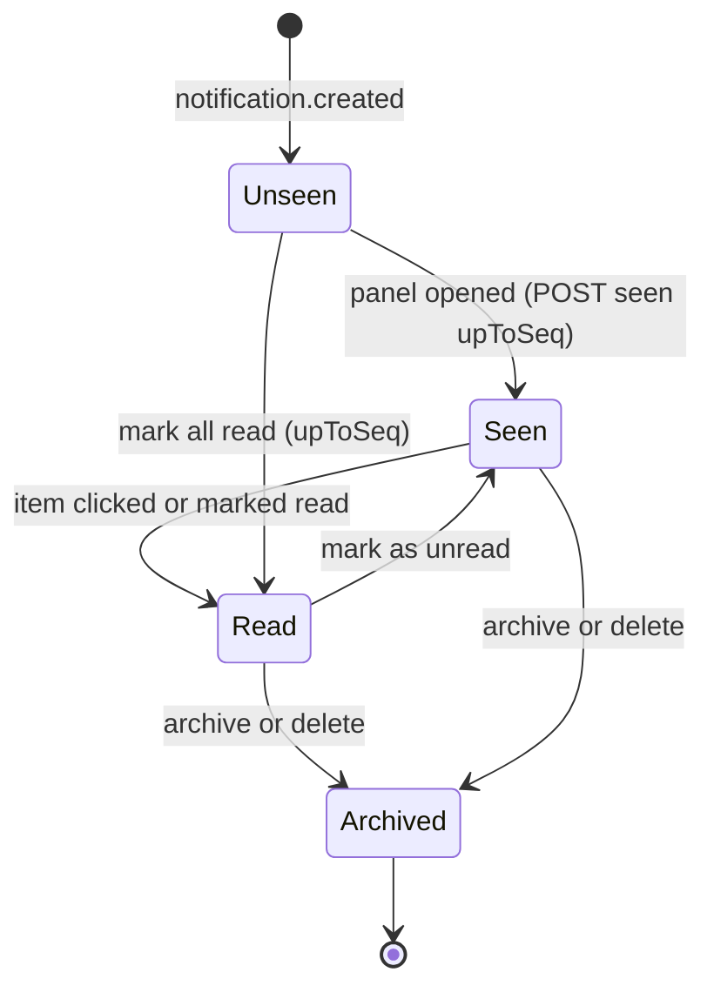
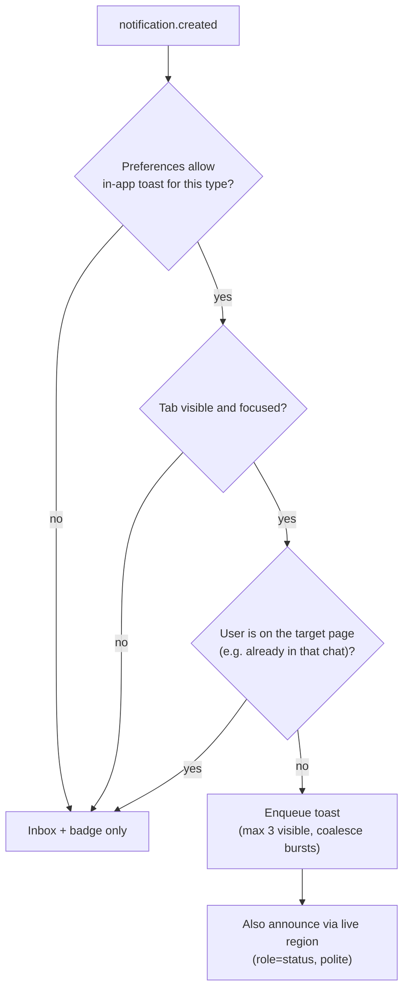
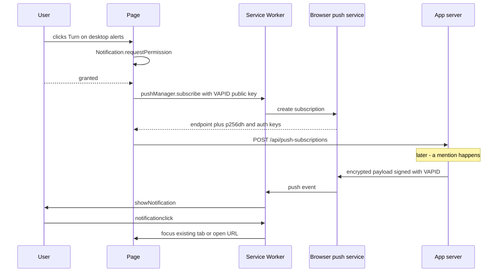
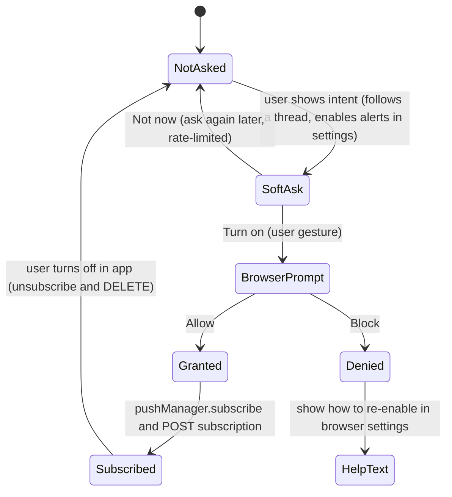
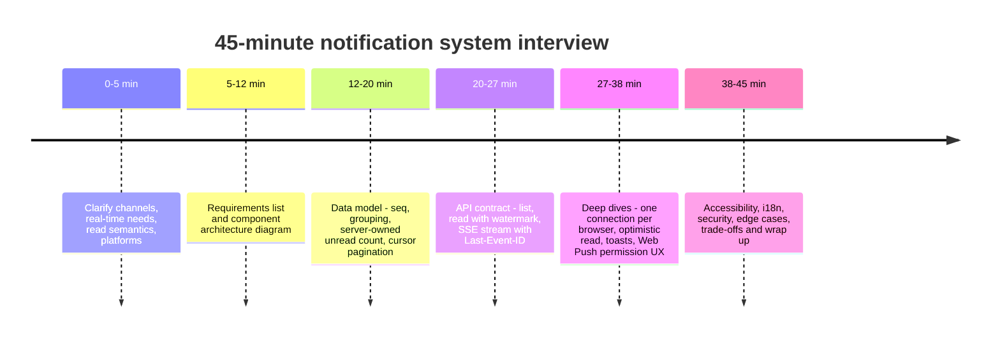

# Design a Notification System UI

> **Date:** 2026-11-06 · **Last updated:** 2026-11-06
> **Category:** Frontend System Design
> **Sub-Topic:** System Design Cases / Notifications (in-app inbox, toasts, Web Push)
> **Level:** Advanced · **Reading time:** ~35 min
> **Informs:** real-time transport for notifications (SSE vs WebSocket vs polling), one connection per browser (cross-tab leader election), unread-count ownership and "seen vs read" semantics, cursor pagination of the inbox, optimistic mark-as-read, toast queueing and timing, Web Push and permission-prompt UX, live-region accessibility, notification grouping and i18n plurals, XSS-safe notification templates

> **Pre-requisite:** [WebSockets, SSE & Long Polling](../01-web-fundamentals/websockets-sse-long-polling.md) (transports, reconnection, ordering) and [Optimistic UI Updates](../03-state-and-data/optimistic-ui-updates.md).
> This case applies **RADIO** (Requirements → Architecture → Data model → Interface → Optimizations) to the bell icon, inbox panel, toasts and push notifications that almost every product ships.

**Previous:** [Design a Multi-Step Form / Wizard](./design-a-multi-step-form-wizard.md) · **Next:** [Design a Map-Based Application](./design-a-map-based-application.md)

---

## Table of Contents

1. [ELI5 — Simple Explanation](#eli5--simple-explanation)
2. [Section 1: Requirements (R)](#section-1-requirements-r)
3. [Section 2: Architecture (A)](#section-2-architecture-a)
4. [Section 3: Data Model (D)](#section-3-data-model-d)
5. [Section 4: Interface (I)](#section-4-interface-i)
6. [Section 5: Optimizations — Real-Time Delivery (O)](#section-5-optimizations--real-time-delivery-o)
7. [Section 6: Optimizations — Read State and Cross-Tab Sync](#section-6-optimizations--read-state-and-cross-tab-sync)
8. [Section 7: Optimizations — Toasts](#section-7-optimizations--toasts)
9. [Section 8: Optimizations — Web Push and Permission UX](#section-8-optimizations--web-push-and-permission-ux)
10. [Section 9: Optimizations — Accessibility, i18n, Security, Performance](#section-9-optimizations--accessibility-i18n-security-performance)
11. [Section 10: Edge Cases and Failure Modes](#section-10-edge-cases-and-failure-modes)
12. [Interview Walkthrough](#interview-walkthrough)
13. [Real-World Examples](#real-world-examples)
14. [Key Points Summary](#key-points-summary)
15. [Test Your Understanding (with answers)](#test-your-understanding)
16. [Cheat Sheet](#cheat-sheet)
17. [References & Further Reading](#references--further-reading)

---

## ELI5 — Simple Explanation

Think of the **front desk of a big apartment building**:
- **The mailbox with a red flag** = the **bell icon with an unread badge**. You glance at it and know whether something is waiting, without opening it.
- **The mailbox itself** = the **notification panel / inbox**. Letters are newest first, you can open each one, and you can mark them all as read.
- **The doorman who taps you on the shoulder in the lobby** = a **toast**. It's for something happening *right now* while you're around, and it goes away by itself.
- **The phone call when you're not home** = a **push notification**. It reaches you even when you're not in the building (the tab is closed), but you must have given the building your number first (permission), and if they call too often, you'll block them.
- **One doorman for the whole building** = **one live connection per browser**, not one per open tab.

> **A notification system UI is three channels (inbox, toast, push) fed by one event stream, with a server-owned unread count, careful permission UX, and accessible, polite announcements.**

---

## Core Concept — Step by Step

### Section 1: Requirements (R)

Start by asking questions. "Notification system" can mean a toast library or a product like GitHub, LinkedIn or Slack notifications.

**Questions to ask the interviewer:**

| Question | Why it changes the design |
|---|---|
| Which **channels**? In-app inbox, toasts, browser push, email/SMS digests? | Push needs a Service Worker, VAPID keys and a permission strategy; email is backend-only |
| How **real-time**? Seconds, or is a refresh on navigation OK? | Picks the transport: polling, SSE or WebSocket |
| Is there already a **WebSocket** in the app (chat, presence)? | Reuse it rather than open a second connection |
| How many **notifications per user**, and how old do we keep them? | Pagination, virtualization, retention |
| **Grouping**? ("Ana and 4 others liked your post") | Server-side aggregation and a different data model |
| **Read semantics**: does opening the panel clear the badge? | "Seen" vs "read" are two different states |
| Multi-device and **multi-tab** consistency? | Read state must be server-owned and broadcast |
| **Actions** inside notifications (Accept invite, Undo)? | Interactive toasts need focus handling; actions need idempotent APIs |
| **User preferences** (mute, per-type channels, quiet hours)? | A settings screen and a preferences API |
| Platforms: desktop web only, mobile web, installed PWA, native apps? | iOS web push works only for Home Screen web apps |

**Functional requirements (typical scope):**
- A **bell** in the header with an **unread count badge** (capped, e.g. `99+`).
- A **panel** (popover) listing recent notifications, newest first, with infinite scroll, "All / Unread" filter, and **mark one / mark all as read**.
- A full **`/notifications` page** for history and **settings** for preferences.
- **Real-time arrival**: new items appear without a refresh; important ones also show a **toast**.
- **Web Push** when the tab is closed (opt-in).
- Clicking a notification **navigates** to the target (post, PR, invoice) and marks it read.

**Non-functional requirements:**
- **Latency:** new notification visible within a few seconds.
- **Consistency:** the badge agrees across tabs and devices; "mark all read" never hides items that arrived a moment later.
- **Resilience:** survives reconnects, sleep/wake and offline periods without duplicates or gaps.
- **Performance:** the bell costs almost nothing on page load; the panel is lazy-loaded.
- **Accessibility:** new items are announced politely; the panel is keyboard-operable; toasts respect WCAG timing rules.
- **Privacy & security:** no other user's data, no HTML injection, careful push payloads.



---

### Section 2: Architecture (A)



**Responsibilities:**

| Part | Responsibility |
|---|---|
| **RealtimeClient** | Opens **one** connection per browser (leader tab), reconnects with backoff, resumes from the last event ID, relays events to other tabs |
| **Notification store** | Single source of truth in the client: list pages (cursor-based), entity map by ID, unread count, optimistic read state |
| **Bell** | Renders only the count; subscribes to a tiny slice of the store |
| **Panel** | Code-split; loads the first page on open (or on hover/focus intent) |
| **Toaster** | Queue of transient messages + an ARIA live region; decides which events deserve a toast |
| **Service Worker** | Receives push while the site is closed, shows system notifications, focuses or opens the right tab on click |

**Rendering strategy:**
- Notifications are **personalized and not indexable**, so SEO doesn't matter. The pages that *contain* the bell may be SSR/SSG for other reasons.
- **Bell:** render it in the app shell. Either SSR the initial unread count (in the personalized HTML, `Cache-Control: private`) or reserve its space and fill it after hydration, so the badge doesn't cause layout shift.
- **Panel:** client-rendered on demand (dynamic `import()` on first open) — it's interaction-only UI.
- **`/notifications` page:** client-rendered or SSR with `private, no-cache`; history is paginated, so the page streams in pages anyway.

---

### Section 3: Data Model (D)



**Design decisions:**

| Decision | Choice | Why |
|---|---|---|
| **Content format** | `type` + structured `params`, rendered by a client template | Lets the client localize and style; avoids shipping server HTML (XSS) |
| **Ordering key** | Server-assigned, monotonically increasing `seq` per user (plus `createdAt` for display) | Clocks differ between servers and clients; `seq` gives gap detection and dedup |
| **Grouping** | Server aggregates by `groupKey` (e.g. `like:post:42`) and updates the same notification | The client just re-renders one item; counts stay consistent across devices |
| **Read vs seen** | `seenAt` (panel opened, badge cleared) and `readAt` (item clicked / marked) | Matches how many large products behave and lets the badge clear without marking everything read |
| **Unread count** | **Server-owned** number sent with every list page and every realtime event | Counting loaded pages on the client is wrong when only page 1 is loaded |
| **Pagination** | Cursor (`before=<seq>` / opaque cursor), not offset | New items at the top would shift offsets and duplicate rows |
| **Client cache** | Normalized `byId` map + list of IDs per filter (All, Unread) | One update (read) changes every list that shows the item |

**Normalized client state:**

```text
notifications.byId   { "n_901": {...readAt: null}, "n_900": {...}, ... }
lists.all            { ids: ["n_901","n_900",...], nextCursor: "c_8a1" }
lists.unread         { ids: ["n_901",...],         nextCursor: "c_77f" }
unreadCount          7          ← from the server, adjusted optimistically
lastSeq              901        ← highest event seq applied; used to resume
```

See [Data Normalization & Caching](../03-state-and-data/data-normalization-and-caching.md) for the general pattern, and [Pagination & Infinite Scroll](../03-state-and-data/pagination-and-infinite-scroll.md) for cursor pagination.

---

### Section 4: Interface (I)

**Server API contract (REST + one event stream):**

```http
GET  /api/notifications?filter=all|unread&cursor=<opaque>&limit=20
→ 200 { "items": [Notification], "nextCursor": "c_8a1" | null, "unreadCount": 7, "lastSeq": 901 }

GET  /api/notifications/stream            (SSE; resumes with Last-Event-ID)
→ event: notification.created | notification.updated | notification.read | inbox.count

POST /api/notifications/read              { "ids": ["n_901","n_899"] }        → 200 { "unreadCount": 5 }
POST /api/notifications/read-all          { "upToSeq": 901 }                  → 200 { "unreadCount": 0 }
POST /api/notifications/seen              { "upToSeq": 901 }                  → 204
GET  /api/notifications/preferences       → 200 Preferences
PUT  /api/notifications/preferences       Preferences                        → 200 Preferences
POST /api/push-subscriptions              { endpoint, keys: { p256dh, auth } } → 201
DELETE /api/push-subscriptions/:id                                            → 204
```

Key contract details:
- **`read-all` takes a watermark (`upToSeq`)**, not "everything". Items that arrive while the request is in flight stay unread.
- **Read endpoints are idempotent** — retries after a timeout are safe.
- **Every response carries `unreadCount`**, so the badge is corrected after each write.
- **Events carry `id: <seq>`** so the stream can resume after a disconnect.

**SSE event example:**

```text
id: 902
event: notification.created
data: {"notification":{"id":"n_902","seq":902,"type":"pr.review_requested","actors":[{"id":"u_7","name":"Ana"}],"actorCount":1,"target":{"kind":"pr","id":"381","url":"/repo/pulls/381"},"params":{"repo":"web"},"createdAt":"2026-11-06T09:12:00Z","readAt":null},"unreadCount":8}

id: 903
event: notification.updated
data: {"notification":{"id":"n_880","seq":903,"type":"post.liked","actorCount":5,"...":"..."},"unreadCount":8}
```

**Component APIs (React/TypeScript):**

```tsx
// Bell: tiny, always mounted, reads only the count
<NotificationBell max={99} onOpenChange={setOpen} />

// Panel: lazy, controlled by the bell
<NotificationPanel
  open={open}
  onOpenChange={setOpen}
  filter="all"                     // 'all' | 'unread'
  renderItem={(n) => <NotificationItem notification={n} />}  // optional override
/>

// Toasts: one provider at the root, imperative API for features
<Toaster position="bottom-end" max={3} />
toast({ title: t('saved'), action: { label: t('undo'), onClick: undo }, duration: 6000 });

// Data hooks
const { unreadCount } = useUnreadCount();
const { items, fetchNextPage, hasNextPage } = useNotifications({ filter: 'unread' });
const { markRead, markAllRead } = useNotificationActions();
```

| API rule | Why |
|---|---|
| Bell and panel are **separate components** | The bell renders on every page; the panel's code and data load only when needed |
| Panel is **controlled** (`open`, `onOpenChange`) | The bell, a keyboard shortcut and a deep link can all open it |
| `renderItem` / per-type registry | New notification types plug in without editing the panel |
| `toast()` is **imperative** and global | Any feature can raise a toast without prop drilling |

---

### Section 5: Optimizations — Real-Time Delivery (O)

**Choosing the transport** (details in [WebSockets, SSE & Long Polling](../01-web-fundamentals/websockets-sse-long-polling.md)):

| Option | Fit for notifications |
|---|---|
| **Polling** (`GET /unread-count` every 30–60 s) | Simple, cache-friendly; acceptable for low-urgency products. Pause it in hidden tabs |
| **SSE** ✅ default | Notifications are **server → client only**; built-in reconnect and `Last-Event-ID` resume; plain HTTP |
| **WebSocket** | Use it if the app already has one (chat, presence) — multiplex a `notifications` channel instead of a second connection |
| **Web Push** | Not a replacement — it's for when **no tab is open** |

**The tab problem.** Each open tab opening its own stream wastes server connections. Over **HTTP/1.1**, browsers also cap connections per origin (about 6), so a few tabs with SSE can block other requests — MDN calls this out for `EventSource`. HTTP/2+ multiplexes streams and removes most of that pain, but the server cost per tab remains.

**One connection per browser — leader election:**



- **Web Locks API** (`navigator.locks`) gives you leader election for free: the tab holding the lock opens the connection; when that tab closes or crashes, the lock is released and the next waiting tab is granted it. Supported in all current major browsers.
- **BroadcastChannel** relays events to the other same-origin tabs.
- A **SharedWorker** is an alternative (one connection shared by all tabs). Check its support on mobile before relying on it; MDN's compat table shows it arriving in Chrome for Android only recently.

**Ordering, gaps and duplicates:**



> `seq` per user must be gap-free for this to work. If the backend can't guarantee that, treat the stream as a **hint** ("something changed") and refetch page 1 + the count — simpler and always correct.

**Reconnection:** `EventSource` reconnects automatically and sends `Last-Event-ID`. For WebSockets you implement exponential backoff with jitter yourself. After wake from sleep (`visibilitychange` → visible, or `online`), **refetch the unread count** — long-lived connections often die silently.

---

### Section 6: Optimizations — Read State and Cross-Tab Sync



**Optimistic mark-as-read** (see [Optimistic UI Updates](../03-state-and-data/optimistic-ui-updates.md)):
1. Snapshot the affected cache entries.
2. Set `readAt` locally, decrement `unreadCount` (never below 0), remove from the Unread list.
3. Send `POST /read`. On success, replace the count with the server's `unreadCount`. On failure, **roll back** and show a quiet error.

**"Mark all as read" race:**

```text
t0  client has seen up to seq 901 → clicks "Mark all as read"
t1  seq 902 arrives on the server (new mention)
t2  server processes read-all
    ❌ "mark everything read"     → 902 is marked read but the user never saw it
    ✅ read-all { upToSeq: 901 }  → 902 stays unread, badge shows 1
```

**Cross-tab and cross-device:**
- The server broadcasts `notification.read` / `inbox.count` events to **all of the user's connections** (every device).
- Within one browser, the leader relays them over `BroadcastChannel`; a tab that marks something read also posts a local message so other tabs update instantly, even before the server echo.
- The **server count always wins** when it arrives — local adjustments are temporary.

---

### Section 7: Optimizations — Toasts

Not every notification deserves a toast. Toasts interrupt; the inbox doesn't.



**Toast rules:**

| Rule | Detail |
|---|---|
| **Queue and cap** | Show at most ~3; collapse bursts ("5 new notifications") |
| **Timing** | Auto-dismiss only non-essential toasts; **pause on hover and focus**; let users dismiss with a close button and `Escape`. WCAG 2.2.1 *Timing Adjustable* applies when content disappears on a timer |
| **Actions** | A toast with an action (Undo, Accept) should stay longer or until dismissed, and the action must also be available elsewhere (e.g. in the inbox), because screen-reader and keyboard users may not reach it in time |
| **Announcements** | Use a **persistent** live region: `role="status"` (polite) for most messages, `role="alert"` (assertive) only for urgent errors. WCAG 4.1.3 *Status Messages* requires that status messages be announced without moving focus |
| **Never steal focus** | Moving focus into a toast interrupts typing |
| **Placement** | Don't cover primary actions or the bottom navigation on mobile; respect safe areas |
| **Motion** | Honor `prefers-reduced-motion` |

> The live region element must **already exist in the DOM** before you insert text into it, or many screen readers won't announce the change. Mount it once at the app root. A newer, region-free API, `element.ariaNotify()`, is rolling out across engines — feature-detect it and keep the live region as the fallback.

---

### Section 8: Optimizations — Web Push and Permission UX

Web Push lets the server reach the user when no tab is open. It combines the **Push API** (delivery to a Service Worker), the **Notifications API** (system UI) and the **Web Push protocol** with **VAPID** server keys. The PWA note covers platform limits in depth: [Progressive Web Apps (PWA)](../10-advanced-topics/progressive-web-apps-pwa.md).



**Platform facts (verify on MDN before relying on them):**
- Chrome requires `userVisibleOnly: true` — every push must show a notification (no silent pushes).
- **Safari** supports Web Push on macOS (Safari 16+) and on **iOS/iPadOS 16.4+ only for web apps added to the Home Screen**. WebKit has also introduced **Declarative Web Push** (payload describes the notification; no Service Worker code needed to display it) — check WebKit's documentation for current platform coverage.
- On Android Chrome, `new Notification()` throws; use `registration.showNotification()` from a Service Worker registration everywhere for consistency.
- Options such as `actions`, `tag`, `renotify` and `requireInteraction` have **uneven support** — treat them as enhancements.
- Firefox and Safari only show the permission prompt in response to a **user gesture**; Chrome may show a quieter permission UI for sites whose prompts are often denied.

**Permission UX — the double opt-in:**



- **Never** call `requestPermission()` on page load. Ask in context, after an in-app "soft ask" explains the value.
- Once **denied**, the site can't prompt again; only browser settings can change it. That's why the soft ask matters.
- Keep the **in-app preference** separate from the browser permission: a user can mute push in your settings without revoking permission.
- Handle **expired subscriptions**: the push service returns `404`/`410` to your server → delete the subscription. Re-check `pushManager.getSubscription()` on app start and re-POST if it changed.
- **Payload privacy:** payloads are encrypted end to end to the browser, but they appear on the lock screen. Send minimal text (or just an ID and fetch details in the SW) for sensitive products.
- **Dedupe with the in-app channel:** if a tab is visible, the SW can skip the system notification for non-critical types (or use a `tag` where supported) and let the page show a toast instead. With `userVisibleOnly`, a push should still show *something*, so do this through the server's routing (don't push when the user is active) rather than by suppressing in the SW.

**Badging API** (`navigator.setAppBadge(n)`): shows a count on the **installed app icon**. Supported in Chromium desktop for installed web apps and in Safari for web apps added to the Dock (macOS) or Home Screen (iOS 16.4+); not in Firefox. For normal tabs, update `document.title` (`(3) Inbox — App`) and optionally the favicon.

---

### Section 9: Optimizations — Accessibility, i18n, Security, Performance

**Accessibility** (see [ARIA Roles, States & Properties](../06-accessibility-and-i18n/aria-roles-states-and-properties.md) and [Keyboard Navigation & Focus Management](../06-accessibility-and-i18n/keyboard-navigation-and-focus-management.md)):

| Element | Pattern |
|---|---|
| Bell | A real `<button>` with an accessible name that includes the count: `aria-label="Notifications, 7 unread"`; `aria-expanded` + `aria-controls` when it opens the panel |
| Badge | Visual only (`aria-hidden="true"`) — the count is already in the button's name |
| Panel | Non-modal popover (the HTML `popover` attribute gives light-dismiss and top-layer for free) or a dialog if it traps focus; `Escape` closes and **returns focus to the bell** |
| List | `<ul>`/`<li>` or `role="feed"` for infinite lists; each item is a link to the target, with unread state in text ("Unread:") not color only |
| New items while open | Announce a summary ("2 new notifications") in a polite live region; don't move focus or reorder under the user's cursor — show a "New notifications" pill instead |
| Toasts | Section 7 rules; WCAG 2.2.1, 2.2.2 and 4.1.3 |

**i18n** (see [Internationalization (i18n) Architecture](../06-accessibility-and-i18n/internationalization-i18n-architecture.md)):
- Render from `type` + `params` with ICU messages: `{actorCount, plural, =1 {{actor} liked your post} other {{actor} and # others liked your post}}` — never concatenate strings.
- Relative times with `Intl.RelativeTimeFormat` ("3 minutes ago"), absolute time in the tooltip/`<time datetime>`; refresh labels every minute while the panel is open.
- Compact counts with `Intl.NumberFormat` and cap with a localized "99+".
- Mirror the panel and toast positions in RTL (`inset-inline-end`).

**Security & privacy:**
- Notification text often contains **user-generated content** (comment snippets, names). Render it as **text**, never via `innerHTML`/`dangerouslySetInnerHTML`; if rich text is required, sanitize with a vetted library on the server and again behind a strict CSP. See [XSS Prevention](../07-security/xss-prevention-reflected-stored-dom.md).
- **Validate target URLs** — only same-origin paths or an allow-list; a notification is a perfect phishing vector.
- Authenticate the stream with **cookies** (`EventSource` can't set an `Authorization` header) or a short-lived token in the URL that the server exchanges immediately; never put long-lived tokens in URLs (they end up in logs).
- On logout: close the connection, clear the notification cache, **unsubscribe push** and delete the subscription on the server, so the next person on a shared computer doesn't get your alerts.

**Performance:**
- The bell is a few hundred bytes; the panel, its virtualized list and date/ICU helpers are **code-split** and prefetched on hover/focus of the bell.
- Batch bursts of events (e.g. apply once per animation frame) so 50 events don't cause 50 renders.
- Virtualize long inbox pages ([Virtual Scrolling & Windowing](../04-performance-engineering/virtual-scrolling-and-windowing.md)).
- Pause polling / close the stream in hidden **follower** tabs; the leader keeps one stream. Reconnect on `pageshow` after a bfcache restore.
- Images: small avatar thumbnails with explicit `width`/`height`, `loading="lazy"` below the fold.

---

### Section 10: Edge Cases and Failure Modes

| Case | Handling |
|---|---|
| Notification for a **deleted target** (post removed) | Server marks it `target.deleted`; client renders "This content is no longer available" and doesn't navigate |
| **Burst** (a viral post, 500 likes in a minute) | Server grouping; client coalesces toasts and batches renders |
| **Clock skew** | Use server timestamps for ordering (`seq`), client clock only for relative labels; clamp "in the future" to "just now" |
| **Offline** | Show cached inbox (read-only) with an offline banner; queue read actions and replay them, or disable them |
| **Stream down for long** | Fall back to polling the unread count; show nothing scary to the user |
| **Count goes negative** | Clamp at 0 locally; trust the next server count |
| **User opens the target page directly** | Server marks related notifications read (or the page calls `/read` for its entity) |
| **Permission revoked** in browser settings | Detect via `Notification.permission` / Permissions API on load; update the settings UI |
| **Multiple accounts** in different tabs | Scope BroadcastChannel names and locks by user ID |

---

## Interview Walkthrough

How to spend 45 minutes:



**What to say, in order:**
1. **Scope:** "I'll design the in-app bell, panel and toasts, plus opt-in Web Push. Email digests are backend." Confirm read semantics and scale.
2. **Draw the architecture:** event stream → store → bell/panel/toaster; Service Worker for push.
3. **Data model:** `type + params` (localizable, XSS-safe), `seq` for ordering/dedup, server-owned `unreadCount`, `seen` vs `read`.
4. **API:** cursor pagination, idempotent read endpoints, **`read-all` with `upToSeq`**.
5. **Deep dive** on whatever the interviewer cares about — usually real-time delivery across tabs, or push permission UX.
6. **Close** with accessibility (live regions, focus return), performance (lazy panel), and failure modes.

**Trade-offs to discuss:**

| Decision | Option A | Option B | Lean |
|---|---|---|---|
| Transport | SSE (simple, one-way, auto-resume) | WebSocket (bi-directional, reuse chat socket) | SSE unless a socket already exists |
| Real-time vs polling | Live stream | 30–60 s polling | Polling is fine for low-urgency B2B tools; stream for social/chat |
| Unread count | Server-owned | Derived on client | Server-owned (client never has all items) |
| Grouping | Server aggregation | Client grouping of loaded items | Server (consistent across devices, pagination-safe) |
| Content | Structured `type + params` | Server-rendered HTML | Structured (i18n, XSS, theming) |
| Tabs | Leader election (Web Locks + BroadcastChannel) | SharedWorker | Locks: broad support, simple fallback |
| Push prompt | Soft ask in context | Prompt on load | Soft ask — a denial is permanent |

---

## Real-World Examples

**Example 1 — Types shared by client and server:**
```typescript
export type NotificationType =
  | 'pr.review_requested'
  | 'comment.mention'
  | 'post.liked'
  | 'invoice.overdue';

export interface Actor { id: string; name: string; avatarUrl?: string }

export interface AppNotification {
  id: string;
  seq: number;                       // per-user, monotonically increasing
  type: NotificationType;
  groupKey?: string;
  actors: Actor[];                   // first few actors only
  actorCount: number;                // total, for "and N others"
  target: { kind: string; id: string; url: string; deleted?: boolean };
  params: Record<string, string | number>;
  createdAt: string;                 // ISO 8601, server time
  seenAt: string | null;
  readAt: string | null;
}

export interface NotificationPage {
  items: AppNotification[];
  nextCursor: string | null;
  unreadCount: number;
  lastSeq: number;
}

export type StreamEvent =
  | { type: 'notification.created' | 'notification.updated'; notification: AppNotification; unreadCount: number }
  | { type: 'notification.read'; ids: string[]; unreadCount: number }
  | { type: 'inbox.count'; unreadCount: number };
```

**Example 2 — One stream per browser: Web Locks leader + BroadcastChannel relay:**
```typescript
type Listener = (e: StreamEvent) => void;

export function startNotificationStream(userId: string, onEvent: Listener) {
  const channel = new BroadcastChannel(`notif:${userId}`);   // scope by user
  channel.onmessage = (msg: MessageEvent<StreamEvent>) => onEvent(msg.data);

  const abort = new AbortController();

  // The lock is held for as long as the promise is pending → this tab is the leader.
  navigator.locks.request(`notif-leader:${userId}`, { signal: abort.signal }, () =>
    new Promise<void>((resolve) => {
      const source = new EventSource('/api/notifications/stream', { withCredentials: true });
      const types = ['notification.created', 'notification.updated', 'notification.read', 'inbox.count'];

      for (const type of types) {
        source.addEventListener(type, (ev) => {
          const data = { type, ...JSON.parse((ev as MessageEvent<string>).data) } as StreamEvent;
          onEvent(data);            // update this tab
          channel.postMessage(data); // relay to follower tabs
        });
      }
      // EventSource reconnects by itself and sends Last-Event-ID.
      abort.signal.addEventListener('abort', () => { source.close(); resolve(); });
    })
  ).catch((err) => {
    if (err.name !== 'AbortError') console.error(err);
  });

  return () => { abort.abort(); channel.close(); };   // call on logout / unmount
}
```

**Example 3 — Store integration with TanStack Query and optimistic mark-as-read:**
```tsx
import { useInfiniteQuery, useMutation, useQueryClient, type InfiniteData } from '@tanstack/react-query';

const listKey = (filter: 'all' | 'unread') => ['notifications', 'list', filter] as const;
const countKey = ['notifications', 'count'] as const;

export function useNotifications(filter: 'all' | 'unread') {
  return useInfiniteQuery({
    queryKey: listKey(filter),
    queryFn: async ({ pageParam, signal }) => {
      const qs = new URLSearchParams({ filter, limit: '20', ...(pageParam ? { cursor: pageParam } : {}) });
      const res = await fetch(`/api/notifications?${qs}`, { signal, credentials: 'include' });
      if (!res.ok) throw new Error(`HTTP ${res.status}`);
      return (await res.json()) as NotificationPage;
    },
    initialPageParam: null as string | null,
    getNextPageParam: (last) => last.nextCursor,
    staleTime: 30_000,          // the stream keeps it fresh
  });
}

export function useMarkRead() {
  const qc = useQueryClient();
  return useMutation({
    mutationFn: async (ids: string[]) => {
      const res = await fetch('/api/notifications/read', {
        method: 'POST',
        headers: { 'Content-Type': 'application/json' },
        credentials: 'include',
        body: JSON.stringify({ ids }),
      });
      if (!res.ok) throw new Error(`HTTP ${res.status}`);
      return (await res.json()) as { unreadCount: number };
    },
    onMutate: async (ids) => {
      await qc.cancelQueries({ queryKey: ['notifications'] });
      const snapshot = qc.getQueriesData({ queryKey: ['notifications'] });
      const now = new Date().toISOString();
      qc.setQueriesData<InfiniteData<NotificationPage>>({ queryKey: ['notifications', 'list'] }, (data) =>
        data && {
          ...data,
          pages: data.pages.map((p) => ({
            ...p,
            items: p.items.map((n) => (ids.includes(n.id) && !n.readAt ? { ...n, readAt: now } : n)),
          })),
        });
      qc.setQueryData<number>(countKey, (c = 0) => Math.max(0, c - ids.length));
      return { snapshot };
    },
    onError: (_err, _ids, ctx) => ctx?.snapshot.forEach(([key, data]) => qc.setQueryData(key, data)),
    onSuccess: ({ unreadCount }) => qc.setQueryData(countKey, unreadCount), // server wins
  });
}
```

**Example 4 — Accessible bell and toast region (BAD → GOOD):**
```tsx
// ❌ BAD: div with onClick, count only in a red dot, live region created on demand
<div className="bell" onClick={toggle}><Icon /><span className="dot">{count}</span></div>

// ✅ GOOD
export function NotificationBell({ count, open, onToggle }: { count: number; open: boolean; onToggle(): void }) {
  const shown = count > 99 ? '99+' : String(count);
  return (
    <button
      type="button"
      aria-expanded={open}
      aria-controls="notification-panel"
      aria-label={count ? `Notifications, ${shown} unread` : 'Notifications'}
      onClick={onToggle}
    >
      <BellIcon aria-hidden="true" />
      {count > 0 && <span className="badge" aria-hidden="true">{shown}</span>}
    </button>
  );
}

// Mounted ONCE at the root, before any message is inserted.
export function LiveAnnouncer({ message }: { message: string }) {
  return <div role="status" className="visually-hidden">{message}</div>;
}
```

**Example 5 — Service Worker: show the push, focus or open the tab on click:**
```javascript
// sw.js
self.addEventListener('push', (event) => {
  const data = event.data?.json() ?? {};
  event.waitUntil(
    self.registration.showNotification(data.title ?? 'New notification', {
      body: data.body,               // keep it short; it shows on the lock screen
      icon: '/icons/icon-192.png',
      tag: data.groupKey,            // replaces an earlier one with the same tag (where supported)
      data: { url: data.url, id: data.id },
    })
  );
});

self.addEventListener('notificationclick', (event) => {
  event.notification.close();
  const url = new URL(event.notification.data?.url ?? '/notifications', self.location.origin);
  if (url.origin !== self.location.origin) return;     // never open foreign URLs
  event.waitUntil((async () => {
    const tabs = await self.clients.matchAll({ type: 'window', includeUncontrolled: true });
    const existing = tabs.find((c) => new URL(c.url).origin === url.origin);
    if (existing) {
      await existing.focus();
      existing.postMessage({ type: 'navigate', url: url.pathname + url.search });
    } else {
      await self.clients.openWindow(url.href);
    }
  })());
});
```

**Example 6 — Subscribing after a soft ask:**
```typescript
export async function enablePush(vapidPublicKey: Uint8Array): Promise<'granted' | 'denied' | 'default' | 'unsupported'> {
  if (!('serviceWorker' in navigator) || !('PushManager' in window)) return 'unsupported';
  const permission = await Notification.requestPermission();   // call from a click handler
  if (permission !== 'granted') return permission;

  const reg = await navigator.serviceWorker.ready;
  const sub = (await reg.pushManager.getSubscription())
    ?? (await reg.pushManager.subscribe({ userVisibleOnly: true, applicationServerKey: vapidPublicKey }));

  await fetch('/api/push-subscriptions', {
    method: 'POST',
    headers: { 'Content-Type': 'application/json' },
    credentials: 'include',
    body: JSON.stringify(sub.toJSON()),   // { endpoint, keys: { p256dh, auth } }
  });
  return 'granted';
}
```

**Other stacks:**
- **Vue:** a `useNotifications` composable over TanStack Query for Vue or Pinia; `<Teleport to="body">` for the toaster; the same Web Locks/BroadcastChannel module (it's framework-free).
- **Angular:** an injectable `NotificationService` exposing signals (or RxJS streams) for the count and list; CDK Overlay for the panel; `LiveAnnouncer` from `@angular/cdk/a11y` for announcements.
- **Svelte/SvelteKit:** a store (or runes-based class) fed by the stream; the panel as a lazily imported component.
- **Native mobile:** push goes through **APNs** (iOS) or **FCM** (Android) instead of Web Push. iOS asks via `UNUserNotificationCenter`; Android 13+ requires the `POST_NOTIFICATIONS` runtime permission and uses notification channels for per-type settings. The in-app inbox design (seq, cursor, server-owned count) is identical.

---

## Key Points Summary

| Concept | One-Line Explanation |
|---|---|
| **Three channels** | Inbox (history), toast (now, in-app), push (tab closed) — one event stream feeds them |
| **Server-owned unread count** | The client never has every item, so it can't count; every response carries the count |
| **Seen vs read** | Opening the panel clears the badge (seen); clicking an item marks it read |
| **`type + params`** | Structured content rendered by client templates — localizable and XSS-safe |
| **`seq`** | Per-user monotonic number for ordering, dedup, gap detection and resume |
| **Cursor pagination** | Stable pages while new items arrive at the top |
| **`read-all` with watermark** | Marks only what the user has seen, not items that arrived mid-request |
| **SSE by default** | One-way, auto-reconnect, `Last-Event-ID` resume; reuse an existing WebSocket if there is one |
| **One connection per browser** | Web Locks leader election + BroadcastChannel relay |
| **Optimistic read** | Update locally, roll back on failure, let the server count win |
| **Toast rules** | Cap and coalesce, pause on hover/focus, never steal focus, actions available elsewhere |
| **Persistent live region** | `role="status"` mounted once; `role="alert"` only for urgent errors |
| **Soft ask before prompt** | A browser "Block" is permanent for the site |
| **iOS Web Push** | Only for Home Screen web apps (iOS/iPadOS 16.4+) |
| **Logout hygiene** | Close stream, clear cache, unsubscribe push |

---

## Test Your Understanding

**Q1 (Basic):**
Why should the unread count come from the server instead of being computed from the notifications the client has loaded?

<details>
<summary>Answer</summary>

The client usually holds only the **first page** (say 20 items) while the user may have 300 unread. Counting loaded items gives a wrong number, and it also diverges across tabs and devices. The server knows the true count, so every list response and every realtime event carries `unreadCount`. The client may **adjust it optimistically** (decrement on mark-as-read) for instant feedback, but replaces it with the server value whenever one arrives. This also keeps the bell cheap: it doesn't need the list at all.
</details>

**Q2 (Application):**
A user has four tabs of your app open. How many realtime connections should there be, and how do you make that happen?

<details>
<summary>Answer</summary>

**One per browser** (per user). Use the **Web Locks API** for leader election: every tab calls `navigator.locks.request('notif-leader:<user>', ...)` with a callback that never resolves while the tab lives; only the lock holder opens the `EventSource`/WebSocket. It relays each event over a **BroadcastChannel** to the other tabs. When the leader tab closes or crashes, the browser releases the lock and the next waiting tab becomes leader and reconnects with `Last-Event-ID`, so nothing is missed.

Why it matters: fewer server connections, and over HTTP/1.1 several SSE streams can exhaust the browser's ~6 connections per origin and stall other requests. A SharedWorker is an alternative, but check mobile support first.
</details>

**Q3 (Tricky):**
"Mark all as read" sometimes marks a brand-new mention as read even though the user never saw it. What's the bug and the fix?

<details>
<summary>Answer</summary>

The endpoint means "mark **everything** read **at the time the server processes it**". A notification created between the user's click and the server handling the request gets swept up. Fix: send a **watermark** — `POST /read-all { upToSeq: <highest seq the client has displayed> }` — and have the server mark only `seq <= upToSeq`. The new item stays unread and the badge correctly shows 1. The same idea applies to "seen".
</details>

**Q4 (Tricky):**
Your toasts auto-dismiss after 4 seconds and include an "Undo" button. What accessibility problems does that create, and how do you fix them?

<details>
<summary>Answer</summary>

- Screen-reader and keyboard users may not reach the button before it disappears; moving focus to it would interrupt their work. This conflicts with **WCAG 2.2.1 Timing Adjustable**.
- If the toast is injected into a newly created element, the announcement may not happen at all (**4.1.3 Status Messages**).

Fixes: announce through a **persistent** `role="status"` live region mounted at startup; **pause the timer on hover and focus**; make toasts with actions stay longer or until dismissed; provide the same action elsewhere (inbox item, history, a keyboard shortcut); allow `Escape` to dismiss; and never move focus into the toast automatically.
</details>

**Q5 (Application):**
Product wants push notifications. Marketing asks to show the browser permission prompt on the first page load "to maximize opt-ins." What do you recommend?

<details>
<summary>Answer</summary>

Don't prompt on load. Firefox and Safari require a **user gesture** for the prompt anyway, and Chrome may switch a site with low acceptance rates to a **quieter prompt**. Most importantly, if the user clicks **Block**, the site can never ask again — only browser settings can undo it.

Use a **double opt-in**: an in-app soft ask at a moment of intent ("Get notified when Ana replies?"), and only after "Turn on" call `Notification.requestPermission()` from that click handler. Rate-limit the soft ask after "Not now". Explain that on iOS, push works only after adding the app to the Home Screen. Keep in-app channel preferences so users can mute types without revoking permission.
</details>

**Q6 (System design):**
Design the client data flow for a GitHub-style notification panel that must work with multiple devices, show grouped items, and recover from a laptop waking up after 8 hours of sleep.

<details>
<summary>Answer</summary>

- **Data:** server-grouped notifications (`groupKey`, `actors`, `actorCount`) with per-user `seq`; normalized `byId` + ID lists per filter; server-owned `unreadCount`; `lastSeq`.
- **Fetch:** cursor pagination; first page on panel open (prefetched on hover/focus).
- **Live:** SSE in the leader tab, events relayed by BroadcastChannel; dedupe by `seq`, detect gaps and fetch `afterSeq`; grouped updates arrive as `notification.updated` for the same ID, so the item updates in place.
- **Multi-device:** read/seen are server writes; the server broadcasts `notification.read` and counts to all connections.
- **Wake from sleep:** the old connection is probably dead without an error. On `visibilitychange` → visible and on `online`, check connection health, **refetch the count and page 1** (or `afterSeq=lastSeq`), and let `EventSource` reconnect with `Last-Event-ID`. If the gap is too large (server can't replay), the server sends a "reset" and the client refetches from scratch.
</details>

---

## Cheat Sheet

**Key Definitions:**
- **Inbox / panel:** the persistent, paginated list of notifications.
- **Toast:** a transient, in-app message for something happening now.
- **Web Push:** server → push service → Service Worker → system notification, works with no tab open.
- **VAPID:** server key pair that identifies the application server to the push service (RFC 8292).
- **Seen vs read:** badge cleared vs item opened.
- **Watermark (`upToSeq`):** "apply this action only to items up to this sequence number."
- **Leader election:** one tab owns the connection; others follow via BroadcastChannel.
- **Live region:** an element whose content changes are announced by screen readers (`role="status"`, `role="alert"`).

**Quick Reference:**
```text
Transport         SSE (default) · reuse WebSocket if present · polling for low urgency · Web Push when closed
Tabs              navigator.locks leader + BroadcastChannel relay (scope names by user id)
Resume            id: <seq> on events → Last-Event-ID → server replays; gap → fetch afterSeq
Count             server-owned, in every response and event; optimistic adjust; clamp ≥ 0
Pagination        cursor (before seq), never offset
Read all          POST /read-all { upToSeq }
Content           type + params → ICU message on the client; text only, never innerHTML
Toasts            max ~3, coalesce, pause on hover/focus, Escape, no focus stealing
Live region       one role=status at the root; role=alert only for urgent errors
Push prompt       soft ask → requestPermission() in a click → subscribe(userVisibleOnly) → POST
Push cleanup      410/404 from push service → delete; logout → unsubscribe
Badge             navigator.setAppBadge (installed apps) · document.title "(3) …" in tabs
Lazy              bell in shell; panel code-split and prefetched on hover/focus
```

**Common Mistakes to Avoid:**

| Mistake | Why Wrong | Fix |
|---|---|---|
| Counting unread from loaded items | Only page 1 is loaded; tabs disagree | Server-owned `unreadCount` |
| One SSE/WebSocket per tab | Server load; HTTP/1.1 connection limit stalls requests | Web Locks leader + BroadcastChannel |
| Offset pagination for the inbox | New items shift pages → duplicates and gaps | Cursor / `before=seq` |
| `read-all` without a watermark | Marks items that arrived mid-request | `upToSeq` |
| Server-rendered HTML in notifications | XSS, no localization, hard to theme | `type + params` + client templates |
| Permission prompt on page load | Gesture requirements, quiet UI, permanent block | Soft ask, prompt from a click |
| Auto-dismissing toasts with actions | Fails WCAG 2.2.1; keyboard/SR users miss them | Pause on focus/hover, longer duration, action elsewhere |
| Creating the live region at announce time | Screen readers often miss the first message | Mount one persistent region at startup |
| Moving focus to new notifications | Interrupts typing, disorients | Polite announcement + "New" pill |
| Trusting the connection after sleep | Sockets die silently | Refetch on `visibilitychange`/`online`; heartbeat |
| Not unsubscribing push on logout | Next user on the device gets alerts | `subscription.unsubscribe()` + DELETE on server |
| Opening arbitrary URLs from `notificationclick` | Phishing / open redirect | Same-origin or allow-listed paths only |

---

## References & Further Reading

**Core docs**
- MDN: [Push API](https://developer.mozilla.org/en-US/docs/Web/API/Push_API) · [Notifications API](https://developer.mozilla.org/en-US/docs/Web/API/Notifications_API) · [`ServiceWorkerRegistration.showNotification()`](https://developer.mozilla.org/en-US/docs/Web/API/ServiceWorkerRegistration/showNotification)
- MDN: [Using server-sent events](https://developer.mozilla.org/en-US/docs/Web/API/Server-sent_events/Using_server-sent_events) (includes the HTTP/1.1 connection-limit warning)
- MDN: [Web Locks API](https://developer.mozilla.org/en-US/docs/Web/API/Web_Locks_API) · [Broadcast Channel API](https://developer.mozilla.org/en-US/docs/Web/API/Broadcast_Channel_API)
- MDN: [Badging API](https://developer.mozilla.org/en-US/docs/Web/API/Badging_API) · [Popover API](https://developer.mozilla.org/en-US/docs/Web/API/Popover_API)
- MDN: [ARIA live regions](https://developer.mozilla.org/en-US/docs/Web/Accessibility/ARIA/Guides/Live_regions) · [`Intl.RelativeTimeFormat`](https://developer.mozilla.org/en-US/docs/Web/JavaScript/Reference/Global_Objects/Intl/RelativeTimeFormat)
- web.dev: [Push notifications overview](https://web.dev/articles/push-notifications-overview)
- web.dev: [Permission UX best practices](https://web.dev/articles/push-notifications-permissions-ux)

**Accessibility**
- W3C WAI: [Understanding SC 4.1.3 Status Messages](https://www.w3.org/WAI/WCAG22/Understanding/status-messages.html) · [Understanding SC 2.2.1 Timing Adjustable](https://www.w3.org/WAI/WCAG22/Understanding/timing-adjustable.html)
- W3C WAI-ARIA APG: [Alert pattern](https://www.w3.org/WAI/ARIA/apg/patterns/alert/) · [Feed pattern](https://www.w3.org/WAI/ARIA/apg/patterns/feed/)

**Specs**
- IETF: [RFC 8030 — Generic Event Delivery Using HTTP Push](https://www.rfc-editor.org/rfc/rfc8030) · [RFC 8291 — Message Encryption for Web Push](https://www.rfc-editor.org/rfc/rfc8291) · [RFC 8292 — VAPID](https://www.rfc-editor.org/rfc/rfc8292)
- W3C: [Push API](https://www.w3.org/TR/push-api/) · WHATWG: [Notifications API](https://notifications.spec.whatwg.org/) · [HTML — Server-sent events](https://html.spec.whatwg.org/multipage/server-sent-events.html)

**Platform notes**
- WebKit: [Web Push for Web Apps on iOS and iPadOS](https://webkit.org/blog/13878/web-push-for-web-apps-on-ios-and-ipados/)
- WebKit blog: [webkit.org/blog](https://webkit.org/blog/) (search "Declarative Web Push" for current status)
- Chromium Blog: [Introducing quieter permission UI for notifications](https://blog.chromium.org/2020/01/introducing-quieter-permission-ui-for.html)
- TanStack Query: [Optimistic updates](https://tanstack.com/query/latest/docs/framework/react/guides/optimistic-updates)

---

> **Previous Topic:** [Design a Multi-Step Form / Wizard](./design-a-multi-step-form-wizard.md)
> — Step state machines, per-step validation, draft persistence and resumable flows

> **Next Topic:** [Design a Map-Based Application](./design-a-map-based-application.md)
> — Tiles, WebGL map rendering, viewport-driven data loading, clustering and geolocation

*Saved on: 2026-11-06 | Repo: Frontend System Design Learning Notes*
