# Design a Rich Text Editor

> **Date:** 2026-11-06 · **Last updated:** 2026-11-06
> **Category:** Frontend System Design
> **Sub-Topic:** System Design Cases / Rich text editing and collaboration
> **Level:** Advanced · **Reading time:** ~40 min
> **Informs:** editor architecture (contenteditable + document model vs custom rendering), editor library choice (ProseMirror/Tiptap, Lexical, Slate, Quill, CKEditor), document schema and storage format, `beforeinput`/IME handling, undo/redo, paste sanitization and XSS, real-time collaboration (OT vs CRDT/Yjs), autosave and versioning, toolbar and editor accessibility, large-document performance

> **Pre-requisite:** [XSS Prevention (Reflected, Stored, DOM)](../07-security/xss-prevention-reflected-stored-dom.md) and [Real-Time Data Sync](../03-state-and-data/real-time-data-sync.md).
> Rich text editing is famously hard because the browser, the operating system's input methods and your app all try to edit the same text. This case shows how to keep **your document model** in charge.

**Previous:** [Design a Drag-and-Drop Board (Trello)](./design-a-drag-and-drop-board-trello.md) · **Next:** [Design an E-Commerce Product Page](./design-an-e-commerce-product-page.md)

---

## Table of Contents

1. [ELI5 — Simple Explanation](#eli5--simple-explanation)
2. [Section 1: Requirements (R)](#section-1-requirements-r)
3. [Section 2: Architecture (A) — Choosing the Editing Approach](#section-2-architecture-a--choosing-the-editing-approach)
4. [Section 3: Architecture (A) — The Editing Pipeline](#section-3-architecture-a--the-editing-pipeline)
5. [Section 4: Data Model (D)](#section-4-data-model-d)
6. [Section 5: Interface (I)](#section-5-interface-i)
7. [Section 6: Optimizations (O) — Collaboration and Persistence](#section-6-optimizations-o--collaboration-and-persistence)
8. [Section 7: Optimizations (O) — Performance](#section-7-optimizations-o--performance)
9. [Section 8: Optimizations (O) — Accessibility and i18n](#section-8-optimizations-o--accessibility-and-i18n)
10. [Section 9: Optimizations (O) — Security and Edge Cases](#section-9-optimizations-o--security-and-edge-cases)
11. [Interview Walkthrough](#interview-walkthrough)
12. [Real-World Examples](#real-world-examples)
13. [Key Points Summary](#key-points-summary)
14. [Test Your Understanding](#test-your-understanding)
15. [Cheat Sheet](#cheat-sheet)
16. [References & Further Reading](#references--further-reading)

---

## ELI5 — Simple Explanation

Imagine a **shared notebook** with a strict **librarian**.

- You don't write in the notebook directly. You tell the librarian **what you want**: "make this word bold", "insert 'hello' here", "split this paragraph".
- The librarian keeps the **real copy** (the **document model**) in a neat, structured format, checks the request against the **rules** (the **schema**: "headings can't contain tables"), applies it, writes it in a **logbook** (so you can **undo**), and then **redraws the page** you see.
- When you **paste** something from a messy website, the librarian **throws away anything dangerous or unknown** (scripts, weird styles) and keeps only allowed formatting (**sanitization**).
- When a friend edits the same notebook from another city, both librarians exchange their logbooks and **merge** them so both notebooks end up identical (**OT or CRDT collaboration**).
- If you write in Japanese or Chinese, your keyboard first shows **candidate characters** before you confirm one. The librarian must **wait patiently** and not "correct" half-typed text (**IME composition**).

> **One-line takeaway: a production rich text editor treats the DOM as a *view*. User input is turned into commands/transactions on a schema-validated document model, which is the single source of truth for rendering, undo, collaboration, storage and sanitization.**

---

## Core Concept — Step by Step

Organized with **RADIO**: Requirements → Architecture → Data model → Interface → Optimizations.

### Section 1: Requirements (R)

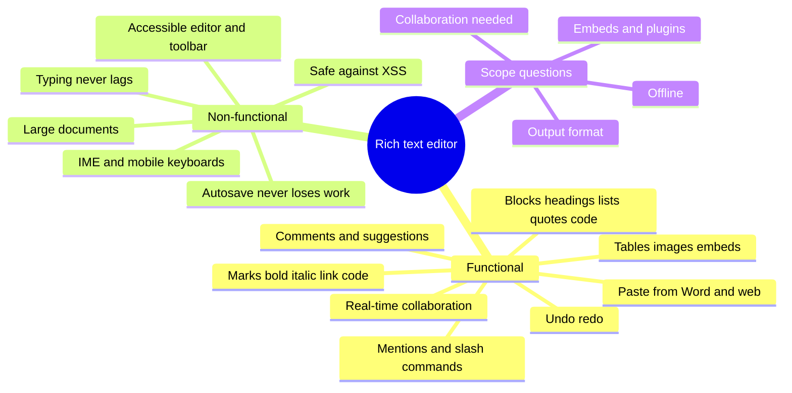

**Functional requirements**

| # | Requirement | Notes |
|---|---|---|
| F1 | Inline **marks**: bold, italic, underline, strike, code, link | Keyboard shortcuts (Mod-B, Mod-I, Mod-K) |
| F2 | **Blocks**: paragraph, headings, bulleted/numbered/task lists, quote, code block, divider | Markdown-style input rules (`# ` → heading) |
| F3 | **Rich nodes**: images (upload, resize, alt text), tables, embeds, mentions (`@`), slash menu (`/`) | Custom node views |
| F4 | **Undo/redo** that matches user intent (word-level grouping) | Per-user in collaboration |
| F5 | **Paste** from Word, Google Docs, web pages, plain text, images | Clean and map to the schema |
| F6 | **Autosave** and version history | Never lose work |
| F7 | **Real-time collaboration**: concurrent editing, remote cursors, presence — *if in scope* | OT or CRDT |
| F8 | Comments/suggestions anchored to text ranges — *if in scope* | Anchors must survive edits |
| F9 | Read-only rendering of saved documents elsewhere (emails, public pages) | Server-side HTML from the stored model |

**Non-functional requirements**

| Quality | Goal |
|---|---|
| **Input latency** | Keystroke → painted character within a frame or two; no long tasks while typing (INP) |
| **Correctness** | Selection never jumps; IME, autocorrect, spellcheck, dictation and emoji work on every platform |
| **Durability** | Edits survive tab crashes, network loss and refresh |
| **Security** | No script execution from pasted or stored content |
| **Accessibility** | Screen readers read and edit text; toolbar fully keyboard-operable; formatting state exposed |
| **Scale** | Long documents (many pages) and several concurrent editors stay smooth |
| **Extensibility** | Product teams add nodes/marks/plugins without forking the core |

**Questions to ask**

```text
1. Comment box (simple) or document editor (Google Docs / Notion)?   → scope differs 10×
2. Real-time collaboration? How many simultaneous editors?
3. Output format: HTML, Markdown, or structured JSON? Who consumes it (email, mobile apps, search)?
4. Paste fidelity expectations (Word, Google Docs)?
5. Offline editing?
6. Custom blocks/embeds and a plugin ecosystem?
7. Mobile web support (Android keyboards are the hardest case)?
```

---

### Section 2: Architecture (A) — Choosing the Editing Approach

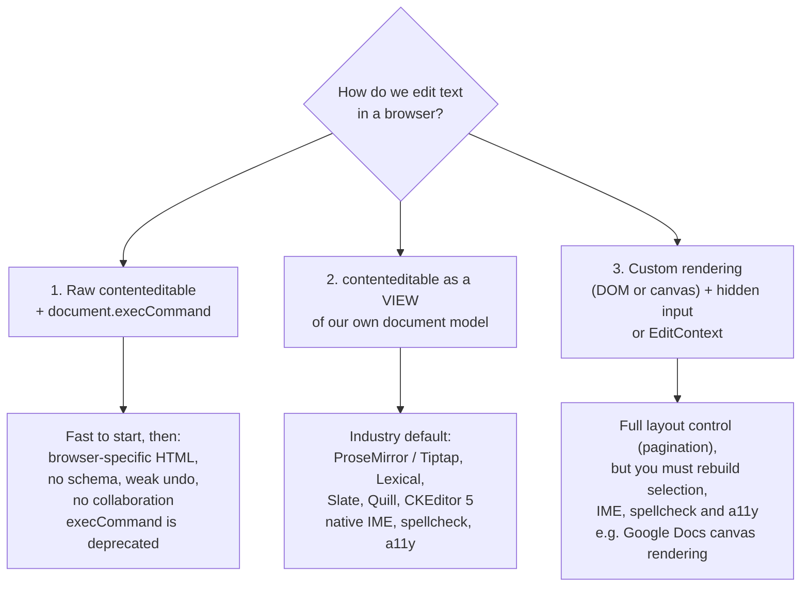

| Approach | Use when | Watch out for |
|---|---|---|
| **`contenteditable` + `execCommand`** | Prototypes, tiny internal tools | `document.execCommand` is **deprecated** (still implemented, per MDN); output HTML differs per browser; no structure; unsafe paste |
| **Model + `contenteditable` view** | Almost every product editor | Must reconcile DOM mutations the browser makes on its own (IME, spellcheck, autocorrect) |
| **Custom rendering** | Word-processor fidelity (pages, columns), very large docs | Huge effort: you re-implement caret, selection, IME, accessibility (Google Docs announced a move to canvas-based rendering in 2021, so its accessibility has to be provided separately from the visible canvas). **EditContext** (Chromium-only per MDN) helps decouple text input from the DOM |

**Library landscape (late 2026)** — verify versions in each project's docs:

| Library | Model | Notes |
|---|---|---|
| **ProseMirror** | Schema-based tree, transactions of invertible *steps* | The foundation of many editors; framework-agnostic; collaboration via its `collab` module or Yjs (`y-prosemirror`) |
| **Tiptap** | ProseMirror underneath, extension API | Official React and Vue bindings; headless (bring your own UI); Yjs-based collaboration |
| **Lexical** (Meta) | Immutable editor state + node classes, command bus | Framework-agnostic core with official React bindings; Yjs collaboration package |
| **Slate** | Plain JSON tree, React-first | Very flexible; you write more of the behaviour yourself |
| **Quill** | Delta format (ops) | Quill 2 is the current major; good for simpler editors |
| **CKEditor 5**, **TinyMCE** | Full-featured commercial/open-core suites | Batteries included (tables, track changes); check licensing |
| **Draft.js** | Immutable.js model, React | **No longer maintained** — Meta points users to Lexical. Migrate rather than start new work on it |

**Page rendering strategy:**
- The **editor** is a client-only island: it needs the DOM, selection and input events. SSR the surrounding page (title, breadcrumbs), and render a **read-only HTML version of the document on the server** so content appears instantly, then **hydrate/upgrade** into the editor (or lazy-load the editor when the user clicks "Edit").
- Public/read-only views (published docs, emails) are rendered **server-side from the stored JSON** with a strict serializer, never from client-produced HTML.

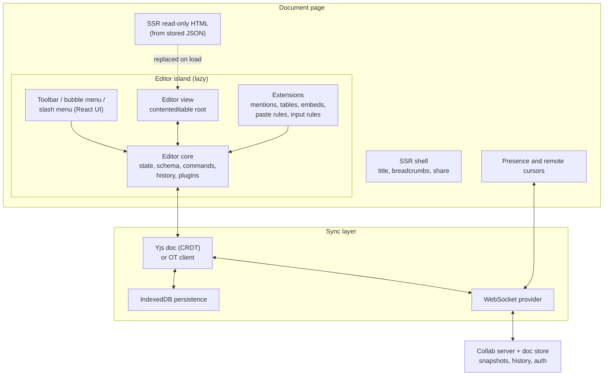

---

### Section 3: Architecture (A) — The Editing Pipeline

Modern editors intercept intent with the **`beforeinput`** event ([Input Events Level 2](https://w3c.github.io/input-events/)), supported in all current major browsers per MDN. Its `inputType` says *what* the user wants (`insertText`, `deleteContentBackward`, `insertParagraph`, `formatBold`, `insertFromPaste`, `historyUndo`…), and `getTargetRanges()` says *where*.

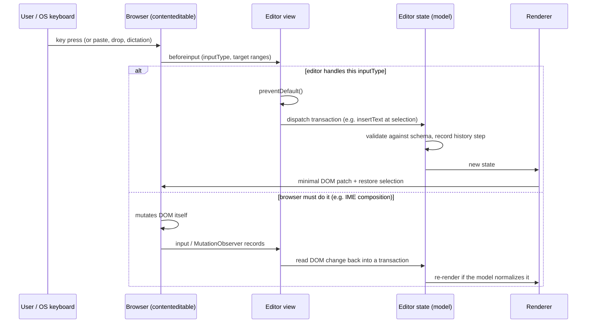

Key mechanics:

| Mechanism | What it does |
|---|---|
| **Transactions** | Every change is a transaction (list of steps) applied to an immutable state. One code path for typing, toolbar, paste, collaboration and undo |
| **Schema** | Allowed nodes, marks and nesting; anything else is dropped or normalized |
| **Selection mapping** | Model positions ↔ DOM `Range`s. After rendering, the editor sets the DOM selection from the model |
| **DOM reconciliation** | When the browser edits the DOM itself (IME, spellcheck replacement, autocorrect), a `MutationObserver` reads the change back into the model |
| **Input rules** | Pattern → transform while typing (`**text**` → bold, `1. ` → ordered list) |
| **Keymaps** | Shortcuts mapped to commands (`Mod-b` → toggle bold; `Mod` = Cmd on macOS, Ctrl elsewhere) |
| **Node views** | Custom renderers for complex nodes (image with resize handles, embeds, mentions) |

**IME composition** is the classic trap. Chinese/Japanese/Korean input, many Android keyboards and dictation build text in a **composition session**:

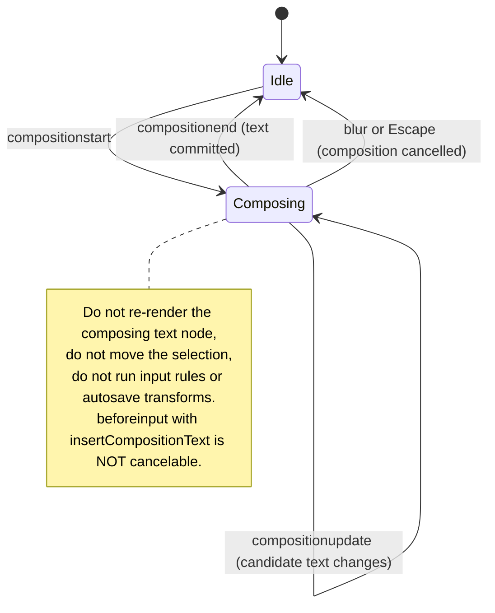

> Check `event.isComposing` (or track `compositionstart`/`compositionend`) before handling `keydown` shortcuts such as Enter. Otherwise pressing Enter to **confirm** a Japanese candidate submits the form or splits the paragraph.

---

### Section 4: Data Model (D)

**Store a structured document, not HTML.** HTML is an output format; JSON with a schema is a data format.

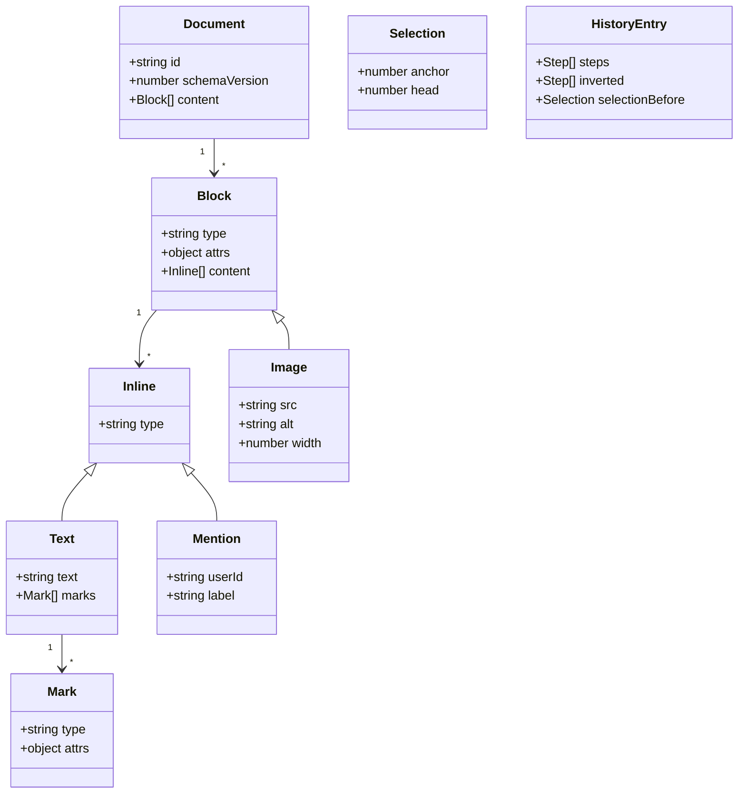

```json
{
  "type": "doc",
  "schemaVersion": 3,
  "content": [
    { "type": "heading", "attrs": { "level": 2 }, "content": [{ "type": "text", "text": "Launch plan" }] },
    {
      "type": "paragraph",
      "content": [
        { "type": "text", "text": "Ship by " },
        { "type": "text", "text": "Friday", "marks": [{ "type": "bold" }] },
        { "type": "text", "text": ", ping " },
        { "type": "mention", "attrs": { "userId": "u42", "label": "Sam" } }
      ]
    },
    { "type": "image", "attrs": { "src": "https://files.example/img/abc.avif", "alt": "Timeline chart", "width": 640 } }
  ]
}
```

| Decision | Choice | Why |
|---|---|---|
| **Storage format** | Schema-versioned JSON (ProseMirror JSON, Lexical state, Slate nodes, Quill Delta) | Validatable, diffable, renderable to HTML/Markdown/native; no executable content |
| **Schema versioning** | `schemaVersion` + migration functions on load | Nodes evolve (e.g. `callout` gains `variant`); old docs must still open |
| **Marks vs nested nodes** | Marks as a set on text runs | `bold+italic` is a set, not `<b><i>` vs `<i><b>`; avoids equivalent-but-different trees |
| **Positions** | Integer positions (ProseMirror) or paths (Slate) | Needed for selection, comments and remote cursors; remapped through every change |
| **Comment anchors** | Stored as **relative positions** (CRDT) or ranges remapped through steps | Absolute offsets break as soon as someone types above |
| **History** | Stack of inverted steps, grouped by time and type | Undo = apply the inverse; collaborative undo only reverts **your** changes |
| **Client caching** | Doc metadata in the server-state cache; doc content in the editor/CRDT + IndexedDB | Content changes per keystroke; it shouldn't go through generic query caches |

---

### Section 5: Interface (I)

**Component API (React):**

```tsx
interface RichTextEditorProps {
  docId: string;
  initialContent?: DocJSON;              // when not collaborative
  extensions?: Extension[];              // nodes, marks, plugins (mentions, tables…)
  readOnly?: boolean;
  placeholder?: string;
  ariaLabel: string;                     // accessible name is required
  onChange?(doc: DocJSON): void;         // debounced; never per keystroke for heavy work
  onSaveStatus?(s: 'saved' | 'saving' | 'offline' | 'error'): void;
  uploadImage?(file: File): Promise<{ src: string; alt?: string }>;
}

// Command API: chainable, testable, shared by toolbar, shortcuts and slash menu
editor.chain().focus().toggleBold().run();
editor.can().toggleHeading({ level: 2 });   // for disabling toolbar buttons
editor.isActive('link');                    // for aria-pressed state
```

Design notes ([Component API Design](../05-design-systems-and-components/component-api-design.md), [Headless UI / Renderless Components](../05-design-systems-and-components/headless-ui-renderless-components.md)):
- Keep the **core headless**; toolbar, bubble menu and slash menu are separate components that call commands.
- **Extensions** register nodes, marks, keymaps, input rules, paste rules and node views. That lets features ship independently.
- `onChange` with the **full document** is expensive on large docs; prefer debounced callbacks, or let the sync layer persist.

**Server API contract:**

| Endpoint / channel | Method | Purpose |
|---|---|---|
| `/api/docs/:id` | GET | Metadata + latest snapshot (JSON) + version/ETag; or the CRDT state for collab |
| `/api/docs/:id` | PUT | Save snapshot with `If-Match: <etag>` (non-collab mode) → `412` on conflict |
| `/api/docs/:id/versions` | GET | Version history (named versions, timestamps, authors) |
| `/api/uploads` | POST | Get a pre-signed upload URL for images/attachments |
| `wss://collab.example/docs/:id` | WebSocket | Yjs sync and awareness (presence, cursors), or OT ops |
| `/api/docs/:id/render?format=html` | GET | Server-rendered sanitized HTML for read-only views and email |

```http
PUT /api/docs/d1
Content-Type: application/json
If-Match: "v57"

{ "schemaVersion": 3, "content": [ ... ] }
```

```http
HTTP/1.1 412 Precondition Failed
ETag: "v58"
```

> A `412` means someone else saved first. In single-user mode, show "This document changed elsewhere" with a diff or reload. In collaborative mode you don't save snapshots from the client at all; the sync protocol merges changes.

---

### Section 6: Optimizations (O) — Collaboration and Persistence

**OT vs CRDT**

| | **Operational Transformation (OT)** | **CRDT** (Yjs, Automerge, Loro) |
|---|---|---|
| Idea | A central server **transforms** concurrent operations against each other | Data structure whose concurrent updates **always merge** to the same result |
| Server role | Required, authoritative ordering | Relay/persistence; peers can merge without a central authority |
| Offline | Harder: long-diverged op logs to transform | Natural: merge whenever reconnected |
| Used by | Google Docs (OT is the classic approach), ShareDB, ProseMirror `collab` (central authority with rebasing) | Many modern editors via Yjs bindings (`y-prosemirror`, Lexical's Yjs plugin, Tiptap Collaboration) |
| Costs | Transformation functions per op type; server bottleneck | Metadata overhead (tombstones), memory; mitigated by GC and snapshotting |

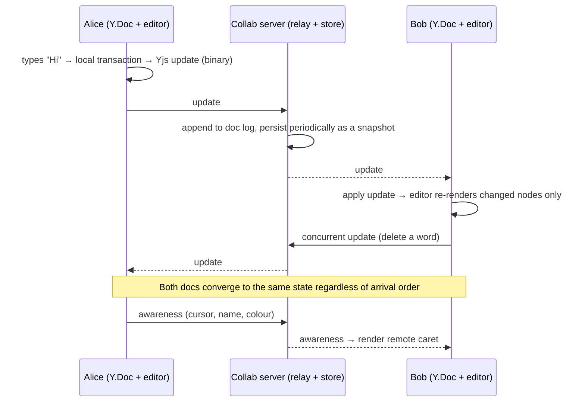

**Persistence strategy**

```text
Single-user editor:  local debounce (~1–2 s idle) → PUT snapshot with If-Match → show "Saved"
                     + IndexedDB draft on every change (crash/offline safety)
                     + flush on visibilitychange=hidden (fetch keepalive)
Collaborative:       every local change → CRDT update → WebSocket (batched by the provider)
                     + y-indexeddb (or equivalent) for offline and instant reload
                     + server compacts updates into snapshots; version history = periodic snapshots
```

- Show **save status** honestly ("Saving…", "Saved", "Offline — changes stored on this device").
- Warn on unload only when there are **unsynced** changes (`beforeunload` with `preventDefault()`), and never otherwise (it can also hurt bfcache).
- **Undo in collaboration** must be **local-origin only** (Yjs `UndoManager` tracks transaction origins), or Alice's Mod-Z would erase Bob's work.

---

### Section 7: Optimizations (O) — Performance

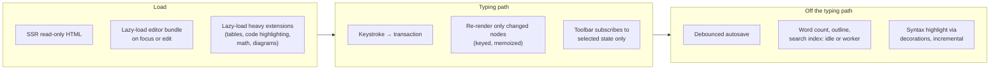

| Technique | Why |
|---|---|
| **Lazy-load the editor** (and heavy extensions) | Editors with tables/code/math are large bundles; viewers don't need them ([Code Splitting & Lazy Loading](../04-performance-engineering/code-splitting-and-lazy-loading.md)) |
| **Minimal DOM updates** | ProseMirror/Lexical diff the model and touch only changed nodes; avoid re-rendering the whole document from React state per keystroke |
| **Toolbar subscribes narrowly** (e.g. Tiptap `useEditorState` with a selector, Lexical command listeners) | Re-rendering the toolbar and page on every transaction costs INP |
| **Debounce serialization** (`getJSON()`, Markdown/HTML export, autosave) | Serializing a long doc per keystroke is a long task ([Debouncing & Throttling](../04-performance-engineering/debouncing-and-throttling.md)) |
| **Move heavy work off the typing path**: word count, outline, search index, spell/grammar services | `requestIdleCallback`/`scheduler.postTask` or a Web Worker ([Web Workers for Heavy Computation](../04-performance-engineering/web-workers-for-heavy-computation.md)) |
| **Decorations instead of document changes** for highlights (search hits, remote selections, spellcheck squiggles) | Don't pollute the document or history; cheap to recompute |
| **CSS Custom Highlight API** for non-DOM highlights | Highlight ranges without wrapping text in spans (supported in current major browsers per MDN) |
| **Very long documents** | Contenteditable can't easily be virtualized (selection, find-in-page and screen readers need the DOM). Options: `content-visibility: auto` on blocks, splitting into pages/sections, or custom rendering |
| **Image uploads** | Optimistic placeholder node with a blob URL, upload in background, then swap `src` ([Image Optimization](../04-performance-engineering/image-optimization.md)) |

---

### Section 8: Optimizations (O) — Accessibility and i18n

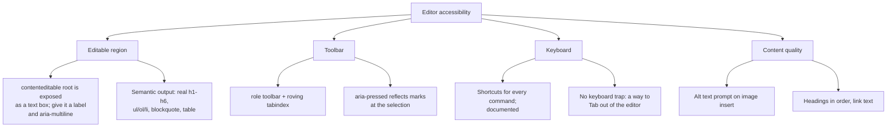

| Concern | Practice |
|---|---|
| **Editable region** | `contenteditable` elements are exposed as editable text. Add `role="textbox"`, `aria-multiline="true"` and an accessible name (`aria-label`/`aria-labelledby`) to be explicit and consistent across browsers |
| **Toolbar** | `role="toolbar"` with `aria-label`, **one tab stop** and arrow-key navigation (roving tabindex); buttons have names and `aria-pressed` for toggles; disabled state when a command can't apply ([Keyboard Navigation & Focus Management](../06-accessibility-and-i18n/keyboard-navigation-and-focus-management.md)) |
| **Toolbar shortcut** | Offer a key (e.g. Alt+F10 in many editors) to jump from the text to the toolbar and Escape to return |
| **Tab key** | Tab inside lists/code may indent; then provide an escape route (e.g. Escape then Tab, or a documented shortcut) — WCAG 2.1.2 No Keyboard Trap |
| **Menus** (slash, mentions) | Combobox/listbox pattern: `aria-activedescendant`, `aria-expanded`, Escape closes ([ARIA Roles, States & Properties](../06-accessibility-and-i18n/aria-roles-states-and-properties.md)) |
| **Announcements** | Polite announcements for non-visual changes ("Bold on", "Link inserted", "Saved") — sparingly |
| **Images** | Prompt for alt text on insert; allow marking decorative |
| **Remote cursors** | Names visible on hover/focus; don't steal focus or announce every remote keystroke |
| **Test** | NVDA/JAWS with Chrome/Firefox, VoiceOver with Safari, TalkBack with Chrome ([Screen Reader Testing](../06-accessibility-and-i18n/screen-reader-testing.md)) |

**Internationalization:**
- **IME** (Section 3) for CJK and many mobile keyboards; test with real IMEs and Android keyboards.
- **Bidirectional text:** set `dir="auto"` per block (or detect per paragraph) so Arabic/Hebrew paragraphs render correctly in an LTR UI; toolbar mirrors in RTL locales ([RTL Layout Support](../06-accessibility-and-i18n/rtl-layout-support.md)).
- **Grapheme clusters:** "delete one character" must delete one **user-perceived** character (👍🏽, family emoji, combining accents). Use `Intl.Segmenter` (all current major browsers per MDN) or let the browser do the deletion.
- **Spellcheck and `lang`:** keep native spellcheck (`spellcheck="true"`), set `lang` on the editor or per block for multilingual documents.
- **Word count** depends on the script: use `Intl.Segmenter` with `granularity: 'word'`, not `split(' ')`.

---

### Section 9: Optimizations (O) — Security and Edge Cases

**Security:** rich text is **stored user-generated HTML waiting to happen**. Defend in layers ([XSS Prevention](../07-security/xss-prevention-reflected-stored-dom.md), [Content Security Policy (CSP)](../07-security/content-security-policy-csp.md)):

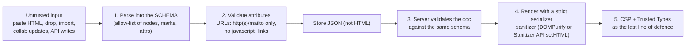

| Threat | Mitigation |
|---|---|
| Malicious paste (``, `<script>`, `style` tricks) | Parse clipboard HTML **into the schema**: unknown tags/attributes simply don't exist in the model. Never insert clipboard HTML with `innerHTML` |
| `javascript:` / `data:` links | Validate link `href` on input **and** on render; allow `http:`, `https:`, `mailto:` (and app-specific schemes) |
| Stored XSS via the API | The server validates documents against the schema; renderers escape text |
| Rendering HTML elsewhere | Sanitize: **DOMPurify** is the cross-browser standard; the **Sanitizer API** (`Element.setHTML()`) ships in Chromium and Firefox per MDN but not Safari yet — feature-detect |
| Embeds (YouTube, Figma, tweets) | Allow-list providers; render in **sandboxed iframes**; never let users supply raw iframe HTML |
| DOM XSS sinks in your own code | Enforce **Trusted Types** where supported (now in Chromium, Firefox and Safari per MDN) |
| Collaboration abuse | Authenticate WebSocket; authorize per document and role (viewer can't send updates); validate update size; rate-limit |
| Image uploads | Pre-signed URLs, content-type checks, serve from a separate domain, strip metadata if needed |

**Edge cases checklist**

```text
✓ IME composition           → don't re-render or move selection mid-composition; check isComposing on Enter
✓ Android keyboards         → some beforeinput events aren't cancelable; reconcile via MutationObserver
✓ Autocorrect / spellcheck  → browser replaces text itself; read it back into the model
✓ Paste from Word/Docs      → map styles to marks/blocks; drop unknown; keep plain-text fallback
✓ Paste plain text          → Mod-Shift-V; split into paragraphs on newlines
✓ Drop images/files         → upload with placeholder; reject unsupported types
✓ Empty document            → placeholder via CSS (::before + data attribute), not real text
✓ Atom nodes (mentions)     → selectable as a unit; Backspace deletes the whole node
✓ Selection across nodes    → copy/cut serializes the slice to HTML and plain text
✓ Undo grouping             → group typing by pause; undo restores selection
✓ Collaborative undo        → only undo local-origin changes
✓ Schema migration          → old docs with retired nodes still open (migrate or render a fallback)
✓ Mobile virtual keyboard   → toolbar above the keyboard via VisualViewport API
✓ Very large paste          → chunk processing; warn above size limits
✓ Find in page (Ctrl+F)     → works only if the text is in the DOM (another reason not to virtualize)
✓ Read-only mode            → contenteditable=false, but still selectable and copyable
```

---

## Interview Walkthrough

```mermaid
gantt
    title 45-minute plan for the rich text editor
    dateFormat mm
    axisFormat %M
    section Clarify
    Scope, collab, output format :r, 00, 5m
    section Design
    Approach and architecture :a, after r, 8m
    Editing pipeline and IME :p, after a, 7m
    Document model and storage :d, after p, 7m
    Interface and API :i, after d, 5m
    section Deepen
    Collaboration and persistence :c, after i, 6m
    Security, a11y, perf, trade-offs :o, after c, 7m
```

| Minute | Cover | Say this |
|---|---|---|
| 0–5 | Comment box or full document editor? Collab? Output consumers? Mobile? | "I'll design a Notion/Docs-style editor with real-time collaboration." |
| 5–13 | The three approaches; why **model + contenteditable view**; library vs build | "The DOM is a view; the model is the source of truth." |
| 13–20 | `beforeinput` → transaction → render → selection; MutationObserver reconciliation; **IME** | "We never fight the IME mid-composition." |
| 20–27 | Schema JSON, marks vs nodes, schema versioning, positions, history | "We store JSON, not HTML." |
| 27–32 | Headless core + command API, extensions; REST + WebSocket contract | "Toolbar, shortcuts and slash menu share commands." |
| 32–38 | OT vs CRDT, Yjs flow, awareness, local-origin undo, autosave/offline | "CRDT because we want offline and simpler servers." |
| 38–45 | Paste sanitization pipeline, toolbar a11y, lazy-loading, long docs; trade-offs | |

**Trade-offs to discuss:**

| Decision | Option A | Option B | Lean |
|---|---|---|---|
| Build vs buy | Build on ProseMirror/Lexical | Fully custom engine | Build on a proven core; custom only for word-processor fidelity |
| Rendering | contenteditable view | Canvas/custom + EditContext | contenteditable keeps native IME, spellcheck, a11y, find-in-page |
| Storage | JSON (schema) | HTML | JSON: validatable, portable, safe; render HTML on output |
| Collaboration | OT (central server) | CRDT (Yjs) | CRDT for offline and peer-friendly sync; OT is proven with a strong central server |
| Save model | Debounced snapshots + ETag | Continuous op/update stream | Snapshots for single-user; streaming updates for collab |
| Paste fidelity | Keep many styles | Strict schema | Strict: predictable docs and fewer XSS vectors; map common styles explicitly |
| Large docs | Single contenteditable | Paged sections or virtualized custom renderer | Single doc + `content-visibility` until proven insufficient |

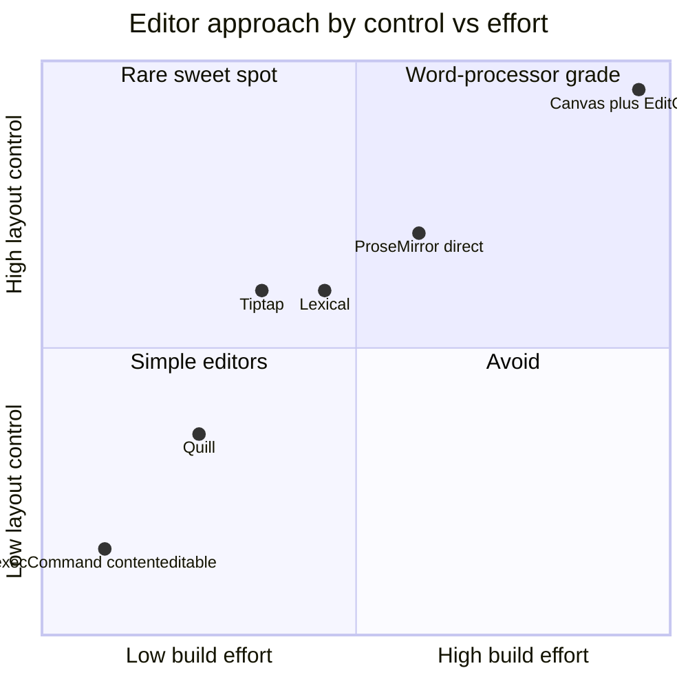

---

## Real-World Examples

**Example 1 — Why not `execCommand` + `innerHTML` (BAD → GOOD):**
```typescript
// ❌ BAD: deprecated API, browser-specific HTML, unsafe paste, no schema, no collaboration
boldButton.onclick = () => document.execCommand('bold');
editor.addEventListener('paste', (e) => {
  e.preventDefault();
  editor.innerHTML += e.clipboardData!.getData('text/html');   // XSS + destroys selection
});
saveButton.onclick = () => api.save(editor.innerHTML);           // stores whatever the browser produced

// ✅ GOOD (minimal idea): intercept intent, update YOUR model, render from the model
editor.addEventListener('beforeinput', (e: InputEvent) => {
  if (composing || e.inputType === 'insertCompositionText') return; // let the IME work
  const range = e.getTargetRanges()[0];
  switch (e.inputType) {
    case 'insertText':            e.preventDefault(); dispatch(insertText(range, e.data ?? '')); break;
    case 'deleteContentBackward': e.preventDefault(); dispatch(deleteBackward(range)); break;   // grapheme-aware
    case 'insertParagraph':       e.preventDefault(); dispatch(splitBlock(range)); break;
    case 'formatBold':            e.preventDefault(); dispatch(toggleMark('bold')); break;
    case 'insertFromPaste':       e.preventDefault(); dispatch(pasteSlice(parseToSchema(e.dataTransfer))); break;
    case 'historyUndo':           e.preventDefault(); dispatch(undo()); break;
    // anything not handled: let the browser act, then reconcile via MutationObserver
  }
});
let composing = false;
editor.addEventListener('compositionstart', () => { composing = true; });
editor.addEventListener('compositionend', () => { composing = false; reconcileFromDom(); });
```

> This is what editor frameworks do for you, with years of browser quirks handled. Writing it yourself is a deliberate, expensive choice.

**Example 2 — Tiptap in React with an accessible toolbar:**
```tsx
import { useEditor, useEditorState, EditorContent, type Editor } from '@tiptap/react';
import StarterKit from '@tiptap/starter-kit';

export function DocEditor({ initial, onSave }: { initial: object; onSave: (json: object) => void }) {
  const editor = useEditor({
    extensions: [StarterKit],
    content: initial,
    immediatelyRender: false,                      // recommended with SSR frameworks (avoids hydration mismatch)
    editorProps: {
      attributes: { role: 'textbox', 'aria-multiline': 'true', 'aria-label': 'Document body', class: 'prose' },
    },
    onUpdate: ({ editor }) => debouncedSave(() => onSave(editor.getJSON())),
  });
  if (!editor) return <div className="prose" aria-busy="true" />;
  return (
    <>
      <Toolbar editor={editor} />
      <EditorContent editor={editor} />
    </>
  );
}

function Toolbar({ editor }: { editor: Editor }) {
  // Re-render only when these derived values change, not on every transaction
  const state = useEditorState({
    editor,
    selector: ({ editor }) => ({
      bold: editor.isActive('bold'),
      italic: editor.isActive('italic'),
      h2: editor.isActive('heading', { level: 2 }),
    }),
  });
  const btn = (label: string, pressed: boolean, run: () => void) => (
    <button type="button" aria-pressed={pressed} onMouseDown={(e) => e.preventDefault() /* keep selection */} onClick={run}>
      {label}
    </button>
  );
  return (
    <div role="toolbar" aria-label="Formatting">
      {btn('Bold', state.bold, () => editor.chain().focus().toggleBold().run())}
      {btn('Italic', state.italic, () => editor.chain().focus().toggleItalic().run())}
      {btn('Heading 2', state.h2, () => editor.chain().focus().toggleHeading({ level: 2 }).run())}
    </div>
  );
}
// Add roving tabindex + arrow keys for a single tab stop (see the Keyboard Navigation note).
```

> **Vue:** Tiptap has official Vue 3 bindings (`@tiptap/vue-3`: `useEditor`, `EditorContent`). **Angular:** use ProseMirror/Tiptap core directly or community wrappers (e.g. `ngx-tiptap`), with the editor created in `afterNextRender` so it only runs in the browser. **Svelte:** create the Tiptap/Lexical editor in `onMount` and bind it to an element. **Lexical** has official React bindings and a framework-agnostic core. **Native mobile:** iOS `UITextView` with `NSAttributedString` (TextKit 2); Android `EditText` with spans; many apps host a shared web editor in a WebView to keep one document model.

**Example 3 — Lexical (React) equivalent:**
```tsx
import { LexicalComposer } from '@lexical/react/LexicalComposer';
import { RichTextPlugin } from '@lexical/react/LexicalRichTextPlugin';
import { ContentEditable } from '@lexical/react/LexicalContentEditable';
import { HistoryPlugin } from '@lexical/react/LexicalHistoryPlugin';
import { OnChangePlugin } from '@lexical/react/LexicalOnChangePlugin';
import { LexicalErrorBoundary } from '@lexical/react/LexicalErrorBoundary';
import { useLexicalComposerContext } from '@lexical/react/LexicalComposerContext';
import { FORMAT_TEXT_COMMAND } from 'lexical';
import { HeadingNode, QuoteNode } from '@lexical/rich-text';

function BoldButton() {
  const [editor] = useLexicalComposerContext();
  return <button type="button" onClick={() => editor.dispatchCommand(FORMAT_TEXT_COMMAND, 'bold')}>Bold</button>;
}

export function LexicalEditor({ onChange }: { onChange: (json: unknown) => void }) {
  return (
    <LexicalComposer initialConfig={{ namespace: 'docs', nodes: [HeadingNode, QuoteNode], onError: (e) => { throw e; } }}>
      <div role="toolbar" aria-label="Formatting"><BoldButton /></div>
      <RichTextPlugin
        contentEditable={<ContentEditable aria-label="Document body" className="prose" />}
        ErrorBoundary={LexicalErrorBoundary}
      />
      <HistoryPlugin />
      <OnChangePlugin onChange={(editorState) => onChange(editorState.toJSON())} ignoreSelectionChange />
    </LexicalComposer>
  );
}
```

**Example 4 — Sanitizing HTML for read-only rendering (and paste fallbacks):**
```typescript
import DOMPurify from 'dompurify';

const ALLOWED = {
  ALLOWED_TAGS: ['p', 'h1', 'h2', 'h3', 'strong', 'em', 'u', 's', 'code', 'pre', 'blockquote', 'ul', 'ol', 'li', 'a', 'img', 'br', 'hr'],
  ALLOWED_ATTR: ['href', 'src', 'alt', 'title'],
  ALLOWED_URI_REGEXP: /^(?:https?:|mailto:)/i,   // blocks javascript:, data: …
};

export function renderSafe(target: HTMLElement, html: string) {
  // Sanitizer API: setHTML() always strips script-capable content; available in Chromium and Firefox, not Safari yet (MDN)
  if ('setHTML' in target) {
    (target as HTMLElement & { setHTML(h: string): void }).setHTML(DOMPurify.sanitize(html, ALLOWED));
  } else {
    target.innerHTML = DOMPurify.sanitize(html, ALLOWED);
  }
}
// In the editor itself, prefer parsing pasted HTML into the schema (ProseMirror DOMParser, Lexical $generateNodesFromDOM),
// which acts as an allow-list by construction.
```

**Example 5 — Real-time collaboration with Yjs + Tiptap:**
```typescript
import * as Y from 'yjs';
import { WebsocketProvider } from 'y-websocket';
import { IndexeddbPersistence } from 'y-indexeddb';
import { Editor } from '@tiptap/core';
import StarterKit from '@tiptap/starter-kit';
import Collaboration from '@tiptap/extension-collaboration';

const ydoc = new Y.Doc();
new IndexeddbPersistence(`doc-${docId}`, ydoc);                           // offline + instant reload
const provider = new WebsocketProvider('wss://collab.example', `doc-${docId}`, ydoc, { params: { token } });

const editor = new Editor({
  element: document.querySelector('#editor')!,
  extensions: [
    // Disable StarterKit's own history: Yjs provides collaborative (local-origin) undo.
    // The option is `history: false` in Tiptap 2 and `undoRedo: false` in Tiptap 3 — check your version.
    StarterKit.configure({ undoRedo: false }),
    Collaboration.configure({ document: ydoc }),
  ],
});

provider.on('status', ({ status }: { status: string }) => setSaveStatus(status === 'connected' ? 'saved' : 'offline'));
// Presence/cursors: provider.awareness.setLocalStateField('user', { name, color }) + a caret extension
```

**Example 6 — Autosave with conflict detection (single-user mode):**
```typescript
let etag: string | null = null;
let timer: ReturnType<typeof setTimeout> | undefined;

export function scheduleSave(getDoc: () => object) {
  clearTimeout(timer);
  timer = setTimeout(() => save(getDoc()), 1500);                       // after typing pauses
}

async function save(doc: object, keepalive = false) {
  setSaveStatus('saving');
  const res = await fetch(`/api/docs/${docId}`, {
    method: 'PUT',
    headers: { 'Content-Type': 'application/json', ...(etag ? { 'If-Match': etag } : {}) },
    body: JSON.stringify(doc),
    keepalive,                                                           // allows the request to outlive the page
  });
  if (res.status === 412) return setSaveStatus('conflict');             // show diff / reload prompt
  if (!res.ok) return setSaveStatus('error');                            // keep IndexedDB draft, retry with backoff
  etag = res.headers.get('ETag');
  setSaveStatus('saved');
}

document.addEventListener('visibilitychange', () => {
  if (document.visibilityState === 'hidden' && hasUnsavedChanges()) save(currentDoc(), true);
});
```

> `keepalive` requests have a body size limit (the Fetch spec caps in-flight keepalive bodies at 64 KiB), so large documents rely on the IndexedDB draft and a save on next load.

---

## Key Points Summary

| Concept | One-Line Explanation |
|---|---|
| **RADIO** | Requirements → Architecture → Data model → Interface → Optimizations |
| **Model-view editor** | contenteditable renders the model; the model is the source of truth |
| **`execCommand`** | Deprecated; inconsistent HTML; don't build products on it |
| **`beforeinput`** | Intercept intent (`inputType`) before the browser mutates the DOM |
| **IME composition** | Don't interfere between `compositionstart` and `compositionend`; check `isComposing` |
| **Schema** | Allow-list of nodes/marks/attrs; makes paste safe and docs consistent |
| **JSON storage** | Store structured, versioned JSON; render HTML on output |
| **Transactions + history** | Invertible steps give undo/redo and collaboration hooks |
| **Decorations** | Visual-only highlights (search, remote cursors) outside the document |
| **OT vs CRDT** | Central transform server vs always-mergeable data structure (Yjs) |
| **Local-origin undo** | In collaboration, undo only your own changes |
| **Sanitization** | Schema parsing + URL validation + DOMPurify/Sanitizer API + CSP/Trusted Types |
| **Toolbar a11y** | `role="toolbar"`, roving tabindex, `aria-pressed`, shortcut to reach it |
| **Lazy editor** | SSR read-only HTML; load the editor bundle on demand |
| **EditContext** | Chromium-only API that decouples text input from the DOM for custom renderers |

---

## Test Your Understanding

**Q1 (Basic):** Why do production editors store JSON instead of the HTML produced by `contenteditable`?

<details>
<summary>Answer</summary>

The HTML a browser produces from `contenteditable` is **inconsistent** (different browsers emit different tags for the same action, plus stray `<span style>`, `<br>`, `<div>` vs `<p>`), **unstructured** (no guarantee a heading doesn't contain a table) and **unsafe** (pasted content can carry event handlers and dangerous URLs). Schema-validated JSON is **deterministic**, **migratable** (`schemaVersion`), **diffable** for history and collaboration, **renderable** to HTML, Markdown, email or native views, and **safe by construction** because only known node types and attributes exist. HTML becomes an output format generated by a strict serializer.
</details>

**Q2 (Basic):** What problem does the `beforeinput` event solve compared with listening to `keydown` or `input`?

<details>
<summary>Answer</summary>

`keydown` tells you about **keys**, not **intent**: it misses paste, drop, autocorrect, dictation, IME, context-menu actions and mobile keyboards that don't send meaningful key codes. `input` fires **after** the browser has already changed the DOM. `beforeinput` fires **before** the change with an `inputType` (`insertText`, `deleteWordBackward`, `insertFromPaste`, `formatBold`, `historyUndo`…) and `getTargetRanges()`, so the editor can `preventDefault()` and apply the change to its own model. Caveat: some input types, notably IME composition (`insertCompositionText`), are **not cancelable**, so editors still need DOM reconciliation.
</details>

**Q3 (Application):** Japanese users report that pressing Enter to confirm a word inserts a new paragraph and sometimes duplicates characters. What's wrong and how do you fix it?

<details>
<summary>Answer</summary>

The editor handles **Enter in `keydown`** (splitting the block) and maybe re-renders the text node **during composition**. With an IME, Enter first **commits the composition**; that keydown arrives with `event.isComposing === true` (some browsers also report `keyCode` 229). Splitting the block or re-rendering the composing node corrupts the composition, which leads to duplicated or lost characters.

Fix: ignore shortcut handling while composing (`if (e.isComposing) return;`), track `compositionstart`/`compositionend`, **don't touch the DOM or selection** inside a composition, and reconcile the committed text into the model on `compositionend`. Test with real IMEs on Windows, macOS, iOS and Android, because their event orders differ.
</details>

**Q4 (Application):** A user pastes content from a web page and an `` executes. Where did the design fail, and what's the layered fix?

<details>
<summary>Answer</summary>

The editor inserted clipboard HTML directly (`innerHTML` or `insertHTML`) instead of **parsing it into the schema**, and possibly re-rendered stored HTML unsanitized.

Layered fix:
1. **Paste → schema parser**: only allowed nodes, marks and attributes survive; event-handler attributes can't exist in the model.
2. **Validate URLs** (`href`/`src`): allow `https:`/`mailto:` (plus any app-specific schemes you trust).
3. **Server-side schema validation** on save, so API clients can't bypass the editor.
4. **Sanitize on render** with DOMPurify (or `setHTML()` where supported) and a strict serializer.
5. **CSP** (no inline scripts) and **Trusted Types** to block DOM XSS sinks as a last line of defence.
</details>

**Q5 (Tricky):** In a collaborative doc, Alice presses Mod-Z and Bob's last paragraph disappears. Why, and what's the correct behaviour?

<details>
<summary>Answer</summary>

The editor uses a **global** undo stack that records every transaction, including **remote** ones applied from the sync layer, so undo reverts Bob's change. Correct behaviour: **undo only local-origin changes**, and make the undo **rebased** onto the current document (remote edits that happened since must be preserved, and positions remapped). With Yjs, use its `UndoManager` with tracked origins (the Tiptap/Lexical/ProseMirror Yjs bindings wire this up) and disable the editor's default history. With ProseMirror's `collab` module, remote steps are applied with `addToHistory: false` and local undo steps are mapped through them.
</details>

**Q6 (Tricky):** Should you use OT or a CRDT for a new collaborative editor that must work offline on mobile? Justify.

<details>
<summary>Answer</summary>

Lean **CRDT** (e.g. Yjs with a ProseMirror, Tiptap or Lexical binding). CRDT updates **merge deterministically regardless of order**, so a device that was offline for hours can sync by exchanging updates, and the server is a relay and store rather than a transformation authority. OT needs a central server to transform concurrent operations, and long offline divergence is harder to rebase.

Costs to acknowledge: CRDT **metadata/tombstones** increase memory and document size (mitigated by garbage collection and snapshots), **semantic conflicts** still exist (two people rewording the same sentence both "win" in a merged form), and **permissions** must still be enforced server-side. OT remains a solid choice when you have an always-online client and a strong central server (the classic Google Docs approach).
</details>

**Q7 (System design):** The editor page has poor INP once documents get long (50+ pages). What do you investigate and change?

<details>
<summary>Answer</summary>

Profile typing in the DevTools Performance panel and look for long tasks per keystroke. Typical culprits and fixes:
- **Whole-doc work per keystroke**: `getJSON()`/HTML/Markdown serialization in `onUpdate`, word count, outline generation → **debounce** them or move them to **idle/worker**.
- **React re-rendering** the toolbar, sidebar or page on every transaction → **narrow subscriptions** (`useEditorState` selectors, command listeners), memoized node views.
- **Expensive decorations** recomputed globally (syntax highlighting, search, spellcheck) → incremental recompute for changed ranges only.
- **Rendering cost** of a huge DOM → `content-visibility: auto` on top-level blocks, lazy node views for embeds/images, and splitting into sections if needed (true virtualization breaks native selection, find-in-page and screen readers unless you go custom-rendered).
- **Collab overhead**: batch outgoing updates and avoid re-encoding the whole document state.

Then verify with field INP ([Core Web Vitals (LCP, INP, CLS)](../04-performance-engineering/core-web-vitals-lcp-inp-cls.md)).
</details>

---

## Cheat Sheet

**Key Definitions:**
- **Schema:** allowed node/mark types, attributes and nesting rules
- **Transaction / step:** atomic, invertible change to the document state
- **Mark:** inline formatting on text (bold, link); **Node:** structural element (paragraph, image)
- **Decoration:** visual-only annotation that isn't part of the document
- **IME composition:** multi-keystroke text entry session (CJK, many mobile keyboards)
- **OT:** server transforms concurrent ops; **CRDT:** mergeable data structure (Yjs, Automerge)
- **Awareness:** ephemeral presence state (cursor, name, colour) shared beside the document

**Quick Reference:**
```text
Approach     model + contenteditable view (ProseMirror/Tiptap, Lexical, Slate, Quill, CKEditor)
             avoid: execCommand (deprecated), Draft.js (unmaintained → Lexical)
Input        beforeinput + inputType + getTargetRanges · MutationObserver reconcile · respect isComposing
Model        schema JSON + schemaVersion · marks as sets · positions remapped through steps
Undo         inverted steps, grouped · collab: local-origin only (Yjs UndoManager)
Collab       Yjs + y-prosemirror / Lexical Yjs / Tiptap Collaboration · awareness for cursors
Save         single-user: debounce + PUT If-Match → 412 on conflict · collab: stream updates + snapshots
Offline      IndexedDB (y-indexeddb or drafts) · honest save status
Security     paste → schema · URL allow-list · server validation · DOMPurify / setHTML · CSP + Trusted Types
A11y         textbox + aria-multiline + label · role=toolbar, roving tabindex, aria-pressed · no keyboard trap
i18n         dir=auto per block · Intl.Segmenter for graphemes/words · lang + spellcheck
Perf         lazy-load editor · narrow toolbar subscriptions · debounce serialization · content-visibility
```

**Common Mistakes to Avoid:**

| Mistake | Why Wrong | Fix |
|---|---|---|
| Building on `execCommand` | Deprecated, inconsistent output, no model | Use a model-based editor framework |
| Storing `innerHTML` | Inconsistent, unvalidated, XSS-prone | Store schema JSON; serialize HTML on output |
| Inserting pasted HTML directly | XSS and garbage markup | Parse into the schema; sanitize |
| Handling Enter during IME composition | Breaks CJK input | Check `isComposing`; reconcile on `compositionend` |
| Re-rendering the whole editor from React state per keystroke | Lost selection, bad INP | Let the editor core patch the DOM; narrow subscriptions |
| Global undo in collaborative editing | Undoes other people's work | Local-origin undo (Yjs UndoManager) |
| Saving only on an interval | Lost work on crash/close | Debounced save + IndexedDB draft + save on hide |
| Last-write-wins snapshots for multi-user | Silent data loss | ETag/If-Match, or a real collab protocol |
| Toolbar buttons that steal focus/selection | Commands apply to nothing | Prevent default on mousedown; `chain().focus()` |
| Tab key trapped in the editor | WCAG 2.1.2 failure | Provide an escape route and document it |
| `split(' ')` word counts / naive delete | Wrong for many scripts and emoji | `Intl.Segmenter` |
| Virtualizing a contenteditable doc naively | Breaks selection, find-in-page, screen readers | `content-visibility`, sections, or a full custom renderer |

---

## References & Further Reading

**Core docs**
- MDN: [`contenteditable`](https://developer.mozilla.org/en-US/docs/Web/HTML/Reference/Global_attributes/contenteditable) · [`document.execCommand()` (deprecated)](https://developer.mozilla.org/en-US/docs/Web/API/Document/execCommand)
- MDN: [`beforeinput` event](https://developer.mozilla.org/en-US/docs/Web/API/Element/beforeinput_event) · [`InputEvent.inputType`](https://developer.mozilla.org/en-US/docs/Web/API/InputEvent/inputType) · [`InputEvent.getTargetRanges()`](https://developer.mozilla.org/en-US/docs/Web/API/InputEvent/getTargetRanges)
- MDN: [`compositionstart`](https://developer.mozilla.org/en-US/docs/Web/API/Element/compositionstart_event) · [`KeyboardEvent.isComposing`](https://developer.mozilla.org/en-US/docs/Web/API/KeyboardEvent/isComposing)
- MDN: [Selection API](https://developer.mozilla.org/en-US/docs/Web/API/Selection) · [CSS Custom Highlight API](https://developer.mozilla.org/en-US/docs/Web/API/CSS_Custom_Highlight_API) · [EditContext API](https://developer.mozilla.org/en-US/docs/Web/API/EditContext_API)
- MDN: [HTML Sanitizer API](https://developer.mozilla.org/en-US/docs/Web/API/HTML_Sanitizer_API) · [Trusted Types API](https://developer.mozilla.org/en-US/docs/Web/API/Trusted_Types_API) · [`Intl.Segmenter`](https://developer.mozilla.org/en-US/docs/Web/JavaScript/Reference/Global_Objects/Intl/Segmenter)

**Specs & accessibility**
- W3C: [Input Events Level 2](https://w3c.github.io/input-events/)
- W3C WAI-ARIA APG: [Toolbar pattern](https://www.w3.org/WAI/ARIA/apg/patterns/toolbar/) · [Combobox pattern](https://www.w3.org/WAI/ARIA/apg/patterns/combobox/)
- W3C: [Understanding SC 2.1.2 No Keyboard Trap](https://www.w3.org/WAI/WCAG22/Understanding/no-keyboard-trap.html)

**Editor frameworks**
- [ProseMirror guide](https://prosemirror.net/docs/guide/) · [Tiptap docs](https://tiptap.dev/docs) · [Lexical docs](https://lexical.dev/docs/intro)
- [Slate docs](https://docs.slatejs.org/) · [Quill](https://quilljs.com/) · [CKEditor 5](https://ckeditor.com/docs/ckeditor5/latest/) · [Draft.js (archived)](https://github.com/facebookarchive/draft-js)
- [DOMPurify](https://github.com/cure53/DOMPurify)

**Collaboration**
- [Yjs docs](https://docs.yjs.dev/) · [y-prosemirror](https://github.com/yjs/y-prosemirror) · [Automerge](https://automerge.org/)
- ProseMirror: [Collaborative editing guide](https://prosemirror.net/docs/guide/#collab)
- Marijn Haverbeke: [Collaborative Editing in ProseMirror](https://marijnhaverbeke.nl/blog/collaborative-editing.html)
- Ink & Switch: [Local-first software](https://www.inkandswitch.com/local-first/)

**Related notes**
- [XSS Prevention (Reflected, Stored, DOM)](../07-security/xss-prevention-reflected-stored-dom.md) · [Real-Time Data Sync](../03-state-and-data/real-time-data-sync.md) · [Offline-First Architecture](../03-state-and-data/offline-first-architecture.md) · [Keyboard Navigation & Focus Management](../06-accessibility-and-i18n/keyboard-navigation-and-focus-management.md)

---

> **Previous Topic:** [Design a Drag-and-Drop Board (Trello)](./design-a-drag-and-drop-board-trello.md)
> — Drag interactions, fractional ordering and real-time board sync

> **Next Topic:** [Design an E-Commerce Product Page](./design-an-e-commerce-product-page.md)
> — Rendering, performance and SEO for a high-traffic product detail page

*Saved on: 2026-11-06 | Repo: Frontend System Design Learning Notes*
