# Design a Video Player (YouTube)

> **Date:** 2026-11-06 · **Last updated:** 2026-11-06
> **Category:** Frontend System Design
> **Sub-Topic:** System Design Cases / Media streaming player
> **Level:** Advanced · **Reading time:** ~40 min
> **Informs:** adaptive bitrate streaming (HLS/DASH via MSE or native), player state machine, watch-page rendering strategy, startup time and rebuffering, poster/LCP and CLS, captions and media accessibility, DRM (EME) and signed URLs, QoE analytics, ad insertion (CSAI vs SSAI), persistent mini-player across SPA navigation

> **Pre-requisite:** [Core Web Vitals (LCP, INP, CLS)](../04-performance-engineering/core-web-vitals-lcp-inp-cls.md) and [Browser Caching Strategies](../01-web-fundamentals/browser-caching-strategies.md).
> This case puts the whole roadmap to work on one of the heaviest things a browser does: **streaming, decoding and controlling video** without hurting the page around it.

**Previous:** [Design a Spreadsheet (Google Sheets)](./design-a-spreadsheet-google-sheets.md) · **Next:** [Design a Drag-and-Drop Board (Trello)](./design-a-drag-and-drop-board-trello.md)

---

## Table of Contents

1. [ELI5 — Simple Explanation](#eli5--simple-explanation)
2. [Section 1: Requirements (R)](#section-1-requirements-r)
3. [Section 2: Architecture (A) — Page and Player Layers](#section-2-architecture-a--page-and-player-layers)
4. [Section 3: Architecture (A) — The Streaming Pipeline](#section-3-architecture-a--the-streaming-pipeline)
5. [Section 4: Data Model (D)](#section-4-data-model-d)
6. [Section 5: Interface (I)](#section-5-interface-i)
7. [Section 6: Optimizations (O) — Performance](#section-6-optimizations-o--performance)
8. [Section 7: Optimizations (O) — Accessibility and i18n](#section-7-optimizations-o--accessibility-and-i18n)
9. [Section 8: Optimizations (O) — Security, Offline and Edge Cases](#section-8-optimizations-o--security-offline-and-edge-cases)
10. [Interview Walkthrough](#interview-walkthrough)
11. [Real-World Examples](#real-world-examples)
12. [Key Points Summary](#key-points-summary)
13. [Test Your Understanding](#test-your-understanding)
14. [Cheat Sheet](#cheat-sheet)
15. [References & Further Reading](#references--further-reading)

---

## ELI5 — Simple Explanation

Imagine watching a film that a friend sends you **one short chapter at a time** by courier.

- Before anything arrives, your friend sends a **menu** (the **manifest**): "this film comes in small, medium and large print; each chapter is 4 seconds long."
- You ask for **chapter 1 in small print** because you want to start reading *now* (fast startup).
- While you read, you keep **a few chapters stacked on the table** (the **buffer**). If the couriers are fast, you start asking for **large print** (higher quality). If they slow down, you switch to small print so you never run out of pages (**adaptive bitrate**).
- The **TV remote** (the controls) only talks to one person, the **projectionist** (the player core), who decides what to request, when to pause because the table is empty (**buffering**), and when to jump ahead (**seeking**).
- Subtitles come on a **separate transparent sheet** laid over the screen (the caption track).

> **One-line takeaway: a modern web video player is a small streaming client: it reads a manifest, downloads short segments at a quality chosen from bandwidth and buffer health, feeds them into the `<video>` element, and wraps all of it in an accessible, keyboard-friendly control layer.**

---

## Core Concept — Step by Step

We use **RADIO**: **R**equirements → **A**rchitecture → **D**ata model → **I**nterface → **O**ptimizations.

### Section 1: Requirements (R)

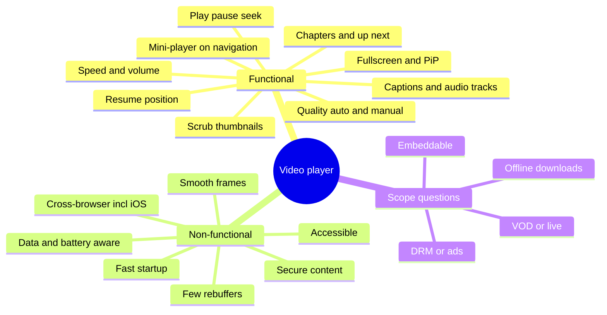

**Functional requirements**

| # | Requirement | Notes |
|---|---|---|
| F1 | Play, pause, seek, volume/mute, playback speed | Seek by click, drag, keyboard |
| F2 | **Adaptive quality** with an "Auto" mode and manual override | 144p … 4K renditions |
| F3 | **Captions/subtitles** in several languages, styled by user preference | WebVTT |
| F4 | Fullscreen, Picture-in-Picture, theatre mode | Platform limits on iPhone |
| F5 | **Thumbnail preview** while hovering/scrubbing the timeline | Storyboard sprites |
| F6 | **Resume** where the user left off; chapters; "Up next" autoplay | Synced across devices |
| F7 | Player **keeps playing as a mini-player** when the user navigates inside the SPA | Persistent player |
| F8 | Ads (pre-, mid-, post-roll) — *if in scope* | IMA/VAST or server-side insertion |
| F9 | Live streams with a DVR window and a "Go live" button — *if in scope* | LL-HLS / LL-DASH |

**Non-functional requirements**

| Quality | Target (state it as a goal, then measure) |
|---|---|
| **Startup time** | Time from click (or page load) to first frame as low as possible |
| **Rebuffering** | Rebuffer count and rebuffer ratio as close to zero as possible |
| **Smoothness** | No dropped frames from main-thread jank; controls stay responsive (good INP) |
| **Page performance** | Poster is a good LCP candidate; no layout shift when the player mounts (CLS) |
| **Reach** | Chromium, Firefox, Safari desktop, **iOS Safari**, Android, smart-TV browsers |
| **Accessibility** | Keyboard-operable, screen-reader labelled, captions (WCAG 1.2.x), no auto-playing audio trap |
| **Cost** | Don't download bits nobody sees: cap quality to player size, bound the buffer |
| **Security** | Protected content via DRM and short-lived signed URLs; no XSS via titles/captions |

**Questions to ask the interviewer**

```text
1. VOD only, or live too? (live changes manifests, latency targets and the timeline UI)
2. Is content premium (DRM) or public?          → EME + licence server, or plain HLS/DASH
3. Ads? Client-side (IMA SDK) or server-side stitched (SSAI)?
4. Which devices? Is iPhone Safari a must?       → native HLS / ManagedMediaSource path
5. Long-form (YouTube) or short vertical feed (Shorts)?  → preloading strategy differs a lot
6. Embeddable on third-party sites?              → iframe player + postMessage API
7. Offline downloads?                            → usually native apps; on web, IndexedDB + quota
8. Do we own the encoding pipeline, or consume a vendor's manifests?
```

> In an interview, pick a scope out loud: *"I'll design long-form VOD with adaptive streaming, captions, resume and a mini-player; I'll touch on live, DRM and ads at the end."*

---

### Section 2: Architecture (A) — Page and Player Layers

**Watch-page rendering strategy.** The watch page has two very different halves:

| Part | Rendering | Why |
|---|---|---|
| Title, description, channel, `VideoObject` JSON-LD, Open Graph tags | **SSR / streaming SSR** | SEO and link previews need real HTML; fast first paint |
| Poster image | SSR'd ``/`poster` with `fetchpriority="high"` | Usually the **LCP element** |
| Player | **Client island**, hydrated first and with high priority | Needs `HTMLMediaElement`, MSE, event listeners |
| Comments, recommendations | Streamed or lazy-loaded below the fold | Not needed for first frame |
| Ads SDK, analytics | Lazy-loaded after the player is interactive | Large third-party JS should not delay startup |

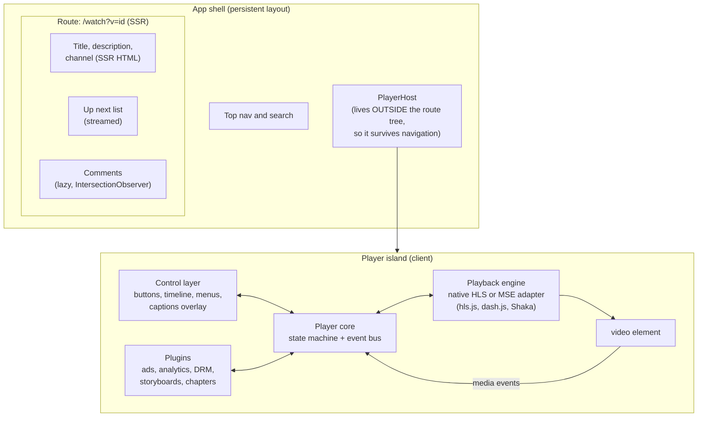

**Layering rules that keep the player maintainable:**

1. **The `<video>` element is the source of truth for media facts** (`currentTime`, `paused`, `buffered`, `readyState`). Don't mirror them in component state on every tick; subscribe and read.
2. **The player core owns a state machine** (below). UI components dispatch *intents* (`PLAY`, `SEEK`, `SET_QUALITY`) and render *state* — they never call `hls.js` directly.
3. **The playback engine is swappable** behind an adapter: native HLS on Safari, an MSE library elsewhere, a mock in tests.
4. **Plugins attach to events** (ads pause content, analytics listen, storyboards read the timeline) so the core stays small.
5. **The player is mounted once in the shell** and *moved* between the full-size slot and the mini-player slot. Re-mounting would destroy the decoder and the buffer.

**Player state machine.** Most player bugs are impossible-state bugs ("spinner shows while paused", "play pressed during seek"). Model it explicitly:

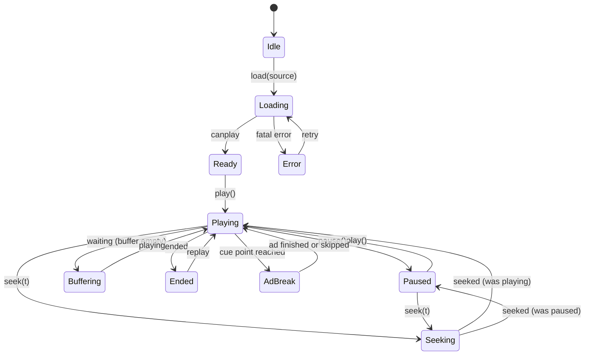

| Media event | Meaning | Typical UI reaction |
|---|---|---|
| `loadedmetadata` | Duration and dimensions known | Draw timeline, chapters |
| `canplay` | Enough data to start | Hide startup spinner |
| `play` / `playing` | Play requested / frames actually rendering | Toggle icon / hide buffering spinner |
| `waiting` | Stalled because the buffer ran out | Show buffering spinner (after a short delay to avoid flicker) |
| `seeking` / `seeked` | Seek started / finished | Freeze timeline thumb / resume |
| `timeupdate` | Position changed (fired roughly every 15–250 ms, browser-dependent) | Update the progress bar cheaply |
| `progress` | More data downloaded | Redraw buffered ranges |
| `ratechange`, `volumechange` | Speed / volume changed | Sync menus, persist preference |
| `ended`, `error` | Finished / failed | Up-next card / error overlay with retry |

---

### Section 3: Architecture (A) — The Streaming Pipeline

A single MP4 file served over HTTP (progressive download, with **range requests** returning `206 Partial Content`) works for short clips, but it can't change quality mid-stream. YouTube-scale players use **adaptive bitrate streaming (ABR)**:

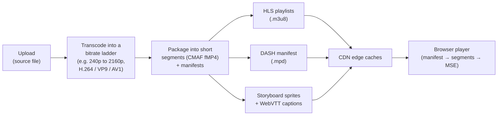

| Term | Meaning |
|---|---|
| **Rendition / representation** | One encoding of the video (resolution + bitrate + codec) |
| **Bitrate ladder** | The set of renditions offered |
| **Segment** | A few seconds of media; independently fetchable over HTTP |
| **Init segment** | Codec configuration for a rendition; fetched once before its media segments |
| **Manifest** | Index of renditions and segment URLs: HLS **`.m3u8`** ([RFC 8216](https://www.rfc-editor.org/rfc/rfc8216)) or MPEG-DASH **`.mpd`** |
| **CMAF** | Common fragmented-MP4 segment format that both HLS and DASH can reference, so one set of segments serves both |
| **MSE** | Media Source Extensions: JS appends segment bytes into `SourceBuffer`s attached to a `<video>` |
| **EME** | Encrypted Media Extensions: lets the browser's CDM decrypt DRM-protected segments |

**Startup sequence (MSE path):**

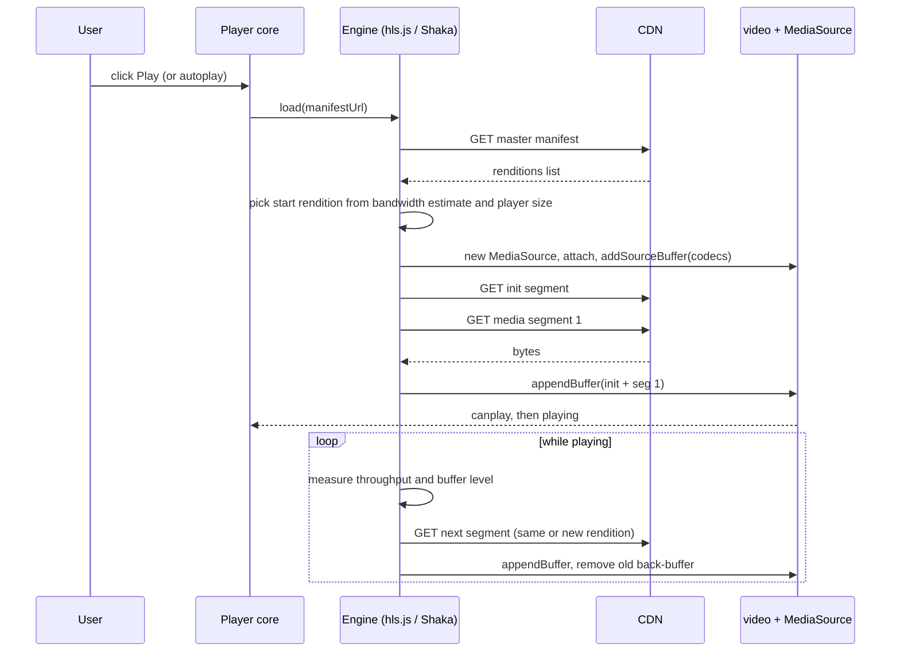

**ABR decision loop.** Players combine several signals; exact algorithms differ by library (dash.js, for example, ships a buffer-based rule called BOLA alongside throughput rules):

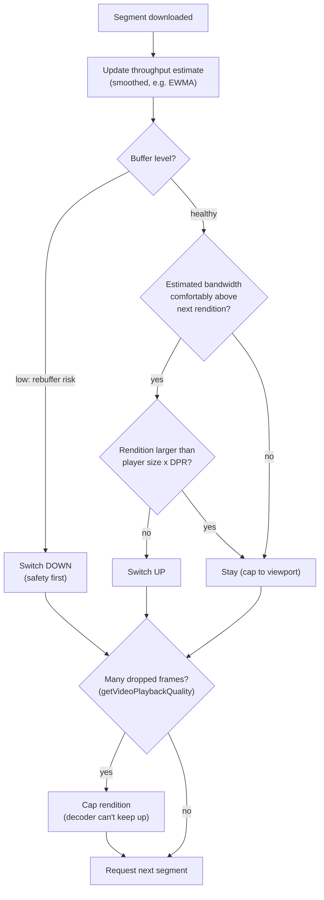

**Which playback path runs where?** Browser support differs, so feature-detect (see Example 1):

| Path | Where | Notes |
|---|---|---|
| **Native HLS** (`video.src = 'x.m3u8'`) | Safari (macOS, iOS, iPadOS); some other browsers | Check `video.canPlayType('application/vnd.apple.mpegurl')`. You give up fine ABR control |
| **MSE** (`MediaSource`) + hls.js / dash.js / Shaka | Chromium, Firefox, Safari macOS, iPadOS | Full control of ABR, buffering, analytics. On iPhone, classic MSE is **not** exposed (MDN marks it iPad-only) |
| **ManagedMediaSource** | Safari 17+ and iOS 17.1+ (WebKit only, per MDN) | MSE variant where the browser may evict buffered data to save power/memory; WebKit requires remote playback to be disabled or an AirPlay alternative source — check MDN/WebKit docs |
| **Progressive MP4** | Everywhere | Fine for short clips, previews, GIF replacements |

> **Native mobile:** iOS uses **AVPlayer** (HLS natively; DASH is not supported by AVFoundation), Android uses **Media3 ExoPlayer** (DASH, HLS, SmoothStreaming). Both give you PiP, background audio and lock-screen controls with less code than the web.

---

### Section 4: Data Model (D)

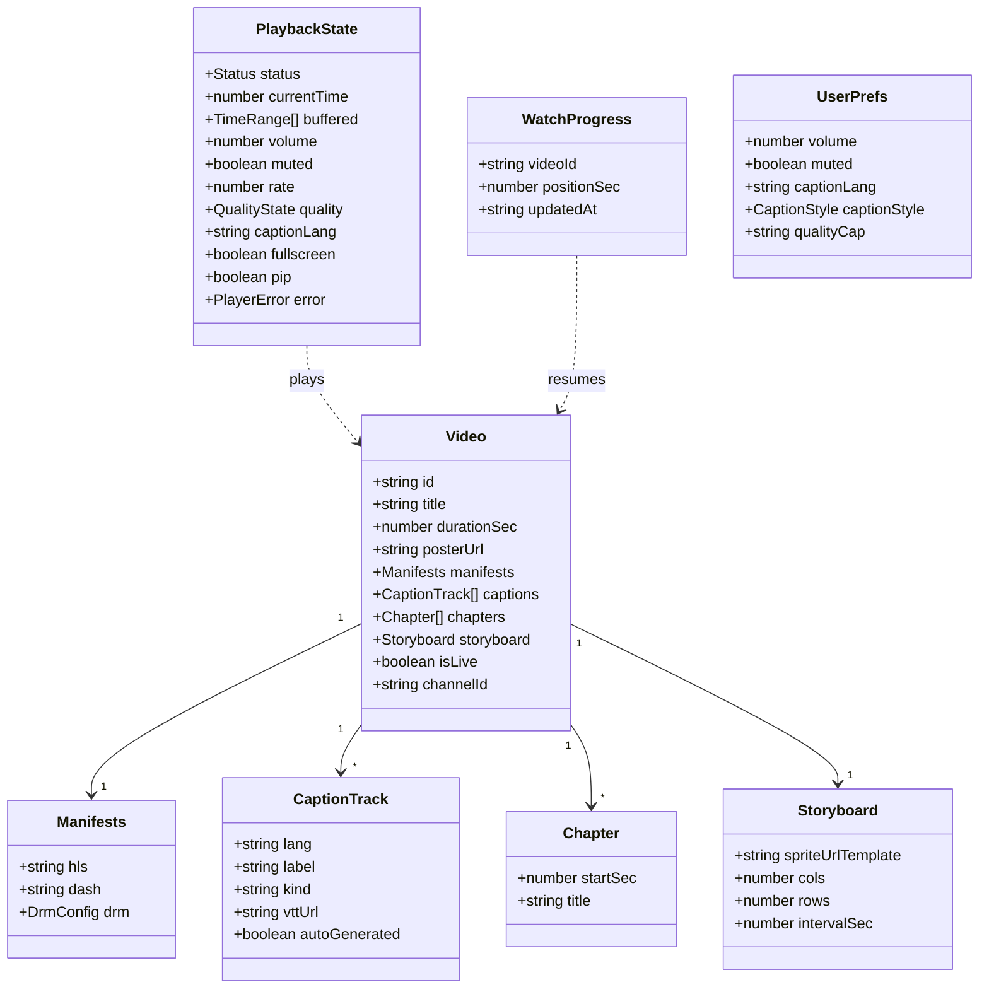

**Where each piece of state lives:**

| State | Kind | Store | Cache / persistence |
|---|---|---|---|
| `Video` metadata, channel, up-next list | **Server state** | TanStack Query / SWR / RTK Query / Apollo, normalized by id | HTTP `private, no-cache` + ETag or short `max-age`; SSR-hydrated |
| Manifests and segments | Bytes | Engine + HTTP cache + CDN | VOD segments: long-lived, immutable URLs. Live playlists: very short TTL |
| `PlaybackState` | **Client/UI state** | Player core store (subscribable), derived from media events | Memory only |
| `UserPrefs` (volume, caption language/style, quality cap) | Client preference | `localStorage` (try/catch) + account sync | Survives reloads |
| `WatchProgress` | Server state, written often | Throttled writes + `sendBeacon` on hide | Server is the source of truth across devices |
| QoE events | Telemetry | In-memory queue, batched | Flushed periodically and on `pagehide` |

**Normalization.** `Video`, `Channel` and `Comment` are separate entities keyed by id ([Data Normalization & Caching](../03-state-and-data/data-normalization-and-caching.md)). The up-next list stores **ids**, so a video card and the player read the same `Video` record and a title edit updates both.

**Don't put `currentTime` into a global store that re-renders the app.** It changes several times per second. Keep it in the player's own subscribable store, and let only the timeline subscribe to it (Example 2).

---

### Section 5: Interface (I)

**Component API (React).** A thin declarative wrapper plus an imperative handle for things that are naturally commands:

```tsx
type Source = { hls?: string; dash?: string; mp4?: string };

interface VideoPlayerProps {
  videoId: string;
  sources: Source;
  poster: string;
  captions?: { lang: string; label: string; src: string; default?: boolean }[];
  startAt?: number;              // seconds (resume or ?t= deep link)
  autoplay?: 'none' | 'muted';   // never "with sound" — browsers block it anyway
  onEnded?: () => void;
  onError?: (err: PlayerError) => void;
  onQoE?: (event: QoEEvent) => void;
}

interface PlayerHandle {
  play(): Promise<void>;
  pause(): void;
  seek(seconds: number): void;
  setQuality(level: number | 'auto'): void;
  setCaptions(lang: string | null): void;
  enterPictureInPicture(): Promise<void>;
}

// <VideoPlayer ref={playerRef} videoId="abc" sources={{ hls: '/v/abc/master.m3u8' }} poster="/v/abc/poster.avif" />
```

Design notes ([Component API Design](../05-design-systems-and-components/component-api-design.md), [Compound Component Pattern](../05-design-systems-and-components/compound-component-pattern.md)):

- Offer **compound/headless pieces** (`<Player.Root>`, `<Player.Timeline>`, `<Player.PlayButton>`, `<Player.CaptionsMenu>`) so products can re-skin controls without forking the core.
- `autoplay` is a **policy**, not a boolean: muted autoplay is widely allowed, audible autoplay generally isn't.
- Expose events as **typed callbacks**, not raw media events, so engine swaps don't break consumers.

**Server API contract:**

```http
GET /api/videos/abc123
Accept: application/json
```

```json
{
  "id": "abc123",
  "title": "Designing a video player",
  "durationSec": 754,
  "posterUrl": "https://img.cdn.example/abc123/poster.avif",
  "manifests": {
    "hls": "https://media.cdn.example/abc123/master.m3u8?token=eyJ...",
    "dash": "https://media.cdn.example/abc123/manifest.mpd?token=eyJ..."
  },
  "captions": [
    { "lang": "en", "label": "English", "kind": "captions", "vttUrl": "https://media.cdn.example/abc123/en.vtt", "autoGenerated": false },
    { "lang": "es", "label": "Español", "kind": "subtitles", "vttUrl": "https://media.cdn.example/abc123/es.vtt", "autoGenerated": true }
  ],
  "chapters": [{ "startSec": 0, "title": "Intro" }, { "startSec": 95, "title": "Requirements" }],
  "storyboard": { "spriteUrlTemplate": "https://img.cdn.example/abc123/sb/{n}.jpg", "cols": 10, "rows": 10, "intervalSec": 5 },
  "resumeAtSec": 312,
  "isLive": false
}
```

| Endpoint | Method | Purpose | Caching |
|---|---|---|---|
| `/api/videos/:id` | GET | Metadata + signed manifest URLs + resume point | `private, no-cache` + ETag (per-user resume point and tokens) |
| CDN `master.m3u8` / `manifest.mpd` | GET | Renditions | VOD: cacheable at the edge; live: very short TTL |
| CDN segments, `.vtt`, sprites | GET | Media bytes | Immutable for VOD |
| `/api/watch-progress` | POST | `{ videoId, positionSec }`, throttled, plus `sendBeacon` on hide | Not cached |
| `/api/qoe` | POST | Batched QoE events | Not cached |
| `/api/videos/:id/next` | GET | Up-next list (ids + card fields) | Short TTL |
| DRM licence server | POST | EME licence request/response | Never cached |

**Embedding API.** If the player is embeddable, ship it as an `<iframe>` (isolation from the host page's CSS/JS) and expose a **`postMessage` API** (`play`, `pause`, `seekTo`, `onStateChange`). Always check `event.origin` on both sides.

---

### Section 6: Optimizations (O) — Performance

```mermaid
flowchart LR
    subgraph PAGE["Page load"]
        A1["SSR metadata + poster<br/>fetchpriority high"]
        A2["preconnect to media CDN"]
        A3["aspect-ratio box<br/>(no CLS)"]
    end
    subgraph START["Startup"]
        B1["Start at a modest rendition,<br/>ramp up"]
        B2["Small first segments"]
        B3["Lazy-load ads and<br/>analytics SDKs"]
    end
    subgraph RUN["During playback"]
        C1["Progress bar via ref / rAF,<br/>not app-wide re-renders"]
        C2["Cap quality to<br/>player size x DPR"]
        C3["Bound buffer ahead<br/>and evict back-buffer"]
        C4["Prefetch up-next<br/>first segments near the end"]
    end
    PAGE --> START --> RUN
```

| Technique | Why it helps |
|---|---|
| **SSR the poster** with `fetchpriority="high"`, sized via `aspect-ratio: 16 / 9` | LCP is usually the poster; reserving space prevents CLS ([Image Optimization](../04-performance-engineering/image-optimization.md)) |
| **`<link rel="preconnect">` to the media CDN** | Saves DNS + TCP + TLS before the manifest request ([Prefetching & Preloading](../04-performance-engineering/prefetching-and-preloading.md)) |
| `preload="metadata"` or `"none"` on non-primary videos | Don't download video for players the user may never start |
| **Split the player bundle**: core first; ads SDK, analytics, storyboards, settings menus lazy | The engine and controls are needed for first frame; the rest isn't ([Code Splitting & Lazy Loading](../04-performance-engineering/code-splitting-and-lazy-loading.md)) |
| **Start low, ramp up**; choose the start rendition from a saved bandwidth estimate | Faster first frame; ABR climbs within a few segments |
| **Cap to player size × devicePixelRatio** | A 4K stream in a 640 px box wastes bandwidth and decoder power |
| `navigator.mediaCapabilities.decodingInfo()` | Ask whether a codec/resolution will be **smooth** and **power-efficient** before choosing AV1 vs VP9 vs H.264 |
| **Bound the buffer** (forward goal + back-buffer eviction) | Avoids `QuotaExceededError` on `appendBuffer` and memory pressure on low-end devices |
| Progress bar updated via **ref + `requestAnimationFrame`** or a narrow subscription | Keeps React/Vue/Angular from re-rendering the page on every `timeupdate` (INP) |
| `requestVideoFrameCallback()` | Frame-accurate overlays and effects without polling |
| **Pause off-screen autoplay previews** (IntersectionObserver) and when `document.hidden` | Saves data, battery and decoder slots |
| **Facade for embeds** (static poster + button, load the iframe on click) | Third-party player iframes are heavy; web.dev recommends facades |
| **Prefetch the next video's manifest and first segment(s)** when the current one is near its end | Instant up-next autoplay; skip on Save-Data / slow connections |
| Transform/opacity-only control animations | Stay on the compositor while video is decoding ([Animation Performance](../04-performance-engineering/animation-performance-css-vs-js.md)) |

> **Short-form feeds (Shorts/Reels/TikTok)** flip the trade-off: preloading the *next one or two* videos is essential, but only a few `<video>` elements should exist at once. Recycle elements, and keep a small pool of decoders. See [Virtual Scrolling & Windowing](../04-performance-engineering/virtual-scrolling-and-windowing.md).

**QoE metrics to log** (define them, don't promise numbers you haven't measured): startup time, rebuffer count and total rebuffer duration, average bitrate and switch count, dropped frames (`getVideoPlaybackQuality()`), fatal error rate by browser/OS, and abandonment before first frame. Send them through your [Analytics Architecture](../09-monitoring-and-observability/analytics-architecture.md) pipeline in batches.

---

### Section 7: Optimizations (O) — Accessibility and i18n

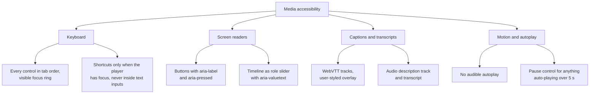

| Concern | What to build | Standard |
|---|---|---|
| **Captions** | WebVTT via `<track kind="captions">` or a custom overlay fed by the TextTrack API; let users choose size, colour, background | WCAG 1.2.2 (prerecorded captions, A), 1.2.4 (live captions, AA) |
| **Audio description** | Alternate audio rendition or described version; extended descriptions in a transcript | WCAG 1.2.3 (A) / 1.2.5 (AA) |
| **Keyboard** | All controls reachable; shortcuts like Space/K (play), ←/→ (seek), J/L (seek further), M (mute), F (fullscreen), C (captions) — scoped to the player | WCAG 2.1.1; 2.1.4 (single-key shortcuts must be turn-off-able, remappable or focus-scoped) |
| **Timeline** | `role="slider"` with `aria-valuemin/max/now` and **human `aria-valuetext`** ("1 minute 5 seconds of 12 minutes 34 seconds") | WAI-ARIA slider pattern |
| **Toggle buttons** | `aria-pressed` for mute/captions; labels that state the action ("Pause", "Unmute") | WCAG 4.1.2 |
| **Autoplay** | Muted only; obvious pause; respect `prefers-reduced-motion` for hover previews | WCAG 1.4.2 Audio Control, 2.2.2 Pause, Stop, Hide |
| **Focus** | Controls auto-hide during playback but **reappear on focus**; never hide the focused element | WCAG 2.4.7, 2.4.11 |
| **Menus** | Settings/quality/captions menus follow the menu or listbox pattern; Escape closes and returns focus | [Keyboard Navigation & Focus Management](../06-accessibility-and-i18n/keyboard-navigation-and-focus-management.md) |

Native `<video controls>` gives you a lot of this for free. If you build custom controls (most products do, for branding and features), **you take over all of it**. See [ARIA Roles, States & Properties](../06-accessibility-and-i18n/aria-roles-states-and-properties.md).

**Internationalization:**

- **UI strings** through your i18n layer ([Internationalization (i18n) Architecture](../06-accessibility-and-i18n/internationalization-i18n-architecture.md)); caption **language labels** in their own language ("Español", "日本語").
- **Durations**: `Intl.DurationFormat` is in all current major browsers per MDN; keep a fallback for older ones. Timestamps like `12:34` are fine visually but `aria-valuetext` should be words.
- **RTL**: mirror the layout of control groups; decide deliberately whether the timeline itself mirrors, and test with RTL users ([RTL Layout Support](../06-accessibility-and-i18n/rtl-layout-support.md)).
- **Multiple audio tracks** (dubbed audio) come from the manifest; the engine exposes them. The native `audioTracks` API is not reliably available across browsers (it's behind flags in Chromium and Firefox per MDN), so read tracks from your engine.

---

### Section 8: Optimizations (O) — Security, Offline and Edge Cases

**Security**

| Threat / need | Mitigation |
|---|---|
| Content theft (premium) | **DRM via EME**: Widevine (Chromium, Firefox, Android), PlayReady (Edge/Windows), FairPlay (Apple). Shaka Player and dash.js integrate with EME; licence requests go to your licence server |
| Hot-linking / sharing segment URLs | **Short-lived signed URLs or tokens** on manifests/segments, validated at the CDN edge |
| XSS through titles, descriptions, chapter names | Render as text; sanitize any rich description HTML ([XSS Prevention](../07-security/xss-prevention-reflected-stored-dom.md)) |
| XSS through captions | WebVTT cue text may contain simple markup; render cue text as text or with a strict allow-list — never `innerHTML` raw cues |
| Embedding abuse / clickjacking of your own pages | `frame-ancestors` on non-embed pages; a dedicated `/embed` route that is meant to be framed ([Clickjacking & iframe Protection](../07-security/clickjacking-and-iframe-protection.md)) |
| Third-party embed on your site | `<iframe allow="autoplay; fullscreen; picture-in-picture; encrypted-media">` with only what is needed; validate `postMessage` origins |
| Ads SDK running arbitrary JS | Load in a sandboxed iframe where the SDK supports it; tighten CSP ([Content Security Policy (CSP)](../07-security/content-security-policy-csp.md)) |

> DRM raises the cost of copying; it doesn't make it impossible (screen capture still exists). It also adds licence latency to startup — request licences early.

**Offline**

- Web: some libraries (e.g. Shaka Player) can store segments and licences in **IndexedDB** for offline playback; you must handle storage quotas, eviction and licence expiry. See [Offline-First Architecture](../03-state-and-data/offline-first-architecture.md).
- Most products keep downloads in **native apps**, where background downloads and DRM persistence are better supported.

**Edge cases checklist**

```text
✓ Autoplay blocked        → play() rejects with NotAllowedError → show big Play button, or retry muted
✓ iPhone inline playback  → add playsinline, otherwise iPhone Safari may go fullscreen on play
✓ iPhone fullscreen       → Element.requestFullscreen is iPad-only per MDN; on iPhone use the video element's native fullscreen
✓ Network drop            → engine retries with backoff, ABR downshifts; after N fatal errors show "Retry"
✓ Decoder / media error   → hls.js-style recoverMediaError(), then fall back to another codec rendition
✓ QuotaExceededError      → evict back-buffer (SourceBuffer.remove) and retry the append
✓ Seek outside buffer     → abort in-flight segment loads, fetch from the new position, show spinner only after ~200 ms
✓ Tab hidden              → keep audio for music-like content (Media Session), pause muted previews
✓ Multiple players        → playing one pauses the others (a small "active player" registry)
✓ Live stream             → seekable range is a sliding window; "Go live" button; latency vs stability trade-off
✓ Very long videos        → storyboards split into many sprite sheets; chapters for navigation
✓ Deep links              → ?t=95 → startAt=95; validate it against the duration
✓ Captions missing / late → don't block playback on caption download
✓ bfcache restore         → pageshow persisted → re-sync state, re-open sockets for live chat
```

---

## Interview Walkthrough

**How to spend 45 minutes:**

```mermaid
gantt
    title 45-minute frontend system design interview
    dateFormat mm
    axisFormat %M
    section Clarify
    Requirements and scope questions :r, 00, 5m
    section Design
    Architecture and rendering strategy :a, after r, 10m
    Streaming pipeline and ABR :s, after a, 8m
    Data model and state ownership :d, after s, 6m
    Interface and API contract :i, after d, 6m
    section Deepen
    Optimizations perf a11y security :o, after i, 7m
    Trade-offs and wrap-up :w, after o, 3m
```

| Minute | What you say / draw | Signal you're sending |
|---|---|---|
| 0–5 | Scope: VOD vs live, DRM, ads, devices; pick defaults out loud | You don't build the wrong thing |
| 5–15 | Component diagram: SSR watch page, player island in the shell, player layers (UI → core → engine → `<video>`) and the **state machine** | Separation of concerns, persistent player |
| 15–23 | Manifest → segments → MSE; ABR signals; native HLS vs MSE vs ManagedMediaSource | You understand *how* video gets to the screen |
| 23–29 | Entities, where state lives, why `currentTime` is not global state | State ownership and render cost |
| 29–35 | Props/handle API, compound controls, server endpoints, signed URLs | Clean contracts |
| 35–42 | Startup/LCP/CLS, caption + keyboard a11y, DRM/XSS, edge cases | Breadth and depth |
| 42–45 | Trade-offs below, what you'd measure first | Judgement |

**Trade-offs to discuss:**

| Decision | Option A | Option B | How to choose |
|---|---|---|---|
| Controls | Native `controls` | Custom control layer | Native = free a11y and platform UX; custom = branding, storyboards, chapters, ads UI — but you own a11y |
| Playback engine | Native HLS (Safari) | MSE library | Native is simple and power-efficient; MSE gives ABR control and analytics. Most products use both, chosen by feature detection |
| Format | HLS | DASH | CMAF segments let one encode serve both; HLS is required for Apple native playback |
| Startup quality | Start low | Start at last-known bandwidth | Low = fastest first frame, blurry start; estimate = sharper start, risk of an early rebuffer |
| Buffer size | Larger forward buffer | Smaller buffer | Larger = fewer rebuffers, more wasted data when users abandon, more memory |
| Ads | Client-side (IMA SDK, VAST) | Server-side ad insertion (SSAI) | CSAI: easier targeting and measurement, blocked by ad blockers, visible transitions. SSAI: seamless and harder to block, more backend complexity |
| Watch page | Full SSR | CSR shell | SSR for SEO/link previews and LCP; the player hydrates as an island either way |
| Live latency | Low-latency HLS/DASH | Standard latency | Lower latency = smaller buffers = more rebuffer risk |

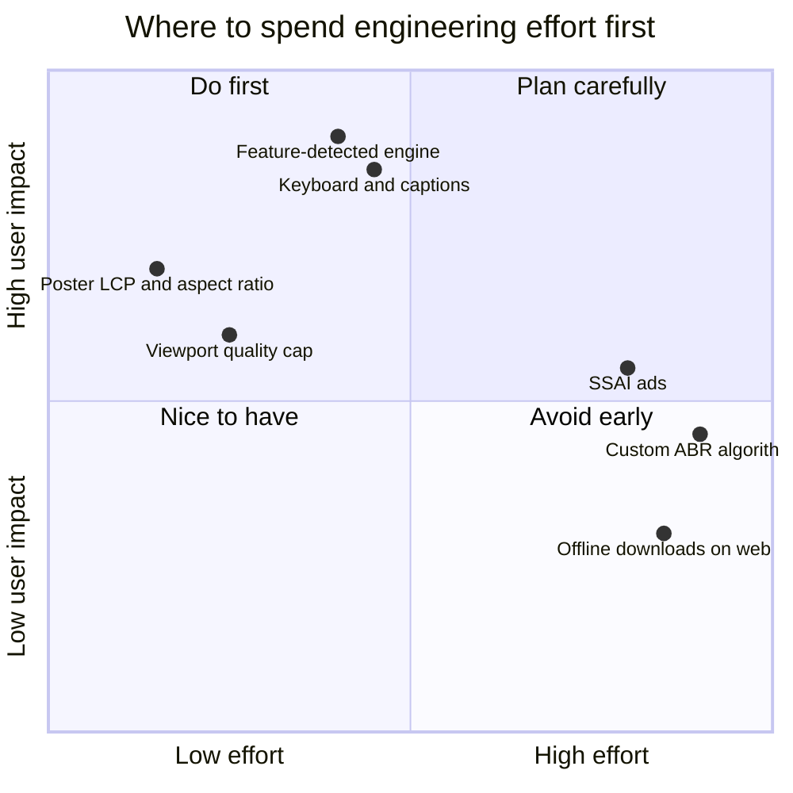

---

## Real-World Examples

**Example 1 — Feature-detect the playback path (TypeScript + hls.js):**
```typescript
import Hls from 'hls.js';

export function attachSource(video: HTMLVideoElement, hlsUrl: string, mp4Fallback?: string): () => void {
  // 1. Prefer MSE via hls.js where available (full ABR control).
  //    Hls.isSupported() checks for a usable MediaSource implementation.
  if (Hls.isSupported()) {
    const hls = new Hls({ capLevelToPlayerSize: true });
    hls.loadSource(hlsUrl);
    hls.attachMedia(video);
    hls.on(Hls.Events.ERROR, (_event, data) => {
      if (!data.fatal) return;
      if (data.type === Hls.ErrorTypes.NETWORK_ERROR) hls.startLoad();          // retry loading
      else if (data.type === Hls.ErrorTypes.MEDIA_ERROR) hls.recoverMediaError(); // reset decoder
      else hls.destroy();                                                          // give up → show error UI
    });
    return () => hls.destroy();
  }

  // 2. Native HLS (Safari, including iPhone).
  if (video.canPlayType('application/vnd.apple.mpegurl')) {
    video.src = hlsUrl;
    return () => { video.removeAttribute('src'); video.load(); };
  }

  // 3. Last resort: progressive MP4.
  if (mp4Fallback) video.src = mp4Fallback;
  return () => { video.removeAttribute('src'); video.load(); };
}
```

> Some teams prefer native HLS first on Safari for power efficiency and AirPlay, and MSE everywhere else. Either order is defensible — say which and why. Check the hls.js docs for its current ManagedMediaSource behaviour on iOS.

**Example 2 — Don't re-render the page on every `timeupdate` (BAD → GOOD):**
```tsx
import { useRef, useState, useEffect, useSyncExternalStore } from 'react';

// ❌ BAD: the whole player tree re-renders several times per second
function PlayerBad({ src }: { src: string }) {
  const [time, setTime] = useState(0);
  return (
    <>
      <video src={src} onTimeUpdate={(e) => setTime(e.currentTarget.currentTime)} />
      <Controls time={time} />      {/* menus, buttons, captions all re-render */}
      <Comments videoTime={time} /> {/* …and so does this */}
    </>
  );
}

// ✅ GOOD: subscribe only where needed; paint the progress bar through a ref
function useMediaSnapshot<T>(video: HTMLVideoElement | null, events: string[], read: (v: HTMLVideoElement) => T, fallback: T) {
  return useSyncExternalStore(
    (notify) => {
      if (!video) return () => {};
      events.forEach((e) => video.addEventListener(e, notify));
      return () => events.forEach((e) => video.removeEventListener(e, notify));
    },
    () => (video ? read(video) : fallback),
    () => fallback, // server snapshot
  );
}

function PlayButton({ video }: { video: HTMLVideoElement | null }) {
  // Re-renders only on play/pause — not on timeupdate
  const paused = useMediaSnapshot(video, ['play', 'pause'], (v) => v.paused, true);
  return (
    <button type="button" aria-label={paused ? 'Play' : 'Pause'} onClick={() => (paused ? video?.play() : video?.pause())}>
      {paused ? '▶' : '❚❚'}
    </button>
  );
}

function ProgressFill({ video }: { video: HTMLVideoElement | null }) {
  const fill = useRef<HTMLDivElement>(null);
  useEffect(() => {
    if (!video) return;
    let id = 0;
    const tick = () => {
      const ratio = video.duration ? video.currentTime / video.duration : 0;
      if (fill.current) fill.current.style.transform = `scaleX(${ratio})`; // compositor-friendly
      id = requestAnimationFrame(tick);
    };
    id = requestAnimationFrame(tick);
    return () => cancelAnimationFrame(id);
  }, [video]);
  return <div ref={fill} className="progress-fill" style={{ transformOrigin: 'left' }} />;
}
```

> `read` must return a primitive (or a cached object) — `useSyncExternalStore` compares snapshots with `Object.is`.
> **Vue:** template ref + a composable (VueUse ships `useMediaControls`). **Angular:** `viewChild()` for the element and **signals** updated from media events, with `ChangeDetectionStrategy.OnPush`. **Svelte:** built-in media bindings — `<video bind:currentTime bind:paused bind:duration>`. **Framework-agnostic:** web-component control libraries such as Media Chrome or Vidstack work in any stack.

**Example 3 — Accessible seek slider:**
```tsx
function formatSpoken(sec: number) {
  const m = Math.floor(sec / 60), s = Math.floor(sec % 60);
  return `${m} minute${m === 1 ? '' : 's'} ${s} second${s === 1 ? '' : 's'}`;
}

export function SeekSlider({ current, duration, onSeek }: { current: number; duration: number; onSeek: (t: number) => void }) {
  const onKeyDown = (e: React.KeyboardEvent) => {
    const step = { ArrowRight: 5, ArrowLeft: -5, PageUp: 30, PageDown: -30 }[e.key];
    if (step !== undefined) { e.preventDefault(); onSeek(Math.min(duration, Math.max(0, current + step))); }
    if (e.key === 'Home') { e.preventDefault(); onSeek(0); }
    if (e.key === 'End') { e.preventDefault(); onSeek(duration); }
  };
  return (
    <div
      role="slider"
      tabIndex={0}
      aria-label="Seek"
      aria-valuemin={0}
      aria-valuemax={Math.round(duration)}
      aria-valuenow={Math.round(current)}
      aria-valuetext={`${formatSpoken(current)} of ${formatSpoken(duration)}`}
      onKeyDown={onKeyDown}
      className="seek-slider"
    />
  );
}
// Alternative: a styled <input type="range"> gives you keyboard + ARIA semantics for free.
```

> Throttle `aria-valuenow`/`aria-valuetext` updates during playback (e.g. once per second or only while focused) so screen readers aren't flooded.

**Example 4 — Autoplay with a graceful fallback:**
```typescript
export async function tryAutoplay(video: HTMLVideoElement): Promise<'sound' | 'muted' | 'blocked'> {
  try {
    await video.play();
    return 'sound';
  } catch (err) {
    if ((err as DOMException).name !== 'NotAllowedError') throw err;
    video.muted = true;                 // muted autoplay is widely permitted
    try {
      await video.play();
      return 'muted';                   // show an "Unmute" button
    } catch {
      return 'blocked';                 // show the big Play button over the poster
    }
  }
}
// Firefox also exposes navigator.getAutoplayPolicy(); it isn't cross-browser (per MDN), so feature-detect.
```

**Example 5 — Save watch progress reliably:**
```typescript
let lastSent = 0;

function sendProgress(videoId: string, positionSec: number) {
  const body = JSON.stringify({ videoId, positionSec: Math.floor(positionSec) });
  // sendBeacon survives page unload; fall back to fetch keepalive
  if (!navigator.sendBeacon('/api/watch-progress', new Blob([body], { type: 'application/json' }))) {
    fetch('/api/watch-progress', { method: 'POST', body, keepalive: true, headers: { 'Content-Type': 'application/json' } });
  }
}

export function trackProgress(video: HTMLVideoElement, videoId: string) {
  const onTime = () => {
    const now = performance.now();
    if (now - lastSent > 10_000) { lastSent = now; sendProgress(videoId, video.currentTime); } // throttle
  };
  const onHide = () => { if (document.visibilityState === 'hidden') sendProgress(videoId, video.currentTime); };
  video.addEventListener('timeupdate', onTime);
  document.addEventListener('visibilitychange', onHide);
  window.addEventListener('pagehide', onHide);
  return () => {
    video.removeEventListener('timeupdate', onTime);
    document.removeEventListener('visibilitychange', onHide);
    window.removeEventListener('pagehide', onHide);
  };
}
```

**Example 6 — Lock-screen / hardware media keys with the Media Session API:**
```typescript
export function setupMediaSession(video: HTMLVideoElement, meta: { title: string; artist: string; artwork: string }) {
  if (!('mediaSession' in navigator)) return;
  navigator.mediaSession.metadata = new MediaMetadata({
    title: meta.title,
    artist: meta.artist,
    artwork: [{ src: meta.artwork, sizes: '512x512', type: 'image/png' }],
  });
  const safe = (action: MediaSessionAction, handler: MediaSessionActionHandler) => {
    try { navigator.mediaSession.setActionHandler(action, handler); } catch { /* action not supported */ }
  };
  safe('play', () => video.play());
  safe('pause', () => video.pause());
  safe('seekbackward', (d) => { video.currentTime = Math.max(0, video.currentTime - (d.seekOffset ?? 10)); });
  safe('seekforward', (d) => { video.currentTime = Math.min(video.duration, video.currentTime + (d.seekOffset ?? 10)); });
  safe('seekto', (d) => { if (d.seekTime != null) video.currentTime = d.seekTime; });
}
```

**Example 7 — Markup baseline (works before any JS):**
```html
<div class="player" style="aspect-ratio: 16 / 9">
  <video
    controls
    playsinline
    preload="metadata"
    poster="/v/abc123/poster.avif"
    crossorigin="anonymous"
  >
    <source src="/v/abc123/master.m3u8" type="application/vnd.apple.mpegurl" />
    <source src="/v/abc123/720p.mp4" type="video/mp4" />
    <track kind="captions" src="/v/abc123/en.vtt" srclang="en" label="English" default />
    <p>Your browser can't play this video. <a href="/v/abc123/720p.mp4">Download it</a>.</p>
  </video>
</div>
<!-- JS then upgrades this to custom controls + MSE where supported (progressive enhancement). -->
```

> `crossorigin` is needed when captions or media come from another origin (CORS) — e.g. cross-origin `<track>` files fail without it.

---

## Key Points Summary

| Concept | One-Line Explanation |
|---|---|
| **RADIO** | Requirements → Architecture → Data model → Interface → Optimizations |
| **Adaptive bitrate (ABR)** | Pick each segment's quality from throughput, buffer level, player size and dropped frames |
| **Manifest** | HLS `.m3u8` or DASH `.mpd` listing renditions and segment URLs |
| **CMAF** | One fragmented-MP4 segment format usable by both HLS and DASH |
| **MSE** | JS appends segment bytes into `SourceBuffer`s; how hls.js/dash.js/Shaka work |
| **ManagedMediaSource** | WebKit's power-aware MSE variant; the MSE route on iPhone (iOS 17.1+) |
| **Native HLS** | Safari plays `.m3u8` directly; simple but less control |
| **EME / DRM** | Browser CDM decrypts protected media; Widevine, PlayReady, FairPlay |
| **Player state machine** | Explicit states (idle, loading, playing, buffering, seeking…) prevent impossible UI |
| **Persistent player** | Mount once in the shell so navigation doesn't destroy the buffer (mini-player) |
| **Watch page** | SSR metadata and poster; player hydrates as an island; comments lazy |
| **Render cost** | Keep `currentTime` out of global state; paint progress via ref/rAF |
| **Captions** | WebVTT tracks, user-styleable, required by WCAG 1.2.2 |
| **Autoplay** | Muted only; handle `NotAllowedError`; give a pause control |
| **QoE** | Startup time, rebuffers, bitrate, dropped frames, errors — measured in the field |

---

## Test Your Understanding

**Q1 (Basic):** Why do large video sites stream short segments with a manifest instead of serving one MP4 file?

<details>
<summary>Answer</summary>

A single progressive MP4 has **one quality**. If bandwidth drops mid-video, the player can only stall. With **segmented adaptive streaming**, every few seconds the player can choose a **different rendition** based on current throughput and buffer level, so it degrades quality instead of rebuffering, and climbs back up when the network improves. Segments are also **plain HTTP objects**, so CDNs cache them like any static file, and seeking means fetching segments near the target rather than relying on byte-range guesses. One encode (CMAF) can serve both HLS and DASH manifests.
</details>

**Q2 (Basic):** What is the difference between the `waiting` and `pause` events, and why does your state machine care?

<details>
<summary>Answer</summary>

`pause` means **the user (or code) paused playback**: `video.paused` becomes `true`. `waiting` means playback **wanted to continue but stalled** because there isn't enough data; `paused` stays `false`. The UI must differ: paused shows a Play button, while waiting shows a **buffering spinner** with the Pause button still visible. Mixing them causes classic bugs like a spinner on a paused video, or a Play button that does nothing during a stall. An explicit `Buffering` state, separate from `Paused`, prevents those impossible combinations.
</details>

**Q3 (Application):** Your watch page has poor LCP and a CLS problem when the player mounts. What do you change?

<details>
<summary>Answer</summary>

- **SSR the poster** (as the video's `poster` or an `` overlay) with `fetchpriority="high"` in a modern format at the right size. It's usually the LCP element, so it must be discoverable in the HTML, not injected after the player JS loads.
- **Reserve space** with `aspect-ratio: 16 / 9` (or explicit width/height) on the player container so mounting controls or the video can't shift layout.
- **`preconnect`** to the media/image CDN.
- **Defer heavy JS**: ads SDK, analytics, comments and recommendations load after the player is interactive.
- Don't block first paint on client-side data fetching: the metadata comes in the SSR payload.
</details>

**Q4 (Application):** A user starts a video on the watch page, then clicks a channel link. Product wants the video to keep playing in a corner mini-player. How do you architect that in a React SPA (and in other frameworks)?

<details>
<summary>Answer</summary>

Mount the player **once, outside the route subtree**, in the app shell or a persistent layout, behind a `PlayerHost`. Routes don't render the player; they render a **slot** (a placeholder element with a known size), and the host positions the single player into the watch-page slot or the mini-player slot. If you unmount and remount the `<video>`, you lose the decoder, MSE buffer and position, which means a visible restart.

Implementation options: a persistent layout (Next.js App Router layouts persist across navigations within them), or a host that never unmounts. Moving the element through a framework (e.g. switching portal targets) usually means unmount + remount, so prefer **CSS repositioning** of a stable element. The newer state-preserving DOM move, `Element.moveBefore()`, is in Chromium and Firefox but not Safari per MDN, so treat it as an enhancement. The same idea works in other stacks: Vue keeps it in the root `App` outside `<RouterView>`; Angular keeps it in the root component outside `<router-outlet>`; SvelteKit keeps it in the root `+layout.svelte`.
</details>

**Q5 (Tricky):** On iPhone, your hls.js-based player fails in some cases while it works on iPad and desktop Safari. Why, and what's the robust design?

<details>
<summary>Answer</summary>

Classic **`MediaSource` isn't exposed on iPhone Safari** (MDN marks it iPad-only). iOS 17.1+ provides **`ManagedMediaSource`**, a WebKit-specific variant with different rules: the browser may evict buffered data, and WebKit requires remote playback to be disabled or an AirPlay alternative source to be supplied. Code that assumes `window.MediaSource` fails, and older iOS versions have neither.

Robust design: **feature-detect, don't sniff user agents.** Use an MSE engine when `MediaSource`/`ManagedMediaSource` is usable (recent hls.js versions handle ManagedMediaSource; check its docs), and otherwise fall back to **native HLS** (`canPlayType('application/vnd.apple.mpegurl')`). Add `playsinline`. Remember that `Element.requestFullscreen` is iPad-only too; on iPhone, use the video element's native fullscreen.
</details>

**Q6 (Tricky):** A PM says "always fetch the highest quality the network allows, and buffer as much as possible — users hate rebuffering." What's wrong with that?

<details>
<summary>Answer</summary>

- **Player size cap:** a 4K rendition in a 400 px-wide embed looks no better than 480p/720p at that size × DPR, and costs much more bandwidth and decoder power. Cap quality to player size × devicePixelRatio.
- **Device capability:** high resolutions or codecs may not decode smoothly; `mediaCapabilities.decodingInfo()` and dropped-frame stats should cap them.
- **Unbounded buffering:** wastes user data and CDN egress when users abandon early (many viewers don't finish videos), and can hit `QuotaExceededError` and memory pressure on low-end devices. A bounded forward buffer plus back-buffer eviction is the norm.
- **Startup:** starting at the top rendition makes the first segment big, which slows time-to-first-frame.
- The right goal is a **QoE balance**: fast startup, minimal rebuffering, good-enough quality for the viewport, verified with field metrics and A/B tests.
</details>

**Q7 (System design):** Design the client-side ads integration for mid-roll ads. What are your options and their trade-offs?

<details>
<summary>Answer</summary>

**Client-side ad insertion (CSAI):** the ads SDK (e.g. Google IMA, VAST/VMAP) fetches ad decisions and plays the ad in a separate media element or overlay. Your player core enters an `AdBreak` state, pauses content and hides content controls, and resumes afterwards. Pros: rich targeting, viewability measurement and interactive ads. Cons: extra JS and requests, visible transitions, and ad blockers can block the SDK.

**Server-side ad insertion (SSAI):** the ad is stitched into the stream's manifest server-side, so the player just keeps playing segments. Pros: seamless playback and harder to block. Cons: per-user manifests (less CDN cacheability), more complex tracking (beacons fired from the client on cue markers or from the server), and ad-specific UI (skip, "Ad 1 of 2") must be driven by metadata in the stream.

Either way: lazy-load ad code, never let an ad failure break content playback (timeout and continue), keep keyboard/a11y on ad controls, and log ad errors separately in QoE.
</details>

---

## Cheat Sheet

**Key Definitions:**
- **ABR:** choosing a rendition per segment from throughput, buffer, size and device capability
- **HLS / DASH:** manifest formats (`.m3u8` / `.mpd`) for segmented streaming; CMAF segments serve both
- **MSE / ManagedMediaSource:** JS-fed media pipeline; the latter is WebKit's power-aware variant (the MSE path on iPhone)
- **EME / CDM:** browser API + module that decrypts DRM content (Widevine, PlayReady, FairPlay)
- **Storyboard:** sprite sheets of thumbnails shown when scrubbing
- **QoE:** startup time, rebuffering, bitrate, dropped frames, errors
- **SSAI / CSAI:** ads stitched into the stream server-side / played by a client SDK

**Quick Reference:**
```text
Page        SSR metadata + JSON-LD + poster (fetchpriority=high) · aspect-ratio box · preconnect media CDN
Player      mount once in the shell · UI → core (state machine) → engine adapter → <video>
Engine      MSE lib (hls.js / dash.js / Shaka) where supported · else native HLS · else MP4
iOS         playsinline · no classic MSE on iPhone (ManagedMediaSource 17.1+) · requestFullscreen iPad-only
ABR         start modest · cap to size x DPR · bound buffer · evict back-buffer · watch dropped frames
React       no currentTime in global state · useSyncExternalStore per control · progress via ref + rAF
A11y        WebVTT captions · role=slider + aria-valuetext · aria-pressed toggles · scoped shortcuts
Autoplay    muted only · catch NotAllowedError · visible pause control
Progress    throttle writes · sendBeacon on visibilitychange/pagehide
Security    signed short-lived URLs · EME for premium · captions/titles as text · postMessage origin checks
Measure     startup, rebuffer count/ratio, avg bitrate, switches, dropped frames, fatal errors
```

**Common Mistakes to Avoid:**

| Mistake | Why Wrong | Fix |
|---|---|---|
| Storing `currentTime` in app-wide state | Re-renders the page several times per second → janky controls, bad INP | Narrow subscriptions; progress bar via ref/rAF |
| UA-sniffing "Safari → native HLS" | Breaks as browsers change (ManagedMediaSource, iPad vs iPhone) | Feature-detect MSE/MMS and `canPlayType` |
| Unmounting the player on route change | Destroys buffer and decoder → restart | Persistent player in the shell; move via slots/CSS |
| Fetching 4K in a small player | Wasted bandwidth and battery | Cap to player size × DPR |
| Unbounded buffering | Data waste, `QuotaExceededError`, memory pressure | Forward-buffer goal + back-buffer eviction |
| Audible autoplay | Blocked by browsers; fails WCAG 1.4.2 | Muted autoplay + clear unmute/pause |
| Custom controls without ARIA/keyboard | Player unusable for keyboard and screen-reader users | Buttons, slider pattern, labels, focus management |
| Global single-key shortcuts | Hijack typing in search/comment boxes | Scope to the focused player; ignore editable targets |
| Captions via `innerHTML` | XSS through cue text | Render as text / strict allow-list |
| No poster / no reserved space | Bad LCP and CLS | SSR poster with priority + `aspect-ratio` |
| Loading ads/analytics SDKs eagerly | Delays first frame | Lazy-load after the player is interactive |
| Showing the spinner instantly on every `waiting` | Flicker on tiny stalls | Small delay before showing; hide on `playing` |

---

## References & Further Reading

**Core docs**
- MDN: [`<video>`: The Video Embed element](https://developer.mozilla.org/en-US/docs/Web/HTML/Reference/Elements/video)
- MDN: [`HTMLMediaElement`](https://developer.mozilla.org/en-US/docs/Web/API/HTMLMediaElement) · [Media events](https://developer.mozilla.org/en-US/docs/Web/API/HTMLMediaElement#events)
- MDN: [Media Source API](https://developer.mozilla.org/en-US/docs/Web/API/Media_Source_Extensions_API) · [`ManagedMediaSource`](https://developer.mozilla.org/en-US/docs/Web/API/ManagedMediaSource)
- MDN: [Encrypted Media Extensions API](https://developer.mozilla.org/en-US/docs/Web/API/Encrypted_Media_Extensions_API)
- MDN: [Web Video Text Tracks Format (WebVTT)](https://developer.mozilla.org/en-US/docs/Web/API/WebVTT_API)
- MDN: [Media Session API](https://developer.mozilla.org/en-US/docs/Web/API/Media_Session_API) · [Picture-in-Picture API](https://developer.mozilla.org/en-US/docs/Web/API/Picture-in-Picture_API) · [Fullscreen API](https://developer.mozilla.org/en-US/docs/Web/API/Fullscreen_API)
- MDN: [Autoplay guide for media and Web Audio APIs](https://developer.mozilla.org/en-US/docs/Web/Media/Guides/Autoplay)
- MDN: [`MediaCapabilities.decodingInfo()`](https://developer.mozilla.org/en-US/docs/Web/API/MediaCapabilities/decodingInfo) · [`requestVideoFrameCallback()`](https://developer.mozilla.org/en-US/docs/Web/API/HTMLVideoElement/requestVideoFrameCallback)

**Specs**
- W3C: [Media Source Extensions](https://www.w3.org/TR/media-source-2/) · [Encrypted Media Extensions](https://www.w3.org/TR/encrypted-media-2/) · [WebVTT](https://www.w3.org/TR/webvtt1/)
- WHATWG HTML: [Media elements](https://html.spec.whatwg.org/multipage/media.html)
- IETF: [RFC 8216 — HTTP Live Streaming](https://www.rfc-editor.org/rfc/rfc8216)
- W3C WAI: [Making Audio and Video Media Accessible](https://www.w3.org/WAI/media/av/) · [ARIA slider pattern](https://www.w3.org/WAI/ARIA/apg/patterns/slider/)

**Performance**
- web.dev: [Fast playback with audio and video preload](https://web.dev/articles/fast-playback-with-preload)
- web.dev: [Best practices for third-party embeds (facades)](https://web.dev/articles/embed-best-practices)
- web.dev: [Media streaming basics](https://web.dev/articles/media-mse-basics)

**Libraries & platforms**
- [hls.js](https://github.com/video-dev/hls.js) · [dash.js](https://github.com/Dash-Industry-Forum/dash.js) · [Shaka Player](https://github.com/shaka-project/shaka-player)
- [Media Chrome](https://www.media-chrome.org/) · [Vidstack](https://vidstack.io/) · VueUse [`useMediaControls`](https://vueuse.org/core/useMediaControls/)
- Svelte: [Media element bindings](https://svelte.dev/docs/svelte/bind#audio)
- Android: [Media3 ExoPlayer](https://developer.android.com/media/media3/exoplayer) · Apple: [AVFoundation / AVPlayer](https://developer.apple.com/documentation/avfoundation/avplayer)
- Google: [IMA SDK for HTML5](https://developers.google.com/interactive-media-ads/docs/sdks/html5/client-side)

**Related notes**
- [Core Web Vitals (LCP, INP, CLS)](../04-performance-engineering/core-web-vitals-lcp-inp-cls.md) · [Image Optimization](../04-performance-engineering/image-optimization.md) · [CDN Architecture & Edge Caching](../10-advanced-topics/cdn-architecture-and-edge-caching.md) · [Analytics Architecture](../09-monitoring-and-observability/analytics-architecture.md)

---

> **Previous Topic:** [Design a Spreadsheet (Google Sheets)](./design-a-spreadsheet-google-sheets.md)
> — Grids, virtualization and formula dependency graphs

> **Next Topic:** [Design a Drag-and-Drop Board (Trello)](./design-a-drag-and-drop-board-trello.md)
> — Boards, lists and cards: drag interactions, ordering and real-time collaboration

*Saved on: 2026-11-06 | Repo: Frontend System Design Learning Notes*
