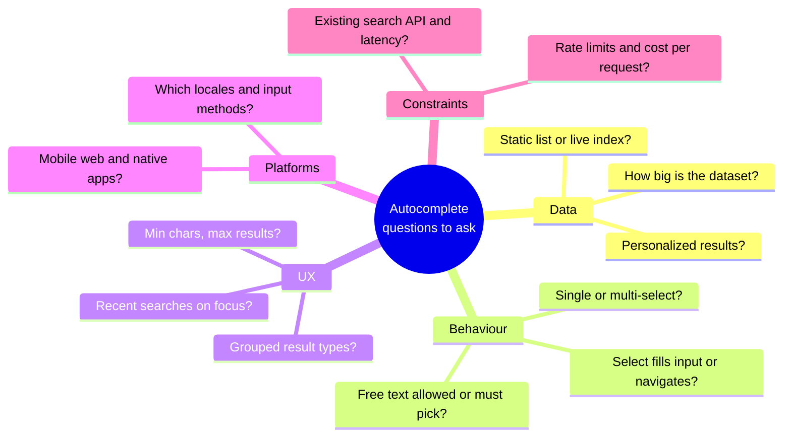
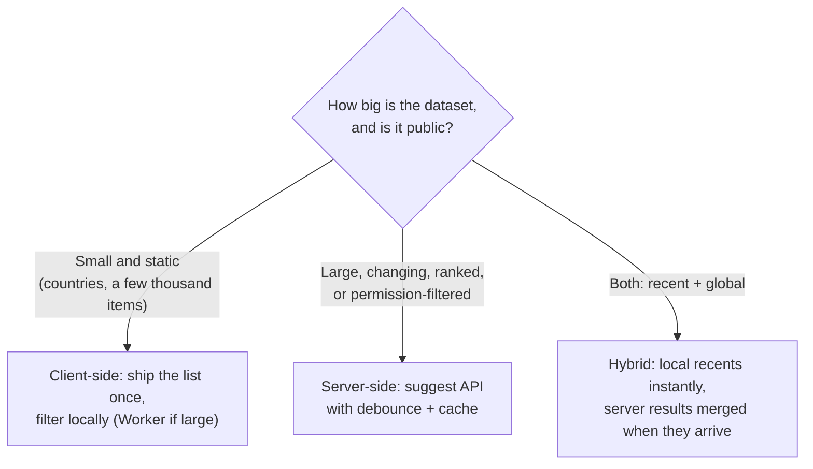
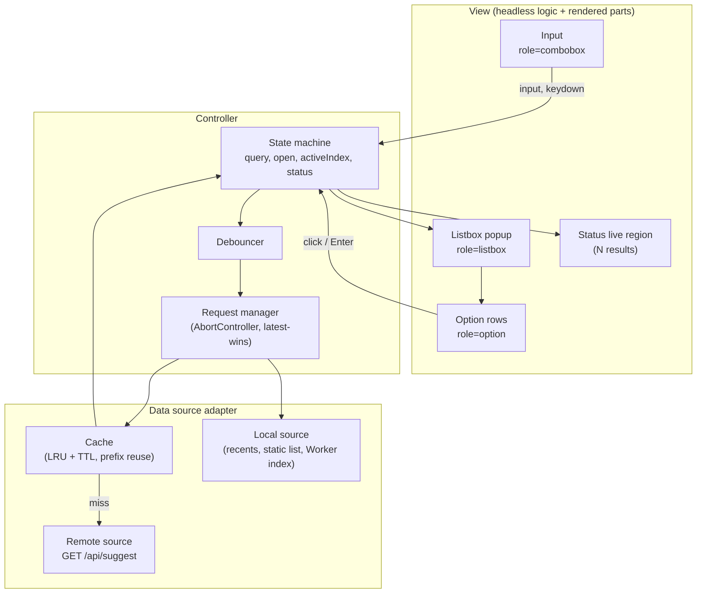
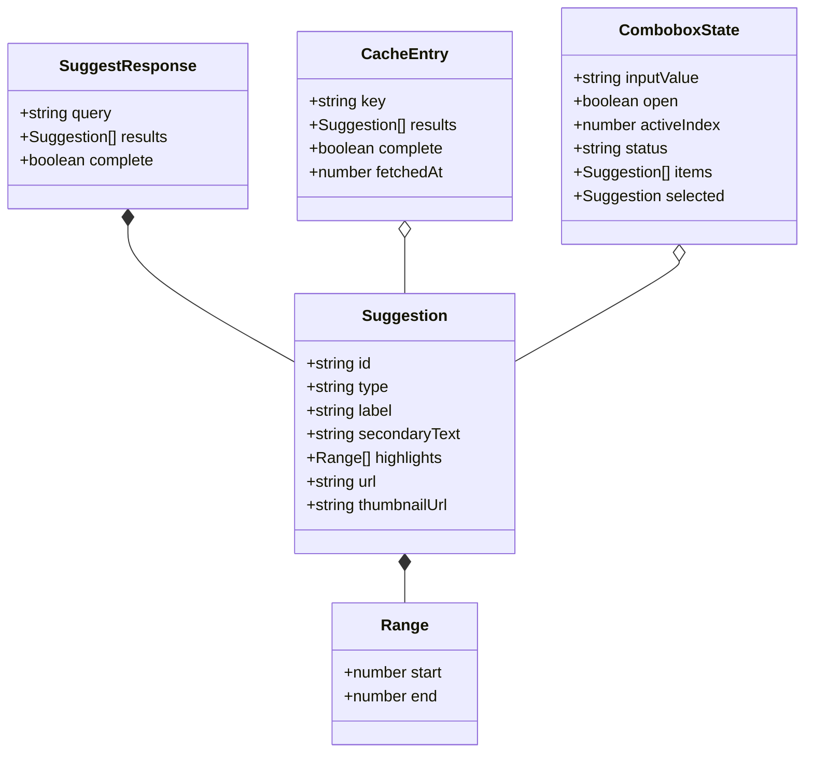
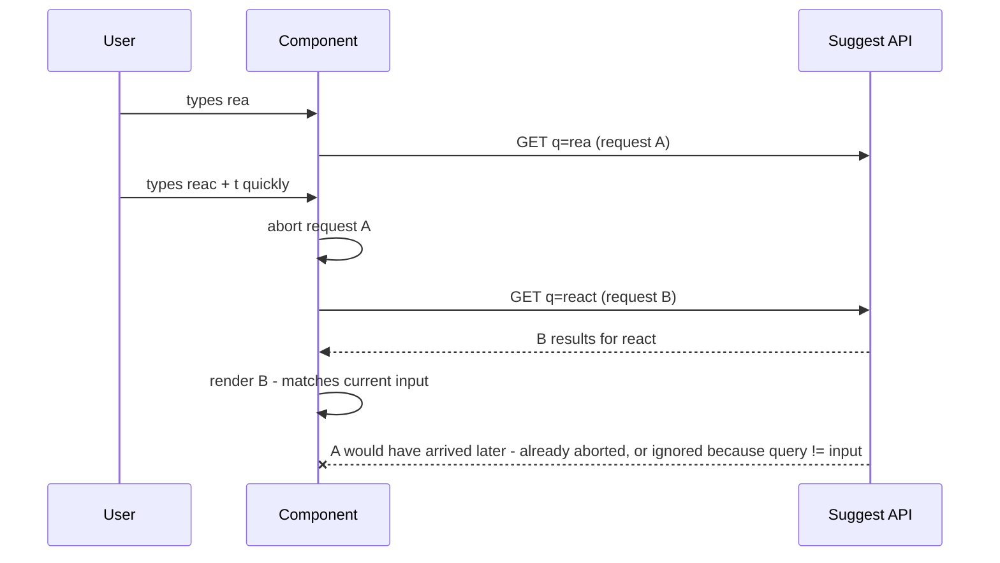
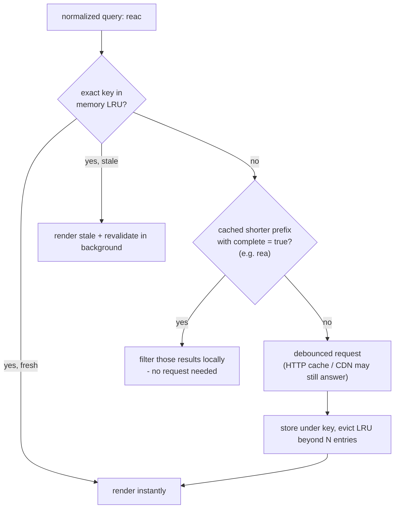
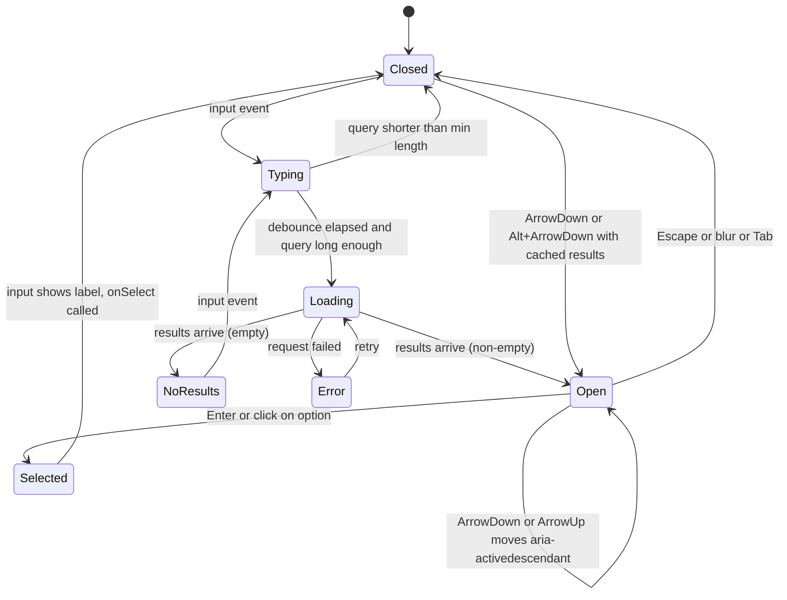
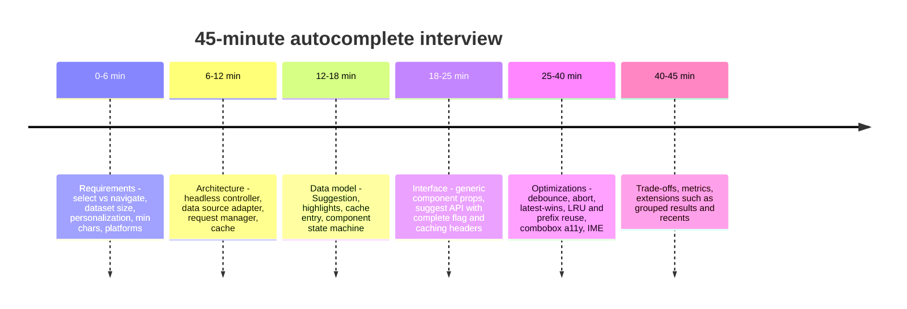

# Design an Autocomplete / Typeahead

> **Date:** 2026-11-06 · **Last updated:** 2026-11-06
> **Category:** Frontend System Design
> **Sub-Topic:** System Design Cases / Search
> **Level:** Advanced · **Reading time:** ~30 min
> **Informs:** client-side vs server-side suggestion filtering, debounce interval and minimum query length, request cancellation and race handling, suggestion caching (in-memory LRU, HTTP cache, prefix reuse), WAI-ARIA combobox semantics and keyboard model, IME composition and Unicode normalization, safe match highlighting, reusable headless component API

> **Pre-requisite:** [Debouncing & Throttling](../04-performance-engineering/debouncing-and-throttling.md), [ARIA Roles, States & Properties](../06-accessibility-and-i18n/aria-roles-states-and-properties.md) and [Keyboard Navigation & Focus Management](../06-accessibility-and-i18n/keyboard-navigation-and-focus-management.md).
> Second **system design case**, organised with **RADIO** (Requirements, Architecture, Data model, Interface, Optimizations), followed by a 45-minute interview walkthrough. It looks small, but it tests networking, caching, accessibility and i18n in one widget.

**Previous:** [Design a News Feed (Facebook/Twitter)](./design-a-news-feed-facebook-twitter.md) · **Next:** [Design an Image Carousel / Gallery](./design-an-image-carousel-gallery.md)

---

## Table of Contents

1. [ELI5 — Simple Explanation](#eli5--simple-explanation)
2. [Section 1: Requirements](#section-1-requirements)
3. [Section 2: Architecture](#section-2-architecture)
4. [Section 3: Data Model](#section-3-data-model)
5. [Section 4: Interface — Component and Server APIs](#section-4-interface--component-and-server-apis)
6. [Section 5: Optimizations — Network: Debounce, Cancel, Race Conditions](#section-5-optimizations--network-debounce-cancel-race-conditions)
7. [Section 6: Optimizations — Caching](#section-6-optimizations--caching)
8. [Section 7: Optimizations — Accessibility (Combobox Pattern)](#section-7-optimizations--accessibility-combobox-pattern)
9. [Section 8: Optimizations — i18n, Performance, Security, Edge Cases](#section-8-optimizations--i18n-performance-security-edge-cases)
10. [Interview Walkthrough](#interview-walkthrough)
11. [Real-World Examples](#real-world-examples)
12. [Key Points Summary](#key-points-summary)
13. [Test Your Understanding](#test-your-understanding)
14. [Cheat Sheet](#cheat-sheet)
15. [References & Further Reading](#references--further-reading)

---

## ELI5 — Simple Explanation

Imagine asking a **librarian** for a book while you're still spelling the title.

- You say "H… Ha… Har…". A smart librarian **waits until you pause** instead of running to the shelves after every letter (**debounce**).
- If you change your mind ("Har… no, *Hob*…"), the librarian **stops fetching the old answer** and never hands you "Harry Potter" after you've asked for "The Hobbit" (**cancel + ignore stale responses**).
- The librarian **remembers** what you asked a minute ago and answers instantly next time (**cache**).
- The suggestions are read out in order, and you point at one with arrow keys without leaving the conversation (**combobox keyboard model**: focus stays in the input, the "pointed-at" option is announced).

> **An autocomplete is a race between the user's typing and the network: wait for pauses, cancel what's outdated, remember what you've seen, and let keyboard and screen-reader users drive it exactly like mouse users.**

---

## Core Concept — Step by Step

### Section 1: Requirements

**Functional requirements:**

| # | Requirement | Notes |
|---|---|---|
| F1 | Show suggestions as the user types | After a minimum length (often 1–3 chars), limited to N results |
| F2 | Select with mouse, touch or keyboard | Selecting fills the input **or** navigates (e.g. to a profile) — ask which |
| F3 | Highlight the matched part | Safe rendering of user input and results |
| F4 | Empty-input state | Recent searches and/or trending, clearable |
| F5 | Grouped results (optional) | "People", "Hashtags", "Products" sections |
| F6 | **Reusable** component | Same widget for search bar, mention picker, country field, tag input |

**Non-functional requirements:**

| Quality | Target / meaning |
|---|---|
| **Perceived latency** | Suggestions appear quickly after a pause; typing itself never lags (INP ≤ 200 ms) |
| **Network efficiency** | No request per keystroke; no duplicate requests for the same query |
| **Correctness** | Displayed results always match the **current** input — never an older query |
| **Accessibility** | WAI-ARIA combobox: full keyboard support, announced results |
| **i18n** | IME input (Chinese, Japanese, Korean), diacritics, RTL |
| **Resilience** | Slow network, errors, offline → graceful states, the input keeps working |



**The first big decision — where does filtering happen?**



---

### Section 2: Architecture



| Layer | Responsibility | Why separate |
|---|---|---|
| **Headless controller** | State, keyboard handling, ARIA attributes | Reused across visual designs and contexts |
| **Data source adapter** | `search(query, signal) → Promise<Suggestion[]>` | Swap local/remote/hybrid without touching the UI |
| **Request manager** | Debounce, cancel, latest-wins | Correctness under fast typing and slow networks |
| **Cache** | Avoid repeated requests | Speed + lower server cost |
| **View** | Markup, styling, popup positioning | Designers own it; logic doesn't care |

**Rendering strategy:** the input itself should be **server-rendered** (it's part of the page and usable before JS), ideally inside a `<form role="search">` that submits to a results page — a **progressive enhancement** baseline. Suggestions are **client-rendered** after hydration (they depend on typing). The popup is positioned with CSS anchor positioning where supported, or a library such as Floating UI; the Popover API helps with top-layer stacking and light dismiss — check MDN for current browser support of both.

---

### Section 3: Data Model



| Data | Kind | Where it lives |
|---|---|---|
| `inputValue`, `open`, `activeIndex` | UI state | Component |
| `items`, `status` (`idle`/`loading`/`success`/`empty`/`error`) | Derived from server state | Controller (or a query cache keyed by normalized query) |
| Cached suggestions | Server state | In-memory LRU (+ HTTP cache underneath) |
| Recent searches | Client state | `localStorage` (bounded list, user-clearable) |
| Static dataset (if client-side) | Static data | Fetched once, `immutable` hashed URL, indexed in a Worker if large |

**Cache key = normalized query:**

```text
raw input:        "  Café "
normalize:        NFKC → trim → collapse spaces → locale lower-case  → "café"
optionally fold:  strip diacritics for matching (NFD + remove combining marks) → "cafe"
key:              source + ":" + locale + ":" + normalized query      → "global:fr-FR:cafe"
```

> **Where do highlight ranges come from?** Ideally the **server** returns them (it knows how it matched: prefix, fuzzy, transliteration). Computing them on the client with `indexOf` on lower-cased strings breaks for characters whose lower-case form has a different length and for diacritic-insensitive matches.

---

### Section 4: Interface — Component and Server APIs

**Component API (headless + default UI):**

```typescript
export interface AutocompleteProps<T> {
  label: string;                                     // visible label (required for a11y)
  source: (query: string, signal: AbortSignal) => Promise<T[]>;
  getKey: (item: T) => string;
  getLabel: (item: T) => string;                     // text for the input + accessible name
  renderOption?: (item: T, state: { active: boolean; query: string }) => React.ReactNode;
  onSelect: (item: T) => void;
  minQueryLength?: number;                           // default 2
  debounceMs?: number;                               // default ~200; tune by measuring
  maxResults?: number;                               // default 8
  emptyStateItems?: T[];                             // recents / trending on focus
  freeSolo?: boolean;                                // allow submitting text that isn't an option
}
```

| Design choice | Reason |
|---|---|
| `source` takes an `AbortSignal` | The component can cancel outdated requests regardless of transport |
| `getKey` / `getLabel` instead of assuming `{id, name}` | Works with any data shape (generic `T`) |
| `renderOption` render prop | Custom rows (avatars, prices) without forking the component |
| Headless hook underneath (`useCombobox`) | Teams with their own design system reuse the logic only |
| Controlled + uncontrolled modes (`value`/`defaultValue`) | Fits forms and standalone search bars — see [Controlled vs Uncontrolled Components](../05-design-systems-and-components/controlled-vs-uncontrolled-components.md) |

**Server API contract:**

```http
GET /api/suggest?q=caf&limit=8&types=place,user HTTP/1.1
Accept: application/json
Accept-Language: fr-FR
```

```json
{
  "query": "caf",
  "complete": false,
  "results": [
    { "id": "pl_19", "type": "place", "label": "Café de Flore", "secondaryText": "Paris", "highlights": [{ "start": 0, "end": 3 }], "url": "/places/pl_19" },
    { "id": "u_88", "type": "user", "label": "Cafu Silva", "secondaryText": "@cafu", "highlights": [{ "start": 0, "end": 3 }], "url": "/u/cafu" }
  ]
}
```

| Field / header | Purpose |
|---|---|
| `query` echoed back | Lets the client verify the response matches the query it rendered (defence against races) |
| `complete` | `true` when the server returned **all** matches (fewer than `limit`) — enables client-side prefix reuse |
| `highlights` | Match ranges in **UTF-16 code units** of `label` (JavaScript string indices) — document the unit |
| `Cache-Control: public, max-age=60, stale-while-revalidate=300` | For non-personalized suggestions; CDN can absorb popular prefixes |
| `Cache-Control: private` | If results depend on the user (friends, permissions) — never in a shared cache |
| `Vary: Accept-Language` | Only if results differ by language; prefer a `locale` query param for better cache keys |
| `429 Too Many Requests` + `Retry-After` | Rate limiting; the UI keeps the last results and quietly retries |

> **GraphQL alternative:** a `suggest(query:, first:)` field works the same way; send it as a persisted query over `GET` if you want HTTP/CDN caching.

---

### Section 5: Optimizations — Network: Debounce, Cancel, Race Conditions

**Debounce vs throttle** (see [Debouncing & Throttling](../04-performance-engineering/debouncing-and-throttling.md)):

| Strategy | Requests while typing "react" quickly | Feel |
|---|---|---|
| None | 5 (r, re, rea, reac, react) | Wasteful; responses can arrive out of order |
| **Debounce** (~150–300 ms) | 1 after the pause | Standard choice — results for what the user meant |
| Throttle (e.g. every 300 ms) | 2–3 during typing | Feels "live" during long typing; more requests |
| Debounce + cache-first | 0 if cached, else 1 | Best: cached prefixes show instantly, no wait |



**Three layers of race protection:**
1. **Abort** the previous request (`AbortController`) — saves bandwidth and server work.
2. **Latest-wins check** — before rendering, verify the response's query equals the **current** normalized input (or use an incrementing request id). Aborts can lose the race with a response already being parsed.
3. **Ignore results after unmount / close** — cleanup in effects; check `signal.aborted`.

**Other network optimizations:**
- **Minimum query length** (1–3 chars depending on dataset): single letters match too much and cache poorly.
- **Prefetch on focus**: warm the connection or load recents/trending when the input is focused (`preconnect` to the suggest host if it's a different origin).
- **Request coalescing**: if two components ask for the same key, share one in-flight promise.
- **Show a spinner only if the request is slow** — a short delay avoids flicker on fast responses; keep old results visible (dimmed) while loading.
- **HTTP/2 or HTTP/3** connection reuse matters more than payload size here; payloads are tiny.

---

### Section 6: Optimizations — Caching



| Layer | What it buys | Policy |
|---|---|---|
| **In-memory LRU** (e.g. 50–100 queries) | Instant results on backspace and repeated queries | TTL of a minute or so for changing data; clear on logout |
| **Prefix reuse** | No request when narrowing a complete result set | Only when the server marks `complete: true` and matching is prefix-monotonic |
| **HTTP cache** | Browser reuse across component instances / reloads | `max-age` short; `private` for personalized |
| **CDN** | Popular prefixes served at the edge | Only non-personalized; normalize the cache key (lower-case `q`, sorted params) |
| **Recents in `localStorage`** | Useful suggestions with zero network on focus | Bounded (e.g. 10), de-duplicated, clearable, never store sensitive queries |
| **Static dataset** | Fully offline filtering | Hashed URL + `immutable`; build an index once (in a Worker for large lists) |

> **Prefix reuse is not always valid.** Fuzzy matching, typo tolerance, synonym expansion or popularity re-ranking can return results for "reac" that weren't in "rea"'s top N. Use it only when the server says the set is complete **and** the matching rule is "contains/starts with".

---

### Section 7: Optimizations — Accessibility (Combobox Pattern)

The WAI-ARIA Authoring Practices **combobox** pattern (ARIA 1.2) is the contract. **DOM focus stays on the input**; the "current" option is indicated with `aria-activedescendant`.



| Element | Attributes |
|---|---|
| Input | `role="combobox"`, `aria-expanded`, `aria-controls="<listbox id>"`, `aria-autocomplete="list"` (or `"both"` with inline completion), `aria-activedescendant="<option id>"` when an option is active, a visible `<label>` |
| Popup | `role="listbox"`, `id`, an accessible name (`aria-label` / `aria-labelledby`) |
| Option | `role="option"`, unique `id`, `aria-selected="true"` on the active option |
| Groups | `role="group"` with `aria-labelledby` on a heading for "People", "Places" |
| Status | A **polite live region** ("5 suggestions available", "No results") — announced without moving focus |

| Key | Behaviour (APG) |
|---|---|
| `ArrowDown` / `ArrowUp` | Open the popup if needed; move the active option (wrapping is optional) |
| `Alt+ArrowDown` | Open without moving the active option |
| `Enter` | Accept the active option (prevent form submit only when an option is active) |
| `Escape` | Close the popup; if already closed, optionally clear the input |
| `Home` / `End`, `ArrowLeft` / `ArrowRight` | Move the text caret (editable combobox) — don't hijack them |
| `Tab` | Leaves the field normally; don't trap focus |

**Practical details:**
- Keep the active option **visible**: `scrollIntoView({ block: 'nearest' })` on change.
- Prevent the input's `blur` from closing the popup before a click registers — `preventDefault()` on the option's `pointerdown`/`mousedown`.
- Visible focus style on the active option (not just colour — also an outline or background with enough contrast).
- `aria-selected` marks the **active** option in a single-select combobox; for multi-select, it reflects selection state and the active one is styled separately.
- Use `<mark>` for highlighted matches — screen readers usually read it as plain text, which is fine.
- **Native `<datalist>`** gives a free basic autocomplete, but styling is very limited and screen-reader/mobile behaviour varies by browser — acceptable for simple internal forms, not for a product search box.

---

### Section 8: Optimizations — i18n, Performance, Security, Edge Cases

**i18n:**

| Concern | Handling |
|---|---|
| **IME composition** (Chinese, Japanese, Korean) | Don't search or treat `Enter` as "select" while composing: check `event.isComposing` / track `compositionstart`/`compositionend`; search after `compositionend` |
| **Case + diacritics** | `normalize('NFKC')`, `toLocaleLowerCase(locale)`; for "cafe" ↔ "café", fold diacritics (`normalize('NFD')` + strip combining marks) or `Intl.Collator(locale, { sensitivity: 'base' })` for comparisons |
| **Turkish i, German ß, etc.** | Locale-aware lower-casing; don't assume lengths stay equal (affects highlight ranges) |
| **Word boundaries** | `Intl.Segmenter` for languages without spaces (Japanese, Thai) when matching word starts locally |
| **RTL** | `dir="auto"` on input and options; logical CSS (`inset-inline-start`) for the popup and icons. See [RTL Layout Support](../06-accessibility-and-i18n/rtl-layout-support.md) |
| **Strings** | Localized status messages with plural rules ("1 result" vs "5 results") |

**Performance:**
- Keep the input **controlled but cheap**: update the input value synchronously; filtering a big local list goes through `useDeferredValue`/`startTransition` (React) or a **Web Worker** (see [Web Workers for Heavy Computation](../04-performance-engineering/web-workers-for-heavy-computation.md)).
- Results are short (≤10) — virtualization is rarely needed, except for long "select from 5,000 options" pickers.
- Lazy-load the autocomplete code if the search box isn't above the fold, but **keep the input in the initial HTML**.
- Memoize option rows; avoid re-rendering the list on each keystroke when results haven't changed.

**Security & privacy:**
- **Never build HTML strings** for highlighting (`label.replace(q, '<b>' + q + '</b>')` + `innerHTML` = XSS through both the label and the query). Split into text segments and render `<mark>` elements.
- Validate result URLs (same-origin paths or `https:`) before navigating.
- Personalized suggestions (contacts, private docs) are `Cache-Control: private` and must be permission-filtered **server-side**.
- Queries can contain PII (names, emails) — avoid logging raw queries in analytics without consent; don't store sensitive recents.
- Rate-limit the endpoint; enforce a max query length on the server.

**Edge cases checklist:**

```text
□ Typing faster than the network            → abort + latest-wins check
□ Backspace to a cached query               → instant from LRU
□ Query below min length                    → close popup, cancel pending request
□ No results                                → "No results for 'xyz'" + announce it; suggest alternatives
□ Error / offline                           → keep last results dimmed, inline message, input still works
□ Paste a long string                       → trim, cap length, one request
□ Click option while input blurs            → preventDefault on option pointerdown
□ Mobile                                    → type="search", enterkeyhint="search", popup above the virtual keyboard
□ Browser autofill dropdown overlapping     → autocomplete="off" on the search input
□ Selected value vs typed text              → decide: input shows label; Escape restores the typed text?
□ Duplicate labels (two "John Smith")        → secondary text (handle, city) to disambiguate
```

---

## Interview Walkthrough



| Phase | What to say / draw | Signals |
|---|---|---|
| **Requirements** | "Does selecting navigate or fill the input?" "How big is the dataset?" | You know the decision that changes everything (client vs server filtering) |
| **Architecture** | Controller ↔ data source adapter ↔ cache ↔ API | Separation makes it reusable (search, mentions, pickers) |
| **Data model** | `Suggestion` with highlight ranges; normalized cache key | Server-provided ranges; Unicode awareness |
| **Interface** | Generic `source(query, signal)`; `complete` flag | Cancellation built into the contract |
| **Optimizations** | Race diagram, cache flow, ARIA attributes + keys | Depth on races, caching validity, a11y |
| **Wrap-up** | Metrics: time-to-suggestions, requests per search, selection rate, zero-result rate | You'd measure and iterate |

**Trade-offs to discuss:**

| Decision | Option A | Option B | Lean |
|---|---|---|---|
| Filtering | Client-side (instant, offline, ships data) | Server-side (scales, ranked, secure) | Size and privacy decide; hybrid for recents |
| Rate control | Debounce (fewer requests) | Throttle (live feel) | Debounce + cache-first |
| Debounce length | Short (snappier, more requests) | Long (fewer requests, laggy feel) | Start ~200 ms, tune with RUM |
| Caching | Exact key only (always correct) | Prefix reuse (fewer requests) | Prefix reuse only with `complete` + prefix matching |
| Component | Build in-house | React Aria / Downshift / Headless UI / Angular Material / Melt-Bits UI | Library unless you have unusual needs — a11y is hard to get right |
| Selection behaviour | Fill input | Navigate | Product decision — ask |
| Inline completion | `aria-autocomplete="list"` | `"both"` (grey ghost text) | `list` unless the product wants inline completion |

---

## Real-World Examples

**Example 1 — Debounced value hook:**
```typescript
import { useEffect, useState } from 'react';

export function useDebouncedValue<T>(value: T, delayMs: number): T {
  const [debounced, setDebounced] = useState(value);
  useEffect(() => {
    const id = setTimeout(() => setDebounced(value), delayMs);
    return () => clearTimeout(id);          // each keystroke restarts the timer
  }, [value, delayMs]);
  return debounced;
}
```

**Example 2 — Suggestions with LRU cache, prefix reuse, abort and latest-wins:**
```typescript
import { useEffect, useState } from 'react';

export interface Suggestion {
  id: string;
  type: 'user' | 'place' | 'query';
  label: string;
  secondaryText?: string;
  highlights: { start: number; end: number }[];
  url?: string;
}
interface Entry { results: Suggestion[]; complete: boolean; fetchedAt: number }

const MAX_ENTRIES = 100;
const TTL_MS = 60_000;
const cache = new Map<string, Entry>();           // Map keeps insertion order → simple LRU

export const normalize = (q: string, locale = 'en') =>
  q.normalize('NFKC').trim().replace(/\s+/g, ' ').toLocaleLowerCase(locale);

function cacheGet(key: string): Entry | undefined {
  const hit = cache.get(key);
  if (!hit) return undefined;
  cache.delete(key); cache.set(key, hit);         // mark as most recently used
  return hit;
}
function cacheSet(key: string, entry: Entry) {
  cache.set(key, entry);
  if (cache.size > MAX_ENTRIES) cache.delete(cache.keys().next().value!); // evict oldest
}
function fromCompletePrefix(key: string): Suggestion[] | undefined {
  for (let i = key.length - 1; i >= 1; i--) {
    const prefix = cacheGet(key.slice(0, i));
    if (prefix?.complete && Date.now() - prefix.fetchedAt < TTL_MS) {
      // Valid only because our server does "label starts with / contains" matching
      return prefix.results.filter((s) => normalize(s.label).includes(key));
    }
  }
  return undefined;
}

type Status = 'idle' | 'loading' | 'success' | 'error';

export function useSuggestions(query: string, minLength = 2) {
  const [state, setState] = useState<{ status: Status; results: Suggestion[] }>({ status: 'idle', results: [] });

  useEffect(() => {
    const key = normalize(query);
    if (key.length < minLength) { setState({ status: 'idle', results: [] }); return; }

    const hit = cacheGet(key);
    if (hit && Date.now() - hit.fetchedAt < TTL_MS) { setState({ status: 'success', results: hit.results }); return; }
    const local = fromCompletePrefix(key);
    if (local) { setState({ status: 'success', results: local }); return; }

    const controller = new AbortController();
    setState((s) => ({ status: 'loading', results: s.results }));   // keep old results visible

    fetch(`/api/suggest?q=${encodeURIComponent(key)}&limit=8`, { signal: controller.signal })
      .then((r) => { if (!r.ok) throw new Error(String(r.status)); return r.json(); })
      .then((data: { query: string; complete: boolean; results: Suggestion[] }) => {
        if (data.query !== key) return;                              // latest-wins guard
        cacheSet(key, { results: data.results, complete: data.complete, fetchedAt: Date.now() });
        setState({ status: 'success', results: data.results });
      })
      .catch((err) => {
        if (err.name === 'AbortError') return;                       // superseded, not a failure
        setState((s) => ({ status: 'error', results: s.results }));
      });

    return () => controller.abort();                                 // new query or unmount
  }, [query, minLength]);

  return state;
}
```
> In an app that already uses TanStack Query, the same thing is `useQuery({ queryKey: ['suggest', key], queryFn: ({ signal }) => ..., enabled: key.length >= 2, staleTime: 60_000, placeholderData: keepPreviousData })` — it handles caching, deduplication and passes an `AbortSignal` for you.

**Example 3 — Accessible combobox (React, ARIA 1.2 pattern):**
```tsx
import { useEffect, useId, useState, type KeyboardEvent } from 'react';

export function SearchAutocomplete({ onSelect }: { onSelect: (s: Suggestion) => void }) {
  const id = useId();
  const listboxId = `${id}-listbox`;
  const optionId = (i: number) => `${id}-opt-${i}`;

  const [input, setInput] = useState('');
  const [open, setOpen] = useState(false);
  const [active, setActive] = useState(-1);
  const debounced = useDebouncedValue(input, 200);
  const { status, results } = useSuggestions(debounced);

  useEffect(() => { setActive(-1); setOpen(results.length > 0 && input.trim().length >= 2); }, [results]); // eslint-disable-line react-hooks/exhaustive-deps
  useEffect(() => {
    if (active >= 0) document.getElementById(optionId(active))?.scrollIntoView({ block: 'nearest' });
  }, [active]); // eslint-disable-line react-hooks/exhaustive-deps

  const choose = (s: Suggestion) => {
    setInput(s.label);
    setOpen(false);
    setActive(-1);
    onSelect(s);
  };

  const onKeyDown = (e: KeyboardEvent<HTMLInputElement>) => {
    if (e.nativeEvent.isComposing) return;                // IME: Enter confirms composition, not a choice
    switch (e.key) {
      case 'ArrowDown':
        e.preventDefault();
        if (!open && results.length) { setOpen(true); if (e.altKey) return; }
        setActive((i) => (results.length ? (i + 1) % results.length : -1));
        break;
      case 'ArrowUp':
        e.preventDefault();
        setActive((i) => (results.length ? (i <= 0 ? results.length - 1 : i - 1) : -1));
        break;
      case 'Enter':
        if (open && active >= 0) { e.preventDefault(); choose(results[active]); }
        break;                                            // otherwise let the form submit
      case 'Escape':
        if (open) { setOpen(false); setActive(-1); } else { setInput(''); }
        break;
    }
  };

  const statusText =
    status === 'loading' ? '' :
    status === 'error' ? 'Suggestions are unavailable.' :
    open ? `${results.length} suggestion${results.length === 1 ? '' : 's'} available.` :
    status === 'success' && input.trim().length >= 2 && results.length === 0 ? 'No suggestions.' : '';

  return (
    <form role="search" action="/search">
      <label htmlFor={`${id}-input`}>Search</label>
      <input
        id={`${id}-input`}
        name="q"
        type="search"
        role="combobox"
        aria-expanded={open}
        aria-controls={listboxId}
        aria-autocomplete="list"
        aria-activedescendant={open && active >= 0 ? optionId(active) : undefined}
        autoComplete="off"
        spellCheck={false}
        enterKeyHint="search"
        dir="auto"
        value={input}
        onChange={(e) => { setInput(e.target.value); }}
        onKeyDown={onKeyDown}
        onBlur={() => setOpen(false)}
      />
      <ul id={listboxId} role="listbox" aria-label="Search suggestions" hidden={!open}>
        {results.map((s, i) => (
          <li
            key={s.id}
            id={optionId(i)}
            role="option"
            aria-selected={i === active}
            onPointerDown={(e) => e.preventDefault()}     // keep focus in the input so blur doesn't close first
            onClick={() => choose(s)}
            onPointerMove={() => setActive(i)}
          >
            <Highlighted text={s.label} ranges={s.highlights} />
            {s.secondaryText && <span className="secondary"> · {s.secondaryText}</span>}
          </li>
        ))}
      </ul>
      <div role="status" aria-live="polite" className="visually-hidden">{statusText}</div>
    </form>
  );
}
```

**Example 4 — Safe highlighting (BAD → GOOD):**
```tsx
// ❌ BAD: XSS through the label OR the user's own query (e.g. q = "")
function HighlightBad({ label, query }: { label: string; query: string }) {
  return <span dangerouslySetInnerHTML={{ __html: label.replace(query, `<b>${query}</b>`) }} />;
}

// ✅ GOOD: server-provided ranges → text segments → <mark>; React escapes every string
export function Highlighted({ text, ranges }: { text: string; ranges: { start: number; end: number }[] }) {
  const parts: React.ReactNode[] = [];
  let cursor = 0;
  [...ranges].sort((a, b) => a.start - b.start).forEach((r, i) => {
    if (r.start > cursor) parts.push(text.slice(cursor, r.start));
    parts.push(<mark key={i}>{text.slice(r.start, r.end)}</mark>);
    cursor = Math.max(cursor, r.end);
  });
  if (cursor < text.length) parts.push(text.slice(cursor));
  return <span dir="auto">{parts}</span>;
}
```

**Example 5 — Suggest endpoint with sensible headers (Express):**
```javascript
import express from 'express';

const app = express();

app.get('/api/suggest', async (req, res) => {
  const q = String(req.query.q ?? '').normalize('NFKC').trim().toLowerCase().slice(0, 100);
  const limit = Math.min(Number(req.query.limit) || 8, 20);

  if (q.length < 2) return res.json({ query: q, complete: true, results: [] });

  const matches = await searchIndex.prefixSearch(q, { limit: limit + 1 }); // fetch one extra to know if complete
  res.set('Cache-Control', 'public, max-age=60, stale-while-revalidate=300'); // non-personalized only
  res.json({
    query: q,
    complete: matches.length <= limit,
    results: matches.slice(0, limit),
  });
});

app.listen(3000);
```

**Example 6 — Large static list filtered in a Web Worker:**
```typescript
// search.worker.ts
let items: { id: string; label: string; folded: string }[] = [];
const fold = (s: string) => s.normalize('NFD').replace(/\p{M}/gu, '').toLocaleLowerCase();

self.onmessage = (e: MessageEvent) => {
  const msg = e.data as { type: 'load'; data: { id: string; label: string }[] } | { type: 'query'; q: string; reqId: number };
  if (msg.type === 'load') {
    items = msg.data.map((d) => ({ ...d, folded: fold(d.label) }));   // precompute once
  } else {
    const q = fold(msg.q);
    const results = items.filter((it) => it.folded.startsWith(q)).slice(0, 8);
    postMessage({ reqId: msg.reqId, results });                        // reqId → latest-wins on the main thread
  }
};
```
```typescript
// main thread
const worker = new Worker(new URL('./search.worker.ts', import.meta.url), { type: 'module' });
let latest = 0;
export function searchLocal(q: string): Promise<{ id: string; label: string }[]> {
  const reqId = ++latest;
  return new Promise((resolve) => {
    const onMsg = (e: MessageEvent) => {
      if (e.data.reqId !== reqId) return;           // a newer query superseded this one
      worker.removeEventListener('message', onMsg);
      resolve(e.data.results);
    };
    worker.addEventListener('message', onMsg);
    worker.postMessage({ type: 'query', q, reqId });
  });
}
```
> Superseded requests never resolve here, which is fine for a UI that only renders the latest; in long sessions, also remove stale listeners (e.g. reject older ids when a newer one arrives). Libraries such as MiniSearch, FlexSearch or Fuse.js add fuzzy matching and ranking.

**Example 7 — Other stacks:**
```text
Vue / Nuxt     Headless UI Vue Combobox · Reka UI Combobox · VueUse refDebounced/watchDebounced
               Abort in watch's onCleanup (Vue 3.5+ also exports onWatcherCleanup)
Angular        Angular Material mat-autocomplete (+ CDK a11y) · RxJS pipeline:
               valueChanges.pipe(debounceTime(200), map(normalize), distinctUntilChanged(),
                                 switchMap(q => this.api.suggest(q)))   // switchMap cancels the previous HTTP call
Svelte / Kit   Bits UI / Melt UI Combobox · a debounced $state + $effect with AbortController cleanup
iOS (SwiftUI)  .searchable(text:) + .searchSuggestions { } ; debounce with Combine or Task.sleep in .task(id:)
Android        Material 3 SearchBar / SearchView (Compose) ; Flow.debounce + flatMapLatest (cancels old queries)
React Native   TextInput + FlatList of results; same debounce/abort logic; accessibilityRole on rows
React (libs)   React Aria useComboBox · Downshift useCombobox · Headless UI Combobox · MUI Autocomplete
```

---

## Key Points Summary

| Concept | One-Line Explanation |
|---|---|
| **Client vs server filtering** | Small public static data → client; large, ranked or private → server; recents → hybrid |
| **Debounce** | Wait for a typing pause (~150–300 ms) before requesting |
| **Abort + latest-wins** | Cancel outdated requests and never render a response for an old query |
| **Normalized cache key** | NFKC + trim + locale lower-case (+ diacritic folding) so equivalent queries share entries |
| **LRU + TTL** | Instant results on backspace/repeat; bounded memory; short freshness |
| **Prefix reuse** | Filter a cached complete prefix result locally — only for prefix/contains matching |
| **`complete` flag** | Server tells the client whether it returned every match |
| **Combobox pattern** | Focus stays in the input; `aria-activedescendant` points to the active option |
| **Live region** | Announce result counts / no results politely |
| **IME** | Ignore keys while `isComposing`; search after `compositionend` |
| **Safe highlighting** | Server ranges → text segments → `<mark>`; never `innerHTML` |
| **Headless component** | Logic hook + render props → reusable for search, mentions, pickers |

---

## Test Your Understanding

**Q1 (Basic):** Why debounce rather than send a request on every keystroke? What problem remains even with debouncing?

<details>
<summary>Answer</summary>

Without debouncing, typing "react" sends five requests; most are wasted, they load the server, and on mobile they compete for bandwidth. Debouncing waits for a pause and sends one request for what the user actually meant.

What remains: **race conditions**. A user can pause, trigger request A ("rea"), type more, trigger request B ("react"), and A can still arrive **after** B (different server paths, caches, retries). If you render whatever arrives last, the UI shows results for "rea" under the input "react". You need **cancellation** (`AbortController`) plus a **latest-wins check** (compare the response's query or a request id with the current input).
</details>

**Q2 (Application):** You're building a country picker (~250 items) and a product search over 10 million SKUs. How does the architecture differ?

<details>
<summary>Answer</summary>

**Country picker:** ship the list (or bundle it) once, cached with a hashed URL; filter **client-side** synchronously — 250 items filter instantly, so no debounce or network races at all. Fold diacritics and use locale-aware matching ("Côte d'Ivoire" for "cote"), localize names with `Intl.DisplayNames` if needed. A native-looking select-only combobox (must pick a value) is appropriate.

**Product search:** **server-side** suggestions from a search index (ranking, typo tolerance, availability, permissions), debounced requests with abort + latest-wins, an in-memory LRU, short HTTP/CDN caching for popular prefixes, recents from `localStorage` on focus, and grouped results (queries, categories, products). Free text is allowed: Enter without an active option submits a full search.
</details>

**Q3 (Tricky):** You implemented prefix reuse: if "rea" is cached, "reac" filters those results locally. Users now complain some obvious products never show up. Why?

<details>
<summary>Answer</summary>

Prefix reuse is only valid if the cached result for "rea" contained **every** match. If the server returned only the **top 8** of 5,000 matches, filtering those 8 for "reac" misses matches that ranked below 8 for "rea" but would be top results for "reac". It is also invalid if matching isn't monotonic — fuzzy/typo-tolerant search, synonyms or popularity re-ranking can return results for the longer query that never appeared for the shorter one.

Fix: the server returns `complete: true` only when it returned all matches (fewer than `limit`), and the client reuses a prefix **only** in that case and only for prefix/contains matching. Otherwise, make a request.
</details>

**Q4 (Tricky):** A Japanese user types with an IME. Each time they press Enter to confirm a conversion, your autocomplete selects the first suggestion and navigates away. Also, requests fire for half-composed text. Fix both.

<details>
<summary>Answer</summary>

During IME composition, `Enter` **confirms the composition**; it isn't a "choose option" command. Check `event.isComposing` (or track `compositionstart`/`compositionend`) in `keydown` and ignore navigation keys while composing. Some browsers report the confirming `Enter` with `keyCode` 229, which legacy code also checks.

For requests: input events fire during composition with intermediate text (e.g. romaji or unconverted kana). Skip searching while composing and search after `compositionend` with the final text. Also normalize (NFKC folds full-width/half-width forms) so equivalent inputs share a cache key.
</details>

**Q5 (Application):** List the ARIA attributes and keyboard behaviour of an accessible autocomplete, and explain why DOM focus stays in the input.

<details>
<summary>Answer</summary>

- Input: `role="combobox"`, `aria-expanded`, `aria-controls` → listbox id, `aria-autocomplete="list"`, `aria-activedescendant` → id of the active option (only while one is active), and a visible `<label>`.
- Popup: `role="listbox"` with an accessible name; options `role="option"` with unique ids and `aria-selected="true"` on the active one; groups with `role="group"` + label.
- A polite live region announces "5 suggestions available" / "No results".
- Keys: `ArrowDown`/`ArrowUp` move the active option (opening the popup if needed), `Alt+ArrowDown` opens, `Enter` accepts the active option, `Escape` closes (then clears), arrow-left/right and Home/End stay with text editing, `Tab` leaves normally.

Focus stays in the input so the user can **keep typing** at any time — moving DOM focus into the list would steal keystrokes and confuse the caret. `aria-activedescendant` tells assistive technology which option is "virtually focused", so it's announced while the real focus remains in the text field.
</details>

**Q6 (System design):** Design a reusable `@mention` picker for a rich-text composer used by web, iOS and Android apps, with tens of thousands of possible users in an organisation.

<details>
<summary>Answer</summary>

- **Trigger:** detect `@` followed by text at the caret; the "query" is the text after `@` up to the caret. The popup anchors to the **caret position** (selection range rect), not the input box.
- **Data:** hybrid — immediately show recent collaborators and people in the current thread (local), then merge debounced server results (`/api/users/suggest?q=&context=thread_123`), personalized and permission-filtered server-side, `Cache-Control: private`. Dedupe by user id; local results first.
- **Controller:** the same headless combobox logic as the search box (abort, latest-wins, LRU per org), but `Enter`/`Tab` inserts a **mention token** (non-editable inline entity with the user id) instead of plain text; `Escape` dismisses and leaves the typed text.
- **A11y:** the editor is a `textbox` with `aria-multiline`; apply combobox attributes (`aria-controls`, `aria-activedescendant`, `aria-expanded`) to the editable element while the picker is open; announce counts in a live region.
- **i18n:** IME-safe triggers, diacritic-insensitive name matching, transliteration server-side, `dir="auto"`.
- **Security:** the stored post contains `{ type: 'mention', userId }` entities, never HTML; names are rendered as text; the server validates that the author can mention those users.
- **Native:** iOS/Android implement the same contract (shared API + shared normalization rules), with platform pickers above the keyboard; debounce with Combine/Flow and cancel with `flatMapLatest`/task cancellation.
</details>

---

## Cheat Sheet

**Key Definitions:**
- **Combobox:** an input with an associated popup (listbox) that helps set its value.
- **`aria-activedescendant`:** points to the "virtually focused" option while DOM focus stays in the input.
- **Debounce:** run after input pauses for N ms.
- **Latest-wins:** render a response only if it belongs to the current query.
- **Prefix reuse:** derive results for a longer query from a complete cached shorter one.
- **IME composition:** multi-keystroke input of characters (CJK); `isComposing` is true meanwhile.
- **Unicode normalization:** NFC/NFKC/NFD canonical forms so equivalent text compares equal.

**Quick Reference:**
```text
R  fill vs navigate? dataset size? personalized? min chars / max results? recents? platforms? IME locales?
A  Input(combobox) + Listbox + Status ← Controller(state machine, debounce, request manager)
   ← DataSource adapter(local | remote | hybrid) ← Cache(LRU+TTL, prefix reuse) ← GET /api/suggest
   Render: SSR the <form role="search"> + input; suggestions client-side
D  Suggestion{id,type,label,secondaryText,highlights[],url} · cache key = normalized query (+locale)
I  source(query, signal) → Promise<T[]> · getKey · getLabel · renderOption · onSelect
   GET /api/suggest?q&limit → {query, complete, results}; public short max-age OR private
O  debounce ~200 ms · min length · abort + latest-wins · LRU + prefix reuse (complete only)
   combobox ARIA + live region · isComposing · NFKC/locale lower/diacritic fold · <mark> not innerHTML
   pointerdown preventDefault on options · autocomplete="off" · enterkeyhint="search" · dir="auto"
```

**Common Mistakes to Avoid:**

| Mistake | Why Wrong | Fix |
|---|---|---|
| Request on every keystroke | Wasted requests, server load, more races | Debounce + min length + cache |
| No cancellation / latest-wins | Old results overwrite new ones | `AbortController` + compare query or request id |
| Caching by raw input | "Café", "café ", "CAFÉ" miss each other | Normalize the key (NFKC, trim, locale lower-case) |
| Prefix reuse on top-N results | Silently hides valid matches | Only with `complete: true` and prefix/contains matching |
| Moving DOM focus into the list | Typing breaks; caret lost | Keep focus in input, use `aria-activedescendant` |
| No live region | Screen-reader users don't know results appeared | Polite status: "N suggestions available" |
| Highlight via `innerHTML` | XSS through labels or the query | Ranges → text segments → `<mark>` |
| Popup closes before click registers | Blur fires first | `preventDefault()` on option `pointerdown`/`mousedown` |
| Enter selects during IME composition | CJK users can't type | Ignore keys when `isComposing` |
| Showing a spinner instantly / clearing results while loading | Flicker and jumpy UI | Keep previous results; show spinner only if slow |
| `Cache-Control: public` on personalized suggestions | Leaks one user's contacts to others via CDN | `private`; permission-filter server-side |
| Hand-rolled combobox without testing | ARIA details are easy to get wrong | Use React Aria / Downshift / Headless UI / Angular Material, test with screen readers |

---

## References & Further Reading

**Accessibility**
- W3C WAI-ARIA APG: [Combobox pattern](https://www.w3.org/WAI/ARIA/apg/patterns/combobox/) · [Editable combobox with list autocomplete example](https://www.w3.org/WAI/ARIA/apg/patterns/combobox/examples/combobox-autocomplete-list/)
- MDN: [ARIA `combobox` role](https://developer.mozilla.org/en-US/docs/Web/Accessibility/ARIA/Reference/Roles/combobox_role) · [`aria-activedescendant`](https://developer.mozilla.org/en-US/docs/Web/Accessibility/ARIA/Reference/Attributes/aria-activedescendant) · [`aria-autocomplete`](https://developer.mozilla.org/en-US/docs/Web/Accessibility/ARIA/Reference/Attributes/aria-autocomplete)
- MDN: [`<datalist>`](https://developer.mozilla.org/en-US/docs/Web/HTML/Reference/Elements/datalist) · [`enterkeyhint`](https://developer.mozilla.org/en-US/docs/Web/HTML/Reference/Global_attributes/enterkeyhint)

**Networking & caching**
- MDN: [`AbortController`](https://developer.mozilla.org/en-US/docs/Web/API/AbortController) · [`Cache-Control`](https://developer.mozilla.org/en-US/docs/Web/HTTP/Reference/Headers/Cache-Control)
- TanStack Query: [Query cancellation](https://tanstack.com/query/latest/docs/framework/react/guides/query-cancellation)
- RxJS: [`switchMap`](https://rxjs.dev/api/operators/switchMap) · [`debounceTime`](https://rxjs.dev/api/operators/debounceTime)

**i18n**
- MDN: [`String.prototype.normalize()`](https://developer.mozilla.org/en-US/docs/Web/JavaScript/Reference/Global_Objects/String/normalize) · [`Intl.Collator`](https://developer.mozilla.org/en-US/docs/Web/JavaScript/Reference/Global_Objects/Intl/Collator) · [`Intl.Segmenter`](https://developer.mozilla.org/en-US/docs/Web/JavaScript/Reference/Global_Objects/Intl/Segmenter)
- MDN: [`KeyboardEvent.isComposing`](https://developer.mozilla.org/en-US/docs/Web/API/KeyboardEvent/isComposing) · [`compositionend` event](https://developer.mozilla.org/en-US/docs/Web/API/Element/compositionend_event)

**Components & positioning**
- React Aria: [`useComboBox`](https://react-spectrum.adobe.com/react-aria/useComboBox.html) · Downshift: [`useCombobox`](https://www.downshift-js.com/use-combobox/) · Headless UI: [Combobox](https://headlessui.com/react/combobox)
- Angular Material: [Autocomplete](https://material.angular.dev/components/autocomplete/overview)
- MDN: [Popover API](https://developer.mozilla.org/en-US/docs/Web/API/Popover_API) · [CSS anchor positioning](https://developer.mozilla.org/en-US/docs/Web/CSS/CSS_anchor_positioning) · Floating UI: [Docs](https://floating-ui.com/)

**Security**
- OWASP: [Cross Site Scripting Prevention Cheat Sheet](https://cheatsheetseries.owasp.org/cheatsheets/Cross_Site_Scripting_Prevention_Cheat_Sheet.html)

**Deep dives**
- GreatFrontEnd: [Autocomplete — front end system design](https://www.greatfrontend.com/questions/system-design/autocomplete)
- Adobe React Spectrum blog: [Building a ComboBox that works everywhere](https://react-spectrum.adobe.com/blog/building-a-combobox.html)

---

> **Previous Topic:** [Design a News Feed (Facebook/Twitter)](./design-a-news-feed-facebook-twitter.md)
> — Infinite, real-time, personalised lists with cursor pagination and virtualization

> **Next Topic:** [Design an Image Carousel / Gallery](./design-an-image-carousel-gallery.md)
> — Responsive images, lazy loading, gestures and an accessible carousel

*Saved on: 2026-11-06 | Repo: Frontend System Design Learning Notes*
