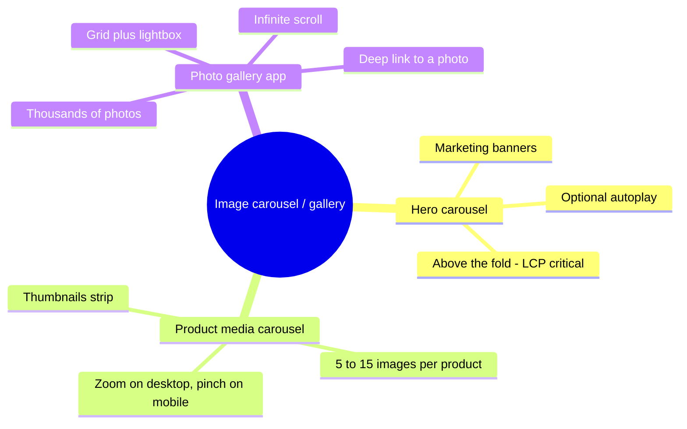
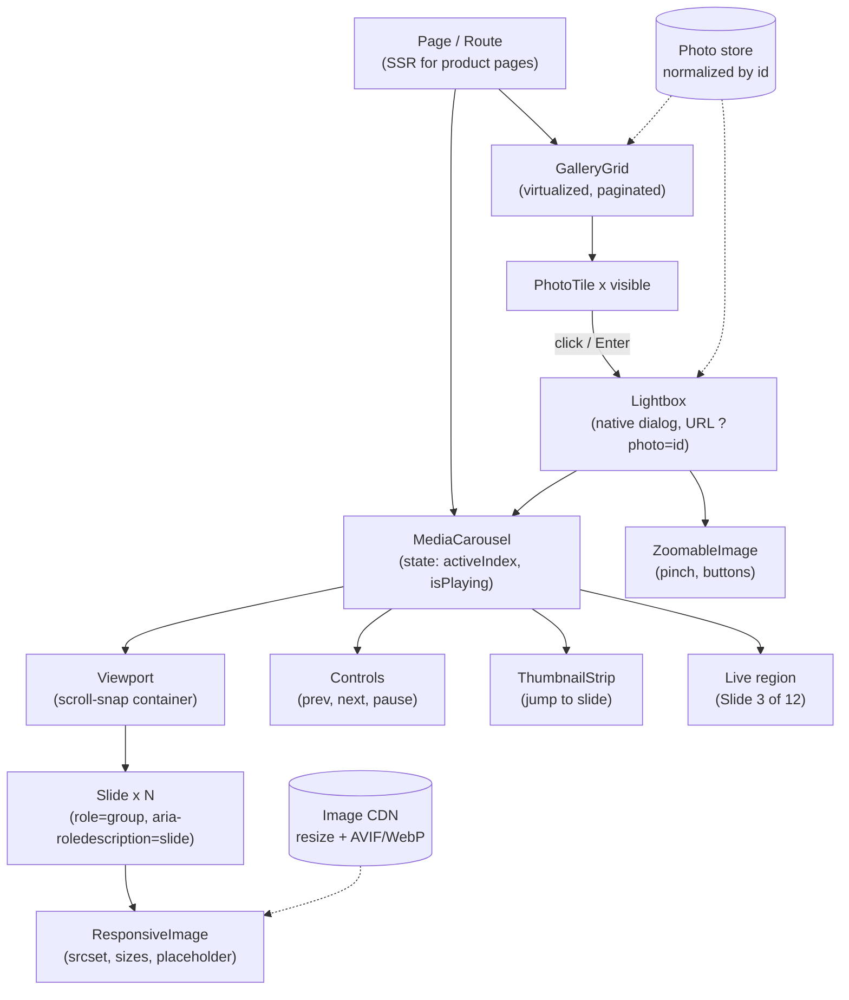
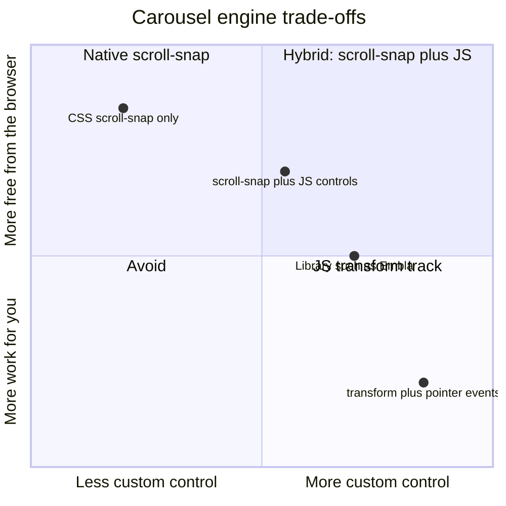
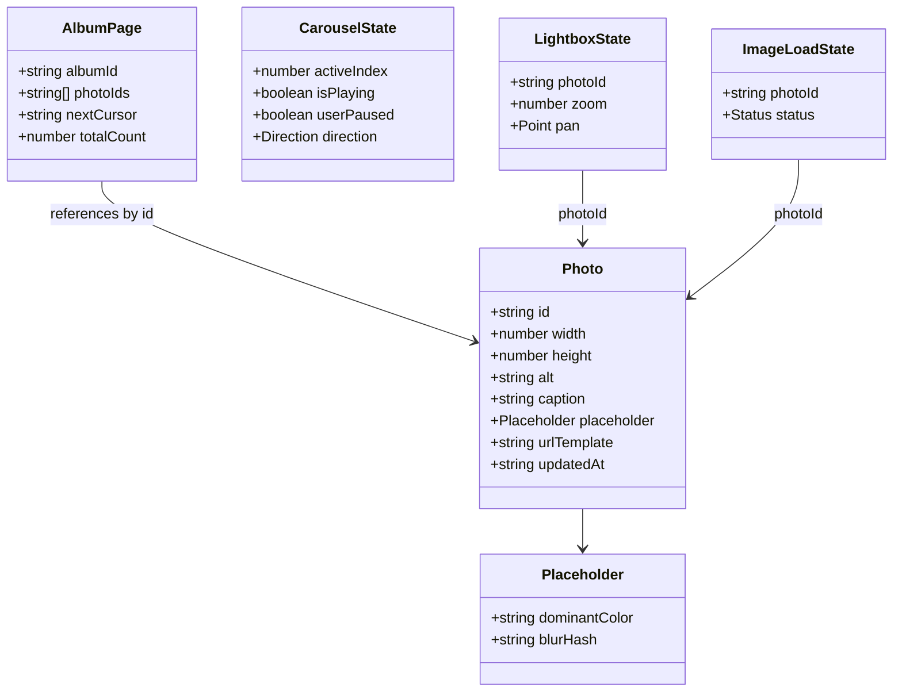
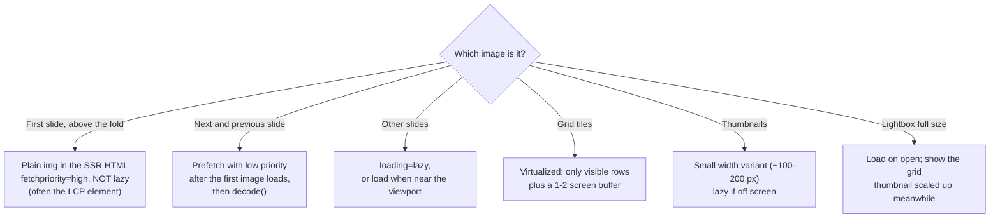
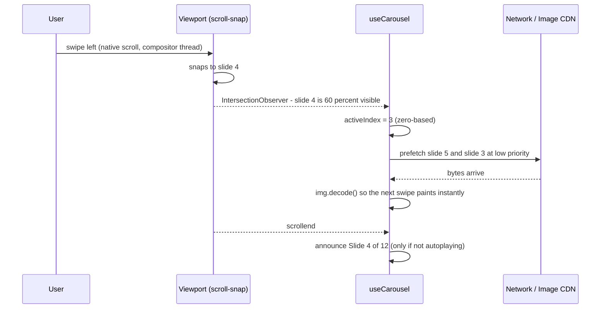
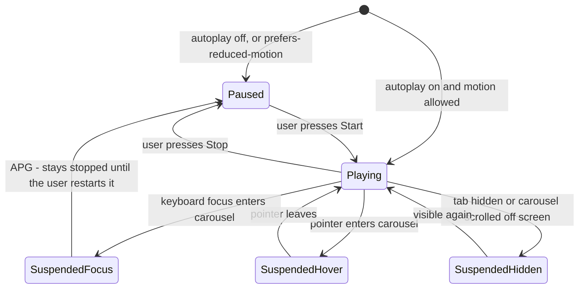

# Design an Image Carousel / Gallery

> **Date:** 2026-11-06 · **Last updated:** 2026-11-06
> **Category:** Frontend System Design
> **Sub-Topic:** System Design Cases / Media — Carousel, Gallery Grid & Lightbox
> **Level:** Intermediate · **Reading time:** ~32 min
> **Informs:** carousel engine choice (CSS scroll-snap vs JS transform), image loading priority and LCP, srcset/sizes and image CDN variants, autoplay and WCAG 2.2.2 compliance, carousel ARIA pattern, lightbox dialog and focus management, URL state for deep-linked photos, gallery pagination and virtualization, CLS-safe placeholders

> **Pre-requisite:** [Image Optimization](../04-performance-engineering/image-optimization.md) and [Keyboard Navigation & Focus Management](../06-accessibility-and-i18n/keyboard-navigation-and-focus-management.md).
> This case puts both to work in one component family: a **carousel** (one image at a time), a **gallery grid** (many images) and a **lightbox** (full-screen viewer).

**Previous:** [Design an Autocomplete / Typeahead](./design-an-autocomplete-typeahead.md) · **Next:** [Design a Chat Application UI](./design-a-chat-application-ui.md)

---

## Table of Contents

1. [ELI5 — Simple Explanation](#eli5--simple-explanation)
2. [Section 1: R — Requirements](#section-1-r--requirements)
3. [Section 2: A — Architecture](#section-2-a--architecture)
4. [Section 3: D — Data Model](#section-3-d--data-model)
5. [Section 4: I — Interface (Component and Server API)](#section-4-i--interface-component-and-server-api)
6. [Section 5: O — Performance Optimizations](#section-5-o--performance-optimizations)
7. [Section 6: O — Accessibility](#section-6-o--accessibility)
8. [Section 7: O — i18n, Security, Offline and Edge Cases](#section-7-o--i18n-security-offline-and-edge-cases)
9. [Interview Walkthrough](#interview-walkthrough)
10. [Framework and Platform Comparison](#framework-and-platform-comparison)
11. [Real-World Examples](#real-world-examples)
12. [Key Points Summary](#key-points-summary)
13. [Test Your Understanding (with answers)](#test-your-understanding)
14. [Cheat Sheet](#cheat-sheet)
15. [References & Further Reading](#references--further-reading)

---

## ELI5 — Simple Explanation

Think of a **photo album on a coffee table**:
- The **carousel** is the album opened to one page: you flip **left and right**, one photo at a time. A good album has **page numbers** ("3 of 12") and you can flip at your own pace.
- An **autoplaying** carousel is a friend flipping pages for you. Polite friends stop the moment you point at a photo or say "wait" — rude ones keep flipping while you're still reading the caption.
- The **gallery grid** is all the photos laid out on the table at once, as small prints. You can't fit 10,000 prints on the table, so you only lay out the ones near you and bring the rest from the box as you walk along (**virtualization + pagination**).
- The **lightbox** is picking up one print and holding it close: everything else fades, and you put it back exactly where it was (**focus return**).
- **Thumbnails vs full size:** you don't print a poster when someone only needs a stamp-sized photo (**responsive images**).

> **One-line takeaway: show the first image fast, load the others just before they're needed, let the user control the motion, and make every action work with a keyboard, a screen reader and a thumb.**

---

## Core Concept — Step by Step

We'll use the **RADIO** framework: **R**equirements → **A**rchitecture → **D**ata model → **I**nterface → **O**ptimizations.

### Section 1: R — Requirements

"Image carousel" is ambiguous. Clarify which of these three things you're building before drawing anything:



**Functional requirements** (product media carousel + gallery, the most common interview version):

| # | Requirement | Notes |
|---|---|---|
| F1 | Show one image at a time with **previous / next** controls | Buttons, keyboard, swipe on touch |
| F2 | **Position indicator** ("3 of 12") and **thumbnail / dot navigation** to jump | Dots alone are tiny touch targets — prefer thumbnails |
| F3 | Optional **autoplay** with a visible pause control | Off by default for product media |
| F4 | **Gallery grid** of many images with pagination / infinite scroll | Variable aspect ratios |
| F5 | **Lightbox**: open an image full screen, navigate, close back to the grid | Deep-linkable URL, Back button closes it |
| F6 | **Zoom** (hover / click zoom on desktop, pinch on touch) | Must also work with buttons |
| F7 | Captions and alt text | Provided by the content owner |

**Non-functional requirements:**

| Concern | Target |
|---|---|
| **Performance** | First image is often the **LCP** element → good LCP (≤ 2.5 s at p75); **no CLS** from images or controls; swipes run at the display's frame rate |
| **Accessibility** | Follow the WAI-ARIA APG **Carousel** pattern; WCAG 2.2 AA (2.2.2 Pause/Stop/Hide, 2.5.1 Pointer Gestures, 2.5.8 Target Size) |
| **Network** | Download only what's visible or about to be; right size and format per device |
| **Responsiveness** | Works from 320 px phones to 4K monitors, portrait and landscape |
| **i18n** | RTL layouts, localized "3 of 12" labels, localized alt text |
| **Reliability** | A broken image doesn't break the carousel; works before/without JS for the first image |

**Questions to ask the interviewer:**

```text
- Which use case: hero banner, product media, or a photo library (how many images)?
- Autoplay required? Loop at the ends, or stop at first/last?
- Devices: mobile-first? Touch swipe and pinch-zoom required?
- Do images have fixed aspect ratios, or mixed portrait/landscape?
- Are images user-uploaded (security, moderation, EXIF) or curated?
- Is SEO needed (product pages: yes; private albums: no)?
- Is there video in the slides too?
- Do we own an image CDN that can resize/convert on the fly?
```

---

### Section 2: A — Architecture

#### 2.1 Component tree



- **`MediaCarousel`** owns `activeIndex` and autoplay state. It's a **compound component** (`Carousel.Viewport`, `Carousel.Slide`, `Carousel.Prev`…) so product teams can rearrange the parts — see [Compound Component Pattern](../05-design-systems-and-components/compound-component-pattern.md).
- Behaviour lives in a **headless hook** (`useCarousel`) so the same logic serves the product page, the lightbox and the hero — see [Headless UI / Renderless Components](../05-design-systems-and-components/headless-ui-renderless-components.md).
- The **photo store** is shared by the grid and the lightbox, so opening photo #57 doesn't refetch what the grid already has.

#### 2.2 Choosing the carousel engine

This is the main architectural decision. There are two families:



| | **CSS scroll-snap (native scrolling)** | **JS transform track** (`translateX` on a strip) |
|---|---|---|
| Swipe, momentum, trackpad, mouse wheel | ✅ Free, native feel on every platform | ❌ You implement gestures, velocity, inertia |
| Works before JS loads / hydration | ✅ Swipeable straight from the HTML | ❌ Static until JS runs |
| Keyboard scrolling, find-in-page, screen readers | ✅ Native scrolling behaviour | ⚠️ You must manage it |
| RTL | ✅ Follows `direction` automatically | ⚠️ Invert the math yourself |
| Infinite loop | ⚠️ Possible but fiddly (re-centre after `scrollend`) | ✅ Easy (modular index + clones) |
| Custom transitions (fade, 3D, parallax) | ⚠️ Limited (scroll-driven animations help) | ✅ Full control |
| Performance | ✅ Scrolling is handled by the compositor | ✅ If you only animate `transform` and handle input carefully |

> **Default:** native **scroll-snap** with JS added for buttons, indicators and autoplay. Reach for a transform track (or a library such as Embla, Swiper or Splide) when the design needs looping, fades or synchronized carousels. See [Animation Performance: CSS vs JS](../04-performance-engineering/animation-performance-css-vs-js.md).

#### 2.3 Rendering strategy

| Context | Strategy | Why |
|---|---|---|
| Product page / marketing hero | **SSR or SSG**, first slide's `` in the initial HTML | The LCP image must be discoverable by the preload scanner; SEO needs it |
| Photo library (Google Photos style) | **CSR app shell** + API-driven, virtualized grid | Private, per-user, highly interactive; no SEO |
| Lightbox | Client-rendered on open, but **URL-addressable** (`/photos/123` or `?photo=123`) so a shared link can be server-rendered | Deep links, Back button, sharing |

With scroll-snap, the carousel **already works as plain HTML+CSS**; hydration only adds the buttons, indicators and analytics. That's [progressive enhancement](../02-rendering-and-architecture/island-architecture.md) — a carousel is a natural interactive island on an otherwise static page.

---

### Section 3: D — Data Model



**Where each piece of state lives:**

| State | Kind | Where |
|---|---|---|
| `Photo` entities, album pages | **Server state** | Query cache (TanStack Query / SWR / Apollo), **normalized by id** — see [Data Normalization & Caching](../03-state-and-data/data-normalization-and-caching.md) |
| `activeIndex`, `isPlaying` | **UI state** | Local component state (inside `useCarousel`) |
| Open lightbox photo | **URL state** | `?photo=123` or `/photos/123` — survives reload, shareable, Back closes it |
| Per-image loaded / error | **Ephemeral UI state** | On the image component; never in a global store |

**Key modelling decisions:**
- **Store intrinsic `width` and `height`** on every photo. The client needs them to reserve space (no CLS) and to compute justified/masonry layouts **before** any image downloads.
- **Store a placeholder** (dominant colour or a tiny BlurHash/ThumbHash string, a few dozen bytes) so tiles have something to show instantly.
- **Don't store image URLs per size.** Store one URL template (or base URL) and let the image CDN produce widths and formats: `https://img.example.com/p/{id}?w={w}&fm=auto`.
- **Cursor pagination** for galleries (stable when photos are added). See [Pagination & Infinite Scroll](../03-state-and-data/pagination-and-infinite-scroll.md).

---

### Section 4: I — Interface (Component and Server API)

#### 4.1 Component API

```tsx
// A compound, headless-friendly API. Controlled OR uncontrolled index.
type CarouselProps = {
  label: string;                       // accessible name: "Product photos"
  index?: number;                      // controlled
  defaultIndex?: number;               // uncontrolled
  onIndexChange?: (index: number) => void;
  loop?: boolean;                      // default false
  autoplay?: false | { intervalMs: number }; // default false
  children: React.ReactNode;
};

<Carousel label="Trail running shoe, photos" defaultIndex={0}>
  <Carousel.Viewport>
    {photos.map((p, i) => (
      <Carousel.Slide key={p.id}>
        <ResponsiveImage photo={p} priority={i === 0} sizes="(min-width: 960px) 600px, 100vw" />
      </Carousel.Slide>
    ))}
  </Carousel.Viewport>
  <Carousel.Prev /> <Carousel.Next />
  <Carousel.Thumbnails />
</Carousel>
```

Design notes:
- Support **controlled and uncontrolled** index ([Controlled vs Uncontrolled Components](../05-design-systems-and-components/controlled-vs-uncontrolled-components.md)) so a thumbnail strip, a URL or analytics can drive it.
- **`label` is required** — a carousel without an accessible name is an a11y bug the API can prevent.
- **`autoplay` defaults to `false`.** Making motion opt-in is a design-system decision, not a per-page one.

#### 4.2 Server API contract

```http
GET /api/albums/alb_42/photos?cursor=eyJpZCI6MTIwfQ&limit=60
Accept: application/json
```

```json
{
  "items": [
    {
      "id": "ph_9f3a",
      "width": 4032,
      "height": 3024,
      "alt": "Red trail shoe, side view on a rocky path",
      "caption": "Side view",
      "placeholder": { "dominantColor": "#a33b2c", "blurHash": "LEHV6nWB2yk8pyo0adR*.7kCMdnj" },
      "urlTemplate": "https://img.example.com/p/ph_9f3a/v3?w={w}&fm=auto",
      "updatedAt": "2026-10-30T12:00:00Z"
    }
  ],
  "nextCursor": "eyJpZCI6MTgwfQ",
  "totalCount": 1873
}
```

| Endpoint | Purpose | Caching |
|---|---|---|
| `GET /api/albums/:id/photos?cursor&limit` | Page of photo metadata | `private, no-cache` + `ETag` for private albums; public products can use an edge TTL |
| `GET /api/photos/:id` | Single photo for a deep-linked lightbox | Same |
| `GET /api/albums/:id/photos/:photoId/position` | "Which index / cursor is this photo at?" for deep links into huge albums | Optional |
| `https://img.example.com/p/:id/:version?w=&fm=` | Image bytes from the **image CDN** | `public, max-age=31536000, immutable` — the **version in the path** changes when the image is edited |

> **Why the version in the image URL?** Image bytes are the largest payload. Versioned URLs let the browser and CDN cache them forever, exactly like hashed JS bundles. See [Browser Caching Strategies](../01-web-fundamentals/browser-caching-strategies.md).

---

### Section 5: O — Performance Optimizations

#### 5.1 Loading priority per image



Rules:
- **Never lazy-load the LCP image.** `loading="lazy"` on the first slide delays it until layout decides it's near the viewport. Use `fetchpriority="high"` instead (supported in current Chrome, Edge, Firefox and Safari — check MDN for your support floor).
- **Hidden slides can steal bandwidth.** Without `loading="lazy"` or JS gating, a 12-slide carousel downloads 12 full images at page load. Lazy-load everything except the first one or two.
- Browsers choose their own lazy-loading distance thresholds, and behaviour inside **horizontal scroll containers** has varied between browsers and versions. If you need precise control (e.g. "exactly one slide ahead"), use an `IntersectionObserver` with the carousel viewport as `root` — see [Web APIs (Intersection Observer, ResizeObserver)](../01-web-fundamentals/web-apis-intersection-observer-resizeobserver.md).

#### 5.2 Right size, right format

```html

```

- **`srcset` + `sizes`** lets the browser pick the right width for the slot and device pixel ratio. A wrong `sizes` (e.g. the default `100vw` for a 600 px slot) makes desktop users download images twice as wide as needed.
- **`fm=auto`** (or `<picture>` with AVIF/WebP `<source>`s) serves modern formats. Format negotiation by `Accept` requires `Vary: Accept` at the CDN.
- **`width` / `height` attributes** (or CSS `aspect-ratio`) reserve space → no CLS. With mixed ratios, give the viewport a fixed ratio and use `object-fit: contain` (letterbox) or `cover` (crop).

#### 5.3 Smooth navigation



- **Animate only `transform` / `opacity`** (or let native scrolling do it). Never animate `left` or `margin` — that triggers layout every frame.
- **Prefetch neighbours** (±1, maybe ±2) after the current image loads, at low priority, and call `img.decode()` so the swap doesn't stall the main thread on a big decode. See [Prefetching & Preloading](../04-performance-engineering/prefetching-and-preloading.md).
- **Debounce index updates during scroll**: update the active index from `IntersectionObserver` or on `scrollend`, not on every `scroll` event. `scrollend` is supported in Chrome, Firefox and recent Safari (26.2+ per MDN's compat data) — feature-detect and fall back to a short debounce.
- Use `scroll-snap-stop: always` if one fast flick must never skip past several slides.

#### 5.4 Large galleries

```text
10 photos     → render all, lazy-load images
200 photos    → paginate (cursor) + lazy-load
10,000+       → virtualize the grid (render visible rows + buffer), paginate metadata,
                compute row layout from width/height before images load,
                content-visibility: auto on off-screen sections where virtualization is overkill
```

- Google Photos and Flickr popularized **justified layouts** (rows of equal height, full width) computed from aspect ratios — possible only because the API returns `width`/`height`.
- CSS-native masonry is still being standardized (`display: grid-lanes` at the time of writing, shipping first in Safari). Don't depend on it without a fallback — check MDN.
- See [Virtual Scrolling & Windowing](../04-performance-engineering/virtual-scrolling-and-windowing.md).

---

### Section 6: O — Accessibility

The [WAI-ARIA Authoring Practices carousel pattern](https://www.w3.org/WAI/ARIA/apg/patterns/carousel/) is the reference. Its key rules:

| Element | Markup | Why |
|---|---|---|
| Carousel container | `<section aria-roledescription="carousel" aria-label="Product photos">` (a labelled `section` is a `region` landmark) | Screen readers announce "Product photos, carousel" |
| Each slide | `role="group" aria-roledescription="slide" aria-label="3 of 12"` (or the slide's name) | Position is announced when focus/reading enters a slide |
| Prev / Next | Real `<button>`s with text labels ("Previous slide", "Next slide") | Keyboard + screen reader operable; icon-only buttons need `aria-label` |
| Rotation control | A `<button>` that is **first in tab order** in the carousel, label toggles "Stop slide rotation" / "Start slide rotation" | User can stop motion before tabbing into it |
| Slides wrapper | `aria-live="off"` while autoplaying, `aria-live="polite"` when not | Don't announce every automatic change; do announce user-initiated ones |
| Picker | Thumbnails as buttons, or the APG **tabbed** variant (`tablist` / `tab` / `tabpanel`) | Lets users jump directly |

**Autoplay rules** (WCAG 2.2.2 Pause, Stop, Hide — Level A: moving content that starts automatically and lasts more than 5 s must be pausable):



**Other a11y requirements:**
- **Keyboard:** Tab reaches the controls; Enter/Space activate them. In a tabbed carousel, arrow keys move between tabs. Off-screen slides of a **transform** carousel must not contain focusable elements — make them `inert`.
- **Pointer gestures (WCAG 2.5.1):** swipe and pinch are path/multipoint gestures, so provide **single-pointer alternatives**: prev/next buttons, zoom +/− buttons.
- **Target size (WCAG 2.5.8, AA):** at least 24 × 24 CSS px. Tiny dots usually fail; thumbnails or larger buttons pass.
- **`prefers-reduced-motion`:** no autoplay by default, and use instant scrolling (`behavior: 'auto'`) instead of smooth scrolling.
- **Alt text:** describe what matters in context ("Red trail shoe, side view"); empty `alt=""` only for purely decorative images. Captions don't replace alt text.
- **Lightbox:** use `<dialog>` + `showModal()` — the rest of the page becomes inert, Esc closes it, and the HTML spec returns focus to the previously focused element on close (verify in your target browsers; restore manually if needed). Give it an accessible name.
- See [ARIA Roles, States & Properties](../06-accessibility-and-i18n/aria-roles-states-and-properties.md) and [Screen Reader Testing](../06-accessibility-and-i18n/screen-reader-testing.md).

---

### Section 7: O — i18n, Security, Offline and Edge Cases

**i18n / RTL**
- In RTL, "next" is to the **left**. Scroll-snap carousels follow `dir="rtl"` automatically; transform carousels must invert their translate direction. Mirror arrow icons (CSS `scale: -1 1` under `:dir(rtl)`), but don't mirror the photos. See [RTL Layout Support](../06-accessibility-and-i18n/rtl-layout-support.md).
- Use logical properties (`margin-inline-start`, `inset-inline-end`) for controls.
- Localize "Slide 3 of 12" with your i18n library and `Intl.NumberFormat` (some locales use other digits). Alt text and captions come from the API in the user's locale. See [Internationalization (i18n) Architecture](../06-accessibility-and-i18n/internationalization-i18n-architecture.md).

**Security (user-uploaded images)**
- **Captions and alt text are user input.** Render them as text (React/Vue/Angular/Svelte escape by default); never inject them as HTML. See [XSS Prevention](../07-security/xss-prevention-reflected-stored-dom.md).
- **SVG uploads** can contain scripts. They don't run inside ``, but they do if someone opens the file URL directly. Rasterize SVGs on upload, or serve user content from a **separate sandbox domain** with `Content-Security-Policy: sandbox` / `Content-Disposition: attachment`.
- **Strip EXIF metadata** (especially GPS location) server-side on upload — a privacy leak otherwise.
- **Private albums:** signed, expiring image URLs (or cookie-authenticated image requests). Signed URLs conflict with long caching, so sign per version and keep the expiry long enough for a session.
- Restrict `img-src` in your [Content Security Policy](../07-security/content-security-policy-csp.md) to your image CDN.

**Offline**
- A Service Worker can cache recently viewed images with a size/entry cap (e.g. Workbox `ExpirationPlugin` with `maxEntries`), plus the album metadata. Serve cross-origin images with CORS: opaque (`no-cors`) responses can't be inspected and are padded heavily in storage-quota accounting in Chromium. See [Offline-First Architecture](../03-state-and-data/offline-first-architecture.md).

**Edge cases checklist**

| Case | Handling |
|---|---|
| 0 images | Render an empty state, not an empty carousel with controls |
| 1 image | Hide prev/next, indicator and autoplay |
| Broken image (404, decode error) | `onError` → placeholder + "Image unavailable"; carousel keeps working |
| Mixed portrait / landscape | Fixed viewport ratio + `object-fit: contain`, or per-slide height with care for CLS |
| Rapid clicks on Next | Jump to the target index; don't queue 10 animations |
| Window resize / rotation | Re-snap to the active slide (ResizeObserver); scroll-snap does this natively |
| Vertical page scroll on a horizontal carousel | `touch-action: pan-y` on a JS-gesture track; native scroll-snap already disambiguates |
| Deep link to photo #31,415 in an unloaded album | Fetch the photo by id for the lightbox; fetch its page/cursor lazily for the grid behind it |
| Photo deleted while open | 404 from `GET /photos/:id` → close lightbox, toast, remove from the store |
| Very slow network | Placeholder colour/blur, low-res thumbnail upscaled, then swap in full res |
| Video slides | Don't autoplay with sound; pause video when its slide leaves the viewport |
| Text inside images (marketing banners) | Avoid — not translatable, not resizable, needs long alt text. Overlay real HTML text |

---

## Interview Walkthrough

How to spend 45 minutes:

```mermaid
gantt
    title 45-minute carousel / gallery interview
    dateFormat mm
    axisFormat %M
    section Clarify
    Requirements and questions        :a1, 00, 6m
    section Design
    Component tree and engine choice  :a2, after a1, 9m
    Data model and API contract       :a3, after a2, 8m
    section Deep dives
    Image loading and LCP             :a4, after a3, 8m
    Accessibility and autoplay        :a5, after a4, 7m
    section Wrap up
    Edge cases, i18n, security        :a6, after a5, 5m
    Trade-offs and questions          :a7, after a6, 2m
```



**Script, step by step:**

1. **Clarify (≈6 min).** "Is this a hero banner, a product media carousel, or a photo library? How many images? Autoplay? Mobile-first?" Write down F1–F7 and the non-functional targets (LCP, CLS, WCAG).
2. **Architecture (≈9 min).** Draw the component tree (Section 2.1). Say the **engine decision** out loud: "I'll use native scroll-snap for swipe/momentum/RTL and progressive enhancement, and add JS for controls and indicators. If design needs infinite loop or fades, I'd switch to a transform track or a library like Embla."
3. **Data + API (≈8 min).** Photo entity with `width`, `height`, `alt`, placeholder and a URL template; cursor pagination; versioned, immutable image URLs on an image CDN.
4. **Performance deep dive (≈8 min).** First slide = LCP: in SSR HTML, `fetchpriority="high"`, not lazy. Others lazy; neighbours prefetched + decoded. `srcset`/`sizes`. Reserved aspect ratio for CLS. Virtualization for big grids.
5. **Accessibility (≈7 min).** APG carousel roles, live region on/off, rotation control first, pause on hover/focus, reduced motion, WCAG 2.2.2 / 2.5.1 / 2.5.8, `<dialog>` lightbox with focus return.
6. **Wrap up (≈7 min).** RTL, user-generated content security, offline caching, the edge-case table, and what you'd measure (LCP element, slide engagement, image bytes per session).

**Trade-offs to discuss:**

| Trade-off | Option A | Option B | Say this |
|---|---|---|---|
| Engine | Scroll-snap: native feel, less code | Transform: loops, custom effects | "Default to native; justify JS by a concrete design need" |
| Autoplay | Engagement for marketing | Motion sickness, missed content, a11y risk | "Off by default; if on, pause on hover/focus/hidden and respect reduced motion" |
| Preload depth | ±1 slide: less waste | ±3 slides: instant browsing | "±1 on mobile data (check `navigator.connection` where available), more on fast networks" |
| Dots vs thumbnails | Dots: compact | Thumbnails: bigger targets, more information | "Thumbnails on desktop, a '3 / 12' counter on mobile" |
| Lightbox as route vs modal state | Route: shareable, Back works | Local state: simpler | "Route/URL state; it's what users expect from Back" |
| Placeholder | Dominant colour: a few bytes | BlurHash/LQIP: nicer, more bytes and decode work | "Colour for grids, blur for the hero" |
| Library vs custom | Faster, battle-tested | Smaller, exact a11y control | "Library if it passes our a11y audit; otherwise a headless hook" |

---

## Framework and Platform Comparison

| Stack | Typical approach |
|---|---|
| **React** | Headless hook (`useCarousel`) or Embla (`embla-carousel-react`); Next.js `<Image>` with its priority/preload option for the first slide (the prop name has changed across versions — check the docs); intercepting routes for "photo as modal, page on refresh" |
| **Vue** | Composable (`useCarousel()` returning refs); Embla has a Vue wrapper; Nuxt Image for `srcset` |
| **Angular** | Standalone component + signal for `activeIndex`; `NgOptimizedImage` with the `priority` attribute for the LCP image; `@defer (on viewport)` for below-the-fold galleries |
| **Svelte** | Action (`use:carousel`) or component with runes; Embla has a Svelte wrapper |
| **Framework-agnostic** | Swiper Element (web component), a plain scroll-snap `<ul>` + a small script, or Chrome's CSS carousel primitives as an enhancement |
| **iOS** | SwiftUI `TabView` with `.tabViewStyle(.page)` or `ScrollView` + `.scrollTargetBehavior(.paging)`; UIKit `UICollectionView` with paging; VoiceOver adjustable action for prev/next |
| **Android** | Jetpack Compose `HorizontalPager` (or `ViewPager2` in Views); TalkBack custom actions for prev/next |

> **CSS-only carousels (Chromium, experimental):** `::scroll-button()`, `::scroll-marker`, `scroll-marker-group` and `:target-current` let the browser generate accessible prev/next buttons and indicators for a scroll-snap container. Supported in Chromium-based browsers only at the time of writing — use them as **progressive enhancement** and check MDN before relying on them.

---

## Real-World Examples

**Example 1 — Accessible scroll-snap carousel (React + TypeScript):**
```tsx
import { useEffect, useRef, useState, type ReactNode } from 'react';

type Props = { label: string; slides: ReactNode[] };

export function Carousel({ label, slides }: Props) {
  const viewportRef = useRef<HTMLUListElement>(null);
  const [active, setActive] = useState(0);
  const [announce, setAnnounce] = useState(false); // only announce user-driven changes

  // Track the visible slide with IntersectionObserver instead of scroll events
  useEffect(() => {
    const root = viewportRef.current;
    if (!root) return;
    const io = new IntersectionObserver(
      (entries) => {
        for (const e of entries) {
          if (e.isIntersecting) setActive(Number((e.target as HTMLElement).dataset.index));
        }
      },
      { root, threshold: 0.6 },
    );
    root.querySelectorAll('[data-index]').forEach((el) => io.observe(el));
    return () => io.disconnect();
  }, [slides.length]);

  const goTo = (i: number) => {
    const root = viewportRef.current;
    const target = root?.querySelector<HTMLElement>(`[data-index="${i}"]`);
    const reduce = matchMedia('(prefers-reduced-motion: reduce)').matches;
    setAnnounce(true);
    // block: 'nearest' avoids scrolling the whole page vertically
    target?.scrollIntoView({ behavior: reduce ? 'auto' : 'smooth', block: 'nearest', inline: 'start' });
  };

  if (slides.length === 0) return null;
  const single = slides.length === 1;

  return (
    <section aria-roledescription="carousel" aria-label={label} className="carousel">
      <ul ref={viewportRef} className="carousel__viewport" aria-live={announce ? 'polite' : 'off'}>
        {slides.map((slide, i) => (
          <li
            key={i}
            data-index={i}
            role="group"
            aria-roledescription="slide"
            aria-label={`${i + 1} of ${slides.length}`}
            className="carousel__slide"
          >
            {slide}
          </li>
        ))}
      </ul>
      {!single && (
        <div className="carousel__controls">
          <button type="button" onClick={() => goTo(active - 1)} disabled={active === 0}>
            Previous slide
          </button>
          <span aria-hidden="true">{active + 1} / {slides.length}</span>
          <button type="button" onClick={() => goTo(active + 1)} disabled={active === slides.length - 1}>
            Next slide
          </button>
        </div>
      )}
    </section>
  );
}
```

**Example 2 — The CSS that makes it swipeable without JS:**
```css
.carousel__viewport {
  display: grid;
  grid-auto-flow: column;
  grid-auto-columns: 100%;
  overflow-x: auto;
  scroll-snap-type: x mandatory;
  overscroll-behavior-x: contain;   /* don't trigger browser back-swipe at the ends */
  scrollbar-width: none;            /* hide the bar; keep it scrollable */
  list-style: none;
  margin: 0;
  padding: 0;
}
.carousel__slide {
  scroll-snap-align: start;
  scroll-snap-stop: always;          /* one flick = one slide */
  aspect-ratio: 4 / 3;               /* reserve space: no CLS */
}
.carousel__slide img {
  width: 100%;
  height: 100%;
  object-fit: contain;
  background: var(--placeholder, #e5e7eb);
}
@media (prefers-reduced-motion: no-preference) {
  .carousel__viewport { scroll-behavior: smooth; }
}
.carousel__controls button { min-inline-size: 44px; min-block-size: 44px; } /* well above 24px */
```

**Example 3 — Image priorities (BAD → GOOD):**
```html
<!-- ❌ BAD: LCP image lazy-loaded, no dimensions, all 12 slides full-size, eager -->

  <!-- ...12 full downloads at startup -->

<!-- ✅ GOOD: first slide prioritized, others lazy, dimensions reserved, responsive -->


```

**Example 4 — Autoplay that respects users (React hook):**
```tsx
import { useEffect, useState, type RefObject } from 'react';

export function useAutoplay(next: () => void, intervalMs: number, rootRef: RefObject<HTMLElement | null>) {
  const [userPaused, setUserPaused] = useState(
    () => matchMedia('(prefers-reduced-motion: reduce)').matches, // reduced motion → start paused
  );
  const [suspended, setSuspended] = useState(false); // hover / focus / hidden

  useEffect(() => {
    const el = rootRef.current;
    if (!el) return;
    const suspend = () => setSuspended(true);
    const resume = () => setSuspended(false);
    const onFocusIn = () => setUserPaused(true);        // APG: focus stops rotation until restarted
    const onVisibility = () => setSuspended(document.hidden);
    el.addEventListener('pointerenter', suspend);
    el.addEventListener('pointerleave', resume);
    el.addEventListener('focusin', onFocusIn);
    document.addEventListener('visibilitychange', onVisibility);
    return () => {
      el.removeEventListener('pointerenter', suspend);
      el.removeEventListener('pointerleave', resume);
      el.removeEventListener('focusin', onFocusIn);
      document.removeEventListener('visibilitychange', onVisibility);
    };
  }, [rootRef]);

  useEffect(() => {
    if (userPaused || suspended) return;
    const id = setInterval(next, intervalMs);
    return () => clearInterval(id);
  }, [userPaused, suspended, next, intervalMs]);

  return {
    playing: !userPaused && !suspended,
    toggle: () => setUserPaused((p) => !p), // wire to the rotation-control button
  };
}
```

> `next` should be stable (`useCallback`) or the interval restarts every render. Note that clicking the rotation button itself moves focus into the carousel, so in a real implementation exclude the rotation button from the `focusin` stop (the APG example handles this).

**Example 5 — Prefetch and decode neighbours:**
```typescript
const prefetched = new Set<string>();

export function prefetchImage(url: string): Promise<void> {
  if (prefetched.has(url)) return Promise.resolve();
  prefetched.add(url);
  const img = new Image();
  img.fetchPriority = 'low';      // ignored where unsupported
  img.decoding = 'async';
  img.src = url;
  // decode() resolves when the image is ready to paint without a main-thread stall
  return img.decode().catch(() => { prefetched.delete(url); });
}

export function prefetchNeighbours(urls: string[], active: number, depth = 1) {
  for (let d = 1; d <= depth; d++) {
    if (urls[active + d]) void prefetchImage(urls[active + d]);
    if (urls[active - d]) void prefetchImage(urls[active - d]);
  }
}
```

**Example 6 — Lightbox with `<dialog>` and URL state:**
```tsx
import { useEffect, useRef } from 'react';
import { useSearchParams } from 'react-router'; // React Router v7 (react-router-dom in v6)

export function Lightbox({ photo }: { photo?: { id: string; alt: string; src: string } }) {
  const ref = useRef<HTMLDialogElement>(null);
  const [params, setParams] = useSearchParams();
  const open = Boolean(params.get('photo'));

  useEffect(() => {
    const dlg = ref.current;
    if (!dlg) return;
    if (open && !dlg.open) dlg.showModal();   // page behind becomes inert, Esc fires 'cancel'
    if (!open && dlg.open) dlg.close();       // Back button removed ?photo → close
  }, [open]);

  // Fires for Esc, the Close button and dlg.close(): keep the URL in sync
  const syncUrlOnClose = () => {
    if (!params.has('photo')) return;          // already removed (e.g. by Back)
    const nextParams = new URLSearchParams(params);
    nextParams.delete('photo');
    setParams(nextParams);                     // or history.back() if opening pushed the entry
  };

  return (
    <dialog ref={ref} aria-label={photo?.alt ?? 'Photo viewer'} onClose={syncUrlOnClose} className="lightbox">
      {photo && }
      <button type="button" onClick={() => ref.current?.close()}>Close</button>
    </dialog>
  );
}
```

> In Vue use `useRoute().query.photo` + a template ref; in Angular, `ActivatedRoute.queryParamMap` + `@ViewChild`; in SvelteKit, `page.url.searchParams` + `bind:this`. Next.js's App Router can render the photo as a modal over the grid on client navigation and as a full page on refresh using **intercepting + parallel routes**.

**Example 7 — CSS carousel primitives as enhancement (Chromium only, experimental):**
```css
@supports (scroll-marker-group: after) {
  .carousel__viewport {
    scroll-marker-group: after;            /* browser-generated, keyboard-accessible indicators */
  }
  .carousel__viewport::scroll-button(inline-start) { content: "←" / "Previous slide"; }
  .carousel__viewport::scroll-button(inline-end)   { content: "→" / "Next slide"; }
  .carousel__slide::scroll-marker { content: ""; inline-size: 24px; block-size: 24px; border-radius: 50%; }
  .carousel__slide::scroll-marker:target-current { background: currentColor; }
  .carousel__controls { display: none; }   /* JS controls no longer needed here */
}
```

---

## Key Points Summary

| Concept | One-Line Explanation |
|---|---|
| **Clarify the use case** | Hero banner, product media and photo library have very different requirements |
| **Scroll-snap engine** | Native swipe, momentum, RTL and no-JS support — the default choice |
| **Transform engine** | Full control (loop, fade) at the cost of re-implementing gestures and a11y |
| **First slide = LCP** | Server-render it, `fetchpriority="high"`, never `loading="lazy"` |
| **Lazy + prefetch** | Lazy-load far slides, prefetch and `decode()` the neighbours |
| **srcset / sizes** | Let the browser pick the right width; a wrong `sizes` wastes bytes |
| **Reserve space** | `width`/`height` or `aspect-ratio` on every image → no CLS |
| **Photo entity** | id, width, height, alt, placeholder, URL template — normalized by id |
| **Versioned image URLs** | Immutable caching on the image CDN, new URL on edit |
| **APG carousel roles** | `aria-roledescription="carousel"` / `"slide"`, labelled slides, live region off while rotating |
| **Autoplay** | Off by default; pause on hover, focus, hidden tab; WCAG 2.2.2 requires a pause control |
| **Gestures** | Swipe/pinch need button alternatives (WCAG 2.5.1); targets ≥ 24 px (2.5.8) |
| **Lightbox** | `<dialog>` + `showModal()`, URL state so Back closes it, focus returns to the tile |
| **Large galleries** | Cursor pagination + virtualization + layout from known aspect ratios |
| **UGC security** | Escape captions, rasterize/sandbox SVG, strip EXIF GPS |

---

## Test Your Understanding

**Q1 (Basic):**
Your hero carousel's first image is the LCP element. A teammate adds `loading="lazy"` to every carousel image "for performance". What happens to LCP, and what should the markup be?

<details>
<summary>Answer</summary>

LCP gets **worse**. A lazy image isn't requested until the browser has done layout and decided the image is near the viewport, so the request starts later than an eager image found by the preload scanner in the HTML. The first slide should be in the **server-rendered HTML**, **eager**, with `fetchpriority="high"`, `width`/`height` (or `aspect-ratio`) and a correct `srcset`/`sizes`. Only slides 2…N get `loading="lazy"` (or JS-gated loading). If the first image is injected by JS, add `<link rel="preload" as="image" imagesrcset="…" imagesizes="…">` so it's discovered early.
</details>

**Q2 (Application):**
Marketing insists on an autoplaying hero carousel. List what you must build so it meets WCAG 2.2 AA and the APG pattern.

<details>
<summary>Answer</summary>

- A visible **rotation control button** (first in the carousel's tab order) that stops and restarts rotation — required by **2.2.2 Pause, Stop, Hide** because the motion starts automatically and lasts more than 5 s.
- **Pause while hovered** and **stop when keyboard focus enters** the carousel (APG: stays stopped until the user restarts it), so users can read and operate it.
- **Pause when the tab is hidden** or the carousel is off-screen (saves CPU/battery and avoids "missed" slides).
- **Respect `prefers-reduced-motion`**: start paused and use non-animated transitions.
- Set the slides container to **`aria-live="off"` while rotating** and **`"polite"` when not**, so automatic changes don't flood screen readers while manual ones are announced.
- Labelled slides (`role="group"`, `aria-roledescription="slide"`, "2 of 5"), real buttons for prev/next with ≥ 24 px targets, and a long enough interval for users to read each slide.
</details>

**Q3 (Tricky):**
In a JS transform carousel, keyboard users tabbing through the page suddenly see the track jump and land on a "Buy now" link in slide 5, which isn't visible. Why, and how do you fix it?

<details>
<summary>Answer</summary>

Off-screen slides are still in the DOM and still focusable. When Tab reaches a link inside slide 5, the browser scrolls it into view — but the carousel's own state (`activeIndex`, the `translateX`) doesn't know, so the visual position and the indicator get out of sync, or the focused element stays clipped and invisible (also a WCAG 2.4.7/2.4.11 focus-visibility problem).

Fix: make non-active slides **`inert`** (removes them from tab order and the accessibility tree) and toggle it as the index changes — or, if partially visible neighbours should stay reachable, listen for `focusin` and move `activeIndex` to the focused slide. A native scroll-snap carousel avoids the "state out of sync" part because the browser's scroll position *is* the state, but content in clipped slides still needs thought.
</details>

**Q4 (System design):**
Design the client for a photo library with 50,000 photos per user. A shared link opens `/photos/ph_31415` directly. What's loaded, in what order, and how does the grid behind the lightbox work?

<details>
<summary>Answer</summary>

1. The route renders the **lightbox first**: `GET /api/photos/ph_31415` (metadata: width, height, alt, placeholder, URL template). Show the placeholder colour/blur at the correct aspect ratio immediately, then the full image sized for the viewport.
2. In parallel or right after, fetch the photo's **neighbours** (prev/next ids) so arrow navigation works, and prefetch ±1 images.
3. The **grid behind** is lazy: request the page/cursor that contains the photo (`/position` endpoint or a cursor derived from its date), render a **virtualized** grid around that position, and scroll it there when the lightbox closes, so focus can return to the right tile.
4. Grid rows are laid out from **known aspect ratios** (justified layout) before images download; only visible rows + a buffer are in the DOM; thumbnails use small CDN widths.
5. Store everything in a **normalized cache by photo id**, so the grid and lightbox share entities and an edit (caption, delete) updates both.
6. URL state (`/photos/:id`) means Back closes the lightbox, refresh keeps it, and the link is shareable.
</details>

**Q5 (Tricky):**
Your product carousel has a CLS of 0.18 on mobile. The images have `width` and `height`. What else in a carousel commonly causes layout shift?

<details>
<summary>Answer</summary>

- **Controls/indicators injected after hydration** (dots, counter, thumbnail strip) pushing content down — reserve their space in CSS or render them on the server.
- **Mixed aspect ratios** where the viewport height follows the active slide — fix the viewport's ratio and use `object-fit`.
- **Fonts for captions** swapping in — see font loading strategies.
- **A JS carousel library** that measures and rewrites slide widths on init (the static HTML stacks slides vertically, then JS turns it into a row). Scroll-snap CSS gives the final layout from the first paint.
- **Late-loading ads/badges** around the carousel. Diagnose with the Layout Instability API / DevTools "Layout shift regions" to find the culprit nodes.
</details>

**Q6 (System design):**
When would you choose a JS transform-based carousel library over native scroll-snap? Give two concrete product requirements that justify it and two risks you'd mitigate.

<details>
<summary>Answer</summary>

Justified by: **infinite looping** with seamless wrap-around (e.g. a logo marquee or a hero that must loop); **non-scroll transitions** such as cross-fades or 3D effects; **synchronized carousels** (main + thumbnails driven by one gesture with physics); precise control over **drag velocity/inertia** across devices.

Risks to mitigate: (1) **Accessibility** — the library must handle labels, live regions, `inert` off-screen slides and keyboard; audit it with a screen reader rather than trusting the docs. (2) **Performance and resilience** — nothing works until JS loads (SSR the first slide statically), gesture handling must not block the main thread or break vertical page scrolling (`touch-action: pan-y`, passive listeners), and RTL must be tested explicitly. Bundle size is a third, smaller cost.
</details>

---

## Cheat Sheet

**Key Definitions:**
- **Carousel:** shows a set of items one (or a few) at a time with controls to rotate through them.
- **Lightbox:** a modal, full-screen viewer for one image with navigation.
- **Scroll snapping:** CSS (`scroll-snap-type`, `scroll-snap-align`) that makes a scroll container settle on item boundaries.
- **LCP element:** the largest image/text block in the viewport; often the first carousel slide.
- **`fetchpriority`:** a hint to raise or lower an image's network priority.
- **`img.decode()`:** a promise that resolves when the image is decoded and ready to paint.
- **`aria-roledescription`:** overrides how a role is announced ("carousel", "slide").
- **WCAG 2.2.2:** auto-moving content lasting over 5 s must be pausable.
- **Justified layout:** gallery rows of equal height filling the width, computed from aspect ratios.

**Quick Reference:**
```text
ENGINE        default: scroll-snap (x mandatory, align start, stop always) + JS for controls
              transform track only for loop / fade / synced carousels
IMAGES        slide 1: SSR , fetchpriority=high, eager, width/height, srcset+sizes
              slides 2..N: loading=lazy (or IO with root = viewport)
              neighbours: prefetch at low priority + decode()
              CDN: ?w=…&fm=auto, versioned URL, Cache-Control immutable
DATA          Photo { id, width, height, alt, placeholder, urlTemplate } normalized by id
              cursor pagination; lightbox = URL state (?photo=id or /photos/:id)
A11Y          section aria-roledescription=carousel + aria-label
              slide role=group aria-roledescription=slide aria-label="3 of 12"
              rotation button first; pause on hover, stop on focus; aria-live off while rotating
              button alternatives for swipe/pinch; targets >= 24px; prefers-reduced-motion
              lightbox: <dialog>.showModal(), named, focus returns to the tile
BIG GALLERY   virtualize + paginate + layout from aspect ratios
UGC           escape captions, sandbox/rasterize SVG, strip EXIF GPS, CSP img-src
```

**Common Mistakes to Avoid:**

| Mistake | Why Wrong | Fix |
|---|---|---|
| `loading="lazy"` on the first slide | Delays the LCP image | Eager + `fetchpriority="high"` |
| All slides eager and full size | Wastes bandwidth, competes with LCP | Lazy-load slides 2..N, prefetch only neighbours |
| No `width`/`height` / `aspect-ratio` | Layout shift as images load | Reserve space; fixed viewport ratio |
| Default `sizes` (`100vw`) for a narrow slot | Desktop downloads oversized images | Accurate `sizes` per breakpoint |
| Autoplay with no pause button | Fails WCAG 2.2.2; users miss content | Rotation control, pause on hover/focus, off by default |
| `div` arrows with `onClick` | Not focusable or announced | Real `<button>`s with labels |
| Dots as the only navigation | Tiny targets, little information | Thumbnails or a "3 / 12" counter + buttons |
| Focusable content in hidden slides | Focus lands on invisible content, state desyncs | `inert` on off-screen slides |
| Animating `left`/`margin` | Layout every frame → jank | `transform` or native scrolling |
| Updating state on every `scroll` event | Excess renders during swipes | IntersectionObserver or `scrollend` |
| Lightbox as a plain `div` overlay | No focus trap, Esc, or inert background | `<dialog>` + `showModal()` |
| Lightbox open state only in memory | Back leaves the page; links can't be shared | URL state |
| Text baked into banner images | Not translatable, not accessible | HTML text over the image |
| Serving user SVGs from the main origin | Script execution on direct open | Rasterize or sandbox domain |

---

## References & Further Reading

**Accessibility**
- W3C WAI-ARIA APG: [Carousel (Slide Show or Image Rotator) Pattern](https://www.w3.org/WAI/ARIA/apg/patterns/carousel/)
- W3C WAI: [Carousels Tutorial](https://www.w3.org/WAI/tutorials/carousels/)
- W3C: [Understanding SC 2.2.2 Pause, Stop, Hide](https://www.w3.org/WAI/WCAG22/Understanding/pause-stop-hide.html)
- W3C: [Understanding SC 2.5.1 Pointer Gestures](https://www.w3.org/WAI/WCAG22/Understanding/pointer-gestures.html) · [SC 2.5.8 Target Size (Minimum)](https://www.w3.org/WAI/WCAG22/Understanding/target-size-minimum.html)
- MDN: [`<dialog>`](https://developer.mozilla.org/en-US/docs/Web/HTML/Reference/Elements/dialog) · [`inert`](https://developer.mozilla.org/en-US/docs/Web/HTML/Reference/Global_attributes/inert)

**Scrolling and CSS**
- MDN: [CSS scroll snap](https://developer.mozilla.org/en-US/docs/Web/CSS/CSS_scroll_snap)
- MDN: [`scrollend` event](https://developer.mozilla.org/en-US/docs/Web/API/Element/scrollend_event)
- MDN: [`::scroll-button()`](https://developer.mozilla.org/en-US/docs/Web/CSS/::scroll-button) · [`::scroll-marker`](https://developer.mozilla.org/en-US/docs/Web/CSS/::scroll-marker)
- Chrome for Developers: [Carousels with CSS](https://developer.chrome.com/blog/carousels-with-css)

**Images and performance**
- web.dev: [Best practices for carousels](https://web.dev/articles/carousel-best-practices)
- web.dev: [Optimize Largest Contentful Paint](https://web.dev/articles/optimize-lcp)
- web.dev: [Optimize resource loading with the Fetch Priority API](https://web.dev/articles/fetch-priority)
- web.dev: [Browser-level image lazy loading](https://web.dev/articles/browser-level-image-lazy-loading)
- MDN: [`` (srcset, sizes, loading, fetchpriority)](https://developer.mozilla.org/en-US/docs/Web/HTML/Reference/Elements/img) · [`HTMLImageElement.decode()`](https://developer.mozilla.org/en-US/docs/Web/API/HTMLImageElement/decode)

**Frameworks and platforms**
- Next.js: [Intercepting Routes (photo modal example)](https://nextjs.org/docs/app/api-reference/file-conventions/intercepting-routes)
- Angular: [`NgOptimizedImage`](https://angular.dev/guide/image-optimization)
- Embla Carousel: [Documentation](https://www.embla-carousel.com/) · PhotoSwipe: [Documentation](https://photoswipe.com/)
- Android: [Pager in Compose](https://developer.android.com/develop/ui/compose/layouts/pager)
- Apple: [`PageTabViewStyle`](https://developer.apple.com/documentation/swiftui/pagetabviewstyle)

**Deep dives**
- Google Design: [Building the Google Photos Web UI](https://medium.com/google-design/google-photos-45b714dfbed1)
- Flickr: [justified-layout](https://github.com/flickr/justified-layout)

---

> **Previous Topic:** [Design an Autocomplete / Typeahead](./design-an-autocomplete-typeahead.md)
> — Debounced search, race-free requests and the combobox pattern

> **Next Topic:** [Design a Chat Application UI](./design-a-chat-application-ui.md)
> — Real-time messages, optimistic sends and a reverse-scrolling message list

*Saved on: 2026-11-06 | Repo: Frontend System Design Learning Notes*
