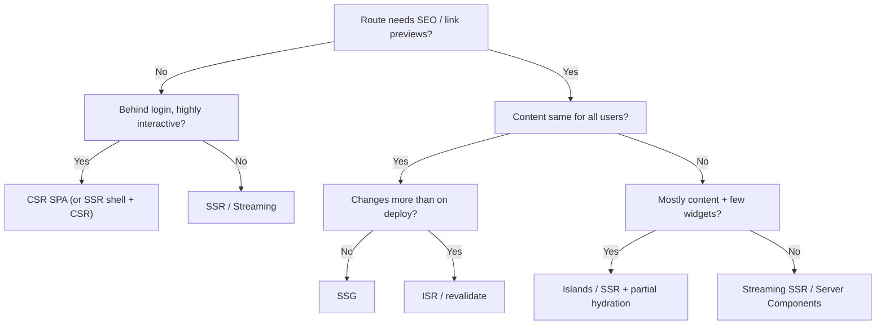

# Architecture decision matrices

Make each decision **per surface or route**, not once for the whole app.

Two rules apply throughout:
- Don't quote framework version numbers you haven't checked. Describe capabilities instead.
- For each choice, name what would make you change it.

## 1. Rendering strategy

| Strategy | Best for | Avoid when | Cost / risk |
|---|---|---|---|
| **SSG** (static at build) | Marketing, docs, blogs; content that changes on deploy | Content per user or per minute | Build time grows with the number of pages |
| **ISR / on-demand revalidation** | Catalogs and content with periodic updates and many pages | Personalization in the HTML | Stale windows; cache invalidation design |
| **SSR** (per request) | SEO plus personalized or fresh data (PDP with stock, search results) | Very high traffic with no cacheable parts | Server cost; TTFB is on the critical path |
| **Streaming SSR / Server Components** | Data-heavy pages where the shell can paint before slow data | Teams without server-runtime experience | Mental model; hydration boundaries |
| **Islands / partial hydration** | Content-first sites with small interactive widgets | App-like UIs where everything is interactive | Cross-island state is awkward |
| **CSR SPA** | Authenticated apps, dashboards, editors; no SEO | Public pages that need SEO or fast first paint on weak devices | Big JS, slow first load, blank-screen risk |
| **Edge rendering** | Geo or personalized variants, A/B, auth gating near users | Heavy compute; needs DB access far from edge | Runtime API limits; data locality |

**Decision flow**

## 2. Framework / meta-framework

| Need | Strong default | Alternatives |
|---|---|---|
| Full-stack React app with mixed rendering | **Next.js** (App Router, Server Components) | React Router (framework mode), TanStack Start |
| Content-first site, multi-framework islands | **Astro** | Eleventy, Hugo (no JS needed) |
| Vue ecosystem | **Nuxt** | Vite + Vue SPA |
| Svelte ecosystem / small bundles | **SvelteKit** | Astro + Svelte islands |
| Fine-grained reactivity, very fast updates | **SolidStart** / Solid | Qwik (resumability) |
| Internal tool or dashboard, SPA only | **Vite + React** (+ TanStack Router) | Vite + Vue / Svelte |
| Enterprise with strict conventions and DI | **Angular** | Next.js plus strong lint and architecture rules |
| Embeddable widgets across host apps | **Web Components** (Lit) | Preact in a Shadow DOM |

Tie-breakers, in order: the team's existing expertise, hosting constraints, ecosystem (auth, i18n, UI kit), then raw performance.

## 3. State management: split state by kind

| Kind of state | Where it lives | Tooling |
|---|---|---|
| **Server state** (cached remote data) | Query cache | TanStack Query, SWR, RTK Query, Apollo/urql (GraphQL); RSC data for server-rendered routes |
| **URL state** (filters, tabs, pagination, selected id) | URL search params | Router APIs, `nuqs`-style helpers |
| **Form state** | Form library, local to the form | React Hook Form, TanStack Form, native forms with server actions; schema validation with Zod or Valibot |
| **Local UI state** | Component | `useState`/`useReducer`, signals |
| **Global client state** (session UI, theme, cross-page drafts) | Small store | Zustand, Jotai, Redux Toolkit (large teams/devtools), Pinia (Vue), stores (Svelte) |
| **Collaborative or offline state** | CRDT or local DB plus sync | Yjs, Automerge, IndexedDB (Dexie), local-first sync engines |

Red flags:
- API responses copied into a global store.
- Derived state stored rather than computed.
- Filter state that isn't in the URL, so it can't be shared or survive a refresh.

## 4. Data fetching and API layer

| Topic | Guidance |
|---|---|
| Contract | REST for simple CRUD and caching through HTTP. GraphQL when many clients need different shapes. A **BFF** when the frontend needs aggregation, auth token handling, or to hide internal services |
| Waterfalls | Fetch in parallel. Hoist data needs to the route level (loaders / RSC). Avoid fetch-on-render chains |
| Caching | Stale-while-revalidate for reads. Cache keys include every parameter. Invalidate on mutation |
| Mutations | Optimistic updates for low-risk actions with rollback. Pessimistic for payments and destructive actions |
| Pagination | Cursor-based for feeds and infinite scroll. Offset for tables that need "page N" and totals |
| Errors | Typed errors. Retry with backoff only for idempotent requests. User-facing messages mapped from codes |
| Types | Generate types from OpenAPI or a GraphQL schema. Validate untrusted input at the boundary |

## 5. Real-time transport

| Transport | Use when | Notes |
|---|---|---|
| Polling / SWR refetch | Updates every 10 s or more; simple | Cheapest to build; add jitter |
| **SSE** | One-way server→client streams (notifications, AI tokens, live metrics) | Runs over HTTP and reconnects automatically |
| **WebSocket** | Two-way, low-latency (chat, collaboration, games) | Needs a heartbeat, reconnection, backpressure, and auth on connect |
| WebRTC | Peer media and data | Needs signaling plus STUN/TURN |
| WebTransport | Low-latency datagrams/streams over HTTP/3 | Check browser support for the target audience |

Always define:
- the reconnection strategy;
- how missed events are recovered (last event id or version);
- message ordering;
- how to throttle UI updates (batch per animation frame).

## 6. Project structure

| Size | Structure |
|---|---|
| Small | `app/` or `routes/`, `components/`, `lib/`, `styles/` |
| Medium to large | **Feature-based**: `features/<feature>/{components,api,hooks,model}` plus `shared/ui`. Enforce boundaries with lint rules |
| Large, multi-team | Feature-Sliced Design or a domain modular monolith in a **monorepo** (Turborepo/Nx) with shared `ui`, `config` and `tsconfig` packages |
| Independent deploys across teams | **Micro-frontends** (Module Federation, or route-level split). Use them only when team autonomy outweighs the cost: duplicate deps, UX consistency, shared-state complexity |

## 7. Cross-cutting decisions checklist

- [ ] Routing and code-splitting per route; lazy-load heavy, rarely used features
- [ ] Error boundaries per route and per widget; a global error page; retry UX
- [ ] Auth: httpOnly secure cookies through a BFF or server session; route guards on server and client
- [ ] Feature flags and experiments, without layout shift
- [ ] Analytics and RUM through one event schema
- [ ] Theming through CSS variables or tokens; dark mode
- [ ] i18n: message catalogs, ICU plurals, `Intl` formatting, logical CSS properties
- [ ] CI: type-check, lint, unit, e2e smoke, bundle-size check, Lighthouse CI on key routes

Deep dives: [How Browsers Work](https://github.com/Muzammil8989/frontend-system-design/blob/main/notes/01-web-fundamentals/how-browsers-work.md) · [Critical Rendering Path](https://github.com/Muzammil8989/frontend-system-design/blob/main/notes/01-web-fundamentals/critical-rendering-path.md) · [Browser Storage](https://github.com/Muzammil8989/frontend-system-design/blob/main/notes/01-web-fundamentals/browser-storage-mechanisms.md) · [Event Loop](https://github.com/Muzammil8989/frontend-system-design/blob/main/notes/01-web-fundamentals/javascript-runtime-event-loop.md)
