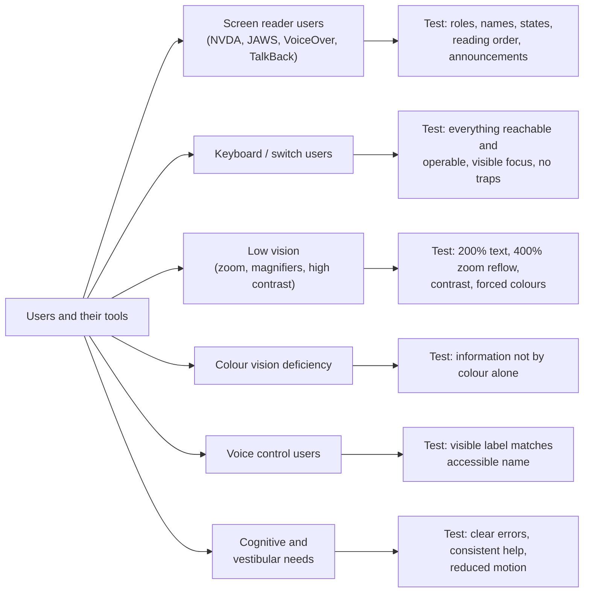
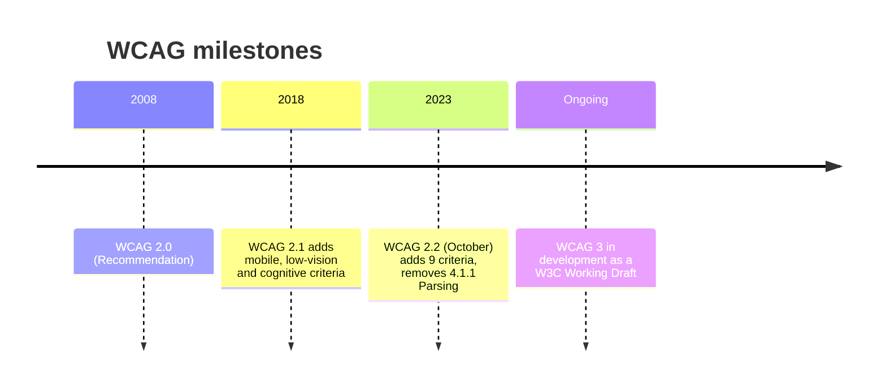
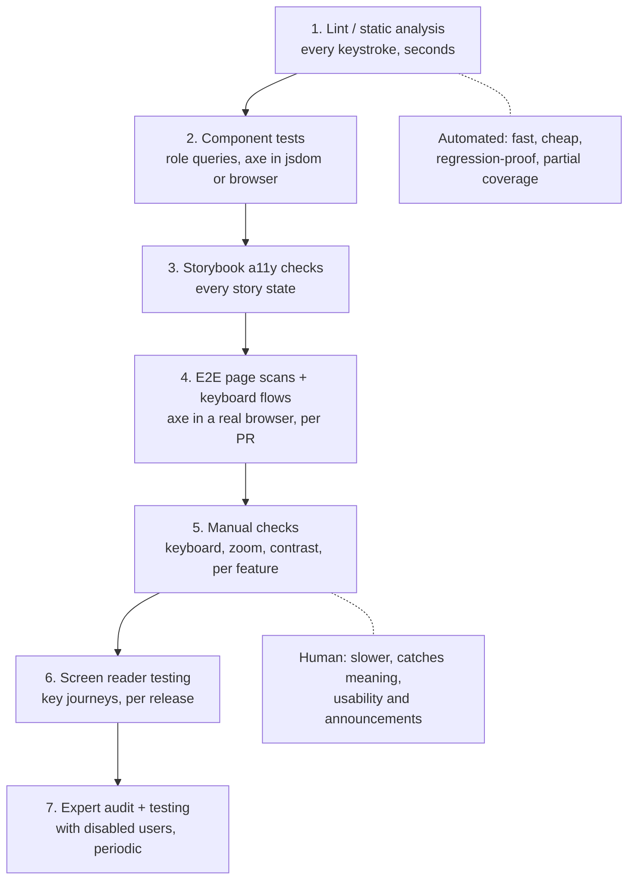
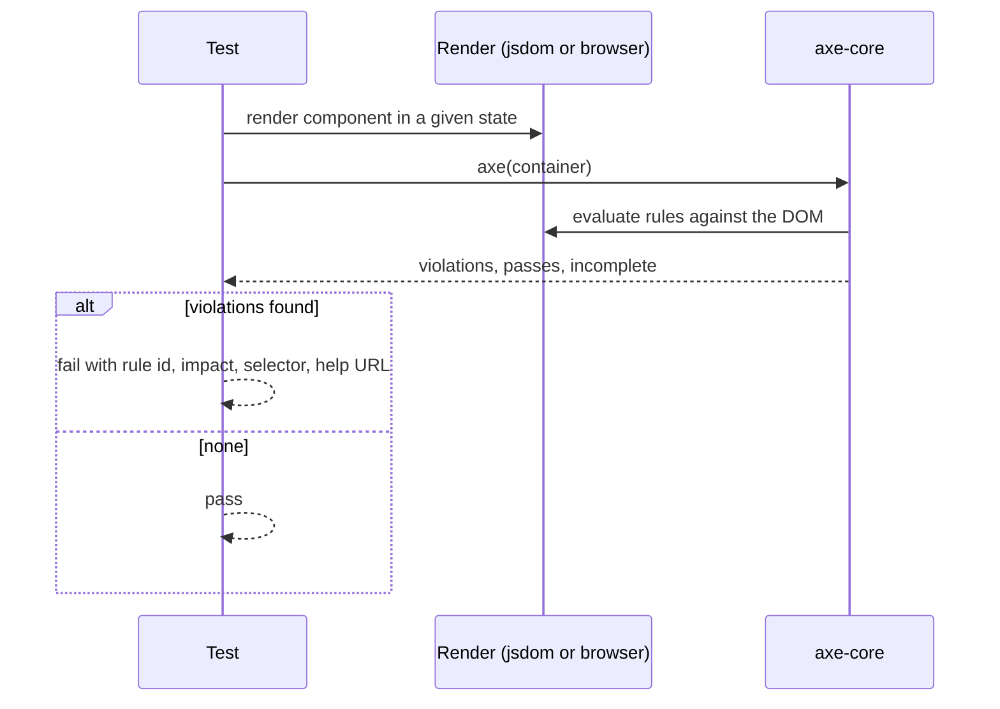
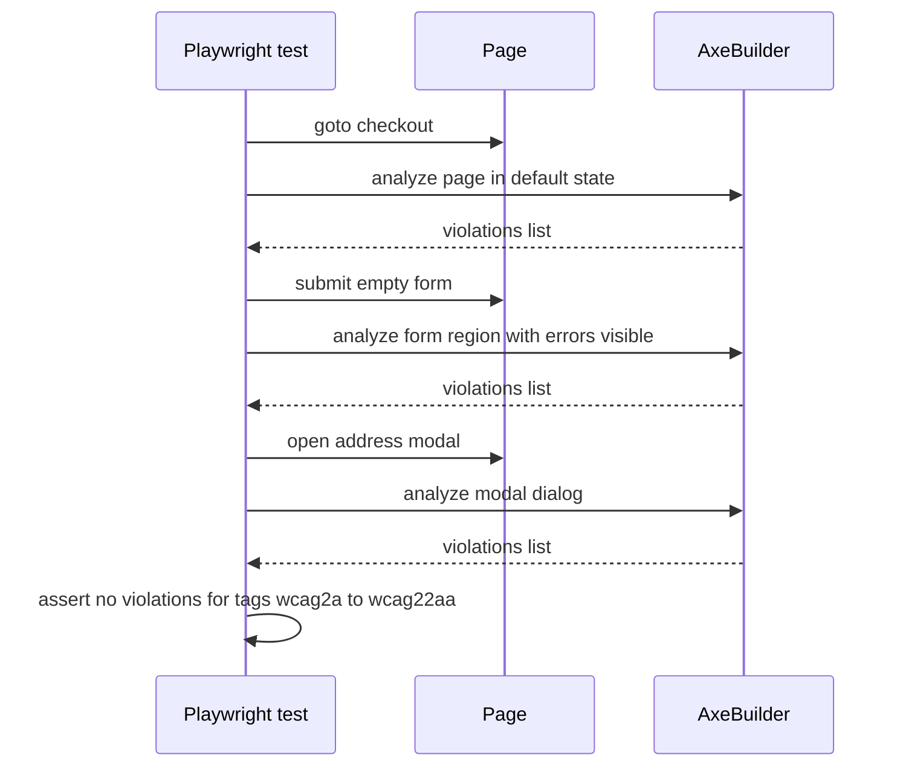
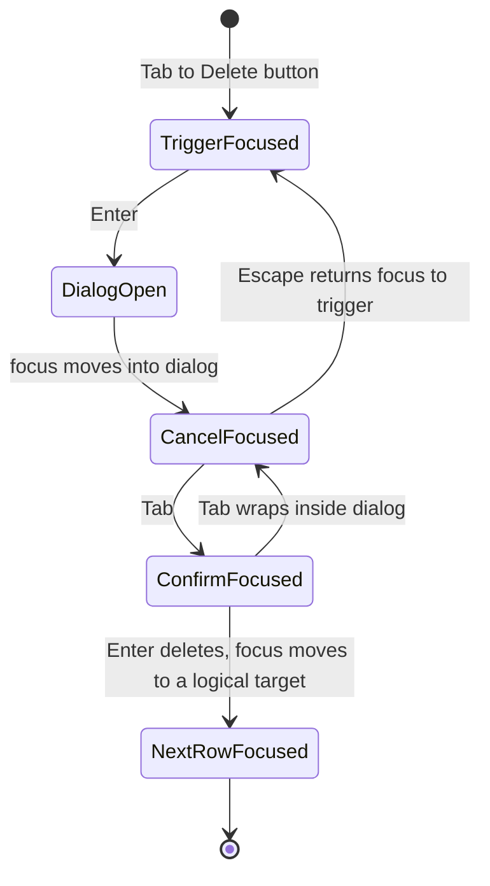
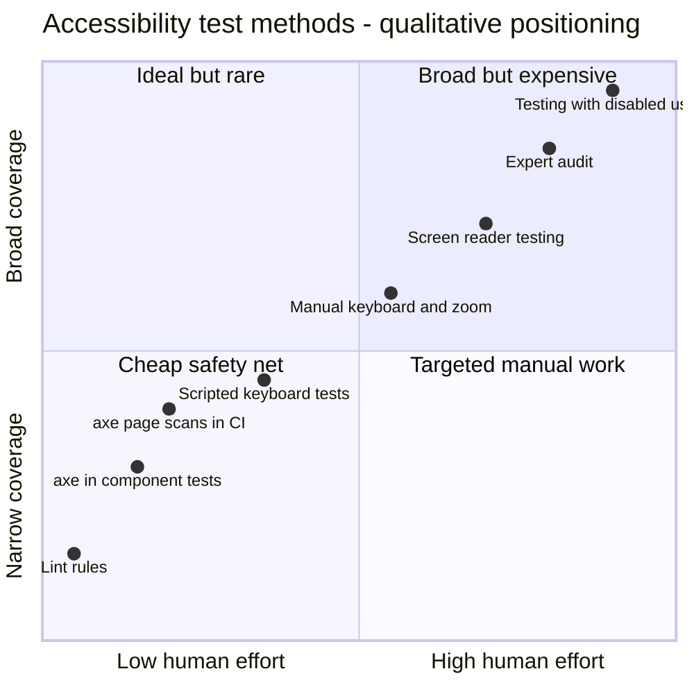
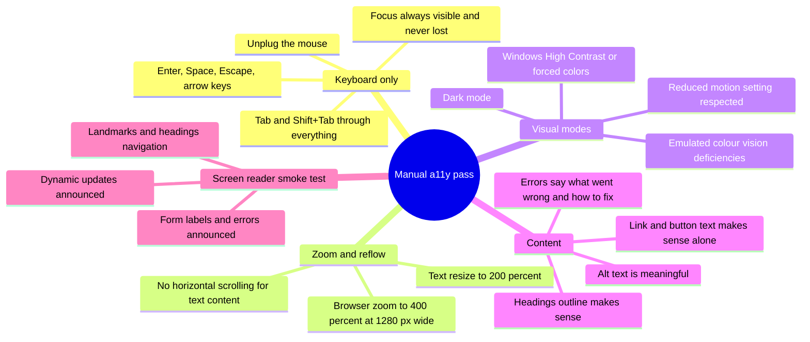
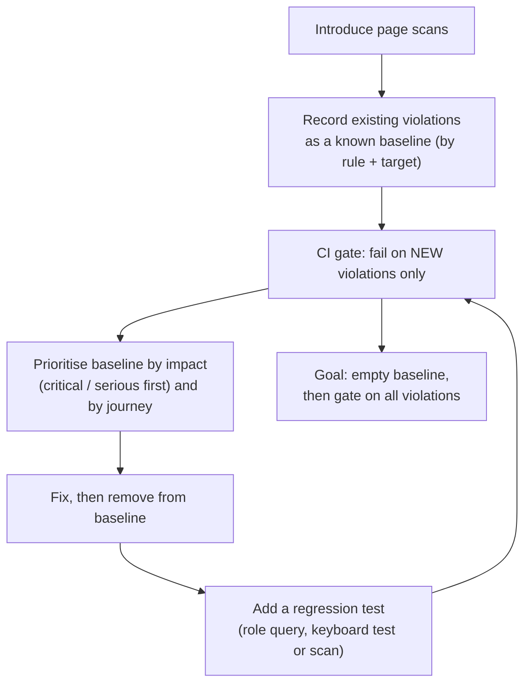
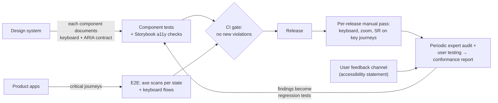

<!-- Generated by scripts/sync-knowledge.js from notes/ and README.md — do not edit here. -->
<!-- sections (line ranges in this file): Table of Contents 19-41 · ELI5 42-55 · Core Concept 56-407 · System Design Angle 408-440 · Real-World Examples 441-640 · Key Points Summary 641-659 · Test Your Understanding 660-736 · Cheat Sheet 737-784 · References & Further Reading 785-822 -->

# Accessibility Testing

> **Date:** 2026-11-06 · **Last updated:** 2026-11-06
> **Category:** Frontend System Design
> **Sub-Topic:** Testing / Accessibility
> **Level:** Intermediate · **Reading time:** ~27 min
> **Informs:** layered a11y test strategy (lint, component, E2E, manual, assistive tech), CI accessibility gates and baselines, WCAG 2.2 AA conformance evidence, screen reader and browser test matrix, design-system a11y contracts, release sign-off and audit cadence, native mobile accessibility checks

> **Pre-requisite:** [ARIA Roles, States & Properties](./aria-roles-states-and-properties.md) and [Keyboard Navigation & Focus Management](./keyboard-navigation-and-focus-management.md).
> Phase 6 covers *how to build* accessible UI and the tools in depth ([Automated A11y Testing (axe, Lighthouse)](./automated-a11y-testing-axe-lighthouse.md), [Screen Reader Testing](./screen-reader-testing.md)). This note is the **testing-strategy view**: which checks run where, what they can and can't prove, and how to wire them into a pipeline.

**Previous:** [Performance Testing](./performance-testing.md) · **Next:** [Testing Strategies & Pyramid](./testing-strategies-and-pyramid.md)

---

## Table of Contents

1. [ELI5 — Simple Explanation](#eli5--simple-explanation)
2. [Section 1: What Accessibility Testing Verifies](#section-1-what-accessibility-testing-verifies)
3. [Section 2: WCAG 2.2 as the Test Oracle](#section-2-wcag-22-as-the-test-oracle)
4. [Section 3: The Accessibility Testing Layers](#section-3-the-accessibility-testing-layers)
5. [Section 4: Static Analysis (Linting)](#section-4-static-analysis-linting)
6. [Section 5: Component Tests — Roles, Names and axe](#section-5-component-tests--roles-names-and-axe)
7. [Section 6: E2E and Page Scans in CI](#section-6-e2e-and-page-scans-in-ci)
8. [Section 7: Keyboard and Focus Tests](#section-7-keyboard-and-focus-tests)
9. [Section 8: What Automation Cannot Catch](#section-8-what-automation-cannot-catch)
10. [Section 9: Manual and Assistive-Technology Testing](#section-9-manual-and-assistive-technology-testing)
11. [Section 10: Triage, Baselines and Regressions](#section-10-triage-baselines-and-regressions)
12. [Section 11: Other Frameworks and Native Mobile](#section-11-other-frameworks-and-native-mobile)
13. [System Design Angle](#system-design-angle)
14. [Real-World Examples](#real-world-examples)
15. [Key Points Summary](#key-points-summary)
16. [Test Your Understanding (with answers)](#test-your-understanding)
17. [Cheat Sheet](#cheat-sheet)
18. [References & Further Reading](#references--further-reading)

---

## ELI5 — Simple Explanation

Imagine checking whether a **building** is accessible:

- A **robot inspector** walks through with a tape measure: "This door is 70 cm wide — too narrow. This ramp is too steep. This sign has no Braille." It's fast and never gets tired, but it can only check things it can **measure**.
- The robot **can't** tell you whether the signs make sense, whether the route from the entrance to the lift is confusing, or whether the lift button is placed where a wheelchair user can reach it while holding the door.
- So you also walk the route **yourself** — with your eyes closed using a cane, in a wheelchair, with only one hand — and best of all you **invite people who use these every day** to try it.

On the web: the robot is **axe / Lighthouse / linters**; walking the route is **keyboard-only, screen-reader and zoom testing**; inviting people is **usability testing with disabled users**.

> **Automated a11y tests catch the measurable problems cheaply on every commit; only humans using keyboards, screen readers and zoom can confirm that the experience actually works.**

---

## Core Concept — Step by Step

### Section 1: What Accessibility Testing Verifies

Accessibility testing checks that people with **visual, auditory, motor, cognitive and speech** disabilities — using assistive technology or not — can **perceive, operate and understand** the UI.



| What you're verifying | Example failure | How it's caught |
|---|---|---|
| **Semantics** — correct roles, names, states | Clickable `<div>` with no role; icon button with no name | Lint, axe, role-based queries, ARIA snapshots |
| **Keyboard operability** | Custom dropdown can't be opened with Enter/Space; focus trapped in a modal after close | Keyboard tests (automated + manual) |
| **Focus management** | After deleting a row, focus jumps to `<body>` | E2E focus assertions, manual |
| **Visual** | Contrast below 4.5:1; content cut off at 400% zoom; focus ring invisible | axe (contrast, partial), manual zoom, visual tests |
| **Announcements** | Form errors appear but aren't announced | Screen reader testing (manual) |
| **Meaning** | Alt text "image123.png"; link text "click here" ×10 | Human review |
| **Real usability** | Technically conformant but exhausting to use with a screen reader | Testing with disabled users |

---

### Section 2: WCAG 2.2 as the Test Oracle

Tests need a definition of "correct". In practice that's the **W3C Web Content Accessibility Guidelines (WCAG)**, usually **level AA**, which most accessibility laws and procurement standards reference.



**Structure:** 4 principles (**P**erceivable, **O**perable, **U**nderstandable, **R**obust) → guidelines → testable **success criteria** at levels A, AA, AAA. WCAG versions are backwards-compatible: meeting 2.2 AA also meets 2.1 AA and 2.0 AA (with 4.1.1 treated as satisfied).

**New in WCAG 2.2 at A/AA — worth explicit tests:**

| Criterion | Level | What to test |
|---|---|---|
| 2.4.11 Focus Not Obscured (Minimum) | AA | Sticky headers/footers/cookie banners don't fully hide the focused element |
| 2.5.7 Dragging Movements | AA | Every drag action (sortable lists, sliders, Kanban) has a single-pointer alternative |
| 2.5.8 Target Size (Minimum) | AA | Pointer targets are at least 24×24 CSS px, or have enough spacing (exceptions apply) |
| 3.2.6 Consistent Help | A | Help links/contact appear in the same relative order across pages |
| 3.3.7 Redundant Entry | A | Don't make users re-type information already provided in the same process |
| 3.3.8 Accessible Authentication (Minimum) | AA | No cognitive function test (e.g. memorising, transcribing) without an alternative; allow paste and password managers |

**Legal context (check with your legal team — requirements vary by country and sector):** the European Accessibility Act applies to many consumer products and services in the EU from 28 June 2025 (via EN 301 549, which references WCAG); in the US, the ADA and Section 508 apply, with Section 508 referencing WCAG 2.0 AA. Many organisations target **WCAG 2.2 AA** as the practical baseline.

---

### Section 3: The Accessibility Testing Layers



| Layer | Catches | Misses | Cost |
|---|---|---|---|
| **Lint** | Missing `alt`, invalid ARIA attributes, click handlers on non-interactive elements | Anything runtime or visual | Near zero |
| **Component tests** | Missing accessible names, wrong roles/states, broken keyboard handlers | Page-level structure, real rendering (contrast in jsdom) | Low |
| **Storybook checks** | axe violations per component state | Composition, page context | Low |
| **E2E scans** | Rendered-page violations (contrast, landmarks, duplicate IDs, names) | Meaning, announcements, usability | Medium |
| **Manual keyboard/zoom** | Focus order, traps, visibility, reflow | Screen reader specifics | Medium |
| **Screen reader** | Announcements, reading order, live regions, AT/browser bugs | Other disability groups | Higher |
| **Audit + user testing** | Real barriers, conformance evidence | — | Highest |

> **Shift left, but don't stop left.** Every layer is cheaper than the next for what it can catch — and blind to what the next layer catches.

---

### Section 4: Static Analysis (Linting)

| Stack | Tool |
|---|---|
| React (JSX/TSX) | `eslint-plugin-jsx-a11y` |
| Vue | `eslint-plugin-vuejs-accessibility` |
| Angular | `@angular-eslint` template accessibility rules |
| Svelte | The Svelte compiler itself emits a11y warnings; `eslint-plugin-svelte` surfaces them in ESLint |
| HTML | `html-validate`, `htmlhint` |
| CSS | Stylelint plugins for e.g. `outline: none` without replacement (community) |

Linting is **syntactic**: it sees `` without `alt` or `onClick` on a `<div>`, but not what a component renders at runtime, and it can't judge whether `alt="photo"` is meaningful. Treat its errors as blocking — they're cheap to fix and nearly never false alarms.

---

### Section 5: Component Tests — Roles, Names and axe

**Role-based queries are accessibility tests in disguise.** Testing Library's `getByRole('button', { name: 'Save' })` only finds elements that expose that role and accessible name to assistive technology. If a test can't find your button by role and name, neither can a screen reader user.

```tsx
// If this query fails, the button has no accessible name
await user.click(screen.getByRole('button', { name: 'Add to cart' }));
expect(screen.getByRole('status')).toHaveTextContent('Added to cart');
expect(screen.getByRole('checkbox', { name: 'Gift wrap' })).not.toBeChecked();
```

Useful `@testing-library/jest-dom` matchers: `toHaveAccessibleName`, `toHaveAccessibleDescription`, `toHaveAccessibleErrorMessage`, `toBeChecked`, `toHaveFocus`, `toBeDisabled`, `toHaveAttribute('aria-expanded', 'true')`.

**axe in component tests** (`jest-axe`, `vitest-axe`) runs axe-core against the rendered DOM:



**jsdom limitations:** jsdom has no layout or rendering, so rules that need real rendering — notably **colour contrast** — don't work there (jest-axe disables them by default). Run contrast checks in a real browser (Playwright, Storybook test runner, Vitest browser mode).

**Storybook:** the **a11y addon** (`@storybook/addon-a11y`) runs axe on every story in the UI panel, and with Storybook's test integration can fail tests on violations; check the Storybook docs for the configuration options in your version. Because stories already enumerate every state (error, disabled, loading, open), this gives broad, cheap coverage of a design system.

---

### Section 6: E2E and Page Scans in CI

Page-level scans in a real browser catch what component tests miss: landmarks, heading structure, duplicate IDs, page `lang` and title, contrast with real CSS, and issues introduced by composition.

| Tool | Use |
|---|---|
| **`@axe-core/playwright`** (`AxeBuilder`) | Scan pages or regions inside Playwright tests |
| **`cypress-axe`** | `cy.injectAxe()` + `cy.checkA11y()` in Cypress |
| **`@axe-core/webdriverjs`**, `@axe-core/puppeteer` | Other drivers |
| **Pa11y / pa11y-ci** | CLI scanning a list of URLs with axe and/or HTML_CodeSniffer runners |
| **Lighthouse accessibility category** | A subset of axe audits with a weighted score — useful signal, not a conformance claim |
| **Playwright `toMatchAriaSnapshot`** | Asserts the accessibility tree structure (roles, names, levels) of a region in YAML |

**Scan the states, not just the page load.** Most violations live in UI that appears after interaction: open menus, modals, validation errors, toasts, expanded accordions, empty and loading states.



**axe result categories:**
- **violations** — failed rules; these fail the test.
- **incomplete** — axe couldn't decide (e.g. contrast over a background image); route to **manual review**, don't ignore.
- **passes / inapplicable** — useful for reporting coverage.

axe-core is designed to minimise false positives, which is why uncertain cases go to `incomplete` instead of `violations`. That makes it safe as a CI gate — and also means **"zero violations" ≠ accessible**.

---

### Section 7: Keyboard and Focus Tests

Keyboard access is where automated scanners are weakest and scripted tests are strongest. Encode the expected behaviour from the [ARIA Authoring Practices](https://www.w3.org/WAI/ARIA/apg/patterns/) pattern for each widget:

| Widget | Assert |
|---|---|
| **Dialog** | Focus moves into the dialog on open; Tab cycles within it; Escape closes; focus returns to the trigger |
| **Menu button** | Enter/Space/ArrowDown opens and focuses the first item; arrows move; Escape closes and returns focus |
| **Tabs** | Arrow keys move between tabs (roving tabindex); Tab moves into the panel |
| **Combobox** | Typing filters; arrows move the active option (`aria-activedescendant`); Enter selects; Escape closes |
| **Page** | Skip link works; Tab order follows visual order; no focus lands on hidden/offscreen content; focus is never lost to `<body>` after updates |



Also test **Focus Not Obscured** (WCAG 2.4.11): with a sticky header and cookie banner visible, tab through the page and check the focused element isn't completely hidden. Playwright can check that the focused element's bounding box isn't covered by the sticky element's box.

---

### Section 8: What Automation Cannot Catch

Automated rules can only verify what's **mechanically decidable**. Many WCAG success criteria require human judgement, so automated tools cover only part of WCAG — they're a floor, not a ceiling.

| Automation can check | Humans must judge |
|---|---|
| `` has an `alt` attribute | Whether the alt text **describes** the image's purpose (or should be empty) |
| A form field has a label | Whether the label is **clear**, and errors explain how to fix them |
| Text/background contrast (when it can compute colours) | Contrast over images/gradients; information conveyed by colour alone |
| Heading elements exist | Whether the heading **hierarchy** reflects the content structure |
| ARIA attributes are valid | Whether the ARIA **pattern** behaves as announced |
| An element is focusable | Whether the **focus order** is logical and focus moves sensibly after actions |
| `aria-live` region exists | Whether announcements are **timely, not too chatty**, and actually spoken |
| Page has `lang` | Whether content is **understandable**; captions are **accurate** |
| Viewport meta allows zoom | Whether the layout **reflows** at 400% without loss |



*(Placement is a qualitative illustration of the trade-off, not measured coverage.)*

---

### Section 9: Manual and Assistive-Technology Testing

**A 15-minute manual pass per feature** (no special tools):



**Screen reader + browser combinations** (test the ones your users use — check your analytics and public surveys such as WebAIM's):

| Platform | Screen reader | Pair with |
|---|---|---|
| Windows | **NVDA** (free) | Firefox or Chrome |
| Windows | **JAWS** (commercial) | Chrome or Edge |
| macOS | **VoiceOver** (built in) | Safari |
| iOS / iPadOS | **VoiceOver** | Safari |
| Android | **TalkBack** | Chrome |
| Windows | Narrator | Edge |

**Why the pairing matters:** the browser builds the accessibility tree and passes it to the screen reader through platform APIs. Support for ARIA patterns differs by browser **and** screen reader; a widget can work in NVDA + Firefox and fail in VoiceOver + Safari. Resources such as [a11ysupport.io](https://a11ysupport.io/) and the [ARIA-AT project](https://aria-at.w3.org/) document support levels.

**Browser tooling for manual testing:**
- Chrome DevTools: Accessibility pane (computed name/role, full accessibility tree view), Rendering panel (emulate vision deficiencies, `prefers-reduced-motion`, `forced-colors`), CSS Overview contrast issues.
- Firefox Accessibility Inspector: tree, issue checks, simulated vision deficiencies, tab-order overlay.
- Browser extensions such as axe DevTools, WAVE, and Accessibility Insights for Web (which includes a guided assessment).

**Automating screen readers** is emerging (e.g. Guidepup can drive VoiceOver and NVDA from tests), but it's slower, platform-bound and harder to stabilise than DOM-level tests. Use it for a few critical journeys at most; keep manual screen reader testing for releases.

**Testing with disabled users** finds problems no checklist does — the experience can be conformant and still painful. Recruit participants who use assistive technology daily, pay them, and test real tasks.

---

### Section 10: Triage, Baselines and Regressions

Adding axe to a large existing app usually reveals many violations at once. Don't disable the check — **baseline** it.



**Rules for a healthy pipeline:**
- **Fail on new violations immediately**; burn down the baseline with owners and dates.
- **Scope exclusions narrowly**: `exclude('#third-party-chat')` with a ticket link, never `disableRules(['color-contrast'])` globally.
- **Tag the WCAG level you target** (`wcag2a`, `wcag2aa`, `wcag21a`, `wcag21aa`, `wcag22aa`) so best-practice rules don't block merges unless you choose them.
- **Track `incomplete` results** as a manual-review queue.
- **Every bug found manually gets an automated regression test** where possible (e.g. a keyboard test for a focus bug).
- **Severity:** prioritise blockers on critical journeys (sign-up, checkout, login, core tasks) over cosmetic issues on rarely used pages.

---

### Section 11: Other Frameworks and Native Mobile

| Stack | Lint | Component / unit | E2E / runtime |
|---|---|---|---|
| **React** | `eslint-plugin-jsx-a11y` | React Testing Library role queries + `jest-axe`/`vitest-axe` | `@axe-core/playwright`, `cypress-axe` |
| **Vue** | `eslint-plugin-vuejs-accessibility` | Vue Testing Library (same role queries) + axe | Same |
| **Angular** | `@angular-eslint` template a11y rules | Angular Testing Library or TestBed (+ CDK component harnesses) + axe | Same |
| **Svelte** | Compiler a11y warnings | Svelte Testing Library + axe | Same |
| **Web components** | — | axe in a real browser (shadow DOM is supported by axe-core) | Same |
| **iOS** | — | XCUITest `performAccessibilityAudit()` (recent Xcode) | Accessibility Inspector, VoiceOver manual |
| **Android (Views)** | Android Lint a11y checks | Espresso `AccessibilityChecks.enable()` (Accessibility Test Framework) | Accessibility Scanner app, TalkBack manual |
| **Android (Compose)** | — | Semantics-based tests (`onNodeWithContentDescription`, `assert(hasClickAction())`) and ATF integration | TalkBack manual |
| **Flutter** | — | `meetsGuideline(textContrastGuideline)`, `labeledTapTargetGuideline`, `androidTapTargetGuideline`, `iOSTapTargetGuideline` | Platform screen readers |
| **React Native** | `eslint-plugin-react-native-a11y` (community) | React Native Testing Library role queries | Platform tools + VoiceOver/TalkBack |

> **Native rule:** automated checks there cover even less than on the web (no axe equivalent with the same breadth), so manual VoiceOver/TalkBack passes on real devices are essential.

---

## System Design Angle

When designing a product or design system, accessibility testing answers: **"How do we prove — and keep proving — that every user can complete every core task?"**



**Decisions to make explicitly:**

| Decision | Recommendation |
|---|---|
| **Target standard** | WCAG 2.2 AA unless legal/contract says otherwise |
| **What blocks merges** | Lint errors, axe violations (WCAG A/AA tags) on scanned states, failed keyboard tests, failed role queries |
| **Where a11y is owned** | Design system owns component contracts; product teams own composition and content |
| **Test matrix** | Screen reader/browser pairs from your user analytics; at minimum one Windows (NVDA or JAWS) and one Apple (VoiceOver) pair, plus TalkBack for mobile web/apps |
| **Cadence** | Automated per PR; manual pass per feature; SR pass per release; expert audit periodically and before major launches |
| **Evidence** | Conformance report (e.g. a VPAT-based Accessibility Conformance Report) for enterprise/government customers |
| **Feedback loop** | Public accessibility statement with a contact route; triage reports like security bugs |

**Design-system leverage:** fixing a component once fixes it everywhere. Testing every story state with axe + keyboard tests gives the largest return per hour of test effort.

---

## Real-World Examples

**Example 1 — Component test: role queries + axe (React + Vitest):**
```tsx
import { render, screen } from '@testing-library/react';
import userEvent from '@testing-library/user-event';
import { axe } from 'vitest-axe';
import { expect, test } from 'vitest';
import { NewsletterForm } from './NewsletterForm';

test('newsletter form is accessible in its error state', async () => {
  const user = userEvent.setup();
  const { container } = render(<NewsletterForm />);

  await user.click(screen.getByRole('button', { name: 'Subscribe' }));

  const email = screen.getByRole('textbox', { name: 'Email address' });
  expect(email).toHaveAttribute('aria-invalid', 'true');
  expect(email).toHaveAccessibleDescription('Enter an email address like name@example.com');
  expect(email).toHaveFocus(); // focus moved to the first invalid field

  const results = await axe(container); // jsdom: contrast rules don't run here
  expect(results.violations).toEqual([]);
});
```

> With `jest-axe`: `import { axe, toHaveNoViolations } from 'jest-axe'; expect.extend(toHaveNoViolations);` then `expect(await axe(container)).toHaveNoViolations()`.

**Example 2 — Accessible markup (BAD → GOOD) that the test above relies on:**
```tsx
// ❌ BAD: placeholder as label, error only shown in red, div as button
<div className="form">
  <input placeholder="Email" className={error ? 'red' : ''} />
  <div className="btn" onClick={submit}>Subscribe</div>
</div>

// ✅ GOOD: real label, error linked and announced, native button
<form noValidate onSubmit={submit}>
  <label htmlFor="email">Email address</label>
  <input
    id="email"
    type="email"
    autoComplete="email"
    aria-invalid={error ? 'true' : undefined}
    aria-describedby={error ? 'email-error' : undefined}
  />
  {error && <p id="email-error">Enter an email address like name@example.com</p>}
  <button type="submit">Subscribe</button>
</form>
```

**Example 3 — Playwright page scans per UI state:**
```typescript
import { test, expect, type Page } from '@playwright/test';
import AxeBuilder from '@axe-core/playwright';

const WCAG_TAGS = ['wcag2a', 'wcag2aa', 'wcag21a', 'wcag21aa', 'wcag22aa'];

const scan = (page: Page) =>
  new AxeBuilder({ page })
    .withTags(WCAG_TAGS)
    .exclude('#third-party-chat'); // vendor widget, tracked in A11Y-142

test.describe('checkout accessibility', () => {
  test('default state', async ({ page }) => {
    await page.goto('/checkout');
    const { violations } = await scan(page).analyze();
    expect(violations).toEqual([]);
  });

  test('validation errors', async ({ page }) => {
    await page.goto('/checkout');
    await page.getByRole('button', { name: 'Place order' }).click();
    await expect(page.getByRole('alert')).toBeVisible();
    const { violations } = await scan(page).include('form').analyze();
    expect(violations).toEqual([]);
  });

  test('address dialog', async ({ page }) => {
    await page.goto('/checkout');
    await page.getByRole('button', { name: 'Change address' }).click();
    const { violations } = await scan(page).include('[role="dialog"]').analyze();
    expect(violations).toEqual([]);
  });
});
```

**Example 4 — Keyboard and focus test for a dialog (Playwright):**
```typescript
import { test, expect } from '@playwright/test';

test('delete dialog: focus in, trap, Escape, focus return', async ({ page }) => {
  await page.goto('/projects');
  const trigger = page.getByRole('button', { name: 'Delete project Apollo' });
  await trigger.focus();
  await page.keyboard.press('Enter');

  const dialog = page.getByRole('dialog', { name: 'Delete project?' });
  await expect(dialog).toBeVisible();
  await expect(dialog.getByRole('button', { name: 'Cancel' })).toBeFocused();

  await page.keyboard.press('Tab');
  await expect(dialog.getByRole('button', { name: 'Delete' })).toBeFocused();
  await page.keyboard.press('Tab'); // wraps, stays inside the dialog
  await expect(dialog.getByRole('button', { name: 'Cancel' })).toBeFocused();

  await page.keyboard.press('Escape');
  await expect(dialog).toBeHidden();
  await expect(trigger).toBeFocused(); // focus returned to the trigger
});
```

> With a native `<dialog>` opened by `showModal()`, browsers make the rest of the page inert, but the Tab-wrapping behaviour can differ — Tab may move to the browser UI instead of wrapping. Assert the behaviour your design system specifies and test it in every browser you support.

**Example 5 — ARIA snapshot of the navigation (Playwright):**
```typescript
test('main navigation exposes the expected accessibility tree', async ({ page }) => {
  await page.goto('/');
  await expect(page.getByRole('navigation', { name: 'Main' })).toMatchAriaSnapshot(`
    - navigation "Main":
      - list:
        - listitem:
          - link "Products"
        - listitem:
          - link "Pricing"
        - listitem:
          - link "Docs"
  `);
});
```

**Example 6 — Visual-mode checks (forced colours, zoom reflow):**
```typescript
import { test, expect } from '@playwright/test';

test('focus ring visible in forced-colors mode', async ({ page }) => {
  await page.emulateMedia({ forcedColors: 'active' });
  await page.goto('/settings');
  await page.keyboard.press('Tab');
  await expect(page.locator(':focus')).toHaveScreenshot('focus-forced-colors.png');
});

test('content reflows at 320 CSS px (≈ 400% zoom of 1280 px)', async ({ page }) => {
  await page.setViewportSize({ width: 320, height: 800 });
  await page.goto('/article/accessibility');
  const overflow = await page.evaluate(
    () => document.documentElement.scrollWidth > document.documentElement.clientWidth,
  );
  expect(overflow).toBe(false); // no horizontal scrolling for text content
});
```

**Example 7 — Storybook a11y addon and Cypress:**
```typescript
// Button.stories.ts — per-story a11y configuration (check Storybook docs for your version)
export const IconOnly = {
  args: { icon: 'trash', 'aria-label': 'Delete' },
  parameters: {
    a11y: { config: { rules: [{ id: 'color-contrast', enabled: true }] } },
  },
};
```

```javascript
// cypress/e2e/login.cy.js
describe('login', () => {
  it('has no detectable WCAG A/AA violations', () => {
    cy.visit('/login');
    cy.injectAxe();
    cy.checkA11y(null, { runOnly: { type: 'tag', values: ['wcag2a', 'wcag2aa', 'wcag21aa', 'wcag22aa'] } });
  });
});
```

**Example 8 — Native mobile checks:**
```swift
// iOS XCUITest — automated accessibility audit (recent Xcode versions)
func testSettingsScreenAccessibility() throws {
    let app = XCUIApplication()
    app.launch()
    app.buttons["Settings"].tap()
    try app.performAccessibilityAudit()
}
```

```dart
// Flutter widget test — built-in accessibility guidelines
testWidgets('login screen meets a11y guidelines', (tester) async {
  final handle = tester.ensureSemantics();
  await tester.pumpWidget(const MaterialApp(home: LoginScreen()));
  await expectLater(tester, meetsGuideline(androidTapTargetGuideline));
  await expectLater(tester, meetsGuideline(iOSTapTargetGuideline));
  await expectLater(tester, meetsGuideline(labeledTapTargetGuideline));
  await expectLater(tester, meetsGuideline(textContrastGuideline));
  handle.dispose();
});
```

---

## Key Points Summary

| Concept | One-Line Explanation |
|---|---|
| **WCAG 2.2 AA** | The usual test oracle: testable success criteria at levels A and AA |
| **Layered testing** | Lint → component → Storybook → E2E scans → manual → screen reader → audit/user testing |
| **Role-based queries** | If a test can't find an element by role and name, assistive tech can't either |
| **axe-core** | Rule engine behind most scanners; low false positives, partial WCAG coverage |
| **jsdom limits** | No rendering → no contrast checks; scan in a real browser too |
| **Scan states** | Errors, dialogs, menus and toasts hold most violations — scan after interactions |
| **`incomplete` results** | Undecidable cases that need manual review |
| **Keyboard tests** | Encode APG patterns: focus in, arrows, Escape, focus return |
| **Automation ≠ accessible** | Meaning, announcements and usability need humans |
| **SR + browser pairs** | Behaviour differs by combination; test the ones your users use |
| **Baseline new violations** | Gate on new issues, burn down existing ones by severity |
| **Native** | XCUITest audits, Espresso ATF, Flutter guidelines, plus manual VoiceOver/TalkBack |

---

## Test Your Understanding

**Q1 (Basic):**
Your app scores 100 in Lighthouse's accessibility category and axe reports zero violations. A manager wants to announce "fully WCAG 2.2 AA compliant". What do you say?

<details>
<summary>Answer</summary>

Not yet. Lighthouse runs a subset of axe-core rules, and axe only checks what's **mechanically decidable**. Many success criteria need human judgement: whether alt text is meaningful, whether focus order is logical, whether errors are announced, whether content reflows at 400% zoom, whether captions are accurate, whether drag actions have alternatives. A clean scan means "no detectable violations in the states that were scanned" — and only the states that were scanned.

To claim conformance you need manual testing (keyboard, zoom, contrast edge cases, screen readers) against every applicable criterion, typically documented in an audit or conformance report.
</details>

**Q2 (Application):**
Your jest-axe tests pass, but the design team finds grey placeholder-style text that fails contrast everywhere. Why didn't the tests catch it?

<details>
<summary>Answer</summary>

jest-axe runs in **jsdom**, which doesn't render or compute layout, so axe can't reliably calculate foreground/background colours. jest-axe disables the colour-contrast rule for that reason. Component tests in jsdom are good for semantics (roles, names, ARIA validity) but blind to visual rules.

Fix: run axe in a **real browser** too — Playwright `AxeBuilder` page scans, Storybook a11y checks, or Vitest browser mode — and check contrast at the **design-token** level (every text/background token pair) so it's correct by construction.
</details>

**Q3 (Tricky):**
A custom select component passes axe on page load. Screen reader users report they can't choose an option. What did the scan miss, and how would you test it?

<details>
<summary>Answer</summary>

The scan ran on the **closed** state. Most of the widget's behaviour — the listbox popup, `aria-expanded`, `aria-activedescendant` or focus movement, option selection with arrows and Enter, Escape to close, announcing the selected value — only exists after interaction, and axe can't judge behaviour anyway (it checks the DOM at one moment).

Test it with: a **keyboard test** following the APG combobox/listbox pattern (open with keyboard, move with arrows, select with Enter, close with Escape, focus returns, value announced via the accessible name/value); an **axe scan in the open state**; and a **manual screen reader check** in the main SR/browser pairs, since ARIA support differs between them. Better still: use a native `<select>` or a well-tested headless component that already implements the pattern.
</details>

**Q4 (Tricky):**
You add `@axe-core/playwright` to a large legacy app and CI immediately reports 400 violations. Someone suggests `disableRules()` for the 10 noisiest rules so the build goes green. What do you do instead?

<details>
<summary>Answer</summary>

Disabling rules globally means **new** violations of those rules are never caught either — the most common ones (contrast, names) stay broken forever.

Instead, **baseline** the existing violations (record rule + target per page) and make CI **fail only on new ones**, so the problem stops growing from day one. Then burn down the baseline by impact (critical/serious first) and by journey (checkout, sign-in before rarely used pages), with owners. Use narrow `exclude()` scopes only for things you genuinely can't fix (a vendor widget) with a ticket. When the baseline is empty, gate on all violations.
</details>

**Q5 (System design):**
You own a design system used by 8 product teams. Design its accessibility testing strategy.

<details>
<summary>Answer</summary>

- **Contracts:** every component documents its keyboard behaviour, roles/states and focus management (from APG patterns), plus content guidance (labels, alt text).
- **Lint:** framework a11y lint rules enforced in the DS repo and recommended to consumers.
- **Component level, every PR:** stories for every state (default, focus, disabled, error, open, loading); axe on every story in a real browser (Storybook test runner/Vitest browser mode or Chromatic); keyboard interaction tests per widget; role-and-name queries in unit tests; ARIA snapshots for complex widgets; visual tests for focus rings, forced-colors and dark mode.
- **Tokens:** automated contrast checks for every text/background token pair.
- **Manual:** screen reader pass on changed components in at least NVDA + a Chromium/Firefox browser and VoiceOver + Safari before each release; TalkBack if mobile matters.
- **Consumers:** product teams scan composed pages and journeys (axe per state, keyboard flows), because a perfect component can still be misused (missing labels, wrong headings).
- **Periodic:** expert audit and testing with disabled users; findings become regression tests.

Trade-off: component testing gives the biggest leverage (fix once, fix everywhere), but composition and content can only be tested in the apps.
</details>

**Q6 (Application):**
Which WCAG 2.2 AA additions would you add specific tests for in a Kanban board (like Trello) with a sticky header?

<details>
<summary>Answer</summary>

- **2.5.7 Dragging Movements:** moving a card must have a single-pointer alternative (e.g. a "Move to…" menu or buttons). Test that a card can be moved without dragging — and with the keyboard (2.1.1).
- **2.4.11 Focus Not Obscured (Minimum):** when tabbing through cards, the sticky header (and any toolbar or cookie banner) must not completely hide the focused card. Test by tabbing and checking the focused element isn't fully covered.
- **2.5.8 Target Size (Minimum):** small icon buttons on cards (edit, labels, "…") must be at least 24×24 CSS px or meet the spacing exception.
- Also relevant: live announcements after a move (status message, 4.1.3), focus placement after moving a card, and **3.3.8 Accessible Authentication** if the board has its own login.
</details>

---

## Cheat Sheet

**Key Definitions:**
- **WCAG success criterion:** A testable requirement at level A, AA or AAA
- **Accessibility tree:** The browser's semantic model (role, name, state, value) exposed to assistive technology
- **Accessible name:** What a screen reader announces for an element (from content, `<label>`, `aria-label`, `aria-labelledby`)
- **axe-core:** Open-source accessibility rule engine used by most scanners
- **Incomplete (axe):** Result that needs human review
- **APG:** ARIA Authoring Practices Guide — reference keyboard/ARIA behaviour for widgets
- **Forced colors:** OS high-contrast modes that override page colours
- **ACR / VPAT:** Accessibility Conformance Report, often based on the VPAT template

**Quick Reference:**
```text
Lint            jsx-a11y · vuejs-accessibility · angular-eslint template · Svelte compiler warnings
Component       getByRole(role, { name }) · toHaveAccessibleName/Description · toHaveFocus
                jest-axe / vitest-axe (jsdom: no contrast) · Storybook addon-a11y
E2E             new AxeBuilder({ page }).withTags([...]).include().exclude().analyze()
                cypress-axe: cy.injectAxe(); cy.checkA11y()
                toMatchAriaSnapshot · scan AFTER interactions (errors, dialogs, menus)
Tags            wcag2a wcag2aa wcag21a wcag21aa wcag22aa (+ best-practice if you choose)
Keyboard        focus in → arrows/Tab per APG → Escape → focus returns to trigger
Visual          contrast 4.5:1 text / 3:1 large text and UI parts · 200% text · reflow at 320 CSS px
                emulateMedia({ forcedColors: 'active', reducedMotion: 'reduce' })
WCAG 2.2 AA     focus not obscured · dragging alternative · target ≥ 24×24 CSS px · accessible auth
Manual          keyboard only · zoom · SR pairs: NVDA+Firefox/Chrome, JAWS+Chrome, VO+Safari, TalkBack+Chrome
Pipeline        lint + component + E2E per PR (gate on NEW violations) · manual per feature
                SR per release · audit + disabled-user testing periodically
```

**Common Mistakes to Avoid:**

| Mistake | Why Wrong | Fix |
|---|---|---|
| Treating a clean axe/Lighthouse run as "compliant" | Automation covers only part of WCAG | Add manual, keyboard and SR testing |
| Scanning only the initial page load | Most violations appear after interaction | Scan errors, dialogs, menus, toasts |
| Relying on jsdom for contrast | jsdom doesn't render | Scan in a real browser; test token pairs |
| `getByTestId` everywhere | Skips the free a11y check of role queries | Query by role and accessible name |
| Disabling noisy rules globally | New violations go undetected | Baseline existing issues, gate on new ones |
| Testing one screen reader only | Support differs per SR + browser pair | Test the pairs your users use |
| Adding ARIA to "fix" scan results | Wrong ARIA is worse than none | Prefer native HTML elements |
| Ignoring `incomplete` results | They're often real issues | Route them to manual review |
| Only testing with a mouse | Keyboard traps and lost focus slip through | Keyboard tests + manual keyboard pass |
| Testing native apps only with automation | Native automated coverage is narrow | Manual VoiceOver/TalkBack on real devices |
| Never testing with disabled users | Conformant can still be unusable | Periodic usability testing with AT users |

---

## References & Further Reading

**Standards**
- W3C: [WCAG 2.2](https://www.w3.org/TR/WCAG22/) · [What's new in WCAG 2.2](https://www.w3.org/WAI/standards-guidelines/wcag/new-in-22/) · [Understanding WCAG 2.2](https://www.w3.org/WAI/WCAG22/Understanding/)
- W3C WAI: [ARIA Authoring Practices Guide (APG)](https://www.w3.org/WAI/ARIA/apg/) · [Evaluating Web Accessibility overview](https://www.w3.org/WAI/test-evaluate/) · [WCAG-EM evaluation methodology](https://www.w3.org/WAI/test-evaluate/conformance/wcag-em/)
- W3C: [ACT Rules (Accessibility Conformance Testing)](https://www.w3.org/WAI/standards-guidelines/act/rules/)

**Tools**
- Deque: [axe-core (GitHub)](https://github.com/dequelabs/axe-core) · [axe-core rule descriptions](https://github.com/dequelabs/axe-core/blob/develop/doc/rule-descriptions.md)
- Playwright: [Accessibility testing](https://playwright.dev/docs/accessibility-testing) · [ARIA snapshots](https://playwright.dev/docs/aria-snapshots)
- Testing Library: [`ByRole` queries](https://testing-library.com/docs/queries/byrole) · [jest-dom matchers](https://github.com/testing-library/jest-dom)
- [jest-axe (GitHub)](https://github.com/nickcolley/jest-axe) · [cypress-axe (GitHub)](https://github.com/component-driven/cypress-axe) · [Pa11y](https://pa11y.org/)
- Storybook: [Accessibility tests](https://storybook.js.org/docs/writing-tests/accessibility-testing)
- [Accessibility Insights](https://accessibilityinsights.io/) · [WAVE](https://wave.webaim.org/)

**Manual and assistive technology**
- WebAIM: [Testing with screen readers](https://webaim.org/articles/screenreader_testing/) · [Keyboard accessibility](https://webaim.org/techniques/keyboard/)
- [a11ysupport.io](https://a11ysupport.io/) · [ARIA-AT (assistive technology interoperability)](https://aria-at.w3.org/)
- MDN: [Accessibility](https://developer.mozilla.org/en-US/docs/Web/Accessibility) · [`forced-colors`](https://developer.mozilla.org/en-US/docs/Web/CSS/@media/forced-colors)
- Chrome for Developers: [Accessibility features reference (DevTools)](https://developer.chrome.com/docs/devtools/accessibility/reference)

**Native mobile**
- Apple: [`performAccessibilityAudit`](https://developer.apple.com/documentation/xctest/xcuiapplication/performaccessibilityaudit(for:_:))
- Android Developers: [Accessibility testing](https://developer.android.com/guide/topics/ui/accessibility/testing)
- Flutter: [Accessibility testing](https://docs.flutter.dev/ui/accessibility-and-internationalization/accessibility)

**Related notes**
- [ARIA Roles, States & Properties](./aria-roles-states-and-properties.md) · [Keyboard Navigation & Focus Management](./keyboard-navigation-and-focus-management.md) · [Color Contrast & Visual Accessibility](./color-contrast-and-visual-accessibility.md) · [Accessible Forms & Error Handling](./accessible-forms-and-error-handling.md) · [Visual Regression Testing](./visual-regression-testing.md)

---

> **Previous Topic:** [Performance Testing](./performance-testing.md)
> — Keeping page loads, interactions, servers and memory fast with repeatable tests

> **Next Topic:** [Testing Strategies & Pyramid](./testing-strategies-and-pyramid.md)
> — Balancing unit, integration, E2E, visual, performance and a11y tests into one strategy

*Saved on: 2026-11-06 | Repo: Frontend System Design Learning Notes*
