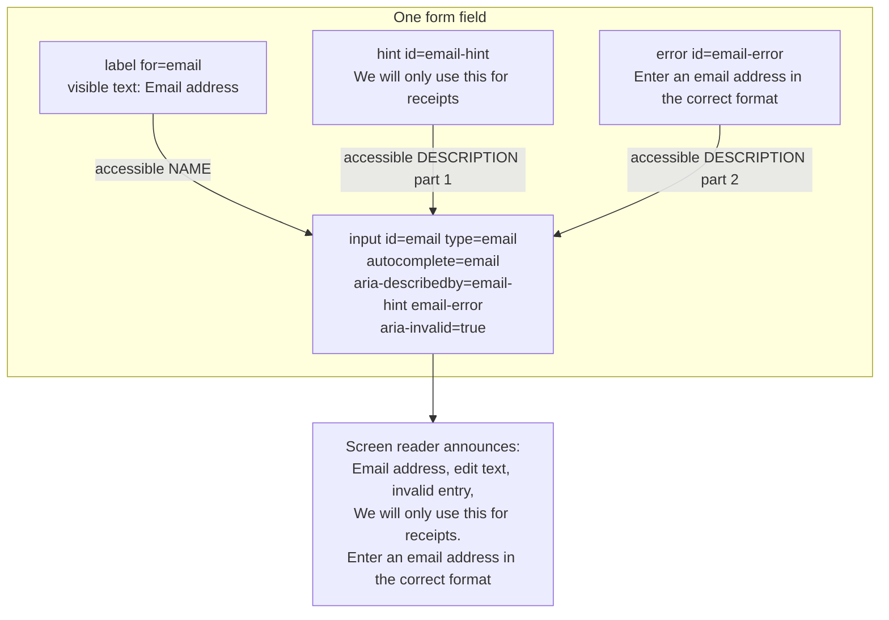
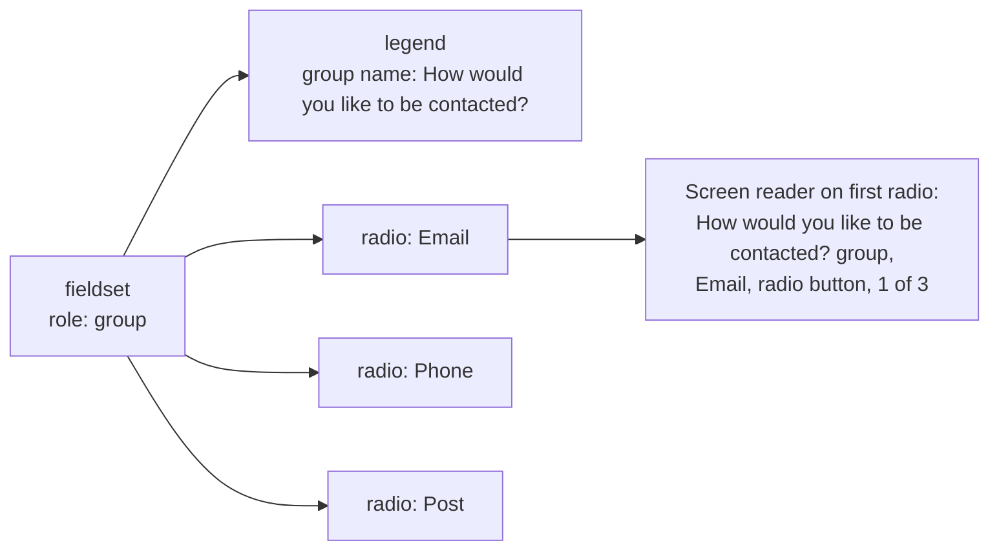
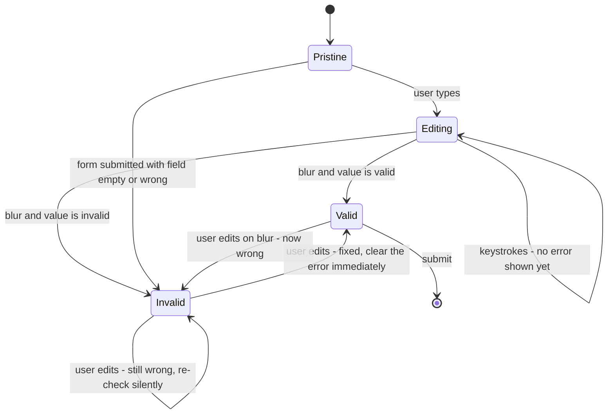
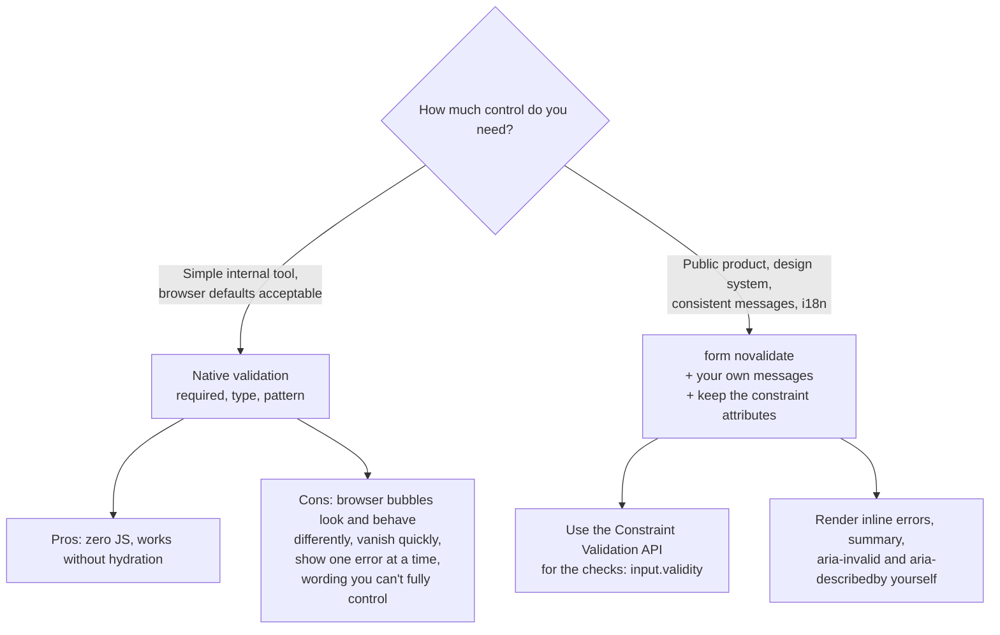
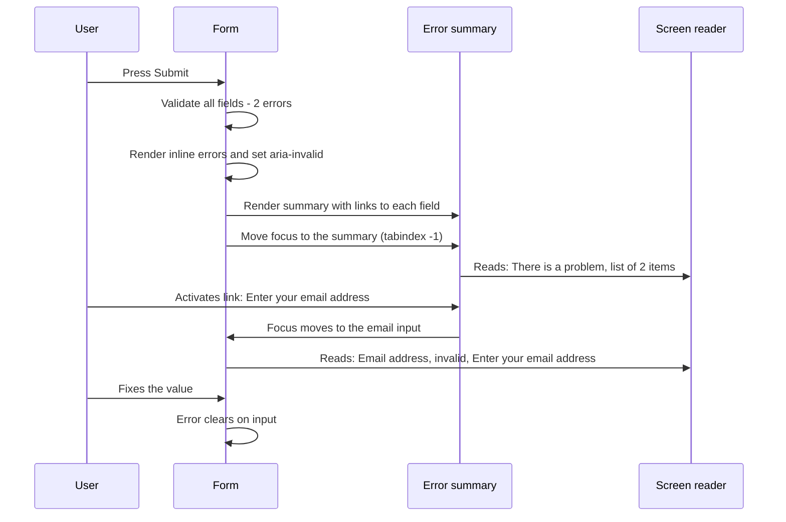
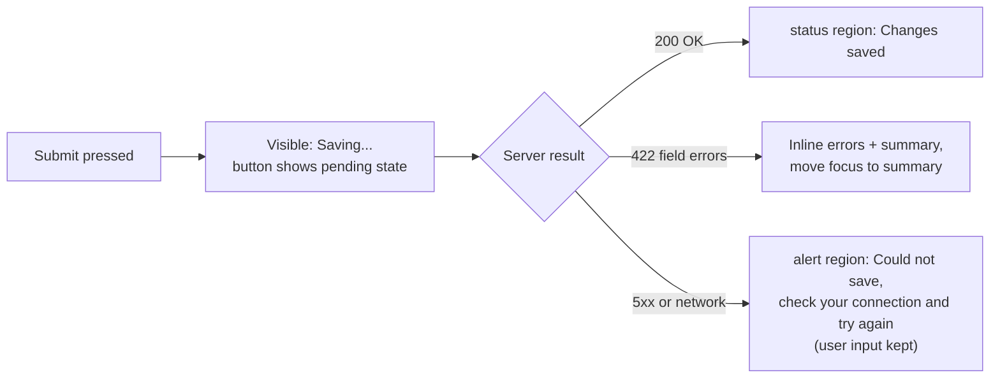
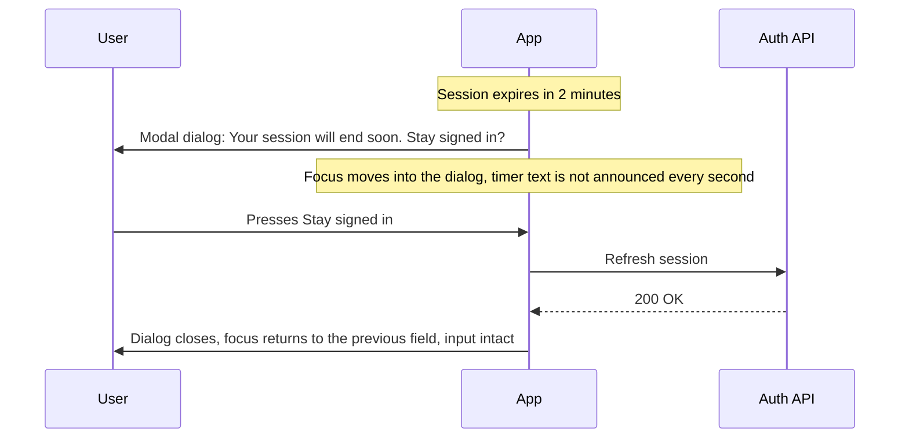
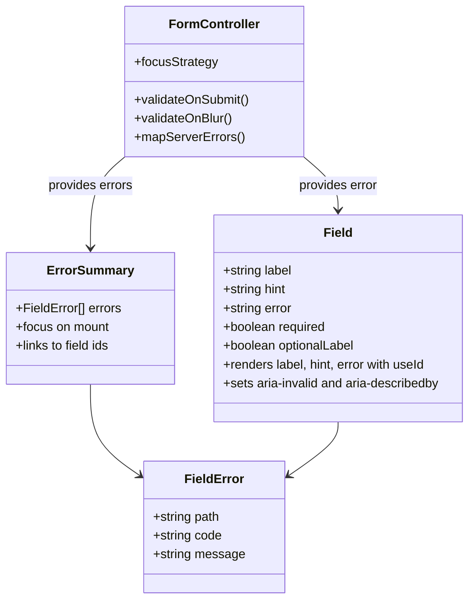

<!-- Generated by scripts/sync-knowledge.js from notes/ and README.md — do not edit here. -->
<!-- sections (line ranges in this file): Table of Contents 19-43 · ELI5 44-57 · Core Concept 58-428 · System Design Angle 429-500 · Real-World Examples 501-789 · Key Points Summary 790-811 · Test Your Understanding 812-895 · Cheat Sheet 896-949 · References & Further Reading 950-987 -->

# Accessible Forms & Error Handling

> **Date:** 2026-11-06 · **Last updated:** 2026-11-06
> **Category:** Frontend System Design
> **Sub-Topic:** Accessibility / Forms, validation & feedback
> **Level:** Intermediate · **Reading time:** ~30 min
> **Informs:** form field component API (label, hint, error wiring), validation timing (submit vs blur vs input), native vs custom validation, error summary and focus strategy, live-region announcements for async results, server validation error contract, autocomplete and authentication UX, session-timeout handling, multi-step form design

> **Pre-requisite:** [ARIA Roles, States & Properties](./aria-roles-states-and-properties.md) (accessible names, descriptions, live regions) and [Keyboard Navigation & Focus Management](./keyboard-navigation-and-focus-management.md) (moving focus on purpose). [Controlled vs Uncontrolled Components](./controlled-vs-uncontrolled-components.md) explains the React state side of forms.
> Forms are where users **give** you something — an order, a signup, a tax return. This note covers how to make every field understandable, every error findable, and every fix possible, for keyboard, screen reader, voice-control and low-vision users.

**Previous:** [Color Contrast & Visual Accessibility](./color-contrast-and-visual-accessibility.md) · **Next:** [Automated A11y Testing (axe, Lighthouse)](./automated-a11y-testing-axe-lighthouse.md)

---

## Table of Contents

1. [ELI5 — Simple Explanation](#eli5--simple-explanation)
2. [Section 1: Anatomy of an Accessible Field](#section-1-anatomy-of-an-accessible-field)
3. [Section 2: Labels](#section-2-labels)
4. [Section 3: Hints, Required and Optional](#section-3-hints-required-and-optional)
5. [Section 4: Grouping with fieldset and legend](#section-4-grouping-with-fieldset-and-legend)
6. [Section 5: Input Purpose, autocomplete and Authentication](#section-5-input-purpose-autocomplete-and-authentication)
7. [Section 6: When to Validate](#section-6-when-to-validate)
8. [Section 7: Native vs Custom Validation](#section-7-native-vs-custom-validation)
9. [Section 8: Describing an Error on the Field](#section-8-describing-an-error-on-the-field)
10. [Section 9: The Error Summary and Focus Strategy](#section-9-the-error-summary-and-focus-strategy)
11. [Section 10: Announcing Status and Async Results](#section-10-announcing-status-and-async-results)
12. [Section 11: Preventing Errors — Confirmation, Undo, Timeouts](#section-11-preventing-errors--confirmation-undo-timeouts)
13. [Section 12: Custom Controls and Multi-Step Forms](#section-12-custom-controls-and-multi-step-forms)
14. [Section 13: Frameworks and Native Mobile](#section-13-frameworks-and-native-mobile)
15. [System Design Angle — The Field Contract and the Error API](#system-design-angle--the-field-contract-and-the-error-api)
16. [Real-World Examples](#real-world-examples)
17. [Key Points Summary](#key-points-summary)
18. [Test Your Understanding (with answers)](#test-your-understanding)
19. [Cheat Sheet](#cheat-sheet)
20. [References & Further Reading](#references--further-reading)

---

## ELI5 — Simple Explanation

Imagine filling in a **paper form at a government office**.

- Every box has a **printed name next to it** ("Date of birth") — not a faint grey example inside the box that vanishes when you start writing. That is a **label**.
- Under the box, small print says **"For example, 27 3 2007"**. That is a **hint**.
- When you hand it in, a **good clerk** doesn't just say "it's wrong". They put a **list on top**: "1. Date of birth must be in the past. 2. Enter your postcode" — and point at each box. That is an **error summary** linked to the fields.
- Each wrong box gets a **note right next to it** explaining what to fix — in words, not just a red pen mark. That is an **inline error message**.
- A bad clerk shouts at you **after every letter you write** ("that's not a full email yet!"). That is **validating too early**.

> **Every field needs a visible label, every error needs words (not just red), and after a failed submit the user must be taken straight to a list of what to fix.**

---

## Core Concept — Step by Step

### Section 1: Anatomy of an Accessible Field



Every field has up to four parts, and each part has a **programmatic** link, not just a visual one:

| Part | HTML | Exposed to assistive tech as | WCAG |
|---|---|---|---|
| **Label** | `<label for="id">` | Accessible **name** | 1.3.1 Info and Relationships, 3.3.2 Labels or Instructions, 4.1.2 Name, Role, Value |
| **Hint** | `<p id="…-hint">` + `aria-describedby` | Accessible **description** | 3.3.2 |
| **Error message** | `<p id="…-error">` + `aria-describedby` | Description (+ invalid state) | 3.3.1 Error Identification, 3.3.3 Error Suggestion |
| **State** | `required`, `aria-invalid="true"`, `disabled` | required / invalid / unavailable | 4.1.2 |

The exact announcement wording and order differ by screen reader and browser — see [Screen Reader Testing](./screen-reader-testing.md). What matters is that **name, role, state and description are all present**.

---

### Section 2: Labels

```html
<!-- ✅ Explicit label (works everywhere, also enlarges the click target) -->
<label for="email">Email address</label>
<input id="email" name="email" type="email" autocomplete="email">

<!-- ✅ Implicit label (wrapping) — fine, but explicit is more robust with some tooling -->
<label>Email address <input name="email" type="email" autocomplete="email"></label>

<!-- ❌ Placeholder as label -->
<input type="email" placeholder="Email address">
```

**Why placeholder-as-label fails:**

| Problem | Who it hurts |
|---|---|
| Disappears when you type — you can't check what the field was for | Everyone, especially people with memory or attention difficulties |
| Default placeholder styling is usually low contrast | Low-vision users ([Color Contrast & Visual Accessibility](./color-contrast-and-visual-accessibility.md)) |
| Browsers use it as a **last-resort** accessible name, and support varies | Screen reader users |
| Looks like a pre-filled value | Users skip the field |

**Label rules:**
- **Visible label for every input.** If a design truly has no room (a search box next to a magnifier button), use `aria-label` or a visually-hidden `<label>` — and make sure the button has a name.
- **Label in Name (2.5.3, Level A):** the accessible name must **contain the visible label text**, ideally at the start. Voice-control users say "click Email address"; if `aria-label="Your contact"` overrides the visible "Email address", that command fails.
- **One label per control, unique within the form.** Two fields called "Name" in a billing and shipping section need a group label (Section 4).
- **Clicking the label focuses the input** — free with a real `<label>`, and it makes checkboxes and radios much easier to hit.

---

### Section 3: Hints, Required and Optional

```html
<label for="dob-day">Date of birth</label>
<p id="dob-hint" class="hint">For example, 27 3 2007</p>
<input id="dob-day" aria-describedby="dob-hint" inputmode="numeric" autocomplete="bday-day" required>
```

- **Hints go before the input** in DOM order (so sighted and screen-reader users meet them at the same time) and are linked with `aria-describedby`.
- **Don't hide essential instructions in tooltips** that only appear on hover — keyboard and touch users may never see them (and tooltips must follow 1.4.13 anyway).

**Required fields:**

| Approach | Verdict |
|---|---|
| Native `required` attribute | ✅ Exposed as "required" to assistive tech; use it on native inputs |
| `aria-required="true"` | ✅ Only for **custom** controls that can't take `required` |
| Red asterisk `*` with no explanation | ⚠️ Explain it at the top of the form ("Fields marked * are required") and keep it out of the accessible name if it's announced oddly |
| Mark the **optional** fields instead: "Phone (optional)" | ✅ Clearer when most fields are required (the GOV.UK Design System approach) |
| Color-only required indicator | ❌ Fails 1.4.1 |

> **Ask only for what you need.** Every optional field you remove is one less place for an error.

---

### Section 4: Grouping with fieldset and legend

Radio buttons and checkboxes answer **one question together**; the question is the **group label**.

```html
<fieldset>
  <legend>How would you like to be contacted?</legend>
  <label><input type="radio" name="contact" value="email"> Email</label>
  <label><input type="radio" name="contact" value="phone"> Phone</label>
  <label><input type="radio" name="contact" value="post"> Post</label>
</fieldset>
```



Use a fieldset for:
- Radio groups and checkbox groups (always).
- **Related inputs that share a label**: a date split into day/month/year, an address block, "Billing address" vs "Shipping address".
- Keep legends **short** — some screen readers repeat the legend for every field inside.

For custom widgets without `<fieldset>`, use `role="radiogroup"` or `role="group"` with `aria-labelledby` (see [ARIA Roles, States & Properties](./aria-roles-states-and-properties.md)).

---

### Section 5: Input Purpose, autocomplete and Authentication

**1.3.5 Identify Input Purpose (AA):** fields that collect information *about the user* must declare their purpose — in HTML that means the right `autocomplete` token. It lets browsers and password managers autofill, and lets assistive tools show familiar icons.

| Field | Attributes |
|---|---|
| Full name | `autocomplete="name"` |
| Email | `type="email" autocomplete="email"` |
| Phone | `type="tel" autocomplete="tel"` |
| Street address / postcode | `autocomplete="street-address"` · `autocomplete="postal-code"` |
| Username | `autocomplete="username"` |
| Current password (login) | `type="password" autocomplete="current-password"` |
| New password (signup/reset) | `type="password" autocomplete="new-password"` |
| One-time code (SMS/email) | `autocomplete="one-time-code" inputmode="numeric"` |
| Card number / expiry | `autocomplete="cc-number" inputmode="numeric"` · `autocomplete="cc-exp"` |

**Input type choices that cause errors:**
- **`type="number"`** is for quantities you'd increment. Don't use it for card numbers, phone numbers, postcodes or IDs — it can drop leading zeros, accept `e`, and change value on scroll in some browsers. Use `type="text" inputmode="numeric"` instead.
- **`inputmode`** picks the on-screen keyboard without changing validation semantics.

**New in WCAG 2.2:**

| SC | Level | What it means for forms |
|---|---|---|
| **3.3.7 Redundant Entry** | A | Don't make users re-type information they already gave in the same process — auto-fill it or let them select it ("Billing address same as shipping") |
| **3.3.8 Accessible Authentication (Minimum)** | AA | Login can't depend on a cognitive function test (remembering, transcribing, solving puzzles) unless there's an alternative or help. **Allowing paste and password managers** satisfies it for passwords; so do passkeys, magic links and OAuth |
| **2.5.8 Target Size (Minimum)** | AA | Click/tap targets at least 24×24 CSS px (or enough spacing) — matters for checkboxes, radios and small icon buttons |
| **3.2.6 Consistent Help** | A | If help (contact link, chat) appears on multiple pages, keep it in the same relative place |

> **Never block paste** in password, email-confirmation or one-time-code fields. It breaks password managers and fails 3.3.8.

---

### Section 6: When to Validate

Validation timing is a **usability** decision with big accessibility impact. Errors fired while someone is still typing are noise — and for screen-reader users, interruptions.



The common pattern is **"late to complain, early to forgive"** (often called *reward early, punish late*):

| Moment | Show an error? | Why |
|---|---|---|
| While typing in a fresh field | ❌ No | The value is incomplete by definition |
| On **blur** of a field the user changed | ✅ Optional | Useful for format errors (email, postcode), but don't shout on blur of an empty field the user just tabbed through |
| While typing in a field **that already shows an error** | ✅ Clear it as soon as it's fixed | Immediate positive feedback; don't re-announce on every keystroke |
| On **submit** | ✅ Always | Check everything; show the summary (Section 9) |
| On the **server** | ✅ Always | Client checks are UX; the server is the source of truth |

**Don't disable the submit button until the form is valid.** Disabled buttons are often skipped by keyboard focus and have low contrast, and the user gets no explanation of *what* is missing. Let them submit, then show the errors.

---

### Section 7: Native vs Custom Validation

HTML has built-in constraint validation: `required`, `type="email"`, `pattern`, `min`/`max`, `minlength`/`maxlength`, and the Constraint Validation API (`checkValidity()`, `setCustomValidity()`, `validity`).



**The usual production setup:**
- `<form novalidate>` turns off the browser's bubbles **but keeps** the `required`/`type` attributes, so assistive tech still hears "required" and you can still read `input.validity`.
- Style errors with **`:user-invalid`** (matches only after the user has interacted or submitted — Chrome 119+, Firefox 88+, Safari 16.5+), not `:invalid` (which matches an empty required field on page load).
- Re-validate on the **server**; return field-level errors in a structured format (System Design Angle).

---

### Section 8: Describing an Error on the Field

```html
<label for="postcode">Postcode</label>
<p id="postcode-hint" class="hint">For example, SW1A 1AA</p>
<p id="postcode-error" class="error">
  <span class="visually-hidden">Error:</span> Enter a real postcode
</p>
<input id="postcode" name="postcode" autocomplete="postal-code"
       aria-invalid="true" aria-describedby="postcode-hint postcode-error">
```

**Rules for the message itself (3.3.1, 3.3.3):**

| ❌ Vague | ✅ Specific and actionable |
|---|---|
| "Invalid input" | "Enter an email address in the correct format, like name@example.com" |
| "Error" | "Enter your date of birth" |
| "Password does not meet requirements" | "Password must be at least 12 characters" |
| "Field required" | "Select how you want to be contacted" |
| Red border only | Text message + icon + red border |

**Wiring details:**
- **`aria-invalid="true"`** only when the field is actually invalid. Don't set `aria-invalid="false"` noisily on pristine fields, and don't set it before the user has had a chance to answer.
- **`aria-describedby`** links hint and error. Order the IDs so the hint comes first (or the error first, if you prefer the error read first — be consistent).
- **`aria-errormessage`** is the ARIA attribute made for this, and only applies while `aria-invalid="true"`. Screen reader support has historically been **inconsistent**; `aria-describedby` is the robust choice today. Check current support (e.g. a11ysupport.io) before relying on `aria-errormessage` alone.
- A **visually-hidden "Error:" prefix** makes the message clear when read out of context.
- **Keep the user's input** — never clear a field because it was invalid (except passwords, by some policies).
- **Errors must not rely on color** — icon + text ([Color Contrast & Visual Accessibility](./color-contrast-and-visual-accessibility.md)).

---

### Section 9: The Error Summary and Focus Strategy

After a failed submit, users must be able to **find** the errors. Two accepted strategies:

| Strategy | Best for | How |
|---|---|---|
| **Error summary + focus it** | Long forms, several errors, government/enterprise | Show a box at the top: heading "There is a problem" + a list of links to each field; move focus to the box |
| **Focus the first invalid field** | Short forms (login, 2–4 fields) | Move focus to the first invalid input; its `aria-describedby` error is read |



**Error summary details:**
- Each link's text **is the error message**, and its `href="#field-id"` moves focus to the input (if the native jump doesn't focus it, handle the click and call `.focus()`).
- Also prefix the document **`<title>`** with "Error: " so the problem is announced on full-page (server-rendered) submits.
- **Don't** use `role="alert"` on the summary *and* move focus to it — users hear it twice. Focus alone is enough.
- Keep the summary until errors are fixed and the form is re-submitted.

> **Server-rendered forms** (no JS) can follow the same pattern: re-render the page with the summary, the title prefix and inline errors. Progressive enhancement keeps working when JavaScript fails.

---

### Section 10: Announcing Status and Async Results

**4.1.3 Status Messages (AA):** messages that report a result **without moving focus** — "Saved", "3 results", "Upload failed" — must be announced by assistive tech. Use live regions.

| Message | Role / attribute | Behavior |
|---|---|---|
| "Saved" / "Copied" / "5 results" | `role="status"` (= `aria-live="polite"`) | Read when the user is idle |
| "Payment failed — card declined" (urgent, not a validation summary you focus) | `role="alert"` (= assertive) | Interrupts; use sparingly |
| "48 characters remaining" | Polite, **debounced**, only near the limit | Don't announce on every keystroke |
| Field-level validation while typing | Usually **no** live region | The error is read when the user returns to the field via `aria-describedby` |

**Live region gotchas:**
- The region must **exist in the DOM before** its text changes; injecting a new element that already contains text is often not announced.
- Change the **text content** of a persistent container; don't toggle `display:none` on the whole region.
- Too many announcements = noise. One concise message per event.
- Async submit: disable double-submission with `aria-disabled` or by ignoring repeat clicks, show a visible pending state, and announce the outcome.



---

### Section 11: Preventing Errors — Confirmation, Undo, Timeouts

**3.3.4 Error Prevention (Legal, Financial, Data) — AA:** for submissions that create legal commitments, move money, or change/delete user data, at least one of:

```text
Reversible   → the action can be undone (e.g. "Undo" for 10 seconds, cancel within 24 h)
Checked      → input is checked and the user can correct it
Confirmed    → a review step ("Check your answers") before final submission
```

**Timeouts — 2.2.1 Timing Adjustable (A):** if a session or step has a time limit, users must be able to turn it off, adjust it, or **be warned before it expires** and extend it with a simple action (at least 20 seconds to respond, extendable at least ten times) — with exceptions for real-time events and cases where the limit is essential.



- **Never lose input** on timeout: save drafts (locally or server-side) so re-authentication returns the user to where they were (2.2.5 Re-authenticating is AAA, but it's simply good practice).
- A countdown that announces **every second** is unusable with a screen reader. Announce at milestones, if at all.

---

### Section 12: Custom Controls and Multi-Step Forms

**Prefer native controls.** `<select>`, `<input type="checkbox">`, `<input type="date">`, `<input type="file">` come with keyboard support, roles, states and form participation for free. Custom ones must rebuild all of it.

| Custom control | Must provide |
|---|---|
| Toggle switch | `<button role="switch" aria-checked>` or a styled native checkbox; label; Space toggles |
| Combobox / autocomplete | The ARIA combobox pattern: `aria-expanded`, `aria-controls`, `aria-activedescendant`, result count announced politely |
| Date picker | A typed text input as the primary path; the calendar is an **optional** helper; dialog focus management |
| File upload | A real `<input type="file">` (can be visually styled through its label); announce upload progress and errors |
| Rich select / multiselect | Listbox pattern, selected count, removable chips with names ("Remove Berlin") |
| Form-associated **web components** | `static formAssociated = true` + `ElementInternals` (`setFormValue`, `setValidity`, `ariaInvalid`) — see Example 7 |

**Multi-step forms (wizards):**
- One `<h1>`/heading per step, and "Step 2 of 4" in text (and in the page `<title>`).
- On step change, **move focus to the new step's heading** (SPA) — otherwise screen-reader users are left on a button that no longer exists ([Keyboard Navigation & Focus Management](./keyboard-navigation-and-focus-management.md)).
- Validate per step; keep entered data when going **back**; end with a "Check your answers" step (3.3.4).
- Full system design: [Design a Multi-Step Form / Wizard](./design-a-multi-step-form-wizard.md).

---

### Section 13: Frameworks and Native Mobile

| Stack | Accessible-forms notes |
|---|---|
| **React** | `useId()` for stable label/hint/error IDs (SSR-safe). React 19 form **actions** + `useActionState` (from `react`) + `useFormStatus` (from `react-dom`) give server-validated forms with pending state. React resets uncontrolled fields after a `<form action>` completes, so **return the submitted values** and re-populate `defaultValue` on error |
| **React Hook Form** | Focuses the first invalid field on submit by default (`shouldFocusError`); you still add `aria-invalid` and `aria-describedby` yourself |
| **Formik / TanStack Form** | Same: they manage state; the ARIA wiring is your component's job |
| **Next.js / Remix (React Router)** | Server actions or route actions return field errors; progressive enhancement works without JS |
| **Vue** | VeeValidate (`useField`, `useForm`) manages errors; bind `:aria-invalid` and `:aria-describedby`. Vue 3.5+ has `useId()` |
| **Angular** | Reactive forms add `ng-invalid`/`ng-touched` classes but **not** `aria-invalid`; bind it (`[attr.aria-invalid]`). Angular Material's `mat-form-field` + `matInput` wires `aria-invalid`, `aria-describedby` and `<mat-error>` for you |
| **Svelte / SvelteKit** | Form actions + `fail(400, { values, errors })` + `use:enhance` for progressive enhancement; Superforms is a popular helper. Compiler a11y warnings catch missing labels (`a11y_label_has_associated_control`) |
| **iOS** | `accessibilityLabel`/`accessibilityHint`; post an announcement for async errors (`UIAccessibility.post(notification: .announcement, …)`, or `AccessibilityNotification.Announcement` in SwiftUI); `.layoutChanged` to move VoiceOver focus to the error. `textContentType` (`.emailAddress`, `.oneTimeCode`, `.newPassword`) = autocomplete |
| **Android** | Material `TextInputLayout.setError()` (Views) or `TextField(isError = true, supportingText = …)` + `Modifier.semantics { error("…") }` in Compose; `autofillHints`; prefer live regions over ad-hoc announcements |
| **React Native** | `accessibilityLabel`/`accessibilityHint` (or `aria-label`); there's no cross-platform "invalid" state, so include the error text in the hint/label and announce it with `AccessibilityInfo.announceForAccessibility()`; `textContentType` (iOS) / `autoComplete` for input purpose |

---

## System Design Angle — The Field Contract and the Error API

At product scale, accessible forms come from **one `Field` component** and **one error format**, not from every engineer remembering ARIA.



**Server error contract** (what the API returns on a validation failure):

```http
HTTP/1.1 422 Unprocessable Content
Content-Type: application/problem+json

{
  "type": "https://api.example.com/problems/validation",
  "title": "Your request has validation errors",
  "status": 422,
  "errors": [
    { "path": "email",            "code": "email.format",  "message": "Enter an email address in the correct format, like name@example.com" },
    { "path": "address.postcode", "code": "postcode.unknown", "message": "Enter a real postcode" }
  ]
}
```

- `path` maps to the **field ID/name** so the client can attach each error to the right input and summary link.
- `code` lets the client **translate** messages (i18n) or override wording; `message` is a safe default.
- RFC 9457 "Problem Details" is a standard envelope; the `errors` array is an extension member you define.
- **One schema, two places:** share validation rules between client and server (e.g. Zod, Valibot or JSON Schema) so messages match — but the server still re-validates everything.

**Decisions to make explicitly:**

| Decision | Options | Recommendation |
|---|---|---|
| Validation timing | input / blur / submit | Submit always; blur for format; clear on input |
| Focus after failed submit | summary / first invalid field | Summary for long forms; first field for short |
| Native bubbles | on / `novalidate` | `novalidate` + custom messages in products |
| Submit button while invalid | disabled / enabled | Enabled; show errors on submit |
| Error message source | client strings / server strings / codes | Codes + translated client strings, server message as fallback |
| Without JavaScript | breaks / server-rendered errors | Server-rendered errors (progressive enhancement) |

---

## Real-World Examples

**Example 1 — The same field, BAD → GOOD (HTML):**
```html
<!-- ❌ BAD: no label, placeholder as label, color-only error, error not linked -->
<input type="text" placeholder="Email" class="border-red">
<span class="red-text">Invalid</span>

<!-- ✅ GOOD -->
<div class="field">
  <label for="email">Email address</label>
  <p id="email-hint" class="hint">We'll send your receipt here</p>
  <p id="email-error" class="error">
    <svg aria-hidden="true" class="icon"><use href="#alert" /></svg>
    <span class="visually-hidden">Error:</span>
    Enter an email address in the correct format, like name@example.com
  </p>
  <input id="email" name="email" type="email" autocomplete="email" required
         aria-invalid="true" aria-describedby="email-hint email-error">
</div>
```

**Example 2 — A reusable `Field` component (React + TypeScript):**
```tsx
import { useId, cloneElement, type ReactElement } from 'react';

type FieldProps = {
  label: string;
  hint?: string;
  error?: string;
  optional?: boolean;
  children: ReactElement<React.InputHTMLAttributes<HTMLInputElement>>;
};

export function Field({ label, hint, error, optional, children }: FieldProps) {
  const id = useId();
  const inputId = children.props.id ?? `${id}-input`;
  const hintId = hint ? `${id}-hint` : undefined;
  const errorId = error ? `${id}-error` : undefined;
  const describedBy = [hintId, errorId].filter(Boolean).join(' ') || undefined;

  return (
    <div className={error ? 'field field--error' : 'field'}>
      <label htmlFor={inputId}>
        {label}
        {optional && <span className="optional"> (optional)</span>}
      </label>
      {hint && <p id={hintId} className="hint">{hint}</p>}
      {error && (
        <p id={errorId} className="error">
          <span className="visually-hidden">Error: </span>{error}
        </p>
      )}
      {cloneElement(children, {
        id: inputId,
        'aria-invalid': error ? true : undefined,
        'aria-describedby': describedBy,
      })}
    </div>
  );
}

// Usage
<Field label="Email address" hint="We'll send your receipt here" error={errors.email}>
  <input name="email" type="email" autocomplete="email" required />
</Field>
```

**Example 3 — Error summary that takes focus:**
```tsx
import { useEffect, useRef } from 'react';

type FieldError = { path: string; message: string };

export function ErrorSummary({ errors }: { errors: FieldError[] }) {
  const ref = useRef<HTMLDivElement>(null);

  useEffect(() => {
    if (errors.length > 0) ref.current?.focus();
  }, [errors]);

  if (errors.length === 0) return null;

  return (
    <div ref={ref} tabIndex={-1} className="error-summary" aria-labelledby="error-summary-title">
      <h2 id="error-summary-title">There is a problem</h2>
      <ul>
        {errors.map((e) => (
          <li key={e.path}>
            <a
              href={`#${e.path}`}
              onClick={(ev) => {
                ev.preventDefault();
                document.getElementById(e.path)?.focus(); // focus the input, not just scroll
              }}
            >
              {e.message}
            </a>
          </li>
        ))}
      </ul>
    </div>
  );
}
```
The summary is focused (not `role="alert"`), so it's announced exactly once. Also set `document.title = 'Error: ' + title` while errors are shown.

**Example 4 — Server-validated form with React 19 actions (progressive enhancement):**
```tsx
'use client';
import { useActionState } from 'react';
import { useFormStatus } from 'react-dom';
import { signup, type SignupState } from './actions'; // a Server Action

function SubmitButton() {
  const { pending } = useFormStatus();
  // aria-disabled keeps the button focusable (disabled would drop focus); it doesn't block clicks by itself
  return <button type="submit" aria-disabled={pending}>{pending ? 'Creating account…' : 'Create account'}</button>;
}

export function SignupForm() {
  const [state, formAction] = useActionState<SignupState, FormData>(signup, { errors: [], values: {} });
  const err = (path: string) => state.errors.find((e) => e.path === path)?.message;

  return (
    <form action={formAction} noValidate>
      <ErrorSummary errors={state.errors} />
      <Field label="Email address" error={err('email')}>
        {/* React resets uncontrolled fields after the action: restore the value */}
        <input id="email" name="email" type="email" autoComplete="email" required defaultValue={state.values.email} />
      </Field>
      <Field label="Password" hint="At least 12 characters" error={err('password')}>
        <input id="password" name="password" type="password" autoComplete="new-password" required />
      </Field>
      <SubmitButton />
      <p role="status" className="visually-hidden">{state.message ?? ''}</p>
    </form>
  );
}
```
```typescript
// actions.ts
'use server';
import { z } from 'zod';

const Signup = z.object({
  email: z.string().email('Enter an email address in the correct format, like name@example.com'),
  password: z.string().min(12, 'Password must be at least 12 characters'),
});

export type SignupState = {
  errors: { path: string; message: string }[];
  values: { email?: string };
  message?: string;
};

export async function signup(_prev: SignupState, formData: FormData): Promise<SignupState> {
  const raw = { email: String(formData.get('email') ?? ''), password: String(formData.get('password') ?? '') };
  const parsed = Signup.safeParse(raw);
  if (!parsed.success) {
    return {
      errors: parsed.error.issues.map((i) => ({ path: i.path.join('.'), message: i.message })),
      values: { email: raw.email }, // never echo the password back
    };
  }
  await createUser(parsed.data);
  return { errors: [], values: {}, message: 'Account created' };
}
```
Zod's API differs slightly between major versions (e.g. string format helpers) — check the version you use.

**Example 5 — Validation timing in plain TypeScript ("late to complain, early to forgive"):**
```typescript
const form = document.querySelector<HTMLFormElement>('#checkout')!;
form.noValidate = true; // keep required/type attributes, drop browser bubbles

function showError(input: HTMLInputElement, message: string | null) {
  const errorEl = document.getElementById(`${input.id}-error`)!;
  errorEl.hidden = !message;
  errorEl.querySelector('.msg')!.textContent = message ?? '';
  if (message) input.setAttribute('aria-invalid', 'true');
  else input.removeAttribute('aria-invalid');
}

function messageFor(input: HTMLInputElement): string | null {
  const v = input.validity;
  if (v.valueMissing) return input.dataset.msgRequired!;     // e.g. "Enter your email address"
  if (v.typeMismatch || v.patternMismatch) return input.dataset.msgFormat!;
  return null;
}

form.addEventListener('focusout', (e) => {
  const input = e.target as HTMLInputElement;
  if (input.matches('input') && input.value !== '') showError(input, messageFor(input)); // blur: format only
});

form.addEventListener('input', (e) => {
  const input = e.target as HTMLInputElement;
  if (input.getAttribute('aria-invalid') === 'true') showError(input, messageFor(input)); // forgive early
});

form.addEventListener('submit', (e) => {
  const invalid = [...form.querySelectorAll<HTMLInputElement>('input')].filter((i) => messageFor(i));
  form.querySelectorAll<HTMLInputElement>('input').forEach((i) => showError(i, messageFor(i)));
  if (invalid.length) {
    e.preventDefault();
    renderSummary(invalid);                 // links to each invalid field
    document.getElementById('error-summary')!.focus();
  }
});
```

**Example 6 — Vue and Angular wiring:**
```html
<!-- Vue 3 + VeeValidate -->
<script setup lang="ts">
import { useField } from 'vee-validate';
import { useId } from 'vue';
const id = useId();
const { value, errorMessage } = useField<string>('email', (v) => (!!v && /.+@.+/.test(v)) || 'Enter your email address');
</script>

<template>
  <label :for="id">Email address</label>
  <p v-if="errorMessage" :id="`${id}-error`" class="error">{{ errorMessage }}</p>
  <input :id="id" v-model="value" type="email" autocomplete="email"
         :aria-invalid="errorMessage ? 'true' : undefined"
         :aria-describedby="errorMessage ? `${id}-error` : undefined" />
</template>
```
```html
<!-- Angular reactive forms: classes are automatic, ARIA is not -->
<label for="email">Email address</label>
@if (email.invalid && (email.touched || submitted)) {
  <p id="email-error" class="error">Enter an email address in the correct format</p>
}
<input id="email" type="email" formControlName="email" autocomplete="email"
       [attr.aria-invalid]="email.invalid && (email.touched || submitted) ? 'true' : null"
       [attr.aria-describedby]="email.invalid && (email.touched || submitted) ? 'email-error' : null" />
```

**Example 7 — A form-associated custom element that reports validity:**
```typescript
class RatingInput extends HTMLElement {
  static formAssociated = true;
  #internals = this.attachInternals();
  #value = '';

  connectedCallback() {
    this.#internals.role = 'radiogroup';
    this.#update();
  }

  set value(v: string) {
    this.#value = v;
    this.#update();
  }

  #update() {
    this.#internals.setFormValue(this.#value);
    if (this.hasAttribute('required') && !this.#value) {
      this.#internals.setValidity({ valueMissing: true }, 'Select a rating');
      this.#internals.ariaInvalid = 'true';
    } else {
      this.#internals.setValidity({});
      this.#internals.ariaInvalid = null;
    }
  }
}
customElements.define('rating-input', RatingInput);
```
`ElementInternals` lets the element take part in `<form>` submission and validation; ARIA reflection on `ElementInternals` (e.g. `ariaInvalid`) is supported in current Chrome, Firefox and Safari — see [Web Components & Shadow DOM](./web-components-and-shadow-dom.md).

**Example 8 — Polite status for an autosave:**
```tsx
export function AutosaveStatus({ state }: { state: 'idle' | 'saving' | 'saved' | 'error' }) {
  const text = { idle: '', saving: 'Saving…', saved: 'All changes saved', error: '' }[state];
  return (
    <>
      {/* Always mounted: live regions must exist before their content changes */}
      <p role="status" className="autosave">{text}</p>
      <p role="alert">{state === 'error' ? 'Could not save. Your changes are kept on this device.' : ''}</p>
    </>
  );
}
```

---

## Key Points Summary

| Concept | One-Line Explanation |
|---|---|
| **Visible label** | Every input has a `<label>`; placeholders are not labels |
| **Label in Name** | Accessible name contains the visible label so voice control works |
| **Hint** | Linked with `aria-describedby`, placed before the input |
| **fieldset / legend** | Group label for radios, checkboxes and multi-part inputs |
| **autocomplete** | Declares input purpose (1.3.5) and enables autofill |
| **Accessible authentication** | Allow paste and password managers; no puzzles without alternatives |
| **Validation timing** | Submit always, blur for format, clear errors as soon as fixed |
| **`novalidate` + Constraint API** | Your own messages, browser's checks, attributes kept |
| **Error message** | Specific, actionable text + icon, linked with `aria-describedby`, `aria-invalid="true"` |
| **Error summary** | Links to each field; focus it after a failed submit |
| **Status messages** | `role="status"` for results, `role="alert"` only for urgent ones |
| **Error prevention** | Reversible, checked or confirmed for legal/financial/data actions |
| **Timeouts** | Warn and allow extension; never lose input |
| **Custom controls** | Prefer native; otherwise full ARIA pattern or `ElementInternals` |
| **Error API** | Field `path` + `code` + `message`; server always re-validates |

---

## Test Your Understanding

**Q1 (Basic):**
A designer wants floating placeholder text inside each input instead of labels above them, "to save space". What are the accessibility problems, and what can you offer instead?

<details>
<summary>Answer</summary>

Placeholder-only fields:
- **Lose the label once the user types**, so people can't check what a field was for (memory and attention load, especially when reviewing before submit).
- Usually have **low-contrast** default styling that fails 1.4.3.
- Are used as the accessible name only as a **fallback**, with inconsistent support, and can look like pre-filled values.

Alternatives: a persistent visible `<label>` above the field (best). If space really matters, a **floating label** pattern where a real `<label>` starts inside the field and moves above it on focus/fill — it stays visible and stays the accessible name. Hints go in linked text, not the placeholder.
</details>

**Q2 (Application):**
A checkout form has 12 fields. On submit, 3 fields are invalid. Describe exactly what the UI should do, for sighted, keyboard and screen-reader users.

<details>
<summary>Answer</summary>

1. **Keep all entered values.**
2. On each invalid field: show a **text error message** (with an icon, not just red), link it via `aria-describedby`, set `aria-invalid="true"`.
3. Render an **error summary** at the top: a heading ("There is a problem") and a list of **3 links**, each with the error text and pointing to its field.
4. **Move focus to the summary** (`tabindex="-1"`), so screen readers read it once and keyboard users start there. Don't also give it `role="alert"`.
5. Prefix the **page title** with "Error: ".
6. Each summary link moves focus **into** its field, where the error is read again via `aria-describedby`.
7. As the user fixes a field, **clear its error immediately**. Validate everything again on the next submit.

For 12 fields the summary is better than "focus the first invalid field", because the user learns **how many** problems there are up front.
</details>

**Q3 (Tricky):**
A developer adds `role="alert"` to every inline error message so "screen readers hear errors immediately", and validates on every keystroke. What goes wrong?

<details>
<summary>Answer</summary>

Every keystroke that changes the error text triggers an **assertive announcement**, interrupting the user while they're typing ("Enter a valid email" after the first letter). Screen reader users hear a constant stream of messages, and their own typing echo gets cut off. On submit, several alerts fire at once and get **queued or dropped**, so the user can't tell which fields failed.

Better: no live regions on inline errors. Show errors on **blur/submit**, link them with `aria-describedby` (read when the user is on the field), use an **error summary with focus** after submit, and reserve `role="alert"` for urgent, non-field messages (e.g. "Payment failed").
</details>

**Q4 (Tricky):**
Your login page blocks paste in the password field "for security", and the 2FA step asks users to type a 6-digit code from an SMS within 30 seconds. Which WCAG 2.2 criteria are at risk, and how do you fix it?

<details>
<summary>Answer</summary>

- **3.3.8 Accessible Authentication (Minimum), AA:** blocking paste stops password managers and forces users to **transcribe or memorize** — a cognitive function test. Allow paste and autofill (`autocomplete="current-password"`). For the code, allow paste and use `autocomplete="one-time-code"` so the platform can offer it automatically. Passkeys or magic links remove the test entirely.
- **2.2.1 Timing Adjustable, A:** a 30-second limit with no way to extend is a problem unless it's essential. Security codes usually have server-side validity anyway; let the user request a new code, and don't wipe the form.
- Blocking paste doesn't add security — it pushes users toward weaker, memorable passwords.
</details>

**Q5 (System design):**
You're designing the form layer for a design system used by 30 product teams with React, Vue and a few server-rendered apps. What do you standardize, and how?

<details>
<summary>Answer</summary>

1. **A `Field` primitive per framework** (React, Vue, plus an HTML/CSS pattern for server-rendered apps) that **owns the wiring**: `<label for>`, hint and error IDs, `aria-describedby`, `aria-invalid`, "(optional)" text. Teams pass `label`, `hint`, `error` — they can't forget ARIA. Visual specs (icon + text errors, 3:1 borders, focus ring) live in shared tokens and CSS.
2. **`ErrorSummary` + focus policy**: summary for forms with more than a few fields, focus-first-invalid for short ones. Documented with examples.
3. **Validation timing policy**: submit always, blur for format, clear on input; a shared form-controller helper implements it.
4. **Error API contract**: 422 Problem Details with `errors[{path, code, message}]`. A shared mapper attaches server errors to fields and the summary; `code` lets each app translate.
5. **Shared schemas** (e.g. Zod / JSON Schema) for client hints and server enforcement, with matching messages.
6. **Progressive enhancement** for server-rendered apps: summary + inline errors + "Error:" title prefix rendered on the server.
7. **Testing**: Storybook stories for each field state with axe checks, unit tests asserting the accessible name/description (Testing Library `getByRole('textbox', { name, description })`), and a manual screen-reader pass on the patterns ([Automated A11y Testing (axe, Lighthouse)](./automated-a11y-testing-axe-lighthouse.md) catches only part of this).
</details>

**Q6 (Application):**
After a save button is pressed, an SPA calls an API. It can succeed, fail with field errors (422), or fail with a network error. Where does focus go in each case, and what is announced?

<details>
<summary>Answer</summary>

- **Pending:** focus stays on the button; it shows a visible pending state ("Saving…") and ignores repeat clicks. Optionally a polite status "Saving".
- **Success:** focus **stays** where it is (don't yank it). A `role="status"` region announces "Changes saved" (4.1.3). If success navigates to a new view, move focus to that view's heading instead.
- **422 field errors:** render inline errors + `aria-invalid`, render the **error summary and move focus to it** (or to the first invalid field for a tiny form).
- **Network/5xx error:** keep all input, show a visible message near the button, announce it with `role="alert"` (urgent, not tied to a field), and keep focus on the button so "try again" is one key press away.
</details>

---

## Cheat Sheet

**Key Definitions:**
- **Accessible name:** What a control is called (from `<label>`, `aria-labelledby`, `aria-label`)
- **Accessible description:** Extra info read after the name (from `aria-describedby`): hints, errors
- **`aria-invalid`:** Exposes an invalid state; set only when the value is actually invalid
- **Error summary:** A focused list of links to every invalid field after submit
- **Status message (4.1.3):** A result announced without moving focus — live regions
- **Constraint Validation API:** `validity`, `checkValidity()`, `setCustomValidity()` on form elements
- **Input purpose (1.3.5):** `autocomplete` tokens for user data
- **Accessible authentication (3.3.8):** No memorize/transcribe/puzzle test without an alternative

**Quick Reference:**
```text
<label for="x">Name</label>                      every input, visible, contains the visible text
<p id="x-hint">…</p>                             before the input
<input id="x" aria-describedby="x-hint x-error" aria-invalid="true" required autocomplete="…">
<p id="x-error"><span class="visually-hidden">Error:</span> Specific fix</p>
<fieldset><legend>Question</legend> radios / checkboxes / date parts </fieldset>

Timing:     submit always · blur for format · clear on input once fixed · server re-validates
Native:     <form novalidate> + keep required/type + style with :user-invalid
After fail: error summary (links) → focus it · title "Error: …" · keep values
Short form: focus first invalid field instead of a summary
Async:      role="status" for results · role="alert" only for urgent failures
Never:      placeholder as label · color-only errors · disabled submit as validation
            · blocked paste · role="alert" on every inline error · clearing user input
Legal/money/data: reversible OR checked OR confirmed (review step)
Timeouts:   warn ≥20 s ahead, simple extend, keep the input
Targets:    ≥24×24 CSS px (2.5.8)
```

**Common Mistakes to Avoid:**

| Mistake | Why Wrong | Fix |
|---|---|---|
| Placeholder as the only label | Vanishes, low contrast, weak accessible name | Visible `<label for>` |
| `aria-label` that differs from the visible label | Breaks voice control (2.5.3) | Name contains the visible text |
| Radios without `<fieldset>`/`<legend>` | The question isn't announced | Group with fieldset + legend |
| Red border as the only error signal | Fails 1.4.1 and says nothing about the fix | Text message + icon + `aria-invalid` |
| Error text not linked to the input | Screen readers don't read it on the field | `aria-describedby` |
| Validating on every keystroke from the start | Noise and interruptions | Blur/submit first, then clear on input |
| `role="alert"` on every inline error | Flood of interruptions, lost messages | Summary + focus; alerts for urgent only |
| Disabled submit until valid | No explanation, often unfocusable | Enabled submit, show errors on submit |
| Relying on browser validation bubbles | Inconsistent, transient, one at a time | `novalidate` + custom messages |
| `type="number"` for card/phone/postcode | Drops zeros, accepts `e`, scroll changes value | `type="text" inputmode="numeric"` |
| Missing `autocomplete` | Fails 1.3.5, no autofill | Correct tokens |
| Blocking paste on passwords/codes | Fails 3.3.8, breaks password managers | Allow paste + `one-time-code` |
| Clearing fields after an error | Users must re-type everything | Keep values; React 19: return them from the action |
| Silent session timeout | Data loss, fails 2.2.1 | Warn + extend + save drafts |
| No focus move between wizard steps | Screen reader users are lost | Focus the new step heading |

---

## References & Further Reading

**Standards**
- W3C: [WCAG 2.2](https://www.w3.org/TR/WCAG22/)
- W3C Understanding: [3.3.1 Error Identification](https://www.w3.org/WAI/WCAG22/Understanding/error-identification.html) · [3.3.2 Labels or Instructions](https://www.w3.org/WAI/WCAG22/Understanding/labels-or-instructions.html) · [3.3.3 Error Suggestion](https://www.w3.org/WAI/WCAG22/Understanding/error-suggestion.html) · [3.3.4 Error Prevention (Legal, Financial, Data)](https://www.w3.org/WAI/WCAG22/Understanding/error-prevention-legal-financial-data.html)
- W3C Understanding: [3.3.7 Redundant Entry](https://www.w3.org/WAI/WCAG22/Understanding/redundant-entry.html) · [3.3.8 Accessible Authentication (Minimum)](https://www.w3.org/WAI/WCAG22/Understanding/accessible-authentication-minimum.html) · [1.3.5 Identify Input Purpose](https://www.w3.org/WAI/WCAG22/Understanding/identify-input-purpose.html) · [2.5.3 Label in Name](https://www.w3.org/WAI/WCAG22/Understanding/label-in-name.html)
- W3C Understanding: [4.1.3 Status Messages](https://www.w3.org/WAI/WCAG22/Understanding/status-messages.html) · [2.2.1 Timing Adjustable](https://www.w3.org/WAI/WCAG22/Understanding/timing-adjustable.html) · [2.5.8 Target Size (Minimum)](https://www.w3.org/WAI/WCAG22/Understanding/target-size-minimum.html)
- W3C WAI: [Forms Tutorial](https://www.w3.org/WAI/tutorials/forms/) · [ARIA APG — Combobox pattern](https://www.w3.org/WAI/ARIA/apg/patterns/combobox/)
- WHATWG: [HTML — Autofill (autocomplete tokens)](https://html.spec.whatwg.org/multipage/form-control-infrastructure.html#autofill) · [Constraint validation](https://html.spec.whatwg.org/multipage/form-control-infrastructure.html#constraints)
- IETF: [RFC 9457 — Problem Details for HTTP APIs](https://www.rfc-editor.org/rfc/rfc9457)

**Core docs**
- MDN: [Client-side form validation](https://developer.mozilla.org/en-US/docs/Learn_web_development/Extensions/Forms/Form_validation)
- MDN: [`aria-invalid`](https://developer.mozilla.org/en-US/docs/Web/Accessibility/ARIA/Reference/Attributes/aria-invalid) · [`aria-describedby`](https://developer.mozilla.org/en-US/docs/Web/Accessibility/ARIA/Reference/Attributes/aria-describedby) · [`aria-errormessage`](https://developer.mozilla.org/en-US/docs/Web/Accessibility/ARIA/Reference/Attributes/aria-errormessage)
- MDN: [`:user-invalid`](https://developer.mozilla.org/en-US/docs/Web/CSS/Reference/Selectors/:user-invalid) · [`ElementInternals`](https://developer.mozilla.org/en-US/docs/Web/API/ElementInternals) · [HTML `autocomplete` attribute](https://developer.mozilla.org/en-US/docs/Web/HTML/Reference/Attributes/autocomplete)
- web.dev: [Learn Forms](https://web.dev/learn/forms) · [Sign-in form best practices](https://web.dev/articles/sign-in-form-best-practices)

**Design systems & frameworks**
- GOV.UK Design System: [Error summary](https://design-system.service.gov.uk/components/error-summary/) · [Error message](https://design-system.service.gov.uk/components/error-message/) · [Validation pattern](https://design-system.service.gov.uk/patterns/validation/)
- React: [`useActionState`](https://react.dev/reference/react/useActionState) · [`useFormStatus`](https://react.dev/reference/react-dom/hooks/useFormStatus) · [`useId`](https://react.dev/reference/react/useId) · [`<form>`](https://react.dev/reference/react-dom/components/form)
- React Hook Form: [Accessibility (a11y)](https://react-hook-form.com/advanced-usage#AccessibilityA11y)
- Angular: [Reactive forms](https://angular.dev/guide/forms/reactive-forms) · Angular Material [Form field](https://material.angular.dev/components/form-field/overview)
- SvelteKit: [Form actions](https://svelte.dev/docs/kit/form-actions) · VeeValidate: [Guide](https://vee-validate.logaretm.com/v4/guide/composition-api/getting-started/)

**Deep dives**
- Adrian Roselli: [Avoid default field validation](https://adrianroselli.com/2019/02/avoid-default-field-validation.html)
- a11ysupport.io: [`aria-errormessage` support](https://a11ysupport.io/tech/aria/aria-errormessage_attribute)
- Adam Silver: [Form Design Patterns](https://www.smashingmagazine.com/printed-books/form-design-patterns/)

---

> **Previous Topic:** [Color Contrast & Visual Accessibility](./color-contrast-and-visual-accessibility.md)
> — Contrast ratios, color-only meaning, focus visibility, zoom, forced colors

> **Next Topic:** [Automated A11y Testing (axe, Lighthouse)](./automated-a11y-testing-axe-lighthouse.md)
> — What axe-core and Lighthouse catch, what they miss, and wiring them into CI

*Saved on: 2026-11-06 | Repo: Frontend System Design Learning Notes*
