<!-- Generated by scripts/sync-knowledge.js from notes/ and README.md — do not edit here. -->
<!-- sections (line ranges in this file): Table of Contents 19-43 · ELI5 44-57 · Core Concept 58-485 · System Design Angle 486-516 · Framework Comparison 517-529 · Real-World Examples 530-815 · Key Points Summary 816-835 · Test Your Understanding 836-922 · Cheat Sheet 923-969 · References & Further Reading 970-1007 -->

# Analytics Architecture

> **Date:** 2026-11-06 · **Last updated:** 2026-11-06
> **Category:** Frontend System Design
> **Sub-Topic:** Monitoring & Observability / Product Analytics
> **Level:** Intermediate · **Reading time:** ~30 min
> **Informs:** event taxonomy and tracking plan, analytics SDK facade vs direct vendor calls, client-side vs server-side collection, CDP build vs buy, consent gating, identity stitching, SPA page-view tracking, beacon transport and batching, third-party script budget (INP), ad-blocker resilience, data quality checks in CI

> **Pre-requisite:** [Feature Flags & A/B Testing](./feature-flags-and-a-b-testing.md) (exposure events) and [Browser Storage Mechanisms](./browser-storage-mechanisms.md) (cookies, localStorage, partitioning). [Browser Caching Strategies](./browser-caching-strategies.md) Section 12 explains bfcache, which affects page-view counts.
> This note covers **how product and marketing analytics data gets from a click in the browser to a table someone can query** — and how to do that without hurting performance, privacy or data quality.

**Previous:** [Feature Flags & A/B Testing](./feature-flags-and-a-b-testing.md) · **Next:** [Logging Best Practices](./logging-best-practices.md)

---

## Table of Contents

1. [ELI5 — Simple Explanation](#eli5--simple-explanation)
2. [Section 1: Analytics vs RUM vs Errors vs Logs](#section-1-analytics-vs-rum-vs-errors-vs-logs)
3. [Section 2: The Analytics Pipeline](#section-2-the-analytics-pipeline)
4. [Section 3: The Event Model](#section-3-the-event-model)
5. [Section 4: Tracking Plan and Naming](#section-4-tracking-plan-and-naming)
6. [Section 5: The Client Instrumentation Layer](#section-5-the-client-instrumentation-layer)
7. [Section 6: Page Views in SPAs](#section-6-page-views-in-spas)
8. [Section 7: Identity and Sessions](#section-7-identity-and-sessions)
9. [Section 8: Transport — Queue, Batch, Flush](#section-8-transport--queue-batch-flush)
10. [Section 9: Consent and Privacy](#section-9-consent-and-privacy)
11. [Section 10: Client-Side vs Server-Side Collection](#section-10-client-side-vs-server-side-collection)
12. [Section 11: The Performance Cost of Analytics](#section-11-the-performance-cost-of-analytics)
13. [Section 12: Data Quality](#section-12-data-quality)
14. [System Design Angle — Build vs Buy](#system-design-angle--build-vs-buy)
15. [Framework Comparison](#framework-comparison)
16. [Real-World Examples](#real-world-examples)
17. [Key Points Summary](#key-points-summary)
18. [Test Your Understanding (with answers)](#test-your-understanding)
19. [Cheat Sheet](#cheat-sheet)
20. [References & Further Reading](#references--further-reading)

---

## ELI5 — Simple Explanation

Think of a **shop that wants to know how customers behave**:

- Every time something interesting happens — a customer picks up a product, puts it in the basket, pays — a staff member writes a **sticky note** ("Product Added: blue mug, €12"). That's an **event**.
- The shop agrees on a **rulebook** for how notes are written ("always `Object Action`, always include the price in euros"). That's the **tracking plan**. Without it, one person writes "added mug", another "basket+1", and nobody can count anything.
- Notes aren't carried to head office one at a time. They go in a **tray** and someone takes the whole tray every few minutes, and **always when the shop closes**. That's **batching and flushing**.
- Before writing anything about a customer, you must check their **"may we watch you?" badge**. That's **consent**.
- Head office sorts notes, throws away duplicates and fakes, and forwards copies to the marketing team, the product team and the finance team. That's the **pipeline / CDP**.

> **Analytics architecture = a well-defined rulebook for events, a thin client that records them cheaply and only with consent, and a pipeline that delivers clean, deduplicated data to every tool that needs it.**

---

## Core Concept — Step by Step

### Section 1: Analytics vs RUM vs Errors vs Logs

Teams often blur four different telemetry streams. They have different consumers, volumes and retention rules — design them separately, even if one vendor sells all four.

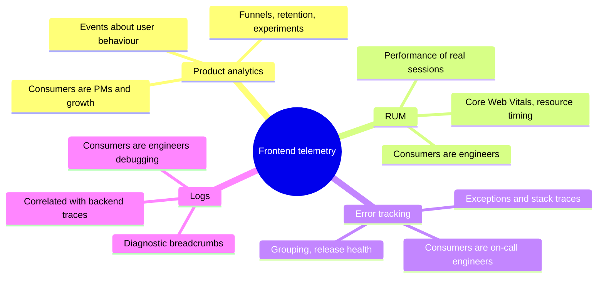

| Stream | Question it answers | Typical volume | Sampling OK? | Note |
|---|---|---|---|---|
| **Product analytics** | "What do users do? Did the change help?" | Every meaningful action | ⚠️ Rarely — funnels and experiments need full counts | This note |
| **RUM** | "How fast/stable is the app for real users?" | Per page/interaction | ✅ Yes | [Real User Monitoring (RUM)](./real-user-monitoring-rum.md) |
| **Error tracking** | "What broke, for whom, since which release?" | Per error | ✅ With care | [Error Tracking (Sentry, Datadog RUM)](./error-tracking-sentry-datadog-rum.md) |
| **Logs** | "What happened right before this?" | High, noisy | ✅ Yes | [Logging Best Practices](./logging-best-practices.md) |

> **Design rule:** analytics events are a **product contract** (people build dashboards and decisions on them). Logs are a **debugging aid**. Don't send logs as analytics events or analytics events as logs.

---

### Section 2: The Analytics Pipeline

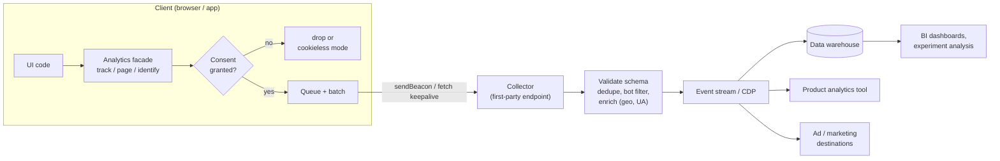

| Stage | Responsibility | Options |
|---|---|---|
| **Collect** | Turn user actions into typed events with context | Your own facade + a vendor SDK (Segment, RudderStack, PostHog, Amplitude, Mixpanel, GA4 gtag, Snowplow trackers) |
| **Transport** | Get events off the device reliably and cheaply | Batching, `sendBeacon`, `fetch(..., { keepalive: true })`, retries |
| **Ingest** | Accept, authenticate (write key), rate-limit | Vendor endpoint, first-party proxy, your own collector |
| **Process** | Validate, dedupe, enrich, filter bots, apply consent | CDP pipelines, stream processors |
| **Store** | Durable, queryable history | Warehouse (BigQuery, Snowflake, Redshift, Databricks) and/or the vendor's store |
| **Activate** | Use the data | Dashboards, experiment analysis, audiences for ads/email (reverse ETL) |

The **frontend owns the first two stages and shapes all the rest**: a badly named or badly timed event can't be fixed downstream.

---

### Section 3: The Event Model

Almost every modern analytics tool is **event-based**: everything (including a page view) is an event with a name, properties and context. Segment's spec popularised a small set of **call types**, which most CDPs mirror:

| Call | Purpose | Example |
|---|---|---|
| `track` | A user did something | `track('Checkout Started', { cartValue: 42 })` |
| `page` / `screen` | A page (web) or screen (mobile) was viewed | `page('Product Detail')` |
| `identify` | Tie the current device to a known user + traits | `identify('u_123', { plan: 'pro' })` |
| `group` | Tie the user to an account/organisation (B2B) | `group('org_9', { seats: 40 })` |
| `alias` | Merge two identities (needed by some destinations) | `alias('u_123')` |

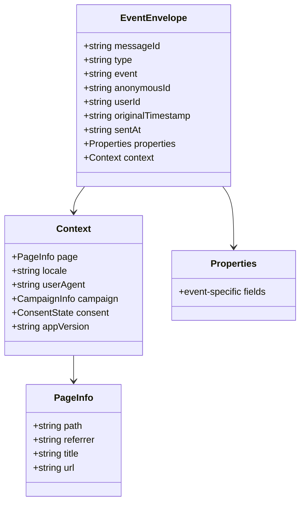

**Envelope fields that matter for architecture:**
- **`messageId`** — a client-generated unique ID (e.g. `crypto.randomUUID()`). Makes retries safe: the server **dedupes** on it.
- **`originalTimestamp` / `sentAt`** — when it happened vs when it was sent. With the server's `receivedAt`, the pipeline can correct for a wrong device clock (Segment documents this exact calculation).
- **`anonymousId` / `userId`** — identity (Section 7).
- **`context`** — automatically attached by the SDK: page, locale, campaign (UTM) parameters, app version, consent state. Never make every call site pass these by hand.

---

### Section 4: Tracking Plan and Naming

A **tracking plan** is the schema for your events: names, required properties, types, owners and the questions each event answers. Treat it like an API contract — versioned, reviewed and checked in CI.

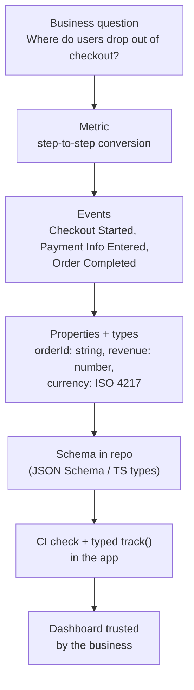

**Naming conventions** — pick one and enforce it:

| Convention | Example | Used by |
|---|---|---|
| `Object Action`, Title Case, past tense | `Product Added`, `Order Completed` | Segment spec, many CDPs |
| `snake_case` verb_object | `add_to_cart`, `purchase` | GA4 recommended events |
| Namespaced | `checkout.payment_submitted` | Some in-house systems |

**Rules that save you later:**
- **Few events, rich properties.** `Button Clicked { button: 'upgrade', location: 'pricing' }` beats 300 events like `Upgrade Button On Pricing Clicked`. (But don't go so generic that every event is `Clicked` — name the business action.)
- **Track intent and outcome.** `Checkout Started` (client) and `Order Completed` (preferably **server-side**, when payment succeeds) — the client can't be trusted for revenue.
- **Units in the name or the schema:** `durationMs`, `priceCents`, `currency`.
- **No PII in event names or free-text properties** (Section 9).
- **Version by adding, not mutating.** Changing a property's meaning silently breaks every historical chart.
- **Every event has an owner and a "why".** Unused events are cost and privacy risk — prune them.

Tools: Segment Protocols, RudderStack Tracking Plans, Avo, Amplitude Data, Snowplow (self-describing JSON Schemas via Iglu) — or a JSON Schema file + generated TypeScript types in your own repo (Example 1).

---

### Section 5: The Client Instrumentation Layer

Never sprinkle `gtag(...)`, `mixpanel.track(...)` and `posthog.capture(...)` across components. Put **one facade** between the app and every vendor.

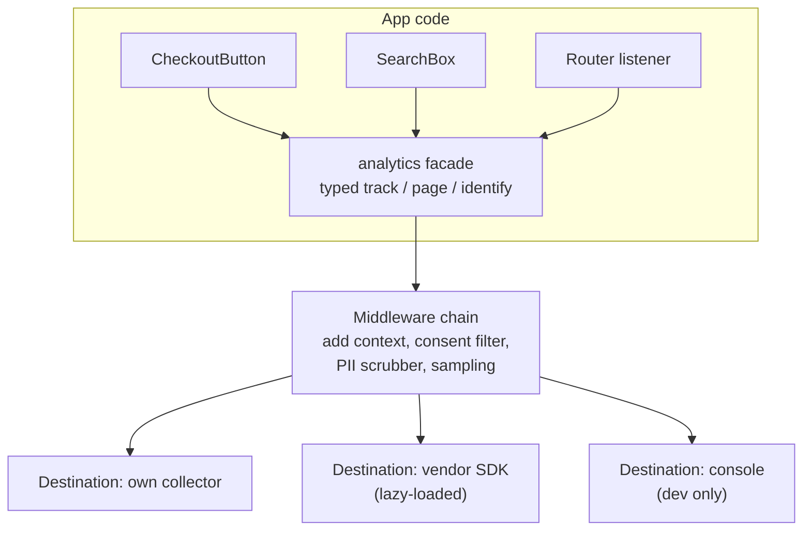

**What the facade buys you:**
- **Swap vendors** without touching components (a common migration — e.g. Universal Analytics was sunset by Google in 2023/2024, forcing GA4 migrations).
- **Type safety** — `track('Order Completed', props)` is checked against the tracking plan.
- **One place for consent, PII scrubbing, sampling and batching.**
- **Lazy loading** — vendor SDKs load after the page is interactive; the facade queues calls until then.
- **Testability** — in unit tests, inject a fake destination and assert `track` was called with the right payload.

**Declarative vs imperative instrumentation:**

| Style | Example | Pros | Cons |
|---|---|---|---|
| Imperative | `onClick={() => { save(); track('Doc Saved') }}` | Explicit, typed, easy to review | Easy to forget |
| Declarative attributes | `<button data-track="Doc Saved">` + one delegated listener | Low effort, consistent | Weakly typed, breaks on refactor |
| Autocapture | SDK records every click/input automatically | Zero effort, retroactive analysis | Noisy, fragile selectors, **risk of capturing PII** — configure masking |

A practical mix: **autocapture for exploration (with masking), explicit typed events for anything a KPI or experiment depends on.**

---

### Section 6: Page Views in SPAs

In a multi-page site, every navigation reloads the analytics snippet, which fires a page view. In an SPA, the **History API changes the URL without a page load**, so nothing fires unless you tell it to.

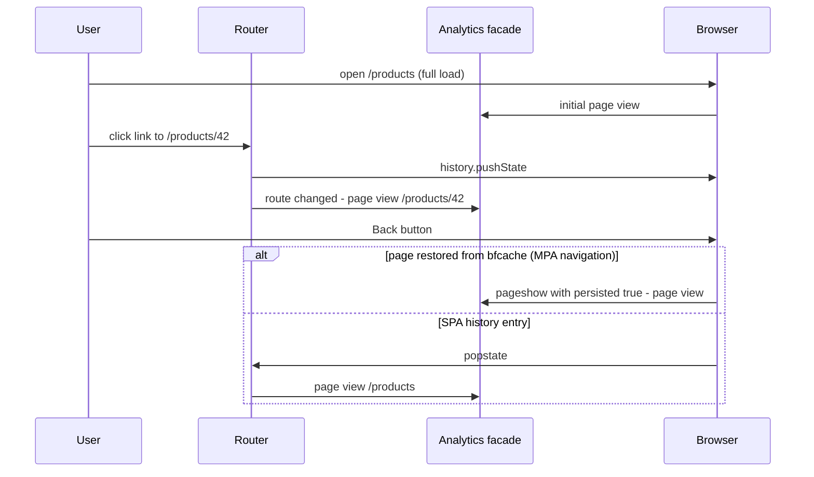

**Rules:**
- **Hook into the router**, not raw `popstate`: React Router `useLocation`, Next.js App Router `usePathname()` + `useSearchParams()`, Vue Router `router.afterEach`, Angular `Router.events` filtered to `NavigationEnd`, SvelteKit `afterNavigate`, Nuxt `router.afterEach` / `page:finish` hook.
- **Send after the title updates**, otherwise the page view carries the previous page's title.
- **Deduplicate**: React Strict Mode runs effects twice in development; query-string changes may or may not count as a new page — decide in the tracking plan.
- **bfcache restores** (see [Browser Caching Strategies](./browser-caching-strategies.md#section-12-backforward-cache-bfcache)) do not re-run your scripts. Listen for `pageshow` with `event.persisted === true` if you want them counted.
- **Strip sensitive query params** (tokens, emails, reset codes) from `context.page.url` before sending.
- Some tools (GA4's enhanced measurement) can auto-detect history changes; **don't also send manual page views** or you'll double count.

---

### Section 7: Identity and Sessions

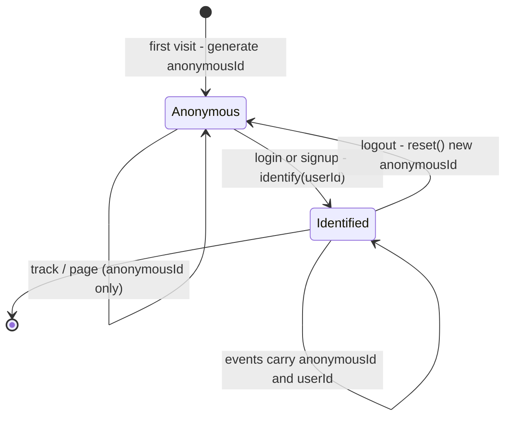

| Concept | How it works | Pitfalls |
|---|---|---|
| **anonymousId** | Random ID (UUID) generated on first visit, stored in a first-party cookie or localStorage | Cleared by users, private mode, Safari's storage limits → one person looks like many |
| **userId** | Your stable internal ID, sent on `identify` after login | **Never** use email or phone as the ID — that's PII in every event |
| **Identity stitching** | Pipeline links the anonymousId's earlier events to the userId | Shared devices: call `reset()` on logout or the next user inherits the identity |
| **Session** | Group of events with gaps shorter than a timeout (GA4's default is 30 minutes, configurable) | Definitions differ by tool — dashboards from two vendors won't match exactly |
| **Cross-device** | Same userId on web and mobile → unified profile | Only works for logged-in users |

**Browser storage reality (late 2026):**
- **Safari ITP** caps the lifetime of cookies written by JavaScript (`document.cookie`) to **7 days**, and can also cap some server-set cookies (for example from CNAME-cloaked tracking subdomains). Script-writable storage can be deleted after 7 days without user interaction. Check the WebKit blog for current rules.
- **Third-party cookies** are blocked by default in Safari and Firefox. Chrome **kept** third-party cookies by default after its Privacy Sandbox changes and lets users control them — don't build analytics identity on third-party cookies anyway.
- **Server-set, first-party, `HttpOnly` cookies** from your own domain (same IP space as your site) are the most durable option for an anonymous ID — another reason for first-party collection (Section 10).

---

### Section 8: Transport — Queue, Batch, Flush

Sending one HTTP request per event wastes battery, radio time and main-thread work. Batch, then flush at the right moments.

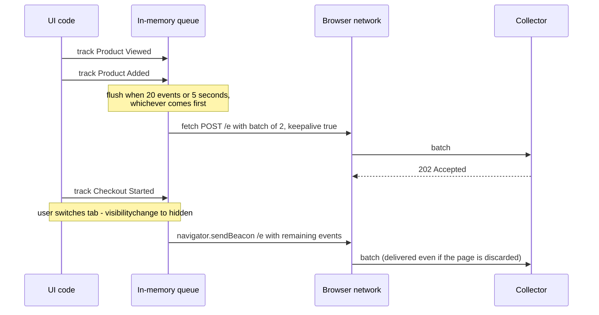

**Transport options:**

| API | Survives page unload? | Custom headers? | Notes |
|---|---|---|---|
| `fetch()` | ❌ May be cancelled | ✅ | For normal in-session flushes |
| `fetch(url, { keepalive: true })` | ✅ | ✅ | Total in-flight keepalive body size is capped (the Fetch spec uses 64 KiB) |
| `navigator.sendBeacon(url, data)` | ✅ | ❌ (content type comes from the body) | Fire-and-forget POST, returns `false` if it couldn't queue; uses keepalive under the hood |
| `fetchLater()` | ✅ Sent at page end or after a timeout | ✅ | Chromium only, experimental (check MDN); feature-detect |
| `` pixel (GET) | ❌ | ❌ | Legacy; URL length limits; avoid |

**Flush triggers:**
- **Size or time threshold** (e.g. 20 events / 5 s — tune for your traffic).
- **`visibilitychange` → `hidden`** — the most reliable "user might be leaving" signal, especially on mobile where `unload` often never fires.
- **`pagehide`** as a backup (some older Safari versions didn't fire `visibilitychange` on navigation).
- **Never `unload` / `beforeunload`** — unreliable and they can block the bfcache.

**Reliability:**
- **Retry with backoff** on network errors and 5xx; drop on 4xx (a schema error won't fix itself).
- **Idempotency via `messageId`** so retries never double-count.
- **Offline**: optionally persist the queue to IndexedDB and drain it on `online` (see [Offline-First Architecture](./offline-first-architecture.md)). Keep the queue bounded.
- **CORS**: a same-origin collector avoids preflights entirely; for cross-origin `sendBeacon`, a JSON `Blob` type isn't CORS-safelisted and needs a preflight — send `text/plain` or use a first-party endpoint.

---

### Section 9: Consent and Privacy

Analytics touches personal data, so law and browser policy shape the architecture — not just the UI.

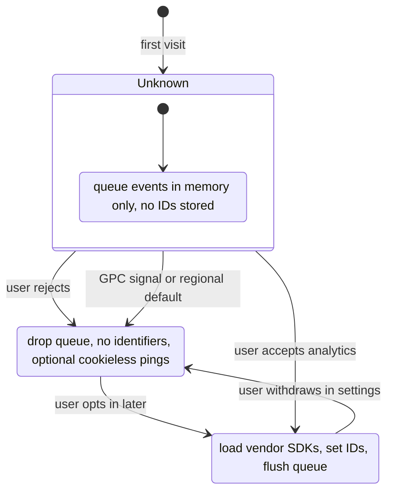

**Architecture rules:**
- **Consent is state in the facade.** Every destination declares a **purpose** (analytics, advertising, functional). The middleware only forwards events to destinations whose purpose is granted.
- **Default to "denied" until you know** in regions that require opt-in (EU/EEA, UK and others). In the EU, storing or reading identifiers on the device for analytics generally needs prior consent under ePrivacy rules — some regulators allow narrow exemptions for strictly limited audience measurement. **Get legal advice; this note isn't it.**
- **Don't load the vendor script before consent** if it sets cookies on load. Buffer events in memory and replay them once consent is granted (dropping them if denied).
- **Google Consent Mode v2** — Google tags read four signals: `ad_storage`, `analytics_storage`, `ad_user_data`, `ad_personalization`. Google requires them for EEA traffic sent to its ad products. In "advanced" mode tags load and send cookieless pings when denied; in "basic" mode they don't load at all until granted.
- **Global Privacy Control** (`navigator.globalPrivacyControl` / `Sec-GPC: 1` header) — a browser-level opt-out signal, legally recognised in some US states (e.g. California). Supported in Firefox and some privacy-focused browsers and extensions, not Chrome or Safari by default — read it where present. `DNT` (Do Not Track) is deprecated.
- **Consent Management Platforms (CMPs)** (OneTrust, Usercentrics, Cookiebot, Didomi, etc.) render the banner and emit consent state; many implement IAB TCF for ad-tech.

**PII hygiene:**

| Do | Don't |
|---|---|
| Send an internal `userId` | Send email, phone, name, address in events |
| Strip query params like `token`, `email`, `code` from URLs | Send full URLs from password-reset or magic-link pages |
| Mask input values in autocapture and session replay | Record keystrokes in form fields |
| Truncate or drop IP at the collector if you don't need it | Store raw IPs "just in case" |
| Set retention per event type | Keep everything forever |
| Support deletion requests by userId (GDPR/CCPA) | Have no way to find a user's events |

---

### Section 10: Client-Side vs Server-Side Collection

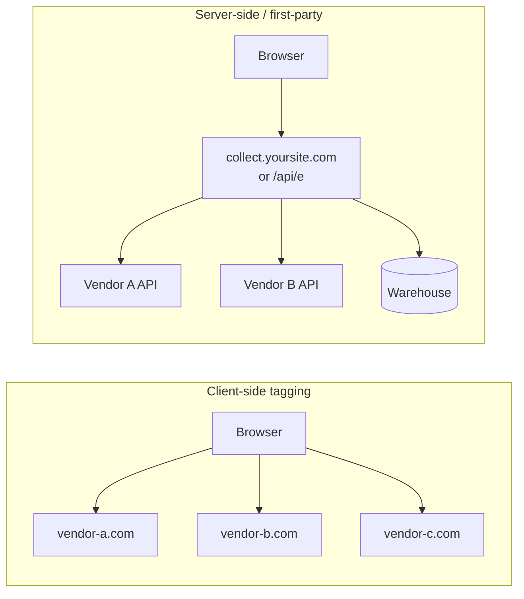

| | Client-side (vendor SDKs in the browser) | Server-side (first-party collector / server-side tag manager / CDP) |
|---|---|---|
| **JS shipped** | One SDK per vendor — heavy | One small client |
| **Network** | Many third-party origins (DNS + TLS each) | One first-party endpoint |
| **Data control** | Vendors see raw data, IP, UA | You filter, scrub and enrich before forwarding |
| **Ad blockers** | Known vendor domains are often blocked | Less affected (but don't use this to dodge consent) |
| **Cookie durability** | Script-set cookies capped by ITP | Server-set first-party cookies last longer |
| **Effort** | Paste a snippet | Run and secure infrastructure |
| **Some features** | Session replay, heatmaps, in-app surveys need client SDKs | Not possible server-side |
| **Truth for revenue** | ❌ Spoofable, blockable | ✅ Fire `Order Completed` from the backend |

Common setups: **Google Tag Manager server-side containers**, **Segment / RudderStack** sources and destinations, **PostHog / Plausible / Amplitude reverse-proxy guides**, or a small collector of your own (Example 5).

> **Ethics and law:** first-party collection improves reliability and data control. It does **not** remove the need for consent, and routing tracking through your domain to evade a user's explicit choice (a blocker or a "reject" click) is exactly what regulators and browser vendors push back on.

**Hybrid is the norm:** behaviour events client-side through a first-party endpoint, business-critical events (signup, purchase, subscription change) server-side from the system of record.

---

### Section 11: The Performance Cost of Analytics

Analytics and tag-manager scripts are a classic source of **long tasks and poor INP**: they parse and execute on the main thread, attach listeners to every click, and often load more scripts.

```mermaid
gantt
    title Main thread during page load (illustrative, not measured)
    dateFormat X
    axisFormat %S
    section Without discipline
    App bundle            :a1, 0, 3s
    Tag manager           :a2, after a1, 1s
    Vendor SDK x3         :a3, after a2, 2s
    Hydration delayed     :a4, after a3, 1s
    section With discipline
    App bundle            :b1, 0, 3s
    Hydration             :b2, after b1, 1s
    Tiny facade, queue    :b3, after b2, 1s
    SDKs on idle          :b4, after b3, 2s
```

**Tactics:**
- **Load after the app is interactive**: `<script async>` placed late, `requestIdleCallback`, or framework helpers — Next.js `<Script strategy="afterInteractive" | "lazyOnload">` and `@next/third-parties` for Google tags; Nuxt Scripts (`useScript`) for Nuxt.
- **The facade queues calls** until the SDK loads, so nothing is lost.
- **Keep click handlers cheap**: `track()` should push to an array and return — no synchronous network or heavy serialization inside an event handler. Defer the flush with `scheduler.postTask`/`setTimeout`.
- **Govern the tag manager**: every tag added by marketing ships code to every user. Put GTM changes through review and a performance budget ([Performance Budgets](./performance-budgets.md)).
- **Off-main-thread options**: Partytown runs third-party scripts in a Web Worker — treat it as experimental and test carefully (scripts needing synchronous DOM access can break, and some need a proxy for CORS). Next.js' `strategy="worker"` builds on it and is experimental.
- **Measure**: Chrome DevTools Performance panel groups third-party cost; Lighthouse has third-party audits ([Lighthouse & Performance Auditing](./lighthouse-and-performance-auditing.md)).

---

### Section 12: Data Quality

Bad data is worse than no data: people make confident decisions on it.

| Problem | Cause | Mitigation |
|---|---|---|
| Double counting | Retries, Strict Mode effects, auto + manual page views | `messageId` dedupe, idempotent hooks, one page-view source |
| Missing events | Ad blockers, page closed before flush, consent denied | First-party endpoint, flush on `visibilitychange`, report "consented share" alongside metrics |
| Wrong timestamps | Device clocks are wrong | Send `originalTimestamp` + `sentAt`; correct with `receivedAt` |
| Schema drift | Someone renames a property | Typed events, schema validation at the collector, CI checks |
| Bot traffic | Crawlers, uptime checks, scrapers | Filter known bots by UA/IP lists, require JS execution, exclude synthetic monitors by header |
| Staging data in prod | Same write key everywhere | Separate keys per environment |
| Experiment bias | Exposure logged when the flag is evaluated, not when the user sees the variant | Log exposure at render time ([Feature Flags & A/B Testing](./feature-flags-and-a-b-testing.md)) |

**Validate at both ends:** TypeScript types catch mistakes at compile time; a schema check at the collector catches old app versions, mobile clients and hand-written events. Send failures to a **quarantine/dead-letter table** rather than silently dropping them.

---

## System Design Angle — Build vs Buy

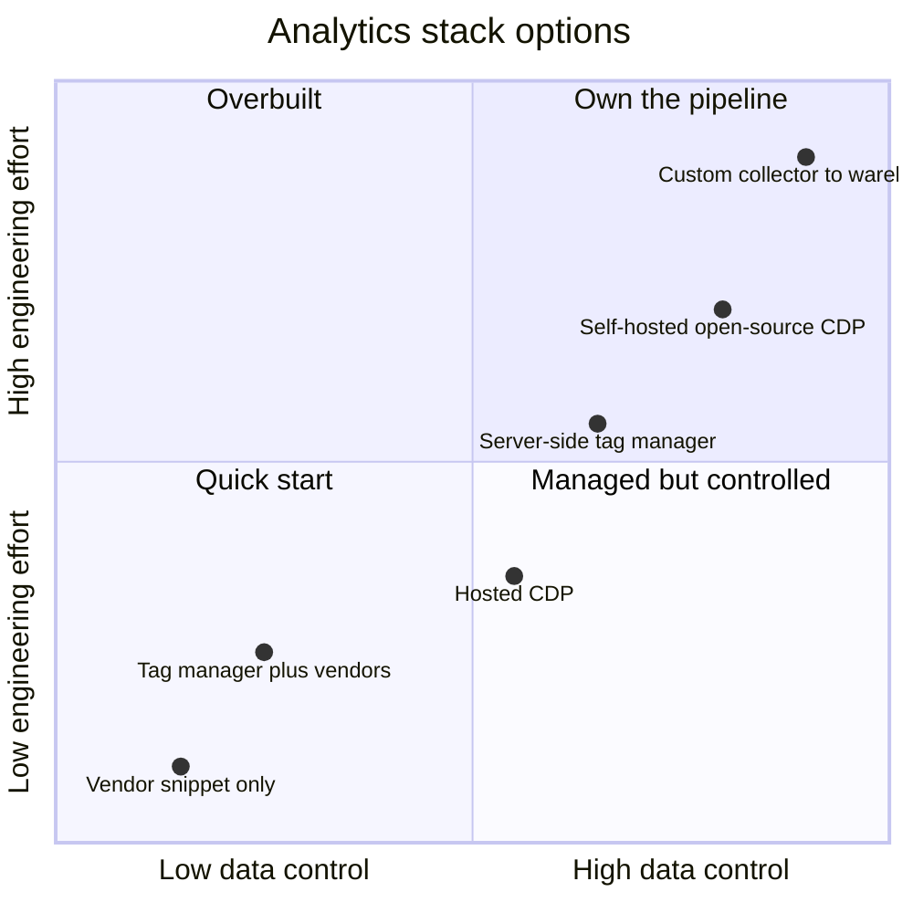

| Situation | Recommendation |
|---|---|
| Early startup, one product tool | Vendor SDK behind your own facade; typed events from day one |
| Several destinations (product, ads, CRM, warehouse) | CDP (hosted or open-source) — instrument once, route many |
| Strict privacy / regulated industry | First-party collector, scrub at ingest, warehouse-first, minimal third parties |
| High traffic, cost-sensitive | Server-side collection, batching, sampling for non-KPI events |
| Marketing needs to add tags without deploys | Tag manager **with** review, a budget and consent integration |

**Questions to ask in a design interview:** Which decisions will this data drive? Which regions (consent regime)? Which destinations? Do we need user-level data or only aggregates? What's the retention and deletion policy? Must revenue numbers reconcile with finance?

---

## Framework Comparison

| Stack | Page-view hook | Where the facade lives | Notes |
|---|---|---|---|
| **React (Vite / React Router)** | `useEffect` on `useLocation()` | Context provider + `useAnalytics()` hook | Guard against Strict Mode double effects in dev |
| **Next.js App Router** | Client component using `usePathname()` + `useSearchParams()` (wrap in `<Suspense>`) | Client provider in the root layout | `@next/third-parties` for GA/GTM; `instrumentation-client.ts` runs before hydration in recent versions (check docs) |
| **Vue 3** | `router.afterEach((to) => ...)` | Plugin via `app.provide` + `inject`, or a composable | Nuxt: plugin + `router.afterEach` / Nuxt Scripts |
| **Angular** | `router.events.pipe(filter(e => e instanceof NavigationEnd))` | Injectable `AnalyticsService` (`providedIn: 'root'`) | Use an `ErrorHandler`/interceptor for related telemetry |
| **Svelte / SvelteKit** | `afterNavigate` from `$app/navigation` | Module-level store or context | Use the `$app/environment` `browser` flag to skip SSR |
| **Native mobile** | `screen` events from navigation (UINavigationController / Jetpack Navigation / React Navigation listeners) | Same facade pattern; vendor mobile SDKs (Segment, Amplitude, Firebase Analytics) | Mobile SDKs batch to disk and flush on app background; app-store privacy labels / Android data safety form must match what you collect |

---

## Real-World Examples

**Example 1 — A typed tracking plan in TypeScript:**
```typescript
// analytics/events.ts — the single source of truth (could be generated from JSON Schema)
export interface EventMap {
  'Product Viewed': { productId: string; priceCents: number; currency: string };
  'Product Added': { productId: string; quantity: number; priceCents: number; currency: string };
  'Checkout Started': { cartId: string; itemCount: number; valueCents: number; currency: string };
  'Search Performed': { queryLength: number; resultCount: number }; // length, not the query text (may contain PII)
  'Experiment Exposed': { flagKey: string; variant: string };
}

export type EventName = keyof EventMap;
```

```typescript
// usage — the compiler rejects typos and missing properties
track('Product Added', { productId: 'sku_42', quantity: 1, priceCents: 1299, currency: 'EUR' });

// @ts-expect-error — 'Product Add' is not in the tracking plan
track('Product Add', { productId: 'sku_42' });
```

**Example 2 — A small analytics client with consent, batching and reliable flush:**
```typescript
// analytics/client.ts
import type { EventMap, EventName } from './events';

type Consent = 'unknown' | 'granted' | 'denied';

interface Envelope {
  messageId: string;
  type: 'track' | 'page' | 'identify';
  event?: string;
  properties?: Record<string, unknown>;
  anonymousId: string;
  userId?: string;
  originalTimestamp: string;
  context: { path: string; referrer: string; locale: string; appVersion: string };
}

const ENDPOINT = '/api/e';            // same-origin: no CORS preflight, first-party
const MAX_BATCH = 20;
const FLUSH_MS = 5000;
const MAX_BUFFER = 200;               // bounded memory while consent is unknown
const SENSITIVE_PARAMS = ['token', 'code', 'email', 'reset'];

let consent: Consent = 'unknown';
let queue: Envelope[] = [];
let timer: ReturnType<typeof setTimeout> | undefined;
let userId: string | undefined;
let anonymousId = 'pending';          // only persisted after consent

function scrubbedPath(): string {
  const url = new URL(location.href);
  SENSITIVE_PARAMS.forEach((p) => url.searchParams.delete(p));
  return url.pathname + url.search;
}

function enqueue(e: Omit<Envelope, 'messageId' | 'anonymousId' | 'originalTimestamp' | 'context'>) {
  if (consent === 'denied') return;
  queue.push({
    ...e,
    messageId: crypto.randomUUID(),
    anonymousId,
    userId,
    originalTimestamp: new Date().toISOString(),
    context: {
      path: scrubbedPath(),
      referrer: document.referrer,
      locale: navigator.language,
      appVersion: import.meta.env.VITE_APP_VERSION ?? 'dev',
    },
  });
  if (queue.length > MAX_BUFFER) queue = queue.slice(-MAX_BUFFER);
  if (consent !== 'granted') return; // buffer only
  if (queue.length >= MAX_BATCH) flush();
  else timer ??= setTimeout(flush, FLUSH_MS);
}

function flush(useBeacon = false) {
  clearTimeout(timer);
  timer = undefined;
  if (consent !== 'granted') return;

  // Page is going away: hand every remaining batch to the browser (each well under the beacon quota)
  while (useBeacon && queue.length) {
    const body = JSON.stringify({ sentAt: new Date().toISOString(), batch: queue.slice(0, MAX_BATCH) });
    if (!navigator.sendBeacon(ENDPOINT, new Blob([body], { type: 'text/plain' }))) break; // quota full
    queue.splice(0, MAX_BATCH);
  }
  if (queue.length === 0) return;

  const batch = queue.splice(0, MAX_BATCH);
  const body = JSON.stringify({ sentAt: new Date().toISOString(), batch });
  fetch(ENDPOINT, { method: 'POST', body, keepalive: true, headers: { 'Content-Type': 'application/json' } })
    .then((res) => {
      if (res.status >= 500) queue.unshift(...batch); // retry later; messageId makes it safe
    })
    .catch(() => queue.unshift(...batch));       // add exponential backoff in real code
  if (queue.length) timer = setTimeout(flush, FLUSH_MS);
}

export function track<K extends EventName>(event: K, properties: EventMap[K]) {
  enqueue({ type: 'track', event, properties });
}

export function page(name?: string) {
  enqueue({ type: 'page', event: name ?? document.title });
}

export function identify(id: string) {
  userId = id; // internal ID only — never an email
  enqueue({ type: 'identify' });
}

export function reset() {
  flush(true);                         // send the previous user's events first
  userId = undefined;
  anonymousId = crypto.randomUUID();
  if (consent !== 'granted') return;   // never persist IDs without consent
  try { localStorage.setItem('ajs_anon', anonymousId); } catch { /* storage blocked */ }
}

export function setConsent(next: Consent) {
  consent = next;
  if (next === 'denied') { queue = []; return; }
  if (next === 'granted') {
    try {
      anonymousId = localStorage.getItem('ajs_anon') ?? crypto.randomUUID();
      localStorage.setItem('ajs_anon', anonymousId);
    } catch { anonymousId = crypto.randomUUID(); }
    queue = queue.map((e) => ({ ...e, anonymousId })); // replay buffered events
    flush();
  }
}

// Reliable end-of-page flush: visibilitychange first, pagehide as a backup. Never 'unload'.
document.addEventListener('visibilitychange', () => {
  if (document.visibilityState === 'hidden') flush(true);
});
addEventListener('pagehide', () => flush(true));
```

> In production you'd usually use a vendor or open-source SDK that already does this. Knowing the shape lets you evaluate SDKs and debug them.

**Example 3 — SPA page views in each framework:**
```tsx
// Next.js App Router — app/analytics-listener.tsx
'use client';
import { usePathname, useSearchParams } from 'next/navigation';
import { useEffect, useRef } from 'react';
import { page } from '@/analytics/client';

export function AnalyticsListener() {
  const pathname = usePathname();
  const searchParams = useSearchParams();
  const last = useRef<string | null>(null);

  useEffect(() => {
    const key = `${pathname}?${searchParams.toString()}`;
    if (last.current === key) return; // Strict Mode / duplicate guard
    last.current = key;
    page();
  }, [pathname, searchParams]);

  return null;
}

// app/layout.tsx: <Suspense fallback={null}><AnalyticsListener /></Suspense>
// (useSearchParams needs a Suspense boundary to avoid opting the route into client rendering)
```

```typescript
// Vue 3 + Vue Router
router.afterEach((to, from, failure) => {
  if (!failure) page(String(to.name ?? to.path));
});

// Angular
@Injectable({ providedIn: 'root' })
export class PageViewTracker {
  constructor(router: Router) {
    router.events
      .pipe(filter((e): e is NavigationEnd => e instanceof NavigationEnd))
      .subscribe(() => page());
  }
}

// SvelteKit (+layout.svelte <script>)
import { afterNavigate } from '$app/navigation';
afterNavigate(() => page());

// bfcache restores (any stack)
addEventListener('pageshow', (e) => { if (e.persisted) page(); });
```

**Example 4 — Consent gating a third-party SDK (BAD → GOOD):**
```html
<!-- ❌ BAD: vendor script loads (and sets cookies) before the user chooses -->
<script async src="https://vendor.example/sdk.js"></script>
```

```typescript
// ✅ GOOD: load only for granted purposes, after the page is interactive
import { setConsent } from './analytics/client';

function loadScript(src: string) {
  const s = document.createElement('script');
  s.src = src;
  s.async = true;
  document.head.append(s);
}

// requestIdleCallback isn't available in every browser (check MDN) — fall back to a timeout
const whenIdle = (fn: () => void) =>
  'requestIdleCallback' in window ? requestIdleCallback(fn) : setTimeout(fn, 2000);

cmp.onChange(({ analytics, advertising }) => {   // your CMP's callback API
  setConsent(analytics ? 'granted' : 'denied');
  if (advertising) whenIdle(() => loadScript('https://ads-vendor.example/pixel.js'));
});

// Respect Global Privacy Control where the browser exposes it
if ((navigator as Navigator & { globalPrivacyControl?: boolean }).globalPrivacyControl) {
  setConsent('denied'); // for "sale/sharing" purposes — map to your legal requirements
}
```

**Example 5 — A first-party collector that validates and forwards (Next.js route handler + Zod):**
```typescript
// app/api/e/route.ts
import { z } from 'zod';

const Envelope = z.object({
  messageId: z.string().uuid(),
  type: z.enum(['track', 'page', 'identify']),
  event: z.string().max(100).optional(),
  properties: z.record(z.string(), z.unknown()).optional(),
  anonymousId: z.string().max(64),
  userId: z.string().max(64).optional(),
  originalTimestamp: z.string().datetime(),
  context: z.object({ path: z.string().max(2048), referrer: z.string().max(2048), locale: z.string(), appVersion: z.string() }),
});
const Batch = z.object({ sentAt: z.string().datetime(), batch: z.array(Envelope).max(50) });

export async function POST(req: Request) {
  const text = await req.text();                      // sendBeacon sends text/plain
  if (text.length > 64 * 1024) return new Response(null, { status: 413 });

  const parsed = Batch.safeParse(JSON.parse(text));
  if (!parsed.success) {
    await quarantine(text, parsed.error);             // dead-letter, don't silently drop
    return new Response(null, { status: 400 });
  }

  const receivedAt = new Date();
  const skewMs = receivedAt.getTime() - Date.parse(parsed.data.sentAt);
  const events = parsed.data.batch.map((e) => ({
    ...e,
    receivedAt: receivedAt.toISOString(),
    timestamp: new Date(Date.parse(e.originalTimestamp) + skewMs).toISOString(), // clock-skew corrected
    // IP intentionally not stored; derive coarse geo here if needed, then discard
  }));

  await publish(events);   // queue / CDP / warehouse loader; dedupe on messageId downstream
  return new Response(null, { status: 202 });
}
```

**Example 6 — PII leaking through events (BAD → GOOD):**
```typescript
// ❌ BAD: email as an ID, raw search text, full URL with a reset token
identify(user.email);
track('Search Performed', { query: input.value });       // users type emails and names into search
page();                                                   // on /reset?token=abc123&email=a@b.com

// ✅ GOOD
identify(user.id);                                        // opaque internal ID
track('Search Performed', { queryLength: input.value.length, resultCount: results.length });
// client scrubs token/email params from context.page (Example 2); collector re-checks
```

---

## Key Points Summary

| Concept | One-Line Explanation |
|---|---|
| **Event** | Name + properties + context; everything (even a page view) is an event |
| **Tracking plan** | Versioned schema of events and properties, treated as an API contract |
| **Facade** | One typed `track/page/identify` API between app code and every vendor |
| **CDP** | Collects once, validates, and routes events to many destinations |
| **SPA page views** | Fire from router hooks; count bfcache restores via `pageshow` |
| **anonymousId / userId** | Device-level random ID vs internal user ID; `reset()` on logout |
| **Batching** | Queue events, flush on size/time and on `visibilitychange` |
| **sendBeacon / keepalive** | Requests that survive the page going away |
| **messageId** | Client-generated ID that makes retries idempotent |
| **Consent gating** | Events and SDKs only flow for granted purposes |
| **Server-side collection** | First-party endpoint forwards to vendors; more control, less JS |
| **Revenue events** | Emit from the backend, not the browser |
| **Performance** | Load SDKs after interactive; keep `track()` cheap; govern tag managers |

---

## Test Your Understanding

**Q1 (Basic):**
Why should an SPA not rely on the analytics vendor's snippet alone to count page views, and what should it do instead?

<details>
<summary>Answer</summary>

The snippet runs once per **document load**. In an SPA, the router changes the URL with `history.pushState` — no new document, so no new page view. Some vendors auto-detect history changes, but behaviour varies and can double count alongside manual calls.

Instead, fire `page()` from the **router's navigation hook** (React Router `useLocation`, Next.js `usePathname`/`useSearchParams`, Vue `router.afterEach`, Angular `NavigationEnd`, SvelteKit `afterNavigate`) after the title updates, with a duplicate guard. Choose **one** source of page views, and decide whether query-string changes count. Also handle `pageshow` with `persisted: true` if bfcache restores should count.
</details>

**Q2 (Application):**
Product wants to know where users drop out of a 4-step checkout, and finance wants revenue numbers that match the payment provider. Design the events and where each is emitted.

<details>
<summary>Answer</summary>

- **Client (behaviour):** `Checkout Started { cartId, itemCount, valueCents, currency }`, `Shipping Info Entered { cartId }`, `Payment Info Entered { cartId, method }` — all keyed by `cartId` so the funnel can join steps.
- **Server (truth):** `Order Completed { orderId, cartId, revenueCents, currency, ... }` emitted by the backend **after the payment provider confirms**. Browser events can be blocked, duplicated or spoofed, and the user may close the tab before the confirmation page loads.
- Same `userId`/`anonymousId` on both sides (the server knows the session), a `messageId` for dedupe, and typed schemas in the tracking plan.
- The funnel uses client events for steps 1–3 and the server event for step 4; revenue reports use only the server event, so they reconcile with finance.
</details>

**Q3 (Tricky):**
Your analytics shows fewer sessions on iOS Safari than your server logs, and many "new users" who are clearly returning customers. Nothing is broken in the code. What's happening?

<details>
<summary>Answer</summary>

Likely a mix of:
- **Identity loss** — Safari's ITP caps cookies written by JavaScript at 7 days and can clear script-writable storage after a period without interaction, so the `anonymousId` is regenerated and a returning visitor looks new.
- **Blocking** — content blockers or privacy features block known third-party analytics domains, so some sessions are never recorded, while server logs still see the requests.
- **Consent** — users who reject analytics are (correctly) missing.
- **Lost final events** — flushing on `unload` instead of `visibilitychange`/`pagehide` loses events on mobile.

Fixes: set the anonymous ID as a **server-set, first-party, `HttpOnly` cookie** from your own domain; collect via a **first-party endpoint**; flush on `visibilitychange`; report the consented share next to the metrics. Accept that analytics counts and server logs never match exactly.
</details>

**Q4 (Tricky):**
A developer puts `await fetch('/api/e', ...)` inside every click handler "so no event is lost". INP gets worse and the backend sees a request spike. Explain both effects and the fix.

<details>
<summary>Answer</summary>

- **INP:** the handler now does serialization and network setup synchronously before the next paint, and if the UI update waits on the `await`, the visual response is delayed. Many clicks → many long-ish tasks.
- **Request spike:** one HTTP request per event multiplies connections, headers and server work.

Fix: `track()` only pushes to an in-memory queue and returns. A batcher flushes on a size/time threshold (with `keepalive`), and on `visibilitychange → hidden` via `sendBeacon`. Events carry a `messageId` so retries are safe. Nothing is lost on navigation because the final flush uses an API designed to outlive the page.
</details>

**Q5 (System design):**
Marketing wants five new tags (ads pixels, a heatmap tool, a chat widget) added through the tag manager without engineering review. How do you respond as the frontend architect?

<details>
<summary>Answer</summary>

Each tag ships third-party JS to every user. That affects **INP/LCP**, **privacy and consent** (each vendor gets user data), and **security** (third-party code runs with full page access).

Propose a governed process instead of a flat "no":
- Tags go through a lightweight review: purpose, consent category, data shared, size/performance cost.
- Tags are wired to the **CMP**, so nothing fires before the matching consent.
- Load non-critical tags **after interaction / on idle**; keep a **third-party performance budget** checked in CI or synthetic monitoring.
- Prefer **server-side forwarding** (ad conversion APIs fed from the CDP) over more client pixels.
- Constrain with a **CSP** allow-list, so unreviewed origins can't load.
- Remove tags that nobody uses.
</details>

**Q6 (System design):**
Design the analytics architecture for a B2B SaaS app (web + iOS + Android) sold in the EU and US. It needs product analytics, experiment analysis and CRM syncing, and has a strict security team.

<details>
<summary>Answer</summary>

- **Instrumentation:** a shared tracking plan (JSON Schema) → generated types for TypeScript, Swift and Kotlin. Each client has a thin facade with `track/page|screen/identify/group` (`group` for the customer account).
- **Consent:** CMP on web; region-aware defaults (opt-in in EU, honour GPC in the US where required); the facade filters per purpose. Mobile: OS-level privacy disclosures match collected data.
- **Collection:** clients send to a **first-party collector** (`/api/e` or `collect.example.com`). The collector validates schemas, dedupes on `messageId`, corrects clock skew, drops IP after coarse geo, and quarantines failures.
- **Server events:** billing and plan changes are emitted by the backend, not the client.
- **Routing:** a CDP (hosted or self-hosted, chosen with the security team) forwards to the product analytics tool, the warehouse (source of truth for experiments), and CRM via reverse ETL. Only the fields each destination needs.
- **Experiments:** exposure events at render time, analysed in the warehouse.
- **Performance:** web facade under a small size budget; vendor SDKs (session replay, if any) lazy-loaded only with consent and with input masking.
- **Governance:** per-event owners, retention policies, deletion by `userId`, separate write keys per environment.
</details>

---

## Cheat Sheet

**Key Definitions:**
- **Event:** a named record of something that happened, with properties and context
- **Tracking plan:** the schema and ownership list of all events
- **CDP (Customer Data Platform):** collects events once and routes them to many destinations
- **anonymousId / userId:** device-level random ID / internal user ID after login
- **Identity stitching:** linking anonymous history to an identified user
- **Consent Mode v2:** Google's consent signals (`ad_storage`, `analytics_storage`, `ad_user_data`, `ad_personalization`)
- **GPC:** Global Privacy Control, a browser opt-out signal (`Sec-GPC: 1`)
- **Server-side tagging:** collecting on a first-party endpoint and forwarding server-to-server
- **Reverse ETL:** syncing warehouse data back into operational tools (CRM, ads)

**Quick Reference:**
```text
Calls:        track(event, props) · page(name) / screen(name) · identify(userId, traits) · group(accountId) · reset()
Envelope:     messageId (dedupe) · anonymousId · userId · originalTimestamp + sentAt (+ receivedAt server) · context
Naming:       pick ONE: "Object Action" (Product Added) or snake_case (add_to_cart); typed in code
Page views:   router hook (afterEach / NavigationEnd / afterNavigate / usePathname) + pageshow persisted
Transport:    queue → batch (N events or T seconds) → fetch keepalive
              final flush on visibilitychange hidden (sendBeacon) + pagehide · never unload
Consent:      default deny where opt-in is required · buffer in memory · load SDKs only after grant
PII:          internal IDs only · scrub token/email params · mask autocapture/replay · drop IPs
Truth:        revenue / subscription events from the backend
Perf:         SDKs after interactive / on idle · track() = array push · govern the tag manager
Quality:      schema check in CI and at the collector · dead-letter queue · env-specific write keys
```

**Common Mistakes to Avoid:**

| Mistake | Why Wrong | Fix |
|---|---|---|
| Vendor calls scattered through components | Vendor lock-in, inconsistent payloads, no consent control | One typed facade with middleware and destinations |
| No tracking plan | Inconsistent names, unusable dashboards | Versioned schema, typed `track()`, CI validation |
| Email/phone as `userId` or in properties | PII copied into every tool | Opaque internal IDs; scrub at client and collector |
| Flushing on `unload` | Unreliable on mobile; blocks bfcache | `visibilitychange` + `sendBeacon`, `pagehide` backup |
| One request per event | Battery, network and server cost; INP | Batch + keepalive |
| Retries without `messageId` | Double-counted events | Client-generated `messageId`, dedupe server-side |
| Loading SDKs before consent | Legal risk; cookies set without permission | Buffer, load after grant, purpose-based routing |
| Revenue from the browser | Blockable, spoofable, lost on tab close | Emit from the backend after payment confirms |
| Auto + manual page views | Double counting | One page-view source |
| No `reset()` on logout | Next user on a shared device inherits identity | Call `reset()`; new `anonymousId` |
| Unreviewed tag-manager tags | Performance, privacy and security regressions | Review, CSP allow-list, budget, consent wiring |
| Same write key for staging and prod | Test data pollutes reports | Separate keys per environment |

---

## References & Further Reading

**Core docs**
- MDN: [`Navigator.sendBeacon()`](https://developer.mozilla.org/en-US/docs/Web/API/Navigator/sendBeacon)
- MDN: [`RequestInit.keepalive`](https://developer.mozilla.org/en-US/docs/Web/API/RequestInit#keepalive) · [`fetchLater()`](https://developer.mozilla.org/en-US/docs/Web/API/Window/fetchLater)
- MDN: [`visibilitychange` event](https://developer.mozilla.org/en-US/docs/Web/API/Document/visibilitychange_event) · [`pagehide` event](https://developer.mozilla.org/en-US/docs/Web/API/Window/pagehide_event)
- MDN: [`Navigator.globalPrivacyControl`](https://developer.mozilla.org/en-US/docs/Web/API/Navigator/globalPrivacyControl) · [`Sec-GPC`](https://developer.mozilla.org/en-US/docs/Web/HTTP/Reference/Headers/Sec-GPC)
- Chrome for Developers: [Page Lifecycle API](https://developer.chrome.com/docs/web-platform/page-lifecycle-api)
- web.dev: [Efficiently load third-party JavaScript](https://web.dev/articles/efficiently-load-third-party-javascript)
- Chrome for Developers: [Deprecating the unload event](https://developer.chrome.com/docs/web-platform/deprecating-unload)

**Specs**
- WHATWG: [Fetch Standard — keepalive](https://fetch.spec.whatwg.org/#request-keepalive-flag)
- W3C: [Beacon](https://w3c.github.io/beacon/)
- [Global Privacy Control specification](https://w3c.github.io/gpc/)

**Vendor and platform docs**
- Segment: [Spec overview (track, page, identify, group, alias)](https://segment.com/docs/connections/spec/) · [Timestamps and clock skew](https://segment.com/docs/connections/spec/common/#timestamps)
- Google: [Consent mode overview](https://developers.google.com/tag-platform/security/concepts/consent-mode) · [Server-side tagging](https://developers.google.com/tag-platform/tag-manager/server-side)
- Google Analytics: [GA4 recommended events](https://support.google.com/analytics/answer/9267735)
- Snowplow: [Self-describing events and schemas](https://docs.snowplow.io/docs/fundamentals/events/)
- Next.js: [Script component](https://nextjs.org/docs/app/api-reference/components/script) · [Third-party libraries (`@next/third-parties`)](https://nextjs.org/docs/app/guides/third-party-libraries)
- Partytown: [Documentation](https://partytown.qwik.dev/)
- WebKit: [Tracking Prevention in WebKit](https://webkit.org/tracking-prevention/)

**Privacy & law (starting points, not legal advice)**
- European Data Protection Board: [Guidelines on consent under Regulation 2016/679](https://www.edpb.europa.eu/our-work-tools/our-documents/guidelines/guidelines-052020-consent-under-regulation-2016679_en)
- IAB Europe: [Transparency & Consent Framework](https://iabeurope.eu/transparency-consent-framework/)

---

> **Previous Topic:** [Feature Flags & A/B Testing](./feature-flags-and-a-b-testing.md)
> — Rolling out changes safely and measuring their impact

> **Next Topic:** [Logging Best Practices](./logging-best-practices.md)
> — Structured, private, correlated client-side logs that help you debug production

*Saved on: 2026-11-06 | Repo: Frontend System Design Learning Notes*
