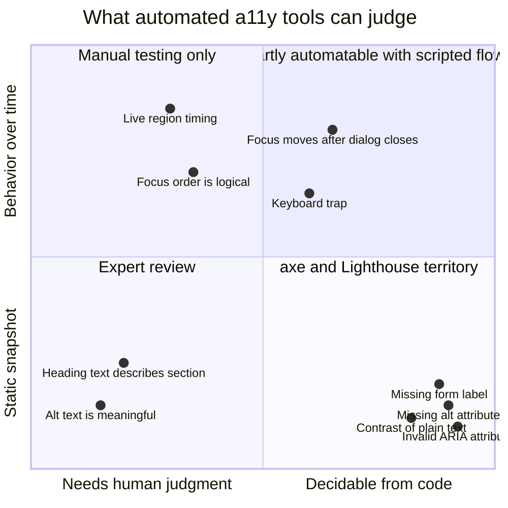
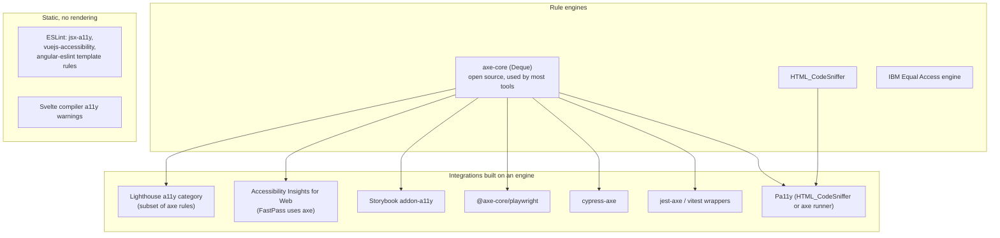
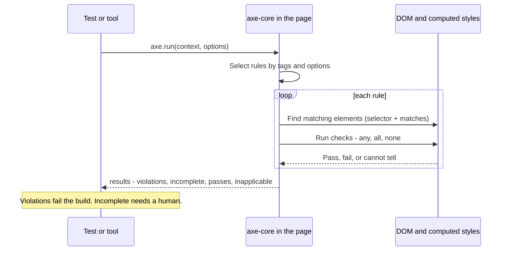
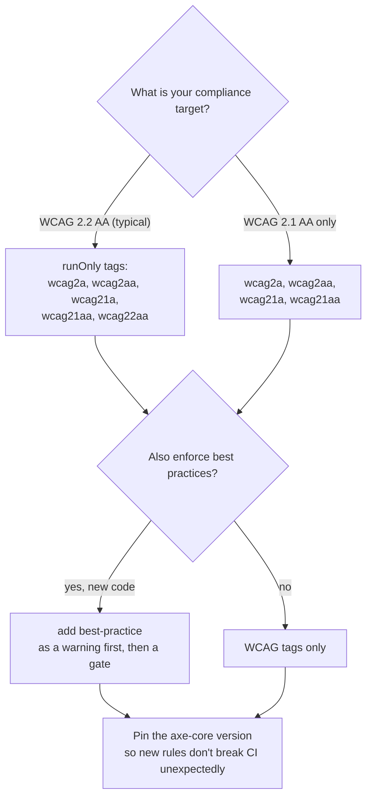
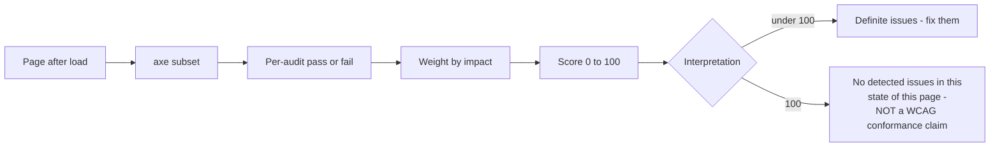
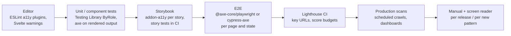
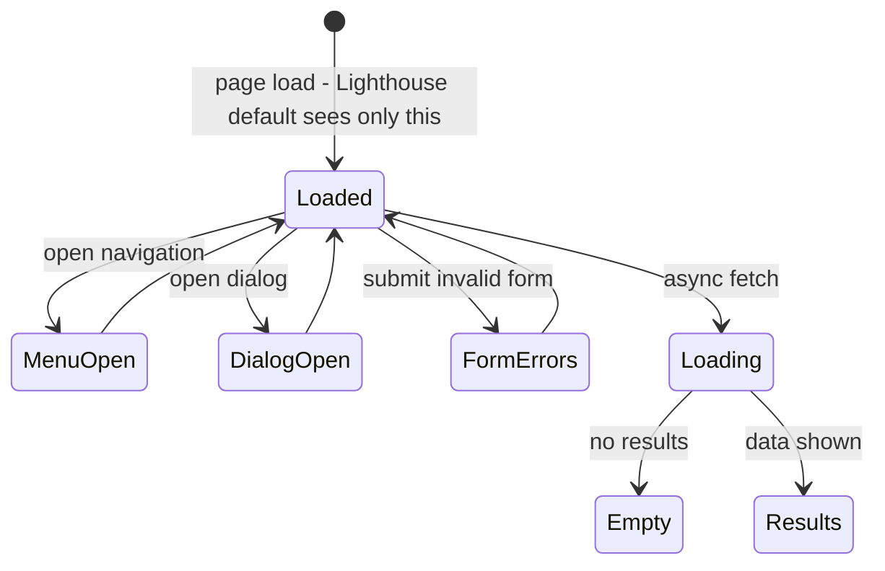
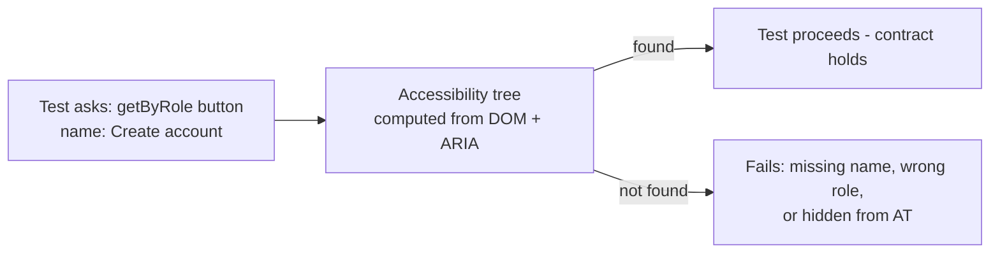
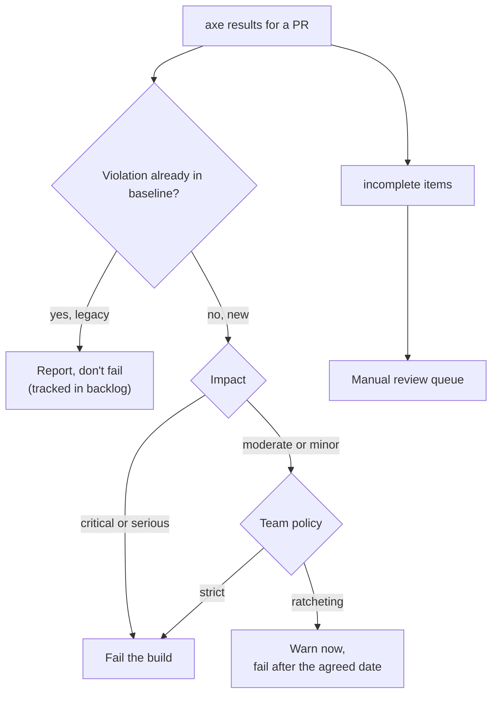
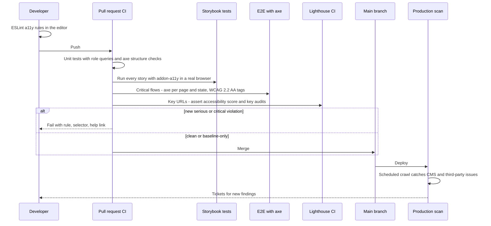

<!-- Generated by scripts/sync-knowledge.js from notes/ and README.md — do not edit here. -->
<!-- sections (line ranges in this file): Table of Contents 19-41 · ELI5 42-54 · Core Concept 55-402 · System Design Angle 403-448 · Real-World Examples 449-661 · Key Points Summary 662-682 · Test Your Understanding 683-770 · Cheat Sheet 771-818 · References & Further Reading 819-857 -->

# Automated A11y Testing (axe, Lighthouse)

> **Date:** 2026-11-06 · **Last updated:** 2026-11-06
> **Category:** Frontend System Design
> **Sub-Topic:** Accessibility / Automated testing & CI quality gates
> **Level:** Intermediate · **Reading time:** ~28 min
> **Informs:** a11y tooling per pipeline stage (lint, unit, Storybook, E2E, Lighthouse CI, monitoring), axe rule tags and WCAG level targeting, CI gate thresholds and baselines for legacy apps, what still needs manual and screen-reader testing, Lighthouse accessibility score interpretation, design-system a11y test coverage, native mobile accessibility audits

> **Pre-requisite:** [ARIA Roles, States & Properties](./aria-roles-states-and-properties.md) (what the rules check) and [Lighthouse & Performance Auditing](./lighthouse-and-performance-auditing.md) (how Lighthouse runs). [Screen Reader Testing](./screen-reader-testing.md) is the manual counterpart of this note.
> This note explains what **axe-core** and **Lighthouse** actually test, where to run them in a delivery pipeline, how to make their results a reliable CI gate, and — just as important — what they **cannot** catch.

**Previous:** [Accessible Forms & Error Handling](./accessible-forms-and-error-handling.md) · **Next:** [Internationalization (i18n) Architecture](./internationalization-i18n-architecture.md)

---

## Table of Contents

1. [ELI5 — Simple Explanation](#eli5--simple-explanation)
2. [Section 1: What Automation Can and Cannot Catch](#section-1-what-automation-can-and-cannot-catch)
3. [Section 2: The Tool Landscape](#section-2-the-tool-landscape)
4. [Section 3: How axe-core Works](#section-3-how-axe-core-works)
5. [Section 4: Rule Tags and Choosing a Target](#section-4-rule-tags-and-choosing-a-target)
6. [Section 5: How Lighthouse Scores Accessibility](#section-5-how-lighthouse-scores-accessibility)
7. [Section 6: Shift Left — Where Each Tool Runs](#section-6-shift-left--where-each-tool-runs)
8. [Section 7: Testing States, Not Just Pages](#section-7-testing-states-not-just-pages)
9. [Section 8: Role-Based Queries and Accessibility-Tree Assertions](#section-8-role-based-queries-and-accessibility-tree-assertions)
10. [Section 9: jsdom vs Real Browsers](#section-9-jsdom-vs-real-browsers)
11. [Section 10: Handling Results — Gates, Baselines, Exceptions](#section-10-handling-results--gates-baselines-exceptions)
12. [Section 11: Frameworks and Native Mobile](#section-11-frameworks-and-native-mobile)
13. [System Design Angle — An A11y Quality Pipeline](#system-design-angle--an-a11y-quality-pipeline)
14. [Real-World Examples](#real-world-examples)
15. [Key Points Summary](#key-points-summary)
16. [Test Your Understanding (with answers)](#test-your-understanding)
17. [Cheat Sheet](#cheat-sheet)
18. [References & Further Reading](#references--further-reading)

---

## ELI5 — Simple Explanation

Think of a **smoke detector** in a house.

- It's **always on**, cheap, and catches a whole class of problems (smoke) **instantly** — that's **axe-core** in your tests and CI.
- It can't tell you the wiring is unsafe, the stairs are too steep, or the door is too narrow for a wheelchair. For that you need an **inspector who walks through the house** — that's **manual testing** with a keyboard and a screen reader.
- **Lighthouse** is like a **home-inspection report card** with a score out of 100. A 100 means "no smoke detected in the rooms we looked at" — not "this house is safe for everyone".
- A good builder installs detectors **in every room** (every component, every page state), not just the front door (the home page on first load).

> **Automated tools reliably find a meaningful share of accessibility bugs, cheaply and early — run them everywhere — but a clean report is the start of testing, not proof of accessibility.**

---

## Core Concept — Step by Step

### Section 1: What Automation Can and Cannot Catch

Automated checkers inspect the **DOM, computed styles and accessibility tree** at one moment. They can verify things that are **objectively decidable from the code**; they can't judge **meaning, experience or behavior over time**.



| Usually caught automatically | Needs a human |
|---|---|
| `` without `alt` | Whether the `alt` text actually describes the image |
| Form control with no accessible name | Whether the label makes sense ("Field 1") |
| Text contrast on solid backgrounds | Contrast over images, gradients, video |
| Invalid/misspelled ARIA attributes, roles missing required children | Whether the ARIA pattern behaves correctly with a keyboard |
| Duplicate IDs referenced by ARIA, empty buttons/links | Logical focus order, visible focus quality |
| Missing `<html lang>`, missing document `<title>` | Whether headings and landmarks form a sensible outline |
| `user-scalable=no` in the viewport meta | Reflow at 400% zoom, text-spacing resilience |
| Some table header associations | Whether live announcements are timely and not noisy |
| `target-size` (2.5.8) in recent axe versions | Captions accuracy, cognitive load, error recovery flows |

**How much is "a meaningful share"?** It depends on how you count (by issue volume or by WCAG criterion) and on the site. Deque has published a study of its own audit data reporting that automated axe tests found **about 57% of issues by volume** (see References) — a vendor figure, measured on Deque's own audits. Counted **per WCAG success criterion**, many criteria can't be fully decided by automation at all. Treat any single percentage as context-dependent.

---

### Section 2: The Tool Landscape



| Tool | Type | Best at | Watch out for |
|---|---|---|---|
| **axe-core** | JS rule engine | The de-facto standard; precise, designed to minimize false positives | Needs a rendered DOM; one page state per run |
| **Lighthouse** | Audit tool (Chrome) | Quick report, CI score tracking, combined with perf/SEO | Subset of axe rules; a score, not a conformance claim |
| **axe DevTools / Accessibility Insights / WAVE / IBM Checker** | Browser extensions | Developer and QA investigation, guided manual checks | Manual, not a CI gate by themselves |
| **eslint-plugin-jsx-a11y** & friends | Static lint | Instant feedback in the editor (missing `alt`, click on `<div>`) | Can't see runtime values, computed styles or props passed through components |
| **Pa11y / Pa11y CI** | CLI runner | Scanning lists of URLs | Choose the runner (axe or HTML_CodeSniffer) deliberately |
| **Testing Library `*ByRole`** | Unit/integration queries | Enforces accessible names and roles as a side effect | Not a rule engine — it checks only what you query |

Different engines report different issues on the same page. Pick **one engine as your gate** (usually axe-core) to keep results consistent, and use others for exploration.

---

### Section 3: How axe-core Works



**Result buckets:**

| Bucket | Meaning | What you do |
|---|---|---|
| `violations` | Definite failures | Fix (or consciously suppress with a ticket) |
| `incomplete` | axe couldn't decide (e.g. text over a background image, content hidden by overflow) — "needs review" | Review manually; don't ignore silently |
| `passes` | Checked and fine | Nothing |
| `inapplicable` | No matching elements on the page | Nothing — but a rule being inapplicable on a page you expected to test may mean you tested the wrong state |

**Each violation includes:** rule `id` (e.g. `color-contrast`, `label`, `button-name`, `aria-required-children`), `impact` (`minor` · `moderate` · `serious` · `critical`), `tags` (WCAG mapping), `helpUrl`, and `nodes` with CSS `target` selectors and a `failureSummary`.

**Context and options** let you scope a run:

```javascript
await axe.run(
  { include: ['main'], exclude: ['#third-party-chat'] },          // what to scan
  {
    runOnly: { type: 'tag', values: ['wcag2a', 'wcag2aa', 'wcag21a', 'wcag21aa', 'wcag22aa'] },
    rules: { 'color-contrast': { enabled: true } },                // per-rule overrides
    resultTypes: ['violations', 'incomplete'],                    // smaller payloads
  },
);
```

---

### Section 4: Rule Tags and Choosing a Target

axe rules are **tagged**; you select rules by tag rather than by listing hundreds of IDs.

| Tag | Contains |
|---|---|
| `wcag2a`, `wcag2aa` | Rules mapping to WCAG 2.0 A / AA |
| `wcag21a`, `wcag21aa` | Rules for criteria added in WCAG 2.1 |
| `wcag22aa` | Rules for criteria added in WCAG 2.2 (e.g. `target-size`) |
| `wcag2aaa` | AAA rules (e.g. `color-contrast-enhanced`) — off unless you opt in |
| `best-practice` | Not WCAG failures, but recommended (e.g. one `main` landmark, `region`) |
| `experimental` | New rules not enabled by default |
| `section508`, `EN-301-549`, `ACT` | Mappings to other standards / W3C ACT rules |



> **Pin and upgrade deliberately.** New axe-core releases add or tighten rules. Pin the version (lockfile), and upgrade in a dedicated PR that triages new findings — otherwise an unrelated PR suddenly fails.

---

### Section 5: How Lighthouse Scores Accessibility

Lighthouse's Accessibility category runs a **subset of axe-core rules** against the page after load and turns them into a 0–100 score.

```text
Each audit is PASS or FAIL for the page — no partial credit
  (1 unlabeled button or 50 unlabeled buttons = the same failed audit)
Score = weighted average of the audits that apply
  weights come from axe's user-impact assessment of each rule
Audits that don't apply (no matching elements) don't count
"Additional items to manually check" are listed but NOT scored
```



**Practical consequences:**
- A **perfect 100 can coexist with an unusable site** — people have demonstrated this deliberately (see "Building the most inaccessible site possible with a perfect Lighthouse score" in References).
- The default run tests **one state** (initial load). Menus, modals and error states aren't seen unless you use **user flows** (navigation, timespan and snapshot modes) — a **snapshot** after interactions audits that state.
- Lighthouse is great for **trend tracking** across many URLs (Lighthouse CI) and for catching regressions; use axe directly in tests for **actionable, per-component** failures.
- The Lighthouse UI, scoring and categories evolve between versions — compare scores only across the same version. Performance-side details are in [Lighthouse & Performance Auditing](./lighthouse-and-performance-auditing.md).

---

### Section 6: Shift Left — Where Each Tool Runs



| Stage | Cost per run | Feedback time | Catches |
|---|---|---|---|
| **Lint** | ~0 | Seconds, in the editor | Static mistakes in JSX/templates |
| **Component tests** | Low | Seconds | Names, roles, states of each component in each variant |
| **Storybook** | Low | Per PR | Every documented state of every design-system component |
| **E2E + axe** | Medium | Minutes | Composition issues: landmarks, headings, duplicate IDs, real CSS contrast |
| **Lighthouse CI** | Medium | Minutes | Regressions across key pages, trend over time |
| **Production scan** | Medium | Daily/weekly | CMS content (missing alt from editors), third-party widgets |
| **Manual / screen reader** | High | Days | Everything automation can't judge |

The earlier a problem is caught, the cheaper it is — but **each stage catches different things**, so you want several of them. Broader test strategy: [Testing Strategies & Pyramid](./testing-strategies-and-pyramid.md).

---

### Section 7: Testing States, Not Just Pages

axe and Lighthouse see **only what's in the DOM right now**. Most real accessibility bugs live in **interactive states**.



**States worth scanning explicitly:**
- Open **menus, dialogs, popovers, comboboxes** (with options visible).
- **Form error states** (inline errors + summary — see [Accessible Forms & Error Handling](./accessible-forms-and-error-handling.md)).
- **Empty, loading, error** states of lists and dashboards.
- **Themes and preferences:** dark mode, `prefers-contrast: more`, forced colors ([Color Contrast & Visual Accessibility](./color-contrast-and-visual-accessibility.md)).
- **Viewports:** mobile layout (different navigation, hidden elements), large text.
- **Authenticated** areas — usually where the important flows are.

> Storybook stories are a natural catalog of states: if every state has a story, every state gets an axe run.

---

### Section 8: Role-Based Queries and Accessibility-Tree Assertions

Rule engines find **generic** mistakes. Your own tests should assert **specific** accessibility contracts — and the right query style does half the work.

```tsx
// Testing Library: queries mirror how assistive tech finds things
const email = screen.getByRole('textbox', { name: 'Email address' });   // fails if the label is missing
expect(email).toHaveAccessibleDescription(/We'll send your receipt here/);
await user.click(screen.getByRole('button', { name: 'Create account' }));
expect(email).toBeInvalid();                                           // aria-invalid or failed constraint
expect(screen.getByRole('heading', { name: 'There is a problem' })).toHaveFocus();
```

| Assertion | Library | Proves |
|---|---|---|
| `getByRole(role, { name })` | Testing Library | Element has the right role **and** accessible name |
| `toHaveAccessibleName` / `toHaveAccessibleDescription` | jest-dom | Name/description computed correctly |
| `toBeInvalid`, `toBeRequired`, `toHaveFocus` | jest-dom | States and focus management |
| `user.tab()`, `user.keyboard('{Escape}')` | user-event | Keyboard operability |
| `toHaveAccessibleName`, `toHaveRole` | Playwright | Same, in a real browser |
| `toMatchAriaSnapshot` | Playwright | The **accessibility tree** of a region matches an expected YAML snapshot |



These tests catch things axe can't: "the dialog's close button is named *Close*", "focus moves to the error summary", "Escape closes the menu". Patterns are covered in [React Testing Library Patterns](./react-testing-library-patterns.md).

---

### Section 9: jsdom vs Real Browsers

Unit tests often run in **jsdom** (or happy-dom), which builds a DOM but **does no layout or painting**.

| Check | jsdom | Real browser (Playwright, Cypress, Vitest browser mode, Storybook test runner) |
|---|---|---|
| Missing names, invalid ARIA, duplicate IDs | ✅ | ✅ |
| **Color contrast** | ❌ No computed layout/colors to measure reliably — jest-axe disables `color-contrast` by default | ✅ |
| Visibility (`display`/`visibility` via stylesheets), overflow, scroll | ⚠️ Partial — external CSS often isn't loaded | ✅ |
| `target-size` (needs element sizes) | ❌ | ✅ |
| Focus-visible styles, forced colors, media queries | ❌ | ✅ (with `emulateMedia`) |
| Speed | ✅ Fastest | Slower, but much more realistic |

> Use jsdom-based axe runs for **structure** (names, roles, ARIA) in fast unit tests, and **real-browser** runs (Storybook/E2E) for anything visual. Don't conclude "no contrast issues" from a jsdom run.

---

### Section 10: Handling Results — Gates, Baselines, Exceptions

A gate nobody trusts gets disabled. Make results **actionable** and the gate **fair**.



**Practices that keep a gate healthy:**

| Practice | Why |
|---|---|
| **New code: zero violations** for your WCAG tags | Simple, fair rule: don't add debt |
| **Legacy: a baseline** (rule id + target selector + page) committed to the repo; fail only on new entries | Lets you turn the gate on today instead of "after we fix 400 issues" |
| **Ratchet**: the baseline may only shrink | Debt goes down over time |
| **Suppressions need a reason + ticket + expiry** | Prevents permanent `disableRules` creep |
| **Scope out third-party widgets** with `exclude`, and track them with the vendor separately | You can't fix their DOM in your PR, but you must not hide them forever |
| **Readable output**: rule, impact, selector, help URL in the CI log or as an HTML/JUnit report | Engineers fix what they can understand quickly |
| **Pin axe-core**; upgrade in its own PR | Avoid surprise failures |
| **Route `incomplete` to people** | "Needs review" often hides real contrast problems over images |

---

### Section 11: Frameworks and Native Mobile

| Stack | Static lint | Component / unit | Browser / E2E |
|---|---|---|---|
| **React** | `eslint-plugin-jsx-a11y` | Testing Library + axe (`jest-axe`, or `axe-core` directly in Vitest) | `@axe-core/playwright`, `cypress-axe`, Storybook addon-a11y. `@axe-core/react` (runtime console logger) has limited support for modern React — check its README |
| **Vue** | `eslint-plugin-vuejs-accessibility` | `@testing-library/vue` + axe | Same browser tools |
| **Angular** | angular-eslint template accessibility rules (`templateAccessibility` config) | Angular Testing Library or TestBed + axe | Same browser tools; Angular CDK test harnesses for component interactions |
| **Svelte** | Compiler a11y warnings (also via `svelte-check`) | `@testing-library/svelte` + axe | Same browser tools |
| **Web components** | — | axe supports open shadow DOM | Same browser tools |
| **iOS** | — | XCTest UI tests: `XCUIApplication().performAccessibilityAudit()` (Xcode 15+) | Xcode Accessibility Inspector audits |
| **Android** | Android Lint accessibility checks | Espresso `AccessibilityChecks.enable()` (Accessibility Test Framework); recent Compose UI test versions offer accessibility checks too | Accessibility Scanner app |
| **React Native** | `eslint-plugin-react-native-a11y` (community) | React Native Testing Library `getByRole` / accessibility queries | Native platform audits on the built app |

Native audits work like axe: they find missing labels, small touch targets, contrast and clipped text — and miss the same "meaning and flow" problems.

---

## System Design Angle — An A11y Quality Pipeline



**Design decisions to make once, centrally:**

| Decision | Recommendation |
|---|---|
| Gate engine | axe-core everywhere (one rule set → consistent results); Lighthouse for trends |
| Target | WCAG 2.2 AA tags; `best-practice` as warnings, promoted later |
| Gate rule | New serious/critical = fail; legacy via baseline + ratchet |
| Coverage | Every design-system component state (Storybook) + every critical user flow state (E2E) |
| Ownership | Platform team owns the tooling and baseline; feature teams own their violations |
| Beyond automation | Manual keyboard + screen-reader check for new patterns and before major releases ([Screen Reader Testing](./screen-reader-testing.md)); periodic expert audit |
| Reporting | Per-PR summary comment; a dashboard of violations over time; data feeds the conformance report (ACR/VPAT) — but the report itself requires manual evaluation |

**Trade-offs:**
- **Strict gate vs velocity** — a strict gate on legacy code blocks everyone; a baseline lets you start strict for new code immediately.
- **Many URLs vs CI time** — scan critical flows on every PR, the long tail nightly.
- **One score vs actionable failures** — leadership likes a number (Lighthouse), engineers need a rule + selector (axe). Provide both, but gate on the actionable one.

---

## Real-World Examples

**Example 1 — Component test with axe-core in Vitest (no wrapper library):**
```typescript
// test/axe.ts
import axe, { type AxeResults, type RunOptions } from 'axe-core';

const WCAG_TAGS = ['wcag2a', 'wcag2aa', 'wcag21a', 'wcag21aa', 'wcag22aa'];

export async function expectNoA11yViolations(container: Element, options: RunOptions = {}) {
  const results: AxeResults = await axe.run(container, {
    runOnly: { type: 'tag', values: WCAG_TAGS },
    rules: { 'color-contrast': { enabled: false } }, // jsdom can't measure contrast; check it in a real browser
    ...options,
  });
  const message = results.violations
    .map((v) => `${v.impact} · ${v.id}: ${v.help}\n  ${v.nodes.map((n) => n.target.join(' ')).join('\n  ')}\n  ${v.helpUrl}`)
    .join('\n\n');
  if (results.violations.length) throw new Error(`axe found ${results.violations.length} violation(s):\n\n${message}`);
}
```
```tsx
// SignupForm.test.tsx
import { render, screen } from '@testing-library/react';
import userEvent from '@testing-library/user-event';
import { it, expect } from 'vitest';
import { SignupForm } from './SignupForm';
import { expectNoA11yViolations } from '../test/axe';

it('is accessible in its default and error states', async () => {
  const user = userEvent.setup();
  const { container } = render(<SignupForm />);
  await expectNoA11yViolations(container);

  await user.click(screen.getByRole('button', { name: 'Create account' }));
  expect(screen.getByRole('textbox', { name: 'Email address' })).toBeInvalid();
  await expectNoA11yViolations(container);               // the error state too
});
```
With Jest, `jest-axe` gives the same thing as a matcher: `expect(await axe(container)).toHaveNoViolations()`.

**Example 2 — Playwright + `@axe-core/playwright` across states:**
```typescript
import { test, expect, type Page } from '@playwright/test';
import AxeBuilder from '@axe-core/playwright';

const scan = (page: Page) =>
  new AxeBuilder({ page })
    .withTags(['wcag2a', 'wcag2aa', 'wcag21a', 'wcag21aa', 'wcag22aa'])
    .exclude('#third-party-chat');

test.describe('checkout accessibility', () => {
  test('cart page', async ({ page }) => {
    await page.goto('/cart');
    const results = await scan(page).analyze();
    expect(results.violations).toEqual([]);
  });

  test('address form with errors', async ({ page }) => {
    await page.goto('/checkout/address');
    await page.getByRole('button', { name: 'Continue' }).click();
    await expect(page.getByRole('heading', { name: 'There is a problem' })).toBeFocused();
    const results = await scan(page).include('main').analyze();
    expect(results.violations).toEqual([]);
  });

  test('dark mode', async ({ page }) => {
    await page.emulateMedia({ colorScheme: 'dark' });
    await page.goto('/cart');
    expect((await scan(page).analyze()).violations).toEqual([]);
  });
});
```
Attach `results` as JSON to the test report (`testInfo.attach`) so failures are easy to triage.

**Example 3 — Cypress + `cypress-axe`:**
```javascript
// cypress/e2e/menu.cy.js
describe('main navigation', () => {
  it('has no violations when the mobile menu is open', () => {
    cy.viewport('iphone-x');
    cy.visit('/');
    cy.injectAxe();
    cy.findByRole('button', { name: 'Menu' }).click();   // @testing-library/cypress
    cy.checkA11y('nav', {
      runOnly: { type: 'tag', values: ['wcag2a', 'wcag2aa', 'wcag21a', 'wcag21aa', 'wcag22aa'] },
      includedImpacts: ['serious', 'critical'],
    });
  });
});
```

**Example 4 — Lighthouse CI configuration (`lighthouserc.json`):**
```json
{
  "ci": {
    "collect": {
      "url": ["http://localhost:3000/", "http://localhost:3000/search?q=shoes", "http://localhost:3000/product/42"],
      "startServerCommand": "npm run start",
      "numberOfRuns": 1
    },
    "assert": {
      "assertions": {
        "categories:accessibility": ["error", { "minScore": 0.95 }],
        "color-contrast": "error",
        "image-alt": "error",
        "label": "error",
        "button-name": "error",
        "link-name": "error"
      }
    },
    "upload": { "target": "temporary-public-storage" }
  }
}
```
```yaml
# .github/workflows/lhci.yml
name: Lighthouse CI
on: [pull_request]
jobs:
  lhci:
    runs-on: ubuntu-latest
    steps:
      - uses: actions/checkout@v4
      - uses: actions/setup-node@v4
        with: { node-version: 22 }
      - run: npm ci && npm run build
      - run: npx @lhci/cli autorun
```
Asserting **specific audits** (not just the category score) means a single new unlabeled button fails the build even if the weighted score stays above 0.95. Use private storage (LHCI server) instead of `temporary-public-storage` for non-public apps.

**Example 5 — Storybook: make a11y failures fail the test run:**
```typescript
// .storybook/preview.ts
import type { Preview } from '@storybook/react-vite';

const preview: Preview = {
  parameters: {
    a11y: {
      test: 'error',                       // 'todo' = report only, 'off' = skip (recent Storybook versions)
      options: { runOnly: { type: 'tag', values: ['wcag2a', 'wcag2aa', 'wcag21a', 'wcag21aa', 'wcag22aa'] } },
    },
  },
};
export default preview;

// Button.stories.ts — one story opts out with a documented reason
export const OnBrandImage = {
  parameters: { a11y: { test: 'todo' } },  // contrast over image reviewed manually, ticket A11Y-231
};
```
Configuration keys have changed between Storybook major versions — check the docs for yours ([Storybook & Component Documentation](./storybook-and-component-documentation.md)).

**Example 6 — ESLint flat config with a11y plugins:**
```javascript
// eslint.config.js
import jsxA11y from 'eslint-plugin-jsx-a11y';

export default [
  jsxA11y.flatConfigs.recommended,
  {
    settings: {
      'jsx-a11y': {
        components: { Button: 'button', Link: 'a', TextField: 'input' }, // map design-system components to native elements
      },
    },
  },
];
```
Mapping design-system components lets the linter check `<Button>` like a `<button>`. Vue: `eslint-plugin-vuejs-accessibility`; Angular: the `templateAccessibility` config from angular-eslint.

**Example 7 — Baseline for a legacy app (fail only on new violations):**
```typescript
// a11y-baseline.ts — used from Playwright tests
import fs from 'node:fs';
import type { Result } from 'axe-core';

type Key = string; // `${page}|${ruleId}|${target}`
const BASELINE_FILE = 'a11y-baseline.json';
const baseline = new Set<Key>(fs.existsSync(BASELINE_FILE) ? JSON.parse(fs.readFileSync(BASELINE_FILE, 'utf8')) : []);

export function newViolations(page: string, violations: Result[]): string[] {
  const found: Key[] = violations.flatMap((v) => v.nodes.map((n) => `${page}|${v.id}|${n.target.join(' ')}`));
  return found.filter((k) => !baseline.has(k));
}

// in a test:
// const fresh = newViolations('/account', results.violations);
// expect(fresh, fresh.join('\n')).toEqual([]);
// A separate script regenerates the baseline — reviewers only accept PRs where it shrinks.
```
Selectors change when markup changes, so keep baseline keys coarse enough (e.g. rule + page + a stable `data-testid`) to avoid churn.

**Example 8 — Playwright ARIA snapshot for a navigation contract:**
```typescript
test('primary navigation exposes the expected structure', async ({ page }) => {
  await page.goto('/');
  await expect(page.getByRole('navigation', { name: 'Main' })).toMatchAriaSnapshot(`
    - navigation "Main":
      - list:
        - listitem:
          - link "Home"
        - listitem:
          - link "Products"
        - listitem:
          - link "Account"
  `);
});
```
This fails if a link loses its name, the list structure disappears, or the landmark is unnamed — regressions axe may not flag.

---

## Key Points Summary

| Concept | One-Line Explanation |
|---|---|
| **Automation's reach** | Finds objective, code-decidable issues; misses meaning, flow and behavior over time |
| **axe-core** | The common rule engine behind most tools; designed to minimize false positives |
| **Result buckets** | violations (fix), incomplete (human review), passes, inapplicable |
| **Impact** | minor · moderate · serious · critical — use it to prioritize and to gate |
| **Tags** | Select rules by WCAG level/version (`wcag2aa`, `wcag22aa`, …) |
| **Lighthouse score** | Weighted pass/fail of an axe subset on one state — not conformance |
| **Shift left** | Lint → component → Storybook → E2E → Lighthouse CI → prod scans → manual |
| **States** | Scan menus, dialogs, errors, empty/loading, themes, viewports |
| **Role queries** | `getByRole(name)` turns every test into an accessible-name check |
| **ARIA snapshots** | Assert the accessibility tree of a region |
| **jsdom limits** | No layout → no contrast or size checks; use real browsers for visual rules |
| **Baseline + ratchet** | Gate new violations now; reduce legacy debt over time |
| **Pin axe-core** | New rules arrive in upgrades — triage them in a dedicated PR |
| **Native mobile** | XCTest `performAccessibilityAudit`, Espresso `AccessibilityChecks`, Scanner apps |

---

## Test Your Understanding

**Q1 (Basic):**
Your homepage scores 100 in Lighthouse Accessibility. The product manager wants to announce "our site is WCAG 2.2 AA compliant". What do you say?

<details>
<summary>Answer</summary>

A 100 means **none of the automated audits Lighthouse ran found a problem on that page in its loaded state**. It doesn't cover:
- **Other pages and states** (menus, dialogs, forms with errors, logged-in flows).
- **Criteria that need human judgment**: meaningful alt text and labels, logical focus order, keyboard operability of custom widgets, sensible headings, live-region behavior, reflow at 400%, captions, and more.
- **Rules outside Lighthouse's subset** of axe.

A conformance claim needs a full evaluation (automated + manual + assistive-technology testing) across the defined scope. Say "no automatically detectable issues on the homepage" and plan a proper audit.
</details>

**Q2 (Application):**
You're adding automated a11y testing to a React design system with 60 components and a Next.js app. Where do you put which tool?

<details>
<summary>Answer</summary>

- **Editor/CI lint:** `eslint-plugin-jsx-a11y` with design-system components mapped to native elements.
- **Design system:** a story for **every state** of every component; Storybook a11y addon in **test mode** ("error") running in a real browser in CI. Plus component tests with `getByRole`/accessible-name assertions for the contracts (dialog focus, combobox keyboard).
- **App unit tests:** Testing Library role queries; axe structural checks (contrast disabled under jsdom).
- **App E2E:** `@axe-core/playwright` on critical flows **and their states** (errors, open menus, dark mode), with WCAG 2.2 AA tags; gate on new serious/critical violations.
- **Lighthouse CI:** key URLs with a category threshold **and** specific audit assertions, for trend tracking.
- **Production:** scheduled scans for CMS content and third-party widgets.
- **Manual:** keyboard + screen-reader checks for new components/patterns and before major releases.
</details>

**Q3 (Tricky):**
A Jest + jsdom test suite runs axe on every component and has zero violations, but the E2E axe run in Chromium reports 14 `color-contrast` violations. Which is right, and why the difference?

<details>
<summary>Answer</summary>

The **Chromium run** is right. jsdom doesn't do layout or apply most stylesheet rules the way a browser does, so axe can't reliably compute foreground/background colors there. That's why `jest-axe` **disables `color-contrast` by default**. The unit tests weren't checking contrast at all.

Keep jsdom axe runs for **structure** (names, roles, ARIA), and rely on **real-browser** runs (Storybook test runner/Vitest browser mode, Playwright, Cypress) for contrast, target size, visibility and media-query states.
</details>

**Q4 (Tricky):**
After upgrading dependencies, CI fails on 30 pages with a rule nobody has seen before. Nobody changed any UI. What happened, and how should the process change?

<details>
<summary>Answer</summary>

The upgrade pulled in a **newer axe-core** (directly or through `@axe-core/playwright`, Storybook or Lighthouse) that **added or tightened rules**. The findings are probably real issues that weren't detected before.

Process changes:
- **Pin axe-core** (lockfile, explicit dependency) and upgrade it in a **dedicated PR**.
- In that PR, **triage** the new findings: fix quick ones, add the rest to the **baseline** with tickets, so the gate stays green for unrelated work.
- Note the rule in the changelog so teams know what it checks.
</details>

**Q5 (System design):**
A company has a 7-year-old app with roughly 900 existing axe violations. Leadership wants "an accessibility gate in CI this quarter" without stopping feature work. Design it.

<details>
<summary>Answer</summary>

1. **Measure**: run axe (WCAG 2.2 AA tags) over the critical flows and states, and store the result as a **baseline** keyed by page + rule + stable target.
2. **Gate on new violations only**: PRs fail if they add violations not in the baseline. New code is held to zero from day one.
3. **Ratchet**: the baseline file can only shrink; CI rejects PRs that add entries to it (except through a reviewed exception with a ticket and expiry).
4. **Prioritize the backlog** by impact (critical/serious first) and by user flow importance (checkout, signup, account) — not by count.
5. **Fix at the source**: many violations come from a few shared components; fixing the design system clears hundreds at once.
6. **Visibility**: a dashboard of baseline size over time, per team.
7. **Beyond automation**: schedule manual keyboard/screen-reader audits of the top flows, because the baseline only covers what axe detects.

Trade-off: legacy issues remain for a while, but the gate starts now and the debt only goes down.
</details>

**Q6 (Application):**
Name three accessibility bugs in a custom dropdown menu that axe would likely **not** report, and how you'd test each automatically or manually.

<details>
<summary>Answer</summary>

1. **Escape doesn't close the menu / focus isn't returned to the trigger.** axe checks a static snapshot, not behavior. Test with user-event or Playwright: press Escape and assert the menu is gone and the trigger `toHaveFocus()`.
2. **Arrow keys don't move between items** (only Tab works, or focus escapes the menu). Script the keyboard interaction and assert focus on the expected `menuitem`.
3. **The menu item labels are ambiguous** ("Click here", three items called "Edit"). Valid names exist, so axe passes. Needs human review; an ARIA snapshot can lock in the agreed names once they're fixed.

Others: `aria-expanded` not updating on toggle (assert it in tests), focus order jumping when the menu opens, announcements not happening — the last needs a screen reader.
</details>

---

## Cheat Sheet

**Key Definitions:**
- **axe-core:** Open-source accessibility rule engine (Deque) used by most tools
- **Violation / incomplete:** Definite failure / couldn't decide — needs a human
- **Impact:** minor, moderate, serious, critical
- **Tags:** Rule groups by standard and level (`wcag2aa`, `wcag22aa`, `best-practice`)
- **Lighthouse accessibility score:** Weighted pass/fail of an axe subset for one page state
- **Baseline / ratchet:** Accept known legacy violations, fail on new ones, only allow the list to shrink
- **ARIA snapshot:** Expected accessibility-tree structure for a region (Playwright)
- **ACT rules:** W3C Accessibility Conformance Testing rules that tools map to

**Quick Reference:**
```text
WCAG 2.2 AA tags      wcag2a wcag2aa wcag21a wcag21aa wcag22aa  (+ best-practice as warnings)
Vitest/Jest (jsdom)   axe.run(container) · disable color-contrast · structure only
Playwright            new AxeBuilder({ page }).withTags([...]).exclude('#widget').analyze()
Cypress               cy.injectAxe(); cy.checkA11y(context, { runOnly, includedImpacts })
Storybook             parameters.a11y.test = 'error' | 'todo' | 'off'   (recent versions)
Lighthouse CI         "categories:accessibility": ["error", {"minScore": 0.95}] + per-audit asserts
Lint                  eslint-plugin-jsx-a11y · vuejs-accessibility · angular-eslint templateAccessibility · Svelte warnings
Role queries          getByRole('button', { name: 'Save' }) · toHaveAccessibleName · toMatchAriaSnapshot
iOS / Android         XCUIApplication().performAccessibilityAudit() · AccessibilityChecks.enable()

Gate: new serious/critical = fail · legacy via baseline · pin axe-core · review "incomplete"
Scan STATES: menus, dialogs, form errors, empty/loading, dark/forced colors, mobile viewport
Automation passes ≠ accessible → keyboard + screen reader + expert review still required
```

**Common Mistakes to Avoid:**

| Mistake | Why Wrong | Fix |
|---|---|---|
| Treating Lighthouse 100 as "compliant" | One state, rule subset, no human-judgment criteria | Full evaluation; report scope honestly |
| Only scanning the homepage on load | Bugs live in states and deep flows | Scan critical flows and interactive states |
| Trusting jsdom for contrast | No layout; rule disabled or unreliable | Real-browser runs for visual rules |
| Ignoring `incomplete` results | Often real contrast/visibility problems | Route to manual review |
| Gating on the category score only | One new failure may not move the weighted score | Assert specific audits/rules too |
| Unpinned axe-core | New rules break unrelated PRs | Pin; upgrade in a dedicated PR |
| Global `disableRules` to get green | Hides real issues permanently | Scoped suppressions with ticket + expiry |
| Blocking all PRs on legacy debt | Gate gets turned off | Baseline + ratchet |
| `exclude` third-party widgets forever | Users still hit those barriers | Track separately, pressure the vendor, re-include |
| Mixing engines as gates | Inconsistent, conflicting results | One gate engine (axe), others for exploration |
| No role-based assertions | Accessible names and focus contracts untested | `getByRole`, accessible-name and focus assertions |
| Skipping manual testing because CI is green | Automation can't judge meaning or flow | Keyboard + screen-reader passes per release |

---

## References & Further Reading

**axe-core**
- Deque: [axe-core on GitHub](https://github.com/dequelabs/axe-core) · [API documentation](https://github.com/dequelabs/axe-core/blob/develop/doc/API.md) · [Rule descriptions](https://github.com/dequelabs/axe-core/blob/develop/doc/rule-descriptions.md)
- Deque: [Automated testing coverage study](https://www.deque.com/automated-accessibility-testing-coverage/)
- Playwright: [Accessibility testing with axe](https://playwright.dev/docs/accessibility-testing) · [ARIA snapshots](https://playwright.dev/docs/aria-snapshots)
- [cypress-axe](https://github.com/component-driven/cypress-axe) · [jest-axe](https://github.com/NickColley/jest-axe)

**Lighthouse**
- Chrome for Developers: [Lighthouse accessibility scoring](https://developer.chrome.com/docs/lighthouse/accessibility/scoring)
- Lighthouse docs: [User flows](https://github.com/GoogleChrome/lighthouse/blob/main/docs/user-flows.md)
- Lighthouse CI: [Configuration](https://github.com/GoogleChrome/lighthouse-ci/blob/main/docs/configuration.md) · [Getting started](https://github.com/GoogleChrome/lighthouse-ci/blob/main/docs/getting-started.md)

**Frameworks & linting**
- Storybook: [Accessibility testing](https://storybook.js.org/docs/writing-tests/accessibility-testing)
- Testing Library: [`ByRole` queries](https://testing-library.com/docs/queries/byrole) · jest-dom: [Custom matchers](https://github.com/testing-library/jest-dom)
- [eslint-plugin-jsx-a11y](https://github.com/jsx-eslint/eslint-plugin-jsx-a11y) · [eslint-plugin-vuejs-accessibility](https://github.com/vue-a11y/eslint-plugin-vuejs-accessibility) · [angular-eslint](https://github.com/angular-eslint/angular-eslint)
- Svelte: [Compiler warnings (a11y)](https://svelte.dev/docs/svelte/compiler-warnings)
- Apple: [WWDC23 — Perform accessibility audits for your app](https://developer.apple.com/videos/play/wwdc2023/10035/)
- Android: [Test your app's accessibility](https://developer.android.com/guide/topics/ui/accessibility/testing)

**Standards & guidance**
- W3C WAI: [Accessibility Conformance Testing (ACT) rules](https://www.w3.org/WAI/standards-guidelines/act/rules/) · [Web accessibility evaluation tools list](https://www.w3.org/WAI/test-evaluate/tools/list/) · [Selecting evaluation tools](https://www.w3.org/WAI/test-evaluate/tools/selecting/)
- W3C: [WCAG 2.2](https://www.w3.org/TR/WCAG22/)

**Deep dives**
- GOV.UK: [What we found when we tested tools on the world's least-accessible webpage](https://accessibility.blog.gov.uk/2017/02/24/what-we-found-when-we-tested-tools-on-the-worlds-least-accessible-webpage/)
- Manuel Matuzović: [Building the most inaccessible site possible with a perfect Lighthouse score](https://www.matuzo.at/blog/building-the-most-inaccessible-site-possible-with-a-perfect-lighthouse-score/)
- Microsoft: [Accessibility Insights](https://accessibilityinsights.io/)

---

> **Previous Topic:** [Accessible Forms & Error Handling](./accessible-forms-and-error-handling.md)
> — Labels, hints, validation timing, error summaries and announcements

> **Next Topic:** [Internationalization (i18n) Architecture](./internationalization-i18n-architecture.md)
> — Locales, message formats, translation pipelines and locale-aware rendering

*Saved on: 2026-11-06 | Repo: Frontend System Design Learning Notes*
