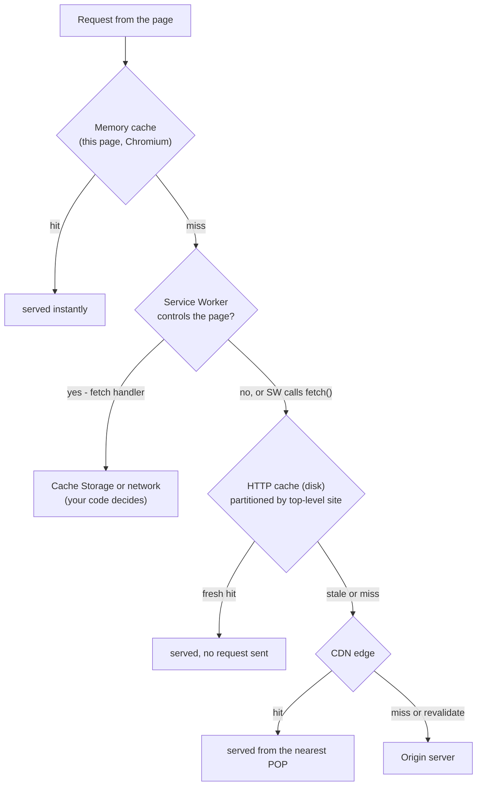
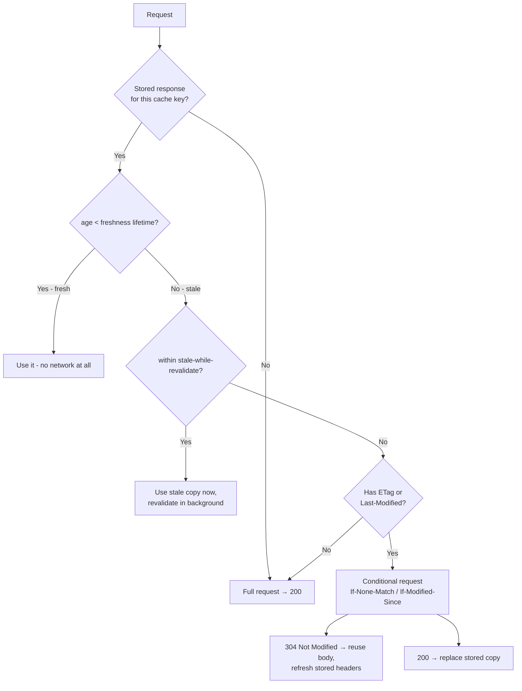
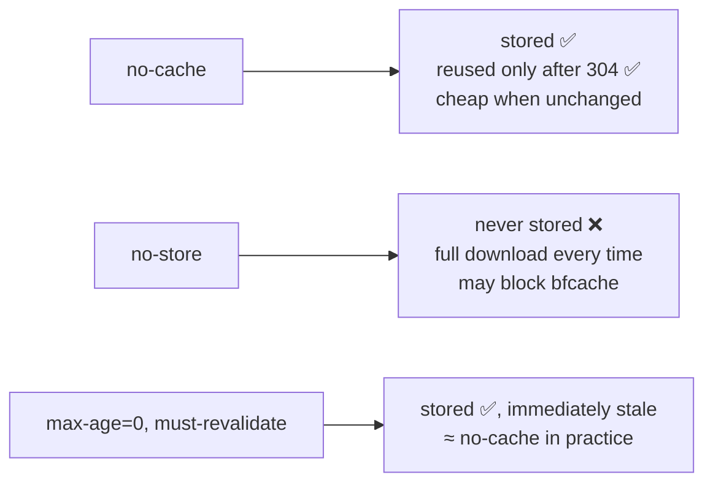
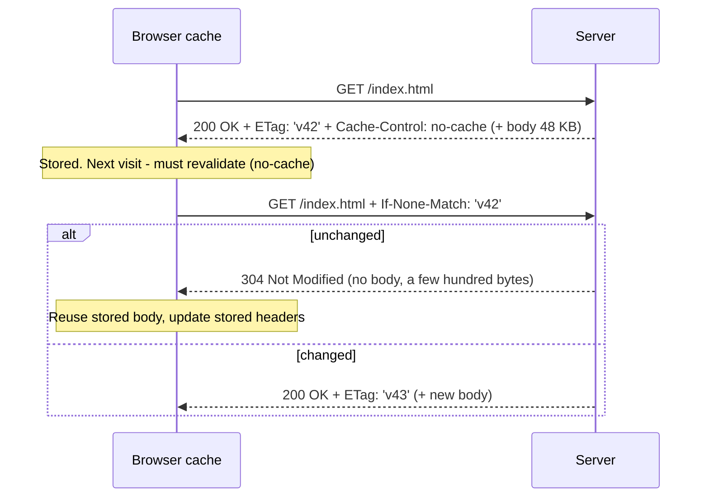
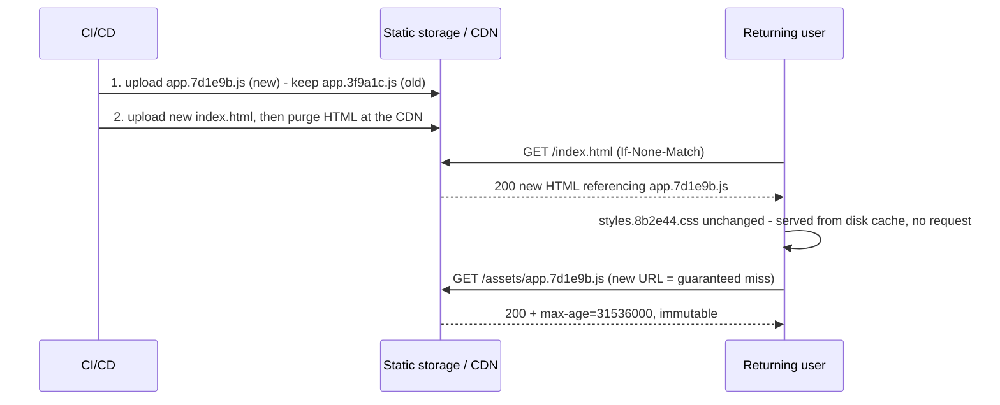
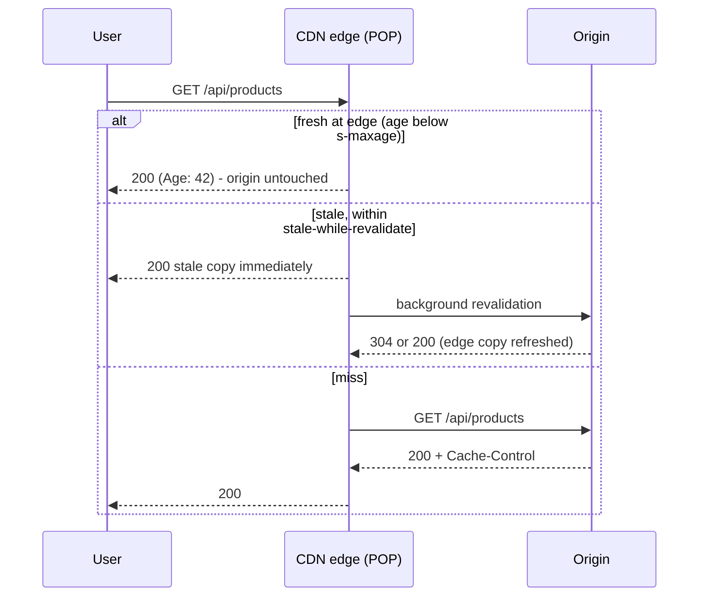
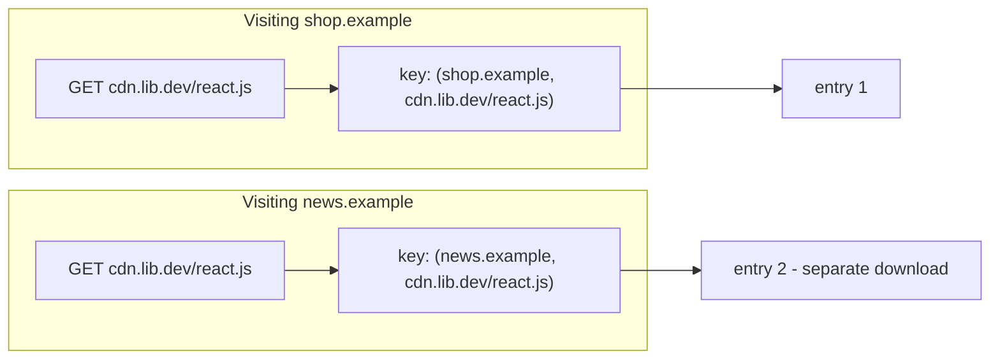
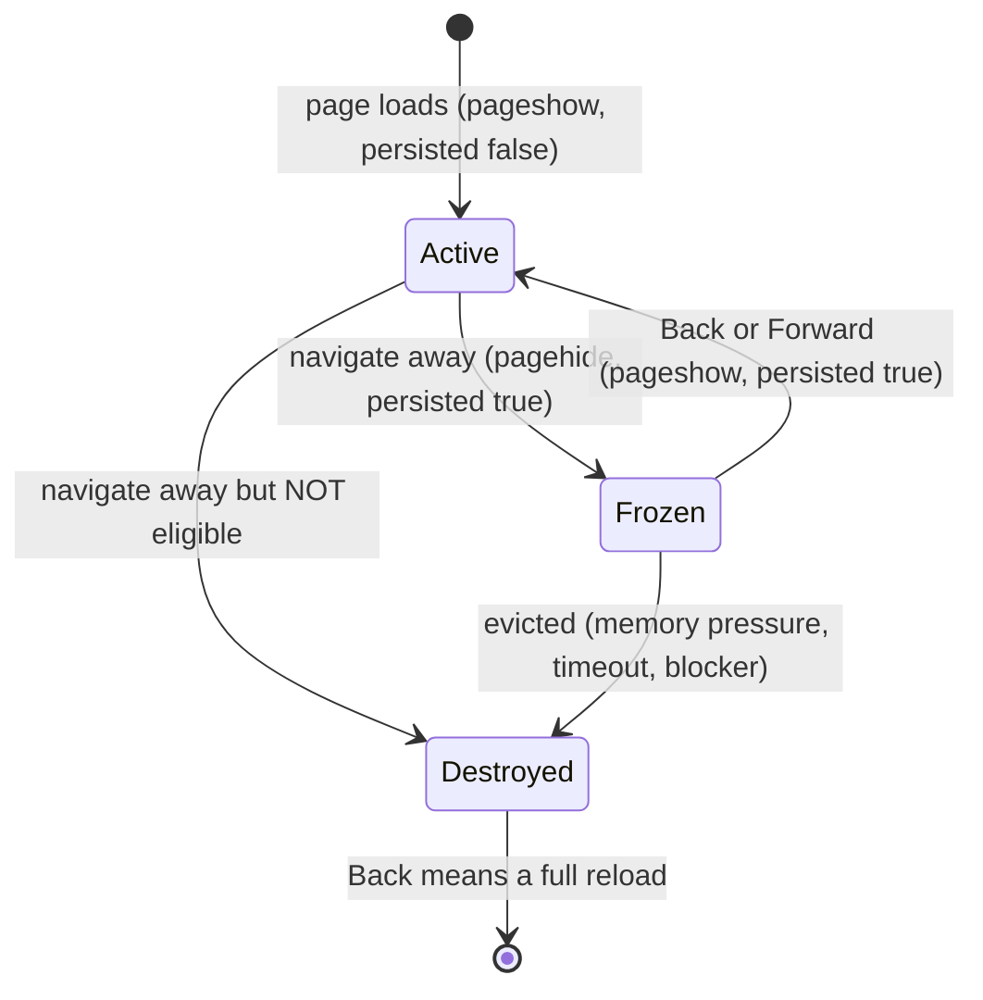
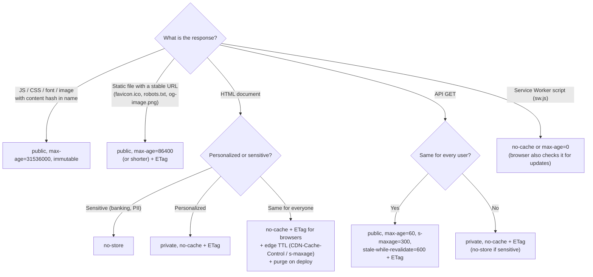

<!-- Generated by scripts/sync-knowledge.js from notes/ and README.md — do not edit here. -->
<!-- sections (line ranges in this file): Table of Contents 19-43 · ELI5 44-57 · Core Concept 58-460 · Header Decision Flowchart by Asset Type 461-496 · Real-World Examples 497-645 · Key Points Summary 646-667 · Test Your Understanding 668-737 · Cheat Sheet 738-788 · References & Further Reading 789-827 -->

# Browser Caching Strategies

> **Date:** 2026-11-06 · **Last updated:** 2026-11-06
> **Category:** Frontend System Design
> **Sub-Topic:** Caching / HTTP
> **Level:** Intermediate · **Reading time:** ~24 min
> **Informs:** HTTP caching headers, asset versioning, CDN/edge cache policy, bfcache, repeat-visit performance

> **Pre-requisite:** Read [How Browsers Work](./how-browsers-work.md) and [Browser Storage Mechanisms](./browser-storage-mechanisms.md) (Cache API) first.
> This note covers **HTTP caching** end to end — browser, Service Worker, CDN and the back/forward cache.

**Previous:** [Web APIs (Intersection Observer, ResizeObserver)](./web-apis-intersection-observer-resizeobserver.md) · **Next:** [Client-Side Rendering (CSR)](./client-side-rendering-csr.md)

---

## Table of Contents

1. [ELI5 — Simple Explanation](#eli5--simple-explanation)
2. [Section 1: The Cache Layers](#section-1-the-cache-layers)
3. [Section 2: Freshness vs Validation](#section-2-freshness-vs-validation)
4. [Section 3: Cache-Control Directives](#section-3-cache-control-directives)
5. [Section 4: Validators — ETag and Last-Modified](#section-4-validators--etag-and-last-modified)
6. [Section 5: Heuristic Freshness](#section-5-heuristic-freshness)
7. [Section 6: Vary and the Cache Key](#section-6-vary-and-the-cache-key)
8. [Section 7: Cache Forever and Rename](#section-7-cache-forever-and-rename)
9. [Section 8: Caching HTML](#section-8-caching-html)
10. [Section 9: Caching API Responses](#section-9-caching-api-responses)
11. [Section 10: CDN and Edge Caching](#section-10-cdn-and-edge-caching)
12. [Section 11: Cache Partitioning](#section-11-cache-partitioning)
13. [Section 12: Back/Forward Cache (bfcache)](#section-12-backforward-cache-bfcache)
14. [Section 13: Clearing Caches and Cache-Busting Mistakes](#section-13-clearing-caches-and-cache-busting-mistakes)
15. [Header Decision Flowchart by Asset Type](#header-decision-flowchart-by-asset-type)
16. [Real-World Examples](#real-world-examples)
17. [Key Points Summary](#key-points-summary)
18. [Test Your Understanding (with answers)](#test-your-understanding)
19. [Cheat Sheet](#cheat-sheet)
20. [References & Further Reading](#references--further-reading)

---

## ELI5 — Simple Explanation

Think of groceries:
- **Memory cache** = food already on the counter — instant, but cleared when you leave the kitchen (the page).
- **HTTP (disk) cache** = the fridge — every item has a **"best before" label** (`max-age`). Before the date, eat it without asking anyone.
- **Revalidation** = the label expired, so you phone the shop: *"Is version `abc` still current?"* — *"Yes, keep it"* (**304**, nothing to carry home) or *"No, here's the new one"* (**200**).
- **CDN** = a supermarket branch near your house — it keeps copies so nobody drives to the factory (origin).
- **Content-hashed filenames** = when the recipe changes, the product gets a **new name** on the shelf, so nobody confuses old and new — the old one can sit in the fridge forever.
- **bfcache** = pausing a movie and resuming exactly where you left off when you press Back.

> **Cache aggressively what never changes (and rename it when it does); revalidate what can change; never store what must stay private.**

---

## Core Concept — Step by Step

### Section 1: The Cache Layers

A single `<script src="/assets/app-3f9a1c.js">` can be answered by several caches before reaching your server:



| Layer | Stores | Scope / lifetime | You control it with | Chrome DevTools label |
|---|---|---|---|---|
| **Memory cache** | Resources already used by the current page (e.g. same image twice, preloads) | The page; gone on navigation. An implementation detail, not part of HTTP | Mostly nothing | `(memory cache)` |
| **Preload cache** | `<link rel="preload">` responses waiting for their real request | The document | Matching `as`, `crossorigin` and URL — a mismatch means a second download | — |
| **Service Worker Cache Storage** | Request/Response pairs your code puts there | Origin; until you delete it or the browser evicts the origin | Your SW code (see [Service Workers & Web Workers](./service-workers-and-web-workers.md)) | `(ServiceWorker)` |
| **HTTP cache** | Responses allowed by `Cache-Control` | Persistent, size-limited, LRU-evicted, **partitioned** (Section 11) | `Cache-Control`, `ETag`, `Last-Modified`, `Vary` | `(disk cache)` |
| **CDN / edge** | Shared copies for all users near a POP | Until expiry, eviction or purge | `s-maxage`, `CDN-Cache-Control`, purge APIs | Vendor headers + `Age` |
| **bfcache** | The **whole live page** (DOM + JS heap) | One history entry, short-lived, in memory | Eligibility rules (Section 12) | Application → Back/forward cache |

> **Not a cache any more:** the HTTP/2 Server Push cache. Chrome and Firefox have removed Server Push; use `103 Early Hints` + `preload` instead.

The browser's HTTP cache and the Service Worker's Cache Storage are **different things**: one is automatic and header-driven, the other is programmatic. A `fetch()` made *from inside* a Service Worker still goes through the HTTP cache.

---

### Section 2: Freshness vs Validation

Every stored response is either **fresh** (use it with zero network) or **stale** (ask the server before using it). That is the entire model of [RFC 9111](https://www.rfc-editor.org/rfc/rfc9111).



**Freshness lifetime** comes from the first of these that is present:

```text
shared caches (CDN):  s-maxage  →  max-age  →  Expires − Date  →  heuristic
private (browser):    max-age   →  Expires − Date  →  heuristic
age = how long since the origin generated the response (includes the Age header from upstream caches)
```

**What the user does matters too** (modern Chromium and Firefox, simplified):

| Action | What the cache does |
|---|---|
| Click a link / type a URL | Fresh entries are used without a request; stale ones are revalidated |
| Back / Forward | bfcache first; otherwise browsers prefer the stored copy, even if stale (but not `no-store`) |
| Reload (F5) | Main document is revalidated. Chrome reuses fresh subresources; Firefox has historically revalidated them unless marked `immutable` |
| Hard reload (Ctrl/Cmd+Shift+R) | Bypasses the cache — requests go out with `Cache-Control: no-cache` |

---

### Section 3: Cache-Control Directives

```http
Cache-Control: public, max-age=31536000, immutable
```

**Response directives:**

| Directive | Meaning | Typical use |
|---|---|---|
| `max-age=N` | Fresh for N seconds after the response was generated | Any cacheable resource |
| `s-maxage=N` | Like `max-age` but **only for shared caches** (CDN/proxy); overrides `max-age` there | HTML/API cached at the edge but revalidated by browsers |
| `no-cache` | **May** be stored, but must be **revalidated before every use** | HTML, per-user data with ETags |
| `no-store` | **Must not** be stored anywhere | Banking pages, PII, one-time tokens |
| `private` | Only the user's browser may store it — not CDNs | Personalized pages and API responses |
| `public` | Shared caches may store it, even for requests with `Authorization` | Public assets behind auth headers (rarely needed otherwise) |
| `must-revalidate` | Once stale, never serve it without a successful revalidation (error → 504 instead of stale content) | Data where stale = wrong |
| `immutable` | Won't change while fresh — skip revalidation even on reload ([RFC 8246](https://www.rfc-editor.org/rfc/rfc8246)) | Content-hashed assets |
| `stale-while-revalidate=N` | After expiry, may serve stale for N more seconds while revalidating in the background ([RFC 5861](https://www.rfc-editor.org/rfc/rfc5861)) | Feeds, listings, avatars |
| `stale-if-error=N` | May serve stale for N seconds if the origin errors (RFC 5861) | Resilience at the CDN |

**Support notes (verify before relying on them):**
- `immutable` is honored by Firefox and Safari. Chrome doesn't implement it, but since Chrome doesn't revalidate fresh subresources on a normal reload, the outcome is similar.
- `stale-while-revalidate` is implemented in Chromium (75+), Firefox (68+) and Safari (14+), and by most CDNs.
- `stale-if-error` is mainly honored by **CDNs**; don't count on browsers for it.

**`no-cache` vs `no-store` vs `max-age=0`:**



**Legacy headers:** `Expires` (an absolute date, ignored when `max-age` is present) and `Pragma: no-cache` (an HTTP/1.0 request header). Prefer `Cache-Control`.

**Request directives** exist too (`Cache-Control: no-cache` on hard reload, `max-age=0`, `only-if-cached`) — from JS you set them through `fetch()`'s `cache` option (Section 9).

---

### Section 4: Validators — ETag and Last-Modified

Validators make **stale** cheap: instead of re-downloading, the browser asks "has it changed?" and usually gets a tiny **304**.



| Validator | Response header | Request header | Notes |
|---|---|---|---|
| **Entity tag** | `ETag: "v42"` (strong) or `ETag: W/"v42"` (weak) | `If-None-Match` | Preferred. Weak = semantically equivalent, not byte-identical |
| **Date** | `Last-Modified: Tue, 03 Nov 2026 10:00:00 GMT` | `If-Modified-Since` | 1-second granularity; `If-None-Match` wins if both are sent |

**Gotchas:**
- **ETags must be identical across servers.** ETags derived from per-machine details (inode, mtime that differs per deploy box) make every load-balanced request a cache miss. Derive them from content (hash) or a version.
- **A 304 is still a round trip.** It saves bytes, not latency — which is why hashed assets use `max-age` + `immutable` instead of relying on revalidation.
- **A 304 can update freshness**: the cache merges the 304's headers (e.g. a new `Cache-Control`) into the stored response.

---

### Section 5: Heuristic Freshness

If a response has **no** `Cache-Control: max-age` and no `Expires`, caches may still treat it as fresh for a **heuristic** period. RFC 9111 suggests a typical value of **10% of the time since `Last-Modified`**.

```text
Last-Modified: 30 days ago,  no Cache-Control
→ heuristic freshness ≈ 3 days
→ you deploy a fix to /app.js (same URL)
→ some users run the OLD app.js for up to ~3 days without the browser asking your server
```

Heuristic caching applies only to statuses that are "heuristically cacheable" — including **200, 301, 308, 404 and 410**. Two real consequences:
- A file served with no `Cache-Control` behaves unpredictably across browsers and CDNs.
- A `301`/`308` permanent redirect can stay cached in browsers for a very long time and is hard to undo. Use `302`/`307` while you're unsure.

> **Rule:** every response your app serves should carry an explicit `Cache-Control`.

---

### Section 6: Vary and the Cache Key

A cache looks up responses by a **cache key**: at minimum the method + URL (and in browsers, the partition key from Section 11). `Vary` adds **request headers** to the key — "this response is only valid for requests with the same value of these headers".

```http
Vary: Accept-Encoding
```

| `Vary` value | Verdict | Why |
|---|---|---|
| `Accept-Encoding` | ✅ Standard | Brotli/gzip/identity bodies differ for the same URL |
| `Origin` | ✅ Required when `Access-Control-Allow-Origin` is echoed dynamically | Otherwise a response for origin A is replayed to origin B → CORS error |
| `Accept` | ⚠️ OK for format negotiation (AVIF/WebP at one URL), but many `Accept` variants hurt hit rate | Normalize at the CDN |
| `Cookie` | ❌ Usually bad | Nearly every user has unique cookies → effectively uncacheable at shared caches |
| `User-Agent` | ❌ Bad | Thousands of UA strings → hit ratio collapses |
| `*` | ❌ | Can never be matched without revalidation |

> Browsers implement `Vary` in their HTTP cache, but some keep only one stored variant per URL — a header that flips between requests causes repeated misses. CDNs often let you define the cache key explicitly instead (normalize headers, strip `utm_*` query params).

---

### Section 7: Cache Forever and Rename

The single most important asset strategy:

```text
1. Put a CONTENT HASH in the filename:      app.3f9a1c.js, styles.8b2e44.css, logo.91cd02.svg
2. Serve those files with:                  Cache-Control: public, max-age=31536000, immutable
3. Serve the HTML that references them with: Cache-Control: no-cache   (+ ETag)
4. Changed code → new hash → new URL → the HTML points to it → browsers fetch only what changed
```



**Why content hashes beat every alternative:**

| Approach | Problem |
|---|---|
| Same URL + long `max-age` | Users keep the old file until it expires — you can't push a fix |
| Same URL + `no-cache` everywhere | Every asset costs a revalidation round trip on every visit |
| `?v=2` query string bumped by hand | Easy to forget; some proxies/CDNs ignore or strip query strings in the cache key |
| Build **timestamp** or release number in names | Every deploy invalidates **every** file, even unchanged ones |
| **Content hash in the filename** ✅ | URL changes if and only if the bytes change |

**Deploy rules that prevent "white screen after deploy":**
- **Upload assets before HTML**, and **keep old hashed assets** for a while (days or weeks). Users with an open tab still have the old HTML and will lazy-load old chunks; deleting them causes `ChunkLoadError` / failed dynamic imports.
- Handle a failed lazy import by reloading once (see Example 4).
- Be aware of **hash cascades**: when a shared chunk's hash changes, every chunk whose code embeds that URL changes too. Modern bundlers keep this contained; import maps can decouple it further.

---

### Section 8: Caching HTML

HTML is the **entry point** that names every other URL, so it must never be stale for long. Remember: **you can purge a CDN, but you cannot purge users' browser caches.**

| Strategy | Headers | Trade-off |
|---|---|---|
| **A. Always revalidate** (default choice) | `Cache-Control: no-cache` + `ETag` | Every navigation costs a round trip, but unchanged pages return a tiny 304 |
| **B. Edge-cached, browser-revalidated** | `Cache-Control: no-cache` for browsers + `CDN-Cache-Control: max-age=300, stale-while-revalidate=60` (or `s-maxage`) + purge on deploy | Fast TTFB from the edge; needs reliable purging |
| **C. Short browser TTL** | `Cache-Control: max-age=60` | OK for content pages that tolerate a minute of staleness; a bad deploy lingers for that minute |
| **Personalized HTML** | `Cache-Control: private, no-cache` | Never stored by CDNs; browser revalidates |
| **Sensitive HTML** (account, banking) | `Cache-Control: no-store` | Nothing written to disk; typically excluded from bfcache |

```text
❌ Cache-Control: max-age=86400 on index.html
   → after a deploy, users keep yesterday's HTML (pointing to old asset hashes) for up to a day,
     and there is no way to reach into their browsers to fix it.
```

---

### Section 9: Caching API Responses

| Endpoint type | Headers | Why |
|---|---|---|
| Public, read-heavy (`GET /api/products?page=1`) | `public, max-age=60, s-maxage=300, stale-while-revalidate=600` + `ETag` | CDN absorbs traffic; browsers reuse for a minute |
| Per-user (`GET /api/me`, cart) | `private, no-cache` + `ETag` | Never stored by shared caches; 304s keep it cheap |
| Sensitive (payments, tokens, PII) | `no-store` | No copy on disk anywhere |
| Mutations (`POST`/`PUT`/`PATCH`/`DELETE`) | (not cached) | A successful unsafe request **invalidates** the cache's stored responses for that URL (RFC 9111 §4.4) |

**`fetch()` cache modes** — per-request control over the HTTP cache:

| `cache:` | Behavior |
|---|---|
| `'default'` | Normal HTTP caching rules |
| `'no-store'` | Bypass the cache entirely, don't store the response |
| `'reload'` | Always go to the network, then update the cache |
| `'no-cache'` | Always revalidate (conditional request) before using a stored response |
| `'force-cache'` | Use any stored response, even stale; network only on a miss |
| `'only-if-cached'` | Stored response or a network error — requires `mode: 'same-origin'` |

**Two layers, two jobs:** the HTTP cache stores **bytes per URL**. App-level caches (TanStack Query, SWR, Apollo, RTK Query) store **parsed data + UI state** with their own `staleTime`. Don't stack long TTLs in both — a 60 s HTTP `max-age` under a 60 s `staleTime` can show data ~2 minutes old. A common pattern: `private, no-cache` + `ETag` on the API, freshness policy in the app cache.

> **GraphQL over POST** isn't cacheable by HTTP caches. If you need CDN caching, use persisted queries sent as `GET`.

---

### Section 10: CDN and Edge Caching



Key tools:
- **`s-maxage`** — edge TTL separate from browser TTL.
- **`CDN-Cache-Control`** ([RFC 9213](https://www.rfc-editor.org/rfc/rfc9213)) — a header aimed **only** at CDNs, supported by several major CDNs; some also accept vendor variants (e.g. `Surrogate-Control`). Lets you say "edge: 5 minutes, browser: always revalidate" cleanly.
- **Purge / tag-based invalidation** — vendor APIs to evict URLs or tagged groups on deploy or content change.
- **Cache-key hygiene** — strip tracking parameters, normalize `Accept-Encoding`, never key on cookies.
- **`Age` response header** — how long the response sat in shared caches; useful when debugging.
- **Never cache personalized responses at the edge** — a response with `Set-Cookie` or user data cached under a shared key leaks one user's data to others. Use `private`, and check your CDN's defaults.

---

### Section 11: Cache Partitioning

Browsers now **partition** the HTTP cache: the cache key includes the **top-level site** (Chrome also adds the requesting frame's site), not just the resource URL. Safari partitioned first; Chrome shipped it in Chrome 86 and Firefox in Firefox 85 (as part of network partitioning).



**Why:** an unpartitioned cache lets any site probe "is this URL already cached?" via timing, leaking browsing history.

**Consequences for design:**
- **Public CDN libraries no longer give a cross-site cache hit.** The old argument "load jQuery from a shared CDN, users already have it" is gone — and the third-party origin costs an extra DNS + TCP + TLS connection. **Self-host** and bundle your dependencies.
- An embedded iframe (widget, payment form) gets a **separate cache per embedding site**.
- First-party repeat visits are unaffected — caching your own assets well matters as much as ever.

---

### Section 12: Back/Forward Cache (bfcache)

The bfcache keeps the **entire page in memory** — DOM, JS heap, scroll position — when you navigate away, and restores it instantly on Back/Forward. No HTTP request, no parsing, no JS re-execution. It's separate from the HTTP cache.



**Common reasons a page is not eligible** (rules differ by browser and change over time):
- An **`unload`** event listener (blocks bfcache in several browsers, including desktop Chrome and Firefox; Chrome is deprecating `unload`). Use `pagehide` instead.
- **`Cache-Control: no-store`** on the document — historically excluded; Chrome has been experimenting with allowing some such pages when safe. Don't add `no-store` to HTML "just in case".
- **Open connections** at navigation time (e.g. WebSocket, WebRTC) — close them on `pagehide`, reopen on `pageshow`.
- Plenty of others — test in Chrome DevTools (**Application → Back/forward cache → Test**) and read `PerformanceNavigationTiming.notRestoredReasons` in the field (Chromium).

```javascript
window.addEventListener('pageshow', (event) => {
  if (event.persisted) {
    // Restored from bfcache: JS state is as you left it, but data may be stale
    refreshCartBadge();
    reconnectLiveUpdates();
    analytics.trackPageView({ restoredFromBfcache: true }); // no new page load happened
  }
});

window.addEventListener('pagehide', (event) => {
  closeLiveUpdates();          // don't block bfcache with an open socket
  flushAnalyticsBeacon();      // reliable "end of page" signal (unlike unload)
});
```

> bfcache restores are **not** visible to a normal page-load analytics snippet. Count `pageshow` with `persisted: true` or your page views and Web Vitals will be under-reported.

---

### Section 13: Clearing Caches and Cache-Busting Mistakes

**`Clear-Site-Data`** — a response header that tells the browser to wipe data for the **origin** (HTTPS only):

```http
HTTP/1.1 200 OK
Clear-Site-Data: "cache", "cookies", "storage"
```

| Directive | Clears |
|---|---|
| `"cache"` | HTTP cache for the origin (and, in some browsers, related caches like bfcache entries) |
| `"cookies"` | Cookies for the origin's registrable domain (including subdomains) |
| `"storage"` | localStorage, sessionStorage, IndexedDB, Cache Storage, Service Worker registrations |
| `"executionContexts"` | Reloads open documents of the origin (patchy support) |
| `"*"` | Everything above |

Use it on **logout** (especially on shared computers) or to recover from a broken Service Worker deploy. Support for individual directives differs across browsers — check MDN before depending on one, and remember it only reaches users who **make a request** that returns it.

**Cache-busting mistakes seen in production:**

```text
❌ Long max-age on unhashed URLs (/app.js, /logo.png)    → users stuck on old files with no way to update
❌ max-age on index.html                                  → stale HTML pointing at old/removed chunks
❌ Deleting old hashed assets on deploy                   → ChunkLoadError for users with open tabs
❌ Date.now() in URLs / ?nocache=123                      → disables caching entirely
❌ Cache-Control: no-store on everything "to be safe"     → slow repeat visits, no bfcache
❌ Forgetting the Service Worker                          → SW serves old precached HTML after you fixed the headers
❌ Missing Vary: Origin with dynamic CORS                 → intermittent CORS errors behind a CDN
❌ Caching responses with Set-Cookie / user data at CDN   → data leak between users
```

---

## Header Decision Flowchart by Asset Type



<details>
<summary>Same decision tree as plain-text</summary>

```text
Hashed static asset (app.3f9a1c.js)    → public, max-age=31536000, immutable
Stable-URL static file (favicon.ico)   → public, max-age=86400 (or less) + ETag
HTML, public                           → no-cache + ETag (browser); edge TTL + purge on deploy
HTML, personalized                     → private, no-cache + ETag
HTML / API, sensitive                  → no-store
API GET, same for all users            → public, max-age=60, s-maxage=300, stale-while-revalidate=600 + ETag
API GET, per user                      → private, no-cache + ETag
Mutations (POST/PUT/PATCH/DELETE)      → not cached; they invalidate the URL's cached entry
sw.js                                  → no-cache (updateViaCache default already bypasses HTTP cache for it)
```

</details>

---

## Real-World Examples

**Example 1 — nginx for a Vite/React SPA:**
```nginx
server {
    listen 443 ssl;
    http2 on;
    server_name app.example.com;
    root /var/www/app/dist;
    etag on;

    # Hashed build output (Vite emits dist/assets/[name]-[hash].js)
    location /assets/ {
        add_header Cache-Control "public, max-age=31536000, immutable" always;
        try_files $uri =404;              # never fall back to index.html for a missing chunk
    }

    # Service worker: always revalidate
    location = /sw.js {
        add_header Cache-Control "no-cache" always;
    }

    # HTML entry point (SPA fallback): always revalidate
    location / {
        add_header Cache-Control "no-cache" always;
        try_files $uri /index.html;
    }
}
```

> **nginx gotcha:** an `add_header` inside a `location` **replaces** all `add_header` directives inherited from the `server` block (including security headers). Repeat them in each location or use an included snippet.

**Example 2 — Express (Node.js) with per-type policies:**
```javascript
import express from 'express';

const app = express();
const ONE_YEAR = 31536000;

// Hashed assets: cache forever
app.use('/assets', express.static('dist/assets', {
  immutable: true,
  maxAge: ONE_YEAR * 1000,   // serve-static takes milliseconds
  fallthrough: false,        // 404 for missing chunks instead of serving HTML
}));

// Public API: short browser TTL, longer edge TTL, background refresh
app.get('/api/products', async (req, res) => {
  res.set('Cache-Control', 'public, max-age=60, s-maxage=300, stale-while-revalidate=600');
  res.json(await getProducts()); // Express adds a weak ETag and answers If-None-Match with 304
});

// Per-user API: never in shared caches
app.get('/api/me', requireAuth, (req, res) => {
  res.set('Cache-Control', 'private, no-cache');
  res.json(req.user);
});

// Logout: wipe client state for this origin
app.post('/logout', (req, res) => {
  res.set('Clear-Site-Data', '"cache", "cookies", "storage"');
  res.sendStatus(204);
});

// HTML for everything else (final middleware = SPA fallback; works in Express 4 and 5)
app.use((req, res) => {
  res.set('Cache-Control', 'no-cache');
  res.sendFile('index.html', { root: 'dist' });
});

app.listen(3000);
```

**Example 3 — Content-hashed filenames in the bundler:**
```javascript
// vite.config.js — these are Vite's defaults, shown explicitly
export default {
  build: {
    rollupOptions: {
      output: {
        entryFileNames: 'assets/[name]-[hash].js',
        chunkFileNames: 'assets/[name]-[hash].js',
        assetFileNames: 'assets/[name]-[hash][extname]',
      },
    },
  },
};

// webpack.config.js — use contenthash (changes only when the file's bytes change)
module.exports = {
  output: {
    filename: '[name].[contenthash].js',
    chunkFilename: '[name].[contenthash].js',
  },
};
```

**Example 4 — Recovering from a stale-HTML chunk error (BAD → GOOD):**
```javascript
import { lazy } from 'react';

// ❌ BAD: a failed lazy import after a deploy leaves a blank screen
const Settings = lazy(() => import('./Settings'));

// ✅ GOOD: reload once to pick up the new HTML (guard against reload loops)
function lazyWithReload(factory) {
  return lazy(() =>
    factory().then((mod) => {
      sessionStorage.removeItem('chunk-reloaded'); // success: re-arm for the next deploy
      return mod;
    }).catch((err) => {
      if (!sessionStorage.getItem('chunk-reloaded')) {
        sessionStorage.setItem('chunk-reloaded', '1');
        location.reload();
        return new Promise(() => {}); // keep Suspense pending while reloading
      }
      throw err; // second failure: show the error boundary
    })
  );
}
const SettingsPage = lazyWithReload(() => import('./Settings'));

// Vite also dispatches an event when a preloaded dependency fails:
window.addEventListener('vite:preloadError', () => location.reload());
```

**Example 5 — Inspecting caching headers from the terminal:**
```bash
# First request: look at Cache-Control, ETag, Age and CDN hit headers
curl -sI https://app.example.com/ | grep -iE 'cache-control|etag|age|last-modified|vary'

# Revalidation: send the ETag back and expect 304
curl -sI https://app.example.com/ -H 'If-None-Match: "v42"' | head -1
# HTTP/2 304
```

**Example 6 — bfcache-friendly analytics (BAD → GOOD):**
```javascript
// ❌ BAD: unload is unreliable (often not fired on mobile) and blocks bfcache in several browsers
window.addEventListener('unload', () => navigator.sendBeacon('/end', payload()));

// ✅ GOOD: visibilitychange/pagehide fire reliably and keep the page bfcache-eligible
document.addEventListener('visibilitychange', () => {
  if (document.visibilityState === 'hidden') navigator.sendBeacon('/end', payload());
});
```

---

## Key Points Summary

| Concept | One-Line Explanation |
|---|---|
| **Fresh vs stale** | Fresh = reuse with no request; stale = revalidate first |
| **`max-age`** | Seconds a response stays fresh |
| **`s-maxage`** | Freshness for shared caches (CDN) only |
| **`no-cache`** | Store, but revalidate before every use |
| **`no-store`** | Never store — for sensitive data |
| **`private` / `public`** | Browser-only vs shared caches allowed |
| **`immutable`** | Never revalidate while fresh — for hashed assets |
| **`stale-while-revalidate`** | Serve stale now, refresh in the background |
| **ETag / 304** | Cheap revalidation: unchanged = no body |
| **Heuristic freshness** | No explicit TTL → caches guess (~10% of age since Last-Modified) |
| **Vary** | Adds request headers to the cache key |
| **Content hash in filename** | New bytes → new URL → cache forever safely |
| **Cache partitioning** | Cache keyed by top-level site → no cross-site shared-CDN hits |
| **bfcache** | Whole page frozen in memory for instant Back/Forward |
| **Clear-Site-Data** | Server tells the browser to wipe the origin's cache/cookies/storage |

---

## Test Your Understanding

**Q1 (Basic):**
What's the difference between `Cache-Control: no-cache` and `Cache-Control: no-store`? Which would you use for a news site's home page HTML, and which for a bank statement page?

<details>
<summary>Answer</summary>

`no-cache` lets the browser (and CDNs) **store** the response, but it must be **revalidated** with the server before each use — with an ETag that's usually a cheap 304. `no-store` forbids storing it at all, so every view downloads the full response and nothing is written to disk.

News home page: **`no-cache` + ETag** (always current, cheap when unchanged, bfcache-friendly), optionally with an edge TTL via `CDN-Cache-Control`/`s-maxage`. Bank statement: **`no-store`**, because the content is sensitive and shouldn't persist on a possibly shared device. (It also tends to exclude the page from bfcache, which is acceptable here.)
</details>

**Q2 (Application):**
Design the caching headers for a React SPA: `index.html`, `assets/app-3f9a1c.js`, `assets/vendor-91ab02.js`, `favicon.ico`, `GET /api/products`, `GET /api/me`. Explain each.

<details>
<summary>Answer</summary>

- `index.html` → `no-cache` + ETag. It names the current asset hashes, so it must be revalidated on every load; a long `max-age` would keep users on an old build with no way to fix it.
- `app-3f9a1c.js`, `vendor-91ab02.js` → `public, max-age=31536000, immutable`. The URL changes whenever the content changes, so a stored copy can never be wrong. Splitting vendor code keeps its hash stable across app deploys.
- `favicon.ico` → `public, max-age=86400` (or less) + ETag. The URL is fixed, so a moderate TTL limits how long an old icon sticks.
- `GET /api/products` → `public, max-age=60, s-maxage=300, stale-while-revalidate=600` + ETag. Same for everyone, so the CDN absorbs load, with brief browser reuse.
- `GET /api/me` → `private, no-cache` + ETag. Per-user data must never be stored in a shared cache. Revalidation keeps it correct and cheap.
</details>

**Q3 (Tricky):**
After a deploy, some users get a blank screen and `Failed to fetch dynamically imported module: /assets/Settings-a1b2c3.js`. Your headers are "correct" (HTML `no-cache`, assets immutable). What happened, and how do you fix it?

<details>
<summary>Answer</summary>

These users loaded the **old HTML and old main bundle before the deploy** and kept the tab open. When they navigate to Settings, the old code requests the **old chunk hash**, which the deploy deleted (or the server falls back to `index.html`, which isn't valid JS). Caching headers can't help because the old HTML is already running in memory.

Fixes: **keep old hashed assets** around for days or weeks (immutable object storage makes this easy), return a real 404 for missing assets rather than the SPA HTML, and **catch chunk-load failures** to reload once (Example 4) so the user picks up the new HTML. Some apps also poll a version endpoint and prompt "a new version is available".
</details>

**Q4 (Tricky):**
`/app.js` (no hash in the name) is served with only `Last-Modified` (60 days ago) and no `Cache-Control`. You ship a critical fix to `/app.js`. Some users keep running the old code for days. Why — nobody set any caching?

<details>
<summary>Answer</summary>

**Heuristic freshness.** Without `max-age`/`Expires`, caches may decide a freshness lifetime themselves; RFC 9111 suggests about **10% of the time since `Last-Modified`** — here ≈ 6 days. During that time browsers reuse their copy **without contacting the server**, so your fix isn't seen. Fix: always send an explicit `Cache-Control`, and for JS use content-hashed filenames with long-lived immutable caching, so a change produces a new URL. As an emergency measure you can only change the HTML that references the file (point it at a new URL) — you can't reach into users' caches.
</details>

**Q5 (Tricky):**
Your API echoes the request's `Origin` into `Access-Control-Allow-Origin` and is behind a CDN with `public, s-maxage=300`. Users on `admin.example.com` intermittently get CORS errors, but `www.example.com` works. Why?

<details>
<summary>Answer</summary>

The CDN caches by URL only. If the first request after expiry came from `www.example.com`, the cached response carries `Access-Control-Allow-Origin: https://www.example.com` and is then served to `admin.example.com`, whose browser rejects it. Which origin "wins" depends on who hit the edge first, so it looks random.

Fix: add **`Vary: Origin`** so each origin gets its own cache entry (or return a fixed value / `*` when credentials aren't involved, or configure the CDN to include `Origin` in its cache key).
</details>

**Q6 (Application):**
A PM asks to load React from a popular public CDN "because most users already have it cached from other sites." Is that still true? What do you recommend?

<details>
<summary>Answer</summary>

No. All major browsers **partition the HTTP cache by top-level site** (Safari first, Chrome since 86, Firefox since 85). A copy cached while visiting another site is stored under that site's key and **cannot** be reused on yours, so the first visit always downloads it. Meanwhile the third-party origin adds DNS + TCP + TLS setup and a dependency on someone else's uptime and integrity.

Recommend **self-hosting/bundling** dependencies with content hashes and `immutable` caching on your own origin/CDN. This gives repeat-visit caching, one connection, and control over versions and security.
</details>

---

## Cheat Sheet

**Key Definitions:**
- **Fresh / stale:** Whether a stored response can be used without contacting the server
- **Revalidation:** Conditional request (`If-None-Match` / `If-Modified-Since`) answered by 304 or 200
- **ETag:** Opaque version identifier for a response; strong or weak (`W/`)
- **Shared cache:** A cache serving many users (CDN, proxy) — controlled by `s-maxage`, `public`/`private`
- **Heuristic freshness:** Cache-chosen lifetime when no explicit one is given
- **Cache key:** URL (+ method, + `Vary` headers, + top-level site partition in browsers)
- **bfcache:** In-memory snapshot of a whole page for instant Back/Forward
- **Clear-Site-Data:** Response header that wipes an origin's cache, cookies and/or storage

**Quick Reference:**
```text
Hashed assets (JS/CSS/fonts/img)  → Cache-Control: public, max-age=31536000, immutable
Stable-URL static files           → Cache-Control: public, max-age=86400 + ETag
HTML                              → Cache-Control: no-cache + ETag   (edge: CDN-Cache-Control / s-maxage + purge)
Personalized HTML / API           → Cache-Control: private, no-cache + ETag
Public API GET                    → Cache-Control: public, max-age=60, s-maxage=300, stale-while-revalidate=600
Sensitive                         → Cache-Control: no-store
CORS with dynamic ACAO            → Vary: Origin
Compressed responses              → Vary: Accept-Encoding
sw.js                             → Cache-Control: no-cache
Logout                            → Clear-Site-Data: "cache", "cookies", "storage"

Lookup order: memory cache → Service Worker → HTTP cache → CDN → origin
Freshness:    s-maxage (shared) > max-age > Expires − Date > heuristic (~10% of age since Last-Modified)
Deploy:       upload new hashed assets → keep old ones → publish HTML → purge HTML at CDN
bfcache:      no unload listeners · pagehide/pageshow · avoid no-store on HTML unless sensitive
```

**Common Mistakes to Avoid:**

| Mistake | Why Wrong | Fix |
|---|---|---|
| Long `max-age` on `index.html` | Users keep stale HTML pointing at old assets; browser caches can't be purged | `no-cache` + ETag; cache at the edge with purge |
| Long `max-age` on unhashed URLs | No way to ship a fix until the TTL expires | Content hash in filenames + `immutable` |
| No `Cache-Control` at all | Heuristic caching → unpredictable staleness | Always set explicit `Cache-Control` |
| `no-store` everywhere "to be safe" | Full downloads every time, hurts bfcache | `no-cache` + ETag unless data is sensitive |
| `public`/`s-maxage` on per-user responses | CDN serves one user's data to another | `private, no-cache` |
| Missing `Vary: Origin` with dynamic CORS | Cached CORS header replayed to other origins | Add `Vary: Origin` |
| `Vary: User-Agent` or `Vary: Cookie` | Cache fragmentation, near-zero hit rate | Normalize / define the cache key at the CDN |
| Deleting old hashed assets on deploy | Open tabs fail to load lazy chunks | Keep old assets; reload once on chunk errors |
| Timestamp/release-number cache busting | Invalidates unchanged files every deploy | `[contenthash]` |
| Relying on a public shared CDN for libraries | Partitioned caches → no cross-site hits, extra connection | Self-host and bundle |
| `unload` handlers | Unreliable and blocks bfcache in several browsers | `pagehide` / `visibilitychange` |
| ETags that differ per server | Every request misses behind a load balancer | Content- or version-based ETags |
| Forgetting the Service Worker cache | Old precached files keep being served | Version SW caches, `no-cache` on `sw.js` |

---

## References & Further Reading

**Core docs**
- MDN: [HTTP caching](https://developer.mozilla.org/en-US/docs/Web/HTTP/Guides/Caching)
- MDN: [`Cache-Control`](https://developer.mozilla.org/en-US/docs/Web/HTTP/Reference/Headers/Cache-Control)
- MDN: [HTTP conditional requests](https://developer.mozilla.org/en-US/docs/Web/HTTP/Guides/Conditional_requests)
- MDN: [`ETag`](https://developer.mozilla.org/en-US/docs/Web/HTTP/Reference/Headers/ETag) · [`Vary`](https://developer.mozilla.org/en-US/docs/Web/HTTP/Reference/Headers/Vary) · [`Clear-Site-Data`](https://developer.mozilla.org/en-US/docs/Web/HTTP/Reference/Headers/Clear-Site-Data)
- MDN: [`Request.cache`](https://developer.mozilla.org/en-US/docs/Web/API/Request/cache)
- web.dev: [Prevent unnecessary network requests with the HTTP Cache](https://web.dev/articles/http-cache)
- web.dev: [Love your cache](https://web.dev/articles/love-your-cache)
- web.dev: [Keeping things fresh with stale-while-revalidate](https://web.dev/articles/stale-while-revalidate)

**bfcache & partitioning**
- web.dev: [Back/forward cache](https://web.dev/articles/bfcache)
- Chrome for Developers: [Back/forward cache `notRestoredReasons` API](https://developer.chrome.com/docs/web-platform/bfcache-notrestoredreasons)
- Chrome for Developers: [Deprecating the unload event](https://developer.chrome.com/docs/web-platform/deprecating-unload)
- Chrome for Developers: [Gaining security and privacy by partitioning the cache](https://developer.chrome.com/blog/http-cache-partitioning)

**Specs**
- IETF: [RFC 9111 — HTTP Caching](https://www.rfc-editor.org/rfc/rfc9111)
- IETF: [RFC 9110 — HTTP Semantics (conditional requests, status codes)](https://www.rfc-editor.org/rfc/rfc9110)
- IETF: [RFC 5861 — `stale-while-revalidate` / `stale-if-error`](https://www.rfc-editor.org/rfc/rfc5861) · [RFC 8246 — `immutable`](https://www.rfc-editor.org/rfc/rfc8246) · [RFC 9213 — Targeted Cache-Control (`CDN-Cache-Control`)](https://www.rfc-editor.org/rfc/rfc9213)
- WHATWG: [Fetch Standard — HTTP cache partitions](https://fetch.spec.whatwg.org/#http-cache-partitions)
- W3C: [Clear Site Data](https://w3c.github.io/webappsec-clear-site-data/)

**Deep dives**
- Jake Archibald: [Caching best practices & max-age gotchas](https://jakearchibald.com/2016/caching-best-practices/)
- Yoav Weiss: [A Tale of Four Caches](https://calendar.perfplanet.com/2016/a-tale-of-four-caches/) (pre-dates partitioning and the removal of HTTP/2 push)
- Vite: [Load error handling (`vite:preloadError`)](https://vite.dev/guide/build.html#load-error-handling)

---

> **Previous Topic:** [Web APIs (Intersection Observer, ResizeObserver)](./web-apis-intersection-observer-resizeobserver.md)
> — Observing visibility, size, DOM and performance changes without polling

> **Next Topic:** [Client-Side Rendering (CSR)](./client-side-rendering-csr.md)
> — Phase 2 begins: rendering strategies, starting with rendering in the browser

*Saved on: 2026-11-06 | Repo: Frontend System Design Learning Notes*
