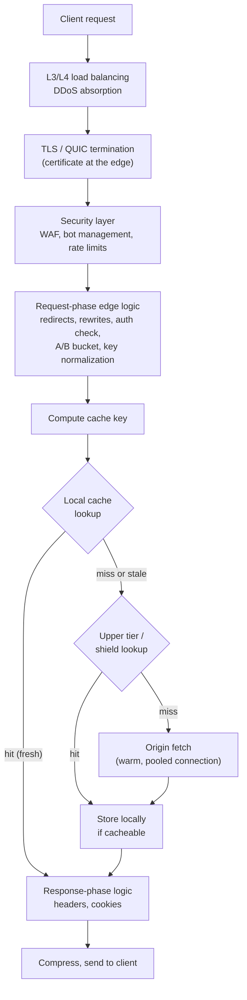
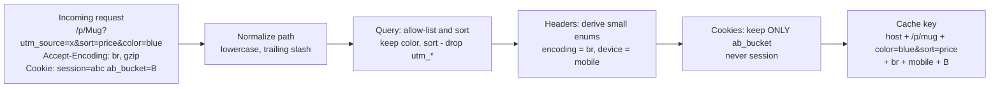
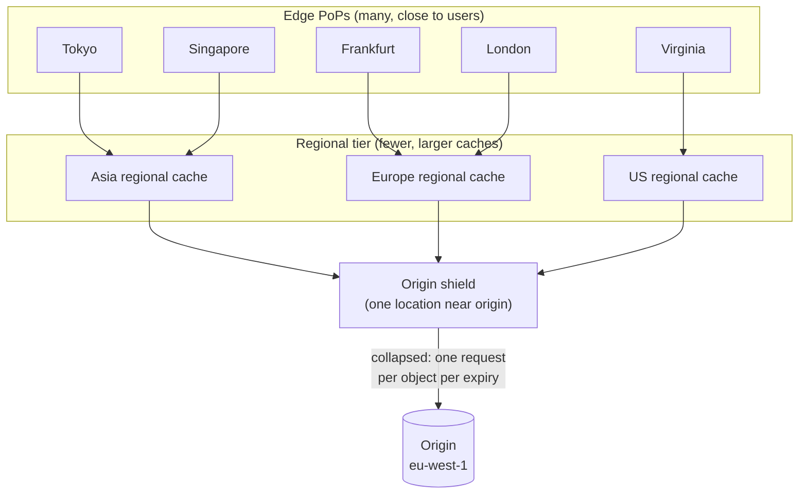
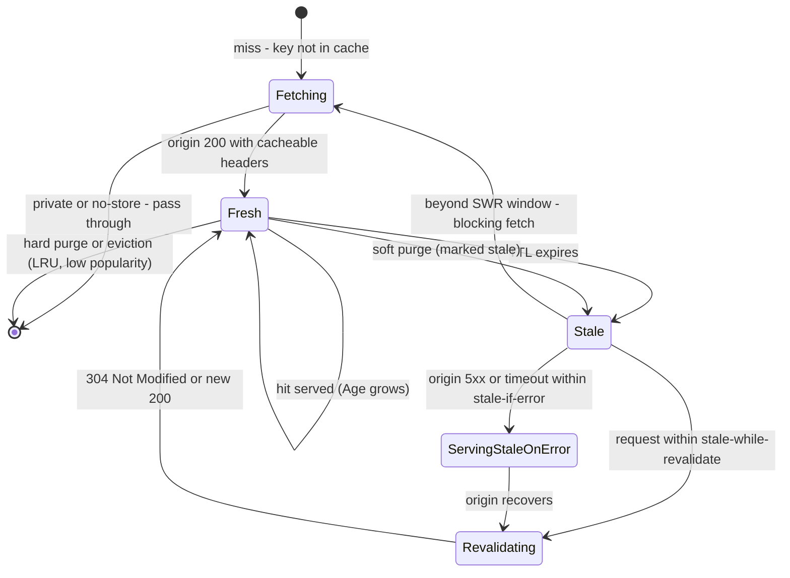
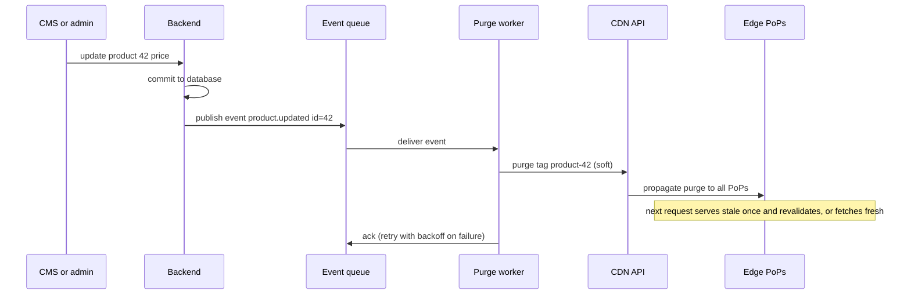
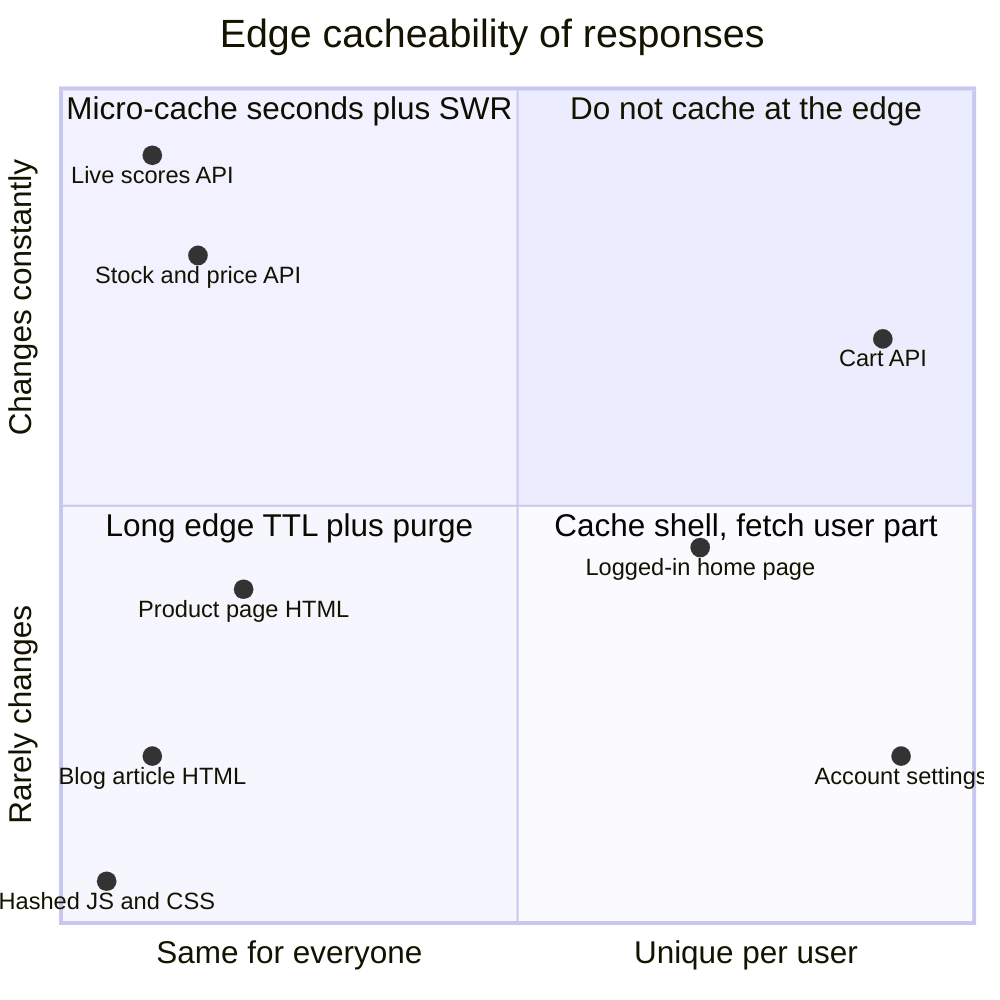
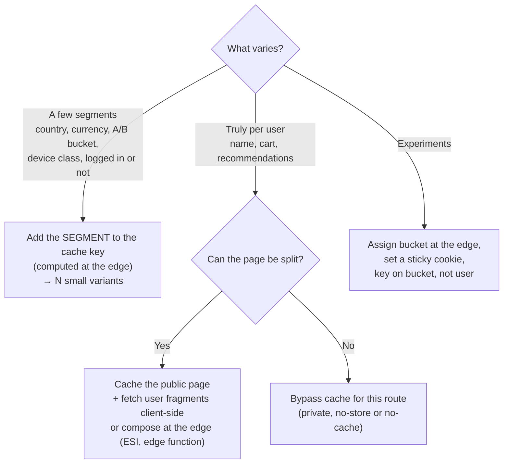
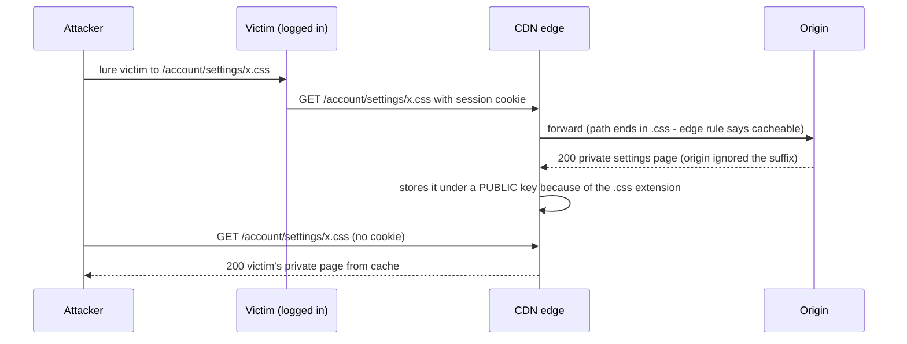
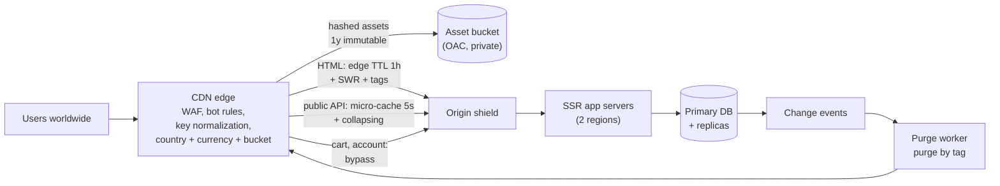

<!-- Generated by scripts/sync-knowledge.js from notes/ and README.md — do not edit here. -->
<!-- sections (line ranges in this file): Table of Contents 19-42 · ELI5 43-57 · Core Concept 58-447 · System Design Angle 448-480 · Framework and Platform Integration 481-495 · Real-World Examples 496-674 · Key Points Summary 675-699 · Test Your Understanding 700-786 · Cheat Sheet 787-841 · References & Further Reading 842-878 -->

# CDN Architecture & Edge Caching

> **Date:** 2026-11-06 · **Last updated:** 2026-11-06
> **Category:** Frontend System Design
> **Sub-Topic:** Advanced Topics / Delivery & Infrastructure
> **Level:** Advanced · **Reading time:** ~32 min
> **Informs:** CDN cache key design, edge vs browser TTL policy, tiered caching and origin shielding, purge and invalidation architecture (tags, soft purge, event-driven), caching HTML/SSR/API responses, personalization at the edge, edge compute placement and edge data consistency, origin protection and signed URLs, cache poisoning and deception defenses, CDN observability (Cache-Status, hit ratio)

> **Pre-requisite:** [DNS Resolution & CDN](./dns-resolution-and-cdn.md) (PoPs, anycast vs DNS routing, cache-key basics) and [Browser Caching Strategies](./browser-caching-strategies.md) (Cache-Control semantics).
> This note goes one level deeper: **how a CDN is put together inside, and how you design keys, TTLs, tiers, invalidation, edge logic and security so the edge serves as much as possible without ever serving the wrong thing.**

**Previous:** [Deployment & CI/CD for Frontend](./deployment-and-ci-cd-for-frontend.md) · **Next:** [Monorepo Tooling (Turborepo, Nx)](./monorepo-tooling-turborepo-nx.md)

---

## Table of Contents

1. [ELI5 — Simple Explanation](#eli5--simple-explanation)
2. [Section 1: Inside a PoP — the Request Pipeline](#section-1-inside-a-pop--the-request-pipeline)
3. [Section 2: Cache Key Design](#section-2-cache-key-design)
4. [Section 3: TTL Policy — Who Controls Freshness at the Edge](#section-3-ttl-policy--who-controls-freshness-at-the-edge)
5. [Section 4: Tiered Caching, Shielding and Request Collapsing](#section-4-tiered-caching-shielding-and-request-collapsing)
6. [Section 5: The Life of a Cached Object](#section-5-the-life-of-a-cached-object)
7. [Section 6: Invalidation Architecture](#section-6-invalidation-architecture)
8. [Section 7: Caching HTML, SSR and APIs](#section-7-caching-html-ssr-and-apis)
9. [Section 8: Personalization Without Killing the Hit Ratio](#section-8-personalization-without-killing-the-hit-ratio)
10. [Section 9: Edge Compute and Edge Data](#section-9-edge-compute-and-edge-data)
11. [Section 10: Security at the Edge](#section-10-security-at-the-edge)
12. [Section 11: Observability and Cost](#section-11-observability-and-cost)
13. [System Design Angle — A Global Storefront](#system-design-angle--a-global-storefront)
14. [Framework and Platform Integration](#framework-and-platform-integration)
15. [Real-World Examples](#real-world-examples)
16. [Key Points Summary](#key-points-summary)
17. [Test Your Understanding](#test-your-understanding)
18. [Cheat Sheet](#cheat-sheet)
19. [References & Further Reading](#references--further-reading)

---

## ELI5 — Simple Explanation

Picture a **chain of bakeries** supplied by one **central kitchen** (your origin).

- Every neighbourhood has a **small shop** (edge PoP). Most customers are served from the shop's shelves (a **cache hit**).
- If a shop runs out, it doesn't call the central kitchen directly — it calls the **regional warehouse** (tier/shield). Only if the warehouse is out too does anyone bother the kitchen. One phone call to the kitchen refills hundreds of shops.
- If **50 customers** ask for the same missing cake at once, the shop places **one order**, not 50 (**request collapsing**).
- Each cake has a **label**: what it is (the **cache key**), its **best-before time** (TTL), and **tags** like "contains strawberries". When the strawberry supplier recalls a batch, the chain removes **every product tagged "strawberries"** in one announcement (**purge by tag**).
- If the kitchen catches fire, shops keep selling yesterday's cakes for a while rather than closing (**stale-if-error**).
- The shop never puts a **named birthday cake** on the public shelf. If it did, the next customer would walk off with someone else's cake (**caching private data**).

> **The edge is a shared, distributed cache with programmable logic. Design the key so identical things match and different things never collide, decide freshness explicitly, invalidate by meaning (tags), and never let anything personal into a shared entry.**

---

## Core Concept — Step by Step

### Section 1: Inside a PoP — the Request Pipeline

A Point of Presence is more than a cache. A request passes through several layers, and **where your logic runs in that pipeline** decides what it can do.



| Stage | What you configure | Vendor names (examples) |
|---|---|---|
| **Security** | WAF rules, bot rules, rate limits | AWS WAF, Cloudflare WAF, Fastly Next-Gen WAF, Akamai App & API Protector |
| **Request-phase logic** | Rewrites, redirects, header normalization, auth checks | CloudFront Functions / Lambda@Edge (viewer request), Cloudflare Workers, Fastly Compute / VCL, Vercel/Netlify middleware |
| **Cache key** | Which parts of the request identify an object | CloudFront cache policy, Cloudflare Cache Rules / custom keys, Fastly VCL hash, Akamai cache ID |
| **Upper tiers** | Regional caches, shield location | CloudFront Regional Edge Caches + Origin Shield, Cloudflare Tiered Cache, Fastly shielding, Akamai tiered distribution |
| **Origin fetch** | Which headers/cookies are forwarded, timeouts, failover origins | CloudFront origin request policy and origin groups, Cloudflare origin rules, Fastly backends |
| **Response-phase logic** | Add security headers, strip internal headers | Response functions, Workers, VCL `deliver` |

> **Key architectural idea:** the **cache key** and **what is forwarded to origin** are separate decisions. CloudFront makes this explicit with a *cache policy* vs an *origin request policy*. Forwarding a header to origin **without** putting it in the key is how cache poisoning happens (Section 10) — do it only when the origin's output doesn't depend on that header.

---

### Section 2: Cache Key Design

The [DNS Resolution & CDN](./dns-resolution-and-cdn.md#section-9-cache-keys-and-cache-hit-ratio) note covers the basics. Here's the design discipline.

**The two failure modes of a cache key:**

| Key is too **wide** (includes things that don't change the response) | Key is too **narrow** (misses things that DO change the response) |
|---|---|
| Duplicate entries, low hit ratio, high origin load | **Wrong content served**: wrong language, wrong currency, another user's data, poisoned responses |
| A performance bug | A **correctness or security bug** |



**Rules:**
1. **Allow-list, don't deny-list,** query parameters for routes you cache. New tracking params appear all the time.
2. **Derive small enums at the edge** instead of keying on raw headers: `device=mobile|desktop` instead of `User-Agent`, `country=DE` instead of IP, `bucket=A|B` instead of a cookie string.
3. **Never key on (or cache with) session cookies or `Authorization`.** Personalized responses are `private` or bypass the cache.
4. **Everything the origin varies on must be in the key** — or the origin must stop varying on it.
5. Keep the number of variants per URL **small and bounded**. Unbounded variants (raw `Accept-Language`, arbitrary image widths) explode the cache.

**`Vary` at the edge:** CDNs handle `Vary` differently. Some honor arbitrary `Vary` headers, some only a few (like `Accept-Encoding`), and some treat unusual `Vary` values as uncacheable. Prefer an **explicit, normalized cache key configured at the CDN**, and keep `Vary` for browsers and other HTTP caches.

---

### Section 3: TTL Policy — Who Controls Freshness at the Edge

Several headers can set an object's lifetime, and there are **two audiences**: the edge (shared cache) and the browser (private cache).

```text
Precedence at a CDN that supports targeted headers (RFC 9213), most specific first:

  <Vendor>-CDN-Cache-Control   e.g. Cloudflare-CDN-Cache-Control, Vercel-CDN-Cache-Control
  CDN-Cache-Control            targeted at all CDNs that support it
  Surrogate-Control            older vendor convention (e.g. Fastly, Akamai variants) — check your vendor
  Cache-Control: s-maxage      any shared cache (CDNs AND corporate proxies)
  Cache-Control: max-age       everyone
  CDN dashboard / rule TTLs    may OVERRIDE origin headers — check min/max/default TTL settings

Browsers only read Cache-Control (and Expires). Targeted headers are usually stripped
or ignored before the response reaches the browser.
```

**Split TTLs are the core pattern:**

| Resource | Edge TTL | Browser TTL | Invalidation |
|---|---|---|---|
| Hashed assets | 1 year | 1 year, `immutable` | Never needed (new URL) |
| Public HTML / SSR pages | Minutes to hours + `stale-while-revalidate` | `no-cache` (or `max-age=0`) | **Purge** on deploy/content change — you can purge the edge but not browsers |
| Public API GET | Seconds (micro-cache) to minutes | 0 to short | Purge by tag or short TTL |
| Personalized | Not cached (`private`) | `no-cache` / `private` | — |
| Errors (`404`, `5xx`) | Short negative-cache TTL | Short or none | Expires quickly |

> **Why HTML gets a long edge TTL but `no-cache` in browsers:** the edge copy is under your control (purge API); the browser copy isn't. Long edge TTL + purge gives a high hit ratio **and** instant updates.

**The `Age` header and effective browser freshness:** when a CDN serves a cached response, it adds `Age: <seconds in cache>`. A browser computes freshness as `max-age − Age`. A response with `max-age=60` that sat in the edge for 50 s is fresh for only **10 s** in the browser.

**Negative caching:** CDNs often cache error responses (404, some 5xx) for a short default period, configurable per vendor. This protects the origin from floods of requests for missing URLs, but a long error TTL can keep a **fixed** page broken. Set error caching TTLs deliberately.

---

### Section 4: Tiered Caching, Shielding and Request Collapsing

Each PoP has its own cache. A global network of many PoPs means a newly popular URL can miss in **each** of them. Tiers turn many misses into one origin fetch.



| Mechanism | What it does | Trade-off |
|---|---|---|
| **Regional / upper tier** | Mid-level caches with more storage; edges ask them on a miss | Extra hop on a full miss |
| **Origin shield** | A single designated tier location that all misses funnel through | One more hop; choose the location **closest to the origin** |
| **Request collapsing (coalescing)** | Concurrent misses for the same key wait for **one** upstream fetch | A slow origin response delays all waiters; uncacheable responses must be detected so waiters aren't serialized |
| **Stale-while-revalidate at the edge** | Serve stale instantly, refresh once in the background | Briefly stale content |

**Cache stampede (thundering herd):** after a purge-all or a popular object's expiry, every PoP misses at once. Defenses, layered: shielding + collapsing + SWR + **soft purge** (mark stale instead of deleting) + avoid purge-all.

**Hit ratio by tier:** measure **edge hit ratio** (latency) and **origin offload** (load and cost) separately. Tiering raises origin offload more than edge hit ratio.

---

### Section 5: The Life of a Cached Object



Things to notice:
- **Eviction isn't under your control.** A TTL of one year is a *maximum*; unpopular objects get evicted earlier (LRU-like policies). Some vendors sell persistent storage tiers (e.g. Cloudflare Cache Reserve) to keep long-tail objects.
- **Revalidation is cheap** when the origin supports `ETag`/`Last-Modified`: the edge sends a conditional request and gets a body-less `304`.
- **Soft purge + SWR** means users almost never wait on the origin, even right after content changes.

---

### Section 6: Invalidation Architecture

The best invalidation is none: **content-hashed URLs** for every static asset. Everything else needs a plan.

| Strategy | Granularity | Support | Use for |
|---|---|---|---|
| **Short TTL + SWR** | Time-based | Universal | Content that tolerates seconds–minutes of staleness |
| **Purge by URL / path / prefix** | Exact URL or wildcard | Universal (CloudFront invalidations are path-based with wildcards) | Deploys (purge HTML), one-off fixes |
| **Purge by tag (surrogate key)** | Every response carrying a tag | Fastly `Surrogate-Key`, Cloudflare `Cache-Tag`, Akamai `Edge-Cache-Tag`; plan availability varies. CloudFront has no native tag purge at the time of writing | Content changes that affect many pages |
| **Soft purge** | URL or tag, marked stale not deleted | Fastly, some others | Avoiding stampedes, keeping stale-if-error |
| **Purge everything** | Whole zone | Universal | Emergencies only |

**Tagging design:** tag every cacheable response with the **entities it renders**.

```http
HTTP/1.1 200 OK
Cache-Control: public, max-age=0, must-revalidate
CDN-Cache-Control: max-age=86400, stale-while-revalidate=60, stale-if-error=86400
Surrogate-Key: page-product product-42 category-7 brand-acme
Cache-Tag: page-product,product-42,category-7,brand-acme
```

When product 42's price changes, purge `product-42`: the product page, category listings, search landing pages and recommendations that show it all refresh — without knowing their URLs.

**Event-driven invalidation:**



Design notes:
- **Purge after the database commit**, never before (or the edge may re-cache old data).
- If reads come from a **replica**, a purge can trigger a re-fetch that reads stale replica data and re-caches it. Delay the purge, purge twice, or read from the primary for revalidation.
- Purges propagate in **seconds**, not instantly everywhere, and APIs have **rate limits** — batch tags.
- Make purge workers **idempotent and retried**; a lost purge means stale content until TTL expiry, so keep a TTL ceiling as a safety net.
- Framework-level revalidation (Next.js `revalidateTag`/`revalidatePath`, Nuxt ISR/SWR route rules) does the same thing for the framework's own cache layer on platforms that integrate with it.

---

### Section 7: Caching HTML, SSR and APIs

"Dynamic" rarely means "uncacheable". Ask: **is this response the same for everyone who sends this key?**



| Response | Pattern |
|---|---|
| **SSG / ISR HTML** | Long edge TTL + purge or SWR; browser `no-cache` |
| **SSR HTML, same for everyone** | Edge TTL of seconds to minutes + SWR; purge by tag on content change |
| **SSR HTML with a little personalization** | Render the **public shell** cacheably; load the personal part client-side (`private` API) or with edge composition |
| **Public API GET** | Micro-cache (1–10 s) + collapsing absorbs bursts; tags for longer TTLs |
| **GraphQL** | `POST` isn't cached; use **persisted queries over `GET`** for cacheable operations |
| **Authenticated API** | Bypass the edge cache (still benefits from TLS termination near users and warm origin connections) |
| **Large files / video** | Range requests and segment caching (HLS/DASH segments are ideal immutable objects) |

**Never cache a response that sets a cookie** unless you are sure the cookie isn't user-specific. Many CDNs refuse to cache `Set-Cookie` responses by default. A single analytics or session cookie set on a public page can silently drop the hit ratio to zero.

---

### Section 8: Personalization Without Killing the Hit Ratio



| Technique | How | Watch out for |
|---|---|---|
| **Segment keys** | Edge computes `country`, `bucket`, `device`, `loggedIn` and adds them to the key | Keep segments few; document them as a contract with the origin |
| **Shell + client fetch** | Cached HTML, then `fetch('/api/me')` with `private` caching | Layout shift — reserve space ([Core Web Vitals](./core-web-vitals-lcp-inp-cls.md)) |
| **Edge composition** | Edge function or ESI stitches a cached page with a per-user fragment | Vendor-specific; adds edge compute cost |
| **Streaming SSR with a cached shell** | Static shell streamed immediately, personalized parts streamed later | Requires platform support (e.g. partial prerendering approaches) — check your framework |
| **Edge redirects by locale** | Redirect `/` → `/de/` at the edge | Let crawlers and users override; don't trap them ([SEO for SPAs](./seo-for-spas-and-dynamic-content.md)) |

---

### Section 9: Edge Compute and Edge Data

Edge compute runs your code inside PoPs. Runtimes differ a lot:

| Kind | Examples | Typical traits |
|---|---|---|
| **Lightweight request/response functions** | CloudFront Functions, Fastly VCL, Akamai EdgeWorkers (lightweight use) | Tiny, very fast, limited APIs; header rewrites, redirects, key normalization |
| **V8 isolate / Wasm platforms** | Cloudflare Workers, Fastly Compute (Wasm), Vercel Edge, Netlify Edge, Deno Deploy | Web-standard APIs (`fetch`, `Request`, `Response`, Web Crypto), fast cold starts, limited Node.js compatibility (improving, vendor-specific) |
| **Regional serverless at the edge** | Lambda@Edge | Full Node.js/Python runtime; runs in regional edge locations; slower start, more capable |

Check each platform's limits (CPU time, memory, bundle size, subrequests) in its docs; they differ and change.

**Edge data and consistency:**

| Store (examples) | Consistency model | Good for |
|---|---|---|
| **Edge KV** (Cloudflare Workers KV, Vercel Edge Config, Fastly KV Store) | Reads served locally; **writes propagate eventually** (seconds or more) | Config, feature flags, redirects, rarely-changing lookups |
| **Coordinated objects** (Cloudflare Durable Objects) | Strongly consistent per object, single location | Counters, rate limits, collaborative state |
| **Edge SQL / replicated DBs** (e.g. Cloudflare D1, Turso) | Primary + read replicas; writes go to the primary | Read-heavy data close to users |
| **Your regional database** | Strong | Anything transactional — but far from most PoPs |

> **The data-locality rule:** an edge function that makes three sequential calls to a database in one region is **slower** than rendering in that region. Put compute next to its data. See [Edge Rendering](./edge-rendering.md).

**Per-PoP caches in edge code:** in Cloudflare Workers, the Cache API (`caches.default`) stores responses **only in the local data center** and doesn't participate in tiered caching. Use `fetch` with cache settings (or platform caching rules) when you want the full tiered cache.

---

### Section 10: Security at the Edge

#### 10.1 What the edge protects

| Control | Purpose |
|---|---|
| **DDoS absorption** | Large networks spread volumetric attacks across PoPs |
| **WAF** | Block common injection and exploit patterns, virtual patching |
| **Bot management, rate limiting** | Credential stuffing, scraping, inventory hoarding |
| **TLS policy, HSTS, HTTP/3** | Modern transport near users |
| **Security headers** | Add CSP, HSTS, `X-Content-Type-Options` in response-phase logic ([Content Security Policy](./content-security-policy-csp.md)) |

#### 10.2 Origin protection — make the CDN the only way in

If attackers can reach the origin directly, they bypass the WAF, rate limits and caching.

- **Private object storage** with CDN-only access (e.g. CloudFront **Origin Access Control** for S3).
- **Allow-list** the CDN's origin-facing IP ranges at the firewall (vendors publish them; AWS offers a managed prefix list for CloudFront).
- **Authenticated origin pulls** (mutual TLS from CDN to origin) or a **secret header** the origin checks, rotated regularly.

#### 10.3 Private content at the edge

**Signed URLs / signed cookies** (CloudFront, Cloudflare, Fastly, Akamai token auth): the origin issues a URL or cookie with an expiry and signature; the edge verifies it **without calling the origin**. Ideal for paid video, downloads and user uploads.

#### 10.4 Cache poisoning and cache deception



| Attack | Mechanism | Defense |
|---|---|---|
| **Web cache deception** (above) | Edge caches by file extension; origin serves a private page for a path with a static-looking suffix | Cache only what the **origin marks** cacheable (`Cache-Control`), not by extension; origin returns 404 for unknown suffixes; send `private`/`no-store` on all authenticated pages; vendor protections (e.g. Cloudflare Cache Deception Armor) |
| **Web cache poisoning** | An **unkeyed** input (e.g. `X-Forwarded-Host`, an odd query param) changes the response; attacker's version is cached for everyone | Key on every input that changes output, or strip/ignore it at the edge and origin; don't reflect request headers into cached responses |
| **Path/encoding discrepancies** | Edge and origin normalize paths differently (`%2F`, `;`, `..`, case) | Normalize at the edge once and make the origin agree; test with security tooling |
| **Caching error pages from attacker requests** | Oversized headers cause a 400 that gets cached ("cache-poisoned denial of service") | Don't cache 4xx caused by request properties; short error TTLs |

Read PortSwigger's research on [web cache poisoning](https://portswigger.net/research/practical-web-cache-poisoning) and [web cache deception](https://portswigger.net/web-security/web-cache-deception) for real-world variants.

---

### Section 11: Observability and Cost

**`Cache-Status`** ([RFC 9211](https://www.rfc-editor.org/rfc/rfc9211)) is a standard response header in which each cache layer reports what it did:

```http
Cache-Status: ExampleEdge; hit; ttl=231, ExampleShield; fwd=uri-miss; stored
```

Read right to left as the response travels: the shield missed and stored it; the edge served a hit with 231 s of freshness left. Vendors also send their own headers (`X-Cache`, `CF-Cache-Status`, `x-vercel-cache`, `X-Served-By`) — support for `Cache-Status` varies by vendor.

**Metrics that matter:**

| Metric | Formula | Tells you |
|---|---|---|
| **Edge hit ratio** | hits ÷ cacheable requests at the edge | Latency users see |
| **Origin offload** | 1 − origin requests ÷ edge requests | Origin load and cost |
| **Byte hit ratio** | bytes from cache ÷ total bytes | Egress cost |
| **Hit ratio per route/content type** | Split by HTML, API, assets | Where to improve (assets are usually near-perfect; HTML/API is the opportunity) |
| **TTFB by cache status** | p75 TTFB for HIT vs MISS | Cost of a miss; whether tiers help |
| **Purge latency and error rate** | Time from event to purge confirmed | Freshness SLO |

Feed **CDN logs** (real-time log streaming is offered by most vendors) into your observability stack, and add `Server-Timing` from the origin to see origin time in browser DevTools and RUM ([Real User Monitoring](./real-user-monitoring-rum.md)).

**Cost model (shape, not prices):** CDN bills usually combine **egress bytes**, **request counts**, **edge compute invocations/CPU**, **purge or log features**, and your **origin egress** to the CDN. Raising origin offload reduces origin compute and egress; edge compute can increase the CDN bill. Pricing differs widely by vendor and contract — model it with your own traffic.

---

## System Design Angle — A Global Storefront

**Scenario:** an e-commerce storefront with users on every continent, SSR product and category pages, a public product API, personalized cart and account, and frequent price changes.



| Decision | Choice | Why |
|---|---|---|
| Asset caching | Hashed URLs, `public, max-age=31536000, immutable` | Zero invalidation |
| Product HTML | Edge TTL long + SWR, tags `product-ID`, `category-ID`; browser `no-cache` | High hit ratio, instant updates via purge |
| Prices by country | `country`/`currency` segment in the key, computed at the edge | Bounded variants, no per-user caching |
| Cart/account | `private, no-store`, bypass | Correctness and privacy |
| Price change | DB commit → event → soft purge `product-42` | Correct ordering, no stampede |
| Origin protection | Shield + allow-listed CDN ranges + mTLS or secret header | Edge is the only door |
| Resilience | `stale-if-error` at the edge, two origin regions with failover | Origin outage ≠ site outage |
| Observability | `Cache-Status`/vendor headers in RUM, hit ratio per route, purge latency SLO | Detect key fragmentation and stale content |

**Trade-offs to discuss in an interview:** long edge TTLs + purges (fresh and fast, but depends on a reliable purge pipeline) vs short TTLs (simple but more origin load); edge compute personalization (flexible, costs CPU, vendor lock-in) vs shell + client fetch (portable, more round trips, potential layout shift); single CDN (simpler, higher hit ratio) vs multi-CDN (resilience, lower per-CDN hit ratio, double config) — see the multi-CDN section of [DNS Resolution & CDN](./dns-resolution-and-cdn.md#multi-cdn).

---

## Framework and Platform Integration

| Stack | How you express edge caching |
|---|---|
| **Next.js** | Route segment config / `fetch` cache options, ISR `revalidate`, `revalidatePath`/`revalidateTag`; on Vercel the platform CDN understands these. Self-hosted: set `Cache-Control` and run your own purge. APIs have changed across major versions — check the caching docs for your version |
| **Nuxt (Nitro)** | `routeRules`: `{ '/blog/**': { swr: 3600 }, '/products/**': { isr: 60 }, '/account/**': { ssr: false } }`, plus `headers` per route; presets map these to platform features |
| **SvelteKit** | `setHeaders({ 'cache-control': '...' })` in `load`; `prerender` per route; adapter decides platform integration |
| **Angular SSR** | Set headers in the server entry (`server.ts`) or via the SSR route configuration; prerender static routes. Check the Angular SSR guide for header options in your version |
| **Astro** | Static by default; on-demand routes set `Astro.response.headers`; adapters integrate with platform CDNs |
| **Remix / React Router v7** | `headers` export per route |
| **SPA (Vite)** | Only the hosting config: hashed assets immutable, `index.html` `no-cache`, API responses set their own headers |
| **Native mobile** | Apps call APIs and download images/video through the same CDN; use signed URLs for private media, image CDN variants per device density, and short-TTL remote config JSON at the edge. Native HTTP stacks (`URLCache` on iOS, OkHttp cache on Android) honor `Cache-Control` too |

---

## Real-World Examples

**Example 1 — Origin headers for each response type (Express):**
```javascript
import express from 'express';
const app = express();

// Hashed assets: cache forever everywhere
app.use('/assets', express.static('dist/assets', { immutable: true, maxAge: '1y', fallthrough: false }));

// SSR product page: long edge TTL + SWR + tags; browsers always revalidate
app.get('/products/:slug', async (req, res, next) => {
  try {
    const product = await getProduct(req.params.slug);
    if (!product) return res.status(404).set('Cache-Control', 'public, max-age=0, s-maxage=60').send(render404());
    res.set({
      'Cache-Control': 'public, max-age=0, must-revalidate',                       // browser
      'CDN-Cache-Control': 'max-age=3600, stale-while-revalidate=60, stale-if-error=86400', // edge
      'Surrogate-Key': `page-product product-${product.id} category-${product.categoryId}`, // Fastly
      'Cache-Tag': `page-product,product-${product.id},category-${product.categoryId}`,     // Cloudflare
    });
    res.send(await renderProductPage(product));
  } catch (err) { next(err); }
});

// Public API: micro-cache at the edge, collapsing absorbs bursts
app.get('/api/stock/:id', async (req, res) => {
  res.set('Cache-Control', 'public, max-age=0, s-maxage=5, stale-while-revalidate=10');
  res.json(await getStock(req.params.id));
});

// Personalized: never in a shared cache
app.get('/api/cart', requireAuth, async (req, res) => {
  res.set('Cache-Control', 'private, no-store');
  res.json(await getCart(req.user.id));
});
```

**Example 2 — CloudFront Function normalizing the cache key (viewer request):**
```javascript
// Runtime: cloudfront-js-2.0. Strips tracking params and sorts the rest,
// and derives a small device-class header that the cache policy includes in the key.
const ALLOWED = ['color', 'page', 'size', 'sort'];

function handler(event) {
  const request = event.request;
  const qs = request.querystring;
  const kept = {};
  Object.keys(qs).sort().forEach((name) => {
    if (ALLOWED.indexOf(name) !== -1) kept[name] = qs[name];
  });
  request.querystring = kept;

  request.uri = request.uri.toLowerCase();

  const isMobile = request.headers['cloudfront-is-mobile-viewer'];
  request.headers['x-device-class'] = { value: isMobile && isMobile.value === 'true' ? 'mobile' : 'desktop' };
  return request;
}
```

> The cache policy then includes only the allowed query strings and `x-device-class` in the key. Device-type headers like `CloudFront-Is-Mobile-Viewer` must be enabled in the policy to be available — check the CloudFront docs.

**Example 3 — AWS CDK: separate cache policies for assets and HTML:**
```typescript
import { Duration } from 'aws-cdk-lib';
import * as cloudfront from 'aws-cdk-lib/aws-cloudfront';

const htmlPolicy = new cloudfront.CachePolicy(this, 'HtmlPolicy', {
  minTtl: Duration.seconds(0),
  defaultTtl: Duration.seconds(0),        // rely on origin headers
  maxTtl: Duration.days(1),
  queryStringBehavior: cloudfront.CacheQueryStringBehavior.allowList('page', 'sort', 'color'),
  headerBehavior: cloudfront.CacheHeaderBehavior.allowList('x-device-class'),
  cookieBehavior: cloudfront.CacheCookieBehavior.allowList('ab_bucket'), // never the session cookie
  enableAcceptEncodingBrotli: true,
  enableAcceptEncodingGzip: true,
});

const assetPolicy = cloudfront.CachePolicy.CACHING_OPTIMIZED; // managed policy for static assets
```

**Example 4 — Cloudflare Worker: A/B bucket in the key, per-PoP Cache API (BAD → GOOD):**
```typescript
export default {
  async fetch(request: Request, env: unknown, ctx: ExecutionContext): Promise<Response> {
    // ❌ BAD: forwarding the whole cookie and caching by URL only → bucket A's page served to bucket B
    // return fetch(request);

    // ✅ GOOD: derive a bounded segment and make it part of the key
    const cookie = request.headers.get('Cookie') ?? '';
    let bucket = /ab_bucket=(A|B)/.exec(cookie)?.[1];
    const isNew = !bucket;
    if (!bucket) bucket = Math.random() < 0.5 ? 'A' : 'B';

    const url = new URL(request.url);
    url.searchParams.set('__bucket', bucket);              // key includes the bucket, not the user
    const cacheKey = new Request(url.toString(), { method: 'GET' });

    const cache = caches.default;                           // local to this data center only
    let response = await cache.match(cacheKey);
    if (!response) {
      const originReq = new Request(request, { headers: new Headers(request.headers) });
      originReq.headers.set('X-AB-Bucket', bucket);
      originReq.headers.delete('Cookie');                   // origin renders by bucket, not by session
      response = await fetch(originReq);
      if (response.ok && !response.headers.has('Set-Cookie')) {
        ctx.waitUntil(cache.put(cacheKey, response.clone()));
      }
    }
    if (isNew) {
      response = new Response(response.body, response);
      response.headers.append('Set-Cookie', `ab_bucket=${bucket}; Path=/; Max-Age=2592000; Secure; SameSite=Lax`);
    }
    return response;
  },
};
```

**Example 5 — Event-driven purge by tag (Fastly soft purge and Cloudflare):**
```typescript
async function purgeTags(tags: string[]) {
  // Fastly: soft purge marks objects stale, so SWR / stale-if-error keep working
  await Promise.all(tags.map((tag) =>
    fetch(`https://api.fastly.com/service/${process.env.FASTLY_SERVICE_ID}/purge/${encodeURIComponent(tag)}`, {
      method: 'POST',
      headers: { 'Fastly-Key': process.env.FASTLY_API_TOKEN!, 'Fastly-Soft-Purge': '1' },
    })));

  // Cloudflare: purge by Cache-Tag (batch tags in one call)
  await fetch(`https://api.cloudflare.com/client/v4/zones/${process.env.CF_ZONE_ID}/purge_cache`, {
    method: 'POST',
    headers: { Authorization: `Bearer ${process.env.CF_API_TOKEN}`, 'Content-Type': 'application/json' },
    body: JSON.stringify({ tags }),
  });
}

// Consumer of product.updated events — runs AFTER the DB commit
export async function onProductUpdated(evt: { id: string; categoryId: string }) {
  await purgeTags([`product-${evt.id}`, `category-${evt.categoryId}`]); // retried by the queue on failure
}
```

**Example 6 — Nuxt route rules and SvelteKit headers:**
```typescript
// nuxt.config.ts
export default defineNuxtConfig({
  routeRules: {
    '/': { swr: 600 },                      // cached, revalidated in the background
    '/products/**': { isr: 3600 },          // platform ISR where supported
    '/account/**': { ssr: false, headers: { 'cache-control': 'private, no-store' } },
    '/_nuxt/**': { headers: { 'cache-control': 'public, max-age=31536000, immutable' } },
  },
});

// SvelteKit: src/routes/products/[slug]/+page.server.ts
export async function load({ params, setHeaders }) {
  const product = await getProduct(params.slug);
  setHeaders({ 'cache-control': 'public, max-age=0, s-maxage=3600, stale-while-revalidate=60' });
  return { product };
}
```

**Example 7 — Debugging cache behavior from the terminal:**
```bash
# Look at every cache-related header
curl -sI https://shop.example/products/blue-mug \
  | grep -iE '^(cache-status|cache-control|age|x-cache|cf-cache-status|x-vercel-cache|surrogate-key|vary|set-cookie):'

# Prove the key ignores tracking params: both should be HITs with similar Age
curl -sI "https://shop.example/products/blue-mug?utm_source=a" | grep -iE '^(age|x-cache|cf-cache-status):'
curl -sI "https://shop.example/products/blue-mug?utm_source=b" | grep -iE '^(age|x-cache|cf-cache-status):'

# Prove a personalized endpoint is never cached
curl -sI -H "Cookie: session=test" https://shop.example/api/cart | grep -i cache-control   # expect private, no-store
```

---

## Key Points Summary

| Concept | One-Line Explanation |
|---|---|
| **PoP pipeline** | TLS → security → request logic → cache key → local cache → tiers → origin → response logic |
| **Cache key vs forwarded inputs** | Separate decisions; forwarding an input that isn't keyed risks poisoning |
| **Too-wide key** | Duplicates and low hit ratio (performance bug) |
| **Too-narrow key** | Wrong or private content served (correctness/security bug) |
| **Segments** | Small, edge-computed enums (country, bucket, device) instead of raw headers |
| **Split TTLs** | Long edge TTL + purge; `no-cache` in browsers for HTML |
| **Targeted headers** | `CDN-Cache-Control` (RFC 9213) and vendor variants override `Cache-Control` at the edge |
| **`Age`** | Time in shared caches; reduces browser freshness |
| **Tiered cache / shield** | Funnel misses through fewer caches → higher origin offload |
| **Request collapsing** | Concurrent misses → one origin request |
| **Soft purge + SWR** | Mark stale, refresh in background → no stampede |
| **Purge by tag** | Invalidate every response showing an entity in one call |
| **Purge after commit** | Otherwise the edge re-caches old data |
| **Edge compute** | Code in PoPs; keep it near its data |
| **Edge KV** | Fast local reads, eventually consistent writes |
| **Origin protection** | CDN must be the only way in (OAC, allow-lists, mTLS) |
| **Cache deception / poisoning** | Caching by extension or on unkeyed inputs leaks or corrupts responses |
| **Cache-Status (RFC 9211)** | Standard per-layer hit/miss reporting header |

---

## Test Your Understanding

**Q1 (Basic):**
Why do teams often give HTML a **long** TTL at the CDN but `no-cache` in the browser? What makes that safe?

<details>
<summary>Answer</summary>

The CDN copy is **under your control**: you can purge it via API when content changes or on deploy. The browser copy is **not**: once a browser stores HTML with a `max-age`, nothing you do server-side can remove it before it expires. So you take the hit-ratio benefit where you can invalidate (edge) and force revalidation where you can't (browser).

It's safe only if purging is **reliable**: purge on every deploy and content change (ideally by tag, triggered by events after the DB commit), with retries and a TTL ceiling as a safety net. Targeted headers (`CDN-Cache-Control` or `s-maxage`) express the split.
</details>

**Q2 (Application):**
Your product pages have a 12% edge hit ratio despite `s-maxage=3600`. Logs show URLs like `/p/mug?utm_source=mail&fbclid=...`, a `Vary: User-Agent` header, and a `Set-Cookie: visitor_id=...` on every response. Fix it.

<details>
<summary>Answer</summary>

Three separate causes, each fragmenting or disabling the cache:
1. **Tracking params in the key** → every campaign click is a new entry. Allow-list the params that change the page (e.g. `color`, `page`, `sort`) and drop the rest at the edge.
2. **`Vary: User-Agent`** → thousands of UA strings, near-unique keys. Derive a `device` class (`mobile`/`desktop`) at the edge, key on that, and stop varying on the raw UA (or render responsively and don't vary at all).
3. **`Set-Cookie` on every response** → many CDNs refuse to cache it, and caching it would hand one visitor's ID to everyone. Set the visitor cookie from the edge or client-side, or on a separate uncached endpoint, and keep cacheable HTML cookie-free.

Then measure hit ratio per route and confirm with `Cache-Status`/vendor headers.
</details>

**Q3 (Tricky):**
A price update is saved in the admin, the purge for `product-42` succeeds, yet the old price stays on the page for several minutes. The purge happens in the same request handler right after the write. What could be wrong?

<details>
<summary>Answer</summary>

Likely a **race between purge and data visibility**:
- The purge is sent **before the transaction commits** (or the write is still in flight), so the next request re-fetches old data and re-caches it.
- The SSR origin reads from a **read replica** that hasn't received the update yet. The edge revalidates right after the purge, gets old data, and caches it for the full TTL.
- A **framework or application cache** (ISR cache, in-memory cache, Redis) between the CDN and the DB still holds the old value; purging only the CDN re-caches stale app output.

Fixes: purge **after commit** via an event/outbox; read from the primary for revalidations or delay the purge (or purge twice with a short delay); invalidate **every cache layer** (app cache tag first, then CDN tag); keep a modest TTL ceiling as a safety net.
</details>

**Q4 (Tricky):**
Security reports that `/account/orders/latest.css` returned another user's order history. Your origin is a Node app and your CDN rule caches "all static file extensions". Explain the attack and the fixes.

<details>
<summary>Answer</summary>

That's **web cache deception**. The attacker lures a logged-in victim to `/account/orders/latest.css`. The origin's router ignores the unknown suffix (or matches `/account/orders/:id`) and returns the victim's private page. The CDN sees `.css`, treats it as a static file, and **caches it under a public key**. The attacker then requests the same URL without cookies and gets the victim's data from cache.

Fixes:
- Cache based on the **origin's `Cache-Control`**, not the file extension. Static assets live under a dedicated path (e.g. `/assets/`) with explicit headers.
- Mark every authenticated response `private, no-store` (defense in depth).
- Make the origin return **404** for unexpected suffixes or paths, and make edge and origin path normalization agree.
- Enable vendor protections (e.g. checks that the content type matches the extension) and add regression tests.
</details>

**Q5 (Application):**
You need country-specific prices and an A/B test on product pages, served from the edge cache. Design the cache key and explain how many variants you'd expect per URL.

<details>
<summary>Answer</summary>

Compute **segments at the edge**: `country` (from the CDN's geo data, mapped to the ~N currencies/price lists you actually have rather than ~200 countries) and `bucket` (`A`/`B` from a sticky cookie assigned at the edge). Key = normalized URL + `priceRegion` + `bucket` (+ `Accept-Encoding` handled by the CDN). Never include the session cookie or raw `Accept-Language`.

Variants per URL = price regions × buckets, e.g. 5 × 2 = **10**: small and bounded, so the hit ratio stays high. The origin receives `X-Price-Region` and `X-AB-Bucket` headers and must render **only** from those (anything else it reads must also be in the key). Logged-in personalization (cart badge, name) is fetched separately with `private` caching. Purge by `product-ID` tag clears all 10 variants at once.
</details>

**Q6 (System design):**
Your SSR origin in one region goes down for 20 minutes during a sale. How should the CDN architecture keep the site usable, and what can't be saved?

<details>
<summary>Answer</summary>

**What can keep working:**
- **`stale-if-error`** (or vendor "serve stale on origin error") on HTML and public API responses lets edges keep serving the last good copy while the origin returns 5xx or times out. **Soft purges** rather than hard purges keep stale copies available to serve.
- **Tiered caching / shield** means many objects exist in upper tiers even if a given edge has evicted them.
- **Hashed assets** are cached for a year — the app shell loads.
- **Origin failover**: a CDN origin group with a second region (or a static fallback bucket with a maintenance page) for misses.
- **Edge logic** can serve a static "degraded mode" banner and disable actions that need the origin.

**What can't be saved without a second origin:** anything uncacheable — checkout, cart, login, account, and pages never cached (cold long tail). Those need multi-region origins, a queue for orders, or a clear degraded UX.

Design takeaway: decide `stale-if-error` windows per route **before** the incident, test the failover with game days, and alert on origin errors separately from edge errors (users may not notice, but you must).
</details>

---

## Cheat Sheet

**Key Definitions:**
- **PoP:** a CDN data center with load balancers, TLS termination, security layers, caches and edge compute
- **Cache key:** the request attributes that identify a cached object (host, path, allowed params, segments)
- **Tiered cache / origin shield:** upper cache layers that funnel edge misses before the origin
- **Request collapsing:** merging concurrent misses for one key into one upstream request
- **Surrogate key / cache tag:** label on a response used to purge groups of objects
- **Soft purge:** mark objects stale instead of deleting them
- **Targeted cache control:** `CDN-Cache-Control` and vendor variants that only CDNs read (RFC 9213)
- **Cache-Status:** standard header reporting each cache's hit/miss/forward decision (RFC 9211)
- **Web cache deception / poisoning:** attacks that store private or attacker-controlled responses in a shared cache

**Quick Reference:**
```text
Hashed assets        → Cache-Control: public, max-age=31536000, immutable
Public HTML / SSR    → Cache-Control: public, max-age=0, must-revalidate
                       CDN-Cache-Control: max-age=3600, stale-while-revalidate=60, stale-if-error=86400
                       + Surrogate-Key / Cache-Tag: page-type entity-ids
Public API GET       → s-maxage=1..60 (micro-cache) + stale-while-revalidate + collapsing
Personalized         → Cache-Control: private, no-store   (bypass the edge cache)
Errors               → short negative-cache TTL; never cache 4xx caused by request quirks

Cache key            → host + normalized path + ALLOW-LISTED params + small segments (country, bucket, device)
Never in key/cache   → session cookies, Authorization, raw User-Agent, raw Accept-Language
Forwarded ≠ keyed    → only forward unkeyed inputs the origin ignores for rendering
Invalidation         → hashed URLs > tags (soft) > path purge > short TTL > purge-all (emergency)
Purge order          → commit → event → purge app cache → purge CDN (retry, idempotent)
Tiers                → edge → regional → shield near origin → origin (collapsing at each)
Edge compute         → near its data; edge KV = eventually consistent
Origin               → reachable ONLY via CDN (OAC, IP allow-list, mTLS or secret header)
Debug                → curl -sI | grep cache-status|age|x-cache|cf-cache-status
```

**Common Mistakes to Avoid:**

| Mistake | Why Wrong | Fix |
|---|---|---|
| Caching by file extension | Enables web cache deception | Cache by origin `Cache-Control`; dedicated asset paths |
| Forwarding headers that aren't in the key | Cache poisoning | Key on it or strip it |
| Raw `User-Agent` / `Accept-Language` in the key | Near-unique keys, low hit ratio | Edge-computed enums |
| `Set-Cookie` on cacheable pages | Uncacheable, or leaks the cookie to others | Cookie-free public responses |
| `s-maxage` used for "CDN only" | Corporate proxies obey it too | `CDN-Cache-Control` / vendor targeted header |
| Purging before the DB commit | Edge re-caches old data | Event after commit; outbox pattern |
| Purge-all on every deploy | Stampede, global hit ratio drops to zero | Hashed assets + purge HTML or tags only |
| Hard purges everywhere | No stale copy for `stale-if-error` | Soft purge where supported |
| Long negative-cache TTLs | Fixed pages stay broken | Short error TTLs |
| Edge function calling a far-away DB repeatedly | Slower than regional SSR | Co-locate compute and data; cache at edge |
| Assuming edge KV is strongly consistent | Readers see old values for a while | Use it for config; strong store for state |
| Origin reachable directly | WAF and caching bypassed | OAC, allow-lists, mTLS/secret header |
| Only tracking overall hit ratio | Hides poor HTML/API caching | Hit ratio per route and per tier |
| Trusting vendor defaults | Defaults differ (HTML, cookies, TTLs) | Explicit headers and rules, tested in CI |

---

## References & Further Reading

**Specs**
- IETF: [RFC 9111 — HTTP Caching](https://www.rfc-editor.org/rfc/rfc9111)
- IETF: [RFC 9213 — Targeted HTTP Cache Control (`CDN-Cache-Control`)](https://www.rfc-editor.org/rfc/rfc9213)
- IETF: [RFC 9211 — The Cache-Status HTTP Response Header Field](https://www.rfc-editor.org/rfc/rfc9211)
- IETF: [RFC 5861 — `stale-while-revalidate` and `stale-if-error`](https://www.rfc-editor.org/rfc/rfc5861)
- MDN: [HTTP caching](https://developer.mozilla.org/en-US/docs/Web/HTTP/Guides/Caching) · [`Cache-Control`](https://developer.mozilla.org/en-US/docs/Web/HTTP/Reference/Headers/Cache-Control) · [`Age`](https://developer.mozilla.org/en-US/docs/Web/HTTP/Reference/Headers/Age)

**Vendor architecture docs**
- Amazon CloudFront: [Cache key and origin requests (policies)](https://docs.aws.amazon.com/AmazonCloudFront/latest/DeveloperGuide/controlling-the-cache-key.html) · [Origin Shield](https://docs.aws.amazon.com/AmazonCloudFront/latest/DeveloperGuide/origin-shield.html) · [CloudFront Functions vs Lambda@Edge](https://docs.aws.amazon.com/AmazonCloudFront/latest/DeveloperGuide/edge-functions-choosing.html) · [Restrict access to an Amazon S3 origin (OAC)](https://docs.aws.amazon.com/AmazonCloudFront/latest/DeveloperGuide/private-content-restricting-access-to-s3.html)
- Cloudflare: [Cache documentation](https://developers.cloudflare.com/cache/) · [Tiered Cache](https://developers.cloudflare.com/cache/how-to/tiered-cache/) · [Purge cache by cache-tags](https://developers.cloudflare.com/cache/how-to/purge-cache/purge-by-tags/) · [CDN-Cache-Control](https://developers.cloudflare.com/cache/concepts/cdn-cache-control/) · [Workers Cache API](https://developers.cloudflare.com/workers/runtime-apis/cache/) · [How KV works](https://developers.cloudflare.com/kv/concepts/how-kv-works/)
- Fastly: [Purging](https://www.fastly.com/documentation/guides/concepts/edge-state/cache/purging/) · [Shielding](https://www.fastly.com/documentation/guides/concepts/shielding/) · [Request collapsing](https://www.fastly.com/documentation/guides/concepts/edge-state/cache/request-collapsing/)
- Vercel: [CDN cache](https://vercel.com/docs/cdn-cache) · [Cache-Control headers](https://vercel.com/docs/headers/cache-control-headers)

**Framework docs**
- Next.js: [Caching](https://nextjs.org/docs/app/guides/caching) · [Incremental Static Regeneration](https://nextjs.org/docs/app/guides/incremental-static-regeneration)
- Nuxt: [Hybrid rendering (route rules)](https://nuxt.com/docs/guide/concepts/rendering#hybrid-rendering)
- SvelteKit: [Loading data (`setHeaders`)](https://svelte.dev/docs/kit/load)
- Angular: [Server-side and hybrid rendering](https://angular.dev/guide/ssr)

**Security research**
- PortSwigger: [Practical Web Cache Poisoning](https://portswigger.net/research/practical-web-cache-poisoning) · [Web cache deception](https://portswigger.net/web-security/web-cache-deception)

**Deep dives**
- web.dev: [Content delivery networks (CDNs)](https://web.dev/articles/content-delivery-networks)
- web.dev: [Keeping things fresh with stale-while-revalidate](https://web.dev/articles/stale-while-revalidate)

---

> **Previous Topic:** [Deployment & CI/CD for Frontend](./deployment-and-ci-cd-for-frontend.md)
> — From a merged pull request to new bytes in every browser, safely and reversibly

> **Next Topic:** [Monorepo Tooling (Turborepo, Nx)](./monorepo-tooling-turborepo-nx.md)
> — Task graphs, affected builds and remote caching for many apps and packages in one repo

*Saved on: 2026-11-06 | Repo: Frontend System Design Learning Notes*
