<!-- Generated by scripts/sync-knowledge.js from notes/ and README.md — do not edit here. -->
<!-- sections (line ranges in this file): Table of Contents 19-41 · ELI5 42-57 · Core Concept 58-399 · Decision Matrix 400-430 · Real-World Examples 431-677 · Key Points Summary 678-698 · Test Your Understanding 699-770 · Cheat Sheet 771-822 · References & Further Reading 823-867 -->

# Clickjacking & iframe Protection

> **Date:** 2026-11-06 · **Last updated:** 2026-11-06
> **Category:** Frontend System Design
> **Sub-Topic:** Security / Framing & Embedding
> **Level:** Intermediate · **Reading time:** ~24 min
> **Informs:** frame-ancestors / X-Frame-Options policy per route, embeddable widget design, third-party iframe sandboxing, postMessage contracts, confirmation UX for sensitive actions, cookie SameSite policy

> **Pre-requisite:** [CORS & Same-Origin Policy](./cors-and-same-origin-policy.md) (origins and what a frame can and cannot read) and [Content Security Policy (CSP)](./content-security-policy-csp.md) (where `frame-ancestors` lives).
> This note covers **both directions** of framing: stopping other sites from framing *you* (clickjacking), and safely framing *other* content inside your app (sandboxing).

**Previous:** [Subresource Integrity (SRI)](./subresource-integrity-sri.md) · **Next:** [Dependency Vulnerability Scanning](./dependency-vulnerability-scanning.md)

---

## Table of Contents

1. [ELI5 — Simple Explanation](#eli5--simple-explanation)
2. [Section 1: What Clickjacking Is](#section-1-what-clickjacking-is)
3. [Section 2: Attack Variants](#section-2-attack-variants)
4. [Section 3: Why the Same-Origin Policy Doesn't Stop It](#section-3-why-the-same-origin-policy-doesnt-stop-it)
5. [Section 4: CSP `frame-ancestors` — the Modern Defense](#section-4-csp-frame-ancestors--the-modern-defense)
6. [Section 5: `X-Frame-Options` — the Legacy Defense](#section-5-x-frame-options--the-legacy-defense)
7. [Section 6: How the Browser Decides — Both Headers Together](#section-6-how-the-browser-decides--both-headers-together)
8. [Section 7: Defense in Depth — Cookies, Fetch Metadata, UX](#section-7-defense-in-depth--cookies-fetch-metadata-ux)
9. [Section 8: Frame-Busting JavaScript (and Why It Fails)](#section-8-frame-busting-javascript-and-why-it-fails)
10. [Section 9: The Other Direction — Embedding Untrusted Content](#section-9-the-other-direction--embedding-untrusted-content)
11. [Section 10: Talking Across Frames Safely — postMessage](#section-10-talking-across-frames-safely--postmessage)
12. [Section 11: Designing an Embeddable Widget](#section-11-designing-an-embeddable-widget)
13. [Decision Matrix — Which Policy for Which Route](#decision-matrix--which-policy-for-which-route)
14. [Real-World Examples](#real-world-examples)
15. [Key Points Summary](#key-points-summary)
16. [Test Your Understanding](#test-your-understanding)
17. [Cheat Sheet](#cheat-sheet)
18. [References & Further Reading](#references--further-reading)

---

## ELI5 — Simple Explanation

Imagine a prankster lays a **sheet of clear glass** over your bank's "Transfer money" button, then paints a big **"Click here to win a free pizza!"** on top of the glass. You press the pizza button — but your finger goes *through* the glass and presses the bank's button underneath.

- The **glass** is an invisible `<iframe>` showing a real page (your bank, logged in as you).
- The **pizza painting** is the attacker's page drawn around and under it.
- Your **click is real** and your **session is real**, so the bank happily obeys.

The fix is for the bank to say, *"I refuse to be shown under anyone else's glass"* — a response header (`frame-ancestors` / `X-Frame-Options`) that tells the browser not to render the page inside someone else's frame.

The reverse problem: when **you** put someone else's content in a frame (an ad, a user's HTML, a payment widget), you put it in a **sandbox** — a glass box with no keys to your house.

> **Clickjacking tricks a user into clicking a real, logged-in page hidden inside an attacker's frame. Stop it with `Content-Security-Policy: frame-ancestors` (plus `X-Frame-Options` for old clients); sandbox every frame you embed.**

---

## Core Concept — Step by Step

### Section 1: What Clickjacking Is

**Clickjacking** (also called **UI redressing**) loads a target page inside an `<iframe>` on an attacker-controlled page, makes the frame invisible or disguised with CSS, and positions it so the victim's click lands on a sensitive control in the target page.

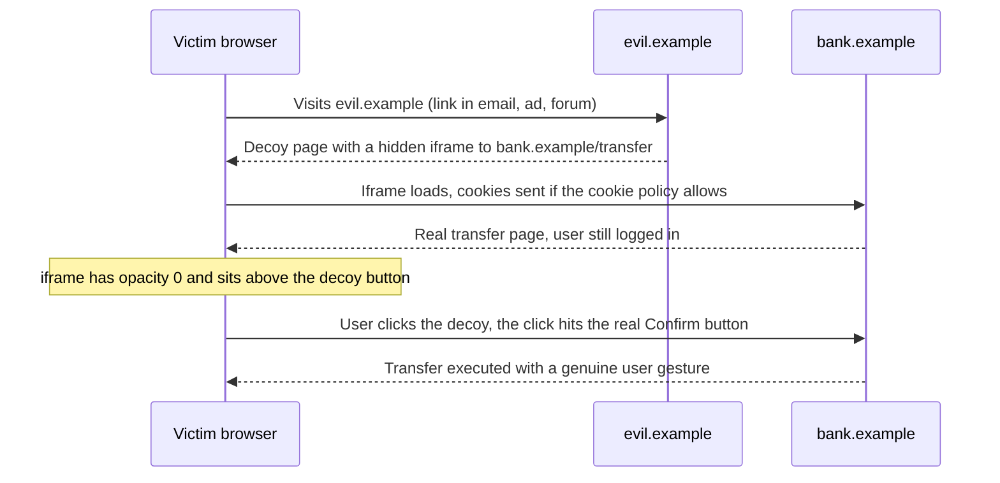

What the attacker **cannot** do and what they **can**:

| Attacker can | Attacker cannot |
|---|---|
| Choose the frame's position, size, opacity, z-index, cursor | Read the frame's DOM, cookies or responses (Same-Origin Policy) |
| Pre-fill the URL (query parameters, fragments) | Run script inside the framed origin |
| Time the decoy so a click lands at the right moment | Bypass a properly set `frame-ancestors` / `X-Frame-Options` |
| Chain several clicks (multi-step "game") | Make the browser send cookies the cookie policy blocks |

**The layered picture** — what the victim sees vs. what is actually on top:

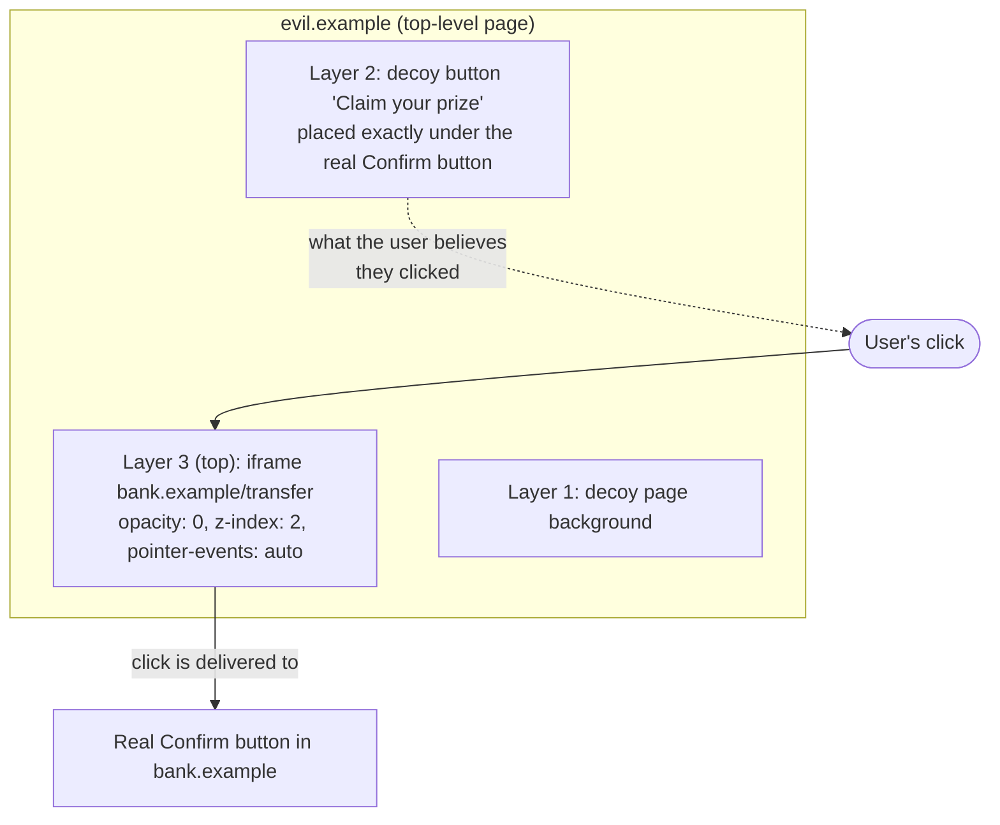

Things that make a page **worth clickjacking**: one-click (or few-click) state changes with no re-confirmation — "Delete account", "Make profile public", "Authorize this app", "Enable camera", "Follow", "Like", "Buy now", changing an email or a security setting.

---

### Section 2: Attack Variants

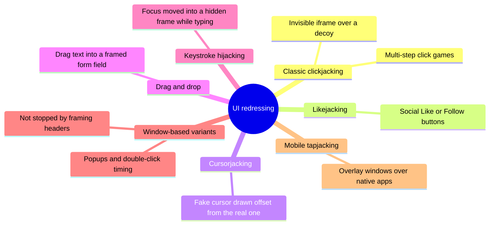

| Variant | How it works | Stopped by `frame-ancestors`? |
|---|---|---|
| **Classic** | Transparent iframe positioned over a decoy | ✅ Yes |
| **Likejacking** | Same trick on a social widget that *must* be frameable | ❌ The widget opts in to framing — needs other defenses (Section 11) |
| **Cursorjacking** | Hides the real cursor (`cursor: none`) and draws a fake one offset from it | ✅ When the target is framed; also a browser UI concern |
| **Drag-and-drop / keystroke** | Tricks the user into dragging or typing into a hidden framed field | ✅ Yes |
| **Window/double-click variants** | Opens the target in a **new window** or swaps windows between the two clicks of a double-click, so the second click lands on a real top-level page | ❌ No frame is involved — the target is top-level |
| **Tapjacking (native mobile)** | An overlay window from another app passes taps through to your app | ❌ Native problem — use OS protections (Example 8) |

> Researchers have published **double-click timing** attacks that switch from a decoy window to a real, top-level target page between the two clicks of a double-click. Because nothing is framed, framing headers can't help. The mitigation is UX: sensitive buttons should require a deliberate interaction on **that** page (Section 7).

---

### Section 3: Why the Same-Origin Policy Doesn't Stop It

The [Same-Origin Policy](./cors-and-same-origin-policy.md) stops `evil.example` from **reading** a cross-origin frame. It does **not** stop it from **displaying** one — embedding cross-origin content is how the web works (maps, videos, payments, ads).

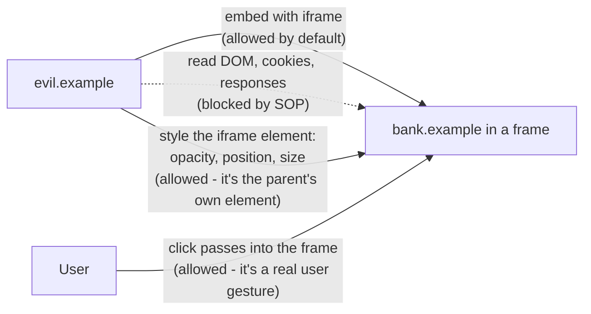

So the protection must come from the **framed page itself**: only it knows whether it is safe to be shown inside someone else's page. It says so with a **response header**, and the browser enforces it **before rendering**.

---

### Section 4: CSP `frame-ancestors` — the Modern Defense

`frame-ancestors` is a [Content Security Policy](./content-security-policy-csp.md) directive that lists **which origins may embed this response** in a `<frame>`, `<iframe>`, `<object>` or `<embed>`.

```http
Content-Security-Policy: frame-ancestors 'none'
```

| Value | Meaning | Use for |
|---|---|---|
| `'none'` | No one may frame this page — not even your own origin | Default for most apps, login, account, checkout |
| `'self'` | Only the page's own origin may frame it | Apps that frame their own pages (an admin console embedding a preview) |
| `'self' https://partner.example` | Own origin + an explicit allowlist | Partner integrations, per-tenant embeds |
| `https://*.example.com` | Any subdomain of `example.com` over HTTPS | Your own multi-subdomain product |
| `https:` | Any HTTPS origin | Public widgets meant to be embedded anywhere (rarely right) |
| *(directive absent)* | No restriction from CSP | — |

**Key behaviors (all current browsers):**
- It checks **every ancestor**, not just the direct parent. `bank.example` framed by `partner.example` framed by `evil.example` is blocked if `evil.example` isn't allowed.
- It **only works as a response header**. `frame-ancestors` inside `<meta http-equiv="Content-Security-Policy">` is **ignored** (as are `report-uri` and `sandbox` in `<meta>`).
- It works in `Content-Security-Policy-Report-Only` too, so you can **monitor** which sites frame you before you enforce.
- It can live in its own header, separate from your script policy. Multiple CSP headers are all enforced, so a dedicated `Content-Security-Policy: frame-ancestors 'none'` header is fine next to an existing script-focused CSP.

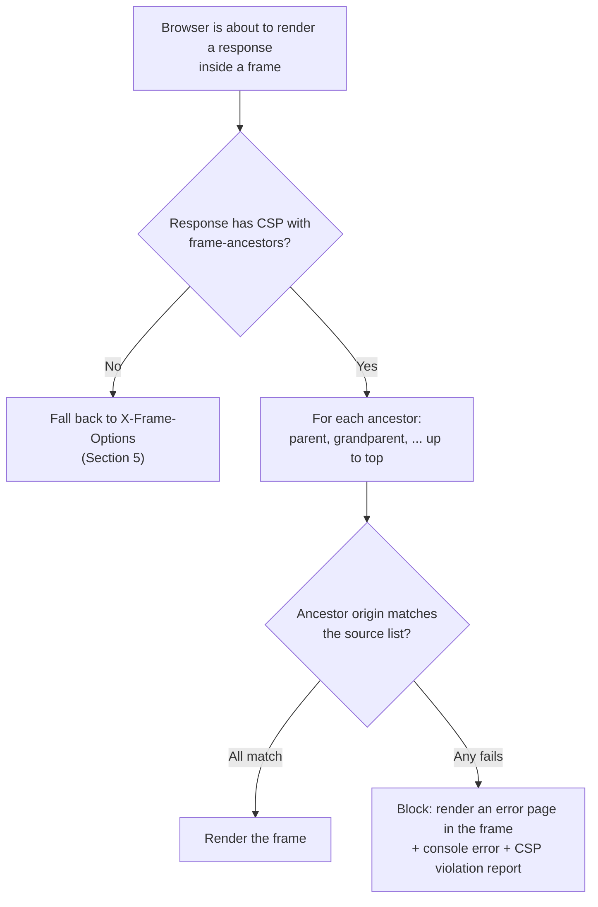

**Browser support:** `frame-ancestors` is supported in all current engines (MDN BCD: Chrome 40, Firefox 58 for full support, Safari 10). Old Internet Explorer never supported it — the reason `X-Frame-Options` is still sent alongside.

---

### Section 5: `X-Frame-Options` — the Legacy Defense

`X-Frame-Options` (XFO) predates CSP. Its handling is now defined in the **HTML Standard** (originally described in RFC 7034).

```http
X-Frame-Options: DENY
```

| Value | Meaning | Status |
|---|---|---|
| `DENY` | Never render in a frame | ✅ Supported everywhere |
| `SAMEORIGIN` | Only if **all** ancestors are same-origin with the page (modern Chrome and Firefox check the whole chain, not only the top) | ✅ Supported everywhere |
| `ALLOW-FROM https://x.example` | Intended allowlist of one origin | ❌ **Obsolete.** Modern browsers ignore it — and an ignored XFO means **no protection** |

**Limits of XFO compared to `frame-ancestors`:**

| | `X-Frame-Options` | CSP `frame-ancestors` |
|---|---|---|
| Allowlist of other origins | ❌ (ALLOW-FROM is dead) | ✅ Multiple origins, wildcards, schemes |
| Checks the full ancestor chain | ✅ in modern browsers (`SAMEORIGIN`) | ✅ always |
| Report-only mode + violation reports | ❌ | ✅ |
| Works in `<meta>` | ❌ ignored | ❌ ignored |
| Old clients (legacy IE, old embedded WebViews) | ✅ | ❌ |
| Precedence when both are present | Ignored | ✅ Wins |

> **Recommendation:** send **both** with matching intent — `frame-ancestors` as the real control, `X-Frame-Options: DENY` (or `SAMEORIGIN`) as a fallback for very old clients. If you need an allowlist of other origins, send **only** `frame-ancestors` (an XFO `DENY` would be overridden anyway in modern browsers, and would break the allowlist in old ones).

---

### Section 6: How the Browser Decides — Both Headers Together

The HTML Standard's navigation algorithm runs the checks **before** the framed document is rendered:

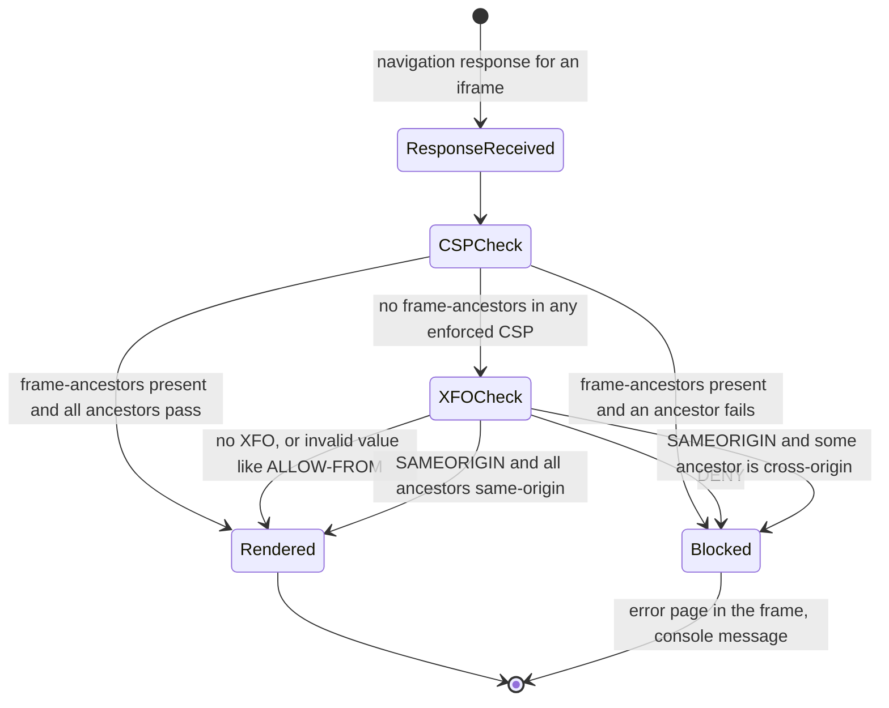

**Gotchas from the spec logic:**
- **Conflicting XFO values** (e.g. two headers `DENY` and `SAMEORIGIN` from two layers of your stack) are treated as a block in current browsers — but don't rely on it; dedupe your headers.
- **Unknown XFO values** (typos, `ALLOW-FROM`) mean **no XFO protection**.
- **A blocked frame doesn't fire a useful error in the parent.** The iframe's `load` event can still fire on the error page, and the parent can't read the frame to tell. Embedders find out from the console, not from code.
- The headers must be on the **document response** (HTML). Putting them on JS/CSS/images does nothing for clickjacking.

---

### Section 7: Defense in Depth — Cookies, Fetch Metadata, UX

Headers are the primary control. These layers limit the damage when a page *must* be frameable, or when an attack doesn't use frames at all:

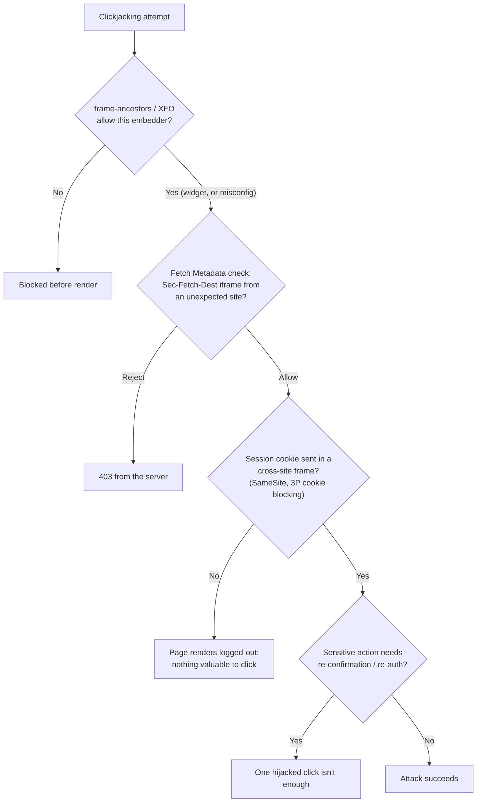

| Layer | What it does | Notes |
|---|---|---|
| **`SameSite` cookies** | `Lax` and `Strict` cookies are **not sent** in a cross-site iframe, so the framed page loads logged-out | Chrome treats cookies without `SameSite` as `Lax`; Firefox and Safari do **not** apply Lax-by-default (MDN BCD). Set `SameSite` explicitly |
| **Third-party cookie restrictions** | Safari and Firefox block or partition third-party cookies by default; Chrome's defaults have changed several times — check current status | Partitioned (CHIPS) cookies are keyed by top-level site, so they don't carry your main session into `evil.example` |
| **Fetch Metadata** | Server sees `Sec-Fetch-Dest: iframe` and `Sec-Fetch-Site: cross-site` and can refuse | Supported in all current engines (Safari 16.4+). A server-side backstop; see Example 3 |
| **Re-confirmation UX** | Sensitive actions need a typed confirmation, re-auth, or a second step in a fresh view | Also defeats the window/double-click variants that framing headers can't |
| **Gesture hardening** | Keep critical buttons disabled until the page has been visible and received pointer movement/keyboard input for a short time | A mitigation for timing-based attacks; tune so it doesn't hurt real users or assistive tech |
| **`Cross-Origin-Opener-Policy`** | Severs `window.opener` links between your page and cross-origin popups | Limits popup/window-based tricks and tab-nabbing |

> **Don't make the session cookie `SameSite=None` "just in case".** That is what turns a frameable page into an exploitable one. Use `None` only for cookies that genuinely must work cross-site (and then add `Secure` and, usually, `Partitioned`).

---

### Section 8: Frame-Busting JavaScript (and Why It Fails)

Before the headers existed, sites tried to escape frames with script:

```javascript
// ❌ Classic frame-buster — do NOT rely on this
if (window.top !== window.self) {
  window.top.location = window.self.location;
}
```

Why it fails:

| Bypass | How |
|---|---|
| **Sandboxed iframe** | The attacker frames you with `sandbox="allow-scripts allow-forms"` (no `allow-top-navigation`) — your script runs but **can't navigate the top**, and with no `allow-scripts` your script doesn't run at all |
| **Navigation cancelling** | Historical tricks (`onbeforeunload` prompts, rapid 204 responses) cancelled the top navigation |
| **Script disabled / blocked** | Some browsers' XSS filters and settings could stop the buster from running (historical) |
| **Timing** | The decoy can still be clicked before the buster finishes |

If you must support a client with no header support, OWASP's legacy approach is "hide the page **by default** with CSS, and reveal it only if script confirms it isn't framed" — so failure means a blank page, not a clickable one. For any modern browser, **use headers**; script is never the primary defense.

---

### Section 9: The Other Direction — Embedding Untrusted Content

When **your** app shows third-party or user-provided content in an iframe (ads, previews of user HTML, rich embeds, partner widgets), the risk flips: the frame might try to navigate your top window, open popups, prompt for permissions, submit forms or (if same-origin) touch your DOM.

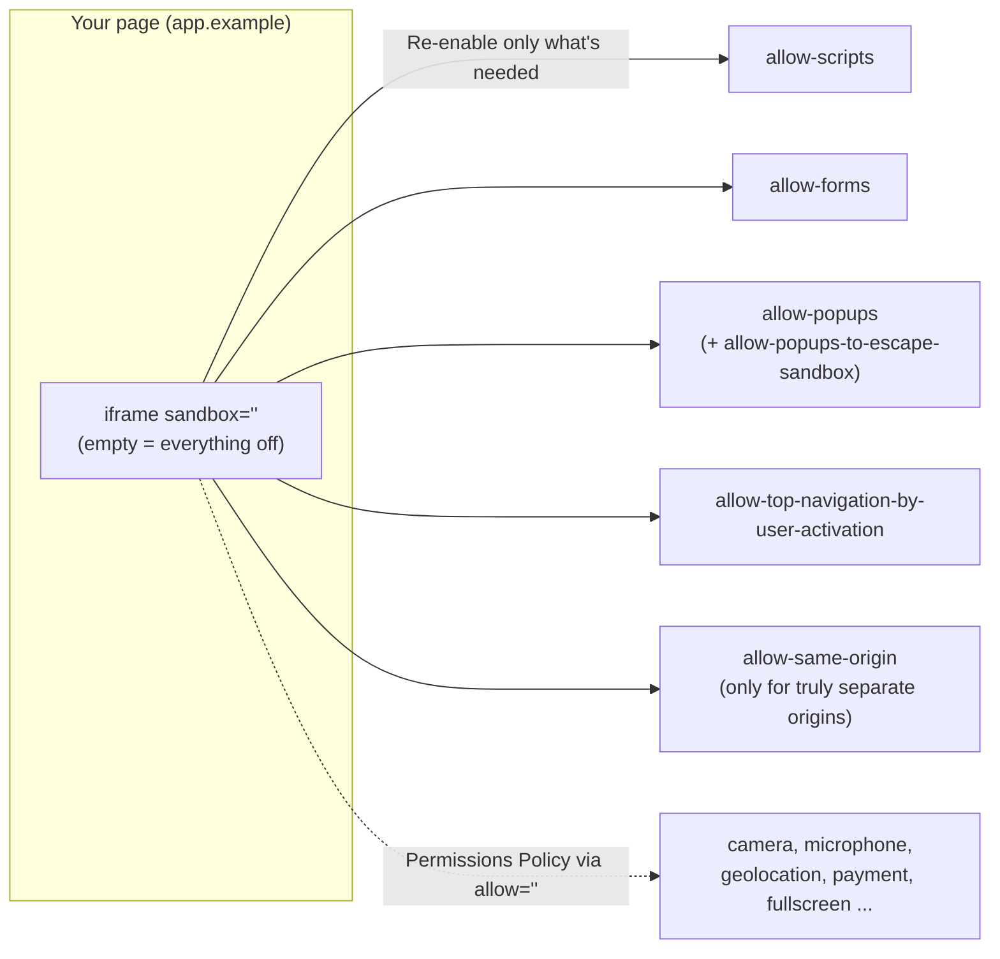

**An empty `sandbox` attribute** gives the frame a **unique opaque origin** and disables scripts, forms, popups, top navigation, plugins, pointer lock, modals and downloads. You add back individual capabilities:

| Token | Re-enables | Risk if added carelessly |
|---|---|---|
| `allow-scripts` | JavaScript | Needed by most widgets |
| `allow-same-origin` | The frame keeps its **real origin** (cookies, storage) | **Never combine with `allow-scripts` for content served from your own origin** — the frame can remove its own `sandbox` attribute and escape |
| `allow-forms` | Form submission | Phishing forms inside your UI |
| `allow-popups` | `window.open`, `target="_blank"` | Popups inherit the sandbox unless `allow-popups-to-escape-sandbox` |
| `allow-top-navigation-by-user-activation` | Navigate your top window, **only after a user click** in the frame | Prefer this over `allow-top-navigation` |
| `allow-top-navigation` | Navigate your top window at any time | Lets ads redirect your users — avoid |
| `allow-modals` | `alert`, `confirm`, `print` | Annoyance, fake system dialogs |
| `allow-downloads` | Downloads | Drive-by downloads |

**Rules for embedding:**
1. **Serve untrusted HTML from a separate origin** (a sandbox domain like `usercontent.example`), not from your app origin — even "sandboxed". This is why many products host user content on a separate registrable domain.
2. **Start from `sandbox=""`** and add tokens one by one.
3. **Delegate powerful features explicitly** with the `allow` attribute ([Permissions Policy](https://developer.mozilla.org/en-US/docs/Web/HTTP/Guides/Permissions_Policy)): `allow="payment; fullscreen"`. Cross-origin frames don't get camera/mic/geolocation unless you delegate them. The `allow` attribute is widely supported; the `Permissions-Policy` **response header** is currently Chromium-only per MDN BCD.
4. **Restrict what you can embed** with CSP `frame-src` (falls back to `child-src`, then `default-src`) — the mirror image of `frame-ancestors`.
5. Set `referrerpolicy` and `loading="lazy"` for below-the-fold embeds.

> **`frame-src` vs `frame-ancestors`:** `frame-src` (on **your** page) = "which URLs may I put in my iframes". `frame-ancestors` (on the **embedded** page) = "which pages may put me in their iframe". Both are CSP; they protect opposite parties.

`credentialless` iframes (load the frame with a fresh, ephemeral storage context) exist in Chromium only and are experimental — useful with COEP, not a general-purpose sandbox.

---

### Section 10: Talking Across Frames Safely — postMessage

Frames that legitimately cooperate (a payment widget, an embedded editor) talk through `window.postMessage`. Most real-world frame bugs are here, not in the headers.

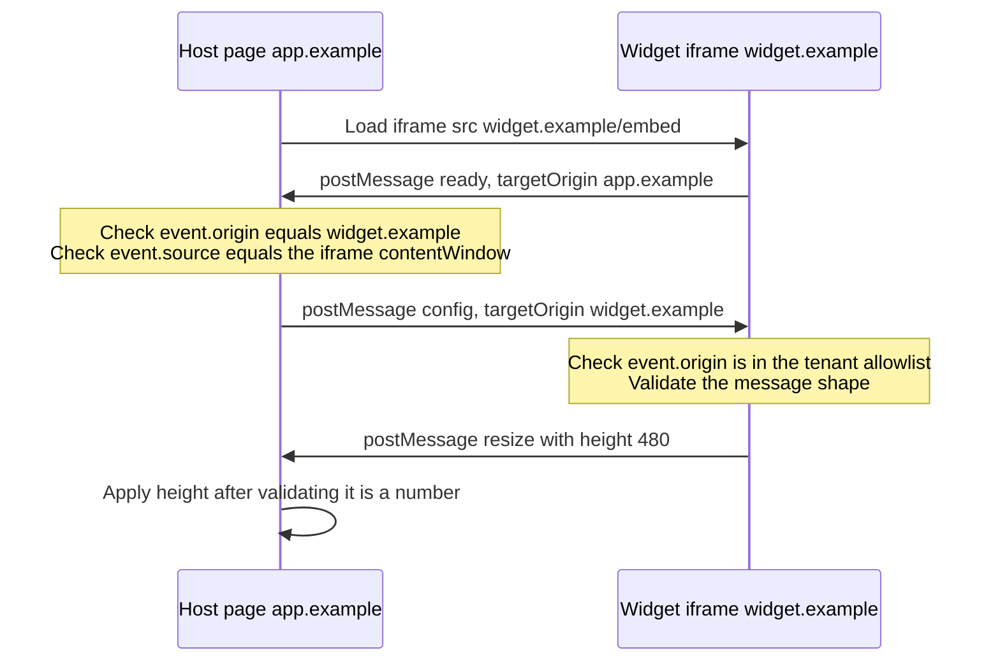

| Rule | Why |
|---|---|
| **Always pass an exact `targetOrigin`**, never `'*'` for data | If the frame was navigated elsewhere, `'*'` delivers your data to whoever is there now |
| **Check `event.origin`** with an exact match (not `includes`/`startsWith`) | `https://widget.example.evil.com` passes an `includes('widget.example')` check |
| **Check `event.source`** is the frame you created | Other frames/windows can post messages to you too |
| **Validate the payload schema** (type, fields, ranges) | Treat messages as untrusted input — never `innerHTML` them or `eval` |
| **Prefer `MessageChannel`** for long-lived conversations | After the handshake, a private port can't be spoofed by other windows |

---

### Section 11: Designing an Embeddable Widget

Some products **must** be framed: "Pay" buttons, comment boxes, booking widgets, social buttons, customer-support chat, video players. They can't use `frame-ancestors 'none'`, so the design shifts.

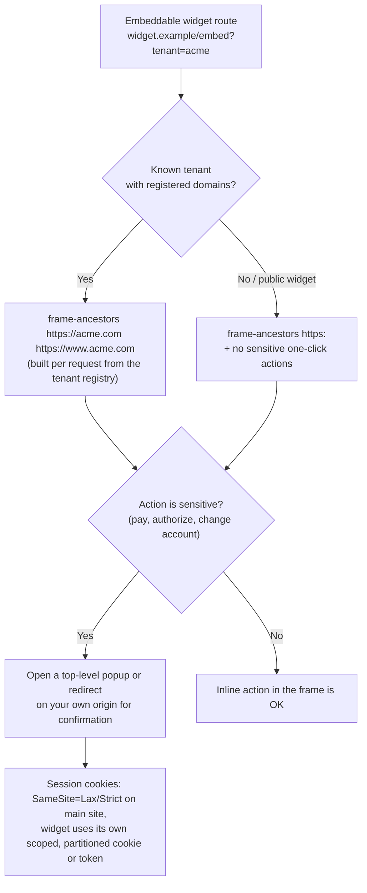

**Design rules:**
- **Separate routes, separate policies.** The embed lives at `/embed/*` (or a dedicated subdomain) with a permissive `frame-ancestors`; **everything else** keeps `'none'`. Don't loosen the whole app for one widget.
- **Per-tenant allowlists**: build `frame-ancestors` dynamically from the tenant's registered domains (Example 4). Validate the tenant ID; never reflect an arbitrary origin from the query string into the header.
- **Escalate sensitive actions to a top-level context** you control (popup or redirect), where your normal `frame-ancestors 'none'` applies. This is the pattern used by OAuth consent screens and many payment confirmations.
- **Visibility checks** for "like/follow"-style buttons: Chromium's **IntersectionObserver v2** (`trackVisibility: true`, `entry.isVisible`) lets a frame check that it isn't covered or transparent before accepting a click. It's **Chromium-only and experimental** (MDN BCD), so treat it as an extra signal.
- **Rate-limit and audit** actions coming from the embed, and show the user the result (e.g. a toast in the widget) so silent abuse is visible.

---

## Decision Matrix — Which Policy for Which Route

| Route type | `Content-Security-Policy` | `X-Frame-Options` | Extra |
|---|---|---|---|
| Whole app (default) | `frame-ancestors 'none'` | `DENY` | — |
| Login, account settings, checkout, OAuth consent | `frame-ancestors 'none'` | `DENY` | Re-auth for critical changes |
| App that frames its own pages (preview pane) | `frame-ancestors 'self'` | `SAMEORIGIN` | — |
| Partner/tenant embed | `frame-ancestors 'self' https://partner.example` | *(omit)* | postMessage origin checks, top-level confirmation |
| Public embeddable widget (video player, public map) | `frame-ancestors https:` *(or omit)* | *(omit)* | No authenticated one-click actions |
| Static assets (JS/CSS/images) | Not needed | Not needed | Framing headers only matter on documents |
| Pages you embed from others | Your page: `frame-src https://trusted.example` | — | `sandbox`, `allow`, separate origin for user content |

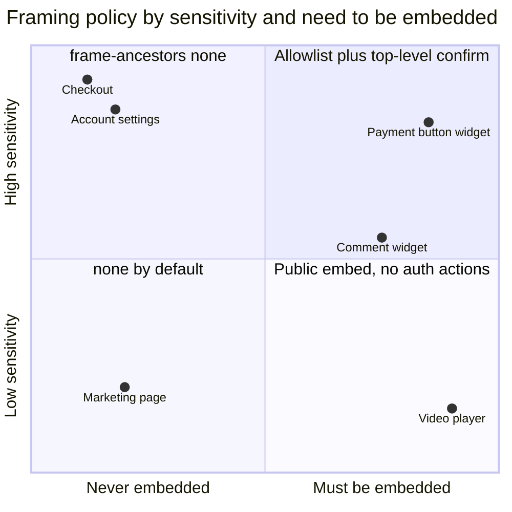

---

## Real-World Examples

**Example 1 — Express with Helmet (Node.js):**
```javascript
import express from 'express';
import helmet from 'helmet';

const app = express();

// Helmet's defaults already send `X-Frame-Options: SAMEORIGIN` and a CSP that
// includes `frame-ancestors 'self'`. Tighten both for an app that is never framed:
app.use(
  helmet({
    contentSecurityPolicy: {
      directives: {
        // ...your script/style directives...
        frameAncestors: ["'none'"],
      },
    },
    xFrameOptions: { action: 'deny' },
  }),
);

// The embeddable route gets its own, looser policy (see Example 4).
app.use('/embed', embedFramingPolicy);
```

**Example 2 — Headers by framework and host:**
```typescript
// Next.js — next.config.ts
import type { NextConfig } from 'next';

const nextConfig: NextConfig = {
  async headers() {
    return [
      {
        source: '/:path*',
        headers: [
          { key: 'Content-Security-Policy', value: "frame-ancestors 'none'" },
          { key: 'X-Frame-Options', value: 'DENY' },
        ],
      },
    ];
  },
};
export default nextConfig;
```

```typescript
// Nuxt (Vue) — nuxt.config.ts
export default defineNuxtConfig({
  routeRules: {
    '/**': {
      headers: {
        'Content-Security-Policy': "frame-ancestors 'none'",
        'X-Frame-Options': 'DENY',
      },
    },
  },
});
```

```typescript
// SvelteKit — src/hooks.server.ts
import type { Handle } from '@sveltejs/kit';

export const handle: Handle = async ({ event, resolve }) => {
  const response = await resolve(event);
  response.headers.set('Content-Security-Policy', "frame-ancestors 'none'");
  response.headers.set('X-Frame-Options', 'DENY');
  return response;
};
```

```text
# Angular: the browser app can't set response headers. Set them where HTML is served:
#  - Angular SSR: in the Node server (server.ts, e.g. Express + Helmet as in Example 1)
#  - Static hosting: in the host/CDN config, like the _headers file below

# Netlify / Cloudflare Pages — _headers
/*
  Content-Security-Policy: frame-ancestors 'none'
  X-Frame-Options: DENY
```

```nginx
# nginx — note: add_header in a location block replaces inherited add_header directives
add_header Content-Security-Policy "frame-ancestors 'none'" always;
add_header X-Frame-Options "DENY" always;
```

> If your SvelteKit, Next.js or Nuxt app already builds a CSP (for nonces or hashes), add `frame-ancestors` to that policy rather than sending a second, conflicting one — and remember it must be a **header**: frameworks that emit CSP in a `<meta>` tag for prerendered pages can't deliver `frame-ancestors` that way.

**Example 3 — Fetch Metadata backstop (BAD → GOOD):**
```typescript
import type { Request, Response, NextFunction } from 'express';

// ❌ BAD: relying only on a client-side frame-buster script

// ✅ GOOD: refuse cross-site framing on the server as a second layer
export function rejectCrossSiteFraming(req: Request, res: Response, next: NextFunction) {
  const dest = req.get('Sec-Fetch-Dest');   // 'document', 'iframe', 'image', ...
  const site = req.get('Sec-Fetch-Site');   // 'same-origin', 'same-site', 'cross-site', 'none'
  if (dest === 'iframe' && site === 'cross-site' && !req.path.startsWith('/embed/')) {
    return res.status(403).send('Framing not allowed');
  }
  next(); // older clients don't send Sec-Fetch-* — keep the CSP/XFO headers as the main control
}
```

**Example 4 — Per-tenant `frame-ancestors` for an embeddable widget:**
```typescript
import type { Request, Response, NextFunction } from 'express';

// tenantId -> origins the tenant registered in your dashboard (validated on save)
async function getTenantOrigins(tenantId: string): Promise<string[]> {
  return db.tenants.findAllowedOrigins(tenantId); // e.g. ['https://acme.com', 'https://www.acme.com']
}

const ORIGIN_RE = /^https:\/\/[a-z0-9.-]+(?::\d+)?$/i; // strict: scheme + host (+ port), no paths, no spaces

export async function embedFramingPolicy(req: Request, res: Response, next: NextFunction) {
  const tenantId = String(req.query.tenant ?? '');
  const origins = (await getTenantOrigins(tenantId)).filter((o) => ORIGIN_RE.test(o));

  // ❌ BAD: res.set('Content-Security-Policy', `frame-ancestors ${req.query.parent}`)
  //    -> anyone can declare themselves an allowed parent (and inject other directives)

  // ✅ GOOD: allowlist from your own data; deny when nothing is registered
  const policy = origins.length ? `frame-ancestors ${origins.join(' ')}` : "frame-ancestors 'none'";
  res.set('Content-Security-Policy', policy);
  next();
}
```

> If a CDN caches the embed HTML, make sure the **tenant** is part of the cache key (it's in the URL here), or one tenant's `frame-ancestors` can be served to another.

**Example 5 — A sandboxed iframe component (React + TypeScript):**
```tsx
type SafeEmbedProps = {
  src: string;                 // must be on an allowlisted origin
  title: string;               // required for accessibility
  allowScripts?: boolean;
  allowFeatures?: string;      // Permissions Policy, e.g. 'fullscreen'
};

const ALLOWED_EMBED_ORIGINS = new Set(['https://www.youtube-nocookie.com', 'https://usercontent.example']);

export function SafeEmbed({ src, title, allowScripts = false, allowFeatures = '' }: SafeEmbedProps) {
  const url = new URL(src);
  if (!ALLOWED_EMBED_ORIGINS.has(url.origin)) return null; // also enforce with CSP frame-src

  const sandbox = [
    allowScripts && 'allow-scripts',
    // allow-same-origin is safe ONLY because these origins differ from our app origin
    allowScripts && 'allow-same-origin',
    'allow-popups',
    'allow-popups-to-escape-sandbox',
  ]
    .filter(Boolean)
    .join(' ');

  return (
    <iframe
      src={url.toString()}
      title={title}
      sandbox={sandbox}
      allow={allowFeatures}
      referrerPolicy="strict-origin-when-cross-origin"
      loading="lazy"
      width="100%"
      height={360}
    />
  );
}
```

Vue (`<iframe :sandbox="sandbox" :src="src">`), Angular and Svelte use the same attributes. **Angular** additionally treats `[src]` on an iframe as a *resource URL*: binding an untrusted value throws, and you'd need `DomSanitizer.bypassSecurityTrustResourceUrl` — call it only after your own allowlist check.

**Example 6 — Secure postMessage in both directions (BAD → GOOD):**
```typescript
// Host page (app.example)
const WIDGET_ORIGIN = 'https://widget.example';
const frame = document.querySelector<HTMLIFrameElement>('#pay-widget')!;

// ❌ BAD
window.addEventListener('message', (e) => {
  if (e.origin.includes('widget.example')) render(e.data.html); // spoofable + XSS sink
});
frame.contentWindow!.postMessage({ token: sessionToken }, '*'); // leaks to whoever is in the frame

// ✅ GOOD
window.addEventListener('message', (e: MessageEvent) => {
  if (e.origin !== WIDGET_ORIGIN || e.source !== frame.contentWindow) return;
  const msg = e.data as { type?: unknown; height?: unknown };
  if (msg.type === 'resize' && typeof msg.height === 'number' && msg.height > 0 && msg.height < 5000) {
    frame.style.height = `${msg.height}px`;
  }
});
frame.contentWindow!.postMessage({ type: 'config', theme: 'dark' }, WIDGET_ORIGIN);
```

**Example 7 — Proving the protection works:**
```html
<!-- clickjack-test.html — open from a different origin (e.g. http://localhost:5555) -->
<!doctype html>
<html lang="en">
  <body>
    <p>If the page below renders, it is frameable from this origin.</p>
    <iframe src="https://app.example/settings" title="framing test"
            style="width: 900px; height: 600px; opacity: 0.6"></iframe>
  </body>
</html>
```

```typescript
// Playwright: assert the headers on every document route in CI
import { test, expect } from '@playwright/test';

for (const path of ['/', '/login', '/settings', '/checkout']) {
  test(`framing headers on ${path}`, async ({ request }) => {
    const res = await request.get(path);
    expect(res.headers()['content-security-policy']).toContain("frame-ancestors 'none'");
    expect(res.headers()['x-frame-options']).toBe('DENY');
  });
}
```

```bash
curl -sI https://app.example/settings | grep -iE 'content-security-policy|x-frame-options'
```

In DevTools, a blocked frame logs something like *"Refused to frame '…' because an ancestor violates the following Content Security Policy directive: frame-ancestors 'none'"* (Chromium wording; other browsers differ).

**Example 8 — Native mobile: tapjacking:**
```xml
<!-- Android: ignore touches when another app's window obscures this view -->
<Button
    android:id="@+id/confirm_payment"
    android:filterTouchesWhenObscured="true"
    android:text="@string/confirm" />
```

Android 12+ also blocks touches that pass through many untrusted overlay windows by default; `filterTouchesWhenObscured` (or checking `MotionEvent.FLAG_WINDOW_IS_OBSCURED`) protects sensitive buttons on older versions and partially-obscured cases. iOS doesn't allow other apps to draw over yours, so the concern there is mainly web content in WebViews — which follows the same `frame-ancestors`/XFO rules as browsers.

---

## Key Points Summary

| Concept | One-Line Explanation |
|---|---|
| **Clickjacking / UI redressing** | Hiding a real, logged-in page in a frame so the user's genuine click triggers an action |
| **Why SOP doesn't help** | SOP stops reading a frame, not displaying and styling it |
| **`frame-ancestors`** | CSP directive on the framed page listing who may embed it; checks every ancestor |
| **`X-Frame-Options`** | Legacy header: `DENY` / `SAMEORIGIN`; `ALLOW-FROM` is obsolete and ignored |
| **Precedence** | If any enforced CSP has `frame-ancestors`, XFO is ignored |
| **Header-only** | Neither works in a `<meta>` tag; both belong on HTML document responses |
| **Frame-busting JS** | Bypassable (sandbox, timing); never the primary defense |
| **SameSite cookies** | Lax/Strict cookies aren't sent in cross-site frames, so the frame is logged-out |
| **Fetch Metadata** | `Sec-Fetch-Dest: iframe` lets the server reject cross-site framing |
| **`sandbox`** | Locks down frames you embed; add tokens one by one |
| **`allow-scripts` + `allow-same-origin`** | Together on same-origin content = no sandbox at all |
| **`frame-src`** | Your page's list of what it may embed (the mirror of `frame-ancestors`) |
| **postMessage** | Exact `targetOrigin`, exact `event.origin` check, validate payloads |
| **Embeddable widgets** | Separate route, per-tenant allowlist, sensitive actions in a top-level window |

---

## Test Your Understanding

**Q1 (Basic):**
Your app sends `X-Frame-Options: ALLOW-FROM https://partner.example`. A security scanner says the app is frameable by anyone. Why, and what should you send instead?

<details>
<summary>Answer</summary>

`ALLOW-FROM` is **obsolete** — current browsers don't recognize it. Per the HTML Standard's processing, an unrecognized XFO value is treated as if no XFO were present, so **any** site can frame the page. Replace it with `Content-Security-Policy: frame-ancestors 'self' https://partner.example`, which supports allowlists, multiple origins and reporting. Don't also send `X-Frame-Options: DENY` on that route — modern browsers ignore it when `frame-ancestors` is present, but old clients would block the partner.
</details>

**Q2 (Application):**
A developer adds `<meta http-equiv="Content-Security-Policy" content="frame-ancestors 'none'">` to `index.html` of a static React app on a CDN. Is the app protected? How do you fix it?

<details>
<summary>Answer</summary>

**No.** `frame-ancestors` is one of the directives that are **ignored in `<meta>` CSP** (the browser has already decided to render the document in the frame by the time it parses the meta tag). `X-Frame-Options` in `<meta>` is ignored too. The fix is a **response header** set by the host or CDN — e.g. a `_headers` file on Netlify/Cloudflare Pages, `headers` in `vercel.json`, an nginx `add_header`, or a CDN response-header rule.
</details>

**Q3 (Tricky):**
Your login page sends `frame-ancestors 'self'`. Your app at `app.example` frames `https://preview.example` (a separate origin you also own), and that preview page frames `app.example/login`. Does the login page render? What about if `app.example/login` were framed directly by `app.example`?

<details>
<summary>Answer</summary>

Chain 1: `app.example` → `preview.example` → `app.example/login`. `frame-ancestors` checks **every ancestor**: the direct parent `preview.example` is not `'self'`, so the frame is **blocked**, even though the top-level page is same-origin.

Chain 2: `app.example` → `app.example/login`. All ancestors match `'self'`, so it **renders**.

This "all ancestors" rule is what stops the nested-frame trick where an attacker frames your page inside an intermediate site you trust. Modern browsers apply the same full-chain check to `X-Frame-Options: SAMEORIGIN`.
</details>

**Q4 (Tricky):**
You embed user-generated HTML previews from `https://app.example/preview/123` in `<iframe sandbox="allow-scripts allow-same-origin">` on `https://app.example`. Why is this unsafe, and what are two ways to fix it?

<details>
<summary>Answer</summary>

The framed content is **same-origin** with the parent, and `allow-same-origin` lets it keep that origin. With `allow-scripts`, its script can reach `parent.document`, find its own `<iframe>` element, **remove the `sandbox` attribute** and reload itself unsandboxed — or simply read cookies/storage and call your APIs as the user. The sandbox gives no protection.

Fixes: (1) **serve user content from a separate origin**, ideally a separate registrable domain like `usercontent-example.net`, so even an escaped frame is cross-origin; (2) **drop `allow-same-origin`**, so the frame runs in an opaque origin with no access to your cookies, storage or DOM. Adding a strict CSP to the preview response is a further layer.
</details>

**Q5 (Application):**
An attacker can't frame your app (headers are correct), yet users report a "Delete project" happening after they double-clicked a button on another site. What's going on, and what helps?

<details>
<summary>Answer</summary>

This is a **window-based** UI-redressing attack: the attacker page opens or switches to **your real page as a top-level window** and times it so the second click of a double-click lands on your "Delete project" button. Nothing is framed, so `frame-ancestors`/XFO don't apply.

Mitigations are about **action design**: require a deliberate confirmation for destructive actions (typed project name, re-auth, a second step), keep critical buttons disabled until the page has been visible and received genuine pointer/keyboard interaction for a moment, use `SameSite=Lax/Strict` session cookies, and `Cross-Origin-Opener-Policy: same-origin` to cut `window.opener` links with cross-origin popups.
</details>

**Q6 (System design):**
You're designing an embeddable "Book an appointment" widget that customers place on their own sites. Users must be logged in to see their past bookings and to pay a deposit. Describe the framing and security design.

<details>
<summary>Answer</summary>

- **Separate route/origin** for the widget (`widget.example/embed/:tenant`); the main app keeps `frame-ancestors 'none'` and `X-Frame-Options: DENY`.
- **Per-tenant `frame-ancestors`** built from domains the tenant registered (validated as exact HTTPS origins), cached per tenant URL; no XFO on that route.
- **Authentication without the main session cookie**: the main site cookie stays `SameSite=Lax`. Logging in or paying happens in a **top-level popup** on `widget.example` (where `frame-ancestors 'none'` applies), which then hands the widget a short-lived, widget-scoped credential (e.g. a partitioned cookie or token via `postMessage` to an exact origin).
- **Payment deposit** is confirmed in the top-level window — never a one-click action inside the frame.
- **postMessage contract**: versioned message types, exact origin and `source` checks on both sides, schema validation, a `MessageChannel` after handshake.
- **Host-side guidance**: document the `<iframe>` snippet with `title`, an appropriate `sandbox` token list (`allow-scripts allow-same-origin allow-forms allow-popups allow-popups-to-escape-sandbox` is safe here because the widget is cross-origin to the host), and `allow="payment"` if using the Payment Request API.
- **Monitoring**: a `report-to` endpoint for CSP violations shows which sites try to frame the widget without being registered.
</details>

---

## Cheat Sheet

**Key Definitions:**
- **Clickjacking (UI redressing):** Tricking a user into interacting with a disguised, framed page
- **`frame-ancestors`:** CSP directive (response header only) that lists who may embed this document
- **`X-Frame-Options`:** Legacy framing header — `DENY` or `SAMEORIGIN`
- **`frame-src`:** CSP directive listing what *your* page may embed
- **`sandbox`:** iframe attribute that strips capabilities from embedded content
- **Permissions Policy (`allow`):** Delegates powerful features (camera, payment, fullscreen) to a frame
- **Fetch Metadata:** `Sec-Fetch-Dest` / `Sec-Fetch-Site` request headers describing how a request was made
- **Tapjacking:** The native-mobile equivalent using overlay windows

**Quick Reference:**
```text
Default (never framed)     Content-Security-Policy: frame-ancestors 'none'
                           X-Frame-Options: DENY
Framed by own origin       frame-ancestors 'self'          + X-Frame-Options: SAMEORIGIN
Partner allowlist          frame-ancestors 'self' https://partner.example   (no XFO)
Public widget              frame-ancestors https:  + no authenticated one-click actions

Precedence:   CSP frame-ancestors present  →  XFO ignored
Placement:    response header on HTML documents only (never <meta>, never on JS/CSS)
Checks:       every ancestor in the chain, not just the parent

Embedding others:
  <iframe src="https://other.example" title="..." sandbox="" allow="" loading="lazy">
  Add tokens one at a time. Never allow-scripts + allow-same-origin for same-origin content.
  CSP on your page: frame-src https://other.example

postMessage:  postMessage(data, 'https://exact.origin')  ·  if (e.origin !== EXPECTED) return
Cookies:      SameSite=Lax/Strict for session cookies; None only when truly cross-site (+ Secure)
```

**Common Mistakes to Avoid:**

| Mistake | Why Wrong | Fix |
|---|---|---|
| `X-Frame-Options: ALLOW-FROM …` | Obsolete → ignored → page frameable by anyone | `frame-ancestors 'self' https://partner.example` |
| `frame-ancestors` in a `<meta>` tag | Ignored in meta CSP | Send it as a response header |
| Headers only on `/` or on assets | Every HTML route can be framed directly | Apply to all document responses |
| Frame-busting JS as the defense | Bypassed by `sandbox`, timing tricks | Headers; JS only as a legacy fallback |
| Loosening the whole app for one widget | Every page becomes frameable | Separate `/embed` route with its own policy |
| Reflecting `?parent=` into `frame-ancestors` | Attacker declares themselves allowed (and can inject directives) | Allowlist from your own tenant data |
| `sandbox="allow-scripts allow-same-origin"` on same-origin content | Frame removes its own sandbox | Separate origin for untrusted content, or drop `allow-same-origin` |
| `postMessage(data, '*')` with secrets | Delivered to whatever document is in the frame now | Exact `targetOrigin` |
| `e.origin.includes('trusted')` | `trusted.attacker.com` passes | Exact equality against a set |
| Session cookie `SameSite=None` "to be safe" | Framed pages arrive logged-in | `Lax`/`Strict`; `None` only for genuine cross-site cookies |
| One-click destructive actions | Any hijacked click (framed or window-based) succeeds | Re-confirmation, re-auth, deliberate gestures |
| Duplicate XFO headers from app + proxy | Conflicting values; confusing behavior across clients | Set framing headers in one layer |

---

## References & Further Reading

**Core docs**
- MDN: [Clickjacking](https://developer.mozilla.org/en-US/docs/Web/Security/Attacks/Clickjacking)
- MDN: [CSP `frame-ancestors`](https://developer.mozilla.org/en-US/docs/Web/HTTP/Reference/Headers/Content-Security-Policy/frame-ancestors) · [`frame-src`](https://developer.mozilla.org/en-US/docs/Web/HTTP/Reference/Headers/Content-Security-Policy/frame-src)
- MDN: [`X-Frame-Options`](https://developer.mozilla.org/en-US/docs/Web/HTTP/Reference/Headers/X-Frame-Options)
- MDN: [`<iframe>` (sandbox, allow, referrerpolicy)](https://developer.mozilla.org/en-US/docs/Web/HTML/Reference/Elements/iframe)
- MDN: [`Window.postMessage()`](https://developer.mozilla.org/en-US/docs/Web/API/Window/postMessage)
- MDN: [Permissions Policy](https://developer.mozilla.org/en-US/docs/Web/HTTP/Guides/Permissions_Policy)
- MDN: [`Set-Cookie` — SameSite](https://developer.mozilla.org/en-US/docs/Web/HTTP/Reference/Headers/Set-Cookie#samesitesamesite-value)
- MDN: [`Sec-Fetch-Dest`](https://developer.mozilla.org/en-US/docs/Web/HTTP/Reference/Headers/Sec-Fetch-Dest)

**Guides**
- OWASP: [Clickjacking Defense Cheat Sheet](https://cheatsheetseries.owasp.org/cheatsheets/Clickjacking_Defense_Cheat_Sheet.html)
- OWASP: [Clickjacking attack](https://owasp.org/www-community/attacks/Clickjacking)
- PortSwigger Web Security Academy: [Clickjacking (UI redressing)](https://portswigger.net/web-security/clickjacking)
- web.dev: [Play safely in sandboxed IFrames](https://web.dev/articles/sandboxed-iframes)
- web.dev: [Protect your resources from web attacks with Fetch Metadata](https://web.dev/articles/fetch-metadata)
- web.dev: [Making your website "cross-origin isolated" using COOP and COEP](https://web.dev/articles/coop-coep)
- Chrome for Developers: [Trust is good, observation is better — Intersection Observer v2](https://developer.chrome.com/blog/intersectionobserver-v2)

**Specs**
- W3C: [Content Security Policy Level 3 — `frame-ancestors`](https://www.w3.org/TR/CSP3/#directive-frame-ancestors)
- WHATWG HTML Standard: [The `X-Frame-Options` header](https://html.spec.whatwg.org/multipage/document-lifecycle.html#the-x-frame-options-header)
- WHATWG HTML Standard: [The `iframe` element (sandbox)](https://html.spec.whatwg.org/multipage/iframe-embed-object.html#attr-iframe-sandbox)
- IETF: [RFC 7034 — HTTP Header Field X-Frame-Options](https://www.rfc-editor.org/rfc/rfc7034)
- W3C: [Fetch Metadata Request Headers](https://www.w3.org/TR/fetch-metadata/)

**Framework docs**
- Helmet: [Documentation](https://helmetjs.github.io/)
- Next.js: [`headers` in next.config.js](https://nextjs.org/docs/app/api-reference/config/next-config-js/headers)
- Nuxt: [`routeRules`](https://nuxt.com/docs/guide/concepts/rendering#route-rules)
- SvelteKit: [Hooks — `handle`](https://svelte.dev/docs/kit/hooks#Server-hooks-handle)
- Angular: [Security — trusting safe values](https://angular.dev/best-practices/security#trusting-safe-values)
- Android Developers: [Tapjacking](https://developer.android.com/privacy-and-security/risks/tapjacking)

---

> **Previous Topic:** [Subresource Integrity (SRI)](./subresource-integrity-sri.md)
> — Making sure the third-party scripts you load are exactly the bytes you expect

> **Next Topic:** [Dependency Vulnerability Scanning](./dependency-vulnerability-scanning.md)
> — Finding and fixing known-vulnerable and malicious packages in your supply chain

*Saved on: 2026-11-06 | Repo: Frontend System Design Learning Notes*
