<!-- Generated by scripts/sync-knowledge.js from notes/ and README.md — do not edit here. -->
<!-- sections (line ranges in this file): Table of Contents 19-43 · ELI5 44-59 · Core Concept 60-464 · Framework Comparison 465-479 · Decision Matrix 480-498 · Real-World Examples 499-728 · Key Points Summary 729-752 · Test Your Understanding 753-828 · Cheat Sheet 829-876 · References & Further Reading 877-915 -->

# Client State Management Patterns

> **Date:** 2026-11-06 · **Last updated:** 2026-11-06
> **Category:** Frontend System Design
> **Sub-Topic:** State & Data / State Management
> **Level:** Intermediate · **Reading time:** ~30 min
> **Informs:** where each piece of state lives (local, lifted, context, store, URL, server cache), choice of state library per stack, re-render cost and INP, SSR-safe stores, persistence and hydration, URL shareability

> **Pre-requisite:** [DOM & Virtual DOM](./dom-and-virtual-dom.md) (how UI re-renders) and [Component Architecture & Design Systems](./component-architecture-and-design-systems.md).
> This note is the **map** of client state: what kinds of state exist, where each should live, and which pattern (local, context, Flux store, atoms, proxies, signals, state machines) fits. The next notes go deep on specific libraries.

**Previous:** [Module Bundling & Build Systems](./module-bundling-and-build-systems.md) · **Next:** [Redux & Redux Toolkit](./redux-and-redux-toolkit.md)

---

## Table of Contents

1. [ELI5 — Simple Explanation](#eli5--simple-explanation)
2. [Section 1: What Is State — the Taxonomy](#section-1-what-is-state--the-taxonomy)
3. [Section 2: Where Should State Live? Colocate First](#section-2-where-should-state-live-colocate-first)
4. [Section 3: Local State and Lifting State Up](#section-3-local-state-and-lifting-state-up)
5. [Section 4: Context — Dependency Injection, Not a Store](#section-4-context--dependency-injection-not-a-store)
6. [Section 5: External Stores, Subscriptions and Tearing](#section-5-external-stores-subscriptions-and-tearing)
7. [Section 6: The Five Pattern Families](#section-6-the-five-pattern-families)
8. [Section 7: Unidirectional Data Flow (Flux)](#section-7-unidirectional-data-flow-flux)
9. [Section 8: Fine-Grained Reactivity and Signals](#section-8-fine-grained-reactivity-and-signals)
10. [Section 9: State Machines for UI Flows](#section-9-state-machines-for-ui-flows)
11. [Section 10: Derived State, Immutability and Shape](#section-10-derived-state-immutability-and-shape)
12. [Section 11: URL State and Form State](#section-11-url-state-and-form-state)
13. [Section 12: Persistence and SSR Hydration](#section-12-persistence-and-ssr-hydration)
14. [Framework Comparison](#framework-comparison)
15. [Decision Matrix](#decision-matrix)
16. [Real-World Examples](#real-world-examples)
17. [Key Points Summary](#key-points-summary)
18. [Test Your Understanding (with answers)](#test-your-understanding)
19. [Cheat Sheet](#cheat-sheet)
20. [References & Further Reading](#references--further-reading)

---

## ELI5 — Simple Explanation

Think about the information in a family home:
- **What's in your pocket** (your keys) = **local state**. Only you need it, so nobody else should have to track it.
- **The whiteboard on the fridge** ("Dad picks up the kids at 5") = **global client state**. Several people read it, so it lives somewhere everyone can see.
- **A photo of the bank balance** = **server state**. It's a *copy* of something owned elsewhere. It gets out of date, and you refresh it rather than edit it.
- **The address on an envelope** = **URL state**. Anyone holding the envelope gets to the same place — you can share it.
- **A half-written shopping list** = **form state**. It's a draft until you "submit" it.
- **"How many items are on the list?"** = **derived state**. You don't write the count down separately — you count when you need it, so it can never be wrong.

Most messy apps come from putting things in the wrong place: everyone's keys on the fridge whiteboard, or a photo of the bank balance treated as if it were the real account.

> **State management is mostly about deciding *where* each piece of state lives — and keeping as little of it as possible. The library is a secondary choice.**

---

## Core Concept — Step by Step

### Section 1: What Is State — the Taxonomy

**State** is any data that changes over time and affects what the UI shows. Treating it all as one blob is the root of most state-management pain. Split it by **owner** and **lifetime**:

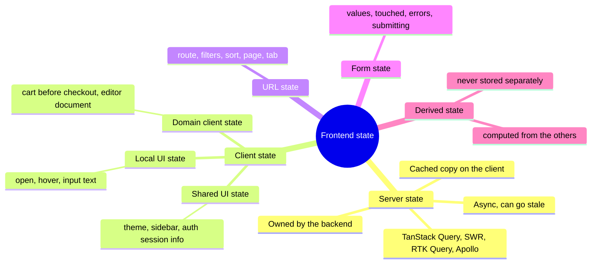

| Kind | Source of truth | Lifetime | Typical tool |
|---|---|---|---|
| **Local UI state** | The component | Component mount | `useState` / `ref` / `signal` / `$state` |
| **Shared client state** | A store or context | App session | Context, Zustand, Redux, Pinia, NgRx, Svelte stores |
| **Server state** | The backend | Cache entry lifetime | TanStack Query, SWR, RTK Query, Apollo — see [Server State vs Client State](./server-state-vs-client-state.md) |
| **URL state** | The address bar | Shareable, survives reload | Router search params |
| **Form state** | The form | Until submit/reset | Native forms, React Hook Form, Formik, Angular Reactive Forms |
| **Persistent client state** | `localStorage` / IndexedDB | Across sessions | Store persistence middleware — see [Browser Storage Mechanisms](./browser-storage-mechanisms.md) |
| **Derived state** | Computed from the above | Recomputed on demand | Selectors, `computed`, `$derived`, `useMemo` |

> **The biggest modern shift:** most of what older apps kept in Redux (fetched lists, the current user, loading flags) is **server state**. Moving it to a server-cache library usually shrinks the "global client state" to a handful of values.

---

### Section 2: Where Should State Live? Colocate First

The default rule in every framework's docs is the same: **keep state as close as possible to where it's used**, and move it up only when you have to.

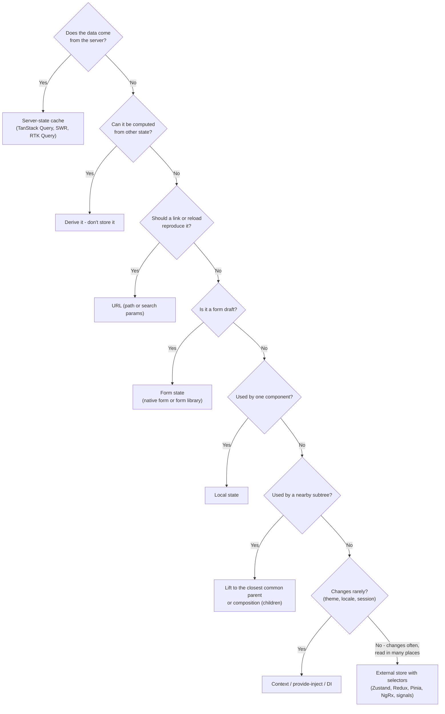

Why colocation wins:
- **Fewer re-renders.** State high in the tree re-renders everything below it (unless memoized).
- **Deletability.** When a feature is removed, its state goes with it — no orphaned global keys.
- **Readability.** You can understand a component without reading a 2,000-line store.

> **Rule of thumb:** "global" should be the *exception you can justify*, not the default bucket.

---

### Section 3: Local State and Lifting State Up

Local state is the simplest and fastest pattern. When two siblings need the same value, **lift it up** to their closest common parent and pass it down as props plus a callback.

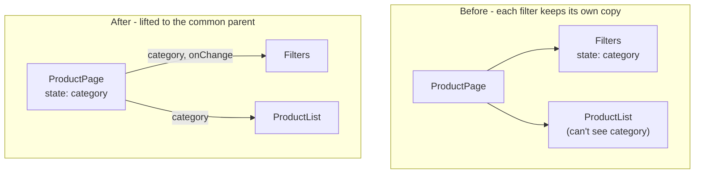

**Prop drilling** is when a value passes through many components that don't use it. It's a smell only when the chain is long and the in-between components are generic. Fixes, in order of preference:

1. **Composition** — pass already-rendered elements (`children`, slots) so the middle layers never touch the data.
2. **Context / provide-inject** for rarely-changing values (Section 4).
3. **An external store** for frequently-changing shared values (Section 5).

```tsx
// Composition: Layout never sees `user` — it just renders the slot it's given
function Page({ user }: { user: User }) {
  return (
    <Layout header={<Avatar user={user} />}>
      <Feed userId={user.id} />
    </Layout>
  );
}
```

**`useReducer` for complex local state:** when several values change together or the next state depends on an "event", a reducer keeps transitions in one pure function — the same idea Redux scales up (see [Redux & Redux Toolkit](./redux-and-redux-toolkit.md)).

---

### Section 4: Context — Dependency Injection, Not a Store

React Context (and Vue `provide`/`inject`, Angular DI, Svelte `setContext`) **passes a value down the tree without props**. It does *not* give you selectors, middleware or fine-grained subscriptions.

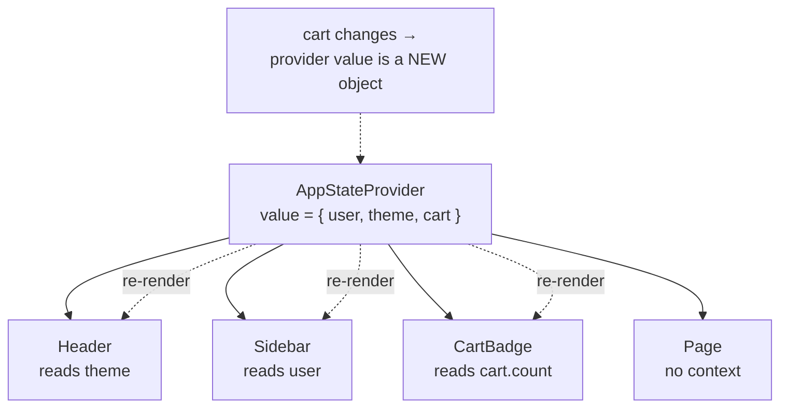

In React, **every component that reads a context re-renders when the provider's `value` changes** (compared with `Object.is`). There is no built-in way to subscribe to *part* of a context value. Consequences:

| Problem | Fix |
|---|---|
| One big context with everything | **Split by change frequency**: `ThemeContext`, `SessionContext`, `CartContext` |
| `value={{ a, b }}` creates a new object every render | `useMemo` the value (or let React Compiler memoize it) |
| State and dispatch in one context | Put `dispatch` (stable) in its own context so "write-only" components don't re-render |
| High-frequency values (cursor position, typing) | Don't use context — use an external store with selectors |

> **React 19 notes:** you can render `<ThemeContext value={...}>` directly instead of `<ThemeContext.Provider>`, and read context with `use(ThemeContext)` (which, unlike hooks, may be called conditionally). The re-render behavior is unchanged. React Compiler can memoize the provider value for you, but consumers still re-render whenever that value really changes.

**Context is great for:** theme, locale, the current user/session, feature flags, and **injecting a store instance** (e.g. a per-request store for SSR — see Section 12).

---

### Section 5: External Stores, Subscriptions and Tearing

An **external store** lives outside the component tree (a module-level object, a class, a library). Components **subscribe** and re-render only when the slice they **select** changes.

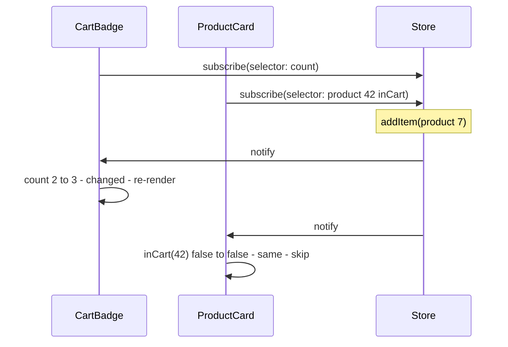

In React, the correct primitive is **`useSyncExternalStore`** (React 18+). React-Redux and Zustand build on it directly; other libraries (e.g. Jotai) use their own subscription mechanism with the same goal:

```typescript
const value = useSyncExternalStore(
  store.subscribe,        // (onChange) => unsubscribe
  () => store.getSnapshot(), // must return the SAME reference if nothing changed
  () => store.getServerSnapshot?.() // used during SSR and hydration
);
```

**Tearing** is the bug it prevents. With concurrent rendering, React can pause a render half-way. If a mutable store changes during the pause, components rendered before and after the change show **different values in the same frame**:

```text
Concurrent render of a list (React yields between components):
  <Row 1>  reads store.theme = "light"
  ...yield to the browser... user clicks "dark" → store.theme = "dark"
  <Row 2>  reads store.theme = "dark"
Result without useSyncExternalStore: one screen, two themes  ← "tearing"
With useSyncExternalStore: React detects the change and re-renders synchronously, consistently
```

**Selector rules (all libraries):**
- A selector must return a **stable reference** when nothing changed. `state => ({ a: state.a })` returns a new object every time → re-render on every store change (or an infinite loop in some libraries). Select primitives, use memoized selectors, or a shallow-equality helper.
- Select the **smallest** thing you need: `state => state.cart.items.length`, not `state => state.cart`.

---

### Section 6: The Five Pattern Families

Every state library is one (or a mix) of these models:

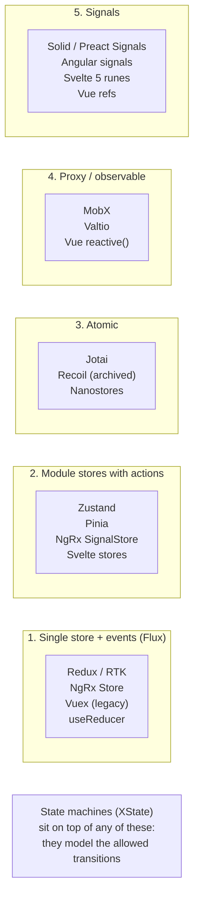

| Family | Mental model | Updates | Re-render granularity | Strengths | Costs |
|---|---|---|---|---|---|
| **Flux / single store** | One state tree, changed only by dispatched **events** through pure reducers | Immutable | Per selector | Predictable, time-travel debugging, middleware, great for large teams | More ceremony; easy to over-centralize |
| **Module stores** | Several small stores, each with state + actions | Immutable (Zustand) or reactive (Pinia) | Per selector / per property | Minimal API, easy to split by feature | Less enforced structure |
| **Atomic** | Many tiny independent atoms; derived atoms form a dependency graph | Immutable atoms | Per atom | Bottom-up, great for interdependent fine-grained state, code-splits naturally | The graph can get hard to trace |
| **Proxy / observable** | Mutate a plain-looking object; the library tracks reads and writes | Mutable | Per property read | Very little code, OOP-friendly | "Magic"; harder to debug implicit dependencies |
| **Signals** | Reactive values; reads inside a computation register dependencies automatically | Mutable `.value` / setter | Per signal, can skip component re-render entirely | Fastest updates, no selectors needed | Different mental model from React's render-everything |

---

### Section 7: Unidirectional Data Flow (Flux)

Flux (introduced by Facebook alongside React) and its successor Redux made one rule central: **data flows one way**, and the only way to change state is to **dispatch an event** that a pure function turns into the next state.

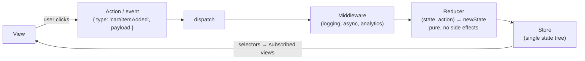

Why it scales:
- **Every change is a named event** — you can log, replay, undo, sync across tabs, or send it to analytics.
- **Reducers are pure** — trivial to unit test (`expect(reducer(s, a)).toEqual(next)`).
- **Model actions as events ("itemAdded"), not setters ("setItems")** — several reducers can react to one event.

The same shape appears outside the web: **The Composable Architecture** (Swift) and **MVI** (Android/Kotlin) are Redux-style unidirectional architectures. Full details in [Redux & Redux Toolkit](./redux-and-redux-toolkit.md).

---

### Section 8: Fine-Grained Reactivity and Signals

React's model is "**state changed → re-run the component function → diff**". Signal-based frameworks track **which computation read which signal** and update only those.

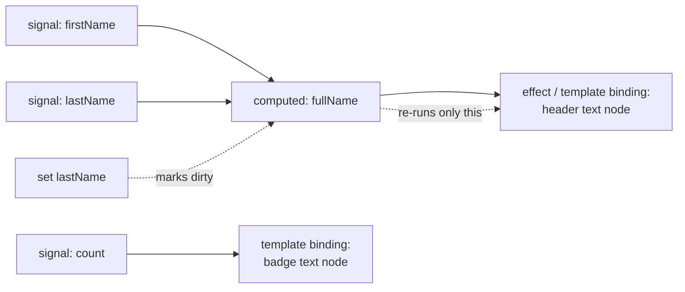

| Framework | Writable | Derived | Side effect |
|---|---|---|---|
| **Solid** | `createSignal` / `createStore` | `createMemo` | `createEffect` |
| **Angular** | `signal()` | `computed()` (and `linkedSignal()`) | `effect()` |
| **Vue** | `ref()` / `reactive()` | `computed()` | `watch()` / `watchEffect()` |
| **Svelte 5** | `$state` | `$derived` | `$effect` |
| **Preact** | `signal()` (`@preact/signals`) | `computed()` | `effect()` |
| **React** | `useState` (component re-renders; no signals primitive) | Compute during render / `useMemo` | `useEffect` |

**TC39 Signals proposal:** a proposal to standardize a signals primitive in JavaScript exists (championed with input from Angular, Vue, Solid, Svelte, Preact and others). It was at an **early stage** at last check — don't depend on it; check the [proposal repo](https://github.com/tc39/proposal-signals) for its current stage.

> **Implication for system design:** in signal frameworks, "global store vs local state" matters less for performance, because updates don't cascade through the tree. In React, where state lives directly controls how much re-renders.

---

### Section 9: State Machines for UI Flows

Many bugs are **impossible states**: `isLoading && isError`, a "Submit" button active while submitting, a wizard on step 3 without step 2's data. Modelling a flow as a **finite state machine** makes illegal states unrepresentable.

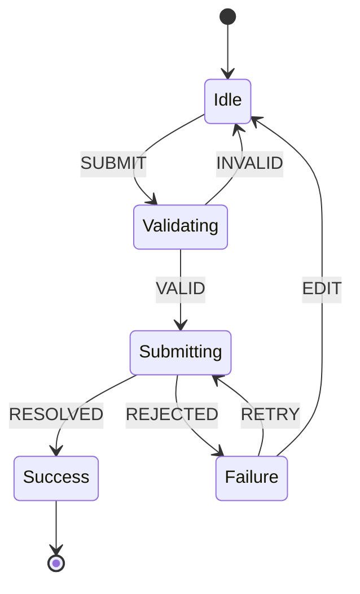

```typescript
// ❌ Booleans: 2^3 = 8 combinations, only 4 are valid
type Bad = { isLoading: boolean; isError: boolean; isSuccess: boolean };

// ✅ Discriminated union: exactly the valid states, and data only where it exists
type Status =
  | { kind: 'idle' }
  | { kind: 'submitting' }
  | { kind: 'success'; orderId: string }
  | { kind: 'failure'; error: string };
```

Options: a discriminated union + `useReducer` (zero dependencies), or **XState** (statecharts with nested/parallel states, guards, actors and a visualizer; adapters for React, Vue, Svelte, Solid and Angular). Use a machine for checkout, onboarding wizards, media players, drag-and-drop, and connection lifecycles — see [Design a Multi-Step Form / Wizard](./design-a-multi-step-form-wizard.md).

---

### Section 10: Derived State, Immutability and Shape

**1. Don't store what you can compute.** Storing `filteredItems` next to `items` and `filter` means three things to keep in sync — and one day you won't.

```text
❌ state = { items, filter, filteredItems, totalPrice }   // two values can go stale
✅ state = { items, filter }                              // filteredItems, totalPrice computed
   cost concern? → memoize the computation (selector / computed / $derived / useMemo)
```

**2. Immutability (React, Redux, Zustand, Jotai).** These libraries detect change by **reference** (`Object.is`). Mutating in place keeps the same reference, so subscribers never hear about it.

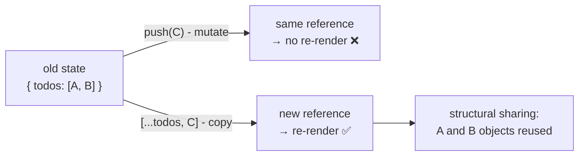

Immer (built into Redux Toolkit, available as Zustand middleware) lets you write "mutating" code that produces an immutable update. Vue, MobX, Valtio and signal libraries are the opposite: you **do** mutate, and the proxy/signal tracks it.

**3. Normalize relational data.** Store entities **by id** and reference them, instead of nesting copies:

```text
❌ { posts: [{ id: 1, author: { id: 9, name: "Ana" } }, { id: 2, author: { id: 9, name: "Ana" } }] }
✅ { users: { byId: { 9: { id: 9, name: "Ana" } } }, posts: { byId: { 1: { id: 1, authorId: 9 }, ... }, allIds: [1, 2] } }
```

Rename Ana once and every post shows it. Details in [Data Normalization & Caching](./data-normalization-and-caching.md).

**4. Keep state serializable** where possible (plain objects, arrays, strings, numbers). It enables persistence, DevTools, SSR transfer and cross-tab sync. Keep `Date`, `Map`, class instances and DOM nodes out of global stores unless your tool explicitly supports them.

---

### Section 11: URL State and Form State

**URL state** — if a user would expect **Back, reload, bookmark or "share link"** to keep it, it belongs in the URL: route, search query, filters, sort, page, selected tab, open item id.

```text
/products?category=shoes&sort=price-asc&page=2&view=grid
  ✅ shareable  ✅ survives reload  ✅ Back button works  ✅ SSR can render it  ✅ analytics see it
  ⚠️ strings only → parse and validate (zod/valibot) · keep it small · don't put secrets or PII in it
  ⚠️ replace vs push: typing in a search box should usually *replace* history, not push 30 entries
```

Tools: `useSearchParams` (React Router), `useSearchParams`/`useRouter` (Next.js), TanStack Router's typed, validated search params, the `nuqs` library (type-safe search-param state for React frameworks), Vue Router `route.query`, Angular `ActivatedRoute.queryParamMap`, SvelteKit `page.url.searchParams`.

**Form state** — values, touched/dirty flags, validation errors, and submission status. It's **local and short-lived**; copying every keystroke into a global store causes needless re-renders and stale drafts.

| Approach | When |
|---|---|
| Native `<form>` + `FormData` (React 19 actions, `useActionState`, SvelteKit form actions, Remix/React Router actions) | Simple forms, progressive enhancement |
| Uncontrolled + library (React Hook Form) | Large forms, performance-sensitive typing |
| Controlled + library (Formik, TanStack Form) | Complex dynamic forms |
| Angular Reactive Forms / Signal Forms, Vue VeeValidate / FormKit | Framework-native options (check each project's current status) |
| Global store | Only for **multi-step wizards** that must survive route changes — and even then, a scoped store per wizard |

---

### Section 12: Persistence and SSR Hydration

**Persistence** — saving client state (theme, cart, drafts) to storage so it survives a reload:

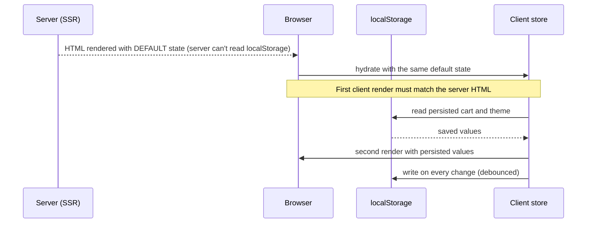

Rules:
- **Version and migrate** persisted state (`{ version: 3, data }`). An old shape in `localStorage` after a deploy is a classic crash.
- **Whitelist** what you persist. Never persist tokens in `localStorage` (XSS-readable — see [Browser Storage Mechanisms](./browser-storage-mechanisms.md)), and never persist server-state caches by accident.
- **Hydration mismatch:** reading `localStorage` during the first render in SSR apps produces different HTML on server and client. Read it **after hydration** (effect / `onMounted` / `afterNextRender`), or put values the server must know (theme, locale) in a **cookie**.
- **Cross-tab sync:** listen to the `storage` event or use `BroadcastChannel`.

**SSR store scope — the cross-request leak:**

```text
❌ export const store = createStore()   // module singleton on a Node server
   → request A (user Ana) writes her cart → request B (user Ben) renders Ana's cart

✅ create one store PER REQUEST on the server, pass it down via context/provider/DI,
   and create one per tab on the client. (Redux, Zustand, Pinia and Jotai docs all describe this.)
```

With React Server Components, Server Components can't use hooks or context at all — client stores live only in Client Components. Fetch on the server, pass data as props, and keep the client store for genuinely interactive state. See [Streaming SSR & React Server Components](./streaming-ssr-and-react-server-components.md).

---

## Framework Comparison

| Concern | React | Vue 3 | Angular | Svelte 5 | Solid | SwiftUI | Jetpack Compose |
|---|---|---|---|---|---|---|---|
| **Local** | `useState`, `useReducer` | `ref`, `reactive` | `signal()` in component | `$state` | `createSignal` | `@State` | `remember { mutableStateOf() }` |
| **Derived** | compute in render, `useMemo` | `computed` | `computed()` | `$derived` | `createMemo` | computed properties | `derivedStateOf` |
| **Pass down** | Context | `provide`/`inject` | DI (services) | `setContext`/`getContext` | Context | `@Environment` | `CompositionLocal` |
| **Shared store** | Zustand, Redux Toolkit, Jotai, MobX | **Pinia** (official; Vuex is legacy) | Services with signals, NgRx Store / SignalStore | `$state` in `.svelte.ts` modules, stores | `createStore` + context | `@Observable` model objects | `ViewModel` + `StateFlow` |
| **Survives config/process** | storage + persist | storage + plugin | storage | storage | storage | `@SceneStorage`, `@AppStorage` | `rememberSaveable`, `SavedStateHandle` |
| **Server state** | TanStack Query, SWR, RTK Query | TanStack Query (Vue), Pinia Colada | `HttpClient` + signals / `resource()` / TanStack Query Angular adapter | SvelteKit `load`, TanStack Query (Svelte) | `createResource`, TanStack Query (Solid) | async/await in models | Repository + Flow |

> APIs marked experimental in a framework (e.g. some Angular `resource` APIs) change between releases — check the official docs for the version you use.

---

## Decision Matrix

| Situation | Recommended pattern | Why |
|---|---|---|
| Toggle, input text, hover, open/closed | Local state | Zero coordination cost |
| Two siblings share a value | Lift to parent | Simplest correct fix |
| Theme, locale, current user, flags | Context / provide-inject / DI | Rarely changes, read everywhere |
| Lists, entities, user profile from an API | **Server-state cache** | Caching, dedupe, refetch, invalidation handled for you |
| Filters, sort, pagination, selected tab | **URL** | Shareable, reload-safe, SSR-friendly |
| Multi-step form spanning routes | Scoped store or state machine (+ URL for the step) | Survives navigation; enforces valid transitions |
| Frequently changing state read by many components (editor, canvas, cart, player) | External store with selectors (Zustand/Redux/Pinia/signals) | Only subscribers of changed slices update |
| Many interdependent fine-grained values (spreadsheet cells, design tool layers) | Atomic (Jotai) or signals | Per-atom subscriptions, derived graphs |
| Large team, audit trail, undo, complex async workflows | Redux Toolkit (or NgRx) | Explicit events, middleware, DevTools |
| Complex flows with illegal states (checkout, auth, media) | State machine (XState or union + reducer) | Makes impossible states unrepresentable |
| Islands / multiple frameworks on one page (Astro) | Framework-agnostic store (Nanostores) | Shares state across islands and frameworks |
| Micro-frontends | Each app owns its state; share via URL, events, or a tiny contract | Avoids coupling deploys — see [Micro-Frontends Architecture](./micro-frontends-architecture.md) |

---

## Real-World Examples

**Example 1 — Derived state (BAD → GOOD):**
```tsx
import { useEffect, useMemo, useState } from 'react';

// ❌ BAD: a second copy kept in sync with an effect → extra render, can go stale
function ProductListBad({ products }: { products: Product[] }) {
  const [query, setQuery] = useState('');
  const [visible, setVisible] = useState<Product[]>([]);
  useEffect(() => {
    setVisible(products.filter((p) => p.name.toLowerCase().includes(query.toLowerCase())));
  }, [products, query]);
  return <List items={visible} query={query} onQuery={setQuery} />;
}

// ✅ GOOD: compute during render; memoize only if it's measurably expensive
function ProductList({ products }: { products: Product[] }) {
  const [query, setQuery] = useState('');
  const visible = useMemo(
    () => products.filter((p) => p.name.toLowerCase().includes(query.toLowerCase())),
    [products, query]
  );
  return <List items={visible} query={query} onQuery={setQuery} />;
}
```

**Example 2 — Context split by change frequency (BAD → GOOD):**
```tsx
import { createContext, use, useMemo, useReducer, type Dispatch, type ReactNode } from 'react';

type CartItem = { id: string; qty: number };
type CartAction = { type: 'itemAdded'; id: string } | { type: 'itemRemoved'; id: string };

function cartReducer(items: CartItem[], action: CartAction): CartItem[] {
  switch (action.type) {
    case 'itemAdded': {
      const found = items.find((i) => i.id === action.id);
      return found
        ? items.map((i) => (i.id === action.id ? { ...i, qty: i.qty + 1 } : i))
        : [...items, { id: action.id, qty: 1 }];
    }
    case 'itemRemoved':
      return items.filter((i) => i.id !== action.id);
  }
}

// ❌ BAD: one context, new object every render → every consumer re-renders on every change
// <AppContext.Provider value={{ user, theme, cart, dispatch }}>

// ✅ GOOD: state and dispatch in separate contexts; dispatch is stable
const CartStateContext = createContext<CartItem[] | null>(null);
const CartDispatchContext = createContext<Dispatch<CartAction> | null>(null);

export function CartProvider({ children }: { children: ReactNode }) {
  const [items, dispatch] = useReducer(cartReducer, []);
  return (
    <CartDispatchContext value={dispatch}>
      <CartStateContext value={items}>{children}</CartStateContext>
    </CartDispatchContext>
  );
}

export function useCartItems() {
  const ctx = use(CartStateContext);
  if (!ctx) throw new Error('useCartItems must be used inside <CartProvider>');
  return ctx;
}
export function useCartDispatch() {
  const ctx = use(CartDispatchContext);
  if (!ctx) throw new Error('useCartDispatch must be used inside <CartProvider>');
  return ctx; // AddToCartButton uses only this → never re-renders when items change
}
```
*(On React 18, use `<Ctx.Provider value>` and `useContext` instead of `<Ctx value>` and `use`.)*

**Example 3 — A tiny external store with selectors (`useSyncExternalStore`):**
```tsx
import { useSyncExternalStore } from 'react';

export function createStore<T>(initial: T) {
  let state = initial;
  const listeners = new Set<() => void>();
  return {
    getState: () => state,
    setState(update: (prev: T) => T) {
      const next = update(state);
      if (Object.is(next, state)) return;
      state = next;
      listeners.forEach((l) => l());
    },
    subscribe(listener: () => void) {
      listeners.add(listener);
      return () => listeners.delete(listener);
    },
  };
}

type Store<T> = ReturnType<typeof createStore<T>>;

// Selector must return a stable value (primitive or existing reference)
export function useStore<T, S>(store: Store<T>, selector: (s: T) => S): S {
  return useSyncExternalStore(
    store.subscribe,
    () => selector(store.getState()),
    () => selector(store.getState()) // server snapshot (per-request store in SSR!)
  );
}

// Usage
const uiStore = createStore({ sidebarOpen: false, density: 'comfortable' as 'comfortable' | 'compact' });
function SidebarToggle() {
  const open = useStore(uiStore, (s) => s.sidebarOpen); // re-renders only when sidebarOpen changes
  return (
    <button aria-expanded={open} onClick={() => uiStore.setState((s) => ({ ...s, sidebarOpen: !s.sidebarOpen }))}>
      Menu
    </button>
  );
}
```
This is, in essence, what Zustand does — see [Zustand / Jotai / Recoil](./zustand-jotai-recoil.md).

**Example 4 — URL as the source of truth for filters (React Router):**
```tsx
import { useSearchParams } from 'react-router';
import { z } from 'zod';

const Filters = z.object({
  category: z.string().optional(),
  sort: z.enum(['relevance', 'price-asc', 'price-desc']).catch('relevance'),
  page: z.coerce.number().int().min(1).catch(1),
});

export function useProductFilters() {
  const [params, setParams] = useSearchParams();
  const filters = Filters.parse(Object.fromEntries(params)); // validate untrusted URL input

  const update = (patch: Partial<z.infer<typeof Filters>>) =>
    setParams(
      (prev) => {
        const next = new URLSearchParams(prev);
        Object.entries(patch).forEach(([k, v]) => (v == null ? next.delete(k) : next.set(k, String(v))));
        if (!('page' in patch)) next.set('page', '1'); // changing a filter resets pagination
        return next;
      },
      { replace: true } // don't flood history while the user tweaks filters
    );

  return { filters, update };
}
```

**Example 5 — The same shared store in Vue, Angular and Svelte:**
```typescript
// Vue 3 + Pinia (setup store)
import { defineStore } from 'pinia';
import { computed, ref } from 'vue';
export const useCartStore = defineStore('cart', () => {
  const items = ref<{ id: string; qty: number }[]>([]);
  const count = computed(() => items.value.reduce((n, i) => n + i.qty, 0));
  function add(id: string) {
    const found = items.value.find((i) => i.id === id);
    if (found) found.qty++; else items.value.push({ id, qty: 1 }); // mutation is fine: Vue tracks it
  }
  return { items, count, add };
});
```

```typescript
// Angular: a signal-based service (providedIn root = app-wide singleton)
import { Injectable, computed, signal } from '@angular/core';
@Injectable({ providedIn: 'root' })
export class CartStore {
  private readonly _items = signal<{ id: string; qty: number }[]>([]);
  readonly items = this._items.asReadonly();
  readonly count = computed(() => this._items().reduce((n, i) => n + i.qty, 0));
  add(id: string) {
    this._items.update((items) => {
      const found = items.find((i) => i.id === id);
      return found
        ? items.map((i) => (i.id === id ? { ...i, qty: i.qty + 1 } : i))
        : [...items, { id, qty: 1 }];
    });
  }
}
```

```typescript
// Svelte 5: cart.svelte.ts — runes work in .svelte.ts modules
// Export an object (or getters), not a reassigned $state variable
export const cart = $state({ items: [] as { id: string; qty: number }[] });
export function add(id: string) {
  const found = cart.items.find((i) => i.id === id);
  if (found) found.qty++; else cart.items.push({ id, qty: 1 }); // deep reactivity via proxy
}
export function count() {
  return cart.items.reduce((n, i) => n + i.qty, 0); // call inside $derived or markup
}
```
> In SSR (Nuxt, Angular SSR, SvelteKit), module-level state is shared by all requests on the server. Pinia and Angular DI create per-request instances for you; in SvelteKit, keep user-specific state in context or `load` data rather than a module-level `$state`.

**Example 6 — Hydration-safe persisted preference:**
```tsx
import { useEffect, useState } from 'react';

// ❌ BAD in SSR: server renders 'light', client's first render reads 'dark' → hydration mismatch
// const [theme] = useState(() => localStorage.getItem('theme') ?? 'light');

// ✅ GOOD: render the server-known default first, then sync after hydration
export function usePersistedState<T>(key: string, fallback: T, version = 1) {
  const [value, setValue] = useState<T>(fallback);
  useEffect(() => {
    try {
      const raw = localStorage.getItem(key);
      if (!raw) return;
      const parsed = JSON.parse(raw) as { v: number; data: T };
      if (parsed.v === version) setValue(parsed.data); // ignore old shapes (or migrate)
    } catch { /* storage blocked or corrupt: keep fallback */ }
  }, [key, version]);
  useEffect(() => {
    try { localStorage.setItem(key, JSON.stringify({ v: version, data: value })); } catch {}
  }, [key, value, version]);
  return [value, setValue] as const;
}
// For theme specifically, prefer a cookie (server can render the right theme) or a tiny
// inline script in <head> that sets a class before first paint — no flash, no mismatch.
```

---

## Key Points Summary

| Concept | One-Line Explanation |
|---|---|
| **State taxonomy** | Split state into server, client (local/shared), URL, form, persistent and derived |
| **Colocation** | Keep state as close as possible to where it's used; promote only when needed |
| **Lifting state up** | Move shared state to the nearest common parent |
| **Composition over drilling** | Pass rendered children/slots so middle layers don't touch data |
| **Context** | Dependency injection for rarely-changing values; all consumers re-render on change |
| **External store** | State outside the tree; components subscribe via selectors |
| **`useSyncExternalStore`** | React's tearing-safe hook for subscribing to external stores |
| **Tearing** | Different components showing different values of one store in the same frame |
| **Flux / unidirectional flow** | Events → pure reducer → new state → views |
| **Atomic state** | Many small atoms + derived atoms with per-atom subscriptions |
| **Proxy / observable** | Mutate objects directly; the library tracks reads and writes |
| **Signals** | Fine-grained reactive values that update only dependent computations |
| **State machine** | Explicit states and transitions; makes impossible states unrepresentable |
| **Derived state** | Compute from source state; never store a second copy |
| **Normalization** | Store entities by id, reference by id |
| **URL state** | Anything that should survive reload, Back or sharing |
| **Per-request stores** | On the server, a module singleton leaks state between users |

---

## Test Your Understanding

**Q1 (Basic):**
Classify each piece of state and say where it should live: (a) whether a dropdown is open, (b) the list of orders from `/api/orders`, (c) the selected sort order on a product listing, (d) the app's dark/light theme, (e) the total price of items in the cart.

<details>
<summary>Answer</summary>

- (a) **Local UI state** in the dropdown component — no one else needs it.
- (b) **Server state** — a server-cache library (TanStack Query, SWR, RTK Query). It's a copy of backend data that needs caching, refetching and invalidation, not a hand-written global store.
- (c) **URL state** (`?sort=price-asc`) — users expect reload, Back and shared links to keep it.
- (d) **Shared client state, rarely changing** → Context/provide-inject/DI, persisted to a cookie (so SSR renders the right theme) or `localStorage`.
- (e) **Derived state** — compute it from the cart items (with a memoized selector if needed). Storing it separately means it can drift.
</details>

**Q2 (Application):**
A React app keeps `{ user, theme, notifications, cart }` in one `AppContext`. Typing in the search box feels laggy and the React Profiler shows the whole page re-rendering whenever a notification arrives. Explain why and give two fixes.

<details>
<summary>Answer</summary>

Every component that reads `AppContext` re-renders whenever the provider's `value` changes — and context has no selectors, so a component that only reads `theme` still re-renders when `notifications` changes. If the value is also an inline object (`value={{ ... }}`), it's a new reference on **every** provider render, so consumers re-render even when nothing changed.

Fixes: (1) **split contexts by change frequency** (theme/session vs notifications vs cart) and memoize each value, with dispatch in its own context; (2) move high-frequency state (notifications, cart) into an **external store with selectors** (Zustand, Redux, Jotai, or `useSyncExternalStore`) so only components whose selected slice changed re-render. Also check the notifications list is **server state** — a query cache might replace it entirely.
</details>

**Q3 (Tricky):**
A Zustand-style hook is used as `const { a, b } = useStore(s => ({ a: s.a, b: s.b }))`. The component re-renders on every store update (or, in some libraries, throws "Maximum update depth exceeded"). Why?

<details>
<summary>Answer</summary>

The selector builds a **new object every time it runs**. Stores compare the selector's result with `Object.is`; a new object is never equal to the previous one, so every store change (even to unrelated keys) looks like a change. With `useSyncExternalStore`, a `getSnapshot` that returns a new value on every call is treated as constantly changing and can trigger an infinite render loop.

Fix: select primitives separately (`useStore(s => s.a)`, `useStore(s => s.b)`), use the library's shallow-equality helper (e.g. Zustand's `useShallow`), or use a memoized selector (Reselect's `createSelector`) that returns the same reference when its inputs are unchanged.
</details>

**Q4 (Tricky):**
After moving to SSR, a support ticket says: "I briefly saw another customer's name in the header." The app uses `export const store = createStore(...)` in a module. What happened?

<details>
<summary>Answer</summary>

On the server, a module is evaluated **once per Node process**, not once per request. The singleton store is shared by every concurrent request: request A writes Ana's session into it, and request B (Ben) renders before it's reset — so Ben's HTML contains Ana's name. This is a cross-request state leak, and a privacy incident.

Fix: create the store **per request** on the server (and per tab on the client), and provide it via context/provider/DI. Redux, Zustand, Jotai and Pinia all document this pattern for Next.js/Nuxt. In React Server Components setups, don't read client stores in Server Components at all — pass server data as props and create the client store inside a Client Component provider.
</details>

**Q5 (Application):**
A checkout uses `isLoading`, `isError`, `isSuccess` and `isPaymentSheetOpen` booleans. QA keeps finding states like "spinner and error message at the same time". How would you redesign it?

<details>
<summary>Answer</summary>

Four booleans allow 16 combinations, most of them invalid. Replace them with a **finite state machine** (or a discriminated union driven by a reducer): `idle → reviewing → paying → (succeeded | failed)`, with `failed → paying` on RETRY. The UI renders from a single `status.kind`, and data exists only in the states where it's valid (e.g. `orderId` only in `succeeded`). Transitions are explicit events, so "pay while paying" can simply be ignored by the machine. XState adds guards, nested states and a visualizer; a typed union with `useReducer` is enough for smaller flows. Keep the payment API call itself in the server-state layer (a mutation) and let the machine react to its result.
</details>

**Q6 (System design):**
You're designing a collaborative whiteboard (thousands of shapes, multi-select, zoom/pan, undo/redo, presence cursors, shareable links to a board and viewport). Propose the state architecture.

<details>
<summary>Answer</summary>

Split by kind:
- **Server/sync state:** the board document, synced through a real-time channel (often a CRDT/OT engine) — not a hand-rolled global store. See [Real-Time Data Sync](./real-time-data-sync.md).
- **Domain client state:** shapes **normalized by id** (`byId` + z-order array) in a store with fine-grained subscriptions — atoms per shape (Jotai), signals, or a selector-based store — so dragging one shape updates one component, not thousands.
- **Ephemeral high-frequency state:** pointer position, drag preview, presence cursors — kept outside React render where possible (refs, canvas, a separate store updated per animation frame) to protect INP.
- **Undo/redo:** an event log or patches (Immer patches, or the sync engine's history), only for document changes, not for viewport.
- **URL state:** board id and optionally viewport (`/b/abc?x=..&y=..&zoom=..`), updated with `replace`.
- **Local UI state:** menus, dialogs, tool palette hover.
- **Derived:** the selection bounding box and visible shapes (viewport culling) computed from source state.
This keeps every piece where its update frequency and sharing needs fit, and avoids one giant store that re-renders the canvas on every cursor move.
</details>

---

## Cheat Sheet

**Key Definitions:**
- **Client state:** Data owned by the browser session (UI flags, drafts, preferences)
- **Server state:** A client-side cached copy of backend-owned data
- **Colocation:** Keeping state in the lowest component that needs it
- **Prop drilling:** Passing props through components that don't use them
- **Selector:** Function that picks/derives a slice of store state for a subscriber
- **Tearing:** Inconsistent values from one store shown in the same frame during concurrent rendering
- **Signal:** Reactive value that notifies only the computations that read it
- **Normalization:** Storing entities in id-keyed maps and referencing by id
- **Finite state machine:** Model with explicit states and allowed transitions

**Quick Reference:**
```text
Order of questions:  server data? → derive? → URL? → form? → local? → lift? → context? → store
Server data          → TanStack Query / SWR / RTK Query / Apollo (not a hand-written store)
Shareable view state → URL search params (validate, replace history while typing)
Rarely changing      → Context / provide-inject / Angular DI
Frequent + shared    → store with selectors (Zustand, RTK, Pinia, NgRx, signals)
Fine-grained graph   → atoms (Jotai) or signals
Complex flows        → state machine (XState or union + reducer)
Islands / multi-fw   → Nanostores
Selectors            → return primitives or stable references
Context              → split by change frequency, memoize value, separate dispatch
SSR                  → one store per request; read localStorage after hydration
Persist              → whitelist + version + migrate; never persist tokens in localStorage
```

**Common Mistakes to Avoid:**

| Mistake | Why Wrong | Fix |
|---|---|---|
| Everything in a global store | Re-renders, coupling, orphaned state | Colocate; promote only when shared |
| Fetched data copied into Redux/Zustand by hand | Re-implementing caching, dedupe and invalidation badly | Server-state library |
| Storing derived values | Copies drift out of sync | Compute + memoize |
| One giant context | Every consumer re-renders on any change | Split contexts, or use a store with selectors |
| Inline `value={{...}}` on a provider | New reference every render | Memoize the value |
| Selector returning a new object | Re-render on every store change or infinite loop | Select primitives / shallow compare / memoized selector |
| Mutating state in immutable libraries | Same reference → no update | Copy, or use Immer |
| Filters/tabs kept only in memory | Lost on reload, can't share a link | URL search params |
| Module singleton store with SSR | Leaks data between users | Per-request store via provider/DI |
| Reading `localStorage` in the first render with SSR | Hydration mismatch | Read after mount, or use a cookie |
| Boolean soup for async flows | Impossible states | Discriminated union or state machine |
| Keystrokes in a global store | Lag on every key press | Local or form-library state |

---

## References & Further Reading

**React**
- React: [Managing State](https://react.dev/learn/managing-state) · [Choosing the State Structure](https://react.dev/learn/choosing-the-state-structure) · [Sharing State Between Components](https://react.dev/learn/sharing-state-between-components)
- React: [Passing Data Deeply with Context](https://react.dev/learn/passing-data-deeply-with-context) · [Scaling Up with Reducer and Context](https://react.dev/learn/scaling-up-with-reducer-and-context)
- React: [You Might Not Need an Effect](https://react.dev/learn/you-might-not-need-an-effect)
- React: [`useSyncExternalStore`](https://react.dev/reference/react/useSyncExternalStore) · [`createContext`](https://react.dev/reference/react/createContext) · [`use`](https://react.dev/reference/react/use)
- React Working Group: [What is tearing?](https://github.com/reactwg/react-18/discussions/69)

**Other frameworks**
- Vue: [State Management](https://vuejs.org/guide/scaling-up/state-management.html) · [Pinia](https://pinia.vuejs.org/) · [SSR state pollution](https://vuejs.org/guide/scaling-up/ssr.html#cross-request-state-pollution)
- Angular: [Signals](https://angular.dev/guide/signals) · [NgRx SignalStore](https://ngrx.io/guide/signals/signal-store)
- Svelte: [`$state`](https://svelte.dev/docs/svelte/$state) · [Stores](https://svelte.dev/docs/svelte/stores) · [SvelteKit state management](https://svelte.dev/docs/kit/state-management)
- Solid: [Signals](https://docs.solidjs.com/concepts/signals)
- Apple: [Managing model data in your app (SwiftUI)](https://developer.apple.com/documentation/swiftui/managing-model-data-in-your-app)
- Android: [State and Jetpack Compose](https://developer.android.com/develop/ui/compose/state)

**Patterns & tools**
- Redux: [Redux Essentials — Concepts and Data Flow](https://redux.js.org/tutorials/essentials/part-1-overview-concepts)
- Redux: [Style Guide — Evaluate Where Each Piece of State Should Live](https://redux.js.org/style-guide/#evaluate-where-each-piece-of-state-should-live)
- Stately: [XState documentation](https://stately.ai/docs/xstate)
- TC39: [Signals proposal](https://github.com/tc39/proposal-signals)
- TanStack Router: [Search params](https://tanstack.com/router/latest/docs/framework/react/guide/search-params) · [nuqs](https://github.com/47ng/nuqs)
- Nanostores: [GitHub](https://github.com/nanostores/nanostores) · Astro: [Share state between islands](https://docs.astro.build/en/recipes/sharing-state-islands/)

**Deep dives**
- Kent C. Dodds: [Application State Management with React](https://kentcdodds.com/blog/application-state-management-with-react)
- Dan Abramov: [You Might Not Need Redux](https://medium.com/@dan_abramov/you-might-not-need-redux-be46360cf367)
- Richard Feldman: [Making Impossible States Impossible (elm-conf 2016)](https://www.youtube.com/watch?v=IcgmSRJHu_8)

---

> **Previous Topic:** [Module Bundling & Build Systems](./module-bundling-and-build-systems.md)
> — How source modules become optimized bundles

> **Next Topic:** [Redux & Redux Toolkit](./redux-and-redux-toolkit.md)
> — The Flux pattern in depth, and the modern Redux Toolkit API

*Saved on: 2026-11-06 | Repo: Frontend System Design Learning Notes*
