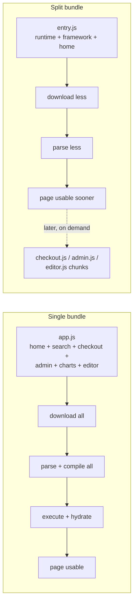
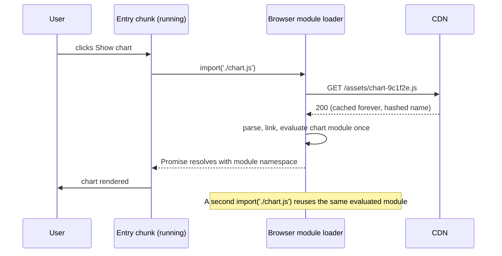
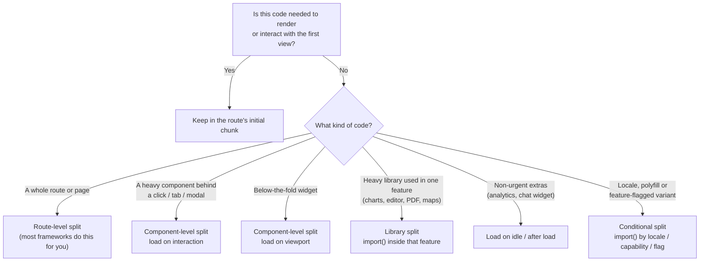
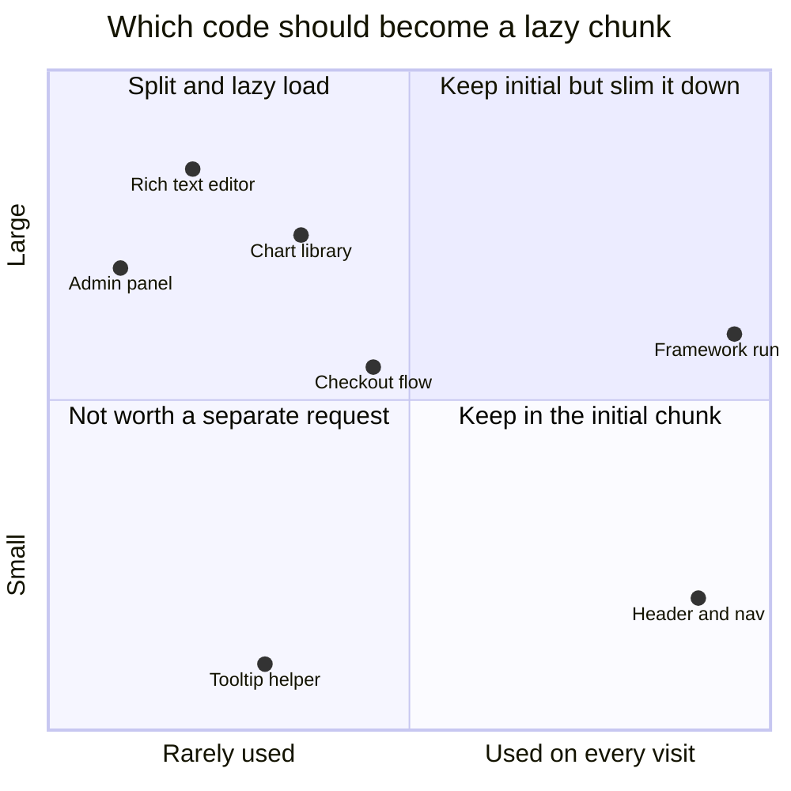
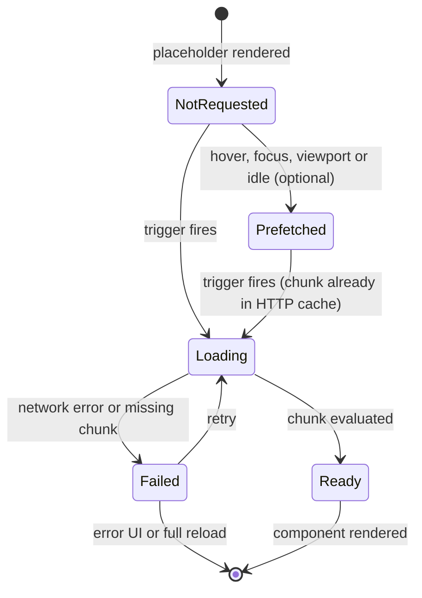
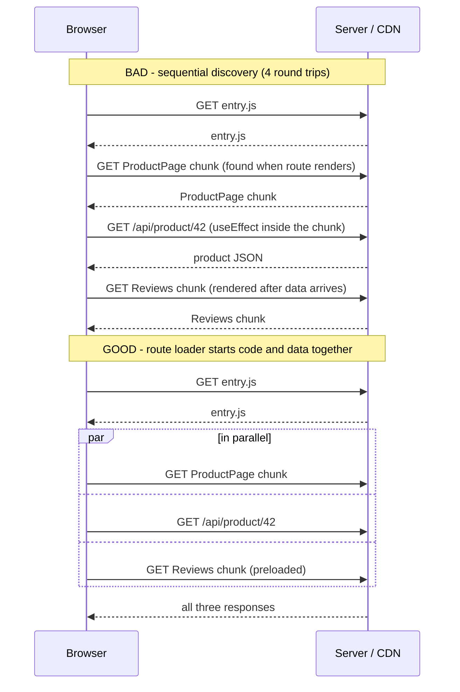
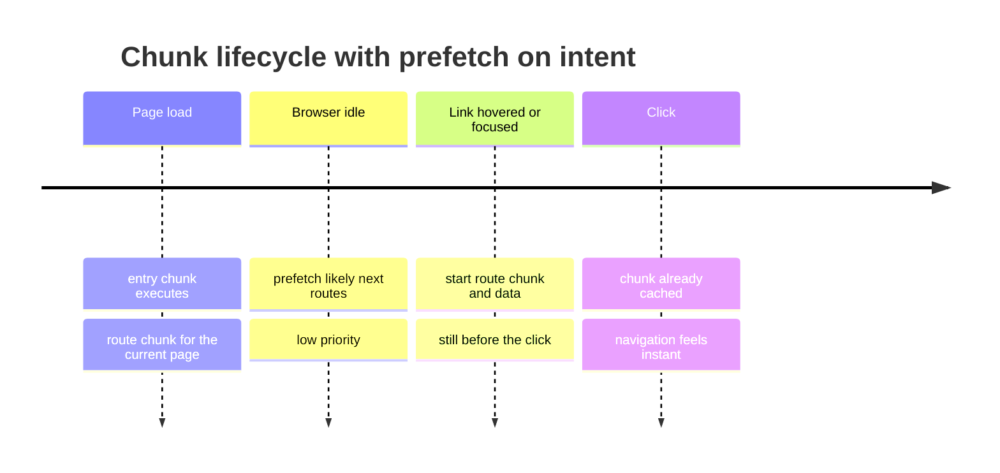
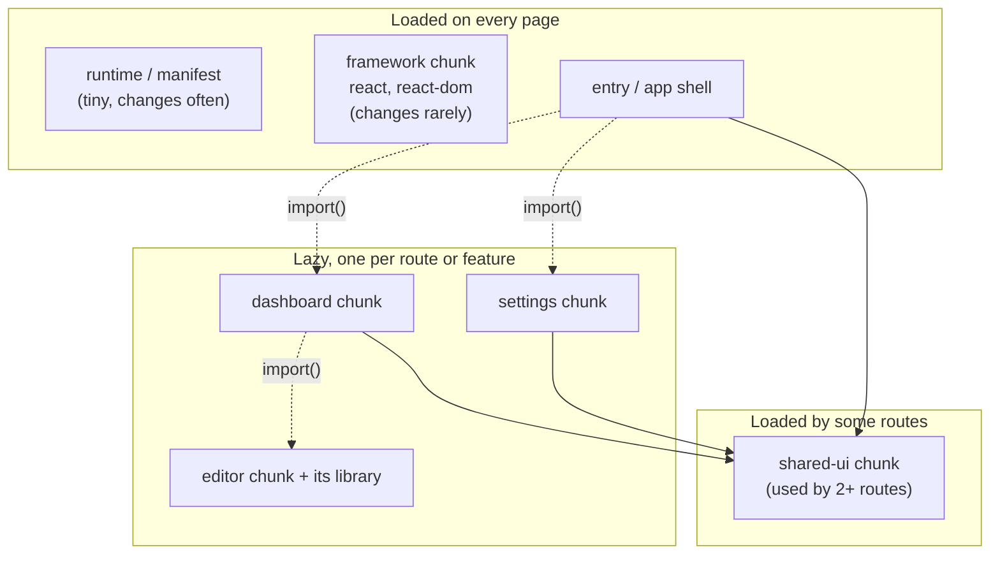
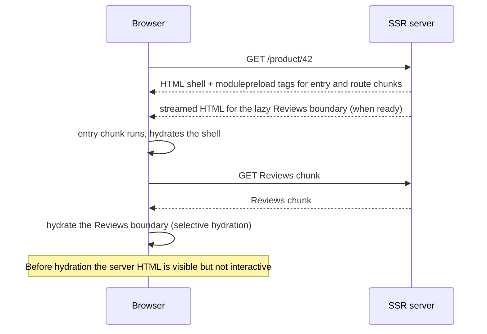
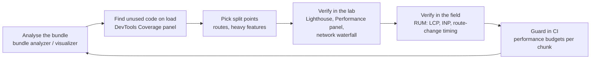

<!-- Generated by scripts/sync-knowledge.js from notes/ and README.md — do not edit here. -->
<!-- sections (line ranges in this file): Table of Contents 19-42 · ELI5 43-56 · Core Concept 57-439 · Framework Comparison 440-458 · Decision Matrix 459-475 · Real-World Examples 476-721 · Key Points Summary 722-741 · Test Your Understanding 742-825 · Cheat Sheet 826-873 · References & Further Reading 874-916 -->

# Code Splitting & Lazy Loading

> **Date:** 2026-11-06 · **Last updated:** 2026-11-06
> **Category:** Frontend System Design
> **Sub-Topic:** Performance Engineering / Loading Performance
> **Level:** Intermediate · **Reading time:** ~30 min
> **Informs:** initial JS budget per route, route-level vs component-level chunk boundaries, lazy-load trigger (route / interaction / viewport / idle), chunk prefetch policy, Suspense and loading-state design, vendor chunking for long-term caching, ChunkLoadError recovery after deploys, LCP / INP / TTI trade-offs

> **Pre-requisite:** [Module Bundling & Build Systems](./module-bundling-and-build-systems.md) (what a bundle and a chunk are) and [Performance Budgets](./performance-budgets.md) (why the initial JS size matters). [Client-Side Rendering (CSR)](./client-side-rendering-csr.md) shows why a single big bundle hurts first load.
> This note answers: **"Which code does the user need right now, and how do we defer everything else without making the app feel slow later?"**

**Previous:** [Performance Budgets](./performance-budgets.md) · **Next:** [Tree Shaking & Dead Code Elimination](./tree-shaking-and-dead-code-elimination.md)

---

## Table of Contents

1. [ELI5 — Simple Explanation](#eli5--simple-explanation)
2. [Section 1: Why One Big Bundle Hurts](#section-1-why-one-big-bundle-hurts)
3. [Section 2: Dynamic `import()` — the Split Point](#section-2-dynamic-import--the-split-point)
4. [Section 3: Where to Split — Routes, Components, Libraries](#section-3-where-to-split--routes-components-libraries)
5. [Section 4: Lazy-Load Triggers](#section-4-lazy-load-triggers)
6. [Section 5: Loading States, Suspense and Errors](#section-5-loading-states-suspense-and-errors)
7. [Section 6: The Waterfall Problem](#section-6-the-waterfall-problem)
8. [Section 7: Prefetching and Preloading Chunks](#section-7-prefetching-and-preloading-chunks)
9. [Section 8: Chunking Strategy and Long-Term Caching](#section-8-chunking-strategy-and-long-term-caching)
10. [Section 9: Code Splitting with SSR, Streaming and Islands](#section-9-code-splitting-with-ssr-streaming-and-islands)
11. [Section 10: Lazy Loading Non-JS Resources](#section-10-lazy-loading-non-js-resources)
12. [Section 11: Measuring Whether Splitting Helped](#section-11-measuring-whether-splitting-helped)
13. [Framework Comparison](#framework-comparison)
14. [Decision Matrix](#decision-matrix)
15. [Real-World Examples](#real-world-examples)
16. [Key Points Summary](#key-points-summary)
17. [Test Your Understanding](#test-your-understanding)
18. [Cheat Sheet](#cheat-sheet)
19. [References & Further Reading](#references--further-reading)

---

## ELI5 — Simple Explanation

Imagine moving into a new flat. You **could** wait until the removal van has unloaded every box — winter coats, the camping tent, the Christmas decorations — before you're allowed to sit on the sofa. Or you could unload **the sofa, the kettle and the bed first**, move in tonight, and fetch the other boxes from storage **when you actually need them**.

- **One big bundle** = waiting for the whole van before you can sit down.
- **Code splitting** = packing things into **labelled boxes** (chunks) instead of one giant crate.
- **Lazy loading** = fetching a box **only when you need it** (the tent when you go camping, the settings page when you click "Settings").
- **Prefetching** = when you see clouds, you quietly fetch the umbrella box **before** it rains, so it's there the moment you need it.
- **A waterfall** = opening the tent box only to find a note saying "the tent poles are in another box in storage" — two trips instead of one.

> **Ship the code for what the user is doing now; fetch the rest when (or just before) they need it — and never make them wait twice.**

---

## Core Concept — Step by Step

### Section 1: Why One Big Bundle Hurts

Every byte of JavaScript costs the user **three times**: download, then parse/compile, then execute — and the last two run on the main thread, competing with input handling and rendering (see [JavaScript Runtime & Event Loop](./javascript-runtime-event-loop.md)).



What a large initial bundle hurts:

| Metric / experience | Why a big bundle hurts it |
|---|---|
| **LCP** (CSR apps) | Content can't render until the JS that renders it has downloaded and run |
| **INP** | Long parse/compile/execute tasks block the main thread; early clicks queue behind them |
| **Time to interactive / hydration** | In SSR apps the HTML is visible early, but stays inert until the JS hydrates it |
| **Low-end devices** | Parse and compile time grows with code size, and slow CPUs feel it most |
| **Data plans** | Users pay for code they never execute |

> **Rule of thumb:** a route should ship only the code it needs to render and respond to its first interactions. Everything else is a candidate for a separate chunk.

Two related techniques remove code in different ways — keep them distinct:

| Technique | What it does | Note |
|---|---|---|
| **Tree shaking** | Deletes code **nobody uses** at all | [Tree Shaking & Dead Code Elimination](./tree-shaking-and-dead-code-elimination.md) |
| **Code splitting** | Moves code that **is** used, but **not yet**, into separate files | This note |
| **Lazy loading** | Fetches those files **at the moment** they're needed | This note |

---

### Section 2: Dynamic `import()` — the Split Point

A static `import` is resolved at build time and lands in the same chunk graph as the importer. A **dynamic `import()`** expression (ES2020) returns a **Promise of the module namespace** — and every modern bundler (webpack, Rollup/Vite, Rolldown, esbuild, Rspack, Parcel, Turbopack) treats it as a **split point**: the imported module and its exclusive dependencies go into a separate chunk.

```javascript
// Static: part of the importer's chunk, evaluated before the importer runs
import { formatPrice } from './format.js';

// Dynamic: a separate chunk, fetched and evaluated only when this line runs
const { renderChart } = await import('./chart.js');
```



Key semantics:

| Fact | Consequence |
|---|---|
| `import()` returns a Promise | Every lazy boundary is **asynchronous** — you must design a loading state and an error state |
| A module is evaluated **once** per realm | Calling `import()` again is cheap after the first load — the browser's module map (or the bundler runtime) caches it |
| Works in classic scripts too | You don't need `type="module"` to use it |
| The specifier should be **statically analysable** | `import('./pages/' + name)` makes bundlers include every file that could match. Vite only supports limited variable patterns (relative path, file extension, one directory level) |
| Bundler runtime handles loading | In webpack builds `import()` becomes the webpack runtime's chunk loader; in Vite builds it's the native `import()` plus a small preload helper |

> Dynamic `import()` is supported in all modern browsers (Chrome 63+, Firefox 67+, Safari 11.1+ per MDN browser-compat-data).

---

### Section 3: Where to Split — Routes, Components, Libraries



| Split level | Typical examples | Who does the work |
|---|---|---|
| **Route-level** | `/dashboard`, `/settings`, `/admin` | Framework routers: Next.js, Remix/React Router framework mode, Nuxt, SvelteKit, Angular router (`loadComponent`), TanStack Router (auto code splitting) |
| **Component-level** | Modals, drawers, tabs not shown first, rich text editors, video players | You: `React.lazy`, `next/dynamic`, `defineAsyncComponent`, Angular `@defer` |
| **Library-level** | Chart libraries, Markdown/syntax highlighters, PDF renderers, map SDKs, date-zone data | You: `import()` inside the code path that needs it |
| **Conditional** | Per-locale messages, polyfills only for old browsers, A/B variants, admin-only tools | You: `import(\`./locales/${lang}.json\`)` or capability checks |
| **Vendor / shared** | Framework runtime, code shared by several routes | Bundler chunking heuristics (Section 8) |



**Don't split:**
- Code that renders the **LCP element** or the above-the-fold UI — lazy loading it delays the most important paint.
- Tiny modules — each chunk is an extra request, and small files compress less effectively than one larger file.
- Code that is needed **within milliseconds** of every load anyway (e.g. the app shell's router).

---

### Section 4: Lazy-Load Triggers

"Lazy" needs a **trigger** — the event that decides when to fetch the chunk.

| Trigger | When the chunk loads | Use for | Watch out for |
|---|---|---|---|
| **Route navigation** | When the user navigates to the route | Pages | Navigation now waits for the chunk — prefetch on link hover/viewport |
| **Interaction** | On click / focus / `pointerdown` | Modals, emoji pickers, editors, "Share" sheets | The first interaction waits for the network — show instant feedback and prefetch on hover/focus |
| **Viewport** | When a placeholder scrolls near the viewport (`IntersectionObserver`) | Comments, carousels, footers, below-the-fold widgets | Reserve the space to avoid CLS; use a `rootMargin` to start early |
| **Idle** | When the main thread is idle after load | Analytics, chat widgets, prefetching likely routes | `requestIdleCallback` is **not** in Safari (MDN BCD) — fall back to `setTimeout` |
| **Condition / capability** | When a flag, locale, permission or feature test says so | Polyfills, locales, A/B variants, admin tools | Don't make the condition itself depend on a lazy chunk |
| **Media query** | When a breakpoint matches | Desktop-only sidebars, mobile-only sheets | Re-check on resize/orientation change |



Interaction-triggered loading and **INP**: the click that triggers `import()` counts towards INP only until the next paint. If you render immediate feedback (a spinner, a skeleton, the pressed state) in the same frame, the network wait shows up as "loading UX", not as a slow interaction. If instead you `await import()` **before** rendering anything, the user sees nothing happen.

---

### Section 5: Loading States, Suspense and Errors

Every lazy boundary has three states: **loading**, **ready** and **failed**. Frameworks give you a declarative place for each.

```tsx
import { lazy, Suspense } from 'react';
import { ErrorBoundary } from 'react-error-boundary';

// Declared at module top level — never inside a component (that would recreate it each render)
const SettingsPanel = lazy(() => import('./SettingsPanel'));

export function Settings() {
  return (
    <ErrorBoundary fallback={<p role="alert">Couldn't load settings. <a href="">Reload</a></p>}>
      <Suspense fallback={<SettingsSkeleton />}>
        <SettingsPanel />
      </Suspense>
    </ErrorBoundary>
  );
}
```

| Rule | Why |
|---|---|
| `React.lazy` needs a module with a **default export** | For named exports: `lazy(() => import('./x').then((m) => ({ default: m.Named })))` |
| Declare lazy components at **module level** | Declaring them inside a component creates a new component type each render, resetting state |
| Put `<Suspense>` **close to** the lazy component | A boundary high up blanks out large parts of the UI while a small widget loads |
| Use **skeletons sized like the real content** | Prevents layout shift (CLS) when the chunk arrives |
| Avoid flashing spinners | If the chunk usually arrives in a few hundred ms, delay the spinner (Vue's `defineAsyncComponent` has a `delay` option for this; React transitions keep the old UI on screen) |
| Always pair with an **error boundary** | A chunk can fail to load (offline, deploy removed it); without a boundary the whole tree unmounts |

**Transitions keep old UI visible.** When navigation to a lazy route is wrapped in `startTransition` (React Router and Next.js do this for navigations), React keeps showing the current page instead of replacing it with the nearest Suspense fallback — the user sees the old page plus a pending indicator instead of a blank skeleton.

**Failed chunks after deploys** are a real production problem: a user with an old tab requests `Settings-a1b2c3.js`, which the deploy removed. Keep old hashed assets for a while and reload once on chunk errors — see [Browser Caching Strategies](./browser-caching-strategies.md) (Section 7 and Example 4).

---

### Section 6: The Waterfall Problem

Code splitting can make things **slower** if each chunk discovers the next one only after it runs.



How to flatten waterfalls:

| Technique | How |
|---|---|
| **Route loaders** | Start data fetching at navigation time, in parallel with loading the route chunk (React Router `loader`, TanStack Router `loader`, Next.js Server Components, Nuxt/SvelteKit `load`) |
| **Fetch-then-render, not fetch-on-render** | Don't wait for a lazy component to mount before its data request starts |
| **Bundler preload of dependencies** | Vite rewrites dynamic imports so the chunk **and its imported chunks** are fetched in parallel (its "async chunk loading optimization"); webpack's `webpackPreload` loads a chunk alongside its parent |
| **Fewer nested lazy boundaries** | A lazy component that itself lazy-loads its children creates a chain — merge them if they're always used together |
| **Prefetch on intent** | Hover, focus or viewport on a link starts the chunk before the click (Section 7) |
| **SSR with chunk manifests** | The server knows which chunks a page uses and emits `<script>`/`modulepreload` tags for all of them up front |

---

### Section 7: Prefetching and Preloading Chunks

Lazy loading saves bytes on first load but adds latency on first use. **Prefetching** buys back that latency with idle bandwidth.

| Hint | Priority | Meaning | Support note |
|---|---|---|---|
| `<link rel="modulepreload" href="chunk.js">` | High | Fetch **and** parse this ES module (and optionally its deps) for the current page | Chrome 66+, Firefox 115+, Safari 17+ (MDN BCD) |
| `<link rel="preload" as="script">` | High | Fetch a classic script needed for the current page | Widely supported |
| `<link rel="prefetch">` | Lowest | Fetch something likely needed for a **future** navigation, into the HTTP cache | Chromium and Firefox; Safari only behind a flag (MDN BCD) |
| Calling `import()` early (e.g. on hover) | Normal | Fetches **and evaluates** the module | Works everywhere `import()` does |
| Speculation Rules (`<script type="speculationrules">`) | — | Prefetch or prerender whole **documents** for MPA navigations | Chromium-only today; see [Prefetching & Preloading](./prefetching-and-preloading.md) |



Framework defaults (check each framework's docs, defaults change between versions):
- **Next.js** `<Link>` prefetches routes as links enter the viewport in production builds; the `prefetch` prop tunes or disables it.
- **React Router / Remix** `<Link prefetch="intent">` (also `"render"`, `"viewport"`, `"none"`) in framework mode.
- **Nuxt** `<NuxtLink>` prefetches on visibility by default; **SvelteKit** uses `data-sveltekit-preload-data` / `data-sveltekit-preload-code` attributes (`"hover"`, `"tap"`, `"viewport"`, `"eager"`).
- **Angular** router `PreloadAllModules` or a custom `PreloadingStrategy`; `@defer` has `prefetch on …` triggers.
- **webpack** magic comment `/* webpackPrefetch: true */` adds `<link rel="prefetch">` for the chunk once its parent loads.

> **Respect the user's data:** skip speculative prefetching when `navigator.connection?.saveData` is true or the effective connection is slow (the Network Information API is Chromium-only, so treat it as a hint).

---

### Section 8: Chunking Strategy and Long-Term Caching

The bundler decides **how** the split modules are grouped into files. The goal: few enough requests, as little duplication as possible, and **stable hashes** so returning users re-download only what changed.



| Goal | How | Tool knobs |
|---|---|---|
| **Cache stability** | Put rarely-changing deps (framework) in their own chunk, so an app-code change doesn't change its hash | webpack `optimization.splitChunks.cacheGroups`, `runtimeChunk: 'single'`; Vite/Rollup `output.manualChunks` (newer Rolldown-based Vite has its own chunking options — check the Vite docs) |
| **No duplication** | Code imported by several async chunks goes into one shared chunk | webpack `splitChunks` (by default it only splits **async** chunks; `chunks: 'all'` includes initial ones); Rollup does this automatically |
| **Not too many requests** | Merge tiny chunks; set minimum sizes | webpack `minSize` / `maxSize`; Rollup `experimentalMinChunkSize` |
| **Content hashes** | `[contenthash]` (webpack) / `[hash]` (Vite) in filenames + `Cache-Control: immutable` | See [Browser Caching Strategies](./browser-caching-strategies.md) |

**A giant `vendor.js` is an anti-pattern.** Putting *all* of `node_modules` into one chunk means every page downloads libraries only one route needs, and any dependency bump invalidates the whole file. Prefer the bundler's default heuristics (or Next.js's built-in granular chunking), plus a dedicated framework chunk.

**HTTP/2 and HTTP/3** make many parallel requests cheap compared with HTTP/1.1 (see [HTTP/1.1 vs HTTP/2 vs HTTP/3](./http1-vs-http2-vs-http3.md)), which is why moderate granularity works well today — but each request still has overhead and per-file compression is less efficient for tiny files. Measure rather than maximising chunk count.

---

### Section 9: Code Splitting with SSR, Streaming and Islands

On the server, lazy components still render to HTML; the split only affects **when their JavaScript reaches the browser and hydrates**.



| Approach | What gets split | Note |
|---|---|---|
| **SSR + lazy components** | Client JS per boundary; HTML is still rendered on the server | Frameworks emit preload tags from a chunk manifest so there's no client-side discovery waterfall |
| **React Server Components** | Server Components never ship to the client; only `'use client'` components are bundled, and Next.js splits them automatically | See [Streaming SSR & React Server Components](./streaming-ssr-and-react-server-components.md) |
| **`ssr: false` / client-only** | The component isn't rendered on the server at all | Next.js `next/dynamic` with `ssr: false` must be used from a Client Component in the App Router; reserve space to avoid CLS |
| **Lazy hydration** | HTML is server-rendered, JS for a part is loaded/hydrated only on a trigger | Vue 3.5+ `defineAsyncComponent({ hydrate: hydrateOnVisible() })`; Angular `@defer` with incremental hydration (`hydrate on …`) in newer versions; Nuxt delayed-hydration props on `Lazy*` components |
| **Islands** | Only interactive islands ship JS at all, each with its own trigger | Astro `client:load` / `client:idle` / `client:visible`; see [Island Architecture](./island-architecture.md) |

> Splitting reduces **download** cost. It doesn't reduce **hydration** cost for code that must hydrate anyway — that's what RSC, islands and lazy hydration address.

---

### Section 10: Lazy Loading Non-JS Resources

The same "load when needed" idea applies to other resources, often with a single attribute.

| Resource | Native lazy loading | Support (MDN BCD) |
|---|---|---|
| Images | `` | Chrome 77+, Firefox 75+, Safari 15.4+ |
| iframes (embeds, maps, videos) | `<iframe loading="lazy">` | Chrome 77+, Firefox 121+, Safari 16.4+ |
| Rendering work (not network) | `content-visibility: auto` on off-screen sections | `auto`: Chrome 85+, Firefox 125+, Safari 26+ |
| CSS per route | Bundlers extract CSS per async chunk (Vite's `build.cssCodeSplit` is on by default) | — |
| Fonts | Only downloaded when text using them renders | See [Font Loading Strategies](./font-loading-strategies.md) |

> **Never lazy-load the LCP image** or anything above the fold — `loading="lazy"` delays it until layout confirms it's in the viewport. Details in [Image Optimization](./image-optimization.md).

For heavy third-party embeds (video players, chat widgets, maps), the **facade pattern** works well: render a lightweight static preview (a thumbnail with a play button) and load the real embed only on click.

---

### Section 11: Measuring Whether Splitting Helped



| Tool | What it tells you |
|---|---|
| `webpack-bundle-analyzer`, `rollup-plugin-visualizer`, `source-map-explorer` | Which modules end up in which chunk, and how big they are |
| Chrome DevTools **Coverage** panel | How many bytes of each loaded script actually ran during your session |
| Chrome DevTools **Network** panel | Request waterfalls — look for chunk → chunk → data chains |
| Lighthouse / PageSpeed Insights | Flags unused JavaScript and long main-thread work in a lab run |
| RUM (web-vitals library, your analytics) | Real LCP/INP after the change, per route and device class |
| Size-limit tools in CI | Fail the build when a chunk exceeds its budget — see [Performance Budgets](./performance-budgets.md) |

Signs you over-split: dozens of tiny chunks on first load, visible chunk-to-chunk waterfalls, and spinners on interactions that used to be instant.

---

## Framework Comparison

| Stack | Route-level splitting | Component-level lazy loading | Prefetch / triggers |
|---|---|---|---|
| **React (Vite / webpack SPA)** | `React.lazy` per route, or React Router `lazy` route property | `React.lazy` + `<Suspense>` | Call `import()` on hover/focus; webpack magic comments |
| **Next.js** | Automatic per route (App and Pages Router) | `next/dynamic` (wraps `lazy` + `Suspense`); Server Components never ship | `<Link>` viewport prefetch in production |
| **React Router (framework mode) / Remix** | Automatic per route module | `React.lazy` | `<Link prefetch="intent">` |
| **TanStack Router** | Automatic code splitting via its bundler plugin, or `.lazy` route files | `React.lazy` | `preload="intent"` on links |
| **Vue + Vue Router** | `component: () => import('./views/X.vue')` | `defineAsyncComponent` (with `loadingComponent`, `errorComponent`, `delay`, `timeout`) | Manual, or Nuxt `<NuxtLink>` |
| **Nuxt** | Automatic per page | `Lazy` prefix on auto-imported components (`<LazyComments />`) | `<NuxtLink>` prefetch on visibility |
| **Angular** | `loadComponent` / `loadChildren` in routes | `@defer` blocks with `on idle` (default), `on viewport`, `on interaction`, `on hover`, `on immediate`, `on timer`, `when` | `prefetch on …`, router preloading strategies |
| **Svelte / SvelteKit** | Automatic per route | `{#await import('./X.svelte') then m}<m.default />{/await}` | `data-sveltekit-preload-code` / `-preload-data` |
| **SolidJS** | Router lazy routes | `lazy()` from `solid-js` + `<Suspense>` | Manual |
| **Astro** | One page = one MPA document | Islands with `client:*` directives | Built-in prefetch configuration |
| **React Native** | No network chunks by default: the bundle ships in the app | `React.lazy` still defers *evaluation*; Metro's inline requires defer module initialisation; Re.Pack (webpack/Rspack) enables real remote chunks | — |
| **Native Android / iOS** | Play Feature Delivery (on-demand feature modules) on Android | Lazy view/module initialisation | iOS On-Demand Resources is for assets, not code |

---

## Decision Matrix

| Situation | Recommendation |
|---|---|
| SPA with many routes, no SSR | Route-level splitting first; prefetch likely next routes on intent |
| Content site with a few widgets | Islands or lazy hydration — most of the page needs no JS |
| Heavy feature behind a click (editor, chart, map) | Interaction-triggered `import()` + prefetch on hover/focus + skeleton |
| Below-the-fold widget | Viewport trigger with `rootMargin`, reserved space |
| Above-the-fold hero or LCP element | **Don't split it** — inline in the route chunk; preload its image |
| Large shared dependency used by many routes | Let the bundler extract it to a shared chunk; don't lazy-load per route |
| Locales / polyfills | Conditional `import()` keyed by locale or feature detection |
| Third-party embeds | Facade pattern; load the real embed on click |
| SSR app with slow hydration | RSC / islands / lazy hydration — splitting alone won't fix hydration cost |
| Mobile app (React Native) | Rely on Hermes + inline requires; use Re.Pack only if you truly need remote chunks |

---

## Real-World Examples

**Example 1 — Route-level splitting with React Router (data router):**
```tsx
import { createBrowserRouter, RouterProvider } from 'react-router';

const router = createBrowserRouter([
  {
    path: '/',
    lazy: () => import('./routes/root'),            // module exports Component, loader, ErrorBoundary
    children: [
      { index: true, lazy: () => import('./routes/home') },
      { path: 'reports', lazy: () => import('./routes/reports') }, // charts only load here
      { path: 'settings', lazy: () => import('./routes/settings') },
    ],
  },
]);

export function App() {
  return <RouterProvider router={router} />;
}

// routes/reports.tsx
export async function loader() {
  return fetch('/api/reports').then((r) => r.json()); // starts with the chunk, not after mount
}
export function Component() {
  /* ... */
}
```

**Example 2 — Interaction-triggered loading with prefetch on intent (BAD → GOOD):**
```tsx
import { lazy, Suspense, useState } from 'react';

// ❌ BAD: the emoji picker and its data ship in the initial bundle for every user
// import EmojiPicker from './EmojiPicker';

// ✅ GOOD: separate chunk; start downloading on hover/focus, render on click
const loadPicker = () => import('./EmojiPicker');
const EmojiPicker = lazy(loadPicker);

export function EmojiButton() {
  const [open, setOpen] = useState(false);
  return (
    <>
      <button
        type="button"
        aria-expanded={open}
        onPointerEnter={loadPicker}  // prefetch: the import() promise is cached by the module loader
        onFocus={loadPicker}
        onClick={() => setOpen(true)}
      >
        😀
      </button>
      {open && (
        <Suspense fallback={<div className="picker-skeleton" aria-busy="true" />}>
          <EmojiPicker onClose={() => setOpen(false)} />
        </Suspense>
      )}
    </>
  );
}
```

**Example 3 — Viewport-triggered loading with `IntersectionObserver`:**
```tsx
import { lazy, Suspense, useEffect, useRef, useState } from 'react';

const Comments = lazy(() => import('./Comments'));

export function LazyComments({ postId }: { postId: string }) {
  const ref = useRef<HTMLDivElement>(null);
  const [visible, setVisible] = useState(false);

  useEffect(() => {
    const el = ref.current;
    if (!el) return;
    const io = new IntersectionObserver(
      ([entry]) => {
        if (entry.isIntersecting) {
          setVisible(true);
          io.disconnect();
        }
      },
      { rootMargin: '400px 0px' } // start loading before it scrolls into view
    );
    io.observe(el);
    return () => io.disconnect();
  }, []);

  return (
    <section ref={ref} style={{ minHeight: 320 }} aria-label="Comments">
      {visible && (
        <Suspense fallback={<CommentsSkeleton />}>
          <Comments postId={postId} />
        </Suspense>
      )}
    </section>
  );
}
```

**Example 4 — Load non-urgent code when idle (with Safari fallback):**
```typescript
type IdleCb = (cb: () => void) => void;

const onIdle: IdleCb =
  'requestIdleCallback' in window
    ? (cb) => window.requestIdleCallback(cb, { timeout: 3000 })
    : (cb) => setTimeout(cb, 1500); // Safari has no requestIdleCallback

window.addEventListener('load', () => {
  onIdle(() => {
    void import('./analytics').then((m) => m.init());
    void import('./support-chat').then((m) => m.mountLauncher());
  });
});
```

**Example 5 — Next.js `next/dynamic` in a Client Component:**
```tsx
'use client';
import dynamic from 'next/dynamic';

// Client-only map: not rendered on the server; `ssr: false` must live in a Client Component
const StoreMap = dynamic(() => import('./StoreMap'), {
  ssr: false,
  loading: () => <div className="map-placeholder" style={{ aspectRatio: '16 / 9' }} />,
});

// Named export
const PriceChart = dynamic(() => import('./charts').then((m) => m.PriceChart));

export function StorePanel({ showMap }: { showMap: boolean }) {
  return (
    <>
      <PriceChart />
      {showMap && <StoreMap />}
    </>
  );
}
```

**Example 6 — Vue, Angular and Svelte equivalents:**
```typescript
// Vue 3 — router + async component with loading/error states
import { defineAsyncComponent } from 'vue';
import { createRouter, createWebHistory } from 'vue-router';

export const router = createRouter({
  history: createWebHistory(),
  routes: [{ path: '/reports', component: () => import('./views/Reports.vue') }],
});

export const RichEditor = defineAsyncComponent({
  loader: () => import('./RichEditor.vue'),
  loadingComponent: EditorSkeleton,
  errorComponent: LoadError,
  delay: 200,     // don't flash the loading component for fast loads
  timeout: 10000, // show errorComponent if it takes longer
});
```

```typescript
// Angular — lazy routes (standalone components)
import { Routes } from '@angular/router';

export const routes: Routes = [
  { path: 'reports', loadComponent: () => import('./reports/reports.component').then((m) => m.ReportsComponent) },
  { path: 'admin', loadChildren: () => import('./admin/admin.routes').then((m) => m.ADMIN_ROUTES) },
];
```

```html
<!-- Angular template — deferrable view: chunk loads when the placeholder enters the viewport,
     prefetched when the browser is idle -->
@defer (on viewport; prefetch on idle) {
  <app-comments [postId]="postId" />
} @placeholder (minimum 300ms) {
  <div class="comments-placeholder"></div>
} @loading (after 150ms) {
  <app-spinner />
} @error {
  <p>Couldn't load comments.</p>
}
```

```html
<!-- Svelte 5 — component-level lazy loading -->
<script>
  let { show } = $props();
</script>

{#if show}
  {#await import('./Chart.svelte') then { default: Chart }}
    <Chart />
  {:catch}
    <p>Couldn't load the chart.</p>
  {/await}
{/if}
```

**Example 7 — webpack chunk naming, prefetch and cache groups:**
```javascript
// Magic comments inside import()
const Admin = () => import(/* webpackChunkName: "admin" */ './admin');
const Help = () => import(/* webpackPrefetch: true */ './help-center'); // <link rel="prefetch"> after parent loads

// webpack.config.js
module.exports = {
  output: {
    filename: '[name].[contenthash].js',
    chunkFilename: '[name].[contenthash].js',
  },
  optimization: {
    runtimeChunk: 'single', // keeps the chunk manifest out of every other file's hash
    splitChunks: {
      chunks: 'all',
      cacheGroups: {
        framework: {
          test: /[\\/]node_modules[\\/](react|react-dom|scheduler)[\\/]/,
          name: 'framework',
          priority: 40,
        },
      },
    },
  },
};
```

**Example 8 — Vite: locale files as separate chunks:**
```typescript
// Vite turns this into one chunk per matching file (relative path + extension required)
export async function loadMessages(locale: string) {
  const mod = await import(`./locales/${locale}.json`);
  return mod.default as Record<string, string>;
}

// Alternative: an explicit map, fully typed and statically analysable
const loaders = import.meta.glob<{ default: Record<string, string> }>('./locales/*.json');
export const loadMessagesSafe = (locale: string) => loaders[`./locales/${locale}.json`]?.();
```

---

## Key Points Summary

| Concept | One-Line Explanation |
|---|---|
| **Code splitting** | Breaking the bundle into chunks so each page downloads only what it needs |
| **Lazy loading** | Fetching a chunk only when a trigger (route, click, viewport, idle) fires |
| **Dynamic `import()`** | Promise-returning import that bundlers treat as a split point |
| **Route-level split** | One chunk per route — usually automatic in meta-frameworks |
| **Component-level split** | Heavy, non-critical UI loaded via `lazy` / `defineAsyncComponent` / `@defer` |
| **Suspense / loading state** | Every lazy boundary needs a loading UI sized like the real content |
| **Error boundary** | Chunks can fail (offline, removed after deploy) — catch and recover |
| **Waterfall** | Chunk → chunk → data chains; fix with loaders, preloading and fewer nested boundaries |
| **Prefetch on intent** | Start downloading on hover/focus/viewport so the click feels instant |
| **`modulepreload`** | High-priority fetch + parse of ES modules needed by the current page |
| **Chunk strategy** | Framework chunk + shared chunks + per-route chunks, all content-hashed |
| **Lazy hydration / islands** | Splitting cuts download cost; these cut hydration cost too |
| **Don't split the LCP path** | Code and images for the first view stay in the initial load |

---

## Test Your Understanding

**Q1 (Basic):**
What's the difference between code splitting, lazy loading and tree shaking?

<details>
<summary>Answer</summary>

- **Tree shaking** removes code that is **never used** (unused exports) from the output entirely.
- **Code splitting** keeps code that **is** used, but puts it into **separate files** (chunks) instead of one bundle.
- **Lazy loading** is the runtime decision of **when** to fetch one of those chunks (on navigation, click, viewport, idle).

They work together: tree shaking shrinks the total, splitting divides what's left, and lazy loading defers the parts not needed yet. Splitting without lazy loading (e.g. all chunks loaded eagerly) gives caching benefits but not first-load savings.
</details>

**Q2 (Application):**
An e-commerce SPA ships a 1.2 MB (uncompressed) bundle containing the home page, product page, checkout (with a payment SDK), an admin dashboard (with a charting library) and a rich-text review editor. Propose a splitting plan.

<details>
<summary>Answer</summary>

1. **Route-level chunks** for home, product, checkout and admin — the router loads each on navigation.
2. **Admin** gets its own route chunk (with the charting library inside it): regular shoppers never download it. Ideally it's a separate entry or app behind auth.
3. **Payment SDK** loads inside the checkout chunk, and the checkout chunk is **prefetched** when the user adds to cart or hovers "Checkout" — a likely next step.
4. **Review editor** is component-level: `lazy()` on "Write a review", prefetch on hover/focus, skeleton sized like the editor.
5. Keep the **product page's above-the-fold code** (gallery, price, Add to cart) in its route chunk — that's the LCP and first-interaction path.
6. Let the bundler extract the framework into a stable, content-hashed chunk for long-term caching.

Then measure: the initial route's JS, LCP/INP in RUM, and the waterfall when navigating to checkout.
</details>

**Q3 (Tricky):**
After adding `React.lazy` to every component "for performance", the page got slower and shows a cascade of spinners. Why?

<details>
<summary>Answer</summary>

Over-splitting creates **waterfalls**: a parent chunk must download and render before it discovers that a child is also lazy, which requests another chunk, and so on — several sequential round trips instead of one. Each boundary also adds a Suspense fallback, producing layout shift and spinner cascades. Tiny chunks add request overhead and compress worse than one larger file.

Fix: split at **routes** and at **heavy, rarely-used features**, keep components that always render together in the same chunk, preload what a route will need (route loaders, framework chunk manifests, Vite's dependency preloading), and remove lazy boundaries on the first-view path.
</details>

**Q4 (Tricky):**
You lazy-load a modal on click. INP for that interaction is poor on slow networks even though the modal component itself is tiny. What's happening and how do you fix it?

<details>
<summary>Answer</summary>

If the click handler does `await import()` and only then updates state, nothing visible happens until the chunk arrives. INP measures the time from input to the **next paint**. Some implementations also do heavy synchronous work right after the chunk evaluates, which adds long tasks.

Fixes:
- Update the UI **immediately** (open the modal shell with a skeleton or a pressed state) so the next paint happens quickly, and let the chunk stream in.
- **Prefetch on intent** (`pointerenter`, `focus`, or when the trigger enters the viewport) so the chunk is usually cached by the time of the click.
- If the modal is tiny and frequently used, **don't split it** — a separate request isn't worth it.
</details>

**Q5 (System design):**
You're designing the frontend for a large SaaS app with 40+ routes, SSR, and a team that deploys several times a day. What's your code-splitting and chunk-caching strategy, and how do you prevent "white screen after deploy"?

<details>
<summary>Answer</summary>

- **Route-level splitting** via the framework router (automatic in Next.js/Nuxt/SvelteKit/React Router framework mode), with **prefetch on intent/viewport** for links.
- **SSR emits preload tags** for the route's chunks from the build manifest, so there's no client-side discovery waterfall. Use RSC/islands/lazy hydration where large parts of a page aren't interactive.
- **Chunking:** a stable framework chunk, shared chunks extracted by the bundler, per-route chunks, a separate runtime chunk; all filenames **content-hashed** and served `public, max-age=31536000, immutable`. HTML is `no-cache`.
- **Deploy safety:** upload new assets before switching HTML, **keep old hashed chunks** for days/weeks (open tabs still reference them), return 404 (not `index.html`) for missing chunks, and catch chunk-load errors with an error boundary that **reloads once**. Optionally poll a version endpoint to prompt "new version available".
- **Guardrails:** per-route JS budgets in CI and RUM dashboards for LCP/INP per route.
</details>

**Q6 (Application):**
Which of these should **not** be lazy loaded, and why? (a) the hero image on the landing page, (b) a cookie-consent banner, (c) a chart on a dashboard tab that's hidden by default, (d) the site header, (e) a support chat widget.

<details>
<summary>Answer</summary>

- **(a) Hero image — don't lazy-load.** It's usually the LCP element; `loading="lazy"` or a JS lazy loader delays it. Preload it and consider `fetchpriority="high"`.
- **(b) Cookie banner — usually don't.** It must show on first view and often blocks or affects interactions; deferring it causes a late layout shift. Keep it small and in the initial chunk (or server-render it).
- **(c) Hidden-tab chart — lazy-load.** Load on tab activation, prefetch on hover/focus of the tab.
- **(d) Site header — don't.** Above the fold, needed immediately, small.
- **(e) Support chat — lazy-load.** Not needed for first view; load on idle or with a facade that loads the real widget on click.
</details>

---

## Cheat Sheet

**Key Definitions:**
- **Chunk:** A separate JS (or CSS) file emitted by the bundler, loaded on demand or shared between entries
- **Split point:** A dynamic `import()` (or framework lazy API) where the bundler cuts a new chunk
- **Lazy loading:** Deferring a resource until a trigger says it's needed
- **Prefetch:** Low-priority download of something likely needed **later**
- **Preload / modulepreload:** High-priority download of something needed **now** by the current page
- **Waterfall:** A chain of requests where each is discovered only after the previous finishes
- **Facade:** A lightweight static stand-in for a heavy embed, swapped for the real thing on interaction
- **Lazy hydration:** Server-rendered HTML whose JS is loaded/hydrated on a trigger

**Quick Reference:**
```text
Split point              → import('./x')  (bundlers emit a chunk per dynamic import)
React                    → lazy(() => import('./X')) + <Suspense fallback> + error boundary
Next.js                  → automatic per route; next/dynamic for components (ssr:false only in Client Components)
Vue                      → () => import('./X.vue') in routes; defineAsyncComponent({ loader, delay, timeout })
Angular                  → loadComponent / loadChildren; @defer (on viewport; prefetch on idle)
Svelte(Kit)              → automatic per route; {#await import('./X.svelte')}
Triggers                 → route · interaction (+ prefetch on hover/focus) · viewport (IO + rootMargin) · idle
Idle fallback            → requestIdleCallback isn't in Safari → setTimeout
Hints                    → modulepreload (now, ES modules) · preload (now) · prefetch (later, low priority)
Chunking                 → framework chunk + shared chunks + per-route chunks + runtime chunk, [contenthash]
Never lazy               → LCP image/element, above-the-fold UI, tiny always-used modules
After deploy             → keep old chunks, 404 for missing chunks, reload once on ChunkLoadError
Measure                  → bundle analyzer · DevTools Coverage · network waterfall · RUM LCP/INP · CI budgets
```

**Common Mistakes to Avoid:**

| Mistake | Why Wrong | Fix |
|---|---|---|
| Lazy-loading the LCP element or hero | Delays the most important paint | Keep it in the initial route chunk; preload its assets |
| Wrapping every component in `lazy()` | Waterfalls, spinner cascades, request overhead | Split at routes and heavy, rarely-used features |
| `lazy()` declared inside a component | New component type each render → state resets, re-suspends | Declare at module top level |
| No error boundary around lazy components | A failed chunk unmounts the whole tree | Error boundary + retry / reload once |
| Fetching data only after the lazy component mounts | Code → data waterfall | Route loaders / start data and code in parallel |
| One giant `vendor.js` | Every route downloads every library; any bump busts the cache | Framework chunk + bundler's shared-chunk heuristics |
| `await import()` before giving any feedback on click | Poor INP, "nothing happened" | Render feedback immediately; prefetch on intent |
| Fully dynamic specifiers (`import(path)`) | Bundler can't analyse it — includes too much or fails | Template literals with a fixed prefix/extension, or `import.meta.glob` |
| Deleting old chunks on deploy | Open tabs get ChunkLoadError | Keep old hashed assets; reload once on failure |
| Skeleton with a different size than the content | Layout shift (CLS) when the chunk arrives | Reserve exact space (`min-height`, `aspect-ratio`) |
| Assuming splitting fixes hydration cost | Hydration still runs for all interactive code | RSC, islands, lazy hydration |
| Prefetching everything eagerly | Wastes bandwidth, competes with critical requests | Prefetch on intent/viewport; respect Save-Data |

---

## References & Further Reading

**Core docs**
- MDN: [`import()` (dynamic import)](https://developer.mozilla.org/en-US/docs/Web/JavaScript/Reference/Operators/import)
- MDN: [Lazy loading](https://developer.mozilla.org/en-US/docs/Web/Performance/Guides/Lazy_loading)
- MDN: [`rel="modulepreload"`](https://developer.mozilla.org/en-US/docs/Web/HTML/Reference/Attributes/rel/modulepreload) · [`rel="prefetch"`](https://developer.mozilla.org/en-US/docs/Web/HTML/Reference/Attributes/rel/prefetch)
- MDN: [`Window.requestIdleCallback()`](https://developer.mozilla.org/en-US/docs/Web/API/Window/requestIdleCallback)
- web.dev: [Code-splitting with dynamic imports in Next.js](https://web.dev/articles/code-splitting-with-dynamic-imports-in-nextjs) · [Reduce JavaScript payloads with code splitting](https://web.dev/articles/reduce-javascript-payloads-with-code-splitting)
- web.dev: [Apply instant loading with the PRPL pattern](https://web.dev/articles/apply-instant-loading-with-prpl)
- web.dev: [Browser-level image lazy loading](https://web.dev/articles/browser-level-image-lazy-loading)

**Framework docs**
- React: [`lazy`](https://react.dev/reference/react/lazy) · [`<Suspense>`](https://react.dev/reference/react/Suspense)
- Next.js: [Lazy Loading](https://nextjs.org/docs/app/guides/lazy-loading)
- React Router: [Route `lazy`](https://reactrouter.com/start/data/route-object)
- TanStack Router: [Code splitting](https://tanstack.com/router/latest/docs/framework/react/guide/code-splitting)
- Vue: [Async Components](https://vuejs.org/guide/components/async.html) · Vue Router: [Lazy Loading Routes](https://router.vuejs.org/guide/advanced/lazy-loading.html)
- Angular: [Deferred loading with `@defer`](https://angular.dev/guide/templates/defer) · [Lazy-loading routes](https://angular.dev/guide/routing/define-routes)
- SvelteKit: [Link options (preloading)](https://svelte.dev/docs/kit/link-options)
- Astro: [Islands architecture](https://docs.astro.build/en/concepts/islands/)

**Bundlers**
- webpack: [Code Splitting](https://webpack.js.org/guides/code-splitting/) · [`SplitChunksPlugin`](https://webpack.js.org/plugins/split-chunks-plugin/) · [Module methods (magic comments)](https://webpack.js.org/api/module-methods/#magic-comments)
- Vite: [Features — dynamic import and async chunk loading optimization](https://vite.dev/guide/features.html#dynamic-import) · [Build options](https://vite.dev/config/build-options.html)
- Rollup: [`output.manualChunks`](https://rollupjs.org/configuration-options/#output-manualchunks)

**Specs**
- ECMAScript: [ImportCall (dynamic import)](https://tc39.es/ecma262/#sec-import-calls)
- WHATWG HTML: [Link type `modulepreload`](https://html.spec.whatwg.org/multipage/links.html#link-type-modulepreload)

**Mobile**
- Android: [Play Feature Delivery](https://developer.android.com/guide/playcore/feature-delivery)
- Re.Pack: [Code splitting for React Native](https://re-pack.dev/)

---

> **Previous Topic:** [Performance Budgets](./performance-budgets.md)
> — Setting and enforcing limits on bytes, requests and timings

> **Next Topic:** [Tree Shaking & Dead Code Elimination](./tree-shaking-and-dead-code-elimination.md)
> — Removing the code nobody uses before you even start splitting

*Saved on: 2026-11-06 | Repo: Frontend System Design Learning Notes*
