<!-- Generated by scripts/sync-knowledge.js from notes/ and README.md — do not edit here. -->
<!-- sections (line ranges in this file): Table of Contents 19-42 · ELI5 43-55 · Core Concept 56-459 · Decision Matrix 460-486 · Real-World Examples 487-722 · Key Points Summary 723-744 · Test Your Understanding 745-809 · Cheat Sheet 810-858 · References & Further Reading 859-899 -->

# Component Architecture & Design Systems

> **Date:** 2026-11-06 · **Last updated:** 2026-11-06
> **Category:** Frontend System Design
> **Sub-Topic:** Rendering & Architecture / Component Architecture
> **Level:** Intermediate · **Reading time:** ~30 min
> **Informs:** component layering and folder boundaries, build vs adopt a UI library, headless vs styled components, design token pipeline, theming, design-system versioning and distribution, cross-framework component reuse, accessibility ownership

> **Pre-requisite:** [DOM & Virtual DOM](./dom-and-virtual-dom.md) (what a component renders into) and [Mono-repo vs Multi-repo](./mono-repo-vs-multi-repo.md) (where a shared library lives).
> This note is the **architecture view**: how to split UI into components, and how a design system turns those components into a shared product. Later notes go deeper on [Atomic Design](./atomic-design-methodology.md), [Design Tokens](./design-tokens.md), [Component API Design](./component-api-design.md) and [Headless UI](./headless-ui-renderless-components.md).

**Previous:** [Mono-repo vs Multi-repo](./mono-repo-vs-multi-repo.md) · **Next:** [Feature-Sliced Design](./feature-sliced-design.md)

---

## Table of Contents

1. [ELI5 — Simple Explanation](#eli5--simple-explanation)
2. [Section 1: What a Component Is (and Isn't)](#section-1-what-a-component-is-and-isnt)
3. [Section 2: Component Layers — From Primitives to Pages](#section-2-component-layers--from-primitives-to-pages)
4. [Section 3: Separating Logic From Presentation](#section-3-separating-logic-from-presentation)
5. [Section 4: Composition Over Configuration](#section-4-composition-over-configuration)
6. [Section 5: State Placement and Data Flow](#section-5-state-placement-and-data-flow)
7. [Section 6: What a Design System Actually Contains](#section-6-what-a-design-system-actually-contains)
8. [Section 7: Design Tokens — the Foundation Layer](#section-7-design-tokens--the-foundation-layer)
9. [Section 8: The Design System Stack — Headless, Styled, Patterns](#section-8-the-design-system-stack--headless-styled-patterns)
10. [Section 9: Distribution, Versioning and Breaking Changes](#section-9-distribution-versioning-and-breaking-changes)
11. [Section 10: Cross-Framework and Cross-Platform Systems](#section-10-cross-framework-and-cross-platform-systems)
12. [Section 11: Quality Gates — Accessibility, Docs, Testing](#section-11-quality-gates--accessibility-docs-testing)
13. [Section 12: Governance and Component Lifecycle](#section-12-governance-and-component-lifecycle)
14. [Decision Matrix — Build, Adopt or Copy-In](#decision-matrix--build-adopt-or-copy-in)
15. [Real-World Examples](#real-world-examples)
16. [Key Points Summary](#key-points-summary)
17. [Test Your Understanding (with answers)](#test-your-understanding)
18. [Cheat Sheet](#cheat-sheet)
19. [References & Further Reading](#references--further-reading)

---

## ELI5 — Simple Explanation

Think of **LEGO and a city building code**:

- A **component** is a LEGO brick. A good brick has a clear shape (its **props**), snaps onto others (**composition**), and doesn't care what you're building.
- **Component architecture** is how you sort the bricks: tiny basic bricks (buttons, inputs), small assemblies (a search bar), big assemblies (a checkout form), and finished models (pages). Big things are built **from** small things — never the other way round.
- A **design system** is the **city building code plus the official brick factory**. It says which colours, sizes and spacings are allowed (**tokens**), supplies certified bricks that already meet safety rules (**accessible components**), and publishes a manual (**documentation**) so every team builds houses that look like they belong to the same city.
- **Governance** is the city council: it decides when a new kind of brick becomes official and when an old one is retired.

> **Components are how you split one app; a design system is how many teams and apps share the same building blocks, rules and language — consistently, accessibly and with versioned change.**

---

## Core Concept — Step by Step

### Section 1: What a Component Is (and Isn't)

A component is a **reusable unit of UI** with three parts: an **interface** (props/inputs, events/outputs, slots/children), **internal state and behaviour**, and **rendered output**. Every modern framework uses the same idea with different syntax.

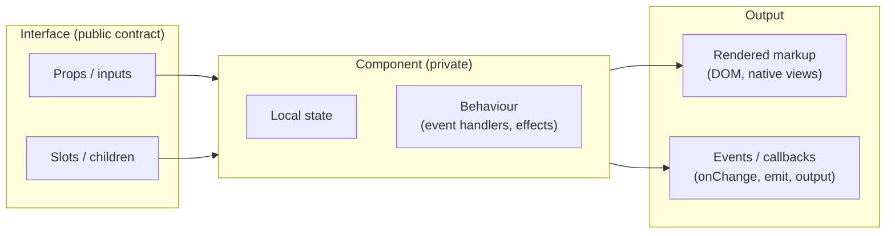

| Framework | Inputs | Outputs | Content projection |
|---|---|---|---|
| **React** | props | callback props (`onChange`) | `children`, render props, element props |
| **Vue 3** | `defineProps` | `defineEmits` / `v-model` | default, named and scoped `<slot>` |
| **Angular** | `input()` signals (or `@Input`) | `output()` (or `@Output`) | `<ng-content>` with `select` |
| **Svelte 5** | `$props()` | callback props | snippets (`{#snippet}` / `{@render}`) |
| **Web Components** | attributes / properties | `CustomEvent` | `<slot>` in Shadow DOM |
| **SwiftUI / Jetpack Compose** | init parameters / function parameters | closures / lambdas | `@ViewBuilder` / composable lambdas |

**A component boundary is a design decision, not a file-size rule.** Split when a piece has its own **reason to change**, its own **state**, is **reused**, or must be **tested in isolation**. Don't split just because a file got long; a 300-line component with one responsibility is better than ten 30-line components that pass the same props down five levels.

---

### Section 2: Component Layers — From Primitives to Pages

Large codebases stay healthy when components live in **layers with one-way dependencies**: higher layers may import lower layers, never the reverse.

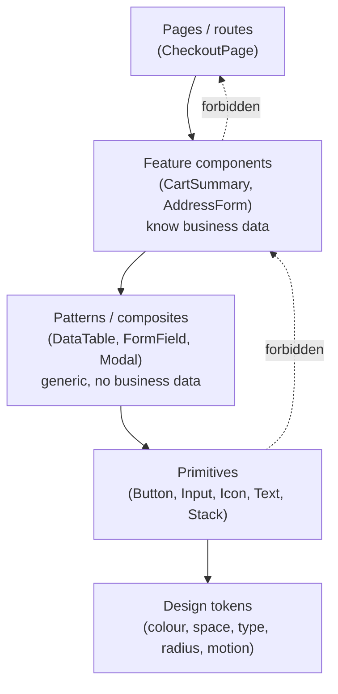

| Layer | Knows about | Example | Lives in |
|---|---|---|---|
| **Tokens** | Nothing (just values) | `color.action.primary` | Design system package |
| **Primitives** | Tokens | `Button`, `TextInput`, `Stack` | Design system package |
| **Patterns** | Primitives | `Combobox`, `DataTable`, `EmptyState` | Design system or shared UI package |
| **Feature components** | Patterns + domain data + API | `ProductCard`, `CartSummary` | The app (feature folder) |
| **Pages** | Features + routing + data loading | `/checkout` | The app (routes) |

Rules of thumb:
- **Primitives are dumb about business.** A `Button` never imports `useCart()`. The moment it does, it can't be reused or published.
- **Feature components are allowed to be specific.** Trying to make `ProductCard` generic for "any card" produces a configuration monster (Section 4).
- **Folder structure should make the layers visible**, and a lint rule should enforce them (`eslint-plugin-boundaries`, Nx module boundaries, or the FSD rules in the [next note](./feature-sliced-design.md)).

> **Atomic Design** (atoms → molecules → organisms → templates → pages) is one popular vocabulary for these layers; see [Atomic Design Methodology](./atomic-design-methodology.md). The exact names matter less than the one-way dependency rule.

---

### Section 3: Separating Logic From Presentation

The idea is old; the mechanism keeps changing.

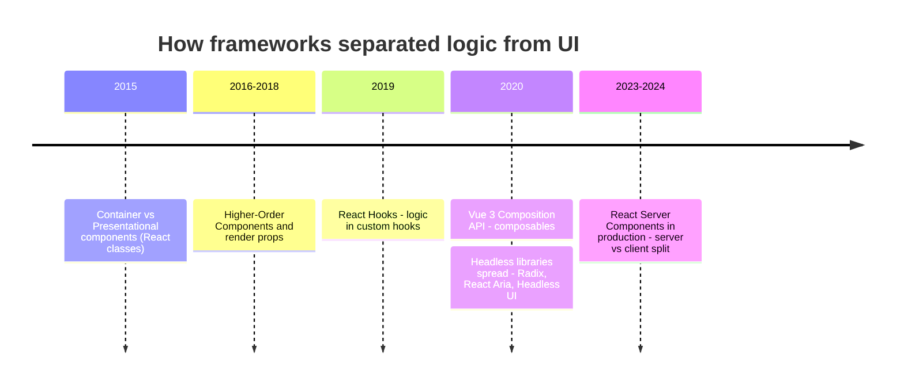

| Approach | Where logic lives | Status today |
|---|---|---|
| **Container / presentational** | A wrapper component fetches data and passes props to a pure view | Still a useful *mental* split; no longer a required file pattern. Its author (Dan Abramov) later noted hooks make it unnecessary as a rule |
| **HOCs / render props** | Wrapper functions or function-as-child | Legacy for most new code; see [HOCs and Render Props](./higher-order-components-and-render-props.md) |
| **Hooks / composables / services** | `useCombobox()`, `useFetch()`; Vue composables; Angular services + signals; Svelte `.svelte.ts` modules with runes | **Default** in modern code |
| **Headless components** | A library ships behaviour + ARIA + keyboard handling; you supply the markup and styles | Default foundation for new design systems (Section 8) |
| **Server / Client components** | Data fetching on the server (RSC); interactivity in `'use client'` leaves | React frameworks such as Next.js App Router; see [Streaming SSR & RSC](./streaming-ssr-and-react-server-components.md) |

The useful rule that survives all of these: **a component should either decide *what* to show (data, business rules) or *how* it looks (markup, styles) — mixing both in a reusable primitive makes it impossible to reuse.**

---

### Section 4: Composition Over Configuration

The most common failure in component libraries is the **"prop explosion"**: one component grows a flag for every use case.

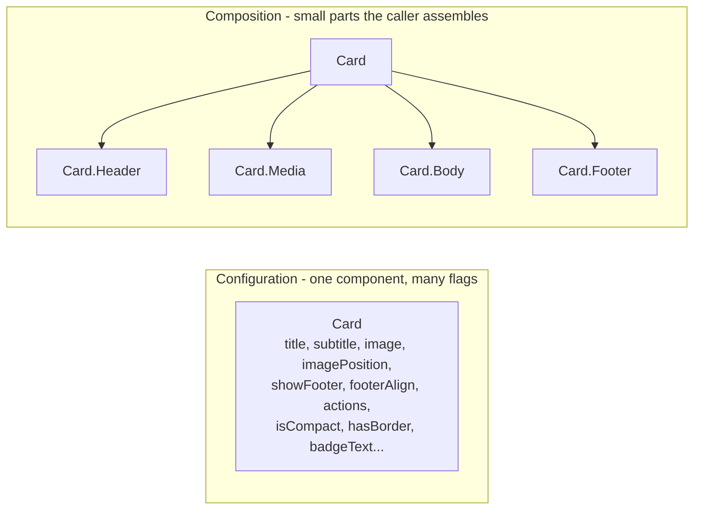

| Technique | What it solves | React | Vue | Angular | Svelte 5 |
|---|---|---|---|---|---|
| **Children / slots** | Caller controls inner content | `children` | `<slot>` | `<ng-content>` | `children` snippet |
| **Named slots** | Several insertion points | element props (`icon={<X/>}`) | named slots | `ng-content select` | named snippets |
| **Compound components** | Related parts share implicit state | Context + sub-components | `provide` / `inject` | DI (parent injected in children) | `setContext` / `getContext` |
| **Render props / scoped slots** | Caller renders with internal data | function child | scoped slots | `ng-template` + `ngTemplateOutlet` | snippets with parameters |
| **Polymorphism (`as` / `asChild`)** | Change the rendered element (link vs button) | `asChild` + Slot (Radix) or `as` | `:is` / `<component :is>` | attribute selectors (`button[appButton]`) | `<svelte:element this>` |

**When configuration is fine:** for **closed sets** the design system *wants* to restrict — `variant="primary" | "secondary"`, `size="sm" | "md"`. Configuration for design choices, composition for content and structure. Details in [Component API Design](./component-api-design.md) and [Compound Component Pattern](./compound-component-pattern.md).

---

### Section 5: State Placement and Data Flow

Where state lives decides how many components re-render and how reusable they are.

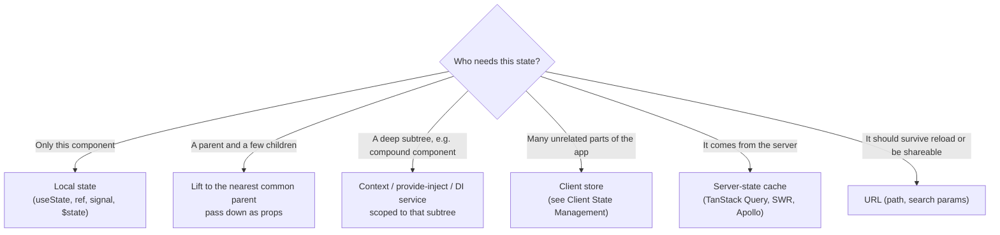

Two contracts every reusable input needs:

| Mode | Who owns the value | API shape | Use when |
|---|---|---|---|
| **Uncontrolled** | The component | `defaultValue`, read via ref / form submit | Simple forms, native-like behaviour |
| **Controlled** | The parent | `value` + `onChange` (`v-model`, `[(ngModel)]` / `model()`, `bind:value`) | Validation as you type, derived UI, syncing |

Good design-system components support **both** (the "controllable state" pattern: use the prop if given, otherwise internal state). See [Controlled vs Uncontrolled Components](./controlled-vs-uncontrolled-components.md).

**Data flow rule:** props go **down**, events go **up**. Two-way binding (`v-model`, `[(x)]`, `bind:`) is syntax sugar for exactly that pair, not a different model.

---

### Section 6: What a Design System Actually Contains

A component library is **one part** of a design system. Teams that ship only components usually end up with inconsistent spacing, colour and copy anyway.

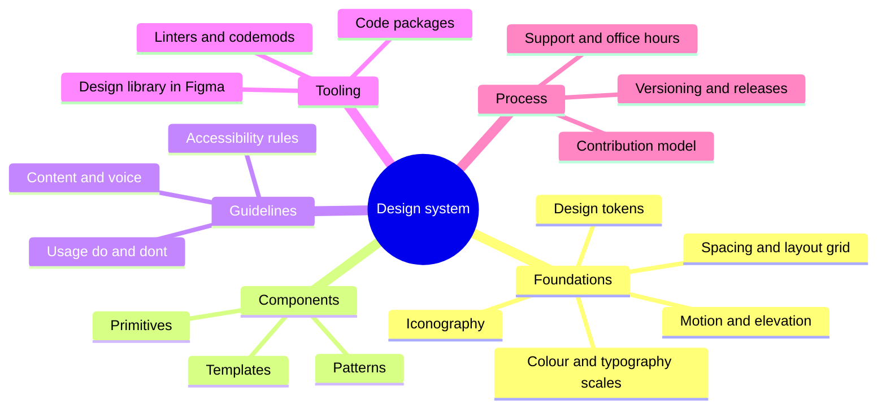

| Part | Owned by | Consumed by | Typical artefact |
|---|---|---|---|
| **Tokens** | Design + engineering together | Design tool, CSS, iOS, Android | JSON source → generated CSS variables, Swift, Kotlin |
| **Design library** | Design | Product designers | Figma library with variants mapped to component props |
| **Code components** | Engineering | Product engineers | npm package(s), sometimes copy-in source |
| **Documentation** | Both | Everyone | Docs site + Storybook with live examples |
| **Governance** | DS team | Everyone | Contribution guide, RFC process, changelog, roadmap |

> **A design system is a product whose users are other teams.** It needs a roadmap, support, release notes and a way to measure adoption — not just a repo.

Well-known public design systems to study: Google **Material Design**, IBM **Carbon**, Microsoft **Fluent**, Adobe **Spectrum**, GitHub **Primer**, Shopify **Polaris**, Atlassian **Design System** and the **GOV.UK Design System** (excellent on accessibility and research-backed guidance).

---

### Section 7: Design Tokens — the Foundation Layer

**Design tokens** are named design decisions (`color.text.danger = #B42318`) stored in a platform-neutral format and transformed into each platform's code. They are the single source of truth that keeps Figma, web and native apps in sync.

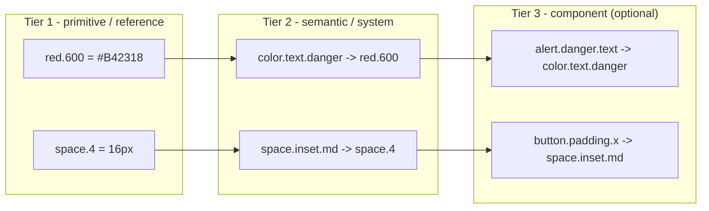

| Tier | Answers | Who references it | Change impact |
|---|---|---|---|
| **Primitive** | "What colours/sizes exist?" | Only other tokens | Rarely changes |
| **Semantic** | "What is this value **for**?" | Components and apps | **Theme switch = remap semantic tokens** (light/dark, brand) |
| **Component** | "What does this part of this component use?" | That component | Fine-grained overrides; adds maintenance cost, use sparingly |

**Rule:** application and component code should reference **semantic** tokens, never primitives. Then dark mode or a rebrand is a token-mapping change, not a code change.

**Format and pipeline:**
- The **W3C Design Tokens Community Group (DTCG)** defines a JSON format (`$value`, `$type`, `$description`, aliases like `{color.red.600}`). It reached its first **stable** version in 2025; check [designtokens.org](https://www.designtokens.org/) for the current spec. Being a Community Group report, it is not a W3C Recommendation.
- **Style Dictionary** (recent versions support the DTCG format), **Tokens Studio** and Figma **Variables** are common tools. A typical pipeline: tokens in Git → CI transforms → CSS custom properties, TS constants, Swift, Kotlin/XML → published packages.

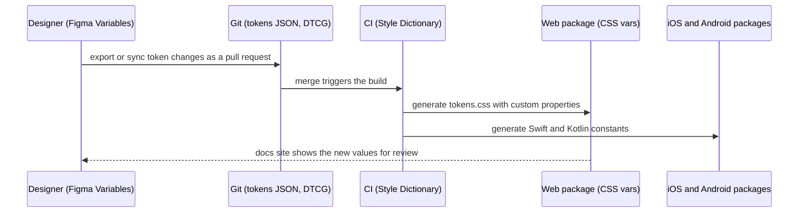

Deep dive: [Design Tokens](./design-tokens.md) and [Theming & Dark Mode](./theming-and-dark-mode.md).

---

### Section 8: The Design System Stack — Headless, Styled, Patterns

Building an accessible combobox, menu or dialog from scratch is hard: focus management, keyboard support, ARIA states, typeahead, scroll locking, portals, RTL. Modern design systems therefore **separate behaviour from styling**.

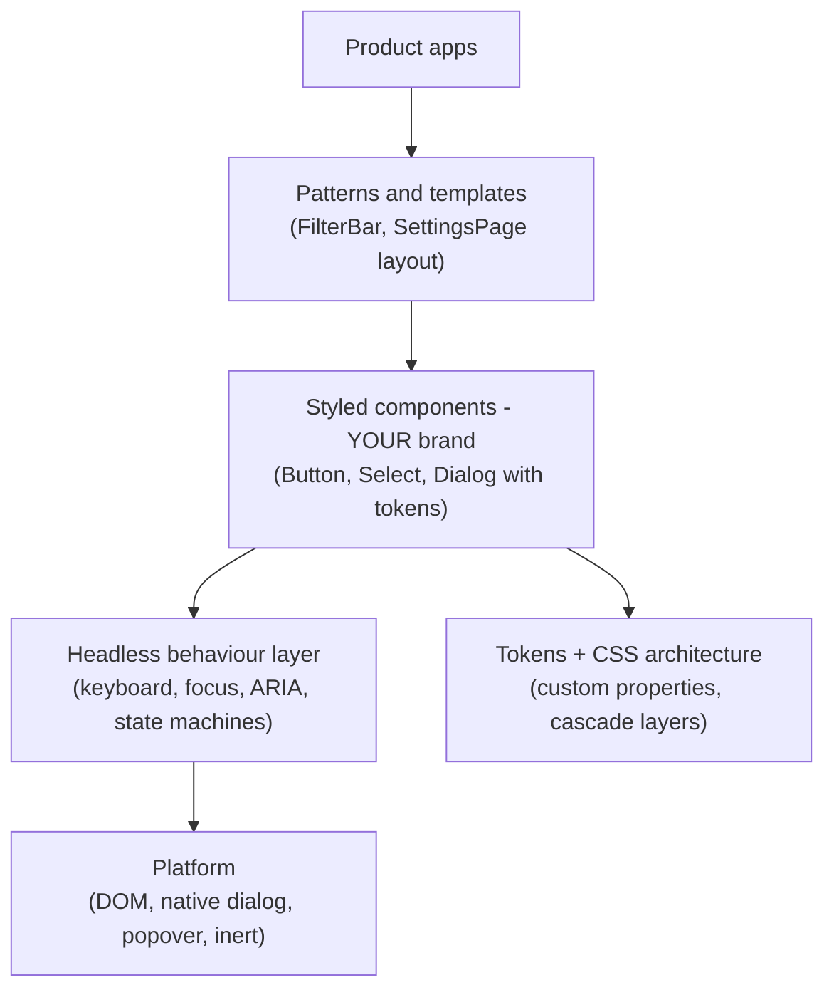

**Headless options by stack** (verify current status on each project's site):

| Stack | Headless / behaviour libraries |
|---|---|
| React | Radix Primitives, React Aria (Adobe), Base UI, Ark UI, Headless UI, Downshift |
| Vue | Reka UI (formerly Radix Vue), Ark UI, Headless UI for Vue |
| Svelte | Bits UI, Melt UI, Ark UI |
| Angular | Angular CDK (overlay, a11y, drag-drop, listbox), plus the newer Angular Aria package; check angular.dev for its stability status |
| Any (incl. Solid) | Zag.js state machines (powers Ark UI) |

**Styled libraries on top:** MUI, Chakra UI, Mantine, Ant Design (React); Vuetify, PrimeVue, Quasar (Vue); Angular Material, PrimeNG (Angular); Skeleton, Flowbite Svelte (Svelte).

**The "copy-in" model:** **shadcn/ui** (React; community ports exist for Vue and Svelte) is not installed as a dependency. A CLI copies component **source** (Radix or Base UI + Tailwind) into your repo, and you own it from then on. Great for full control; you also own every bug fix and upgrade.

**Use the platform where it's good enough:** `<dialog>` with `showModal()`, the **Popover API** (`popover` attribute), `inert`, the details/summary disclosure element, and native form controls are now widely supported and remove a lot of custom JS. Newer features need a compatibility check on MDN: per MDN's browser-compat-data, **CSS anchor positioning** reached all major engines only in early 2026 (Chrome 125, Safari 26, Firefox 147), and **customizable `<select>`** (`appearance: base-select`) ships in Chrome and Safari but is still behind a flag in Firefox at the time of writing.

**CSS architecture for a design system:**
- Expose tokens as **CSS custom properties** so apps can theme at runtime.
- Put library styles in a **cascade layer** (`@layer ds`) so app styles override them without specificity wars.
- Use **container queries** so components adapt to their slot, not the viewport.
- Avoid runtime CSS-in-JS for shared libraries in React Server Component apps; zero-runtime options (CSS Modules, Tailwind, vanilla-extract, Panda) work in both server and client components. See [CSS Architecture](./css-architecture-css-in-js-tailwind-css-modules.md).

---

### Section 9: Distribution, Versioning and Breaking Changes

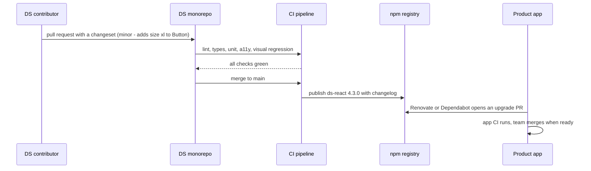

| Concern | Recommended practice |
|---|---|
| **Versioning** | Semantic Versioning. Removing or renaming a prop, changing default behaviour, or changing DOM structure that consumers style or test against is **major** |
| **Release tooling** | Changesets, semantic-release, or Nx/Turborepo release tooling in a monorepo |
| **Package shape** | ESM output, `"sideEffects"` declared correctly (CSS files listed) so bundlers can tree-shake, per-component entry points via `"exports"` |
| **Peer dependencies** | `react`, `vue`, `@angular/core` etc. as **peer** deps — never bundled, or apps get two copies of the framework |
| **CSS delivery** | One tokens stylesheet + per-component CSS, or a build-time solution; document the import order |
| **Deprecation** | Mark deprecated in types (`/** @deprecated */`), warn in dev builds, give a migration guide and a **codemod** where possible |
| **Upgrade cadence** | Avoid long-lived majors; several small majors with codemods beat one huge rewrite |

**Package vs copy-in vs monorepo source:**

| Model | Upgrade path | Consistency | Best for |
|---|---|---|---|
| **Versioned npm package** | Bump version | High, but apps can lag behind | Many apps, many teams, multiple repos |
| **Source in a monorepo (workspace package)** | Every app gets changes on merge | Highest; one breaking change affects all apps at once | One org, one monorepo — see [Mono-repo vs Multi-repo](./mono-repo-vs-multi-repo.md) |
| **Copy-in (shadcn/ui style)** | Manual diff / re-run CLI | Drifts over time | Single product teams that want full ownership |

---

### Section 10: Cross-Framework and Cross-Platform Systems

Large organisations often run React, Angular and Vue apps side by side, plus native mobile. There are three strategies:

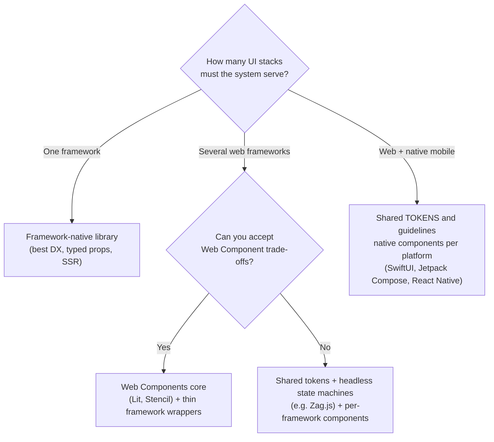

| Strategy | Pros | Cons |
|---|---|---|
| **Web Components** (Lit, Stencil; e.g. Web Awesome, formerly Shoelace) | One implementation runs in any framework or plain HTML | SSR needs Declarative Shadow DOM support and framework integration; form participation needs `ElementInternals`; styling through Shadow DOM needs CSS parts/custom properties; React 19 improved custom element support, older React needs wrappers. See [Web Components & Shadow DOM](./web-components-and-shadow-dom.md) |
| **Per-framework libraries sharing tokens + logic** | Idiomatic API in each framework | N implementations to keep in sync |
| **Native per platform, shared tokens** | Native look, feel and accessibility on iOS/Android | Visual parity is a process problem, not a code one |

**What is always shared, whatever the strategy:** tokens, iconography, content guidelines, accessibility requirements, and the **component specification** (anatomy, states, keyboard behaviour). Those are framework-free.

---

### Section 11: Quality Gates — Accessibility, Docs, Testing

A design system multiplies both quality and bugs: a focus bug in `Dialog` ships to every app. Gates therefore live **in the DS pipeline**, not in each app.

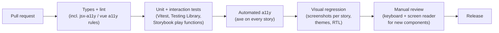

| Gate | Catches | Doesn't catch |
|---|---|---|
| **TypeScript types** | Wrong prop names/values | Behaviour bugs |
| **Interaction tests** | Broken keyboard handling, state transitions | Visual issues |
| **axe / automated a11y** | A subset of WCAG issues (missing names, invalid ARIA, contrast) | Many issues need humans: focus order quality, screen-reader announcements |
| **Visual regression** | Unintended style changes across themes, sizes, RTL | Behaviour |
| **Manual screen reader + keyboard check** | Real usability | Regressions over time (that's what the automated gates are for) |

**Storybook** (or Histoire for Vue, Ladle for React) doubles as documentation, a test harness and a visual-regression target. See [Storybook & Component Documentation](./storybook-and-component-documentation.md), [Visual Regression Testing](./visual-regression-testing.md) and [Accessibility Testing](./accessibility-testing.md).

**Accessibility ownership:** the DS owns **component-level** a11y (roles, keyboard, focus, contrast of tokens). The app still owns **page-level** a11y (headings, landmarks, labels in context, focus after navigation). Writing "uses the DS" in a ticket doesn't make a page accessible.

---

### Section 12: Governance and Component Lifecycle

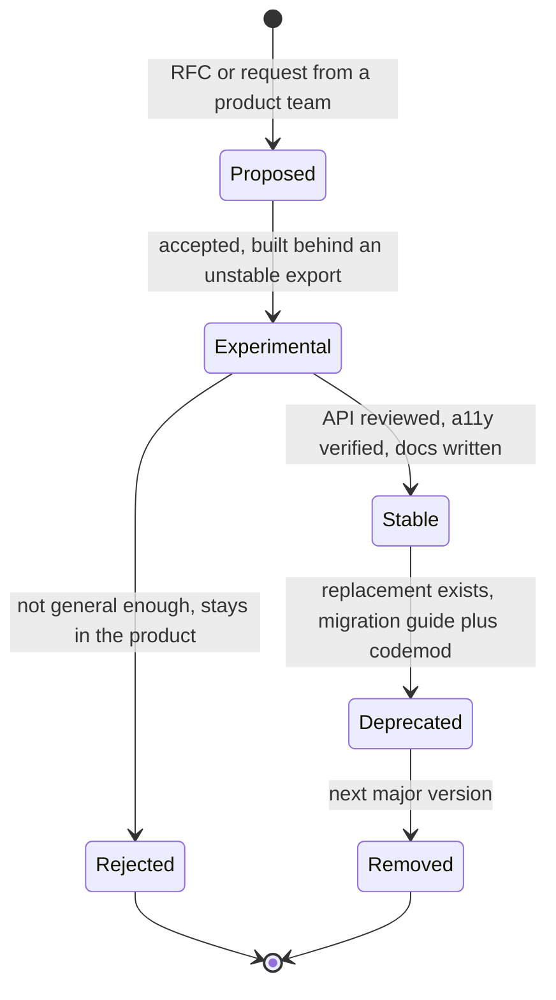

| Contribution model | How it works | Risk |
|---|---|---|
| **Centralised** | A dedicated DS team builds everything | Bottleneck; product teams build local copies while they wait |
| **Federated** | Product teams contribute; a small core team reviews and maintains | Inconsistent quality without strong review |
| **Hybrid** (common) | Core team owns foundations and complex components; product teams contribute patterns | Needs a clear contribution guide and RFC template |

**The "rule of three":** promote a pattern into the design system after it has appeared in about three places. Promoting earlier freezes an API before you know the real use cases.

**Measuring adoption without guessing:** scan app repos for DS imports vs local look-alikes (e.g. with a codemod tool or a custom AST script), track DS version lag per app, and count support requests. Avoid vanity metrics like "number of components".

---

## Decision Matrix — Build, Adopt or Copy-In

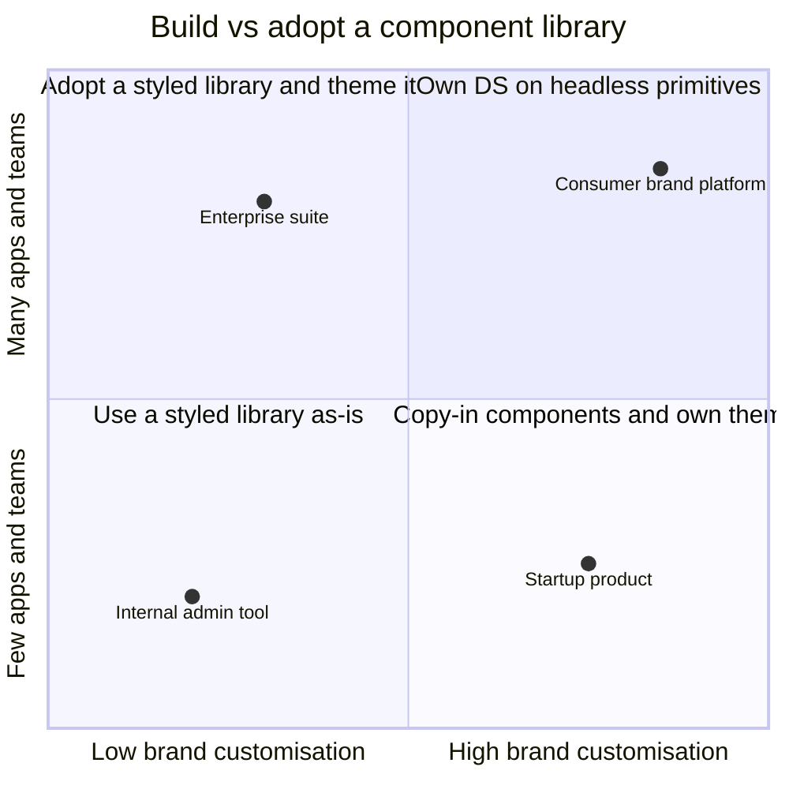

| Situation | Recommendation | Why |
|---|---|---|
| Internal tools, small team | Styled library as-is (MUI, Ant Design, Angular Material, Vuetify) | Speed matters more than brand |
| One product, strong brand, one team | Copy-in (shadcn/ui-style) or headless + your styles | Full control, no external release cadence |
| Many apps, one framework | Own DS package built on a headless library, tokens in DTCG format | Consistency + a11y without writing focus management |
| Many apps, several frameworks | Tokens + Web Components core, or shared state machines + per-framework wrappers | One spec, many runtimes |
| Web + native apps | Shared tokens and guidelines, native components per platform | Native platforms have their own accessibility and interaction models |

---

## Real-World Examples

**Example 1 — A token-driven `Button` primitive (React + TypeScript, React 19 `ref` as a prop):**
```tsx
// packages/ds-react/src/button/Button.tsx
import type { ComponentPropsWithRef } from 'react';
import { clsx } from 'clsx';
import styles from './Button.module.css';

type Variant = 'primary' | 'secondary' | 'danger';
type Size = 'sm' | 'md' | 'lg';

export interface ButtonProps extends ComponentPropsWithRef<'button'> {
  variant?: Variant;   // closed set = configuration is fine
  size?: Size;
  loading?: boolean;
}

export function Button({
  variant = 'primary',
  size = 'md',
  loading = false,
  disabled,
  className,
  children,
  type = 'button',     // safer default than the HTML default "submit"
  ...rest              // forwards aria-*, data-*, onClick, ref (React 19)
}: ButtonProps) {
  return (
    <button
      {...rest}
      type={type}
      className={clsx(styles.button, styles[variant], styles[size], className)}
      disabled={disabled || loading}
      aria-busy={loading || undefined}
    >
      {children}
    </button>
  );
}
```

```css
/* Button.module.css: only SEMANTIC tokens, never raw values */
@layer ds {
  .button {
    font: var(--ds-font-label-md);
    padding-block: var(--ds-space-inset-sm);
    padding-inline: var(--ds-space-inset-md);
    border-radius: var(--ds-radius-control);
    border: 1px solid transparent;
  }
  .button:focus-visible { outline: 2px solid var(--ds-color-focus-ring); outline-offset: 2px; }
  .primary   { background: var(--ds-color-action-primary-bg); color: var(--ds-color-action-primary-fg); }
  .secondary { background: transparent; border-color: var(--ds-color-border-strong); color: var(--ds-color-text-default); }
  .danger    { background: var(--ds-color-action-danger-bg); color: var(--ds-color-action-danger-fg); }
  .sm { min-block-size: 2rem; }
  .md { min-block-size: 2.5rem; }
  .lg { min-block-size: 3rem; }
}
```

> In React 18 and earlier, function components need `forwardRef` to receive a `ref`. React 19 passes `ref` as a regular prop for function components; `forwardRef` still works.

**Example 2 — Prop explosion vs composition (BAD → GOOD):**
```tsx
// ❌ BAD: every new use case adds a flag; the component knows about every caller
<Card
  title="Order #1042"
  subtitle="Shipped"
  image="/box.png"
  imagePosition="left"
  showFooter
  footerAlign="right"
  primaryActionLabel="Track"
  onPrimaryAction={track}
  badgeText="New"
/>

// ✅ GOOD: small parts, the caller composes; new layouts need no library change
<Card>
  <Card.Media src="/box.png" alt="" />
  <Card.Header>
    <Card.Title>Order #1042</Card.Title>
    <Badge tone="info">New</Badge>
  </Card.Header>
  <Card.Body>Shipped</Card.Body>
  <Card.Footer align="end">
    <Button onClick={track}>Track</Button>
  </Card.Footer>
</Card>
```

**Example 3 — The same composition in Vue, Svelte 5 and Angular:**
```html
<!-- Vue 3: Card.vue with named slots -->
<template>
  <article class="card">
    <header v-if="$slots.header" class="card__header"><slot name="header" /></header>
    <div class="card__body"><slot /></div>
    <footer v-if="$slots.footer" class="card__footer"><slot name="footer" /></footer>
  </article>
</template>
<!-- usage: <Card><template #header>Order</template>Shipped<template #footer><Button>Track</Button></template></Card> -->
```

```html
<!-- Svelte 5: Card.svelte with snippets -->
<script lang="ts">
  import type { Snippet } from 'svelte';
  let { header, footer, children }: { header?: Snippet; footer?: Snippet; children: Snippet } = $props();
</script>

<article class="card">
  {#if header}<header class="card__header">{@render header()}</header>{/if}
  <div class="card__body">{@render children()}</div>
  {#if footer}<footer class="card__footer">{@render footer()}</footer>{/if}
</article>
```

```typescript
// Angular: content projection with selectors
import { Component } from '@angular/core';

@Component({
  selector: 'ds-card',
  template: `
    <article class="card">
      <header class="card__header"><ng-content select="[dsCardHeader]" /></header>
      <div class="card__body"><ng-content /></div>
      <footer class="card__footer"><ng-content select="[dsCardFooter]" /></footer>
    </article>
  `,
})
export class CardComponent {}
// usage: <ds-card><h3 dsCardHeader>Order</h3>Shipped<button dsCardFooter>Track</button></ds-card>
```

**Example 4 — Design tokens in DTCG format and a Style Dictionary build:**
```json
{
  "color": {
    "red":   { "600": { "$type": "color", "$value": "#B42318" } },
    "text":  {
      "danger": { "$type": "color", "$value": "{color.red.600}", "$description": "Error text on default surfaces" }
    }
  },
  "space": {
    "4": { "$type": "dimension", "$value": { "value": 16, "unit": "px" } }
  }
}
```

```javascript
// style-dictionary.config.mjs (sketch; check the Style Dictionary docs for your version's options)
export default {
  source: ['tokens/**/*.json'],
  platforms: {
    css: {
      transformGroup: 'css',
      prefix: 'ds',
      buildPath: 'dist/css/',
      files: [{ destination: 'tokens.css', format: 'css/variables', options: { outputReferences: true } }],
    },
    ios: {
      transformGroup: 'ios-swift',
      buildPath: 'dist/ios/',
      files: [{ destination: 'Tokens.swift', format: 'ios-swift/enum.swift' }],
    },
  },
};
```

> The DTCG `dimension` value moved from a string (`"16px"`) to an object (`{ "value": 16, "unit": "px" }`) in the stable spec. Older tools and token files still use the string form — check what your toolchain expects.

**Example 5 — Building a styled component on a headless primitive (Radix Dialog):**
```tsx
import type { ReactNode } from 'react';
import * as Dialog from '@radix-ui/react-dialog';
import styles from './ConfirmDialog.module.css';
import { Button } from '../button/Button';

interface ConfirmDialogProps {
  trigger: ReactNode;
  title: string;
  description: string;
  onConfirm: () => void;
}

export function ConfirmDialog({ trigger, title, description, onConfirm }: ConfirmDialogProps) {
  return (
    <Dialog.Root>
      <Dialog.Trigger asChild>{trigger}</Dialog.Trigger>
      <Dialog.Portal>
        <Dialog.Overlay className={styles.overlay} />
        {/* Radix handles focus trap, Escape, aria-labelledby, scroll lock and focus return */}
        <Dialog.Content className={styles.content}>
          <Dialog.Title>{title}</Dialog.Title>
          <Dialog.Description>{description}</Dialog.Description>
          <div className={styles.actions}>
            <Dialog.Close asChild><Button variant="secondary">Cancel</Button></Dialog.Close>
            <Dialog.Close asChild><Button variant="danger" onClick={onConfirm}>Delete</Button></Dialog.Close>
          </div>
        </Dialog.Content>
      </Dialog.Portal>
    </Dialog.Root>
  );
}
```

**Example 6 — Publishing a tree-shakable DS package:**
```json
{
  "name": "@acme/ds-react",
  "version": "4.3.0",
  "type": "module",
  "exports": {
    ".": { "types": "./dist/index.d.ts", "import": "./dist/index.js" },
    "./button": { "types": "./dist/button/index.d.ts", "import": "./dist/button/index.js" },
    "./tokens.css": "./dist/tokens.css"
  },
  "sideEffects": ["**/*.css"],
  "peerDependencies": { "react": "^19.0.0", "react-dom": "^19.0.0" },
  "files": ["dist"]
}
```

```bash
# Record a change with Changesets; CI turns pending changesets into versions + changelog
npx changeset            # choose package, bump type (patch/minor/major), write a summary
npx changeset version    # applies bumps and writes CHANGELOG.md
npx changeset publish    # publishes changed packages to the registry
```

---

## Key Points Summary

| Concept | One-Line Explanation |
|---|---|
| **Component** | A reusable UI unit with a public interface (props, events, slots) and private state |
| **Layered architecture** | Tokens → primitives → patterns → features → pages, dependencies point down only |
| **Logic vs presentation** | Decide *what* (data, rules) separately from *how it looks*; hooks, composables and services do this today |
| **Composition over configuration** | Children, slots and compound components instead of a flag per use case |
| **Controllable state** | Reusable inputs support both controlled (`value`) and uncontrolled (`defaultValue`) use |
| **Design system** | Tokens + components + guidelines + tooling + governance, run as a product |
| **Design tokens** | Named, platform-neutral design decisions; apps use semantic tokens, not primitives |
| **DTCG format** | Community standard JSON for tokens (`$value`, `$type`, aliases) |
| **Headless components** | Behaviour, keyboard and ARIA without styles; you supply the look |
| **Copy-in model** | Component source copied into your repo (shadcn/ui); full control, manual upgrades |
| **Peer dependencies** | DS packages must not bundle the framework |
| **SemVer + codemods** | Breaking changes are majors, shipped with migration guides and automated codemods |
| **Web Components** | One implementation for many frameworks, with SSR, forms and styling trade-offs |
| **Quality gates** | Types, interaction tests, axe, visual regression, manual a11y review in the DS pipeline |
| **Governance** | Contribution model, RFCs, lifecycle from experimental to deprecated |

---

## Test Your Understanding

**Q1 (Basic):**
What is the difference between a component library and a design system? Give two things a design system has that a component library alone doesn't.

<details>
<summary>Answer</summary>

A **component library** is code: reusable UI components in one technology. A **design system** is the whole shared language and process around them: **design tokens** (colour, spacing, type decisions used by design tools, web and native), **guidelines** (when to use which component, content style, accessibility rules), a **design library** in the design tool that mirrors the code, **documentation**, and **governance** (contribution, versioning, deprecation). Without tokens and guidelines, teams using the same component library still produce inconsistent spacing, colours and copy, because those decisions live outside the components.
</details>

**Q2 (Application):**
Your team's `Modal` component has 23 props, including `showHeader`, `headerAlign`, `footerButtons`, `hideCloseIcon` and `isDrawer`. Each new feature request adds another prop. How would you redesign it?

<details>
<summary>Answer</summary>

Switch from **configuration to composition**. Keep a small root (`Dialog`) that owns behaviour (open state, focus trap, Escape, focus return, `aria-labelledby`), and expose parts that callers assemble: `Dialog.Trigger`, `Dialog.Content`, `Dialog.Title`, `Dialog.Description`, `Dialog.Close`. Headers, footers and button layouts become **children**, so a new layout needs no library change. `isDrawer` is a different component (`Drawer` / `Sheet`) sharing the same headless behaviour, because its layout and animation differ. Keep configuration only for **closed design choices** such as `size="sm" | "md" | "lg"`. Build the behaviour on a headless primitive (Radix, React Aria, Ark, Angular CDK, Reka, Bits UI) or the native `<dialog>` instead of writing focus management yourself.
</details>

**Q3 (Tricky):**
Product wants dark mode. Your components use tokens like `--ds-red-600` and `--ds-gray-900` directly. Why is dark mode now painful, and what should the token structure have been?

<details>
<summary>Answer</summary>

Components reference **primitive** tokens, which describe *what the value is* ("red 600") instead of *what it's for*. In dark mode, text that was `gray-900` must become something like `gray-50`, but other uses of `gray-900` (e.g. a dark overlay) may need to stay dark, so you can't just remap the primitive. You end up editing every component.

The fix is a **semantic tier**: components use `--ds-color-text-default`, `--ds-color-surface-raised`, `--ds-color-text-danger`. Each theme maps semantic tokens to primitives (`text-default → gray-900` in light, `→ gray-50` in dark). Switching theme becomes swapping one set of custom-property values (e.g. under `[data-theme="dark"]` or `prefers-color-scheme`), with zero component changes.
</details>

**Q4 (Tricky):**
You publish `@acme/ds-react` and list `react` under `dependencies`. Some apps report "Invalid hook call" errors and their bundles grow. What happened?

<details>
<summary>Answer</summary>

With `react` as a regular dependency, the package manager can install a **second copy of React** inside the DS package's `node_modules` when versions don't dedupe. Components from the DS then run hooks against a different React instance than the app's renderer, which triggers "Invalid hook call" errors (hooks rely on shared module state), and both copies get bundled. The fix is to declare `react` and `react-dom` as **`peerDependencies`** (with a compatible range) and as `devDependencies` for local development, and to mark them external in the library build. The same applies to `vue`, `@angular/core` and `svelte`.
</details>

**Q5 (System design):**
A company has three React apps, two Angular apps and an iOS/Android app. Leadership wants "one design system". Propose an architecture.

<details>
<summary>Answer</summary>

1. **Shared foundations for everyone:** tokens in DTCG JSON in one repo, transformed by Style Dictionary (or similar) into CSS custom properties, TS constants, Swift and Kotlin. Shared icons, content guidelines, accessibility requirements and a **component spec** per component (anatomy, states, keyboard behaviour).
2. **Web components layer, two options:** (a) one **Web Components** implementation (Lit/Stencil) with thin React and Angular wrappers, accepting the SSR, form-participation and styling trade-offs; or (b) **framework-native** React and Angular libraries that share tokens, specs, visual-regression baselines and, ideally, headless state machines (Zag.js-style). Choose (b) if apps rely heavily on SSR/RSC or framework-native forms; (a) if the team is small and parity matters most.
3. **Native:** SwiftUI and Jetpack Compose components that consume the generated tokens. Don't try to share UI code with the web; share decisions.
4. **Process:** one DS team with a hybrid contribution model, SemVer with Changesets, codemods for breaking changes, Storybook docs per web library, a Figma library whose variants map to component props, and adoption tracked by scanning repos for DS imports and version lag.
</details>

**Q6 (Application):**
When should a pattern that one product team built (say a `FilterBar`) move into the design system, and what has to happen before it's "stable"?

<details>
<summary>Answer</summary>

Move it when it's **needed in several places** (the "rule of three" heuristic) and is **generic** — it doesn't depend on that product's data model or API. Promoting too early freezes an API built for one use case.

Before "stable": an RFC or proposal describing the API and use cases; refactor to depend only on DS primitives and tokens (no product imports); an API review (composition vs props, controlled/uncontrolled support, naming consistent with other components); accessibility verification (keyboard, screen readers, focus, contrast in all themes, RTL); docs and stories; interaction, a11y and visual-regression tests; then ship it as **experimental** first, collect feedback from at least one other team, and only then mark it stable. The original team migrates to the DS version so there's one implementation.
</details>

---

## Cheat Sheet

**Key Definitions:**
- **Component:** Reusable UI unit — interface (props/events/slots) + private state + output
- **Primitive:** Lowest-level DS component (`Button`, `Input`, `Stack`), knows only tokens
- **Pattern / composite:** Generic assembly of primitives (`DataTable`, `Combobox`)
- **Compound component:** A root plus sub-components sharing implicit state (`Tabs`, `Tabs.List`, `Tabs.Panel`)
- **Headless component:** Behaviour + ARIA + keyboard without styles
- **Design token:** Named design decision (primitive → semantic → component tiers)
- **DTCG:** W3C Design Tokens Community Group format (`$value`, `$type`, aliases)
- **Copy-in library:** Components copied into your repo as source (shadcn/ui)
- **Codemod:** Script that rewrites consumer code for a breaking change

**Quick Reference:**
```text
Layering        tokens → primitives → patterns → features → pages   (imports point DOWN only)
Split a component when it has: its own reason to change | own state | reuse | isolated testing
Configuration   for closed design choices: variant, size, tone
Composition     for content and structure: children, slots, compound parts, asChild
State           local → lift → context/provide/DI → store → server cache → URL
Inputs          support value+onChange AND defaultValue (controllable state)
Tokens          apps and components use SEMANTIC tokens; themes remap semantic → primitive
CSS             custom properties + @layer ds + container queries; zero-runtime CSS for RSC
Package         ESM, "exports", "sideEffects": ["**/*.css"], framework as peerDependency
Versioning      SemVer; prop removal / default change / DOM change = MAJOR; ship codemods
A11y            DS owns component a11y; app owns page a11y (headings, labels, focus on route change)
Multi-framework shared tokens + specs always; Web Components OR per-framework libs on shared logic
Native          share tokens and guidelines, not UI code
Promotion       rule of three → RFC → experimental → stable → deprecated → removed
```

**Common Mistakes to Avoid:**

| Mistake | Why Wrong | Fix |
|---|---|---|
| A flag for every use case (`showFooter`, `isCompact`…) | Prop explosion, untestable combinations | Composition: children, slots, compound parts |
| Primitives importing app state or APIs | Can't be reused or published | Keep business logic in feature components |
| Components using primitive tokens (`red-600`) | Theming and dark mode require code changes | Reference semantic tokens only |
| Building dialogs/menus/comboboxes from scratch | Focus, keyboard and ARIA bugs ship to every app | Headless library or native `<dialog>` / popover |
| Framework listed in `dependencies` | Duplicate framework copies, "Invalid hook call" | `peerDependencies` + externalise in the build |
| Breaking changes in minor releases | Apps break on routine upgrades | SemVer majors + changelog + codemods |
| Promoting a pattern after one use | API frozen around one product's needs | Rule of three, ship as experimental first |
| Design library and code drift apart | Designers spec components that don't exist | Map Figma variants to props, shared tokens pipeline |
| Runtime CSS-in-JS in a shared lib for RSC apps | Doesn't work in Server Components, adds runtime cost | CSS Modules, Tailwind or zero-runtime CSS-in-JS |
| "We use the DS, so the page is accessible" | Page structure, labels in context and focus are app concerns | Test pages too, not just components |
| No owner or roadmap for the DS | Teams fork components, consistency erodes | Treat the DS as a product with a team and support |

---

## References & Further Reading

**Core docs**
- React: [Thinking in React](https://react.dev/learn/thinking-in-react) · [Passing JSX as children](https://react.dev/learn/passing-props-to-a-component#passing-jsx-as-children) · [Sharing state between components](https://react.dev/learn/sharing-state-between-components)
- React: [React 19 — `ref` as a prop](https://react.dev/blog/2024/12/05/react-19#ref-as-a-prop)
- Vue: [Slots](https://vuejs.org/guide/components/slots.html) · [Provide / Inject](https://vuejs.org/guide/components/provide-inject.html) · [Composables](https://vuejs.org/guide/reusability/composables.html)
- Angular: [Content projection](https://angular.dev/guide/components/content-projection) · [Angular CDK](https://material.angular.io/cdk/categories)
- Svelte: [Snippets](https://svelte.dev/docs/svelte/snippet) · [`$props`](https://svelte.dev/docs/svelte/$props)
- MDN: [Using custom elements](https://developer.mozilla.org/en-US/docs/Web/API/Web_components/Using_custom_elements) · [`@layer` (cascade layers)](https://developer.mozilla.org/en-US/docs/Web/CSS/@layer) · [Container queries](https://developer.mozilla.org/en-US/docs/Web/CSS/CSS_containment/Container_queries)
- MDN: [`<dialog>`](https://developer.mozilla.org/en-US/docs/Web/HTML/Reference/Elements/dialog) · [Popover API](https://developer.mozilla.org/en-US/docs/Web/API/Popover_API)

**Design tokens & specs**
- W3C Design Tokens Community Group: [designtokens.org](https://www.designtokens.org/) · [Format specification](https://www.designtokens.org/tr/drafts/format/)
- Style Dictionary: [Documentation](https://styledictionary.com/)
- W3C WAI: [ARIA Authoring Practices Guide (APG) patterns](https://www.w3.org/WAI/ARIA/apg/patterns/)

**Headless & component libraries**
- [Radix Primitives](https://www.radix-ui.com/primitives) · [React Aria](https://react-spectrum.adobe.com/react-aria/) · [Base UI](https://base-ui.com/) · [Ark UI](https://ark-ui.com/) · [Zag.js](https://zagjs.com/)
- [Reka UI (Vue)](https://reka-ui.com/) · [Bits UI (Svelte)](https://bits-ui.com/) · [Headless UI](https://headlessui.com/)
- [shadcn/ui — introduction](https://ui.shadcn.com/docs)
- [Lit](https://lit.dev/) · [Stencil](https://stenciljs.com/)

**Public design systems**
- [Material Design 3](https://m3.material.io/) · [Carbon](https://carbondesignsystem.com/) · [Fluent 2](https://fluent2.microsoft.design/) · [Spectrum](https://spectrum.adobe.com/) · [Primer](https://primer.style/) · [GOV.UK Design System](https://design-system.service.gov.uk/)

**Deep dives**
- Brad Frost: [Atomic Design (book, free online)](https://atomicdesign.bradfrost.com/)
- Nathan Curtis (EightShapes): [Design system articles on Medium](https://medium.com/@nathanacurtis)
- Dan Abramov: [Presentational and Container Components](https://medium.com/@dan_abramov/smart-and-dumb-components-7ca2f9a7c7d0) (read the 2019 update at the top)
- Changesets: [Documentation](https://github.com/changesets/changesets)
- Storybook: [Documentation](https://storybook.js.org/docs)

---

> **Previous Topic:** [Mono-repo vs Multi-repo](./mono-repo-vs-multi-repo.md)
> — Where shared code (including a design system) lives and how it's versioned

> **Next Topic:** [Feature-Sliced Design](./feature-sliced-design.md)
> — A layered folder architecture for whole apps, with enforced import rules

*Saved on: 2026-11-06 | Repo: Frontend System Design Learning Notes*
