<!-- Generated by scripts/sync-knowledge.js from notes/ and README.md — do not edit here. -->
<!-- sections (line ranges in this file): Table of Contents 19-39 · ELI5 40-52 · Core Concept 53-367 · Decision Matrix 368-397 · Real-World Examples 398-647 · Key Points Summary 648-667 · Test Your Understanding 668-747 · Cheat Sheet 748-792 · References & Further Reading 793-828 -->

# Controlled vs Uncontrolled Components

> **Date:** 2026-11-06 · **Last updated:** 2026-11-06
> **Category:** Frontend System Design
> **Sub-Topic:** Design Systems & Components / Component Patterns
> **Level:** Intermediate · **Reading time:** ~25 min
> **Informs:** form architecture (FormData and actions vs field-level state), form library choice, design-system prop contracts (value/defaultValue/onValueChange, open/defaultOpen/onOpenChange), validation timing, per-keystroke re-render cost, state reset strategy, URL- or store-synced component state

> **Pre-requisite:** [Headless UI / Renderless Components](./headless-ui-renderless-components.md) (components that expose state) and [Client State Management Patterns](./client-state-management-patterns.md) (where state should live).
> This note answers one question for every stateful component: **who owns the value — the component, its parent, or the DOM?**

**Previous:** [Headless UI / Renderless Components](./headless-ui-renderless-components.md) · **Next:** [Higher-Order Components & Render Props](./higher-order-components-and-render-props.md)

---

## Table of Contents

1. [ELI5 — Simple Explanation](#eli5--simple-explanation)
2. [Section 1: Who Owns the Value?](#section-1-who-owns-the-value)
3. [Section 2: Controlled Inputs in React — the Render Loop](#section-2-controlled-inputs-in-react--the-render-loop)
4. [Section 3: Uncontrolled Inputs — the DOM Is the Source of Truth](#section-3-uncontrolled-inputs--the-dom-is-the-source-of-truth)
5. [Section 4: The Rules and the Warnings](#section-4-the-rules-and-the-warnings)
6. [Section 5: Forms in Modern React — Actions and FormData](#section-5-forms-in-modern-react--actions-and-formdata)
7. [Section 6: Performance — Re-renders per Keystroke](#section-6-performance--re-renders-per-keystroke)
8. [Section 7: Beyond Inputs — Controllable Component APIs](#section-7-beyond-inputs--controllable-component-apis)
9. [Section 8: Resetting and Syncing State Without Bugs](#section-8-resetting-and-syncing-state-without-bugs)
10. [Section 9: Vue, Angular, Svelte, Web Components and Native](#section-9-vue-angular-svelte-web-components-and-native)
11. [Decision Matrix — Controlled or Uncontrolled?](#decision-matrix--controlled-or-uncontrolled)
12. [Real-World Examples](#real-world-examples)
13. [Key Points Summary](#key-points-summary)
14. [Test Your Understanding (with answers)](#test-your-understanding)
15. [Cheat Sheet](#cheat-sheet)
16. [References & Further Reading](#references--further-reading)

---

## ELI5 — Simple Explanation

Think about the **volume on a TV**:

- **Uncontrolled:** the TV has its own volume knob and **remembers** the level itself. You set a starting level once (`defaultValue`). If you want to know the volume later, you **look at the TV** (read the DOM / a ref).
- **Controlled:** the TV is connected to a smart-home hub. Turning the knob only **sends a request** to the hub ("user wants 12"). The TV shows **exactly** what the hub says. If the hub says "max 10 after 10 pm", the TV stays at 10 — the knob can't overrule it.

Controlled gives the parent **full power** (validate, limit, sync to other screens) at the cost of a round trip on every change. Uncontrolled is **simpler and cheaper**, but the parent only finds out when it asks.

> **One-line takeaway: controlled = the parent owns the value and the component just reports changes; uncontrolled = the component (or the DOM) owns the value and the parent reads it when needed.**

---

## Core Concept — Step by Step

### Section 1: Who Owns the Value?

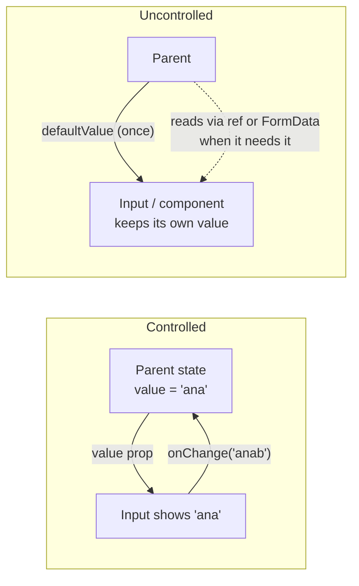

| | Controlled | Uncontrolled |
|---|---|---|
| **Source of truth** | Parent state (React state, store, URL) | The DOM node or the component's internal state |
| **API** | `value` + `onChange` (`checked` + `onChange` for checkboxes) | `defaultValue` (`defaultChecked`) + a ref, `name` + FormData, or an `onChange` you only listen to |
| **Parent knows the value** | Always, on every change | Only when it reads it (submit, ref) |
| **Parent can change / reject a value** | ✅ Any time | ❌ Only by remounting (`key`) or imperatively |
| **Re-render per keystroke** | The owner re-renders | None in the parent |
| **Typical uses** | Live validation, masking, dependent fields, syncing to URL/store | Simple forms, file inputs, progressive enhancement, big forms with a form library |

The idea isn't limited to inputs. **Any** stateful component (dialog `open`, tabs `value`, accordion expanded items, table sorting) can be controlled or uncontrolled — Section 7.

---

### Section 2: Controlled Inputs in React — the Render Loop

In React, a controlled input is **locked to its `value` prop**. After every event, React makes the DOM match the prop again.

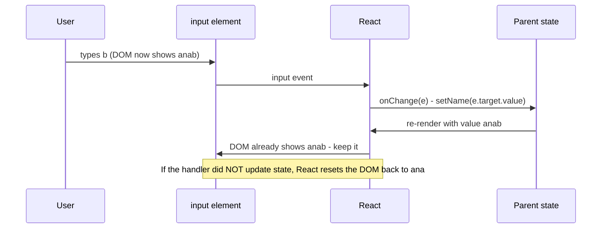

```tsx
function NameField() {
  const [name, setName] = useState('');
  return (
    <input
      value={name}
      onChange={(e) => setName(e.target.value)}
      aria-invalid={name.length > 0 && name.length < 2}
    />
  );
}
```

Because every change goes through your code, you can **transform** or **reject** it:

```tsx
// Upper-case a coupon code, allow only A-Z and 0-9, max 12 chars
<input
  value={code}
  onChange={(e) => setCode(e.target.value.toUpperCase().replace(/[^A-Z0-9]/g, '').slice(0, 12))}
/>
```

> **Caret gotcha:** set the state **synchronously** from the event, and to the value the user typed (or a transformation of it). Updating a controlled input's state **asynchronously** (after `await`, in a `setTimeout`) or replacing the text with something unrelated can make the cursor jump to the end. React's docs cover this under "My input caret jumps to the beginning on every keystroke".

---

### Section 3: Uncontrolled Inputs — the DOM Is the Source of Truth

The browser already stores every field's value. Uncontrolled means **let it**:

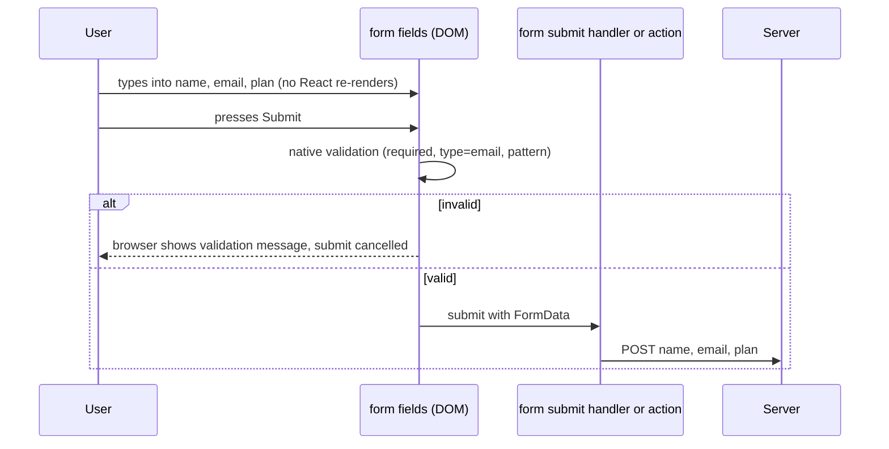

Ways to read an uncontrolled value:

| Method | Use when |
|---|---|
| `new FormData(form)` / form **action** receiving `FormData` | Submitting a form — the most common case |
| `ref.current.value` | Reading one field imperatively (focus, select, measure) |
| `onChange` that **only observes** (doesn't set `value`) | Analytics, autosave drafts, enabling a button — still uncontrolled |
| Constraint Validation API (`input.validity`, `setCustomValidity`) | Native validation without state |

| Element | Controlled prop | Uncontrolled prop | Note |
|---|---|---|---|
| `<input type="text">`, `<textarea>`, `<select>` | `value` | `defaultValue` | In React, `<textarea>` uses `value`, not children; `<select>` uses `value` instead of `selected` on options |
| `<input type="checkbox" / "radio">` | `checked` | `defaultChecked` | |
| `<select multiple>` | `value={['a', 'b']}` | `defaultValue={[...]}` | |
| `<input type="file">` | — | — | **Always uncontrolled**: its value can only be set by the user (you can only clear it) |

---

### Section 4: The Rules and the Warnings

React prints development warnings for the classic mistakes. Each points at a real bug.

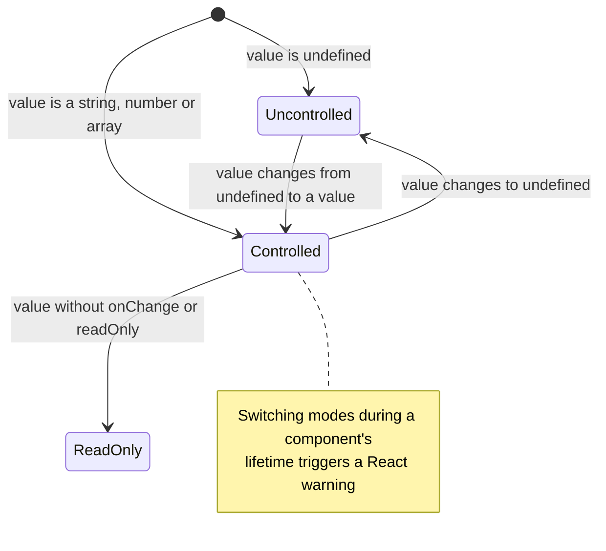

| Warning (paraphrased) | Cause | Fix |
|---|---|---|
| "You provided a `value` prop to a form field without an `onChange` handler" | Controlled but nothing updates it → the field is frozen | Add `onChange`, or use `defaultValue`, or add `readOnly` if intended |
| "A component is changing an uncontrolled input to be controlled" | `value={user.name}` where `user.name` starts as `undefined` (data still loading) | `value={user.name ?? ''}`, or don't render the field until data is loaded |
| "…changing a controlled input to be uncontrolled" | The value became `undefined` later | Same — never pass `undefined` to a controlled input |
| "`value` prop on `input` should not be null" | `value={null}` from an API | Map `null` to `''` |
| (no warning) Changing `defaultValue` after mount does nothing visible | `defaultValue` only sets the **initial** value | Remount with `key` (Section 8) or make it controlled |

**One rule covers all of these: decide the mode for the component's whole lifetime.**

---

### Section 5: Forms in Modern React — Actions and FormData

React 19 made **uncontrolled forms** first-class again: a `<form action={fn}>` calls your function with the form's `FormData`, works with Server Functions, and can be progressively enhanced.

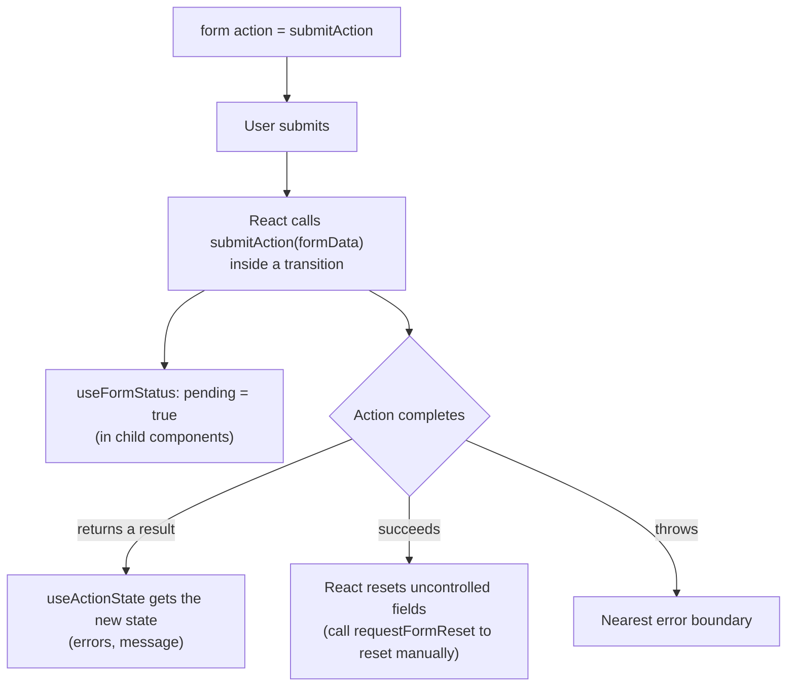

| Tool | What it gives you |
|---|---|
| `<form action={fn}>` | `fn(formData)` on submit; with a Server Function the form can submit before JS loads |
| `useActionState(action, initialState)` | `[state, formAction, isPending]` — the action's return value as state (e.g. errors) |
| `useFormStatus()` | `pending`, `data`, `method` for the parent form — use it inside a child (e.g. a submit button) |
| `useOptimistic` | Show the expected result while the action runs. See [Optimistic UI Updates](./optimistic-ui-updates.md) |

> **Reset gotcha:** React resets uncontrolled fields after a form action succeeds. An action that **returns** validation errors (instead of throwing) has still succeeded, so the user's input can be cleared. Return the submitted values in the state and feed them back as `defaultValue`, or keep the affected fields controlled. Check react.dev for current behaviour.

**When to still go controlled inside a form:** a field whose value drives other UI as you type (password strength meter, live character count, dependent dropdowns, masked inputs). Mixing is fine: most fields uncontrolled, a few controlled.

---

### Section 6: Performance — Re-renders per Keystroke

A controlled input re-renders **the component that owns its state** on every keystroke. Put that state high in a big form and the whole form re-renders per character.

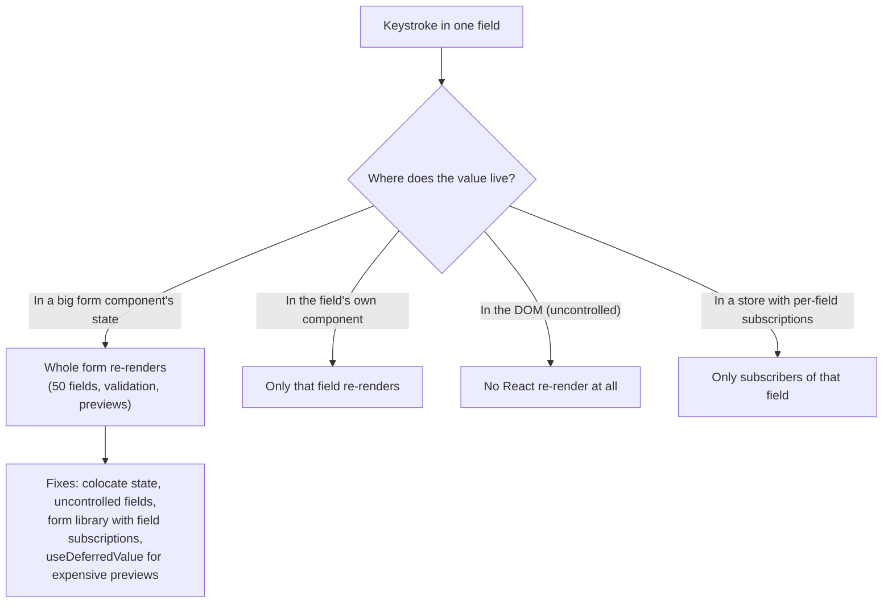

| Technique | How it helps |
|---|---|
| **Colocate** controlled state in the smallest component that needs it | Fewer components re-render |
| **Uncontrolled fields + FormData** | Zero renders while typing |
| **Form libraries with subscriptions** — React Hook Form (uncontrolled by default, `register` attaches refs), TanStack Form, Formik (controlled) | Only fields whose state changed re-render (library-dependent — check docs) |
| `useDeferredValue(query)` | Typing stays responsive; the expensive list/preview renders with a deferred value |
| React Compiler | Auto-memoizes children so unrelated parts skip re-rendering |

> Don't optimize prematurely: a controlled login form with three fields is fine. Measure with the React DevTools Profiler when a form feels slow. INP is the user-facing metric — see [Core Web Vitals](./core-web-vitals-lcp-inp-cls.md).

---

### Section 7: Beyond Inputs — Controllable Component APIs

Design-system components should usually support **both** modes with one API — often called **controllable state**.

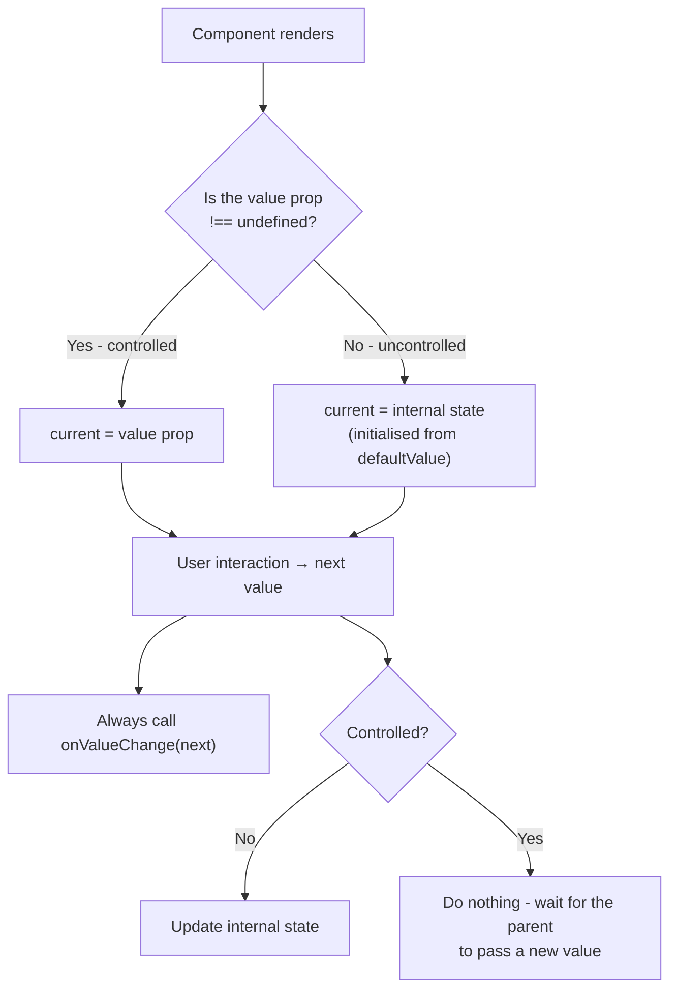

**Naming conventions** (used by Radix, Ark UI, Reka UI, Base UI and many design systems — check each library):

| State | Controlled | Uncontrolled initial | Change callback |
|---|---|---|---|
| Selection / text | `value` | `defaultValue` | `onValueChange(value)` |
| Open / closed | `open` | `defaultOpen` | `onOpenChange(open)` |
| Checked | `checked` | `defaultChecked` | `onCheckedChange(checked)` |
| Expanded items | `value: string[]` | `defaultValue` | `onValueChange` |
| Table sorting / pagination | `sorting`, `pagination` | `initialState` | `onSortingChange`, `onPaginationChange` (TanStack Table) |

API design rules:
- **Pass the value, not the DOM event**, to `onValueChange` — a Select or Slider has no meaningful `event.target.value`.
- **Allow partial control**: a component with several pieces of state (open, highlighted, input text) can let callers control just one of them.
- **Give advanced users a veto**: Downshift's **`stateReducer`** lets the caller intercept every internal state change and modify it ("keep the menu open after selection") without taking full control.
- **Warn in development** when a component switches between modes, like React's inputs do.

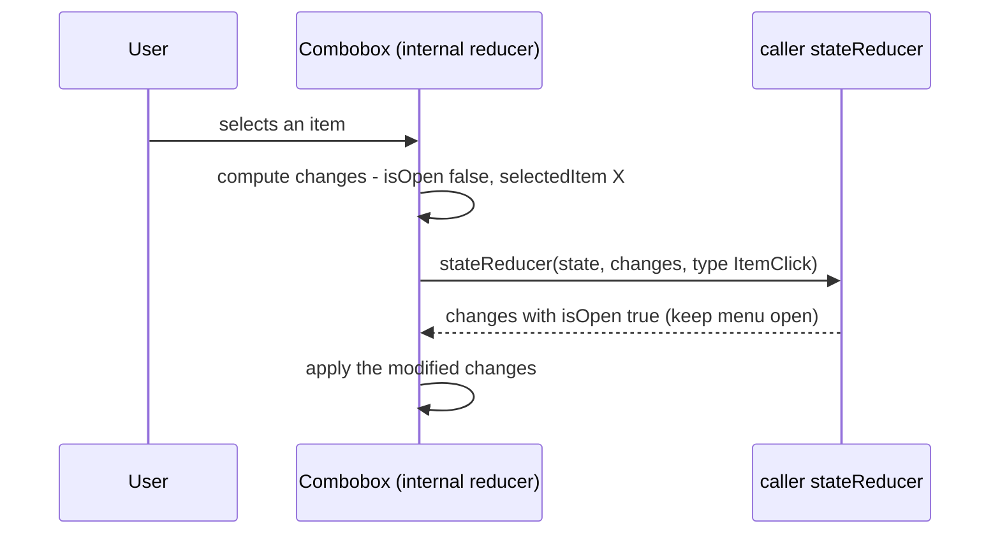

---

### Section 8: Resetting and Syncing State Without Bugs

Two recurring problems: **resetting** an uncontrolled component, and **syncing** props into state.

**Reset with `key`.** Changing a component's `key` makes React unmount it and mount a fresh one, re-reading `defaultValue`:

```tsx
// Edit form for the selected contact — new contact = fresh, uncontrolled form
<ContactForm key={contact.id} defaultValues={contact} />
```

**Don't mirror props into state with an effect** (the "derived state" anti-pattern):

```tsx
// ❌ BAD: two sources of truth; one render shows stale data; edits get overwritten when props change
function EmailField({ initialEmail }: { initialEmail: string }) {
  const [email, setEmail] = useState(initialEmail);
  useEffect(() => setEmail(initialEmail), [initialEmail]);
  return <input value={email} onChange={(e) => setEmail(e.target.value)} />;
}

// ✅ GOOD (a): fully controlled — the parent owns it
function EmailField({ email, onEmailChange }: { email: string; onEmailChange: (v: string) => void }) {
  return <input value={email} onChange={(e) => onEmailChange(e.target.value)} />;
}

// ✅ GOOD (b): fully uncontrolled with a reset key — <EmailField key={userId} defaultEmail={...} />
function EmailFieldUncontrolled({ defaultEmail }: { defaultEmail: string }) {
  return <input name="email" defaultValue={defaultEmail} />;
}
```

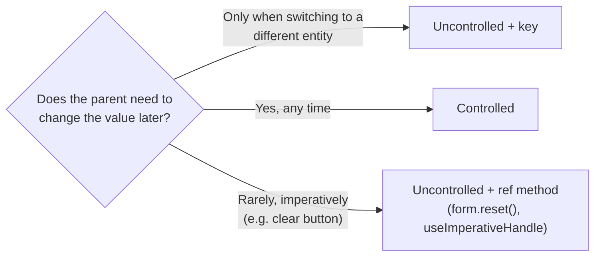

**Syncing to the URL.** Filters, tabs and pagination that should survive reload or be shareable are **controlled by the URL**: read the value from search params, write it in `onValueChange`. The component itself doesn't change — only who owns the value.

---

### Section 9: Vue, Angular, Svelte, Web Components and Native

Important difference: **React enforces control** (it resets the DOM to the `value` prop after each event). Most other frameworks **sync** values with two-way binding instead; a one-way `:value` / `[value]` binding doesn't lock the field.

| Stack | Controlled-style | Uncontrolled-style | Notes |
|---|---|---|---|
| **React** | `value` + `onChange` | `defaultValue`, refs, FormData / actions | Strict: DOM is forced back to `value` |
| **Vue 3** | `v-model` = `modelValue` prop + `update:modelValue` event; `defineModel()` in components | Plain inputs read via template ref or FormData | `:value` without a listener doesn't lock the input; `defineModel` falls back to local state when the parent doesn't bind it |
| **Angular** | Reactive forms (`FormControl` is the source of truth); signal `model()` inputs for components | Template-driven forms (`ngModel`) — the framework keeps the model in sync | Custom inputs join forms via **`ControlValueAccessor`**; newer Signal Forms exist (check angular.dev for status) |
| **Svelte 5** | `bind:value` / `$bindable()` props; **function bindings** (`bind:value={() => get, (v) => set}`) to transform or validate | Plain inputs + FormData, `use:enhance` in SvelteKit | Function bindings arrived in a Svelte 5.x minor — check svelte.dev |
| **Web Components** | Property + `change`/`input` event, app writes the property back | Native-style: attribute = default, property = current value | Form-associated custom elements use `ElementInternals` (`setFormValue`) to join forms |
| **SwiftUI** | `TextField("Name", text: $name)` — a `Binding` is controlled state | — (UIKit's `UITextField` owns its text, read via delegate/property) | Bindings make SwiftUI controlled by default |
| **Jetpack Compose** | `TextField(value, onValueChange)` — **state hoisting** | Newer `TextFieldState`-based text fields hold their own state (check Compose docs) | Compose guidance: hoist state to the lowest common owner |

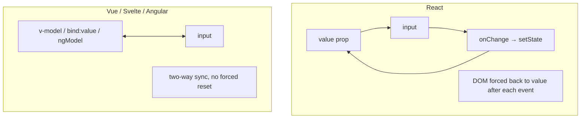

---

## Decision Matrix — Controlled or Uncontrolled?

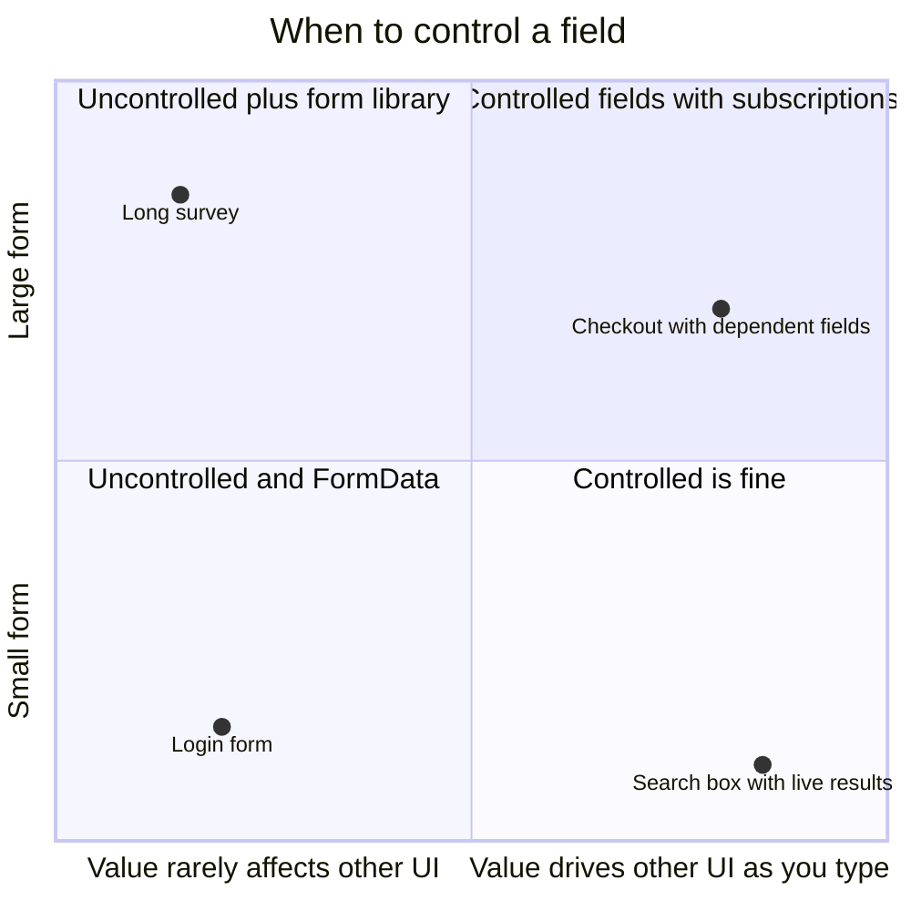

| Requirement | Choose |
|---|---|
| Submit-only form, server validates, progressive enhancement | **Uncontrolled** + form action / FormData |
| Validate or format **while typing**, input masks | **Controlled** (that field) |
| Value drives other UI (live preview, dependent options, enable/disable) | **Controlled** |
| Value must sync with URL, store, or another component | **Controlled** |
| Large form, performance-sensitive | **Uncontrolled** + library (React Hook Form) or field-level subscriptions |
| File upload | **Uncontrolled** (the only option) |
| Design-system component | **Support both** (`value`/`defaultValue`/`onValueChange`) |
| Component whose initial value comes from loaded data | Uncontrolled + `key`, or controlled with `?? ''` |

---

## Real-World Examples

**Example 1 — The three classic bugs (BAD → GOOD):**
```tsx
// ❌ BAD 1: controlled with no handler → frozen field + React warning
<input value={email} />
// ✅ GOOD
<input value={email} onChange={(e) => setEmail(e.target.value)} />
// or, if you don't need to control it:
<input name="email" defaultValue={email} />

// ❌ BAD 2: undefined while loading → switches from uncontrolled to controlled
const { data: user } = useUser();
<input value={user?.name} onChange={(e) => setName(e.target.value)} />
// ✅ GOOD: never undefined
<input value={name ?? user?.name ?? ''} onChange={(e) => setName(e.target.value)} />

// ❌ BAD 3: expecting defaultValue to update when data arrives
<input defaultValue={user?.name} />   // stays empty if user loads after first render
// ✅ GOOD: mount when ready, or remount with a key
{user && <input key={user.id} name="name" defaultValue={user.name} />}
```

**Example 2 — Uncontrolled form with a React 19 action:**
```tsx
'use client';
import { useActionState } from 'react';
import { useFormStatus } from 'react-dom';

type State = { error: string | null; values: { email: string } };

async function subscribe(_prev: State, formData: FormData): Promise<State> {
  const email = String(formData.get('email') ?? '');
  const res = await fetch('/api/subscribe', { method: 'POST', body: formData });
  if (!res.ok) return { error: 'Could not subscribe. Try again.', values: { email } };
  return { error: null, values: { email: '' } };
}

function SubmitButton() {
  const { pending } = useFormStatus(); // reads the parent <form>'s status
  return <button type="submit" disabled={pending}>{pending ? 'Subscribing…' : 'Subscribe'}</button>;
}

export function NewsletterForm() {
  const [state, formAction] = useActionState(subscribe, { error: null, values: { email: '' } });
  return (
    <form action={formAction}>
      <label htmlFor="email">Email</label>
      {/* Uncontrolled; defaultValue restores input after an error-returning action resets the form */}
      <input id="email" name="email" type="email" required defaultValue={state.values.email}
             aria-describedby={state.error ? 'email-error' : undefined} aria-invalid={!!state.error} />
      {state.error && <p id="email-error" role="alert">{state.error}</p>}
      <SubmitButton />
    </form>
  );
}
```

**Example 3 — A reusable `useControllableState` hook:**
```tsx
import { useCallback, useEffect, useRef, useState } from 'react';

type Options<T> = { value?: T; defaultValue: T; onChange?: (value: T) => void; name?: string };

export function useControllableState<T>({ value, defaultValue, onChange, name = 'Component' }: Options<T>) {
  const [internal, setInternal] = useState(defaultValue);
  const isControlled = value !== undefined;
  const current = isControlled ? (value as T) : internal;

  // Dev-only warning when the mode changes during the component's lifetime
  const wasControlled = useRef(isControlled);
  useEffect(() => {
    if (process.env.NODE_ENV !== 'production' && wasControlled.current !== isControlled) {
      console.warn(`${name} is changing from ${wasControlled.current ? 'controlled' : 'uncontrolled'} to ${isControlled ? 'controlled' : 'uncontrolled'}. Decide one mode for its lifetime.`);
    }
    wasControlled.current = isControlled;
  }, [isControlled, name]);

  const setValue = useCallback((next: T) => {
    if (Object.is(next, current)) return;
    if (!isControlled) setInternal(next);
    onChange?.(next);
  }, [current, isControlled, onChange]);

  return [current, setValue] as const;
}

// A Switch that supports both modes
type SwitchProps = {
  checked?: boolean;
  defaultChecked?: boolean;
  onCheckedChange?: (checked: boolean) => void;
  label: string;
};

export function Switch({ checked, defaultChecked = false, onCheckedChange, label }: SwitchProps) {
  const [on, setOn] = useControllableState({ value: checked, defaultValue: defaultChecked, onChange: onCheckedChange, name: 'Switch' });
  return (
    <button type="button" role="switch" aria-checked={on} onClick={() => setOn(!on)} data-state={on ? 'checked' : 'unchecked'}>
      {label}
    </button>
  );
}

// <Switch label="Email alerts" defaultChecked />                         // uncontrolled
// <Switch label="Email alerts" checked={alerts} onCheckedChange={save} /> // controlled
```

**Example 4 — React Hook Form: uncontrolled by default, `Controller` for controlled widgets:**
```tsx
import { useForm, Controller } from 'react-hook-form';
import * as Select from './ui/select'; // a controlled-capable design-system Select

type FormValues = { email: string; country: string };

export function SignupForm({ onSubmit }: { onSubmit: (v: FormValues) => Promise<void> }) {
  const { register, handleSubmit, control, formState: { errors, isSubmitting } } =
    useForm<FormValues>({ defaultValues: { email: '', country: 'PK' } });

  return (
    <form onSubmit={handleSubmit(onSubmit)}>
      {/* Native input: registered via ref, no re-render per keystroke */}
      <input type="email" {...register('email', { required: 'Email is required' })} aria-invalid={!!errors.email} />
      {errors.email && <p role="alert">{errors.email.message}</p>}

      {/* Custom component without a DOM input: bridge it with Controller */}
      <Controller
        name="country"
        control={control}
        render={({ field }) => (
          <Select.Root value={field.value} onValueChange={field.onChange}>{/* …parts… */}</Select.Root>
        )}
      />
      <button type="submit" disabled={isSubmitting}>Sign up</button>
    </form>
  );
}
```

**Example 5 — Vue 3: `defineModel` for a custom input:**
```html
<!-- QuantityInput.vue -->
<script setup lang="ts">
// Controlled when the parent uses v-model; local state when it doesn't
const quantity = defineModel<number>({ default: 1 });
const props = defineProps<{ max: number }>();
const step = (delta: number) => {
  quantity.value = Math.min(props.max, Math.max(1, quantity.value + delta));
};
</script>
<template>
  <div class="qty" role="group" aria-label="Quantity">
    <button type="button" aria-label="Decrease" @click="step(-1)">−</button>
    <output aria-live="polite">{{ quantity }}</output>
    <button type="button" aria-label="Increase" @click="step(1)">+</button>
  </div>
</template>

<!-- Parent -->
<QuantityInput v-model="cart.qty" :max="10" />   <!-- controlled by the parent -->
<QuantityInput :max="10" />                       <!-- uncontrolled -->
```

**Example 6 — Angular: a custom control that works with reactive forms (`ControlValueAccessor`):**
```typescript
import { Component, forwardRef, signal } from '@angular/core';
import { ControlValueAccessor, NG_VALUE_ACCESSOR } from '@angular/forms';

@Component({
  selector: 'app-rating',
  template: `
    <div role="radiogroup" aria-label="Rating">
      @for (n of stars; track n) {
        <button type="button" role="radio" [attr.aria-checked]="value() === n"
                [disabled]="disabled()" (click)="select(n)" (blur)="onTouched()">★</button>
      }
    </div>`,
  providers: [{ provide: NG_VALUE_ACCESSOR, useExisting: forwardRef(() => RatingComponent), multi: true }],
})
export class RatingComponent implements ControlValueAccessor {
  readonly stars = [1, 2, 3, 4, 5];
  protected readonly value = signal(0);
  protected readonly disabled = signal(false);
  private onChange: (v: number) => void = () => {};
  protected onTouched: () => void = () => {};

  writeValue(v: number | null): void { this.value.set(v ?? 0); }        // form → component
  registerOnChange(fn: (v: number) => void): void { this.onChange = fn; } // component → form
  registerOnTouched(fn: () => void): void { this.onTouched = fn; }
  setDisabledState(isDisabled: boolean): void { this.disabled.set(isDisabled); }

  protected select(n: number): void {
    this.value.set(n);
    this.onChange(n);
  }
}
// Usage: <app-rating [formControl]="ratingControl" />   or   <app-rating formControlName="rating" />
```

**Example 7 — Svelte 5: two-way binding and a function binding that transforms input:**
```html
<script lang="ts">
  let code = $state('');
</script>

<!-- Function binding: the setter transforms the value as it's written.
     Unlike React, the DOM isn't forced back if the state doesn't change - test rejected-character cases -->
<input
  bind:value={() => code, (v) => (code = v.toUpperCase().replace(/[^A-Z0-9]/g, '').slice(0, 12))}
  aria-label="Coupon code"
/>
<p>Applying: {code}</p>
```
```html
<!-- Stepper.svelte — $bindable makes the prop optionally two-way (like defineModel) -->
<script lang="ts">
  let { value = $bindable(1), max = 10 }: { value?: number; max?: number } = $props();
</script>
<button type="button" onclick={() => (value = Math.max(1, value - 1))} aria-label="Decrease">−</button>
<output>{value}</output>
<button type="button" onclick={() => (value = Math.min(max, value + 1))} aria-label="Increase">+</button>
```

**Example 8 — Native: SwiftUI binding and Compose state hoisting:**
```swift
struct ProfileForm: View {
    @State private var name = ""          // owner of the value
    var body: some View {
        TextField("Name", text: $name)    // controlled through a Binding
            .onChange(of: name) { _, newValue in
                if newValue.count > 40 { name = String(newValue.prefix(40)) } // reject extra characters
            }
    }
}
```
```kotlin
@Composable
fun NameField(name: String, onNameChange: (String) -> Unit) {  // stateless = controlled
    TextField(value = name, onValueChange = { onNameChange(it.take(40)) }, label = { Text("Name") })
}

@Composable
fun ProfileScreen() {
    var name by rememberSaveable { mutableStateOf("") }        // state hoisted to the caller
    NameField(name = name, onNameChange = { name = it })
}
```

---

## Key Points Summary

| Concept | One-Line Explanation |
|---|---|
| **Controlled** | Parent owns the value (`value` + `onChange`); the component only reports changes |
| **Uncontrolled** | The DOM or component owns the value (`defaultValue`); parent reads it via ref/FormData |
| **React enforcement** | React resets a controlled input's DOM to the `value` prop after each event |
| **One mode per lifetime** | Switching between `undefined` and a value triggers warnings and bugs |
| **`defaultValue`** | Read once at mount; use `key` to reset |
| **Form actions** | React 19 `<form action>` + `useActionState` + `useFormStatus` make uncontrolled forms first-class |
| **Reset after actions** | Uncontrolled fields reset when an action succeeds — feed values back if needed |
| **Performance** | Controlled re-renders the owner per keystroke; colocate state or go uncontrolled |
| **Controllable state** | Design-system components support `value`/`defaultValue`/`onValueChange` |
| **State reducer** | Lets callers veto/modify internal transitions without full control |
| **Derived-state anti-pattern** | Don't copy props into state with an effect; choose controlled or keyed uncontrolled |
| **Other frameworks** | Vue/Svelte/Angular use two-way binding; Angular custom inputs use ControlValueAccessor |
| **Native** | SwiftUI `Binding` and Compose state hoisting are the controlled model |

---

## Test Your Understanding

**Q1 (Basic):**
What's the difference between `<input value={name} onChange={...} />` and `<input defaultValue={name} />` in React? When does each re-render?

<details>
<summary>Answer</summary>

The first is **controlled**: React state is the source of truth, every keystroke calls `onChange`, you update state, and the owning component re-renders. React forces the DOM to show `value` after each event, so you can transform or reject input.

The second is **uncontrolled**: the DOM keeps the value; `defaultValue` is used only at mount. Typing causes **no** React re-render. You read the value through a ref or `FormData` when needed. Changing `name` later doesn't update the field unless you remount it (e.g. with a `key`).
</details>

**Q2 (Application):**
An edit page loads a user with TanStack Query and renders `<input value={user?.name} onChange={...} />`. The console shows "A component is changing an uncontrolled input to be controlled". Explain and fix.

<details>
<summary>Answer</summary>

On the first render `user` is `undefined`, so `value={undefined}` — React treats that as **uncontrolled**. When the data arrives, `value` becomes a string and the input becomes **controlled**. Switching modes mid-life is a bug React warns about.

Fixes, depending on intent:
- **Controlled:** keep a local draft and never pass `undefined`: `value={draft ?? user?.name ?? ''}`.
- **Uncontrolled edit form:** render the form only when data is ready and key it by the entity: `{user && <UserForm key={user.id} defaultValues={user} />}`. This also resets the form when you switch users, and avoids copying server state into local state with an effect.
</details>

**Q3 (Tricky):**
A design-system `Select` takes `value` and `onChange`. A team writes `<Select value="pk" />` without `onChange` to "preselect Pakistan" and reports "the Select is broken — I can't change it". Is it broken? How should the API be designed?

<details>
<summary>Answer</summary>

It behaves as designed: passing `value` makes it **controlled**, and with no `onChange` nobody updates the value, so the selection is frozen (exactly like a React `<input value>` without a handler).

The API should support both modes explicitly: `value` + `onValueChange` for controlled, **`defaultValue`** for "preselect but let the component manage it". Add a **dev warning** when `value` is passed without `onValueChange` (unless `readOnly`/`disabled`), and when the component switches between modes. Pass the **value**, not an event, to `onValueChange`. Document both modes with examples.
</details>

**Q4 (Tricky):**
A React 19 form uses `<form action={formAction}>` from `useActionState`. When the server returns "Email already taken", the error shows but the email field is now empty. Why, and how do you fix it?

<details>
<summary>Answer</summary>

React **resets uncontrolled fields after a form action succeeds**. Returning an error object (instead of throwing) still counts as the action completing successfully, so the form is reset and the typed email disappears.

Fixes: return the submitted values in the action state and use them as `defaultValue` (`defaultValue={state.values.email}`), or make that field **controlled** so its value lives in React state. Throwing isn't the answer: it sends you to an error boundary, which is wrong for expected validation errors. Check react.dev for the current reset behaviour.
</details>

**Q5 (Application):**
A 60-field insurance form feels laggy while typing. All fields are controlled through one `useState` object at the top of the form. What are your options?

<details>
<summary>Answer</summary>

Every keystroke updates the top-level object, so **all 60 fields** (plus validation and any preview) re-render. Options, roughly in order of effort:
- **Colocate**: give each field (or section) its own state, lifting only what's shared.
- **Go uncontrolled**: use `name` + `defaultValue` and read `FormData` on submit or per step; validate on blur/submit.
- **Form library with subscriptions**: React Hook Form registers uncontrolled inputs via refs and re-renders only what changed (`Controller` for custom widgets); TanStack Form offers fine-grained field subscriptions.
- **`useDeferredValue`** for expensive derived UI (e.g. a live premium calculation), and the React Compiler to skip unchanged subtrees.
Measure with the React Profiler and INP before and after.
</details>

**Q6 (System design):**
You're defining the state contract for all stateful components (Dialog, Tabs, Accordion, Select, DataTable) in a design system used by React, Vue and Angular apps, where some screens must sync state to the URL. What do you specify?

<details>
<summary>Answer</summary>

- **Every piece of user-changeable state is controllable**: React `value`/`defaultValue`/`onValueChange` (`open`/`defaultOpen`/`onOpenChange`, `checked`/`defaultChecked`/`onCheckedChange`); Vue `v-model` / named `v-model:open` via `defineModel`; Angular `model()` inputs for two-way binding plus `ControlValueAccessor` for form fields; Svelte `$bindable` props.
- **Callbacks receive values**, not DOM events, and fire in both modes.
- **Partial control** for multi-state widgets (DataTable: `sorting`, `pagination`, `filters` independently), so a screen can put just pagination in the URL.
- **Dev warnings** for value-without-handler and mode switching.
- **Reset semantics** documented (keyed remount for uncontrolled; parent-driven for controlled).
- **Form integration**: fields expose `name` and work in native forms / FormData (form-associated where relevant), so apps can choose uncontrolled forms.
- **Optional state reducer** for advanced customisation on complex widgets (combobox).
- URL sync is then an app concern: read search params into `value`, write them in `onValueChange` — no component changes.
</details>

---

## Cheat Sheet

**Key Definitions:**
- **Controlled component:** Its value comes from props; changes are reported via a callback and applied by the parent
- **Uncontrolled component:** It keeps its own value; the parent sets only the initial value and reads it when needed
- **Source of truth:** The single place the current value lives
- **Controllable state:** One component supporting both modes (`value` vs `defaultValue`)
- **State hoisting:** Moving state up to the lowest common owner (React, Compose)
- **State reducer:** A caller-supplied function that can modify a component's internal state transitions
- **ControlValueAccessor:** Angular's bridge between a custom component and the forms API

**Quick Reference:**
```text
React controlled:     value + onChange       | checked + onChange
React uncontrolled:   defaultValue + ref     | defaultChecked | name + FormData | <form action>
Never:                value={undefined} or value={null} on a controlled input → use ''
Frozen field:         value without onChange → add onChange / defaultValue / readOnly
Reset uncontrolled:   key={entity.id}  ·  form.reset()  ·  requestFormReset (React DOM)
File input:           always uncontrolled
DS contract:          value/defaultValue/onValueChange · open/defaultOpen/onOpenChange · checked/defaultChecked/onCheckedChange
Callbacks:            pass the value, not the event · fire in both modes · warn on mode switch
Perf:                 colocate state · uncontrolled + FormData · RHF/TanStack Form · useDeferredValue
Vue:                  v-model = modelValue + update:modelValue · defineModel() (local fallback)
Angular:              Reactive forms (FormControl) · ngModel · model() · ControlValueAccessor
Svelte 5:             bind:value · $bindable() · function bindings for transforms
Native:               SwiftUI TextField(text: $binding) · Compose TextField(value, onValueChange)
```

**Common Mistakes to Avoid:**

| Mistake | Why Wrong | Fix |
|---|---|---|
| `value` without `onChange` | Field is frozen | Add `onChange`, use `defaultValue`, or `readOnly` |
| `value={data?.x}` while loading | Switches uncontrolled → controlled | `?? ''` or render when loaded + `key` |
| Expecting `defaultValue` to update | Only read at mount | Remount with `key` or go controlled |
| Copying props into state with `useEffect` | Two sources of truth, stale renders, lost edits | Fully controlled or keyed uncontrolled |
| Async state updates for a controlled input | Caret jumps | Update state synchronously in the handler |
| Whole large form in one top-level state | Every keystroke re-renders everything | Colocate, uncontrolled fields, form library |
| `onChange(event)` from a custom Select | No meaningful `event.target.value` | `onValueChange(value)` |
| Design-system component that's only controlled | Every caller must wire state for trivial uses | Support `defaultValue` too |
| Returning errors from a form action with uncontrolled fields | Fields reset, input lost | Feed values back as `defaultValue`, or control those fields |
| Custom Angular input without `ControlValueAccessor` | Doesn't work with `formControlName` / validation | Implement CVA and provide `NG_VALUE_ACCESSOR` |

---

## References & Further Reading

**Core docs**
- React: [`<input>` — controlling an input with a state variable](https://react.dev/reference/react-dom/components/input) · [`<select>`](https://react.dev/reference/react-dom/components/select) · [`<textarea>`](https://react.dev/reference/react-dom/components/textarea)
- React: [Sharing State Between Components (controlled and uncontrolled components)](https://react.dev/learn/sharing-state-between-components)
- React: [`<form>` and form actions](https://react.dev/reference/react-dom/components/form) · [`useActionState`](https://react.dev/reference/react/useActionState) · [`useFormStatus`](https://react.dev/reference/react-dom/hooks/useFormStatus)
- React: [You Might Not Need an Effect (resetting state with a key)](https://react.dev/learn/you-might-not-need-an-effect) · [Preserving and Resetting State](https://react.dev/learn/preserving-and-resetting-state)
- React: [`useDeferredValue`](https://react.dev/reference/react/useDeferredValue)
- Vue: [Component v-model (`defineModel`)](https://vuejs.org/guide/components/v-model.html) · [Form input bindings](https://vuejs.org/guide/essentials/forms.html)
- Angular: [Forms overview (reactive vs template-driven)](https://angular.dev/guide/forms) · [`ControlValueAccessor`](https://angular.dev/api/forms/ControlValueAccessor)
- Svelte: [`bind:` (including function bindings)](https://svelte.dev/docs/svelte/bind) · [`$bindable`](https://svelte.dev/docs/svelte/$bindable)
- MDN: [`FormData`](https://developer.mozilla.org/en-US/docs/Web/API/FormData) · [Client-side form validation](https://developer.mozilla.org/en-US/docs/Learn_web_development/Extensions/Forms/Form_validation) · [`ElementInternals`](https://developer.mozilla.org/en-US/docs/Web/API/ElementInternals)

**Libraries**
- React Hook Form: [Get started](https://react-hook-form.com/get-started) · [`Controller`](https://react-hook-form.com/docs/usecontroller/controller)
- TanStack Form: [Overview](https://tanstack.com/form/latest/docs/overview)
- Downshift: [State reducer](https://github.com/downshift-js/downshift#statereducer)
- Radix Primitives: [Dialog API reference (`open` / `defaultOpen` / `onOpenChange`)](https://www.radix-ui.com/primitives/docs/components/dialog)

**Native**
- Android: [Where to hoist state](https://developer.android.com/develop/ui/compose/state-hoisting)
- Apple: [`Binding`](https://developer.apple.com/documentation/swiftui/binding)

**Deep dives**
- Kent C. Dodds: [The State Reducer Pattern with React Hooks](https://kentcdodds.com/blog/the-state-reducer-pattern-with-react-hooks)
- React (legacy blog, still relevant): [You Probably Don't Need Derived State](https://legacy.reactjs.org/blog/2018/06/07/you-probably-dont-need-derived-state.html)

---

> **Previous Topic:** [Headless UI / Renderless Components](./headless-ui-renderless-components.md)
> — Behaviour and accessibility without markup or styles

> **Next Topic:** [Higher-Order Components & Render Props](./higher-order-components-and-render-props.md)
> — The pre-hooks logic-reuse patterns, their status today, and what replaced them

*Saved on: 2026-11-06 | Repo: Frontend System Design Learning Notes*
