<!-- Generated by scripts/sync-knowledge.js from notes/ and README.md — do not edit here. -->
<!-- sections (line ranges in this file): Table of Contents 19-41 · ELI5 42-55 · Core Concept 56-511 · System Design Angle 512-547 · Framework Comparison 548-560 · Real-World Examples 561-673 · Key Points Summary 674-693 · Test Your Understanding 694-765 · Cheat Sheet 766-815 · References & Further Reading 816-855 -->

# Core Web Vitals (LCP, INP, CLS)

> **Date:** 2026-11-06 · **Last updated:** 2026-11-06
> **Category:** Frontend System Design
> **Sub-Topic:** Performance Engineering / Performance Metrics
> **Level:** Intermediate · **Reading time:** ~30 min
> **Informs:** performance SLOs and alert thresholds, LCP element priority (preload, fetchpriority, SSR), main-thread budget per interaction, layout-stability rules (image dimensions, ad slots, font fallbacks), RUM instrumentation, rendering strategy per route

> **Pre-requisite:** [Critical Rendering Path](./critical-rendering-path.md) (what blocks the first paint) and [JavaScript Runtime & Event Loop](./javascript-runtime-event-loop.md) (long tasks, yielding).
> This note opens Phase 4: **how "fast" is defined and measured** before we learn how to make things faster.

**Previous:** [Offline-First Architecture](./offline-first-architecture.md) · **Next:** [Lighthouse & Performance Auditing](./lighthouse-and-performance-auditing.md)

---

## Table of Contents

1. [ELI5 — Simple Explanation](#eli5--simple-explanation)
2. [Section 1: What Core Web Vitals Are (and Are Not)](#section-1-what-core-web-vitals-are-and-are-not)
3. [Section 2: Thresholds and the 75th Percentile](#section-2-thresholds-and-the-75th-percentile)
4. [Section 3: LCP — Largest Contentful Paint](#section-3-lcp--largest-contentful-paint)
5. [Section 4: INP — Interaction to Next Paint](#section-4-inp--interaction-to-next-paint)
6. [Section 5: CLS — Cumulative Layout Shift](#section-5-cls--cumulative-layout-shift)
7. [Section 6: Supporting Metrics (TTFB, FCP, TBT) and Retired FID](#section-6-supporting-metrics-ttfb-fcp-tbt-and-retired-fid)
8. [Section 7: Field vs Lab Data](#section-7-field-vs-lab-data)
9. [Section 8: Measuring in Code](#section-8-measuring-in-code)
10. [Section 9: SPAs, bfcache and Edge Cases](#section-9-spas-bfcache-and-edge-cases)
11. [Section 10: Browser Support](#section-10-browser-support)
12. [System Design Angle](#system-design-angle)
13. [Framework Comparison](#framework-comparison)
14. [Real-World Examples](#real-world-examples)
15. [Key Points Summary](#key-points-summary)
16. [Test Your Understanding](#test-your-understanding)
17. [Cheat Sheet](#cheat-sheet)
18. [References & Further Reading](#references--further-reading)

---

## ELI5 — Simple Explanation

Imagine visiting a restaurant and judging it on three things:

- **LCP — "When does my main dish arrive?"** You don't care when the napkins land on the table; you care when the *big thing you came for* shows up. On a page, that is the largest image or text block in the first screen.
- **INP — "When I wave at the waiter, how quickly do they react?"** Every time you ask for something, how long until you *see* a response? One painfully slow reaction ruins the evening, so the restaurant is graded on (almost) its slowest response.
- **CLS — "Does the table keep moving?"** If someone keeps sliding your plate around just as you reach for your fork, you knock things over. On a page, that is content jumping while you try to read or tap.

Google sends inspectors to **thousands of real diners** (field data from real Chrome users), not one critic in a quiet test kitchen. The grade is what **3 out of 4 diners** experienced or better (the 75th percentile).

> **Core Web Vitals grade real users on three things: did the main content load fast (LCP ≤ 2.5 s), did the page respond quickly to every input (INP ≤ 200 ms), and did it stay visually stable (CLS ≤ 0.1), measured at the 75th percentile.**

---

## Core Concept — Step by Step

### Section 1: What Core Web Vitals Are (and Are Not)

**Web Vitals** is a Google initiative that gives unified guidance for user-centric quality signals. **Core Web Vitals** (CWV) is the small subset that applies to *every* page, is measurable *in the field*, and is reviewed roughly yearly.

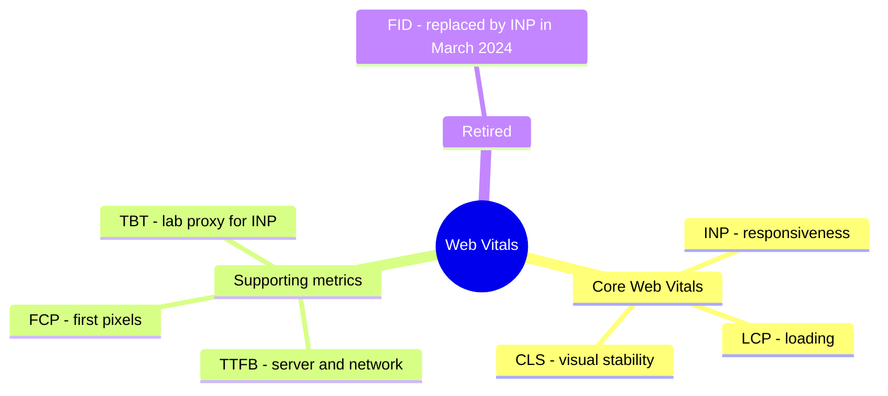

| Metric | Question it answers | Measures | Good | Needs improvement | Poor |
|---|---|---|---|---|---|
| **LCP** — Largest Contentful Paint | *Is the main content visible?* | Time from navigation start to rendering the largest image/text block in the viewport | **≤ 2.5 s** | 2.5 – 4.0 s | > 4.0 s |
| **INP** — Interaction to Next Paint | *Does the page react quickly?* | Latency of (nearly) the slowest click/tap/key interaction over the page's whole life | **≤ 200 ms** | 200 – 500 ms | > 500 ms |
| **CLS** — Cumulative Layout Shift | *Does the content stay put?* | Largest burst of unexpected layout shift scores (unitless) | **≤ 0.1** | 0.1 – 0.25 | > 0.25 |

What Core Web Vitals are **not**:

- **Not a full performance picture.** A page can pass all three and still feel slow (for example a heavy JS app that loads its LCP image quickly but takes seconds to become usable before the first interaction).
- **Not a lab score.** The Lighthouse "Performance" score is a separate, weighted lab score (next note: [Lighthouse & Performance Auditing](./lighthouse-and-performance-auditing.md)).
- **Not the only ranking input.** Google Search documents CWV as part of the signals its ranking systems use for page experience, but relevance of content is far more important. Do performance work for users and conversions first; SEO is a side benefit.

**Timeline of the program** (dates from web.dev / Chrome announcements):

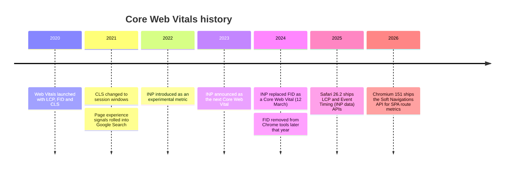

---

### Section 2: Thresholds and the 75th Percentile

Thresholds are judged on the **75th percentile (p75)** of page loads, **separately for mobile and desktop**. A page (or origin) "passes" Core Web Vitals when **all three** metrics are "good" at p75.

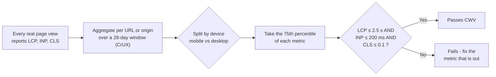

Why p75 and not the average?

| Choice | Problem / benefit |
|---|---|
| **Average** | One user on a slow device with a 30 s LCP drags the mean around; it describes nobody |
| **Median (p50)** | Ignores the slower half of your users entirely |
| **p75** | Most users have a good experience, and it is stable enough not to swing on outliers |
| **p95 / p99** | Useful for your own internal alerting on tail latency, but noisy and dominated by bad networks/devices you can't control |

> Interpreting p75: "LCP p75 = 2.1 s" means **75% of page views had LCP ≤ 2.1 s**, and 25% were slower. Design for the slower quarter, which is usually **mid-range Android phones on mobile networks**.

**Units and rounding:** LCP and INP are durations in milliseconds; CLS is a unitless score (two decimals, e.g. `0.08`).

---

### Section 3: LCP — Largest Contentful Paint

#### 3.1 What counts as the LCP element

LCP reports the render time of the **largest image or text block visible in the viewport**, relative to when the user started navigating.

| Counts | Doesn't count |
|---|---|
| `` (first frame for animated images) | Elements with `opacity: 0` / invisible |
| `<image>` inside `<svg>` | Images that cover the whole viewport and are treated as backgrounds |
| `<video>` — poster image or first frame, whichever is earlier | Low-content images (placeholders, very low "bits per pixel" in Chromium's heuristics) |
| Elements with a CSS `background-image: url(...)` | Content below the fold |
| Block-level elements containing text nodes | Content inside cross-origin iframes (the API can't report it) |

Size is the **visible area in the viewport**, and for images it is the smaller of the displayed size and the intrinsic size (upscaling a tiny image does not make it "larger").

#### 3.2 LCP is a moving target until the user interacts

As the page loads, the browser emits a new **LCP candidate** whenever a larger element renders. Reporting stops at the first user input (tap, click, scroll, key press), because input changes what is on screen.

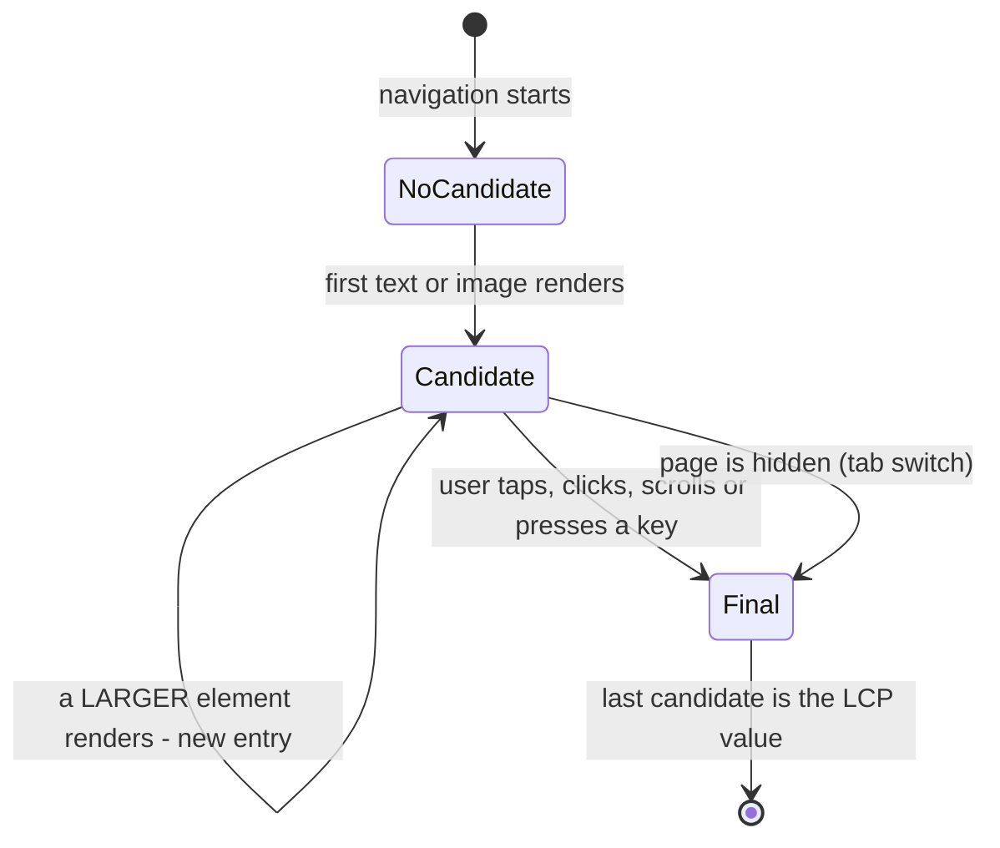

That is why a **text headline** is often the early candidate and a **hero image** that arrives later replaces it.

#### 3.3 The four LCP sub-parts

Every LCP time can be decomposed (per web.dev's *Optimize LCP* guide). Find the biggest part and fix **that**.

```mermaid
gantt
    title LCP for an image element (illustrative timings)
    dateFormat x
    axisFormat %L ms
    section Sub-parts
    TTFB - server and network          :a1, 0, 800
    Resource load delay                :a2, after a1, 300
    Resource load duration             :a3, after a2, 700
    Element render delay               :a4, after a3, 200
```

| Sub-part | From → to | Typical causes | Fixes |
|---|---|---|---|
| **TTFB** | Navigation start → first byte of HTML | Slow server, no CDN, redirects, cold starts, uncached SSR | CDN/edge caching, cache HTML, fewer redirects, `103 Early Hints`, streaming SSR |
| **Resource load delay** | TTFB → browser *starts* fetching the LCP resource | Image discovered late: CSS background, injected by JS, `loading="lazy"`, low priority | Put `` in server HTML, `fetchpriority="high"`, `<link rel="preload">`, never lazy-load it |
| **Resource load duration** | Fetch start → fetch end | Huge file, wrong format, slow third-party host, bandwidth contention | AVIF/WebP, `srcset`/`sizes`, compression, same-origin CDN, fewer competing requests |
| **Element render delay** | Resource loaded → element painted | Render-blocking CSS/JS, client-side rendering waiting for JS, A/B test scripts hiding the page, web font block period for text | Inline critical CSS, `defer` scripts, SSR/SSG, avoid anti-flicker snippets, `font-display` |

web.dev's guidance is that a well-optimized page spends most of its LCP time in **TTFB and resource load duration**, with **load delay and render delay close to zero**. If either "delay" is large, the browser was waiting for no good reason.

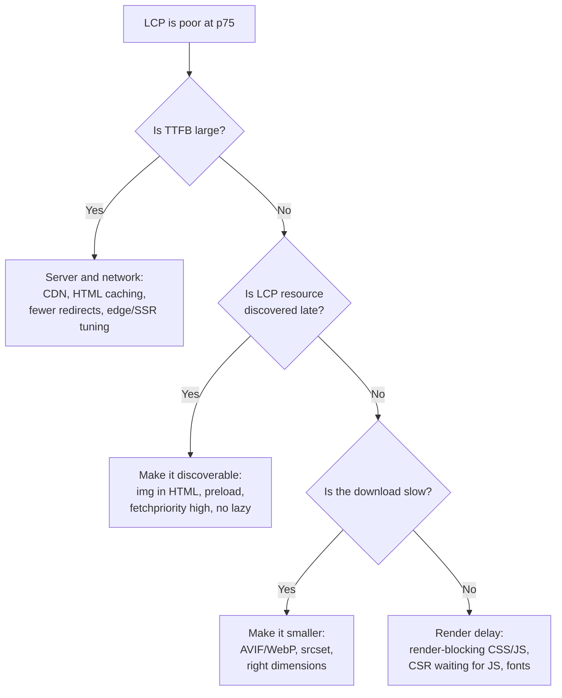

#### 3.4 Rendering strategy and LCP

| Strategy | Effect on LCP | Note |
|---|---|---|
| **CSR** ([note](./client-side-rendering-csr.md)) | Usually worst: HTML is empty, LCP element only exists after JS downloads, runs and fetches data | Render delay dominates |
| **SSR** ([note](./server-side-rendering-ssr.md)) | LCP element is in the HTML; TTFB grows if the server is slow | Stream and cache to keep TTFB low |
| **SSG / ISR** ([SSG](./static-site-generation-ssg.md), [ISR](./incremental-static-regeneration-isr.md)) | Best TTFB (served from CDN) and element in HTML | Great default for content pages |
| **Prerendered navigation** (Speculation Rules, Chromium) | The next page can already be rendered before the click, so LCP can be near zero | Chromium-only; others ignore the rules safely |

---

### Section 4: INP — Interaction to Next Paint

#### 4.1 What INP observes

INP observes every **click, tap and key press** during the whole page visit (not hover, not scrolling). For each interaction it measures the time from the input until the **next frame is painted**, so the user *sees* a response. The page's INP is the **slowest interaction**, except that on pages with many interactions one highest outlier is ignored for every 50 interactions (so it approximates a high percentile, not a single freak event).

#### 4.2 The three phases of one interaction

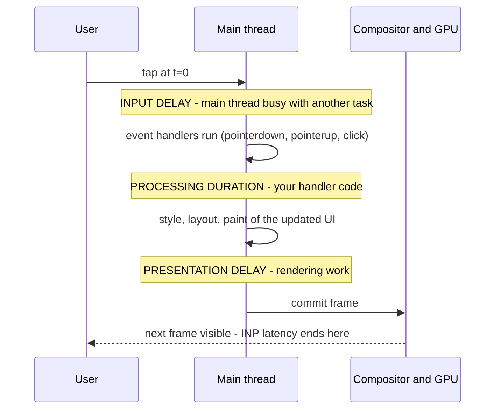

| Phase | What it is | Common causes | Fixes |
|---|---|---|---|
| **Input delay** | Input arrives while the main thread is busy | Long tasks from hydration, third-party scripts, timers, big JSON parsing | Break up long tasks, yield, defer non-critical JS, move work to a Worker |
| **Processing duration** | Your event callbacks run | Heavy handlers, synchronous state updates that re-render large trees, analytics in the handler | Do the minimum, update UI first, defer the rest (`startTransition`, `scheduler.postTask`, `setTimeout`) |
| **Presentation delay** | Style, layout, paint of the next frame | Huge DOM, layout thrashing, expensive CSS, rendering thousands of rows | Smaller DOM, virtualization, `content-visibility: auto`, avoid forced layouts |

**Event Timing rounds durations to 8 ms** and an interaction groups all the events of one user gesture (for example `pointerdown`, `pointerup` and `click` for one tap); the interaction's latency is the longest of them.

#### 4.3 Long tasks are the root cause

Any main-thread task over **50 ms** is a *long task*. If the user taps during one, the input waits (see the [event loop note](./javascript-runtime-event-loop.md#section-10-blocking-the-main-thread-and-how-to-stop)).

```text
Main thread:  |=====hydration 280 ms=====|  handler 40 ms | render 30 ms |
User taps:          ^ t=60 ms
INP for this tap ≈ (280-60) input delay + 40 processing + 30 presentation ≈ 290 ms  → Needs improvement
```

The pattern that fixes most INP problems: **paint the acknowledgement first, then do the heavy work in a later task.**

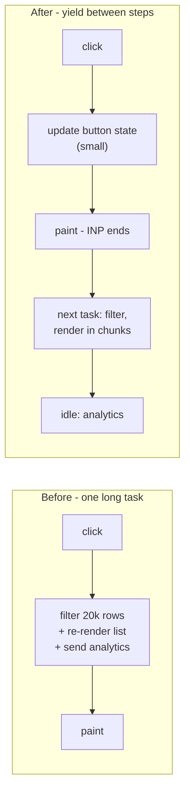

> **Why INP replaced FID:** FID measured only the *input delay* of the *first* interaction. It ignored processing and rendering time, and every interaction after the first. Most sites scored well on FID while users still felt slowness, so INP measures the full latency for all interactions.

---

### Section 5: CLS — Cumulative Layout Shift

#### 5.1 What a layout shift is

A **layout shift** happens when an element that was already visible changes its start position between two frames, *without* the user causing it. Each shift gets a score:

```text
layout shift score = impact fraction × distance fraction

impact fraction   = area of the viewport touched by the unstable elements (before ∪ after) / viewport area
distance fraction = greatest distance any unstable element moved / largest viewport dimension

Example: a banner pushes an article down by 25% of the viewport height.
The article occupies 50% of the viewport before and 75% (union) after.
score = 0.75 × 0.25 = 0.1875   (already above the 0.1 "good" limit)
```

#### 5.2 Session windows — "cumulative" is not "sum of everything"

Shifts are grouped into **session windows**: a window continues while shifts occur less than **1 s** apart, up to **5 s** in total. CLS is the **largest** window's sum. This change (2021) stopped long-lived pages like infinite feeds from accumulating scores forever.

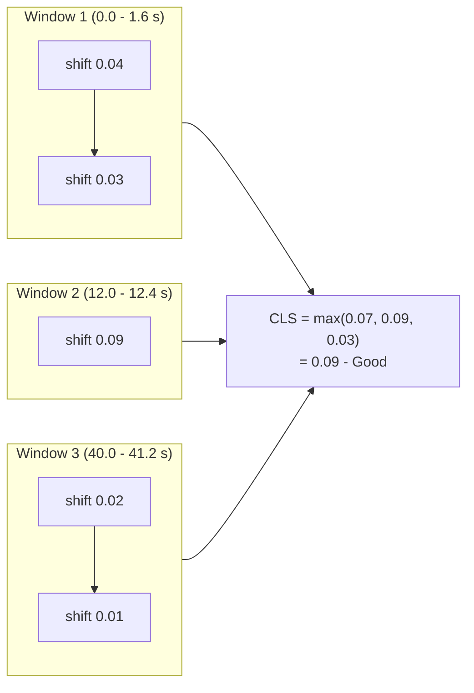

#### 5.3 Expected vs unexpected shifts

| Not counted | Why |
|---|---|
| Shifts within **500 ms after a discrete input** (click, tap, key press) | The user caused them; `hadRecentInput` is `true` on the entry. Scrolling and hover do not count as input for this rule |
| **`transform` animations** (translate, scale) | They don't change layout positions, they are composited |
| Elements that move **together with** their container during scroll | Scrolling is not a layout shift |
| Newly inserted elements that don't move other elements | Only *existing* elements moving count |

#### 5.4 The usual causes

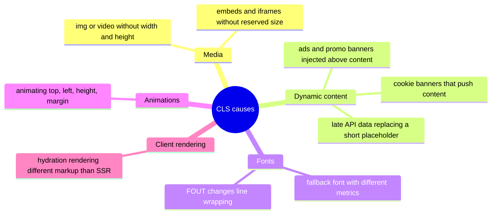

| Cause | Fix |
|---|---|
| Images/videos without dimensions | Always set `width` and `height` attributes (browsers derive `aspect-ratio` from them) or CSS `aspect-ratio` |
| Ads/embeds | Reserve the slot with `min-height`, choose the most common size, keep empty slots rather than collapsing them |
| Content inserted above existing content | Insert below the fold, or behind a user action ("Show 3 new posts" button), or overlay instead of push |
| Web fonts | Preload the critical font, use `font-display: optional` or metric-matched fallbacks (`size-adjust`, `ascent-override`) — framework font tools do this |
| Skeletons that don't match | Make skeletons the **same size** as the real content |
| Layout-property animations | Animate `transform` and `opacity` only |

---

### Section 6: Supporting Metrics (TTFB, FCP, TBT) and Retired FID

| Metric | Type | Good threshold (web.dev) | Why you still track it |
|---|---|---|---|
| **TTFB** — Time to First Byte | Field + lab | ≤ 0.8 s | First sub-part of LCP; diagnoses server/CDN/redirects |
| **FCP** — First Contentful Paint | Field + lab | ≤ 1.8 s | First pixels; shows render-blocking resources |
| **TBT** — Total Blocking Time | **Lab only** | (Lighthouse scores it) | Sum of the part of each long task beyond 50 ms between FCP and load; the lab proxy for INP |
| **FID** — First Input Delay | Retired | — | Replaced by INP in March 2024; no longer reported by CrUX or Chrome tools. Remove it from dashboards and alerting |

> **TBT is not INP.** TBT only looks at page load, with no real user. Low TBT makes good INP likely during load but says nothing about interactions later (opening a heavy modal, filtering a big table).

---

### Section 7: Field vs Lab Data

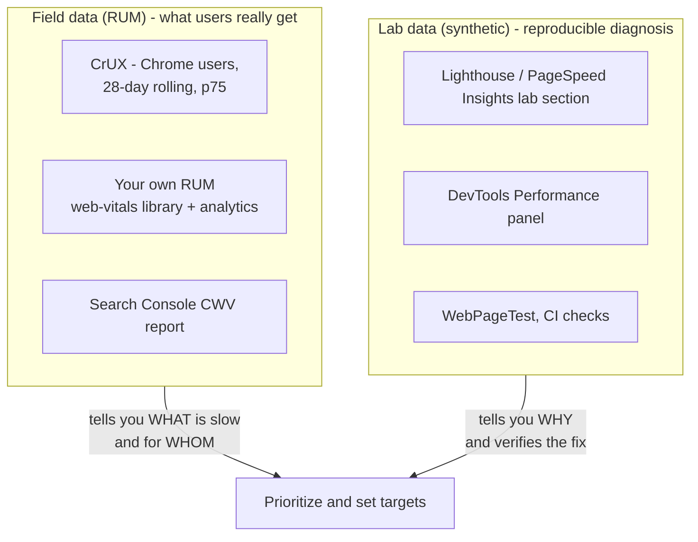

| | **Field (RUM)** | **Lab (synthetic)** |
|---|---|---|
| Who | Real users, real devices, real networks | One emulated device and network profile |
| LCP | ✅ | ✅ (for the tested viewport and conditions) |
| INP | ✅ | ❌ in a plain load test (no interactions). Use TBT as a proxy, or script interactions (Lighthouse user flows, DevTools) |
| CLS | ✅ whole page life | Only shifts during the recorded period (usually just load) |
| Strength | Ground truth, used for CWV assessment | Reproducible, debuggable, runs before release |
| Weakness | Lagging (28 days for CrUX), noisy, needs traffic | Can disagree with users (cache state, device, logged-in state, consent banners) |

**CrUX (Chrome UX Report)** is Google's public field dataset: real-user data from Chrome users who opted in, for pages and origins with enough traffic. It is what PageSpeed Insights' "Discover what your real users are experiencing" section and Search Console show. It covers **Chrome only**, so your own RUM should cover other browsers where the APIs exist.

---

### Section 8: Measuring in Code

#### 8.1 The `web-vitals` library (recommended)

Google's small `web-vitals` library implements the metric definitions correctly (session windows, bfcache restores, prerendering, hidden tabs) — far easier than raw observers.

```typescript
// rum.ts — send Core Web Vitals to your analytics endpoint
import { onLCP, onINP, onCLS, onTTFB, onFCP, type Metric } from 'web-vitals';

function send(metric: Metric) {
  const body = JSON.stringify({
    name: metric.name,          // 'LCP' | 'INP' | 'CLS' | 'TTFB' | 'FCP'
    value: metric.value,        // ms, or unitless score for CLS
    rating: metric.rating,      // 'good' | 'needs-improvement' | 'poor'
    id: metric.id,              // unique per page load, for de-duplication
    navigationType: metric.navigationType, // 'navigate' | 'reload' | 'back-forward-cache' | 'prerender' | 'soft-navigation' | ...
    page: location.pathname,
  });
  // sendBeacon survives page unload; fall back to keepalive fetch
  if (!navigator.sendBeacon?.('/rum', body)) {
    fetch('/rum', { method: 'POST', body, keepalive: true });
  }
}

onLCP(send);
onINP(send);
onCLS(send);
onTTFB(send);
onFCP(send);
```

Notes:
- Callbacks may fire **late** (INP and CLS are final only when the page is hidden) and **more than once** (with `reportAllChanges`, or after a bfcache restore). Aggregate by `id` and keep the last value.
- Recent major versions of `web-vitals` **removed `onFID`**. Check the [changelog](https://github.com/GoogleChrome/web-vitals) when upgrading.
- The **attribution build** (`web-vitals/attribution`) tells you *why*: the LCP element and its sub-parts, the INP target element and its phases (plus Long Animation Frame data in Chromium), the largest CLS shift source.

```typescript
import { onINP, onLCP } from 'web-vitals/attribution';

onINP(({ value, attribution }) => {
  console.log('INP', value, {
    target: attribution.interactionTarget,       // CSS selector of the element
    inputDelay: attribution.inputDelay,
    processing: attribution.processingDuration,
    presentation: attribution.presentationDelay,
  });
});

onLCP(({ value, attribution }) => {
  console.log('LCP', value, attribution.target, {
    ttfb: attribution.timeToFirstByte,
    loadDelay: attribution.resourceLoadDelay,
    loadDuration: attribution.resourceLoadDuration,
    renderDelay: attribution.elementRenderDelay,
  });
});
```

#### 8.2 Raw `PerformanceObserver` (to understand what the library does)

```javascript
// LCP candidates
new PerformanceObserver((list) => {
  const last = list.getEntries().at(-1);
  console.log('LCP candidate', last.startTime, last.element);
}).observe({ type: 'largest-contentful-paint', buffered: true });

// Layout shifts (Chromium only) — naive sum, NOT the session-window CLS
let naive = 0;
new PerformanceObserver((list) => {
  for (const e of list.getEntries()) if (!e.hadRecentInput) naive += e.value;
}).observe({ type: 'layout-shift', buffered: true });

// Event timing — entries with an interactionId belong to a user interaction
new PerformanceObserver((list) => {
  for (const e of list.getEntries()) {
    if (e.interactionId) console.log(e.name, e.duration, e.target);
  }
}).observe({ type: 'event', durationThreshold: 16, buffered: true });
```

> Writing your own CLS/INP aggregation is easy to get subtly wrong (session windows, the "ignore one per 50" rule, bfcache, prerender `activationStart`). Use the library in production.

---

### Section 9: SPAs, bfcache and Edge Cases

| Situation | What happens | What to do |
|---|---|---|
| **SPA client-side route change** ("soft navigation") | Classically, LCP is tied to the *hard* navigation, while INP and CLS keep accumulating across all routes of the visit and get attributed to the landing URL | Tag RUM data with the current route. Chromium 151+ ships the **Soft Navigations API**, and recent `web-vitals` versions report per-route metrics with `{ reportSoftNavs: true }` (`navigationType: 'soft-navigation'`). Other browsers don't support it, so keep custom `performance.mark`/`measure` too, and check the CrUX docs for whether Google's assessment includes soft navigations |
| **bfcache restore** (Back/Forward) | Page appears instantly. `web-vitals` reports new values with `navigationType: 'back-forward-cache'` | Keep pages bfcache-eligible (see [Browser Caching Strategies](./browser-caching-strategies.md#section-12-backforward-cache-bfcache)) |
| **Prerendered page** (Speculation Rules) | Timings are measured from activation (`activationStart`), so LCP can be close to 0 | The library handles this; raw observers must subtract `activationStart` |
| **Page loaded in a background tab** | LCP would be meaningless; the library ignores pages hidden from the start | Don't report those loads |
| **Cross-origin iframes** (embeds, ads) | Their content can be the visible LCP and their shifts affect CLS for the user, but the parent page's APIs can't see inside | Expect field (CrUX) vs your RUM differences |
| **Cookie/consent banners** | Often the LCP element (large text block) or a CLS source | Overlay instead of push; make the banner small or not text-heavy |

---

### Section 10: Browser Support

Data from MDN browser-compat-data (late 2026). CrUX, and therefore Google's assessment, is Chrome-only regardless.

| API (metric) | Chromium | Firefox | Safari |
|---|---|---|---|
| `largest-contentful-paint` (LCP) | ✅ 77+ | ✅ 122+ | ✅ 26.2+ |
| Event Timing + `interactionId` (INP) | ✅ 96+ | ✅ 144+ (`interactionId`) | ✅ 26.2+ |
| `layout-shift` (CLS) | ✅ 77+ | ❌ | ❌ |
| Long Animation Frames (INP attribution) | ✅ 123+ | ❌ | ❌ |
| `scheduler.yield()` (INP fix) | ✅ 129+ | ✅ 142+ | ❌ (fall back to `setTimeout`) |
| `fetchpriority` on `` (LCP fix) | ✅ 101+ | ✅ 132+ | ✅ 17.2+ |

> Because CLS is only measurable in Chromium, your cross-browser RUM will have CLS from Chromium users only. Safari support for LCP and INP is recent, so older Safari versions will report nothing; always feature-detect (the `web-vitals` library does).

---

## System Design Angle

How Core Web Vitals shape decisions in a design review:

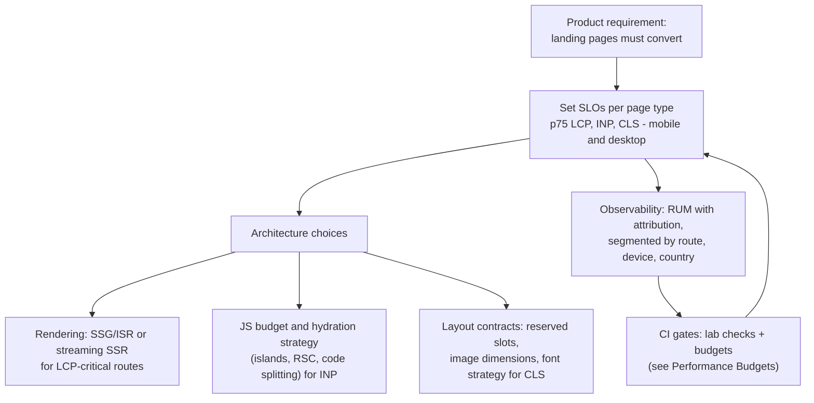

**Questions to ask in an interview or design doc:**

1. Which page types matter most (landing, product, checkout, dashboard)? Each gets its own targets, because the LCP element and interactions differ.
2. What devices and networks do the slowest 25% of users have? (Look at RUM by device class and country.)
3. What is the LCP element per page type, and is it in the server HTML?
4. What is the heaviest interaction (filter, add to cart, open editor) and how much main-thread work does it trigger?
5. Which third parties (ads, tag managers, chat widgets, A/B testing) run on the page and who owns their performance?
6. How will a regression be caught: lab gates in CI, RUM alerts, or both?

**Per page type cheat list:**

| Page type | Likely weakest metric | First design moves |
|---|---|---|
| Content / marketing | LCP (hero image), CLS (ads, fonts) | SSG/ISR + CDN, preload hero, reserved ad slots, font fallbacks |
| E-commerce product page | LCP (product image), INP (variant pickers) | SSR with cached HTML, `fetchpriority="high"` on main image, small handlers |
| Dashboard / SaaS app | INP (big tables, charts) | Virtualization, Web Workers, yielding, avoid re-rendering whole trees |
| Feed / infinite scroll | CLS (inserted items), INP | Insert new items behind a button, reserve heights, virtualize |

---

## Framework Comparison

| Concern | React / Next.js | Vue / Nuxt | Angular | Svelte / SvelteKit |
|---|---|---|---|---|
| **Report metrics** | `useReportWebVitals` in Next.js, or `web-vitals` directly | `web-vitals` in a client plugin | `web-vitals` in `main.ts` after `bootstrapApplication` | `web-vitals` in a client hook or root layout `onMount` |
| **LCP image** | `next/image` with its priority/preload option (prop names have changed across versions — check current docs) | `<NuxtImg>` (`@nuxt/image`) with `preload` / `fetchpriority` | `NgOptimizedImage` with the `priority` attribute | `@sveltejs/enhanced-img` and native `fetchpriority="high"` |
| **Fonts and CLS** | `next/font` generates metric-adjusted fallbacks | `@nuxt/fonts` provides fallback metrics | Font inlining in the CLI build; use `font-display` | Self-host + `font-display`, or a fallback metrics tool |
| **INP** | `useTransition` / `useDeferredValue`, React Compiler to avoid needless re-renders, RSC to ship less JS | Fine-grained reactivity; avoid huge reactive arrays (`shallowRef`), `v-memo` for big lists | Signals + zoneless change detection, `OnPush`, `@defer` blocks | Compile-time fine-grained updates; still keep handlers small |

**Native mobile:** Core Web Vitals are web-only. The closest equivalents are **Android vitals** in Google Play Console (startup time, slow/frozen frames, ANRs) and Apple's **MetricKit / Xcode Organizer** (launch time, hang rate, hitches). React Native and Flutter apps are measured with those tools, not CWV.

---

## Real-World Examples

**Example 1 — LCP hero image (React/HTML):**
```html
<!-- ❌ BAD: hero is a CSS background, lazy JS-rendered, so the browser discovers it late -->
<div class="hero" style="background-image: url('/hero.jpg')"></div>


<!-- ✅ GOOD: in the server HTML, high priority, responsive, sized (also prevents CLS) -->

```

**Example 2 — INP: acknowledge first, then do the heavy work (React 18+):**
```tsx
import { useState, useTransition } from 'react';

export function ProductFilter({ products }: { products: Product[] }) {
  const [query, setQuery] = useState('');
  const [visible, setVisible] = useState(products);
  const [isPending, startTransition] = useTransition();

  return (
    <>
      <input
        value={query}
        onChange={(e) => {
          setQuery(e.target.value);              // urgent: the input updates in the next frame
          startTransition(() => {                // non-urgent: React may interrupt this render
            setVisible(products.filter((p) => p.name.includes(e.target.value)));
          });
        }}
      />
      {isPending && <span aria-live="polite">Updating…</span>}
      <ProductList items={visible} />
    </>
  );
}
```

**Example 3 — INP in plain JS: yield between steps:**
```javascript
const yieldToMain = () =>
  globalThis.scheduler?.yield ? scheduler.yield() : new Promise((r) => setTimeout(r, 0));

button.addEventListener('click', async () => {
  button.classList.add('is-saving');   // visible feedback first
  await yieldToMain();                 // let the browser paint → INP for this click ends soon
  const result = expensiveRecalc();    // heavy work in a later task
  render(result);
  await yieldToMain();
  sendAnalytics('save_clicked');       // lowest priority last
});
```

**Example 4 — CLS: reserve space for late content:**
```css
/* ❌ BAD: ad container collapses to 0 px, then pushes the article down when the ad arrives */
.ad-slot { }

/* ✅ GOOD: reserve the most common ad size; keep the space even if no ad fills it */
.ad-slot { min-height: 250px; }

/* ✅ Media boxes with stable proportions */
.video-embed { aspect-ratio: 16 / 9; width: 100%; }

/* ✅ Animate without layout */
.toast-enter { transform: translateY(100%); transition: transform 200ms ease-out; }
.toast-enter.active { transform: translateY(0); }
```

**Example 5 — CLS: font fallback with matched metrics:**
```css
@font-face {
  font-family: 'Brand';
  src: url('/fonts/brand.woff2') format('woff2');
  font-display: swap;
}
/* A local fallback tuned to Brand's metrics so the swap doesn't reflow text.
   The percentages are font-specific: generate them with a tool (or next/font, @nuxt/fonts). */
@font-face {
  font-family: 'Brand Fallback';
  src: local('Arial');
  size-adjust: 104%;
  ascent-override: 92%;
  descent-override: 24%;
}
body { font-family: 'Brand', 'Brand Fallback', sans-serif; }
```

**Example 6 — Next.js App Router reporting:**
```tsx
// app/web-vitals.tsx
'use client';
import { useReportWebVitals } from 'next/web-vitals';

export function WebVitals() {
  useReportWebVitals((metric) => {
    navigator.sendBeacon('/rum', JSON.stringify(metric));
  });
  return null;
}
// Render <WebVitals /> once in app/layout.tsx
```

---

## Key Points Summary

| Concept | One-Line Explanation |
|---|---|
| **Core Web Vitals** | LCP (loading), INP (responsiveness), CLS (visual stability), assessed on real users |
| **p75** | A page passes when 75% of its page views are "good" for all three metrics, per device type |
| **LCP** | Render time of the largest image/text block in the viewport; good ≤ 2.5 s |
| **LCP sub-parts** | TTFB + resource load delay + resource load duration + element render delay |
| **INP** | Latency from input to next paint for (nearly) the slowest click/tap/key interaction; good ≤ 200 ms |
| **INP phases** | Input delay + processing duration + presentation delay |
| **CLS** | Largest session window (≤ 5 s, gaps < 1 s) of unexpected layout shift scores; good ≤ 0.1 |
| **Shift score** | Impact fraction × distance fraction |
| **FID** | Retired in March 2024, replaced by INP — remove from dashboards |
| **TBT** | Lab-only proxy for INP during load |
| **Field vs lab** | Field (CrUX, RUM) says what users get; lab (Lighthouse, DevTools) explains why |
| **web-vitals library** | The correct way to collect CWV in RUM; use the attribution build for debugging |
| **Browser support** | LCP and INP: Chromium, Firefox, Safari 26.2+; CLS: Chromium only |

---

## Test Your Understanding

**Q1 (Basic):**
What are the three Core Web Vitals, their "good" thresholds, and at which percentile are they assessed?

<details>
<summary>Answer</summary>

**LCP ≤ 2.5 s**, **INP ≤ 200 ms**, **CLS ≤ 0.1**, assessed at the **75th percentile** of page views, separately for mobile and desktop. All three must be good for the page to pass. p75 is used because it reflects most users while not being dominated by outliers (as an average or p99 would be).
</details>

**Q2 (Application):**
Your product page has LCP p75 = 3.8 s on mobile. RUM attribution shows TTFB 600 ms, resource load delay 1,900 ms, load duration 900 ms, render delay 400 ms. What do you fix first and how?

<details>
<summary>Answer</summary>

**Resource load delay** (1.9 s) is the biggest sub-part, and ideally it should be near zero. The browser starts fetching the image late, so the image is not discoverable early or has low priority. Typical causes: it is rendered by client JS, it is a CSS background, it has `loading="lazy"`, or it competes with many other requests.

Fix: render the `` in the server HTML, add `fetchpriority="high"` (or a `<link rel="preload" as="image">` with matching `imagesrcset`), remove lazy-loading for it, and reduce competing early requests. After that, attack load duration (AVIF/WebP, correct `srcset`) and render delay (render-blocking CSS/JS).
</details>

**Q3 (Tricky):**
Lighthouse shows TBT = 0 ms on a dashboard page, but CrUX reports INP p75 = 450 ms. How can both be true?

<details>
<summary>Answer</summary>

They measure different things. **TBT** is a lab metric computed **during page load only**, with no user interactions. **INP** is a field metric that covers **every interaction for the whole visit**. The dashboard can load cheaply and then be slow when users filter a 10,000-row table or open a chart. That work happens in event handlers long after load, so Lighthouse never sees it.

To diagnose, use RUM attribution (`web-vitals/attribution`: target element, input delay, processing, presentation), and reproduce the interaction in the DevTools Performance panel or a Lighthouse **timespan/user flow**. Then shorten processing (virtualize, memoize, `startTransition`, Worker) and yield.
</details>

**Q4 (Tricky):**
A cookie banner slides in from the top and pushes the page down 1.5 s after load. The team says "it's fine, the user expects a banner". Does it count toward CLS? How do you fix it?

<details>
<summary>Answer</summary>

**Yes, it counts.** Shifts are only excluded if they happen within 500 ms of a **user input** (click, tap, key press). A banner the page inserts by itself is an unexpected shift, and pushing all content down a large distance can easily exceed 0.1 alone.

Fixes: render the banner as an **overlay** (`position: fixed` at the bottom, or a modal) so it doesn't move other content. Or reserve its space in the server HTML from the first paint. Animate it in with `transform`, not by changing `height` or `top`.
</details>

**Q5 (Application):**
Why did Google replace FID with INP? What would a site that "passed FID" but fails INP typically be doing wrong?

<details>
<summary>Answer</summary>

FID measured only the **input delay of the first interaction**: not the handler's processing time, not the time to paint, and not any later interaction. Most sites passed FID easily, yet users still experienced slow clicks.

INP measures **the full latency (input delay + processing + presentation) of all interactions** and reports roughly the worst. A site that passed FID but fails INP usually has **heavy event handlers** (synchronous re-renders of large trees, big computations, analytics calls) or **expensive rendering after interactions** (huge DOM, layout thrashing), or long tasks *later* in the session (polling, third parties).
</details>

**Q6 (System design):**
You're designing an e-commerce site that must pass Core Web Vitals on mobile. Name the key architectural decisions for each metric and how you'll keep it passing after launch.

<details>
<summary>Answer</summary>

**LCP:** SSR or ISR with HTML cached at a CDN (low TTFB), the product image in the HTML with `fetchpriority="high"` and responsive AVIF/WebP, critical CSS inline, and non-critical JS `defer`red. Use Speculation Rules prefetch/prerender for likely next pages (Chromium).

**INP:** Limit hydration cost: islands or Server Components, code-split below-the-fold widgets, and load third parties after interaction or in a Worker (for example with Partytown, with care). Keep handlers small: update the UI first, then yield. Virtualize long lists.

**CLS:** `width`/`height` on all media, reserved slots for reviews/recommendations/ads, metric-matched font fallbacks, overlays for banners, skeletons of exact size.

**Keeping it passing:** RUM with the `web-vitals` attribution build, segmented by route and device, with alerts on p75; lab checks and **performance budgets** in CI (next notes); and a review step for adding any new third-party script.
</details>

---

## Cheat Sheet

**Key Definitions:**
- **LCP:** Time until the largest image or text block in the viewport is rendered.
- **INP:** Time from a click/tap/key press until the next frame is painted, for (almost) the slowest interaction of the visit.
- **CLS:** Biggest burst (session window) of unexpected layout shift scores.
- **Long task:** Main-thread task over 50 ms; the main cause of input delay.
- **CrUX:** Chrome UX Report, Google's public field dataset (28-day rolling, p75).
- **RUM:** Real User Monitoring, your own field data collection.
- **Attribution:** Diagnostic data that explains a metric value (element, sub-parts, script).

**Quick Reference:**
```text
Metric  Good       Needs improvement   Poor       Measures
LCP     ≤ 2.5 s    2.5 – 4.0 s         > 4.0 s    loading of main content
INP     ≤ 200 ms   200 – 500 ms        > 500 ms   responsiveness (all interactions)
CLS     ≤ 0.1      0.1 – 0.25          > 0.25     visual stability
Supporting: TTFB ≤ 0.8 s · FCP ≤ 1.8 s · TBT (lab proxy for INP)
Assessed: p75 of page views, mobile and desktop separately, all three must pass

LCP = TTFB + load delay + load duration + render delay   (both delays should be ~0)
INP = input delay + processing duration + presentation delay
CLS shift = impact fraction × distance fraction; windows: gaps < 1 s, max 5 s; take the max window

LCP fixes:  CDN/HTML cache · img in HTML · fetchpriority="high" · no lazy on hero · AVIF/srcset · no render-blocking
INP fixes:  break long tasks · yield (scheduler.yield / setTimeout) · small handlers · startTransition · virtualize · Workers
CLS fixes:  width/height or aspect-ratio · reserve ad/embed slots · overlay banners · font metric overrides · transform animations

Measure:    web-vitals (onLCP/onINP/onCLS) + attribution build → sendBeacon → p75 by route/device
```

**Common Mistakes to Avoid:**

| Mistake | Why Wrong | Fix |
|---|---|---|
| Optimizing only for the Lighthouse score | Lab ≠ field; CWV are assessed on real users | Use CrUX/RUM to prioritize, lab to debug |
| Still tracking FID | Retired in 2024; hides interaction slowness | Track INP |
| `loading="lazy"` on the hero image | Delays the LCP resource on purpose | Eager load + `fetchpriority="high"` |
| Hero image as CSS background or JS-injected | Preload scanner can't discover it early | `` in server HTML, or `preload` |
| Reporting the average | Hides the slow quarter of users | Report p75 (and track p95 internally) |
| Testing only on a fast laptop | Slow users are on mid-range phones | Segment RUM by device; throttle in the lab |
| Doing all work inside the click handler | Paint waits for it → poor INP | Update UI, yield, then do the heavy work |
| Yielding with `await Promise.resolve()` | Microtask, doesn't let the browser paint | `scheduler.yield()` or `setTimeout` |
| Images without `width`/`height` | Space appears only after load → shift | Set dimensions or `aspect-ratio` |
| Animating `top`/`height` | Each frame shifts layout | Animate `transform`/`opacity` |
| Summing all `layout-shift` entries | Not the CLS definition (session windows, max) | Use the `web-vitals` library |
| Ignoring SPA route changes | Metrics get attributed to the landing URL | Tag RUM with route; `reportSoftNavs` in Chromium; custom marks per route |

---

## References & Further Reading

**Core docs (web.dev / Chrome)**
- web.dev: [Web Vitals](https://web.dev/articles/vitals)
- web.dev: [Largest Contentful Paint (LCP)](https://web.dev/articles/lcp) · [Optimize LCP](https://web.dev/articles/optimize-lcp)
- web.dev: [Interaction to Next Paint (INP)](https://web.dev/articles/inp) · [Optimize INP](https://web.dev/articles/optimize-inp)
- web.dev: [Cumulative Layout Shift (CLS)](https://web.dev/articles/cls) · [Optimize CLS](https://web.dev/articles/optimize-cls)
- web.dev: [How the Core Web Vitals metrics thresholds were defined](https://web.dev/articles/defining-core-web-vitals-thresholds)
- web.dev: [Why lab and field data can be different](https://web.dev/articles/lab-and-field-data-differences)
- web.dev: [Optimize long tasks](https://web.dev/articles/optimize-long-tasks)
- Chrome for Developers: [Chrome UX Report (CrUX)](https://developer.chrome.com/docs/crux)
- Chrome for Developers: [Long Animation Frames API](https://developer.chrome.com/docs/web-platform/long-animation-frames)
- Google Search Central: [Understanding Core Web Vitals and Google search results](https://developers.google.com/search/docs/appearance/core-web-vitals)

**MDN**
- MDN: [`LargestContentfulPaint`](https://developer.mozilla.org/en-US/docs/Web/API/LargestContentfulPaint)
- MDN: [`PerformanceEventTiming`](https://developer.mozilla.org/en-US/docs/Web/API/PerformanceEventTiming)
- MDN: [`LayoutShift`](https://developer.mozilla.org/en-US/docs/Web/API/LayoutShift)
- MDN: [`fetchpriority` on ``](https://developer.mozilla.org/en-US/docs/Web/HTML/Reference/Elements/img#fetchpriority)

**Specs**
- W3C: [Largest Contentful Paint](https://w3c.github.io/largest-contentful-paint/)
- W3C: [Event Timing API](https://w3c.github.io/event-timing/)
- WICG: [Layout Instability API](https://wicg.github.io/layout-instability/)

**Libraries and framework docs**
- GitHub: [GoogleChrome/web-vitals](https://github.com/GoogleChrome/web-vitals)
- Next.js: [`useReportWebVitals`](https://nextjs.org/docs/app/api-reference/functions/use-report-web-vitals)
- Angular: [Getting started with NgOptimizedImage](https://angular.dev/guide/image-optimization)
- React: [`useTransition`](https://react.dev/reference/react/useTransition)

---

> **Previous Topic:** [Offline-First Architecture](./offline-first-architecture.md)
> — Local-first data, sync queues and conflict resolution

> **Next Topic:** [Lighthouse & Performance Auditing](./lighthouse-and-performance-auditing.md)
> — Lab tooling to diagnose and verify what Core Web Vitals reveal in the field

*Saved on: 2026-11-06 | Repo: Frontend System Design Learning Notes*
