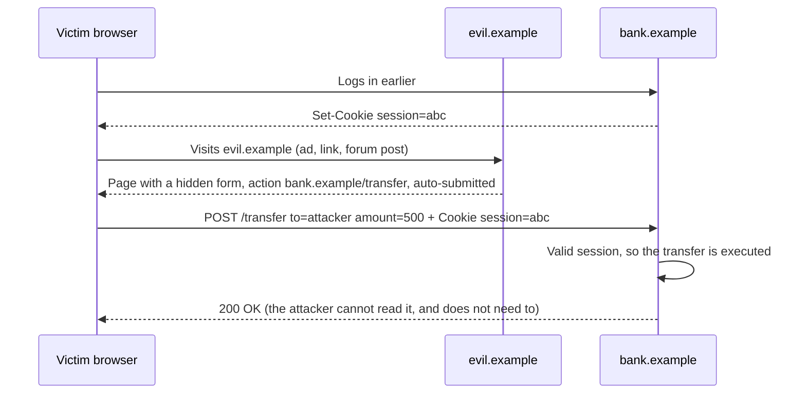
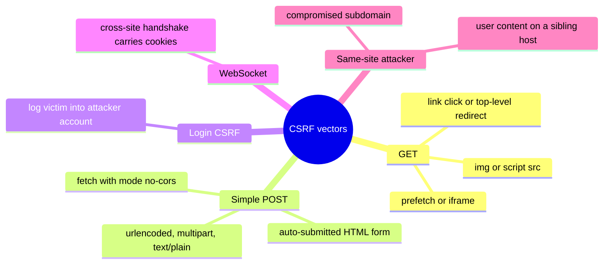
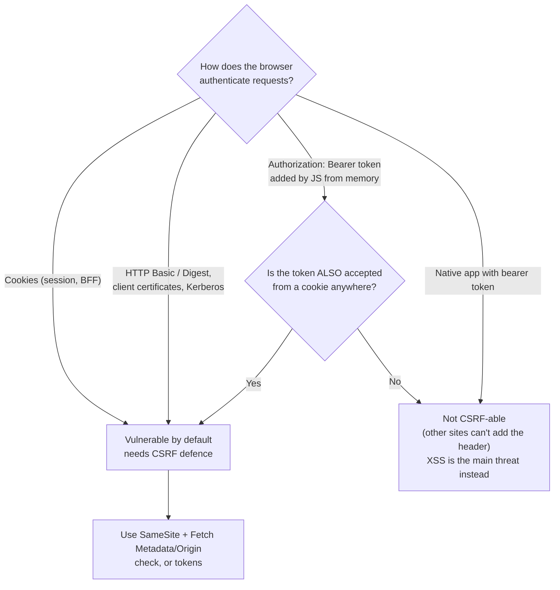
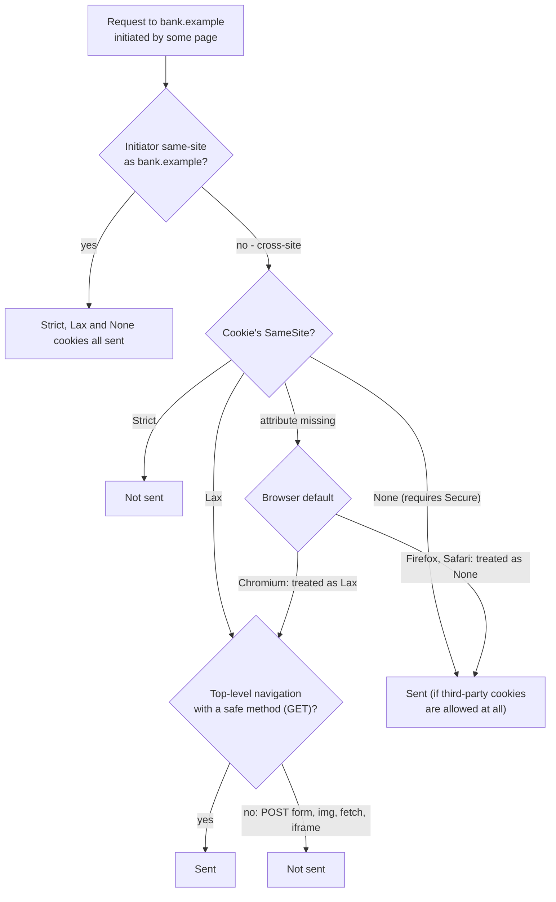
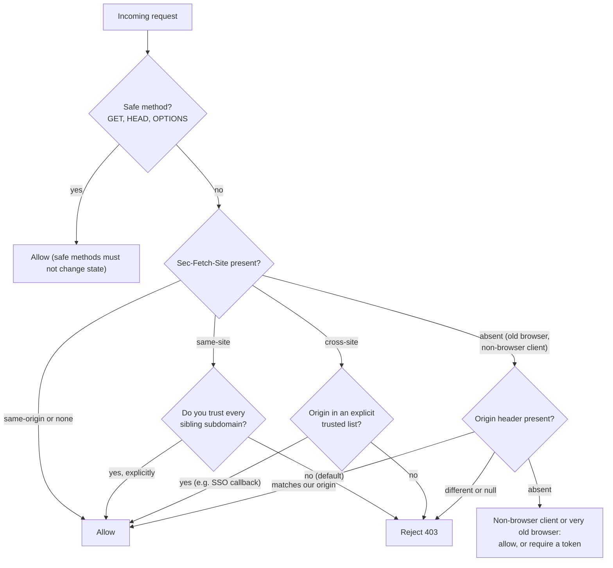
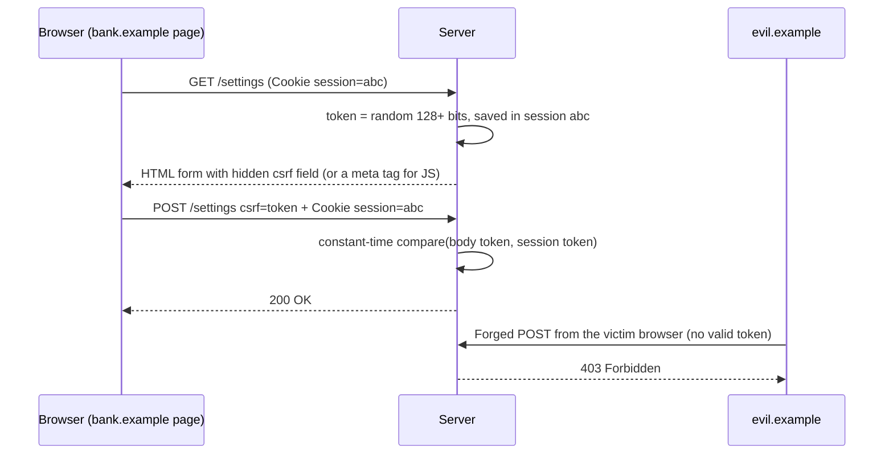
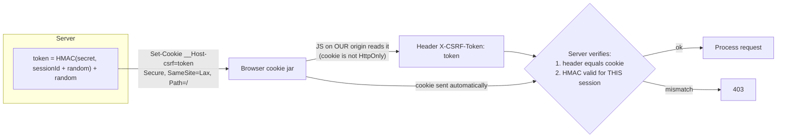
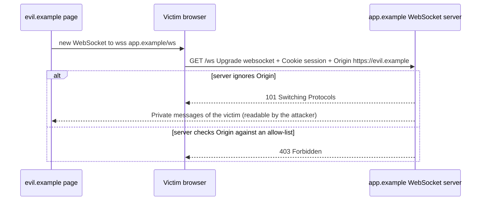
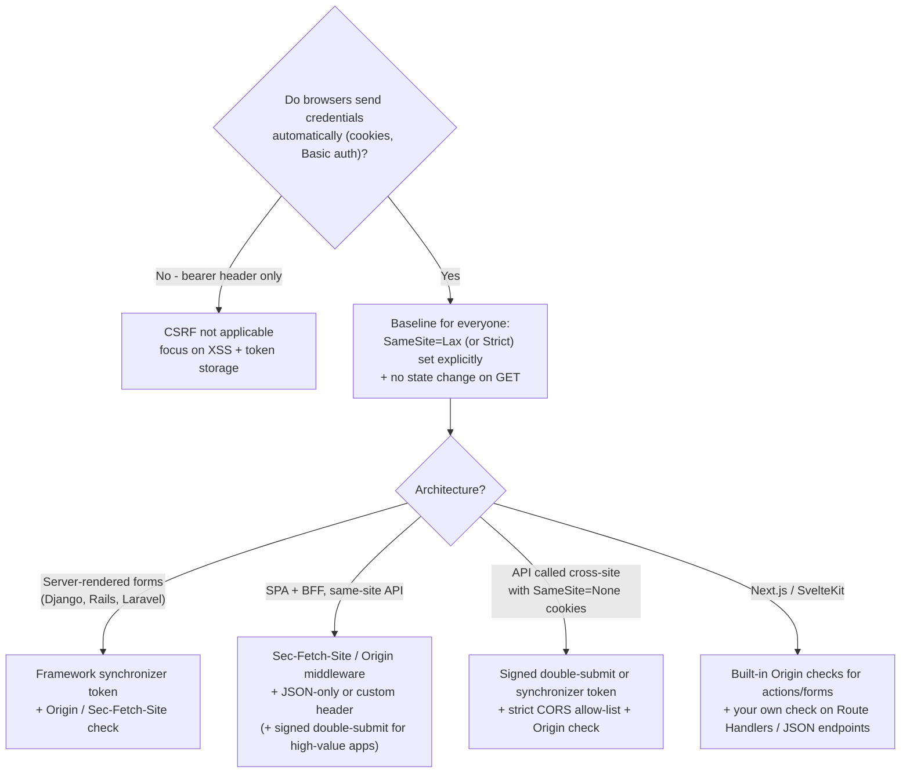

<!-- Generated by scripts/sync-knowledge.js from notes/ and README.md — do not edit here. -->
<!-- sections (line ranges in this file): Table of Contents 19-42 · ELI5 43-58 · Core Concept 59-367 · Framework Support 368-387 · Decision Matrix 388-412 · Real-World Examples 413-575 · Key Points Summary 576-596 · Test Your Understanding 597-677 · Cheat Sheet 678-724 · References & Further Reading 725-760 -->

# CSRF Protection

> **Date:** 2026-11-06 · **Last updated:** 2026-11-09
> **Category:** Frontend System Design
> **Sub-Topic:** Security / Request Forgery & Cookie Auth
> **Level:** Intermediate · **Reading time:** ~30 min
> **Informs:** cookie-based session and BFF design, `SameSite` cookie settings, API/app domain topology (same-site vs cross-site), CSRF token strategy (synchronizer vs signed double-submit vs Fetch Metadata), HTTP method semantics, WebSocket handshake checks, GraphQL endpoint hardening, framework CSRF configuration

> **Pre-requisite:** [CORS & Same-Origin Policy](./cors-and-same-origin-policy.md) (origin vs site, why CORS is not CSRF protection) and [Browser Storage Mechanisms](./browser-storage-mechanisms.md) (cookies and `SameSite`).
> This note explains **how another website can make your users' browsers perform actions on your site**, and the layered defences — `SameSite`, Fetch Metadata, Origin checks and tokens — that stop it.

**Previous:** [Content Security Policy (CSP)](./content-security-policy-csp.md) · **Next:** [Authentication Flows in SPAs](./authentication-flows-in-spas.md)

---

## Table of Contents

1. [ELI5 — Simple Explanation](#eli5--simple-explanation)
2. [Section 1: What CSRF Is](#section-1-what-csrf-is)
3. [Section 2: Attack Vectors](#section-2-attack-vectors)
4. [Section 3: Who Is (and Isn't) Vulnerable](#section-3-who-is-and-isnt-vulnerable)
5. [Section 4: SameSite Cookies](#section-4-samesite-cookies)
6. [Section 5: Fetch Metadata — `Sec-Fetch-Site`](#section-5-fetch-metadata--sec-fetch-site)
7. [Section 6: Origin and Referer Verification](#section-6-origin-and-referer-verification)
8. [Section 7: Synchronizer Token Pattern](#section-7-synchronizer-token-pattern)
9. [Section 8: Signed Double-Submit Cookie](#section-8-signed-double-submit-cookie)
10. [Section 9: Custom Headers and JSON-Only APIs](#section-9-custom-headers-and-json-only-apis)
11. [Section 10: Special Cases — Login, WebSockets, GraphQL, Subdomains](#section-10-special-cases--login-websockets-graphql-subdomains)
12. [Section 11: What Does NOT Protect You](#section-11-what-does-not-protect-you)
13. [Framework Support](#framework-support)
14. [Decision Matrix](#decision-matrix)
15. [Real-World Examples](#real-world-examples)
16. [Key Points Summary](#key-points-summary)
17. [Test Your Understanding (with answers)](#test-your-understanding)
18. [Cheat Sheet](#cheat-sheet)
19. [References & Further Reading](#references--further-reading)

---

## ELI5 — Simple Explanation

Imagine your **bank knows you by your face**. Whenever you walk up to the counter, the teller sees your face and does what the paper in your hand says.

- A stranger slips a pre-filled slip into your pocket: *"Transfer $500 to account 666."*
- You walk into the bank for something else, the teller sees **your face** (your cookie, sent automatically), reads **the slip**, and does the transfer. You never meant to ask for it.
- That's **Cross-Site Request Forgery**: another website makes *your* browser send a request to *your* bank, and the browser helpfully attaches *your* cookies.
- **Defences:**
  - **SameSite cookies** — your face only "counts" when you came in through the bank's own front door, not when someone pushed you in from the street.
  - **Fetch Metadata / Origin check** — the teller asks, *"Which door did you come in through?"* and the browser answers honestly.
  - **CSRF token** — every real slip from the bank carries a secret stamp that the stranger can't see or copy.

> **One-line takeaway: CSRF abuses credentials the browser attaches automatically (cookies). Reject cross-site state-changing requests — `SameSite` cookies plus a `Sec-Fetch-Site`/`Origin` check, or tokens — and never change state on `GET`.**

---

## Core Concept — Step by Step

### Section 1: What CSRF Is

**Cross-Site Request Forgery (CSRF, "sea-surf")** tricks a victim's browser into sending an **unwanted, state-changing request** to a site where the victim is authenticated. The attacker **can't read the response** (the same-origin policy prevents that) — but they don't need to: the transfer, password change or purchase already happened.



**The three ingredients** (remove any one and CSRF fails):

| Ingredient | Example | Defence that removes it |
|---|---|---|
| 1. **Ambient credentials** the browser attaches automatically | Cookies, HTTP Basic/Digest auth, client TLS certificates, Kerberos/NTLM | Bearer tokens in headers; `SameSite` cookies |
| 2. **A state-changing request the attacker can construct** | Predictable parameters: `to`, `amount` | Unpredictable token in the request |
| 3. **The server can't tell it came from another site** | No origin check | `Sec-Fetch-Site` / `Origin` verification |

---

### Section 2: Attack Vectors



| Vector | What the attacker controls | Notes |
|---|---|---|
| `` | A **GET** request with cookies (subject to `SameSite`) | Works whenever GET changes state — never do that |
| Auto-submitting `<form method="POST">` | Body with `application/x-www-form-urlencoded`, `multipart/form-data` or `text/plain` | The classic vector — top-level navigation, no CORS preflight |
| `fetch(url, { method: 'POST', mode: 'no-cors', credentials: 'include', body })` | A "simple" request (safelisted method, headers, content type) | Sent without preflight; response is opaque, but the side effect happens |
| `fetch()` with JSON or custom headers | — | Triggers a **CORS preflight**; blocked unless your CORS policy allows the attacker's origin |
| `<iframe>` / `window.open` | Top-level or framed navigation | Combined with clickjacking, can make the user click real buttons — see `frame-ancestors` in [CSP](./content-security-policy-csp.md) |

> **Why `text/plain` matters:** a form with `enctype="text/plain"` can send a body like `{"amount":500,"to":"attacker","x":"="}` that **looks like JSON**. If your server parses JSON regardless of `Content-Type`, a "JSON API" is CSRF-able with a plain HTML form.

---

### Section 3: Who Is (and Isn't) Vulnerable



- **Cookie-based sessions** — server-rendered apps, the **BFF pattern** recommended for SPAs (see [Authentication Flows in SPAs](./authentication-flows-in-spas.md)), and Next.js/Nuxt/SvelteKit apps with session cookies — **need** CSRF protection.
- **Bearer tokens** that JavaScript adds to an `Authorization` header are **not** sent automatically, so another site can't forge them. The trade-off is that tokens readable by JS are exposed to **XSS** (see [Secure Token Storage](./secure-token-storage.md)).
- **Native mobile apps** using bearer tokens aren't CSRF targets, but a **WebView** that shares the system cookie jar with an authenticated web session can be.
- **Intranet / localhost services** (routers, dev servers, admin panels) authenticated by network location are CSRF targets too — browsers are adding Private/Local Network Access restrictions, but don't rely on them alone.

---

### Section 4: SameSite Cookies

`SameSite` tells the browser whether to attach a cookie to **cross-site** requests. "Site" = scheme + registrable domain (eTLD+1), so `app.example.com` and `api.example.com` are **same-site**.



| Value | Cross-site requests that carry the cookie | Use for |
|---|---|---|
| `Strict` | None — not even a link click from another site | High-value actions; can be confusing (user arrives from an email link and looks logged out) |
| `Lax` | Only **top-level GET navigations** (link clicks, typed redirects) | **Default choice** for session cookies |
| `None; Secure` | All (subject to third-party cookie blocking) | Genuinely cross-site embeds/SSO — needs explicit CSRF defence |

**Important details:**
- **Defaults differ by browser.** Chromium (Chrome 80+, Edge 86+) treats cookies **without** a `SameSite` attribute as `Lax`. MDN's compatibility data shows Firefox only behind a flag and Safari not at all — so **always set `SameSite` explicitly**.
- Chromium shipped the default with a temporary "Lax + POST" mitigation: a cookie **without** an explicit `SameSite` attribute, set within the last two minutes, may still be sent on a cross-site top-level POST (added for SSO flows). Check current Chromium behaviour; setting `SameSite=Lax` explicitly avoids the question.
- **`Lax` still sends cookies on cross-site top-level GETs** — so any state-changing `GET` endpoint is still exploitable.
- **Same-site ≠ same-origin.** A compromised or user-controlled **sibling subdomain** (`blog.example.com`, `user123.pages.example.com`) is same-site and bypasses `SameSite` entirely.
- **Schemeful same-site:** Chromium (91+) treats `http://example.com` → `https://example.com` as cross-site; not all browsers do.

> `SameSite=Lax` blocks the classic CSRF vectors in browsers that support it, and OWASP considers it a valuable **defence in depth** — but combine it with a server-side check (Fetch Metadata/Origin or tokens) because of browser differences, same-site attackers and GET mistakes.

---

### Section 5: Fetch Metadata — `Sec-Fetch-Site`

Modern browsers send **Fetch Metadata request headers** that tell the server how a request was made. They're "forbidden" headers — page JavaScript can't set or forge them.

| Header | Values | Meaning |
|---|---|---|
| **`Sec-Fetch-Site`** | `same-origin`, `same-site`, `cross-site`, `none` | Relationship between the initiator and the target; `none` = user-initiated (typed URL, bookmark) |
| `Sec-Fetch-Mode` | `navigate`, `cors`, `no-cors`, `same-origin`, `websocket` | How the request was made |
| `Sec-Fetch-Dest` | `document`, `iframe`, `image`, `script`, `empty`, … | What the response will be used for |
| `Sec-Fetch-User` | `?1` | Navigation triggered by user activation |

MDN's compatibility data lists `Sec-Fetch-Site` in Chromium 76+, Firefox 90+ and Safari 16.4+, so all current major browsers send it over HTTPS.



This is the approach popularised as a **resource isolation policy** by web.dev, and the one Go's standard library adopted (Go 1.25 added `http.CrossOriginProtection`, which rejects non-safe cross-origin browser requests using `Sec-Fetch-Site` with an `Origin` fallback). It's **stateless**, needs **no frontend changes**, and covers forms, `fetch`, and `no-cors` requests alike.

**Caveat:** it blocks cross-origin requests that you **want** (partner sites posting forms to you, OAuth `form_post` responses from an identity provider). Allow-list those endpoints or origins explicitly.

---

### Section 6: Origin and Referer Verification

The **`Origin`** header is sent by browsers on cross-origin requests and on **all non-GET/HEAD requests** (including same-origin `POST` — Firefox since version 70). It can't be set by page JavaScript.

```http
POST /transfer HTTP/1.1
Host: bank.example
Origin: https://evil.example
Cookie: session=abc
```

| Check | Rule |
|---|---|
| **Compare to the expected origin** | Exact match against your own origin(s) — compute the expected value from configuration, **not** from the `Host` header if proxies can rewrite it |
| **`Origin: null`** | Sent from sandboxed iframes, some cross-origin redirects, `file:` pages, privacy contexts — treat as **cross-site** |
| **Missing `Origin`** | Fall back to `Referer` (its origin part), then to `Sec-Fetch-Site`, or require a token |
| **`Referer` caveats** | Can be stripped by `Referrer-Policy: no-referrer`, privacy extensions or proxies — use it as a fallback, not the primary check |
| **Never substring-match** | `origin.startsWith('https://bank.example')` matches `https://bank.example.evil.com` |

> Origin verification is essentially the pre-Fetch-Metadata version of Section 5. Django has checked `Origin` against `CSRF_TRUSTED_ORIGINS` (in addition to its token) since Django 4.0; Next.js Server Actions compare `Origin` to the host; SvelteKit's `csrf.checkOrigin` does the same for form submissions.

---

### Section 7: Synchronizer Token Pattern

The classic, **stateful** defence: the server generates a random token, stores it **in the session**, and embeds it in pages/forms. Every state-changing request must echo it; the attacker can't read it because of the same-origin policy.



| Detail | Guidance |
|---|---|
| Token entropy | Cryptographically random, at least 128 bits |
| Scope | **Per session** is fine (OWASP); per-request tokens add little and break the Back button and multiple tabs |
| Transport | Hidden form field or custom request header — **never in the URL** (leaks via `Referer`, logs, history) |
| Comparison | Constant-time comparison |
| Rotation | Regenerate on login (prevents token fixation) and on privilege change |
| BREACH | If HTML is compressed over TLS and reflects user input, **mask** the token per response (random XOR pad) — Rails and Django do this |
| SPA delivery | Expose it via a `<meta name="csrf-token">` tag, a `GET /csrf` endpoint (same-origin only), or a non-HttpOnly cookie read by JS (Section 8) |

---

### Section 8: Signed Double-Submit Cookie

The **stateless** alternative: the token is stored in a **cookie**, and the client must also send it in a **header or body**. The attacker's page can make the browser send the cookie, but can't **read** it to copy it into the header.



**Naive vs signed:**

| Variant | Weakness |
|---|---|
| **Naive** double submit (any random value, just "header == cookie") | An attacker who can **write** a cookie for your domain — from a compromised subdomain, an HTTP (non-HTTPS) response, or a sibling host — sets both values to something they know. OWASP discourages it |
| **Signed** double submit (HMAC bound to the session ID) | A planted cookie fails the HMAC check for the victim's session |
| **`__Host-` prefix** on the cookie | Requires `Secure`, `Path=/` and **no `Domain`**, so subdomains can't overwrite it |

This is the pattern used by Angular's `HttpClient` (reads the `XSRF-TOKEN` cookie, sends `X-XSRF-TOKEN`), Axios's `xsrfCookieName`/`xsrfHeaderName`, Laravel's `XSRF-TOKEN` cookie, and Spring Security's `CookieCsrfTokenRepository`. The **server** must still do the comparison — the client library only copies the value.

---

### Section 9: Custom Headers and JSON-Only APIs

Browsers **only** let a cross-origin page send custom headers or `Content-Type: application/json` after a successful **CORS preflight**. So an API that **requires** one of them is protected — *as long as CORS doesn't allow the attacker's origin*.

```text
Cross-site attacker can send without preflight:
  methods:        GET, HEAD, POST
  content types:  application/x-www-form-urlencoded, multipart/form-data, text/plain
  headers:        only CORS-safelisted ones (Accept, Accept-Language, Content-Language, Content-Type with the values above)

Cross-site attacker CANNOT send (preflight required, and your CORS policy says no):
  PUT / PATCH / DELETE
  Content-Type: application/json
  X-CSRF-Token, X-Requested-With, Authorization, any custom header
```

| Approach | Strength | Watch out for |
|---|---|---|
| Require `Content-Type: application/json` and **reject** anything else | Simple for JSON APIs | Servers or frameworks that parse bodies leniently; endpoints that also accept forms |
| Require a custom header (e.g. `X-Requested-With: XMLHttpRequest` or a token header) | Simple; used by many frameworks | Overly permissive CORS (reflecting any origin with credentials) breaks it |
| Use non-POST verbs for mutations (`PUT`, `DELETE`) | Preflighted cross-origin | `POST` endpoints still need protection |

> These are good **defence in depth** for JSON APIs. OWASP lists custom request headers as a valid technique for AJAX/API endpoints, but they don't protect classic HTML form endpoints, and they depend entirely on a correct CORS configuration.

---

### Section 10: Special Cases — Login, WebSockets, GraphQL, Subdomains

**Login CSRF:** the attacker logs the victim into the **attacker's** account (forged login POST). The victim then saves a card, searches, or uploads documents — into an account the attacker controls. Protect the **login form** too (pre-session token or `Sec-Fetch-Site`/`Origin` check), and rotate the session on login.

**Cross-Site WebSocket Hijacking (CSWSH):** WebSocket handshakes are **not** subject to CORS, and they carry cookies. A malicious page can open `new WebSocket('wss://app.example/ws')` and read every message in the victim's session.



Fix: **validate `Origin`** on the upgrade request, use `SameSite=Lax`/`Strict` session cookies (cross-site WebSocket handshakes then don't carry them), or authenticate the socket with a short-lived token sent in the first message.

**GraphQL:** queries over `GET` or `POST` with `application/x-www-form-urlencoded`/`multipart` bodies are CSRF-able if mutations are accepted that way. Accept mutations only via `POST` with `application/json`, or require a preflight-triggering header. Apollo Server 4 enables CSRF prevention by default (it requires a non-simple `Content-Type` or a header such as `Apollo-Require-Preflight`); file-upload (`multipart`) setups need that header from clients.

**Subdomains and cookie tossing:** any subdomain can set a cookie with `Domain=example.com` that your app receives. This can **overwrite** a naive double-submit token or fix a session. Use `__Host-` cookies, signed tokens, and don't host untrusted content on subdomains of your app's site.

---

### Section 11: What Does NOT Protect You

| "Defence" | Why it fails |
|---|---|
| **CORS** | It controls who can **read** responses; simple requests are still **sent and executed** (see [CORS Is Not CSRF Protection](./cors-and-same-origin-policy.md#section-9-cors-is-not-csrf-protection)) |
| **Using `POST` instead of `GET`** | Auto-submitting forms send POSTs |
| **Secret cookies / HttpOnly** | The browser attaches them anyway — that's the attack |
| **HTTPS** | The forged request is also HTTPS |
| **Multi-step flows / confirmation pages** | An attacker can submit each step in sequence (unless each step requires a token) |
| **Checking `Referer` only when present** | Attackers suppress it (`<meta name="referrer" content="no-referrer">`) |
| **Tokens when you have XSS** | Same-origin script reads the token and sends a same-origin request — see [XSS Prevention](./xss-prevention-reflected-stored-dom.md). CSRF defences assume no XSS |

---

## Framework Support

| Framework / library | Built-in mechanism | Notes |
|---|---|---|
| **Django** | `CsrfViewMiddleware` + ``; token via `csrftoken` cookie for AJAX | Also verifies `Origin` against `CSRF_TRUSTED_ORIGINS` |
| **Rails** | `protect_from_forgery`, `csrf_meta_tags` | Masked per-request tokens (BREACH mitigation); Rails UJS/Turbo send the token header |
| **Laravel** | `@csrf` Blade directive, `XSRF-TOKEN` cookie | Works with Axios's default XSRF settings |
| **Spring Security** | CSRF protection enabled by default | For SPAs, `CookieCsrfTokenRepository` (non-HttpOnly cookie) + a header |
| **ASP.NET Core** | Antiforgery (`[ValidateAntiForgeryToken]`, automatic in Razor forms) | `IAntiforgery` for SPA header tokens |
| **Express / Node** | Nothing built in; the old `csurf` package is **deprecated** | Use a maintained library (e.g. `csrf-csrf` for signed double-submit, `csrf-sync` for synchronizer) or a `Sec-Fetch-Site` middleware |
| **Go** | `http.CrossOriginProtection` (Go 1.25+) | Fetch Metadata + `Origin` based |
| **Next.js** | Server Actions are POST-only and compare `Origin` with the host | `serverActions.allowedOrigins` for proxies; **Route Handlers** need your own protection |
| **SvelteKit** | Built-in origin check for form-encoded/`multipart`/`text/plain` POSTs (`csrf.checkOrigin`, on by default; newer versions add a trusted-origins option — check the docs for your version) | Doesn't cover JSON or other methods — those need your own checks |
| **Angular** (client) | `HttpClient` XSRF: reads `XSRF-TOKEN` cookie, sends `X-XSRF-TOKEN` on mutating same-origin requests | Configure with `withXsrfConfiguration`; the server must verify |
| **Axios** (client) | `xsrfCookieName` / `xsrfHeaderName` | Recent versions only attach the token to same-origin requests unless configured (`withXSRFToken`) |
| **React / Vue / Svelte** (client) | No built-in CSRF handling | Use a fetch wrapper that adds the token header; rely on the server framework |
| **Native mobile** | Usually bearer tokens → not CSRF-prone | If the API also accepts cookies (shared with web), protect the cookie path |

---

## Decision Matrix



| Technique | Stateless? | Frontend work | Covers HTML forms? | Main weakness |
|---|---|---|---|---|
| `SameSite=Lax` | ✅ | None | ✅ (cross-site) | Browser defaults vary; same-site attackers; GET mutations |
| `Sec-Fetch-Site` check | ✅ | None | ✅ | Needs fallback for clients without the header |
| `Origin` check | ✅ | None | ✅ | `null`/missing values; proxy host rewriting |
| Synchronizer token | ❌ (session store) | Embed token in forms / header | ✅ | Token plumbing, BREACH masking |
| Signed double-submit | ✅ | Read cookie → header | ✅ (hidden field) | Needs HMAC secret; cookie must not be HttpOnly |
| Custom header / JSON-only | ✅ | Add header | ❌ | Depends on correct CORS |
| Re-authentication / step-up | — | UI for password/passkey prompt | ✅ | Friction — use only for high-risk actions |

---

## Real-World Examples

**Example 1 — The attack page (for understanding, test against your own app only):**
```html
<!-- evil.example/win-a-prize.html -->
<body onload="document.forms[0].submit()">
  <form action="https://bank.example/transfer" method="POST">
    <input type="hidden" name="to" value="attacker-account" />
    <input type="hidden" name="amount" value="500" />
  </form>
</body>
```

**Example 2 — Fetch Metadata + Origin middleware (Express, TypeScript):**
```typescript
import type { Request, Response, NextFunction } from 'express';

const SAFE_METHODS = new Set(['GET', 'HEAD', 'OPTIONS']);
const APP_ORIGIN = 'https://app.example.com';             // from config, not from the Host header
const TRUSTED_CROSS_ORIGINS = new Set(['https://idp.example.org']); // e.g. OAuth form_post callback

export function csrfGuard(req: Request, res: Response, next: NextFunction) {
  if (SAFE_METHODS.has(req.method)) return next(); // GET handlers must never change state

  const site = req.get('Sec-Fetch-Site');
  const origin = req.get('Origin');

  if (site === 'same-origin' || site === 'none') return next();
  if (site === 'cross-site' || site === 'same-site') {
    if (origin && TRUSTED_CROSS_ORIGINS.has(origin)) return next();
    return res.status(403).json({ error: 'cross-site request blocked' });
  }

  // No Fetch Metadata (older browser or non-browser client): fall back to Origin
  if (origin) {
    return origin === APP_ORIGIN ? next() : res.status(403).json({ error: 'bad origin' });
  }
  // No Origin either: non-browser clients (curl, server-to-server) have no ambient browser cookies.
  // Allow, or require a CSRF token here if you must support very old browsers.
  return next();
}
```

**Example 3 — Session cookie settings:**
```http
Set-Cookie: __Host-session=9f2c…; Path=/; Secure; HttpOnly; SameSite=Lax
Set-Cookie: __Host-csrf=Zx81….a3f9; Path=/; Secure; SameSite=Lax
```
- `__Host-` → `Secure`, `Path=/`, no `Domain` — subdomains can't overwrite it.
- Session cookie is `HttpOnly` (JS never needs it); the CSRF cookie is **not** (JS copies it into a header).

**Example 4 — Signed double-submit token (Node.js):**
```typescript
import crypto from 'node:crypto';

const SECRET = process.env.CSRF_SECRET!; // long random value, rotated with care

export function issueCsrfToken(sessionId: string): string {
  const random = crypto.randomBytes(16).toString('base64url');
  const mac = crypto.createHmac('sha256', SECRET).update(`${sessionId}.${random}`).digest('base64url');
  return `${random}.${mac}`;
}

export function verifyCsrfToken(sessionId: string, cookieToken?: string, headerToken?: string): boolean {
  if (!cookieToken || !headerToken) return false;
  const a = Buffer.from(cookieToken);
  const b = Buffer.from(headerToken);
  if (a.length !== b.length || !crypto.timingSafeEqual(a, b)) return false; // header must equal cookie

  const [random, mac] = cookieToken.split('.');
  if (!random || !mac) return false;
  const expected = crypto.createHmac('sha256', SECRET).update(`${sessionId}.${random}`).digest('base64url');
  const m = Buffer.from(mac);
  const e = Buffer.from(expected);
  return m.length === e.length && crypto.timingSafeEqual(m, e);        // bound to THIS session
}
```

**Example 5 — React fetch wrapper that sends the token:**
```tsx
function readCookie(name: string): string | undefined {
  return document.cookie
    .split('; ')
    .find((c) => c.startsWith(`${name}=`))
    ?.split('=')
    .slice(1)
    .join('=');
}

export async function apiFetch(path: string, init: RequestInit = {}) {
  const method = (init.method ?? 'GET').toUpperCase();
  const headers = new Headers(init.headers);
  headers.set('Content-Type', 'application/json');                 // JSON-only API: forces preflight cross-origin
  if (!['GET', 'HEAD', 'OPTIONS'].includes(method)) {
    const token = readCookie('__Host-csrf');
    if (token) headers.set('X-CSRF-Token', token);
  }
  return fetch(path, { ...init, method, headers, credentials: 'same-origin' }); // relative URL = same origin
}

// Usage
await apiFetch('/api/profile', { method: 'PATCH', body: JSON.stringify({ displayName: 'Ada' }) });
```

**Example 6 — Angular, Vue and SvelteKit:**
```typescript
// Angular: HttpClient copies the XSRF-TOKEN cookie into X-XSRF-TOKEN on mutating same-origin requests
import { provideHttpClient, withXsrfConfiguration } from '@angular/common/http';

export const appConfig = {
  providers: [
    provideHttpClient(withXsrfConfiguration({ cookieName: 'XSRF-TOKEN', headerName: 'X-XSRF-TOKEN' })),
  ],
};
```

```typescript
// Vue (or any SPA): an Axios instance with XSRF settings
import axios from 'axios';

export const api = axios.create({
  baseURL: '/api',
  withCredentials: true,
  xsrfCookieName: 'XSRF-TOKEN',
  xsrfHeaderName: 'X-XSRF-TOKEN',
});
```

```javascript
// svelte.config.js — origin check for form submissions is on by default; shown explicitly
// (option names have evolved across SvelteKit 2.x releases — confirm in the configuration docs)
export default {
  kit: {
    csrf: { checkOrigin: true },
  },
};
```

**Example 7 — State change on GET (BAD → GOOD):**
```typescript
// ❌ BAD: a link to /api/subscriptions/42/cancel on any site cancels it — SameSite=Lax cookies are sent on
//    cross-site top-level GET navigations; an  (a subresource) also works wherever the
//    cookie is SameSite=None, or has no SameSite in Firefox/Safari
app.get('/api/subscriptions/:id/cancel', requireAuth, cancelSubscription);

// ✅ GOOD: mutation on a non-safe method, behind the CSRF guard
app.post('/api/subscriptions/:id/cancel', requireAuth, csrfGuard, cancelSubscription);
```

**Example 8 — WebSocket origin check (Node `ws`):**
```typescript
import { WebSocketServer } from 'ws';

const ALLOWED = new Set(['https://app.example.com']);

const wss = new WebSocketServer({
  port: 8080,
  verifyClient: ({ origin }: { origin?: string }) => !!origin && ALLOWED.has(origin), // blocks CSWSH
});
```

---

## Key Points Summary

| Concept | One-Line Explanation |
|---|---|
| **CSRF** | Another site makes the victim's browser send an authenticated, state-changing request |
| **Ambient credentials** | Cookies/Basic auth attached automatically — the root cause |
| **Bearer tokens** | Not sent automatically → not CSRF-able, but exposed to XSS |
| **`SameSite=Lax`** | Cookies only on same-site requests and cross-site top-level GETs; set it explicitly |
| **Browser defaults** | Chromium defaults to Lax; Firefox and Safari don't — never rely on the default |
| **Same-site ≠ same-origin** | Sibling subdomains bypass `SameSite` |
| **`Sec-Fetch-Site`** | Unforgeable header saying `same-origin`/`same-site`/`cross-site`/`none` — reject cross-site mutations |
| **`Origin` check** | Exact-match allow-list; `null` = cross-site; fallback when Fetch Metadata is absent |
| **Synchronizer token** | Random per-session token stored server-side, echoed in forms/headers |
| **Signed double-submit** | HMAC token in a `__Host-` cookie + header; stateless; naive version is weak |
| **Custom header / JSON-only** | Forces a CORS preflight cross-origin; depends on correct CORS |
| **Safe methods** | GET/HEAD must never change state |
| **Login CSRF, CSWSH** | Protect login forms and WebSocket handshakes too |
| **XSS beats CSRF defences** | Same-origin script can read tokens and send same-origin requests |

---

## Test Your Understanding

**Q1 (Basic):**
Why can't the attacker in a CSRF attack simply read the CSRF token from your page and include it in the forged request?

<details>
<summary>Answer</summary>

Because of the **same-origin policy**. The attacker's page (`evil.example`) can make the victim's browser **send** requests to `bank.example`, but it can't **read** the responses (HTML containing the token) or `bank.example`'s cookies. Without CORS permission, a cross-origin `fetch` returns an opaque or blocked response. The token is a secret only same-origin code can see, so the forged request lacks it and the server rejects it.

This is also why **XSS defeats CSRF protection**: injected script runs in `bank.example`'s origin and can read the token.
</details>

**Q2 (Application):**
Your SPA talks to a BFF on the same site using an `HttpOnly; Secure; SameSite=Lax` session cookie. The API only accepts JSON. A colleague says that's enough and no further CSRF defence is needed. What gaps remain, and what would you add?

<details>
<summary>Answer</summary>

It's a strong baseline, but gaps remain:
- **Same-site attackers:** a compromised or user-content **sibling subdomain** is same-site, so `Lax` cookies are sent.
- **Endpoint mistakes:** a single endpoint that accepts form-encoded or `text/plain` bodies, or parses JSON regardless of `Content-Type`, is forgeable with a plain form.
- **GET mutations:** `Lax` cookies are sent on cross-site top-level GETs.
- **CORS misconfiguration:** reflecting arbitrary origins with credentials lets attackers send JSON (and read responses).

Add a stateless **`Sec-Fetch-Site`/`Origin` middleware** that rejects non-safe requests unless they're `same-origin` (Example 2), **enforce** `Content-Type: application/json` on mutations, and make sure no `GET` changes state. For high-value apps, add a signed double-submit token too.
</details>

**Q3 (Tricky):**
You implemented double-submit cookies: the server checks that the `X-CSRF-Token` header equals the `csrf` cookie, with random values. A pentester still forges requests from `https://promo.example.com`, a marketing site hosted by a third-party CMS on a subdomain. How?

<details>
<summary>Answer</summary>

**Cookie tossing.** Any subdomain can set a cookie for the parent domain (`Set-Cookie: csrf=known; Domain=example.com`). If the attacker controls script or headers on `promo.example.com`, they set the `csrf` cookie to a value they know, then send a request from that same-site page with the header set to the same value. The naive check "header == cookie" passes.

And because `promo.example.com` is **same-site**, `SameSite=Lax` doesn't stop the session cookie either.

Fixes: name the cookie with the **`__Host-` prefix** (no `Domain` attribute allowed, so subdomains can't set it), **sign** the token with an HMAC bound to the session ID, reject `Sec-Fetch-Site: same-site` on mutations, and move untrusted third-party content to a different registrable domain.
</details>

**Q4 (Tricky):**
"All our session cookies have no `SameSite` attribute, and Chrome defaults to Lax, so we're protected." What's wrong with this reasoning?

<details>
<summary>Answer</summary>

1. **Only Chromium defaults to `Lax`.** MDN's compatibility data shows Firefox only behind a flag and Safari not at all, so a large share of users get `None`-like behaviour and full CSRF exposure.
2. Chromium's **"Lax + POST" mitigation** (introduced as temporary; verify whether your target versions still apply it): cookies *without* an explicit `SameSite` attribute that were set within the last two minutes can still be sent on cross-site top-level POSTs — exactly the auto-submitting form vector.
3. Even explicit `Lax` sends cookies on cross-site **top-level GET** navigations and doesn't stop **same-site** attackers.

Set `SameSite=Lax` (or `Strict`) **explicitly** and add a server-side check (Fetch Metadata/Origin or tokens).
</details>

**Q5 (Application):**
Your chat app uses cookie authentication for its WebSocket endpoint. Your CORS policy is strict. Is the WebSocket safe from cross-site attacks?

<details>
<summary>Answer</summary>

No. **WebSockets aren't covered by CORS.** Any page can call `new WebSocket('wss://chat.example/ws')`; the browser sends the handshake with the user's cookies (subject to `SameSite`), and if the server accepts it, the attacker's page can **read and send** messages as the victim — Cross-Site WebSocket Hijacking, which is worse than classic CSRF because the attacker reads the data too.

Fix: check the **`Origin` header** on the upgrade request against an exact allow-list (Example 8), use `SameSite=Lax`/`Strict` session cookies, and/or require a short-lived token in the first message.
</details>

**Q6 (System design):**
Design CSRF protection for a product with: a Django server-rendered admin, a Next.js customer app (Server Actions + a few Route Handlers) behind a BFF session cookie, a public JSON API used by partners with API keys, and an OAuth identity provider that uses `response_mode=form_post` to your callback.

<details>
<summary>Answer</summary>

- **Cookies:** `__Host-` prefixed, `Secure; HttpOnly; SameSite=Lax` sessions for both apps; admin could use `Strict`. Separate admin origin.
- **Django admin:** keep `CsrfViewMiddleware` + `` (synchronizer token, masked), configure `CSRF_TRUSTED_ORIGINS` exactly, and add re-authentication for destructive actions.
- **Next.js:** Server Actions get Next's built-in Origin vs host check (configure `serverActions.allowedOrigins` if behind a proxy that rewrites hosts). **Route Handlers** that mutate get a shared `Sec-Fetch-Site`/`Origin` guard, require `application/json`, and never mutate on `GET`.
- **OAuth `form_post` callback:** it's a legitimate **cross-site POST** from the IdP. Allow-list the IdP origin for that one route, and protect it with OAuth's own **`state`** (and OIDC `nonce`) — which is CSRF protection for the login flow.
- **Partner JSON API:** authenticated by API keys in headers, never by cookies → not CSRF-prone. Make sure it **doesn't** also accept the browser session cookie, or that path inherits CSRF risk.
- **Cross-cutting:** no untrusted content on sibling subdomains, strict CORS allow-lists (never reflect origins with credentials), WebSocket Origin checks, and XSS prevention + CSP, since XSS bypasses all of the above.
</details>

---

## Cheat Sheet

**Key Definitions:**
- **CSRF:** forged cross-site request that rides on the victim's automatically-attached credentials.
- **Ambient credentials:** cookies, HTTP auth, client certificates — sent without page code adding them.
- **Site:** scheme + registrable domain (eTLD+1); `SameSite` and `Sec-Fetch-Site` are about sites.
- **Synchronizer token:** server-stored random token that each mutating request must echo.
- **Signed double-submit:** HMAC-signed token in a cookie that the client copies into a header.
- **Fetch Metadata:** `Sec-Fetch-*` request headers describing how a request was initiated.
- **Login CSRF:** forcing the victim into the attacker's account.
- **CSWSH:** cross-site WebSocket hijacking — a CSRF-like attack on WebSocket handshakes.

**Quick Reference:**
```text
Cookies:        __Host-session=…; Path=/; Secure; HttpOnly; SameSite=Lax   (always explicit)
Methods:        GET/HEAD/OPTIONS never change state
Server check:   non-safe method → allow if Sec-Fetch-Site is same-origin or none
                → otherwise allow only explicit trusted origins (IdP callback)
                → no Fetch Metadata → exact Origin match; Origin null → reject
Tokens:         synchronizer (stateful) or signed double-submit (__Host- cookie + header, HMAC with session)
JSON APIs:      require Content-Type: application/json; reject form/text bodies
CORS:           strict allow-list; never reflect any origin with credentials
WebSockets:     check Origin on the upgrade request
GraphQL:        mutations only via POST JSON or preflight-forcing header
Login:          protect the login form; rotate session and CSRF token on login
Not defences:   CORS, POST-only, HTTPS, HttpOnly, secret cookies, multi-step forms
```

**Common Mistakes to Avoid:**

| Mistake | Why Wrong | Fix |
|---|---|---|
| State changes on `GET` | Links, images and `Lax` cookies make them trivially forgeable | Use POST/PUT/PATCH/DELETE |
| Relying on the browser's `SameSite` default | Only Chromium defaults to Lax | Set `SameSite` explicitly |
| Treating CORS as CSRF protection | Simple requests are sent and executed anyway | Fetch Metadata/Origin check or tokens |
| Naive double-submit with a plain cookie | Subdomains can plant the cookie | `__Host-` prefix + HMAC bound to session |
| CSRF token in the URL | Leaks via `Referer`, logs, history | Header or hidden form field |
| Substring/prefix origin matching | `bank.example.evil.com` passes | Exact match against configured origins |
| Accepting `Origin: null` | Sandboxed iframes and redirects produce it | Treat `null` as cross-site |
| Lenient body parsing on JSON APIs | `text/plain` forms deliver JSON-looking bodies | Enforce `Content-Type: application/json` |
| Forgetting login and logout forms | Login CSRF puts victims in attacker accounts | Protect them like any mutation |
| No Origin check on WebSockets | CSWSH reads private messages | Allow-list `Origin` on upgrade |
| Using deprecated `csurf` | Unmaintained | Maintained library or Fetch Metadata middleware |
| Ignoring XSS | XSS reads tokens and sends same-origin requests | Prevent XSS; CSP; Trusted Types |

---

## References & Further Reading

**Core docs**
- OWASP: [Cross-Site Request Forgery Prevention Cheat Sheet](https://cheatsheetseries.owasp.org/cheatsheets/Cross-Site_Request_Forgery_Prevention_Cheat_Sheet.html)
- MDN: [Cross-site request forgery (CSRF)](https://developer.mozilla.org/en-US/docs/Web/Security/Attacks/CSRF)
- MDN: [`Set-Cookie` — `SameSite`](https://developer.mozilla.org/en-US/docs/Web/HTTP/Reference/Headers/Set-Cookie#samesitesamesite-value) · [`Sec-Fetch-Site`](https://developer.mozilla.org/en-US/docs/Web/HTTP/Reference/Headers/Sec-Fetch-Site) · [`Origin`](https://developer.mozilla.org/en-US/docs/Web/HTTP/Reference/Headers/Origin)
- web.dev: [Protect your resources from web attacks with Fetch Metadata](https://web.dev/articles/fetch-metadata)
- web.dev: [SameSite cookies explained](https://web.dev/articles/samesite-cookies-explained)

**Specs**
- W3C: [Fetch Metadata Request Headers](https://www.w3.org/TR/fetch-metadata/)
- IETF: [Cookies: HTTP State Management Mechanism (RFC 6265bis draft)](https://datatracker.ietf.org/doc/draft-ietf-httpbis-rfc6265bis/)
- WHATWG: [Fetch Standard — CORS-safelisted request headers](https://fetch.spec.whatwg.org/#cors-safelisted-request-header)

**Framework docs**
- Django: [Cross Site Request Forgery protection](https://docs.djangoproject.com/en/stable/ref/csrf/)
- Rails: [Security guide — CSRF](https://guides.rubyonrails.org/security.html#cross-site-request-forgery-csrf)
- Spring Security: [CSRF](https://docs.spring.io/spring-security/reference/features/exploits/csrf.html)
- Angular: [HttpClient — XSRF/CSRF security](https://angular.dev/best-practices/security#httpclient-xsrf-csrf-security)
- Next.js: [Data security — Server Actions](https://nextjs.org/docs/app/guides/data-security)
- SvelteKit: [Configuration — `csrf`](https://svelte.dev/docs/kit/configuration#csrf)
- Go: [`net/http.CrossOriginProtection`](https://pkg.go.dev/net/http#CrossOriginProtection)
- Apollo Server: [CSRF prevention](https://www.apollographql.com/docs/apollo-server/security/cors#preventing-cross-site-request-forgery-csrf)

**Deep dives**
- PortSwigger Web Security Academy: [CSRF](https://portswigger.net/web-security/csrf) · [Bypassing SameSite restrictions](https://portswigger.net/web-security/csrf/bypassing-samesite-restrictions) · [Cross-site WebSocket hijacking](https://portswigger.net/web-security/websockets/cross-site-websocket-hijacking)

---

> **Previous Topic:** [Content Security Policy (CSP)](./content-security-policy-csp.md)
> — The header that stops injected scripts from running even when an XSS bug slips through

> **Next Topic:** [Authentication Flows in SPAs](./authentication-flows-in-spas.md)
> — Sessions, tokens, OAuth/OIDC with PKCE and the BFF pattern

*Saved on: 2026-11-06 | Repo: Frontend System Design Learning Notes*
