<!-- Generated by scripts/sync-knowledge.js from notes/ and README.md — do not edit here. -->
<!-- sections (line ranges in this file): Table of Contents 19-42 · ELI5 43-54 · Core Concept 55-427 · Decision Matrix 428-450 · Real-World Examples 451-656 · Key Points Summary 657-676 · Test Your Understanding 677-741 · Cheat Sheet 742-788 · References & Further Reading 789-818 -->

# Data Normalization & Caching

> **Date:** 2026-11-06 · **Last updated:** 2026-11-06
> **Category:** Frontend System Design
> **Sub-Topic:** State & Data / Client-Side Caching
> **Level:** Intermediate · **Reading time:** ~32 min
> **Informs:** client cache shape (normalized entities vs per-query cache), entity identity and cache keys, invalidation strategy (TTL, tags, mutation-driven, push), staleTime/gcTime and memory limits, list and pagination storage, race and consistency handling, persisted caches and cross-tab sync

> **Pre-requisite:** [Server State vs Client State](./server-state-vs-client-state.md) and [GraphQL Client (Apollo, urql)](./graphql-client-apollo-urql.md). For the HTTP layer underneath, see [Browser Caching Strategies](./browser-caching-strategies.md).
> This note is about the **in-memory data your app keeps** — how to shape it so every screen agrees, and how to decide when it's no longer true.

**Previous:** [GraphQL Client (Apollo, urql)](./graphql-client-apollo-urql.md) · **Next:** [Optimistic UI Updates](./optimistic-ui-updates.md)

---

## Table of Contents

1. [ELI5 — Simple Explanation](#eli5--simple-explanation)
2. [Section 1: The Problem — Duplicated Nested Data](#section-1-the-problem--duplicated-nested-data)
3. [Section 2: Normalization — One Record per Entity](#section-2-normalization--one-record-per-entity)
4. [Section 3: Entity Identity and Cache Keys](#section-3-entity-identity-and-cache-keys)
5. [Section 4: Normalize In, Denormalize Out](#section-4-normalize-in-denormalize-out)
6. [Section 5: Normalized Stores vs Query-Key Caches](#section-5-normalized-stores-vs-query-key-caches)
7. [Section 6: Cache Lifecycle — Fresh, Stale, Inactive, Collected](#section-6-cache-lifecycle--fresh-stale-inactive-collected)
8. [Section 7: Invalidation Strategies](#section-7-invalidation-strategies)
9. [Section 8: Lists, Filters and Pagination](#section-8-lists-filters-and-pagination)
10. [Section 9: Consistency, Races and Partial Entities](#section-9-consistency-races-and-partial-entities)
11. [Section 10: Persistence and Multi-Tab Sync](#section-10-persistence-and-multi-tab-sync)
12. [Section 11: The Caching Layers Together](#section-11-the-caching-layers-together)
13. [Section 12: Across Frameworks and Native Mobile](#section-12-across-frameworks-and-native-mobile)
14. [Decision Matrix](#decision-matrix)
15. [Real-World Examples](#real-world-examples)
16. [Key Points Summary](#key-points-summary)
17. [Test Your Understanding (with answers)](#test-your-understanding)
18. [Cheat Sheet](#cheat-sheet)
19. [References & Further Reading](#references--further-reading)

---

## ELI5 — Simple Explanation

Think of a **school with many class photos**.

- **Not normalized:** every class photo has each child's name **written on the back**. When Sam changes his name to Samuel, you must find **every photo** Sam is in and fix each one. Miss one, and two photos disagree.
- **Normalized:** the school keeps **one student card per child** in a filing cabinet (`Student:7 → Samuel`). Photos only say "child #7 is in row 2". Change one card, and every photo is right.
- **Caching** is deciding **how long you trust the cabinet**. "Cards are good for 5 minutes" (TTL). "When the office calls about a change, fix that card" (event-based invalidation). "Throw away cards nobody's looked at in a while" (garbage collection).

> **Store each thing once, point to it everywhere, and have an explicit rule for when each copy stops being trusted.**

---

## Core Concept — Step by Step

### Section 1: The Problem — Duplicated Nested Data

APIs return **trees**. The same entity often appears in several places:

```text
GET /api/feed
[
  { id: "p1", title: "Hello", author: { id: "u7", name: "Sam", avatar: "a.png" },
    comments: [ { id: "c1", text: "Nice", author: { id: "u7", name: "Sam", avatar: "a.png" } } ] },
  { id: "p2", title: "Again", author: { id: "u7", name: "Sam", avatar: "a.png" }, comments: [] }
]
GET /api/me  →  { id: "u7", name: "Sam", avatar: "a.png" }
```

`User u7` now lives in **four** places in memory. Rename him from the profile page, and:

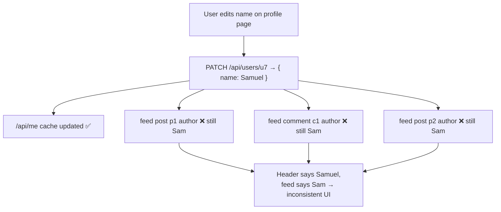

You have three options: **refetch everything** that might contain `u7` (simple, costs network), **walk every tree and patch** it (error-prone), or **normalize** so there's only one copy.

---

### Section 2: Normalization — One Record per Entity

**Normalization** (borrowed from relational databases) means: store each entity **once**, keyed by its ID, and replace nested copies with **references** (IDs).

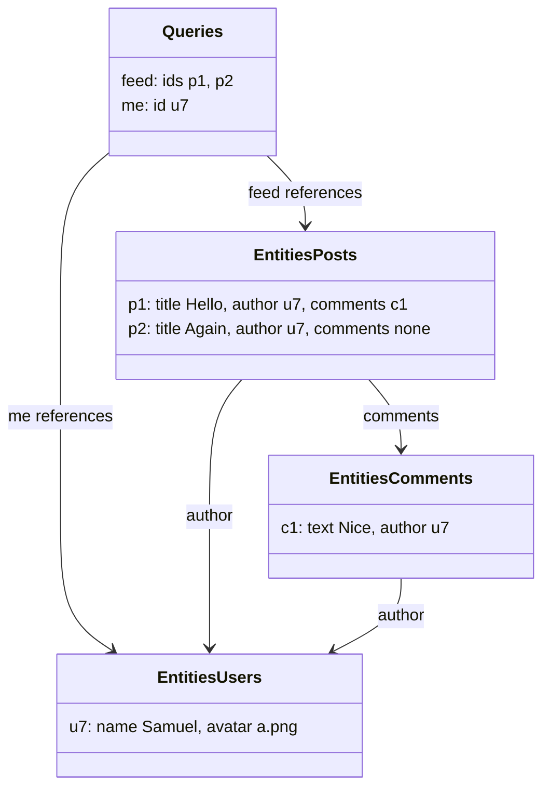

```text
{
  entities: {
    users:    { u7: { id: "u7", name: "Samuel", avatar: "a.png" } },
    posts:    { p1: { id: "p1", title: "Hello", author: "u7", comments: ["c1"] },
                p2: { id: "p2", title: "Again", author: "u7", comments: [] } },
    comments: { c1: { id: "c1", text: "Nice", author: "u7" } }
  },
  queries: {                       // results = ordered lists of IDs
    "feed":    ["p1", "p2"],
    "me":      "u7"
  }
}
```

| Benefit | Why |
|---|---|
| **Single source of truth** | One update → every view consistent |
| **Cheap updates** | `O(1)` lookup by ID instead of tree searches |
| **Smaller memory** | No duplicate copies of large entities |
| **Fine-grained re-renders** | Components subscribe to `users[u7]`, not the whole feed |
| **Merging** | A detail response can **enrich** the same record a list response created |

| Cost | Why |
|---|---|
| **Identity required** | Every entity needs a stable, unique key |
| **Denormalization on read** | Views need trees → selectors/joins (must be memoized) |
| **List membership is unknown** | The store can't know a new entity belongs in `feed` |
| **Complexity** | Schemas, merge rules, garbage collection |

---

### Section 3: Entity Identity and Cache Keys

Normalization is only as good as its keys.

| Key strategy | Example | Notes |
|---|---|---|
| **Type + ID** | `User:42`, `Post:42` | Default in Apollo and Graphcache; numeric IDs often collide across tables, so the type prefix is essential |
| **Globally unique ID** | `VXNlcjo0Mg==` (Relay `Node` id), UUID | Unique across types; enables generic `node(id:)` refetch |
| **Natural / composite key** | `Product:sku-123`, `Price:{productId,currency}` | Configure explicitly (`keyFields`, `keys`, `selectId`) |
| **No identity (value object)** | `Address`, `Money` | Store **embedded** in the parent; don't normalize |
| **Temporary client ID** | `tmp_8f3a` for an unsaved item | Swap to the server ID on success (see [Optimistic UI Updates](./optimistic-ui-updates.md)) |
| **Singleton** | `Viewer`, `Settings` | One record per app (Apollo `keyFields: []`) |

**Query-result keys** are a different thing: a key for **"the answer to this request"**, e.g. `['todos', { status: 'done', page: 2 }]` (TanStack Query) or `hash(query + variables)` (urql document cache). Keep keys:
- **Deterministic** — object key order shouldn't matter (TanStack Query hashes keys deterministically).
- **Complete** — include **every variable** that changes the result (filters, locale, user/tenant when caches outlive sessions).
- **Hierarchical** — `['todos', ...]` lets you invalidate a whole family by prefix.

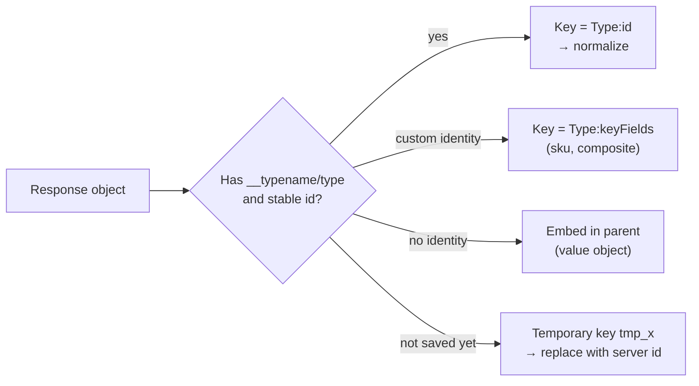

---

### Section 4: Normalize In, Denormalize Out

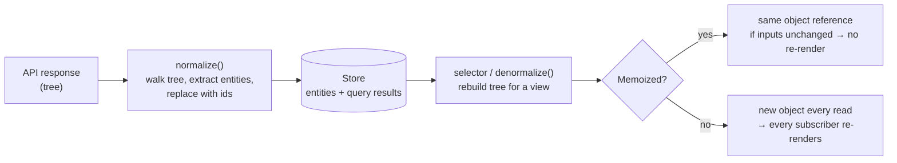

**Who does the normalizing?**

| Tool | Status (late 2026) | Notes |
|---|---|---|
| **Apollo `InMemoryCache`, urql Graphcache, Relay** | Active | Automatic for GraphQL using `__typename` + id |
| **Redux Toolkit `createEntityAdapter`** | Active | Gives `{ ids, entities }` state + CRUD reducers + selectors; you feed it already-flat arrays |
| **NgRx Entity / `@ngrx/signals` `withEntities`** | Active | Angular equivalents of the entity adapter |
| **normalizr** | **Archived (March 2022), unmaintained** | Still found in older Redux codebases. Prefer flattening by hand for simple shapes, the API returning flat data, or a normalized client |
| **Reactive Data Client (`@data-client/react`)** | Active | Normalized cache for REST/any protocol via schemas (formerly "Rest Hooks") |
| **`@normy/react-query`** etc. | Community | Adds automatic normalization on top of TanStack Query |

**Denormalizing must be memoized.** A selector that rebuilds `posts.map(p => ({ ...p, author: users[p.author] }))` on every call returns a **new array every time** → every `useSelector` subscriber re-renders. Use `createSelector` (Reselect, re-exported by Redux Toolkit), framework `computed`, or let the cache library handle it (Apollo/Relay return stable results).

> **Structural sharing** (TanStack Query, Apollo) keeps unchanged parts of a result **referentially equal** across refetches, so `React.memo` and selectors stay effective even without normalization.

---

### Section 5: Normalized Stores vs Query-Key Caches

There are two families of server-state caches. Most apps should pick **one** as the primary model.

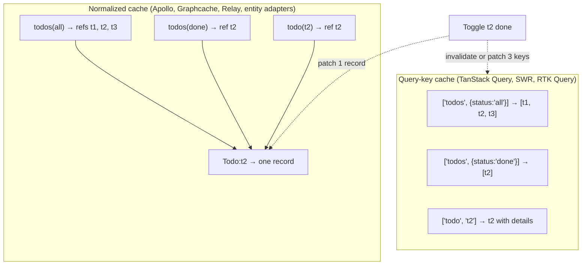

| | **Query-key cache** | **Normalized cache** |
|---|---|---|
| Unit of caching | A **request's result** | An **entity** |
| Same entity in 3 queries | 3 copies | 1 record |
| After a mutation | **Invalidate** keys (refetch) or `setQueryData` on each | Merge into the record; lists may need updates |
| Setup | Minimal | Keys, merge rules, list updaters |
| Consistency | Eventually (after refetch) | Immediate |
| Best for | REST, read-heavy apps, most CRUD dashboards | Same entities on many screens, real-time collaboration, GraphQL |
| Examples | TanStack Query, SWR, RTK Query (tags) | Apollo, urql Graphcache, Relay, Reactive Data Client, RTK entity adapter |

> **RTK Query deliberately does not normalize** — its docs recommend tag-based invalidation (`providesTags` / `invalidatesTags`) and, if you need normalization, combining it with `createEntityAdapter` in `transformResponse`. TanStack Query takes the same stance: invalidate by key prefix and refetch.

---

### Section 6: Cache Lifecycle — Fresh, Stale, Inactive, Collected

Every cached item has two independent clocks: **freshness** (can I show it without refetching?) and **retention** (should I keep it in memory at all?).

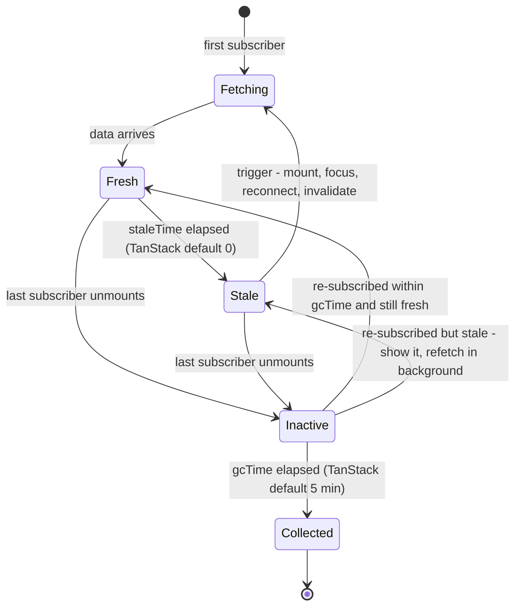

| Knob | TanStack Query v5 | SWR | Apollo Client | RTK Query |
|---|---|---|---|---|
| Freshness | `staleTime` (default `0`) | Revalidate on mount/focus/reconnect; `dedupingInterval` | Fetch policy (`cache-first` = fresh until evicted) | `refetchOnMountOrArgChange`, `pollingInterval` |
| Retention | `gcTime` (default 5 min; called `cacheTime` before v5) | Cache provider (Map by default) | Reachability: `cache.gc()` removes records unreachable from roots; `cache.evict()` | `keepUnusedDataFor` (default 60 s) |
| Manual invalidation | `invalidateQueries({ queryKey })` (prefix match) | `mutate(key)` | `refetchQueries`, `evict`, `modify` | `invalidatesTags` |

**Normalized-cache garbage collection** works like a language GC: start from **roots** (`ROOT_QUERY`, retained IDs), follow references, delete everything unreachable. Evicting a list doesn't delete entities still referenced by another query.

**Memory:** long-running apps (dashboards, chat) accumulate data. Bound it — `gcTime`, max pages kept (`maxPages` in TanStack infinite queries), evicting old conversations, or a windowed/virtualized view (see [Virtual Scrolling & Windowing](./virtual-scrolling-and-windowing.md) and [Memory Leaks in Frontend Apps](./memory-leaks-in-frontend-apps.md)).

---

### Section 7: Invalidation Strategies

> "There are only two hard things in Computer Science: cache invalidation and naming things." — widely attributed to Phil Karlton.

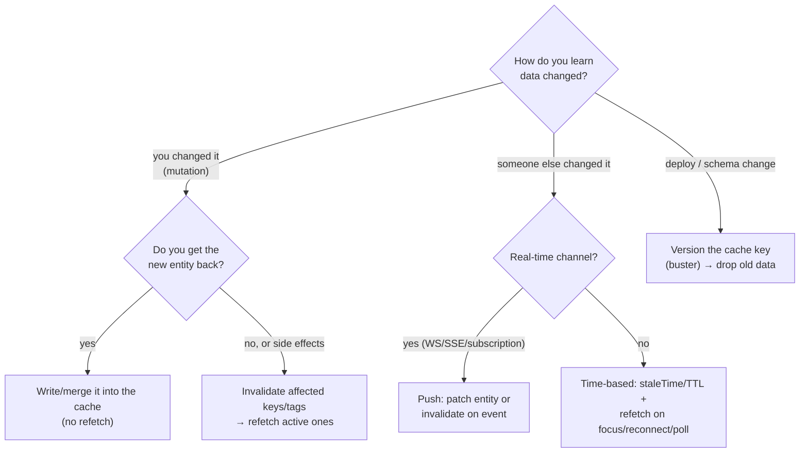

| Strategy | How | Pros | Cons |
|---|---|---|---|
| **TTL / staleTime** | Data considered fresh for N seconds | Simple, predictable load | Shows stale data up to N; refetches unchanged data |
| **Revalidate on events** | Focus, reconnect, mount, interval | Cheap "eventually fresh" | Still a window of staleness |
| **Mutation write-through** | Mutation returns the entity → merge | Instant, no extra request | Needs normalized cache or per-key patching |
| **Tag / key invalidation** | Mutation marks `['todos']` / `{type:'Todo'}` stale | Coarse but robust | Refetch cost, possible over-fetching |
| **Push invalidation** | Server sends "Todo t2 changed" or the new data | Near-real-time for other users' changes | Needs a live connection; reconnect/backfill logic |
| **Conditional revalidation** | `ETag` / `If-None-Match` → 304 | Saves bytes when unchanged | Still a round trip |
| **Version / buster** | Include app or schema version in persisted cache key | Safe deploys | Cold cache after each change |

**Rule:** pick per data type. Product catalog: long `staleTime` + tag invalidation. Chat messages: push. Account balance: `staleTime: 0`, refetch on focus, never persisted.

---

### Section 8: Lists, Filters and Pagination

In a normalized store, a **list is a query result: an ordered array of IDs** plus metadata, keyed by its parameters.

```text
queries:
  "todos?status=all&sort=created"   → { ids: [t9, t8, t7], nextCursor: "c3", fetchedAt: … }
  "todos?status=done&sort=created"  → { ids: [t8],         nextCursor: null, fetchedAt: … }
entities:
  todos: { t7: {...}, t8: {...}, t9: {...} }
```

**The membership problem:** after `createTodo` (`t10`) or toggling `t9` to done, which lists change? The cache can't know the server's filter/sort logic.

| Situation | Approach |
|---|---|
| One unfiltered list, known order | Insert/remove the ID locally (prepend for "newest first") |
| Many filtered/sorted lists | Invalidate the list family (`['todos']` prefix / `Todo` tag) and refetch the active one |
| Item deleted | Remove the entity **and** its ID from every list (Apollo `evict` + `gc` handles dangling refs; Apollo's list reads skip dangling references by default) |
| Infinite scroll | Merge pages into one list field (Apollo `relayStylePagination`, Graphcache `relayPagination`, TanStack `useInfiniteQuery` pages) |
| Filter done on the client | Keep one master list; derive filtered views with memoized selectors |

Details: [Pagination & Infinite Scroll](./pagination-and-infinite-scroll.md).

---

### Section 9: Consistency, Races and Partial Entities

**Out-of-order responses** overwrite newer data with older data:

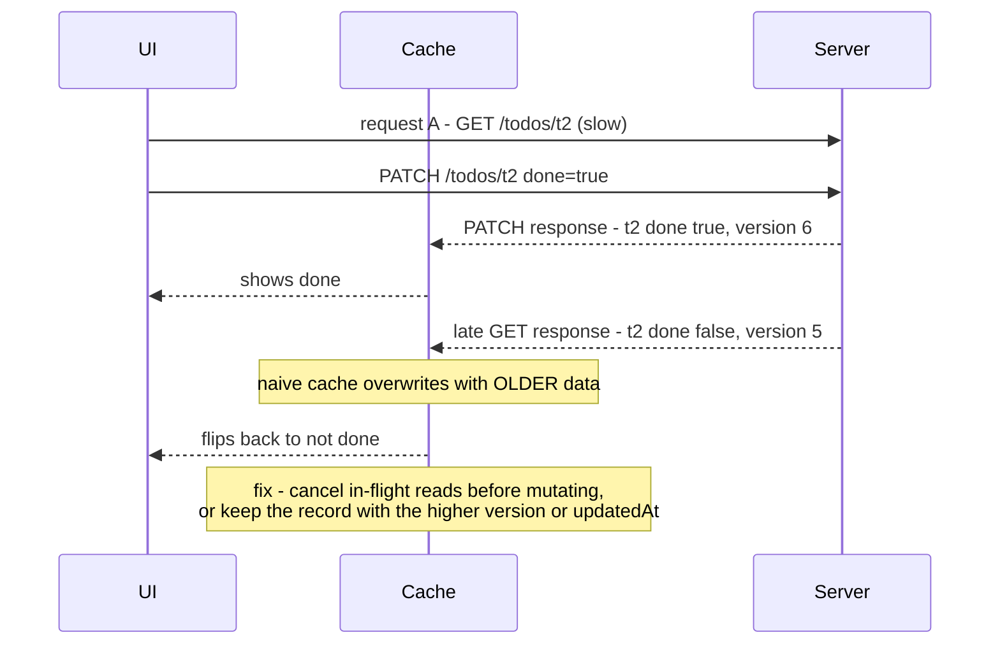

| Problem | Fix |
|---|---|
| Late read overwrites a newer write | Cancel queries before optimistic writes (`queryClient.cancelQueries`), `AbortController`, or compare `version`/`updatedAt` and keep the newer |
| Rapid filter changes show the wrong results | Key results by parameters (each key holds its own answer); abort stale requests |
| **Partial entities**: list returns `{id, title}`, detail returns `{id, title, body, tags}` | **Merge** fields (not replace) — the detail view must still check for missing fields; Apollo merges fields of the same entity by default |
| Different shapes for the same ID | Same entity type must mean the same thing everywhere — don't reuse an ID for a "summary" object with different semantics |
| Two tabs editing | Last-write-wins, or server-side versioning with conflict errors (`409`, `412 Precondition Failed` with `If-Match`) |

> **Seed details from lists:** when navigating list → detail, show the list's partial entity immediately (TanStack `initialData`/`placeholderData` from the list cache; Apollo cache redirects with `toReference`), then fetch the rest.

---

### Section 10: Persistence and Multi-Tab Sync

Persisting the cache (IndexedDB, AsyncStorage on React Native) gives **instant warm starts** and offline reads ([Offline-First Architecture](./offline-first-architecture.md)).

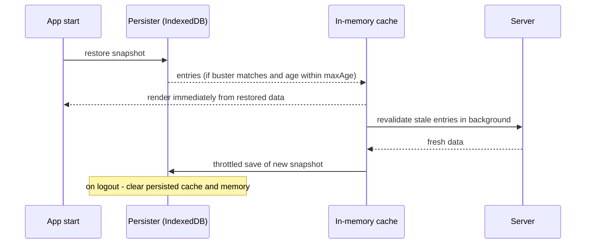

**Rules:**
- **Version the snapshot** (`buster` in TanStack's persister) — a deploy that changes data shapes must discard old snapshots, or the app crashes on unexpected fields.
- **Expire it** (`maxAge`), and make retention ≥ persistence age (TanStack: `gcTime` ≥ `maxAge`, otherwise entries are garbage-collected before they're saved).
- **Never persist sensitive data** (tokens, payment details, health data). Exclude those queries (`dehydrateOptions.shouldDehydrateQuery`) and **clear on logout**.
- Storage choice and quotas: [Browser Storage Mechanisms](./browser-storage-mechanisms.md).

**Multi-tab:** each tab has its own memory cache. Options: refetch on focus (default in TanStack Query/SWR), or broadcast changes with **`BroadcastChannel`** (TanStack's `broadcastQueryClient` plugin is labelled experimental), or share one connection through a SharedWorker.

---

### Section 11: The Caching Layers Together

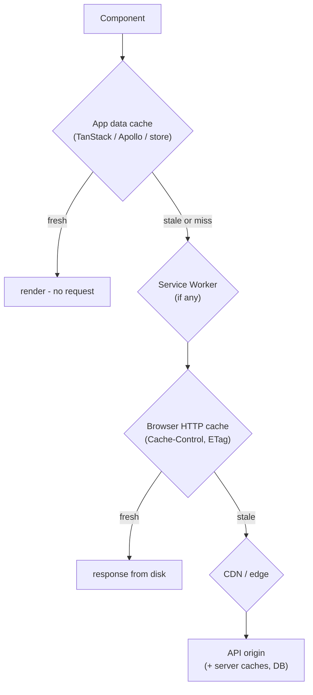

| Layer | Stores | Invalidated by | Watch out |
|---|---|---|---|
| **App data cache** | Parsed objects, entities, UI-ready lists | `staleTime`, invalidation, mutations | Most control; per tab |
| **Service Worker** | Responses in Cache Storage | Your SW code | Can serve stale data after you fixed headers |
| **HTTP cache** | Bytes per URL | `Cache-Control`, `ETag` | `POST` (most GraphQL) isn't cached |
| **CDN** | Shared responses | TTL, purge, tags | Never cache personalized responses |

> **Don't stack long TTLs.** HTTP `max-age=60` under `staleTime: 60_000` can show data ~2 minutes old. A common pattern: API sends `private, no-cache` + `ETag`; the **app cache** owns freshness. See [Browser Caching Strategies](./browser-caching-strategies.md).

---

### Section 12: Across Frameworks and Native Mobile

| Stack | Query-key cache | Normalized option | Entity store |
|---|---|---|---|
| **React** | TanStack Query, SWR, RTK Query | Apollo, Relay, urql Graphcache, Reactive Data Client | RTK `createEntityAdapter`, Zustand with `Record<id, T>` |
| **Vue** | TanStack Vue Query, Pinia Colada | Apollo (Vue Apollo), urql Graphcache | Pinia store with `Map`/record + getters (`computed`) as selectors |
| **Angular** | TanStack Query Angular adapter (check its stability label) | apollo-angular | NgRx Entity (`createEntityAdapter`), NgRx SignalStore `withEntities` |
| **Svelte** | TanStack Svelte Query | Houdini, urql Graphcache | Stores / runes holding `Map<id, T>` + derived values |
| **Android / iOS** | Repository + in-memory cache | Apollo Kotlin / Apollo iOS normalized cache (memory or SQLite) | **Local database as single source of truth** (Room, Core Data / SwiftData) — UI observes the DB, network writes into it |

> The native-mobile "database as source of truth" pattern is normalization taken to its conclusion: the UI only reads from local tables; sync code writes server data into them.

---

## Decision Matrix

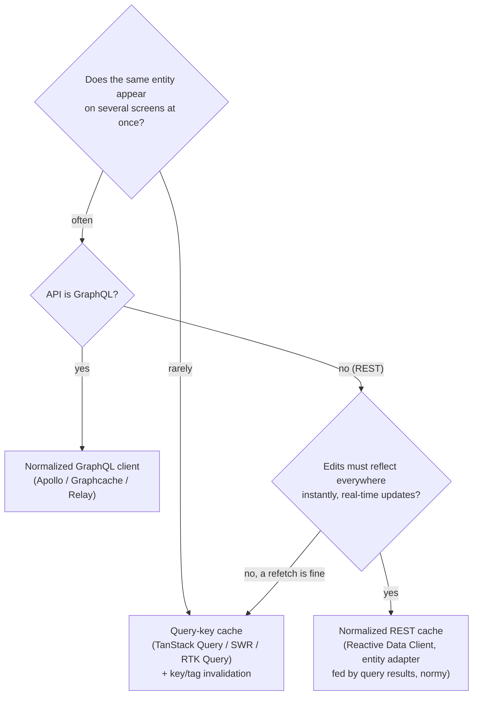

| Question | Leans query-key | Leans normalized |
|---|---|---|
| How many views show the same entity? | 1–2 | Many |
| Who changes data? | Mostly this user, occasionally | Many users, real-time |
| Team familiarity / time | Low setup wanted | Can invest in keys and merge rules |
| API shape | REST endpoints per screen | GraphQL, or REST with stable IDs everywhere |
| Cost of a refetch | Low | High (big payloads, mobile networks) |

---

## Real-World Examples

**Example 1 — Normalizing by hand (TypeScript):**
```typescript
type ApiUser = { id: string; name: string; avatar: string };
type ApiComment = { id: string; text: string; author: ApiUser };
type ApiPost = { id: string; title: string; author: ApiUser; comments: ApiComment[] };

type Post = { id: string; title: string; author: string; comments: string[] };
type Comment = { id: string; text: string; author: string };

export interface NormalizedFeed {
  users: Record<string, ApiUser>;
  posts: Record<string, Post>;
  comments: Record<string, Comment>;
  feed: string[]; // ordered ids = the query result
}

export function normalizeFeed(posts: ApiPost[]): NormalizedFeed {
  const out: NormalizedFeed = { users: {}, posts: {}, comments: {}, feed: [] };
  const addUser = (u: ApiUser) => (out.users[u.id] = { ...out.users[u.id], ...u }); // merge partials

  for (const p of posts) {
    addUser(p.author);
    for (const c of p.comments) {
      addUser(c.author);
      out.comments[c.id] = { id: c.id, text: c.text, author: c.author.id };
    }
    out.posts[p.id] = { id: p.id, title: p.title, author: p.author.id, comments: p.comments.map((c) => c.id) };
    out.feed.push(p.id);
  }
  return out;
}
```

**Example 2 — Redux Toolkit entity adapter + memoized denormalization:**
```typescript
import { createEntityAdapter, createSelector, createSlice, type PayloadAction } from '@reduxjs/toolkit';

type User = { id: string; name: string };
type Post = { id: string; title: string; authorId: string; createdAt: number };

const usersAdapter = createEntityAdapter<User>();
const postsAdapter = createEntityAdapter<Post>({ sortComparer: (a, b) => b.createdAt - a.createdAt });

const entitiesSlice = createSlice({
  name: 'entities',
  initialState: { users: usersAdapter.getInitialState(), posts: postsAdapter.getInitialState() },
  reducers: {
    feedLoaded(state, action: PayloadAction<{ users: User[]; posts: Post[] }>) {
      usersAdapter.upsertMany(state.users, action.payload.users); // merge, don't replace
      postsAdapter.upsertMany(state.posts, action.payload.posts);
    },
    userRenamed(state, action: PayloadAction<{ id: string; name: string }>) {
      usersAdapter.updateOne(state.users, { id: action.payload.id, changes: { name: action.payload.name } });
    },
  },
});

type RootState = { entities: ReturnType<typeof entitiesSlice.reducer> };
const userSelectors = usersAdapter.getSelectors((s: RootState) => s.entities.users);
const postSelectors = postsAdapter.getSelectors((s: RootState) => s.entities.posts);

// ❌ BAD: new array + new objects on every call → every subscriber re-renders on any state change
export const selectFeedBad = (s: RootState) =>
  postSelectors.selectAll(s).map((p) => ({ ...p, author: userSelectors.selectById(s, p.authorId) }));

// ✅ GOOD: recomputes only when posts or users change
export const selectFeed = createSelector(
  [postSelectors.selectAll, userSelectors.selectEntities],
  (posts, users) => posts.map((p) => ({ ...p, author: users[p.authorId] })),
);

export const { feedLoaded, userRenamed } = entitiesSlice.actions;
```

**Example 3 — Query-key cache: hierarchical keys, invalidation, seeding details (TanStack Query v5):**
```tsx
import { useQuery, useMutation, useQueryClient, keepPreviousData } from '@tanstack/react-query';

// One place that defines keys → consistent, prefix-invalidatable
export const todoKeys = {
  all: ['todos'] as const,
  lists: () => [...todoKeys.all, 'list'] as const,
  list: (filters: { status: string; page: number }) => [...todoKeys.lists(), filters] as const,
  detail: (id: string) => [...todoKeys.all, 'detail', id] as const,
};

export function useTodos(filters: { status: string; page: number }) {
  return useQuery({
    queryKey: todoKeys.list(filters),           // every variable is in the key
    queryFn: ({ signal }) => api.getTodos(filters, { signal }),
    staleTime: 30_000,
    placeholderData: keepPreviousData,          // no flash of empty list between pages
  });
}

export function useTodo(id: string) {
  const qc = useQueryClient();
  return useQuery({
    queryKey: todoKeys.detail(id),
    queryFn: ({ signal }) => api.getTodo(id, { signal }),
    // Show the partial item from any cached list immediately, then fetch the full one
    placeholderData: () =>
      qc.getQueriesData<Todo[]>({ queryKey: todoKeys.lists() })
        .flatMap(([, list]) => list ?? [])
        .find((t) => t.id === id),
  });
}

export function useRenameTodo() {
  const qc = useQueryClient();
  return useMutation({
    mutationFn: api.renameTodo,                  // returns the updated Todo
    onSuccess: (updated) => {
      qc.setQueryData(todoKeys.detail(updated.id), updated);              // write-through
      return qc.invalidateQueries({ queryKey: todoKeys.lists() });        // lists may re-sort/filter
    },
  });
}
```

**Example 4 — Version guard against out-of-order writes:**
```typescript
type Versioned = { id: string; version: number };

export function upsertIfNewer<T extends Versioned>(store: Map<string, T>, incoming: T): boolean {
  const current = store.get(incoming.id);
  if (current && current.version > incoming.version) return false; // late, older response → ignore
  store.set(incoming.id, current ? { ...current, ...incoming } : incoming); // merge partial fields
  return true;
}
```

**Example 5 — Persisting a query cache safely (React + IndexedDB):**
```tsx
import { QueryClient } from '@tanstack/react-query';
import { PersistQueryClientProvider } from '@tanstack/react-query-persist-client';
import { createAsyncStoragePersister } from '@tanstack/query-async-storage-persister';
import { get, set, del } from 'idb-keyval';

const ONE_DAY = 24 * 60 * 60 * 1000;
const queryClient = new QueryClient({ defaultOptions: { queries: { gcTime: ONE_DAY } } }); // gcTime >= maxAge

const persister = createAsyncStoragePersister({
  storage: { getItem: get, setItem: set, removeItem: del }, // IndexedDB via idb-keyval
});

export function Providers({ children }: { children: React.ReactNode }) {
  return (
    <PersistQueryClientProvider
      client={queryClient}
      persistOptions={{
        persister,
        maxAge: ONE_DAY,
        buster: import.meta.env.VITE_CACHE_VERSION, // e.g. "2026-11-a" - change it when data shapes change → old snapshot discarded
        dehydrateOptions: {
          shouldDehydrateQuery: (q) => q.state.status === 'success' && q.queryKey[0] !== 'billing',
        },
      }}
    >
      {children}
    </PersistQueryClientProvider>
  );
}

// On logout: queryClient.clear(); await persister.removeClient();
```

**Example 6 — Cross-tab invalidation with BroadcastChannel:**
```typescript
const channel = new BroadcastChannel('cache-sync');

// After a successful mutation in this tab
export function announceChange(queryKey: readonly unknown[]) {
  channel.postMessage({ type: 'invalidate', queryKey });
}

// In every tab
channel.onmessage = (event: MessageEvent<{ type: string; queryKey: unknown[] }>) => {
  if (event.data.type === 'invalidate') void queryClient.invalidateQueries({ queryKey: event.data.queryKey });
};
```

**Example 7 — Vue (Pinia) and Angular (NgRx SignalStore) entity stores:**
```typescript
// Vue + Pinia: a normalized store with computed selectors
import { defineStore } from 'pinia';
import { computed, ref } from 'vue';

export const useUsersStore = defineStore('users', () => {
  const byId = ref<Record<string, User>>({});
  const upsertMany = (users: User[]) => users.forEach((u) => (byId.value[u.id] = { ...byId.value[u.id], ...u }));
  const all = computed(() => Object.values(byId.value)); // cached until byId changes
  return { byId, upsertMany, all };
});

// Angular + NgRx SignalStore entities
import { signalStore } from '@ngrx/signals';
import { withEntities, upsertEntities } from '@ngrx/signals/entities';
export const UsersStore = signalStore({ providedIn: 'root' }, withEntities<User>());
// patchState(store, upsertEntities(users));  store.entities() / store.entityMap() are signals
```

---

## Key Points Summary

| Concept | One-Line Explanation |
|---|---|
| **Normalization** | Store each entity once by ID; replace nested copies with references |
| **Entity key** | Stable unique identity, usually `Type:id` |
| **Query-result key** | Identity of a request's answer: all parameters, deterministic, hierarchical |
| **Denormalization** | Rebuilding trees for views — memoize it to keep references stable |
| **Query-key cache** | Caches per request; consistency via invalidation + refetch |
| **Normalized cache** | Caches per entity; consistency via merging |
| **staleTime vs gcTime** | Freshness clock vs retention clock — independent |
| **Garbage collection** | Drop records unreachable from roots or unused past `gcTime` |
| **Invalidation** | TTL, events, mutation write-through, tags, push, version busters |
| **List membership** | Caches can't infer it — update lists explicitly or refetch |
| **Out-of-order responses** | Cancel stale reads or keep the higher version |
| **Partial entities** | Merge fields; never assume a list item has detail fields |
| **Persistence** | Version + expire snapshots, exclude sensitive data, clear on logout |

---

## Test Your Understanding

**Q1 (Basic):**
What is data normalization in a frontend cache, and what problem does it solve?

<details>
<summary>Answer</summary>

Storing each entity **once**, keyed by a stable ID (e.g. `User:7`), with other data referring to it by ID instead of embedding copies. It solves **inconsistency after updates**: when the same user appears in a feed, comments and a header, a single write to `User:7` updates all of them. It also makes lookups `O(1)` and avoids duplicate memory. The price is identity requirements, denormalization (selectors) on read, and explicit handling of list membership.
</details>

**Q2 (Application):**
A dashboard shows "Tasks assigned to me", "Overdue tasks" and a task detail drawer. Using TanStack Query (no normalization), the user renames a task in the drawer. How do you keep all three views correct, and what would change with a normalized cache?

<details>
<summary>Answer</summary>

TanStack Query: the mutation returns the updated task → `setQueryData(todoKeys.detail(id), updated)` for the drawer, then `invalidateQueries({ queryKey: ['tasks', 'list'] })` so both lists refetch (active ones immediately, inactive ones on next use). Optionally patch the lists with `setQueriesData` for instant feedback, then let invalidation reconcile. Hierarchical keys make this one prefix call.

Normalized cache: the returned `Task:42 { title }` merges into the single record; **both lists and the drawer** re-render without a request. Only if the rename could change **membership or order** (e.g. lists sorted by title) do you still refetch/update the lists.
</details>

**Q3 (Tricky):**
`staleTime: 60_000, gcTime: 30_000`. A user leaves a page and returns 45 seconds later. What do they see, and what's wrong with this config?

<details>
<summary>Answer</summary>

When the last component unmounts, the query becomes **inactive** and the `gcTime` (30 s) countdown starts. At 45 s it has already been **garbage-collected**, so the user sees a **loading state and a fresh fetch**, even though the data would still have been "fresh" (60 s). Freshness can't outlive retention. Make `gcTime ≥ staleTime` (and ≥ `maxAge` when persisting). Defaults (`staleTime: 0`, `gcTime: 5 min`) already respect this.
</details>

**Q4 (Tricky):**
A user toggles a todo to done. The UI shows ✅, then 300 ms later flips back to ❌, then (after a refetch) shows ✅ again. What's happening and how do you fix it?

<details>
<summary>Answer</summary>

An **out-of-order response**: a read request (background refetch, polling or focus revalidation) started **before** the mutation and returned **after** it, carrying the old state, and the cache overwrote the newer value. Fixes: **cancel in-flight queries** for the affected keys before writing (`queryClient.cancelQueries`), ignore responses whose `version`/`updatedAt` is older than the stored one, and invalidate after the mutation settles so the final state comes from the server. This is the standard pattern in [Optimistic UI Updates](./optimistic-ui-updates.md).
</details>

**Q5 (Tricky):**
Your app persists its query cache to IndexedDB. After a release that renamed `price` to `priceCents`, some users see a crash on startup until they clear site data. Why, and how should it have been designed?

<details>
<summary>Answer</summary>

The restored snapshot contains objects in the **old shape** (`price`), and the new code assumes `priceCents` → `undefined` → crash, before any refetch replaces it. Persisted caches are **data that outlive deploys**. Design: include a **schema/app version (buster)** in the persister so mismatched snapshots are discarded, set `maxAge`, validate or migrate restored data (or treat it as untrusted and fall back to loading), exclude sensitive queries, and clear on logout.
</details>

**Q6 (System design):**
Design the client data layer for a team chat app: channels, messages, users (names/avatars appear on every message), presence, and unread counts. Which data is normalized, how is it invalidated, and what is bounded?

<details>
<summary>Answer</summary>

- **Normalize** `User`, `Channel` and `Message` by ID. Messages reference `userId`; a rename or avatar change updates one record across thousands of rendered messages.
- **Lists**: per-channel message timelines are ordered ID arrays with cursors (paginate backwards). New messages arrive by **push** (WebSocket) and are appended by ID; deduplicate by message ID (a pushed message can also come back in a fetch).
- **Invalidation**: push for messages, presence and unread counts; refetch-on-reconnect with a "since" cursor to backfill gaps; time-based refresh for rarely changing data (channel list, user profiles).
- **Races**: server sequence numbers/`version` decide order; temporary client IDs for sent messages, swapped on ack.
- **Bounds**: keep only the last N messages per inactive channel in memory, virtualize the timeline, GC channels not visited recently, and cap persisted history.
- **Persistence**: recent channels/messages in IndexedDB for instant start (versioned snapshot); never persist auth tokens in the cache; clear on logout.
</details>

---

## Cheat Sheet

**Key Definitions:**
- **Entity:** A thing with identity (User, Post) — normalized by key
- **Value object:** Data without identity (Address) — embedded in its parent
- **Reference:** An ID stored instead of a nested copy
- **Query result:** The ordered IDs (plus metadata) a request returned, keyed by its parameters
- **Denormalize:** Join references back into trees for a view
- **Stale:** Data that should be revalidated before being trusted
- **GC / eviction:** Removing unused or unreachable cache entries
- **Buster:** A version string that invalidates a persisted cache

**Quick Reference:**
```text
Shape:          { entities: { users: {id→User}, posts: {id→Post} }, queries: { key → [ids] } }
Entity key:     Type:id  (custom: keyFields/keys/selectId; value objects: embed)
Query key:      ['resource', 'list', { every, variable }]  → invalidate by prefix
Read path:      memoized selectors (createSelector / computed) → stable references
Field update:   merge into the entity (write-through) — normalized caches do it automatically
List change:    update the ID list you know, else invalidate the list family
Delete:         remove entity + references (Apollo: evict + gc)
Freshness:      staleTime / TTL / fetch policy        Retention: gcTime / keepUnusedDataFor / gc()
Races:          cancelQueries before writes · AbortController · keep higher version
Persistence:    buster + maxAge + exclude sensitive + clear on logout · gcTime ≥ maxAge
Multi-tab:      refetch on focus or BroadcastChannel invalidation
Layers:         app cache → Service Worker → HTTP cache → CDN → origin (don't stack long TTLs)
```

**Common Mistakes to Avoid:**

| Mistake | Why Wrong | Fix |
|---|---|---|
| Storing API trees as-is in a global store | Same entity duplicated → inconsistent UI | Normalize by ID, or use a query-key cache with invalidation |
| Using raw numeric IDs across types | `User:1` and `Post:1` collide | Prefix with type or use global IDs |
| Replacing an entity with a partial one | Detail fields vanish when a list refetches | Merge (`upsert`) fields |
| Unmemoized denormalizing selectors | New references every render → re-render storms | `createSelector` / `computed` |
| Missing variables in query keys | Different filters share one cache entry | Put every parameter in the key |
| `gcTime` < `staleTime` | Data GC'd while still "fresh" → needless loading | `gcTime ≥ staleTime` |
| Expecting the cache to know new list members | New items don't appear | Update lists explicitly or invalidate |
| No guard against out-of-order responses | Old data overwrites new | Cancel reads, compare versions |
| Persisting without a version | Shape changes crash restored sessions | `buster`, `maxAge`, validation |
| Persisting sensitive data / not clearing on logout | Next user sees previous user's data | Exclude, clear memory + storage on logout |
| Normalizing everything "just in case" | Complexity without benefit | Normalize entities shared across views only |
| Starting new code with normalizr | Archived since 2022 | Hand-flatten, entity adapters, or a normalized client |

---

## References & Further Reading

**Core docs**
- Redux docs: [Normalizing State Shape](https://redux.js.org/usage/structuring-reducers/normalizing-state-shape)
- Redux Toolkit: [`createEntityAdapter`](https://redux-toolkit.js.org/api/createEntityAdapter) · [RTK Query — Automated re-fetching (tags)](https://redux-toolkit.js.org/rtk-query/usage/automated-refetching) · [RTK Query — Manual cache updates](https://redux-toolkit.js.org/rtk-query/usage/manual-cache-updates)
- TanStack Query: [Caching examples](https://tanstack.com/query/latest/docs/framework/react/guides/caching) · [Query invalidation](https://tanstack.com/query/latest/docs/framework/react/guides/query-invalidation) · [Important defaults](https://tanstack.com/query/latest/docs/framework/react/guides/important-defaults) · [persistQueryClient](https://tanstack.com/query/latest/docs/framework/react/plugins/persistQueryClient)
- Apollo Docs: [Caching overview (normalization)](https://www.apollographql.com/docs/react/caching/overview) · [Garbage collection and cache eviction](https://www.apollographql.com/docs/react/caching/garbage-collection)
- urql Docs: [Graphcache normalized caching](https://urql.dev/docs/graphcache/normalized-caching/)
- Relay: [Thinking in GraphQL (normalized store)](https://relay.dev/docs/principles-and-architecture/thinking-in-graphql/)

**Other ecosystems**
- NgRx: [Entity](https://ngrx.io/guide/entity) · [SignalStore Entities](https://ngrx.io/guide/signals/signal-store/entity-management)
- Pinia: [Defining a store](https://pinia.vuejs.org/core-concepts/)
- Reactive Data Client: [Documentation](https://dataclient.io/docs)
- Android Developers: [Offline-first app architecture (local source of truth)](https://developer.android.com/topic/architecture/data-layer/offline-first)
- MDN: [BroadcastChannel](https://developer.mozilla.org/en-US/docs/Web/API/BroadcastChannel)

**Deep dives**
- Dominik Dorfmeister (TanStack maintainer): [Effective React Query Keys](https://tkdodo.eu/blog/effective-react-query-keys) · [Seeding the Query Cache](https://tkdodo.eu/blog/seeding-the-query-cache)
- GitHub: [normalizr (archived)](https://github.com/paularmstrong/normalizr)

---

> **Previous Topic:** [GraphQL Client (Apollo, urql)](./graphql-client-apollo-urql.md)
> — Transport, cache and bindings for GraphQL: Apollo, urql, Relay

> **Next Topic:** [Optimistic UI Updates](./optimistic-ui-updates.md)
> — Show the result before the server confirms it, and roll back safely when it doesn't

*Saved on: 2026-11-06 | Repo: Frontend System Design Learning Notes*
