<!-- Generated by scripts/sync-knowledge.js from notes/ and README.md — do not edit here. -->
<!-- sections (line ranges in this file): Table of Contents 19-41 · ELI5 42-54 · Core Concept 55-412 · Incident Timeline 413-440 · Real-World Examples 441-647 · Key Points Summary 648-669 · Test Your Understanding 670-752 · Cheat Sheet 753-800 · References & Further Reading 801-841 -->

# Dependency Vulnerability Scanning

> **Date:** 2026-11-06 · **Last updated:** 2026-11-06
> **Category:** Frontend System Design
> **Sub-Topic:** Security / Software Supply Chain
> **Level:** Intermediate · **Reading time:** ~25 min
> **Informs:** CI security gates, dependency update policy (Dependabot/Renovate), lockfile and install-script hardening, package manager choice, SBOM generation, vulnerability triage SLAs, third-party library selection

> **Pre-requisite:** [Module Bundling & Build Systems](./module-bundling-and-build-systems.md) (what ends up in the shipped bundle) and [Subresource Integrity (SRI)](./subresource-integrity-sri.md) (the runtime side of supply-chain trust).
> This note covers **known-vulnerable** packages (CVEs) *and* **malicious** packages — two different problems that need different tools.

**Previous:** [Clickjacking & iframe Protection](./clickjacking-and-iframe-protection.md) · **Next:** [Unit Testing Components (Jest, Vitest)](./unit-testing-components-jest-vitest.md)

---

## Table of Contents

1. [ELI5 — Simple Explanation](#eli5--simple-explanation)
2. [Section 1: The Frontend Supply Chain](#section-1-the-frontend-supply-chain)
3. [Section 2: Two Different Threats — Vulnerable vs Malicious](#section-2-two-different-threats--vulnerable-vs-malicious)
4. [Section 3: The Vocabulary — CVE, GHSA, CVSS, EPSS, KEV](#section-3-the-vocabulary--cve-ghsa-cvss-epss-kev)
5. [Section 4: How a Scanner Works](#section-4-how-a-scanner-works)
6. [Section 5: Package-Manager Audits](#section-5-package-manager-audits)
7. [Section 6: Platform and Third-Party Scanners](#section-6-platform-and-third-party-scanners)
8. [Section 7: Triage — Is This Alert Real for Us?](#section-7-triage--is-this-alert-real-for-us)
9. [Section 8: Fixing — Upgrades, Overrides, Replacements](#section-8-fixing--upgrades-overrides-replacements)
10. [Section 9: Defending Against Malicious Packages](#section-9-defending-against-malicious-packages)
11. [Section 10: SBOMs, Provenance and Signatures](#section-10-sboms-provenance-and-signatures)
12. [Section 11: Where Scans Run — the Pipeline](#section-11-where-scans-run--the-pipeline)
13. [Incident Timeline — Lessons from Real Attacks](#incident-timeline--lessons-from-real-attacks)
14. [Real-World Examples](#real-world-examples)
15. [Key Points Summary](#key-points-summary)
16. [Test Your Understanding](#test-your-understanding)
17. [Cheat Sheet](#cheat-sheet)
18. [References & Further Reading](#references--further-reading)

---

## ELI5 — Simple Explanation

Your app is a **meal cooked from hundreds of ingredients** bought from many suppliers. You wrote the recipe, but most of what's on the plate came from someone else.

- **Recall notices** — "Batch 4.17.11 of this flour is contaminated" — are **vulnerability advisories**. A **scanner** reads your shopping list (the **lockfile**) and checks every ingredient against the recall list.
- Sometimes the recalled flour is only in the **cleaning cupboard** (a dev tool), never in the food — still worth fixing, but not an emergency.
- Worse than a contaminated batch is a **supplier who's been bribed** to add poison on purpose (a **malicious package**). Recall lists don't know about it yet, so you also need to **watch suppliers' behavior**: new hands at the factory, weird new ingredients, deliveries that try to open your safe (install scripts stealing tokens).
- A **receipt with a tamper-proof seal** (provenance, signatures) proves the ingredient really came from that supplier's factory.

> **Know exactly what you ship (lockfile, SBOM), check it continuously against advisories, triage by real exposure, update on a steady cadence — and treat install-time code from strangers as the dangerous part.**

---

## Core Concept — Step by Step

### Section 1: The Frontend Supply Chain

A typical React, Vue, Angular or Svelte app has a handful of **direct** dependencies and hundreds to thousands of **transitive** ones. Each arrow below is a place where something can go wrong:

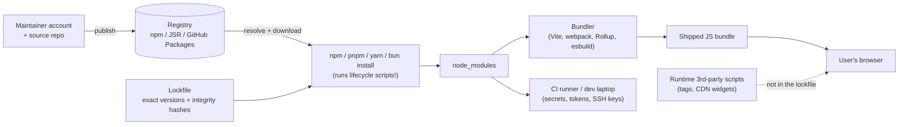

Where the risk lands:

| Stage | What a bad dependency can do | Who is exposed |
|---|---|---|
| **Install time** (`preinstall`/`install`/`postinstall` scripts) | Run arbitrary code: steal npm/GitHub/cloud tokens, env vars, SSH keys; publish worms | Developers and **CI runners** |
| **Build time** (bundler plugins, PostCSS, loaders) | Tamper with the bundle, exfiltrate build secrets | CI, and every user via the output |
| **Runtime — client bundle** | Known bugs (XSS, prototype pollution, ReDoS) or injected malware running on **your users' devices** | **Your users** (data, credentials, wallets) |
| **Runtime — SSR / server** | Known bugs in the framework server (auth bypass, SSRF, RCE) | Your servers and data |
| **Runtime — third-party scripts** | Anything; they aren't in `package.json` at all | Your users — needs [SRI](./subresource-integrity-sri.md), [CSP](./content-security-policy-csp.md), vendor review |

> **devDependencies are not "safe".** They don't ship in the bundle (so their *CVEs* matter less), but their *install scripts* run on machines holding your most valuable secrets.

---

### Section 2: Two Different Threats — Vulnerable vs Malicious

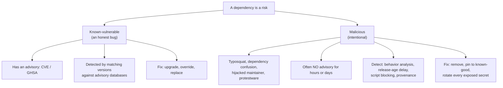

| | Known-vulnerable | Malicious |
|---|---|---|
| Example | A sanitizer has an XSS bypass in versions `< x.y.z` | A new patch release of a popular package contains a wallet-drainer |
| Intent | Accident | Attack |
| Detection | **SCA** (software composition analysis): match versions to advisories | Behavior/heuristics (install scripts, network calls, obfuscation), registry takedowns, then advisories |
| Typical window | Advisory exists before you're scanned | You may install it **before** anyone has flagged it |
| Fix | Upgrade within the semver range or across a major | Remove/pin, **rotate credentials**, audit what ran |
| Tools | `npm audit`, Dependabot, Snyk, OSV-Scanner | Socket-style analysis, `minimumReleaseAge`, script allowlists, provenance |

---

### Section 3: The Vocabulary — CVE, GHSA, CVSS, EPSS, KEV

| Term | What it is | Example |
|---|---|---|
| **CVE** | Global ID for a publicly disclosed vulnerability (MITRE-run program) | `CVE-2025-29927` |
| **GHSA** | GitHub Security Advisory ID in the GitHub Advisory Database — the source `npm audit` and Dependabot use | `GHSA-xxxx-xxxx-xxxx` |
| **OSV** | Open, machine-readable advisory format + aggregated database (osv.dev) covering many ecosystems | Used by OSV-Scanner, Renovate |
| **CWE** | The *class* of weakness | `CWE-79` (XSS), `CWE-1321` (prototype pollution), `CWE-1333` (ReDoS) |
| **CVSS** | Severity score 0–10 from FIRST (v3.1 widely used, v4.0 published 2023) | 9.8 Critical |
| **EPSS** | FIRST's estimated **probability** that a CVE will be exploited in the wild soon | Helps rank two "High" CVEs |
| **KEV** | CISA's catalog of **Known Exploited Vulnerabilities** | "Fix now" signal |
| **Affected range** | Versions with the bug, e.g. `< 4.17.12` | Scanners match your lockfile against this |
| **Patched version** | First fixed version(s) | What `audit fix` aims for |
| **VEX** | A statement that a product **is or is not affected** by a CVE (e.g. "vulnerable code not reachable") | Lets you close an alert with a reason |

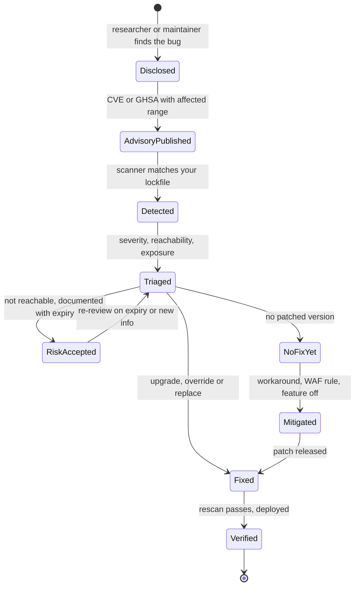

> **CVSS measures how bad a bug *could* be in general, not how bad it is in *your* app.** A 9.8 in a server-side code path you never call can matter less than a 6.1 XSS in the sanitizer you run on every comment.

---

### Section 4: How a Scanner Works

Almost every SCA tool does the same thing — the differences are in data quality, reachability analysis and workflow.

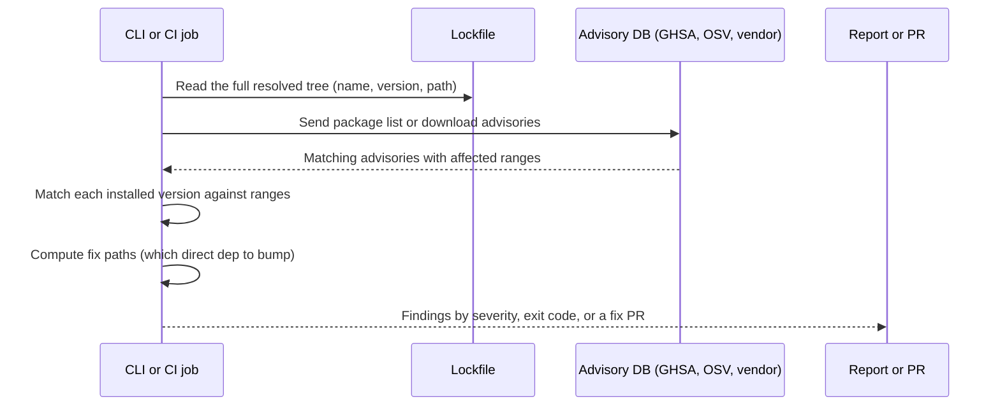

**Inputs matter more than the tool:**
- **Scan the lockfile**, not just `package.json`. `"react": "^19.0.0"` says nothing about the exact transitive tree; `package-lock.json` / `pnpm-lock.yaml` / `yarn.lock` / `bun.lock` do.
- **Commit the lockfile** and install with `npm ci` / `pnpm install --frozen-lockfile` / `yarn install --immutable` in CI, so what you scanned is what you build.
- **Monorepos:** scan every workspace (each app may resolve different versions).
- **What scanners usually miss:** vendored/copied code, scripts loaded from CDNs at runtime, code inlined by a bundler from a non-npm source, and binaries downloaded by postinstall scripts.

---

### Section 5: Package-Manager Audits

Every major JavaScript package manager has a built-in audit:

| Package manager | Command | Notes |
|---|---|---|
| **npm** | `npm audit` · `npm audit --omit=dev` · `npm audit --audit-level=high` | Exits non-zero when findings ≥ `--audit-level` (CI gate). `--json` for machine output |
| | `npm audit fix` | Installs fixed versions **within your semver ranges** |
| | `npm audit fix --force` | Also applies **semver-major** upgrades — can break your app; review the diff |
| | `npm audit signatures` | Verifies registry signatures and provenance attestations of installed packages |
| | `npm explain <pkg>` (alias `npm why`) | Shows *why* a transitive package is installed |
| **pnpm** | `pnpm audit` · `pnpm audit --prod` · `pnpm audit --fix` | `--fix` writes **overrides** to force patched versions |
| | `pnpm why <pkg>` | Dependency path |
| **Yarn (Berry, v2+)** | `yarn npm audit --all --recursive` | Classic Yarn v1 uses `yarn audit` |
| **Bun** | `bun audit` | Available in recent Bun versions — check the Bun docs |

**Severity levels** in npm/pnpm reports: `info`, `low`, `moderate`, `high`, `critical`.

**The known weaknesses of raw `audit` output** (widely discussed, e.g. Dan Abramov's *npm audit: Broken by Design*):
- It flags vulnerabilities in **build-only tools** (a ReDoS in a CSS parser fed only your own files) with the same severity as runtime bugs.
- `--omit=dev` helps, but many build tools are (correctly) devDependencies while some are mis-declared as dependencies.
- The same advisory appears once per path, inflating the count.
- `audit fix --force` can "fix" by **downgrading** or major-bumping a direct dependency.

So: use `audit` as a **signal and a gate on production dependencies**, not as a number to drive to zero blindly.

---

### Section 6: Platform and Third-Party Scanners

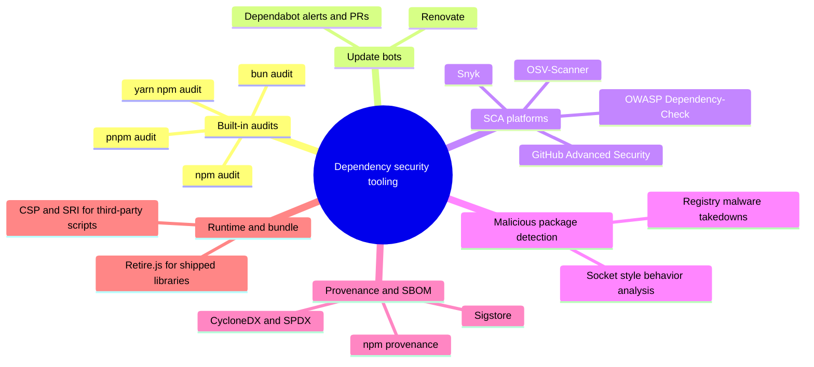

| Tool | Category | Strengths | Watch out for |
|---|---|---|---|
| **Dependabot** (GitHub) | Alerts + security-update PRs + scheduled version-update PRs | Zero setup on GitHub, uses GHSA, `groups` to batch PRs | PR noise without grouping; GitHub-only |
| **Renovate** | Update bot (any Git host) | Very configurable: grouping, schedules, automerge, `minimumReleaseAge`, vulnerability-triggered PRs | Config complexity |
| **`actions/dependency-review-action`** | PR gate | Fails a PR that **adds** a vulnerable (or disallowed-license) dependency | Only sees the diff — pair with full scans |
| **OSV-Scanner** (Google, open source) | CLI SCA over OSV.dev | Many ecosystems & lockfiles; free; JSON/SARIF output | CLI syntax changed between major versions |
| **Snyk** | Commercial SCA (+ SAST, containers) | Fix PRs, prioritization, monitoring of deployed snapshots | Cost, data-sharing review |
| **Socket** and similar | Supply-chain behavior analysis | Flags install scripts, network/filesystem access, obfuscation, typosquats, maintainer changes — **before** a CVE exists | Different question from SCA; tune alerts |
| **OWASP Dependency-Check** | Open-source SCA | Multi-language (strong on Java/.NET) | npm support relies on audit data |
| **Retire.js** | Detects known-vulnerable JS libraries in files/pages | Finds libraries **copied or served** outside npm (old jQuery in `/public`) | Smaller database |

**Ecosystem notes:**
- **Angular**: framework packages move together — use `ng update` for coordinated upgrades instead of bumping `@angular/*` packages one by one. **Nuxt**: `nuxi upgrade`. **SvelteKit/Svelte**: `npx sv migrate` helps with major migrations. **Next.js**: upgrade `next` together with `react`/`react-dom` versions it supports.
- **React Native / native mobile**: you have **three** dependency graphs — npm, iOS (CocoaPods / Swift Package Manager) and Android (Gradle). Dependabot and OSV-Scanner support several of these ecosystems; check each tool's supported-ecosystems list for your exact lockfile types. Gradle also offers dependency verification (checksums/signatures).

---

### Section 7: Triage — Is This Alert Real for Us?

Most of the work is triage, not detection.

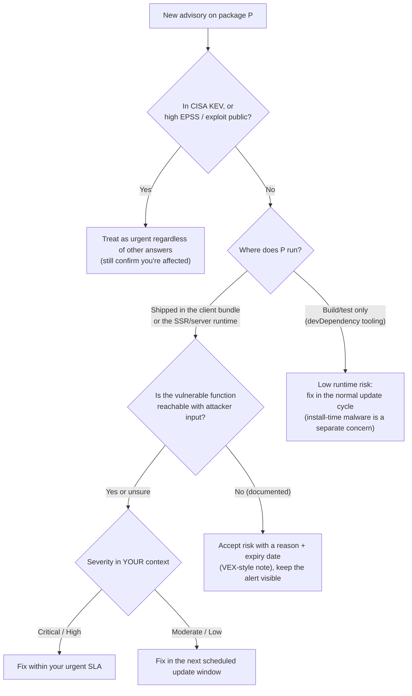

**Questions to ask per alert:**

| Question | Why it changes priority |
|---|---|
| Is the package in the **production bundle** or server runtime? | Check the bundle (e.g. a bundle analyzer, or search the built output) — devDependencies can still leak in, and dependencies can be tree-shaken away |
| Does **attacker-controlled input** reach the vulnerable function? | A ReDoS in a parser that only reads your config files isn't exploitable by users |
| What does it run **with**? | Browser: user's session, DOM, tokens. Server: secrets, DB. CI: publish tokens |
| Is there **evidence of exploitation** (KEV, EPSS, public exploit)? | Exploited-in-the-wild beats a theoretical high score |
| Is there a **fixed version** reachable from your direct dependency? | Decides between upgrade, override, or replacement |

Write the decision down. A finding closed as "not reachable" needs the **reason** and a **review date**, because code changes can make it reachable later.

---

### Section 8: Fixing — Upgrades, Overrides, Replacements

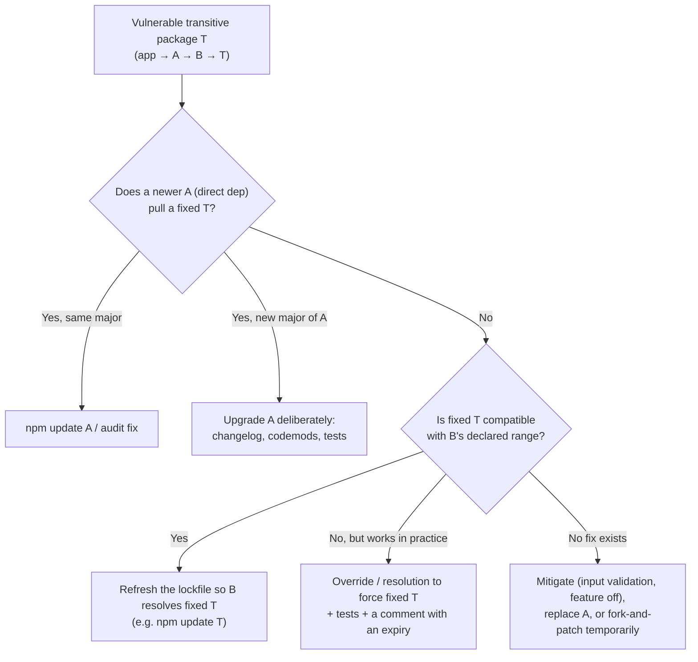

**Forcing a version (when the parent hasn't updated yet):**

| Package manager | Field | Scope |
|---|---|---|
| npm | `"overrides"` in `package.json` | Can target a package globally or under a specific parent |
| pnpm | `pnpm.overrides` in `package.json`, or `overrides` in `pnpm-workspace.yaml` (pnpm 10) | Same idea; `pnpm audit --fix` writes these |
| Yarn | `"resolutions"` in `package.json` | Glob-like paths |
| Bun | `"overrides"` (and `"resolutions"`) | npm-compatible |

**Rules for overrides:** each one is a small fork of the dependency graph. Comment *why* (the advisory ID), test the affected feature, and remove the override when the parent releases a proper fix — otherwise overrides silently pin old versions forever.

**Healthy update rhythm beats emergency upgrades.** Projects that stay a few minor versions behind can take a security patch in minutes; projects three majors behind face a migration under pressure. Bots with **grouping** (e.g. all `@tanstack/*` together, all non-major dev tools weekly) keep the noise manageable.

---

### Section 9: Defending Against Malicious Packages

Advisory-based scanners can't catch an attack nobody has reported yet. These controls reduce the blast radius:

```mermaid
flowchart LR
    subgraph PREVENT["Before install"]
        P1["Release-age delay<br/>(don't take versions younger than N days)"]
        P2["Scoped packages + registry mapping<br/>(blocks dependency confusion)"]
        P3["Review new deps:<br/>maintainers, downloads, repo, scripts"]
    end
    subgraph INSTALL["During install"]
        I1["Block lifecycle scripts by default<br/>(allowlist the few that need them)"]
        I2["Frozen lockfile + integrity hashes"]
        I3["CI install job without<br/>publish or deploy secrets"]
    end
    subgraph RUNTIME["After install"]
        R1["Least-privilege, short-lived tokens<br/>(OIDC, trusted publishing)"]
        R2["CSP / SRI limit what injected<br/>browser code can do and load"]
        R3["Incident playbook:<br/>remove, rotate, audit"]
    end
    PREVENT --> INSTALL --> RUNTIME
```

| Attack | How it works | Control |
|---|---|---|
| **Typosquatting** | `reactt`, `lodash-utils`, `@type/node` look like real packages | Review new deps; tooling that flags look-alike names |
| **Dependency confusion** | Public package with the same name as your **internal** one, higher version, gets resolved from the public registry | Use a **scope** you own (`@acme/*`) mapped to your private registry in `.npmrc`; reserve the scope on npm |
| **Maintainer account takeover** | Phished or leaked credentials publish a malicious version of a legit package | Release-age delay, provenance checks, behavior analysis, lockfiles (you only get it when you update) |
| **Malicious maintainer / protestware** | The real owner ships destructive or political code | Same as above; pin and review majors |
| **Self-propagating worms** | Install script steals npm/GitHub tokens and publishes infected versions of the victim's packages | **Block install scripts**, no publish tokens on dev machines/CI install steps, trusted publishing |
| **Build-tool compromise** | A bundler plugin modifies output | Minimal plugin set, provenance, reproducible builds where feasible |

**Package-manager controls (check your version's docs):**
- **pnpm 10** does **not** run dependencies' lifecycle scripts unless the package is allowlisted (`onlyBuiltDependencies`, managed with `pnpm approve-builds`). pnpm also supports a `minimumReleaseAge` setting.
- **Bun** runs lifecycle scripts only for packages in `trustedDependencies`.
- **npm / Yarn**: `ignore-scripts=true` in `.npmrc` (npm) or `enableScripts: false` (Yarn Berry), then explicitly run what's needed. Some packages (native addons, binary downloaders) need their scripts — allowlist those deliberately.
- **Renovate** `minimumReleaseAge` and Dependabot's cooldown setting delay update PRs for brand-new releases — most malicious versions are found and unpublished within that window.

---

### Section 10: SBOMs, Provenance and Signatures

| Concept | What it answers | How (npm ecosystem) |
|---|---|---|
| **SBOM** (Software Bill of Materials) | "Exactly which components, versions and licenses are in this release?" | `npm sbom --sbom-format cyclonedx` (or `spdx`); other tools: CycloneDX CLI, Syft |
| **CycloneDX / SPDX** | Standard SBOM formats (OWASP / Linux Foundation; SPDX is also ISO/IEC 5962) | Consumed by scanners, customers, auditors |
| **Registry signatures** | "Did this tarball come from the registry unmodified?" | `npm audit signatures` |
| **Provenance attestations** | "Which source repo and CI workflow built this package?" | Publish with `npm publish --provenance` from supported CI; verify with `npm audit signatures`; shown on npmjs.com |
| **Trusted publishing** | "Can we publish without a long-lived npm token?" | OIDC from CI (e.g. GitHub Actions) to npm — no stored token to steal |

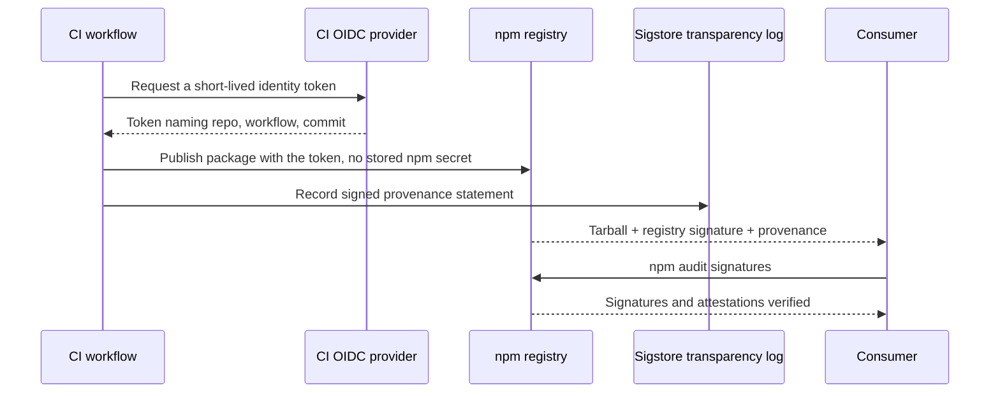

**For app teams**, SBOMs are mostly about **response speed**: when the next big advisory lands, "which of our 40 deployed apps ship version X?" becomes a query, not a week of grepping. Generate one per release build and store it with the artifact.

> npm's publishing and token rules have been tightening (granular tokens, shorter lifetimes, push toward trusted publishing and 2FA) after the 2025 incidents. Check the npm docs for the current requirements rather than relying on older blog posts.

---

### Section 11: Where Scans Run — the Pipeline

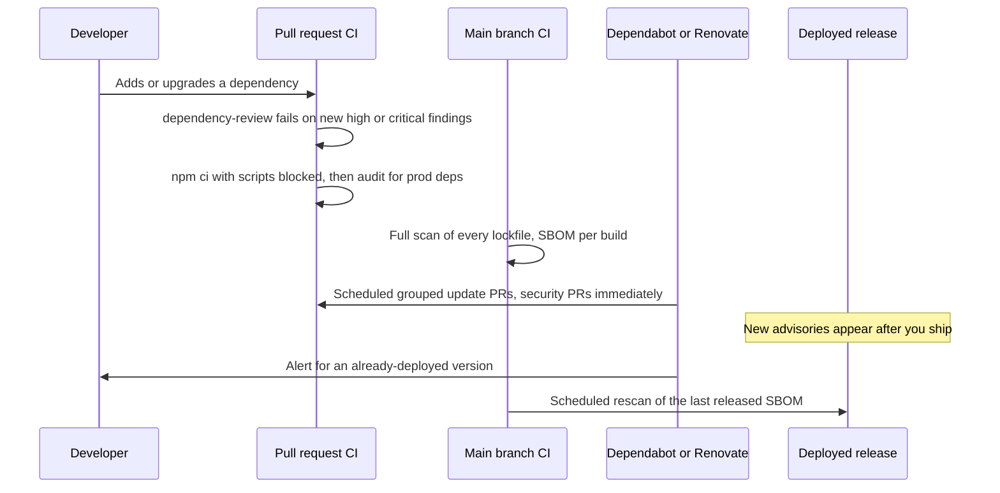

| Where | What | Blocks? |
|---|---|---|
| **Editor / pre-commit** | Optional quick audit, IDE warnings | No — keep dev loops fast |
| **Pull request** | Dependency review (only **new** problems), license policy | ✅ Block new high/critical in prod deps |
| **Main branch / nightly** | Full scan, SBOM, upload results (SARIF) | Alert, open issues/PRs |
| **Update bot** | Security PRs immediately, version PRs on a schedule | Normal review |
| **Released artifacts** | Rescan SBOMs of what's **deployed** — new CVEs appear for old releases | Page on-call for KEV/critical |

**Gate design:** blocking every PR on *any* existing moderate finding trains people to ignore or bypass the gate. Block on **new** findings at **high/critical** in **production** dependencies; track the backlog separately with SLAs.

---

## Incident Timeline — Lessons from Real Attacks

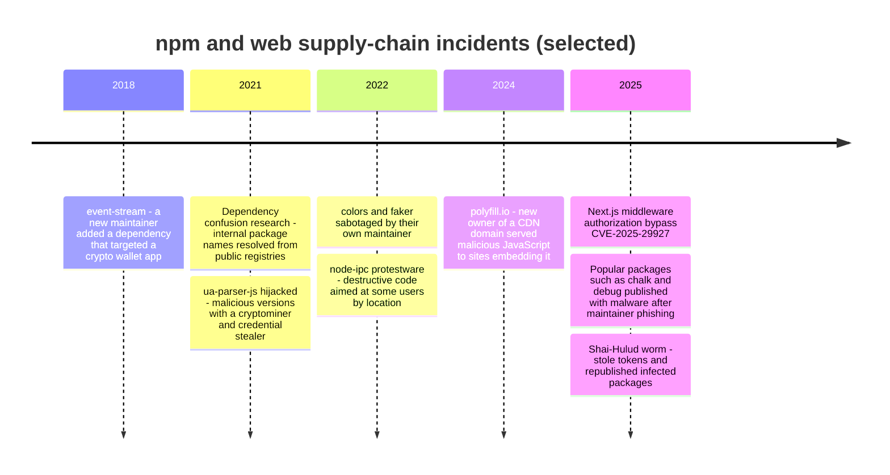

| Incident | Lesson for design |
|---|---|
| **event-stream** | Maintainer handover is a risk signal; a tiny transitive dependency can target one specific app |
| **Dependency confusion** | Scope internal packages and pin registries per scope |
| **ua-parser-js**, **chalk/debug** (2025) | Account takeover of trusted maintainers happens; release-age delays and lockfiles buy time |
| **colors/faker, node-ipc** | Even the "real" author can ship harmful code — review majors, pin, keep lockfiles |
| **polyfill.io** | Runtime third-party script URLs are dependencies too — self-host, use SRI, restrict with CSP |
| **CVE-2025-29927** | Framework-level CVEs need same-day patch capability; don't rely on a single layer (middleware) for authorization |
| **Shai-Hulud** | Install scripts + long-lived tokens = wormable ecosystem → block scripts, short-lived OIDC credentials |

---

## Real-World Examples

**Example 1 — CI gate with GitHub Actions:**
```yaml
# .github/workflows/dependency-security.yml
name: dependency-security
on:
  pull_request:
  push:
    branches: [main]
  schedule:
    - cron: '0 6 * * 1'        # weekly rescan: new advisories appear for old code

permissions:
  contents: read

jobs:
  review:
    if: github.event_name == 'pull_request'
    runs-on: ubuntu-latest
    steps:
      - uses: actions/checkout@v4
      - uses: actions/dependency-review-action@v4
        with:
          fail-on-severity: high          # block only NEW high/critical findings in this PR
          fail-on-scopes: runtime         # dev tooling is tracked, not blocked

  audit:
    runs-on: ubuntu-latest
    steps:
      - uses: actions/checkout@v4
      - uses: actions/setup-node@v4
        with:
          node-version: 22
          cache: npm
      - run: npm ci --ignore-scripts                   # no install-time code; no secrets in this job
      - run: npm audit --omit=dev --audit-level=high   # prod deps gate
      - run: npm audit signatures                      # registry signatures + provenance
      - run: npm sbom --sbom-format cyclonedx > sbom.cdx.json
      - uses: actions/upload-artifact@v4
        with:
          name: sbom
          path: sbom.cdx.json
```

> Pin third-party actions to a full commit SHA in security-sensitive workflows — a compromised action tag is itself a supply-chain attack. Tags are shown here for readability.

**Example 2 — Dependabot with grouping and a release-age delay:**
```yaml
# .github/dependabot.yml
version: 2
updates:
  - package-ecosystem: npm
    directory: /
    schedule:
      interval: weekly
    open-pull-requests-limit: 10
    cooldown:                      # wait before proposing brand-new releases (check current docs)
      default-days: 3
    groups:
      react:
        patterns: ['react', 'react-dom', '@types/react*']
      tanstack:
        patterns: ['@tanstack/*']
      dev-tooling:
        dependency-type: development
        update-types: ['minor', 'patch']
  - package-ecosystem: github-actions
    directory: /
    schedule:
      interval: weekly
```

Security updates (for alerts) are enabled separately in the repository settings and are opened as soon as an advisory matches.

**Example 3 — Renovate equivalent:**
```json
{
  "$schema": "https://docs.renovatebot.com/renovate-schema.json",
  "extends": ["config:recommended"],
  "minimumReleaseAge": "3 days",
  "vulnerabilityAlerts": { "labels": ["security"], "minimumReleaseAge": null },
  "packageRules": [
    { "matchPackageNames": ["@tanstack/**"], "groupName": "tanstack" },
    { "matchDepTypes": ["devDependencies"], "matchUpdateTypes": ["minor", "patch"], "groupName": "dev tooling", "automerge": true }
  ]
}
```

Security fixes skip the age delay (`minimumReleaseAge: null` under `vulnerabilityAlerts`), routine updates wait.

**Example 4 — Forcing a patched transitive version (BAD → GOOD):**
```jsonc
// ❌ BAD: npm audit fix --force  → silently major-bumps a direct dependency and breaks the build
// ❌ BAD: deleting the lockfile and reinstalling → changes hundreds of versions at once

// ✅ GOOD (npm): targeted override with the reason next to it
{
  "overrides": {
    // GHSA-xxxx: ReDoS in path-to-regexp; remove when some-router >= 3.2 ships a fix
    "some-router": {
      "path-to-regexp": "^0.1.12"
    }
  }
}
```

```yaml
# pnpm 10 — pnpm-workspace.yaml
overrides:
  'some-router>path-to-regexp': ^0.1.12
onlyBuiltDependencies:          # the only packages allowed to run install scripts
  - esbuild
  - sharp
minimumReleaseAge: 4320         # minutes (3 days) — check the pnpm docs for your version
```

```json
{ "resolutions": { "**/path-to-regexp": "^0.1.12" } }
```
*(Yarn `resolutions` — the version strings above are illustrative; always use the patched range named in the advisory.)*

**Example 5 — Hardened `.npmrc` and dependency-confusion protection:**
```ini
# .npmrc (project)
ignore-scripts=true                       # opt in to scripts explicitly (npm rebuild <pkg>)
@acme:registry=https://npm.acme.internal/ # internal scope ALWAYS resolves from the private registry
audit-level=high
engine-strict=true
```

```bash
# After an install with scripts disabled, run only the builds you trust
npm ci --ignore-scripts
npm rebuild esbuild sharp
```

**Example 6 — Triage script: fail only on high/critical production findings (TypeScript):**
```typescript
// scripts/audit-gate.ts — run with: npm audit --omit=dev --json | npx tsx scripts/audit-gate.ts
import { readFileSync } from 'node:fs';

type Severity = 'info' | 'low' | 'moderate' | 'high' | 'critical';
interface AuditVuln {
  name: string;
  severity: Severity;
  isDirect: boolean;
  range: string;
  fixAvailable: boolean | { name: string; version: string; isSemVerMajor: boolean };
}
interface AuditReport { vulnerabilities: Record<string, AuditVuln> }

// Documented, time-boxed exceptions (reason + expiry), reviewed in code review
const ACCEPTED: Record<string, { reason: string; expires: string }> = {
  // 'some-pkg': { reason: 'only used by build-time codegen on trusted input', expires: '2027-01-31' },
};

const report: AuditReport = JSON.parse(readFileSync(0, 'utf8'));
const now = new Date();

const blocking = Object.values(report.vulnerabilities).filter((v) => {
  if (v.severity !== 'high' && v.severity !== 'critical') return false;
  const exception = ACCEPTED[v.name];
  return !exception || new Date(exception.expires) < now; // expired exceptions block again
});

for (const v of blocking) {
  const fix = typeof v.fixAvailable === 'object'
    ? `fix: ${v.fixAvailable.name}@${v.fixAvailable.version}${v.fixAvailable.isSemVerMajor ? ' (MAJOR)' : ''}`
    : v.fixAvailable ? 'fix: npm audit fix' : 'no fix available';
  console.error(`${v.severity.toUpperCase()} ${v.name} ${v.range} (${v.isDirect ? 'direct' : 'transitive'}) — ${fix}`);
}
process.exit(blocking.length ? 1 : 0);
```

**Example 7 — Other scanners from the command line:**
```bash
# OSV-Scanner (v2 syntax): scan every lockfile under the repo
osv-scanner scan source -r .

# pnpm / Yarn Berry / Bun equivalents
pnpm audit --prod --audit-level high
yarn npm audit --all --recursive --environment production
bun audit

# Why is this package here?
npm explain path-to-regexp
pnpm why path-to-regexp

# Find vulnerable libraries that were copied into /public or served outside npm
npx retire --path ./public
```

**Example 8 — Checking whether a vulnerable package actually ships to the browser:**
```bash
# Build, then look for the package in the emitted bundle and the bundler's module graph
npm run build
npx vite-bundle-visualizer             # Vite (or webpack-bundle-analyzer / Next.js @next/bundle-analyzer)

# With source maps enabled, the maps list every original module path that made it into the bundle
grep -l "node_modules/some-lib/" dist/assets/*.js.map
```

If the package appears only in build tooling, the runtime exposure is low (fix it in the normal cycle). If it's in the client bundle **and** handles user input (parsers, sanitizers, markdown renderers, URL handling), treat it as a user-facing vulnerability.

---

## Key Points Summary

| Concept | One-Line Explanation |
|---|---|
| **SCA** | Matching your resolved dependency versions against advisory databases |
| **Lockfile** | The exact tree you ship — scan it, commit it, install from it (`npm ci`) |
| **Vulnerable vs malicious** | Honest bugs have advisories; attacks often don't yet — need different controls |
| **CVE / GHSA / OSV** | Advisory identifiers and databases that scanners read |
| **CVSS vs EPSS vs KEV** | Generic severity vs likelihood of exploitation vs confirmed exploitation |
| **Reachability** | A finding matters if attacker input reaches the vulnerable code in a shipped context |
| **devDependencies** | Low CVE risk at runtime, high malware risk at install time |
| **`audit fix --force`** | Applies semver-major changes — review, never run blindly in CI |
| **Overrides / resolutions** | Force a patched transitive version; document and remove later |
| **Update bots** | Dependabot / Renovate with grouping and release-age delays |
| **Install scripts** | The main execution path for npm malware — block by default, allowlist |
| **Dependency confusion** | Prevent with owned scopes mapped to your private registry |
| **SBOM** | Per-release inventory (CycloneDX/SPDX) for fast incident response |
| **Provenance / trusted publishing** | Proves where a package was built; removes long-lived publish tokens |
| **Gate design** | Block new high/critical prod findings; track the backlog with SLAs |

---

## Test Your Understanding

**Q1 (Basic):**
What's the difference between scanning `package.json` and scanning the lockfile? Which one should CI use, and why does `npm ci` matter here?

<details>
<summary>Answer</summary>

`package.json` holds **ranges** for **direct** dependencies only (`^19.0.0`); it says nothing about which exact versions — or which transitive packages — get installed. The **lockfile** records the full resolved tree with exact versions and integrity hashes, so a scanner can match every package against advisory ranges. CI should scan the lockfile **and** install with `npm ci` (or `pnpm install --frozen-lockfile`, `yarn install --immutable`), which fails if the lockfile and `package.json` disagree and never re-resolves. That guarantees the tree you scanned is the tree you built and shipped.
</details>

**Q2 (Application):**
`npm audit` reports 37 vulnerabilities, 4 "high", all in packages used only by your Storybook and test tooling. Your manager wants them at zero by Friday. What do you do?

<details>
<summary>Answer</summary>

Triage instead of chasing a count:
- Confirm they're **not in the production bundle or server runtime** (`npm audit --omit=dev`, `npm explain`, bundle analysis). If `--omit=dev` is clean, the **runtime** exposure is essentially nil — the vulnerable code runs only on developer/CI machines against your own files.
- Check whether any of the four is exploitable with **attacker input** in that context (e.g. a dev server exposed on a network, or tooling that processes untrusted files) — usually not.
- Fix what's cheap in the normal update cycle (grouped bot PRs); for the rest record an accepted-risk note with reason and expiry.
- Don't run `npm audit fix --force` — it may major-bump Storybook or test tooling and break the toolchain for no runtime benefit.

Explain that the real dev-tooling risk is **malicious install scripts**, not these CVEs, and propose script blocking and a release-age delay instead.
</details>

**Q3 (Tricky):**
A new patch release of a popular utility (in your lockfile range) was published an hour ago with a credential-stealing `postinstall` script. `npm audit` is clean. Which of your controls could have stopped it, and what do you do if a CI job already installed it?

<details>
<summary>Answer</summary>

Audit is clean because **no advisory exists yet** — SCA can't see a brand-new attack. Controls that would have helped:
- **Lockfile + `npm ci`**: CI only gets the new version if someone updated the lockfile; a range in `package.json` alone isn't re-resolved.
- **Release-age delay** in the update bot / package manager: brand-new versions aren't proposed for days.
- **Blocking lifecycle scripts** (pnpm 10 default, `ignore-scripts`, Bun `trustedDependencies`): the payload in `postinstall` never runs.
- **No secrets in the install job**, short-lived OIDC tokens instead of long-lived npm/cloud tokens.
- Behavior-analysis tooling that flags a new install script or network access in a patch release.

If it already ran: **remove/pin** to the last good version, treat the runner as compromised, **rotate every secret** that job could reach (npm, GitHub, cloud, deploy keys), check for packages published or commits pushed with those credentials, and review logs. Rotation is the important part — removing the package doesn't take back stolen tokens.
</details>

**Q4 (Tricky):**
Your company has an internal package `@acme/design-tokens` and an unscoped internal package `billing-utils`, both on a private registry. Which one is exposed to dependency confusion, and how do you fix it?

<details>
<summary>Answer</summary>

`billing-utils` is exposed. If the package manager can resolve unscoped names from the public registry (common when a proxy/virtual registry merges public and private, or `.npmrc` points to the public default), an attacker can publish a public `billing-utils` with a **higher version** and it may be resolved instead.

`@acme/design-tokens` is protected **if** the `@acme` scope is mapped to your private registry (`@acme:registry=https://npm.acme.internal/`) **and** you own the `@acme` scope on the public registry so nobody else can publish under it. Fix: move internal packages under the owned scope, map the scope in `.npmrc`, configure the private registry/proxy to never fetch internal names from upstream, and keep lockfiles (which record the resolved URL/integrity).
</details>

**Q5 (Application):**
A critical advisory hits a transitive dependency `T` (app → `ui-kit` → `parser` → `T`). The fixed `T` is a new major; `parser` declares `T@^2` and hasn't released an update. Walk through the options.

<details>
<summary>Answer</summary>

1. **Check reachability and exposure** first — is `T` in the client bundle/server runtime, and does untrusted input reach the vulnerable function? That sets the urgency.
2. **Look for a backported fix**: some maintainers patch older majors (`T@2.x.y`). If one exists, a lockfile refresh (`npm update T`) or a narrow override within `^2` solves it cleanly.
3. If only `T@3` is fixed, **override** `parser > T` to `^3` and run the affected features' tests — majors may break `parser`. Document the advisory ID and an expiry.
4. If the override breaks things: **mitigate** (validate/limit input to the vulnerable path, disable the feature), ask/PR upstream (`parser`, then `ui-kit`), or temporarily **patch** (`patch-package` / `pnpm patch`) a backport.
5. Longer term: if `ui-kit`/`parser` are slow to update, consider replacing them — maintenance health is part of dependency selection.
</details>

**Q6 (System design):**
Design the dependency-security program for a company with 30 frontend apps (React, Angular and a React Native app) in a monorepo, deploying daily.

<details>
<summary>Answer</summary>

- **Inventory:** one package manager with a committed lockfile; per-app SBOM (CycloneDX) generated on every release build and stored with the artifact, so "who ships X?" is a query.
- **Install hardening:** pnpm (or equivalent) with dependency lifecycle scripts **off by default** and an allowlist; owned `@company` scope mapped to the private registry; release-age delay for routine updates; CI install steps run **without** publish/deploy secrets; OIDC trusted publishing for internal packages.
- **Detection:** dependency-review on every PR (block **new** high/critical in runtime deps); full scan of all lockfiles nightly (npm/pnpm audit or OSV-Scanner, plus Gradle and iOS lockfiles for the RN app); rescan **deployed** SBOMs when new advisories land; behavior analysis for new or changed packages.
- **Updates:** Renovate/Dependabot with **grouping** (framework families: `@angular/*` via `ng update`, `react`+`react-dom`, `@tanstack/*`), weekly schedule, automerge for passing dev-tooling patches, immediate security PRs.
- **Triage process:** owners per app; SLAs by contextual severity (KEV/critical fastest); accepted-risk records with reason + expiry; dashboards on mean time to remediate.
- **Runtime side:** third-party scripts reviewed like dependencies, self-hosted where possible, SRI + CSP for the rest.
- **Incident playbook:** pin/remove, rotate credentials, search SBOMs for affected versions, hotfix pipeline that can ship in hours.
</details>

---

## Cheat Sheet

**Key Definitions:**
- **SCA:** Software composition analysis — finding known-vulnerable components
- **Transitive dependency:** A dependency of a dependency (most of your tree)
- **Advisory:** Published vulnerability record with affected and patched ranges (CVE, GHSA, OSV)
- **CVSS / EPSS / KEV:** Severity score / exploitation probability / known-exploited catalog
- **Override / resolution:** Package-manager setting that forces a transitive version
- **Dependency confusion:** Public package hijacking an internal package name
- **Typosquatting:** Look-alike package names
- **SBOM:** Machine-readable inventory of components (CycloneDX, SPDX)
- **Provenance:** Signed statement of which repo/workflow built a package

**Quick Reference:**
```text
Install (CI)        npm ci --ignore-scripts      pnpm install --frozen-lockfile     yarn install --immutable
Audit prod deps     npm audit --omit=dev --audit-level=high      pnpm audit --prod
Fix in range        npm audit fix                (NOT --force without review)
Why is it here?     npm explain <pkg>            pnpm why <pkg>
Force a version     npm "overrides" · pnpm overrides · yarn "resolutions"
Signatures          npm audit signatures
SBOM                npm sbom --sbom-format cyclonedx
Multi-ecosystem     osv-scanner scan source -r .
PR gate             actions/dependency-review-action (fail-on-severity: high)
Bots                Dependabot / Renovate: groups + schedule + release-age delay
Malware controls    block install scripts · release-age delay · owned scope in .npmrc · no secrets in install jobs
Prioritize          KEV / exploited > reachable in prod runtime > CVSS number > dev-only
```

**Common Mistakes to Avoid:**

| Mistake | Why Wrong | Fix |
|---|---|---|
| Not committing the lockfile | Scanned tree ≠ built tree; every install can differ | Commit it; `npm ci` / frozen installs |
| `npm audit fix --force` in CI | Unreviewed major bumps and downgrades | Targeted upgrades/overrides with tests |
| Treating every audit finding as urgent | Alert fatigue; real issues get ignored | Triage by runtime, reachability, exploitation |
| Ignoring devDependencies entirely | Their install scripts run with your secrets | Block scripts, no secrets in install steps |
| Gate blocks on any existing finding | Teams bypass the gate | Block **new** high/critical in runtime deps |
| Overrides with no comment or expiry | Pins old versions forever, hides real fixes | Advisory ID + removal condition next to it |
| Unscoped internal package names | Dependency confusion | Owned scope mapped to private registry |
| Long-lived npm/cloud tokens in CI | Stolen by malicious install scripts or worms | OIDC trusted publishing, short-lived tokens |
| Updating once a year | Security fixes require risky multi-major jumps | Weekly grouped updates |
| Forgetting CDN/runtime scripts | Not in any lockfile → never scanned | Inventory, self-host, SRI, CSP |
| Only scanning at PR time | New advisories hit already-deployed code | Scheduled rescans of released SBOMs |
| Ignoring native lockfiles in mobile apps | Gradle/iOS dependencies go unscanned | Scan all ecosystems in the repo |

---

## References & Further Reading

**Core docs**
- npm Docs: [`npm audit`](https://docs.npmjs.com/cli/commands/npm-audit)
- npm Docs: [`npm sbom`](https://docs.npmjs.com/cli/commands/npm-sbom) · [`npm explain`](https://docs.npmjs.com/cli/commands/npm-explain) · [`overrides`](https://docs.npmjs.com/cli/configuring-npm/package-json#overrides)
- npm Docs: [Generating provenance statements](https://docs.npmjs.com/generating-provenance-statements) · [Trusted publishing](https://docs.npmjs.com/trusted-publishers)
- pnpm: [`pnpm audit`](https://pnpm.io/cli/audit) · [Settings (overrides, onlyBuiltDependencies, minimumReleaseAge)](https://pnpm.io/settings)
- Yarn: [`yarn npm audit`](https://yarnpkg.com/cli/npm/audit)
- Bun: [`bun audit`](https://bun.sh/docs/install/audit) · [Lifecycle scripts and `trustedDependencies`](https://bun.sh/docs/install/lifecycle)

**Platforms & tools**
- GitHub Docs: [About Dependabot alerts](https://docs.github.com/en/code-security/dependabot/dependabot-alerts/about-dependabot-alerts)
- GitHub Docs: [Dependabot options reference](https://docs.github.com/en/code-security/dependabot/working-with-dependabot/dependabot-options-reference)
- GitHub Docs: [About dependency review](https://docs.github.com/en/code-security/supply-chain-security/understanding-your-software-supply-chain/about-dependency-review)
- GitHub: [GitHub Advisory Database](https://github.com/advisories)
- Renovate Docs: [Configuration options (`minimumReleaseAge`, `vulnerabilityAlerts`)](https://docs.renovatebot.com/configuration-options/)
- OSV: [osv.dev](https://osv.dev/) · [OSV-Scanner docs](https://google.github.io/osv-scanner/)
- Retire.js: [Project site](https://retirejs.github.io/retire.js/)

**Standards & scoring**
- FIRST: [CVSS v4.0](https://www.first.org/cvss/v4-0/) · [EPSS](https://www.first.org/epss/)
- CISA: [Known Exploited Vulnerabilities Catalog](https://www.cisa.gov/known-exploited-vulnerabilities-catalog)
- [CycloneDX](https://cyclonedx.org/) · [SPDX](https://spdx.dev/)
- OpenSSF: [Supply-chain Levels for Software Artifacts (SLSA)](https://slsa.dev/)
- OWASP: [Vulnerable Dependency Management Cheat Sheet](https://cheatsheetseries.owasp.org/cheatsheets/Vulnerable_Dependency_Management_Cheat_Sheet.html) · [NPM Security Cheat Sheet](https://cheatsheetseries.owasp.org/cheatsheets/NPM_Security_Cheat_Sheet.html)

**Deep dives**
- Dan Abramov: [npm audit: Broken by Design](https://overreacted.io/npm-audit-broken-by-design/)
- Alex Birsan: [Dependency Confusion: How I Hacked Into Apple, Microsoft and Dozens of Other Companies](https://medium.com/@alex.birsan/dependency-confusion-4a5d60fec610)
- Next.js: [Postmortem on Next.js middleware bypass (CVE-2025-29927)](https://vercel.com/blog/postmortem-on-next-js-middleware-bypass)
- GitHub Blog: [Our plan for a more secure npm supply chain](https://github.blog/security/supply-chain-security/our-plan-for-a-more-secure-npm-supply-chain/)

---

> **Previous Topic:** [Clickjacking & iframe Protection](./clickjacking-and-iframe-protection.md)
> — Stopping other sites from framing your UI, and sandboxing what you embed

> **Next Topic:** [Unit Testing Components (Jest, Vitest)](./unit-testing-components-jest-vitest.md)
> — Phase 8 begins: testing, starting with fast, isolated component tests

*Saved on: 2026-11-06 | Repo: Frontend System Design Learning Notes*
