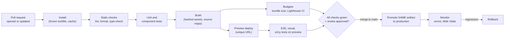
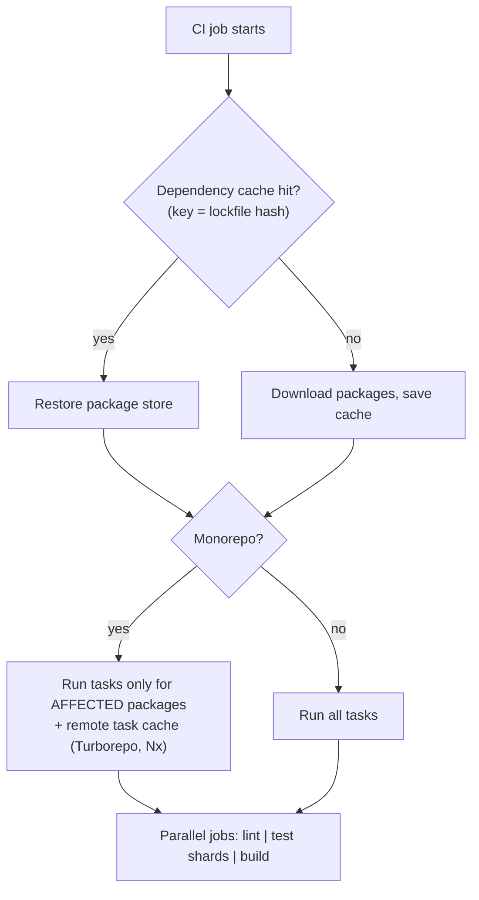
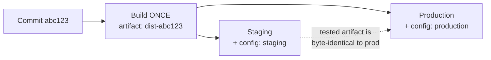
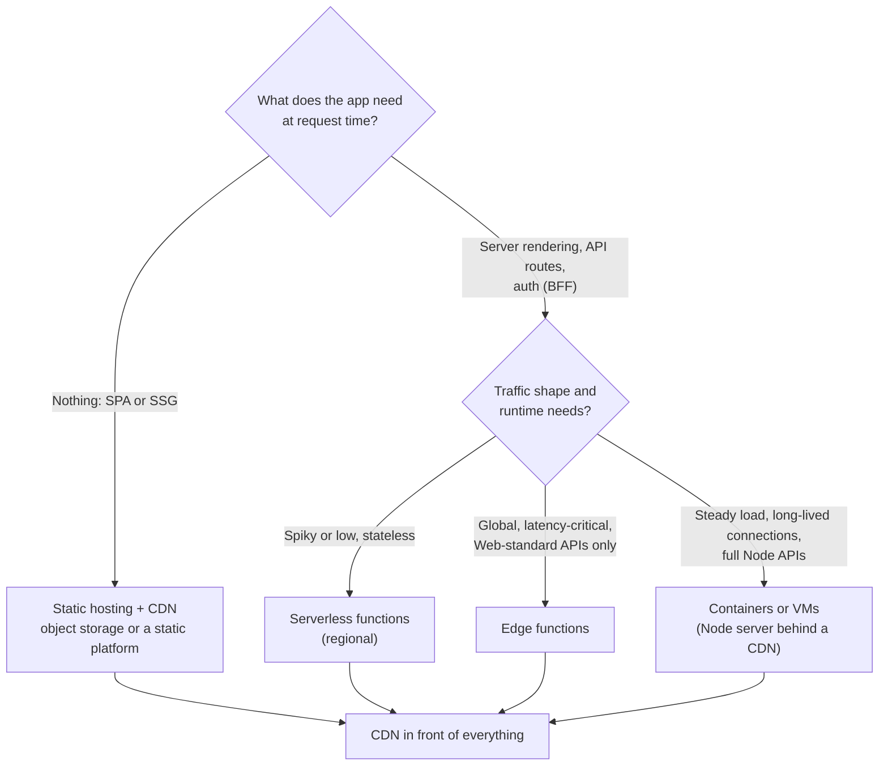
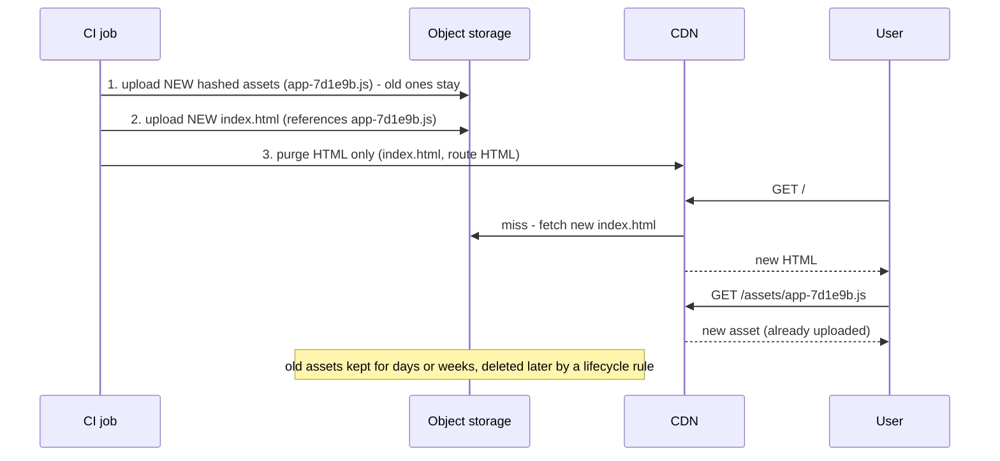
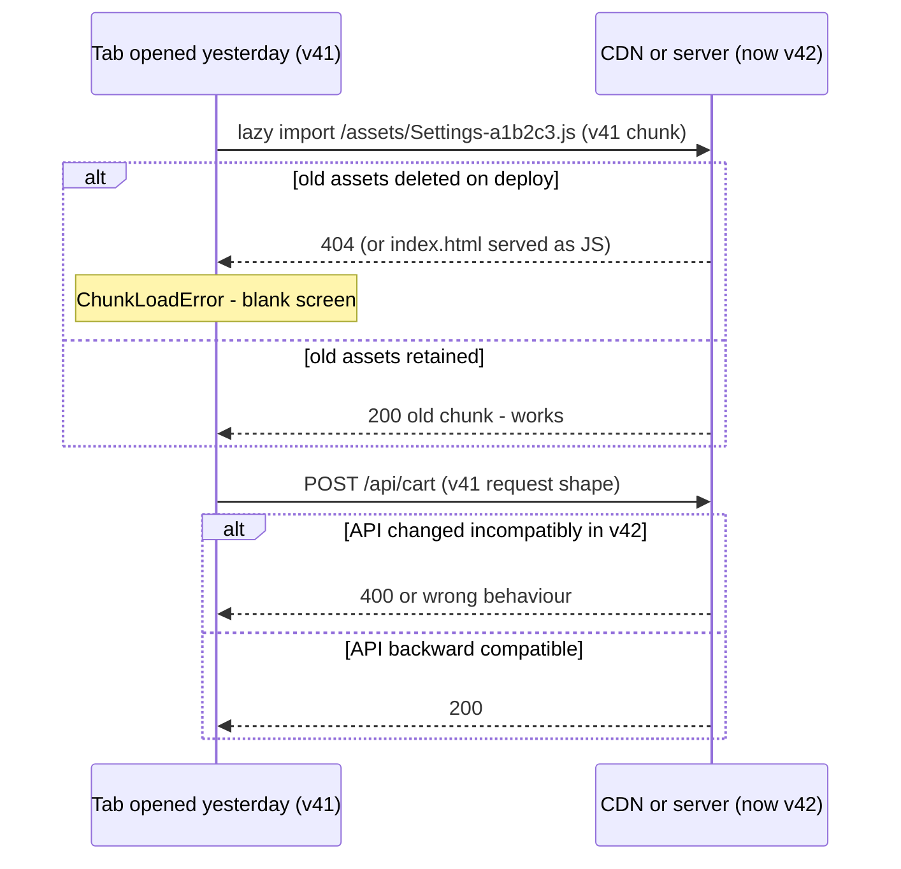
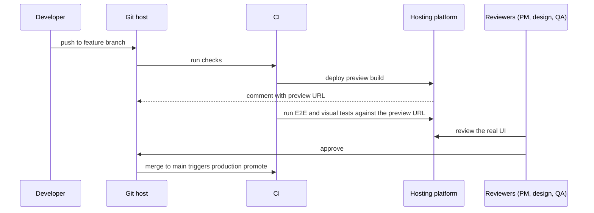
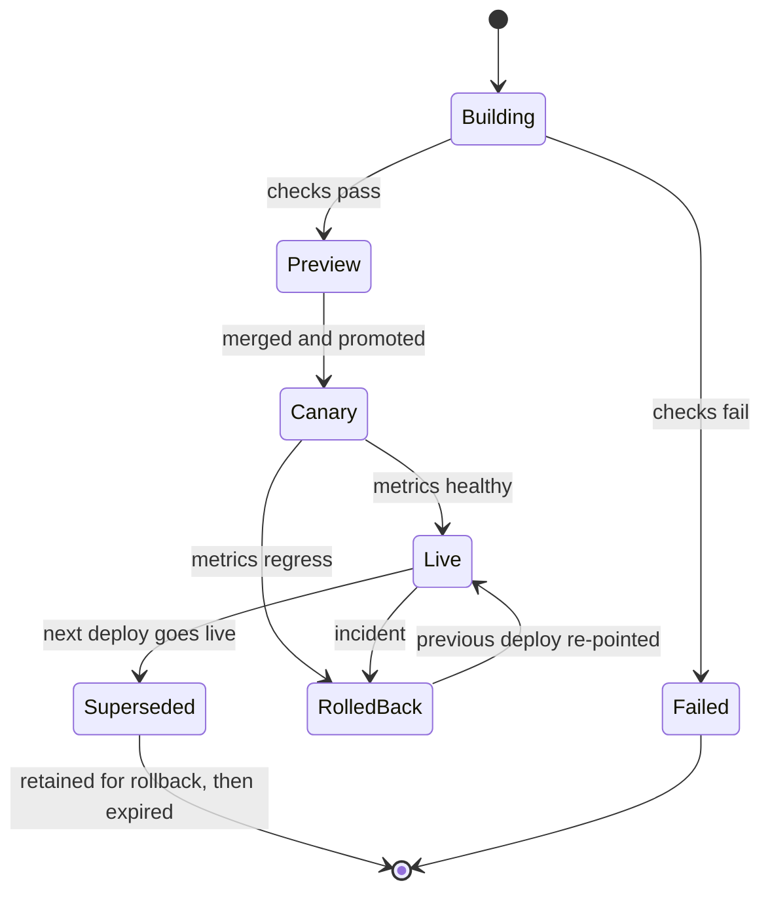

<!-- Generated by scripts/sync-knowledge.js from notes/ and README.md — do not edit here. -->
<!-- sections (line ranges in this file): Table of Contents 19-43 · ELI5 44-58 · Core Concept 59-416 · Framework Comparison 417-430 · Real-World Examples 431-637 · Key Points Summary 638-660 · Test Your Understanding 661-744 · Cheat Sheet 745-795 · References & Further Reading 796-839 -->

# Deployment & CI/CD for Frontend

> **Date:** 2026-11-06 · **Last updated:** 2026-11-06
> **Category:** Frontend System Design
> **Sub-Topic:** Advanced Topics / Delivery & Operations
> **Level:** Advanced · **Reading time:** ~32 min
> **Informs:** CI pipeline stages and quality gates, hosting model (static CDN vs SSR server vs serverless/edge), build-once-deploy-many and environment config, atomic deploys and asset upload order, version skew handling, preview environments, canary/blue-green/feature-flag release strategy, rollback design, pipeline security (OIDC, pinned actions), source maps and release tracking

> **Pre-requisite:** [Browser Caching Strategies](./browser-caching-strategies.md) (why hashed assets are immutable and HTML is not) and [Module Bundling & Build Systems](./module-bundling-and-build-systems.md) (what the build produces).
> This note answers one question: **how does a merged pull request become new bytes in every user's browser — safely, repeatably, and with a one-click way back?**

**Previous:** [SEO for SPAs & Dynamic Content](./seo-for-spas-and-dynamic-content.md) · **Next:** [CDN Architecture & Edge Caching](./cdn-architecture-and-edge-caching.md)

---

## Table of Contents

1. [ELI5 — Simple Explanation](#eli5--simple-explanation)
2. [Section 1: CI vs CD vs CD](#section-1-ci-vs-cd-vs-cd)
3. [Section 2: The Frontend Pipeline, Stage by Stage](#section-2-the-frontend-pipeline-stage-by-stage)
4. [Section 3: Reproducible, Fast Builds](#section-3-reproducible-fast-builds)
5. [Section 4: Build Once, Deploy Many — and Environment Config](#section-4-build-once-deploy-many--and-environment-config)
6. [Section 5: Hosting Models](#section-5-hosting-models)
7. [Section 6: Atomic Deploys and Upload Order](#section-6-atomic-deploys-and-upload-order)
8. [Section 7: Version Skew](#section-7-version-skew)
9. [Section 8: Preview Environments](#section-8-preview-environments)
10. [Section 9: Release Strategies — Blue/Green, Canary, Feature Flags](#section-9-release-strategies--bluegreen-canary-feature-flags)
11. [Section 10: Rollback](#section-10-rollback)
12. [Section 11: Pipeline Security](#section-11-pipeline-security)
13. [Section 12: After the Deploy — Observability](#section-12-after-the-deploy--observability)
14. [Section 13: Native Mobile and Hybrid Apps](#section-13-native-mobile-and-hybrid-apps)
15. [Framework Comparison](#framework-comparison)
16. [Real-World Examples](#real-world-examples)
17. [Key Points Summary](#key-points-summary)
18. [Test Your Understanding](#test-your-understanding)
19. [Cheat Sheet](#cheat-sheet)
20. [References & Further Reading](#references--further-reading)

---

## ELI5 — Simple Explanation

Think of a **bakery that ships bread to many shops**.

- **Continuous Integration** = every baker's change to a recipe is **tested in the test kitchen right away** (lint, type-check, tests), so a bad ingredient is caught the same day — not on delivery day.
- **The build** = baking one batch. **Build once, deploy many** means the *same* loaf goes to the tasting room (staging) and then to the shops (production) — you don't bake a new one for each, or you'd ship something nobody tasted.
- **Hashed asset names** = each loaf's label includes a fingerprint of its recipe, so shops never confuse today's bread with yesterday's.
- **Atomic deploy** = you swap the **menu board** (HTML) only after **all the new bread is on the shelves** (assets uploaded). Customers never order something that isn't there yet.
- **Canary release** = give the new recipe to **one shop first**. If customers complain, stop before every shop has it.
- **Rollback** = put yesterday's menu board back up. Yesterday's bread is still on the shelf, so it takes seconds.

> **Make every change small, tested and built once; ship the same artifact everywhere; switch traffic atomically; watch real users; and keep the previous version one click away.**

---

## Core Concept — Step by Step

### Section 1: CI vs CD vs CD

| Term | Meaning | Frontend reality |
|---|---|---|
| **Continuous Integration (CI)** | Everyone merges to the main branch often; every change is automatically built and tested | Lint, type-check, unit/component tests, build, bundle budget on every PR |
| **Continuous Delivery** | Every change that passes CI is **releasable**; production deploy is a button | Preview deploys per PR; promote to prod manually |
| **Continuous Deployment** | Every change that passes CI goes to production **automatically** | Common for static sites and SPAs with feature flags and fast rollback |

**Trunk-based development** (short-lived branches, merge daily, hide unfinished work behind feature flags) is the branching model that makes CI real. Long-lived release branches delay integration and make merges risky.

The **DORA** research program measures delivery performance with four key metrics: **deployment frequency**, **lead time for changes**, **change failure rate**, and **time to restore service** (renamed *failed deployment recovery time* in recent reports). Good frontend pipelines move all four in the right direction at once — speed and stability are not a trade-off in DORA's findings.

---

### Section 2: The Frontend Pipeline, Stage by Stage



| Stage | Tools (examples) | Fails the build when | Related note |
|---|---|---|---|
| **Install** | `npm ci`, `pnpm install --frozen-lockfile`, `yarn install --immutable` | Lockfile out of sync with `package.json` | [Mono-repo vs Multi-repo](./mono-repo-vs-multi-repo.md) |
| **Static checks** | ESLint, Prettier/Biome, `tsc --noEmit`, `vue-tsc`, `svelte-check`, `ng lint` | Lint/type errors | — |
| **Unit / component tests** | Vitest, Jest, Testing Library, Angular TestBed | Any failing test | [Testing Strategies & Pyramid](./testing-strategies-and-pyramid.md) |
| **Build** | Vite, Next.js, Nuxt, Angular CLI, SvelteKit, Astro | Build errors, missing env vars | [Module Bundling & Build Systems](./module-bundling-and-build-systems.md) |
| **Budgets** | size-limit, bundlesize-style checks, Lighthouse CI | JS over budget, score/metric regression | [Performance Budgets](./performance-budgets.md) |
| **Security** | `npm audit`, Dependabot/Renovate, CodeQL, secret scanning | High-severity vulnerabilities (per policy) | [Dependency Vulnerability Scanning](./dependency-vulnerability-scanning.md) |
| **E2E / visual / a11y** | Playwright, Cypress, Chromatic/Percy, axe | Broken user flows, unreviewed visual diffs, a11y violations | [E2E Testing](./e2e-testing-playwright-cypress.md), [Visual Regression](./visual-regression-testing.md), [Automated a11y Testing](./automated-a11y-testing-axe-lighthouse.md) |
| **Deploy** | Platform CLI/API, `aws s3` + CloudFront, `wrangler`, containers | Upload or health-check failure | — |
| **Post-deploy** | Sentry/RUM, synthetic checks | Error rate or Web Vitals regression | [Real User Monitoring](./real-user-monitoring-rum.md), [Synthetic Monitoring](./synthetic-monitoring.md) |

**Ordering principle:** run **cheap, fast, high-signal** checks first (lint and type-check in seconds), and run them **in parallel** where possible. Slow E2E suites run against a deployed preview, sharded across machines.

---

### Section 3: Reproducible, Fast Builds

**Reproducible** means the same commit produces the same output on any machine.

| Practice | Why |
|---|---|
| Commit the **lockfile** and install with the frozen/CI command | `npm install` may update the lockfile; `npm ci` fails instead of silently drifting |
| Pin the **Node.js version** (`.nvmrc`, `engines`, `packageManager` field + Corepack, or `volta`) | Different Node versions can change build output or break native deps |
| **Content-hashed filenames** (`[name]-[hash].js`) | Same bytes → same URL; enables immutable caching ([Browser Caching Strategies](./browser-caching-strategies.md)) |
| No build-time randomness (timestamps, random IDs) in bundles | Otherwise every build changes every hash and invalidates every user's cache |
| Fail on **missing required env vars** at build time | A missing API URL should break CI, not production |

**Fast:**



- Cache the **package manager store** keyed by the lockfile hash (`actions/setup-node` has a built-in `cache` option).
- In monorepos, run only **affected** projects and use **remote caching** so a task that already ran with identical inputs is replayed, not rerun (see [Monorepo Tooling (Turborepo, Nx)](./monorepo-tooling-turborepo-nx.md)).
- **Shard** E2E suites across parallel machines.
- **Cancel superseded runs** on the same branch (`concurrency` with `cancel-in-progress`).

---

### Section 4: Build Once, Deploy Many — and Environment Config



The artifact you tested must be the artifact you ship. Rebuilding per environment means production runs **code nobody tested** (different dependency resolution, different inlined values).

**The catch for frontends: build-time env vars are baked into the JS.**

| Mechanism | When it's resolved | Visible to users? |
|---|---|---|
| Vite `import.meta.env.VITE_*` | **Build time** — statically replaced in the bundle | **Yes**, in the shipped JS |
| Next.js `process.env.NEXT_PUBLIC_*` | **Build time** — inlined into client bundles | **Yes** |
| Next.js/Nuxt/SvelteKit **server-only** env (no public prefix) | Runtime on the server (for dynamically rendered code) | No |
| Nuxt `runtimeConfig.public` | Runtime (server), serialised to the client | Yes |
| Angular `environment.ts` file replacement | **Build time** | Yes |
| **Runtime config file** (`/config.json`) or server-injected `window.__CONFIG__` | **Deploy/run time** | Yes |

```text
Rule 1: Anything in a client bundle is PUBLIC. Never put secrets (API keys with write access,
        signing keys, DB URLs) in VITE_* / NEXT_PUBLIC_* / environment.ts.
Rule 2: Values that differ per environment (API base URL, feature-flag key, Sentry DSN) should be
        RUNTIME config if you want build-once-deploy-many for a static SPA.
Rule 3: Values that are truly constant across environments can stay build-time.
```

---

### Section 5: Hosting Models



| Model | Examples | Strengths | Watch out for |
|---|---|---|---|
| **Static + CDN** | S3 + CloudFront, Cloudflare Pages, Netlify, Vercel, GitHub Pages, Firebase Hosting, Azure Static Web Apps | Cheap, fast, simple rollback | SPA fallback routing, real 404s, no server logic |
| **Managed framework platform** | Vercel, Netlify, Cloudflare (Workers), AWS Amplify | Previews, atomic deploys, ISR, edge functions out of the box | Vendor-specific features, cost at scale |
| **Serverless (regional)** | AWS Lambda, Google Cloud Run, Azure Functions | Scales to zero, pay per use | Cold starts, connection limits to databases |
| **Edge functions** | Cloudflare Workers, Vercel Edge, Netlify Edge, Deno Deploy | Low latency near users | Restricted runtime APIs; far from your database ([Edge Rendering](./edge-rendering.md)) |
| **Containers / VMs** | Kubernetes, ECS, Fly.io, plain VMs | Full control, WebSockets, steady cost | You own scaling, patching, zero-downtime rollout |

Whatever the model, a **CDN sits in front** (see [CDN Architecture & Edge Caching](./cdn-architecture-and-edge-caching.md)).

---

### Section 6: Atomic Deploys and Upload Order

An **atomic deploy** switches users from version N to N+1 in **one step**: no user ever gets HTML from N+1 that references assets that aren't uploaded yet, or a mix of N and N+1 files.



**Two ways to get atomicity:**

| Approach | How | Used by |
|---|---|---|
| **Ordered upload** | Assets first, HTML last, purge HTML, never delete old assets in the same step | DIY on object storage + CDN |
| **Immutable deployments + pointer swap** | Each deploy is uploaded to its own immutable location (`/deploys/abc123/`); production is an **alias/pointer** switched in one operation | Vercel, Netlify, Cloudflare Pages and similar platforms; can be built on S3 with a CDN origin-path switch or edge routing |

The pointer model makes **rollback instant**: point the alias back at the previous deploy. Nothing is rebuilt or re-uploaded.

---

### Section 7: Version Skew

**Version skew** = the client runs version N while the server (or the asset store) is already on N+1. It's unavoidable: users keep tabs open for days.



| Skew type | Mitigation |
|---|---|
| **Missing old chunks** | Keep old hashed assets for at least as long as tabs realistically stay open (days to weeks); return a real `404` for missing assets, never `index.html` |
| **Lazy import fails anyway** | Catch the chunk-load error and **reload once** (see the example in [Browser Caching Strategies](./browser-caching-strategies.md#real-world-examples)) |
| **API contract changed** | **Expand → migrate → contract**: add the new field/endpoint, ship clients that use it, remove the old one only after old clients are gone |
| **Server actions / RPC IDs** (Next.js server actions, tRPC, GraphQL persisted queries) | Keep old IDs/queries valid for a period; platforms offer **skew protection** that routes a client to the deployment it was built against (e.g. Vercel Skew Protection with Next.js `deploymentId`) |
| **Service Worker serving stale app** | Version caches, `skipWaiting` with care, prompt "New version available — reload" ([Service Workers & Web Workers](./service-workers-and-web-workers.md)) |
| **Long-lived tabs** | Poll a `/version.json` (or compare a header) and show a non-blocking "update available" banner |

---

### Section 8: Preview Environments

Every pull request gets its **own deployed URL** built from that branch.



**Design decisions:**
- Previews must **not be indexed**: send `X-Robots-Tag: noindex` from the platform (see [SEO for SPAs & Dynamic Content](./seo-for-spas-and-dynamic-content.md)).
- Previews must **not use production data or secrets** with write access. Use a staging API or seeded data.
- Protect previews (platform auth, password, or SSO) if features are confidential.
- Expire previews automatically when the PR closes.
- Backend changes need **ephemeral backends** too, or previews point at a shared staging API — decide explicitly.

---

### Section 9: Release Strategies — Blue/Green, Canary, Feature Flags

**Deploy ≠ release.** Deploying puts code on servers. Releasing exposes behaviour to users. Separating them is the main tool for safe frontends.

| Strategy | How | Rollback | Best for |
|---|---|---|---|
| **All-at-once (atomic)** | Pointer switch to the new version | Pointer switch back | Static sites, small teams, low risk |
| **Blue/green** | Two full environments; switch traffic from blue to green | Switch back | SSR servers, infra changes |
| **Canary / progressive** | Route 1% → 10% → 50% → 100% of traffic to the new version, gated on metrics | Stop and route 0% | High-traffic SSR apps |
| **Feature flags** | Code for both behaviours ships; a flag decides per user/segment at runtime | Turn the flag off (no deploy) | Product features, experiments, kill switches |
| **Dark launch** | New code path runs (e.g. calls a new API) but results aren't shown | Turn off | Load-testing new backends with real traffic |

```mermaid
gantt
    title Canary rollout of v42, gated on error rate and INP
    dateFormat HH:mm
    axisFormat %H:%M
    section Traffic
    1 percent canary          :a1, 09:00, 30m
    10 percent                :a2, after a1, 30m
    50 percent                :a3, after a2, 60m
    100 percent               :a4, after a3, 30m
    section Gates
    Compare errors vs baseline :g1, 09:00, 150m
    Keep v41 warm for rollback :g2, 09:00, 180m
```



**Frontend-specific canary details:**
- Canary assignment must be **sticky** (cookie or user ID hash), or a user flips between versions on every request and hits version skew.
- Static SPAs can canary at the **CDN/edge** (route a percentage to a different origin path) or via **feature flags** in one build.
- Compare the canary to the baseline on **client** metrics (JS error rate, Web Vitals, conversion), not only server 5xx.

**Feature flags, done well:**
- Evaluate flags **server-side or at the edge** for SSR pages to avoid a flash of the old UI.
- Use a vendor-neutral SDK where possible (**OpenFeature** is a CNCF project defining a standard flag API with providers for many vendors).
- Every flag gets an **owner and an expiry**. Stale flags are permanent complexity.
- A flag-protected path must have tests for **both** states.

---

### Section 10: Rollback



| Make rollback cheap by… | Because |
|---|---|
| Keeping **previous deploys** (immutable artifacts) | Rollback = pointer switch, seconds, no rebuild |
| Keeping **old hashed assets** | Rolled-back HTML references them |
| **Backward-compatible APIs and DB migrations** (expand/contract) | Rolling back the frontend must not break against the new backend |
| **Feature flags as kill switches** | Fastest rollback of a single feature — no deploy at all |
| **Purging HTML at the CDN** on rollback | Otherwise the bad HTML stays cached at the edge |
| **Not caching HTML in browsers** (`no-cache`) | You can't purge browsers; a cached bad `index.html` can't be rolled back |
| A Service Worker **escape hatch** | A broken SW can pin users to a broken version; ship a "kill switch" SW or `Clear-Site-Data` plan |

**Roll forward vs roll back:** roll back first to restore service, then fix forward. Exception: a bad deploy that already ran an irreversible data migration — design migrations so this doesn't happen.

---

### Section 11: Pipeline Security

The CI pipeline holds the keys to production. It's a prime supply-chain target.

| Risk | Control |
|---|---|
| Long-lived cloud keys stored as CI secrets | **OIDC federation**: the CI job exchanges a short-lived identity token for temporary cloud credentials (GitHub Actions → AWS/GCP/Azure) |
| Over-privileged workflow token | Declare minimal `permissions:` per workflow/job |
| Compromised third-party action | **Pin actions to a full commit SHA**, review updates (Dependabot can bump SHAs) |
| PRs from forks stealing secrets | Don't expose secrets to untrusted fork builds; be very careful with `pull_request_target` |
| Malicious or typo-squatted dependency | Lockfile, `npm ci`, review new deps, automated scanning, disable install scripts where feasible |
| Secrets in the client bundle | Treat every `VITE_*`/`NEXT_PUBLIC_*` value as public; secret scanning on the repo and the build output |
| Tampered build artifacts | Build provenance/attestations (SLSA framework, GitHub artifact attestations, npm `--provenance` for published packages) |
| Unreviewed changes to production | Branch protection, required checks, required reviews, environment protection rules for prod |

See also [Dependency Vulnerability Scanning](./dependency-vulnerability-scanning.md) and [Subresource Integrity (SRI)](./subresource-integrity-sri.md).

---

### Section 12: After the Deploy — Observability

A deploy isn't done when it's uploaded; it's done when **real users are fine**.

- **Tag every event with the release** (commit SHA or version) in error tracking, RUM and logs, so dashboards can compare v41 vs v42.
- **Upload source maps** to the error tracker during CI, but don't serve them publicly if you don't want to (Vite `build.sourcemap: 'hidden'` emits maps without the `sourceMappingURL` comment).
- **Deploy markers** on dashboards make "did this deploy cause it?" a glance, not an investigation.
- **Automated gates:** canary promotion only if JS error rate and Web Vitals stay within thresholds you define.
- **Synthetic checks** right after deploy: hit key pages and flows (login, checkout) from several regions.

Related: [Logging Best Practices](./logging-best-practices.md), [Error Boundaries & Global Error Handling](./error-boundaries-and-global-error-handling.md).

---

### Section 13: Native Mobile and Hybrid Apps

| Aspect | Web | Native (iOS/Android) | React Native / Expo |
|---|---|---|---|
| Release speed | Minutes | App store review, then users must update | Store release for native changes; **OTA updates** for JS/assets |
| Rollback | Pointer switch | Not possible for installed binaries — ship a new version | Republish a previous OTA update |
| Gradual rollout | CDN/flags | **Phased release** (App Store) / **staged rollout** (Google Play) | Store staged rollout + OTA channels |
| Version skew | Hours–weeks | Months–years (old app versions in the wild) | Same as native for the binary |

Consequences: **mobile clients force long-lived API compatibility**, minimum-supported-version checks, and server-driven feature flags. **Microsoft App Center (which hosted CodePush) was retired in March 2025**; **Expo EAS Update** is the common managed OTA option for React Native today. Store policies restrict what OTA updates may change — check Apple's and Google's current guidelines.

---

## Framework Comparison

| Framework | Static output | Server output | Notes |
|---|---|---|---|
| **Vite SPA (React/Vue/Svelte)** | `vite build` → `dist/` | — | Host on any static CDN; configure SPA fallback and real 404s |
| **Next.js** | `output: 'export'` (no server features) | Default (`next start`), `output: 'standalone'` for minimal Docker images, or platform adapters | ISR and server actions need a server or a platform that supports them |
| **Nuxt** | `nuxi generate` | Nitro **presets** (node-server, Vercel, Netlify, Cloudflare, AWS Lambda, …) | Same code, different deployment target |
| **SvelteKit** | `adapter-static` | `adapter-node`, `adapter-vercel`, `adapter-netlify`, `adapter-cloudflare` | Choose adapter per platform; `adapter-auto` detects some platforms |
| **Angular** | `ng build` (browser output) | `@angular/ssr` (Node server) with optional prerendering per route | Server routes config chooses SSR/prerender/CSR per route |
| **Astro** | Default static build | SSR via adapters (Node, Vercel, Netlify, Cloudflare) | Islands; mix static and on-demand routes |
| **React Router v7 / Remix** | Prerender / SPA mode | Node or platform adapters | — |

---

## Real-World Examples

**Example 1 — GitHub Actions CI for a Vite + TypeScript app:**
```yaml
# .github/workflows/ci.yml
name: CI
on:
  pull_request:
  push:
    branches: [main]

concurrency:
  group: ci-${{ github.workflow }}-${{ github.ref }}
  cancel-in-progress: true          # a new push cancels the superseded run

permissions:
  contents: read                    # least privilege by default

jobs:
  checks:
    runs-on: ubuntu-latest
    steps:
      # In production, pin third-party actions to a full commit SHA and let Dependabot update it
      - uses: actions/checkout@v4
      - uses: pnpm/action-setup@v4
      - uses: actions/setup-node@v4
        with:
          node-version-file: .nvmrc
          cache: pnpm               # caches the pnpm store keyed by the lockfile
      - run: pnpm install --frozen-lockfile
      - run: pnpm lint
      - run: pnpm typecheck         # tsc --noEmit (or vue-tsc / svelte-check / ng build type-check)
      - run: pnpm test -- --run     # Vitest in CI mode
      - run: pnpm build
      - run: pnpm size-limit        # fail if bundles exceed their budget
      - uses: actions/upload-artifact@v4
        with:
          name: dist-${{ github.sha }}   # build once; deploy jobs download THIS artifact
          path: dist

  e2e:
    needs: checks
    runs-on: ubuntu-latest
    strategy:
      matrix:
        shard: [1, 2, 3, 4]
    steps:
      - uses: actions/checkout@v4
      - uses: pnpm/action-setup@v4
      - uses: actions/setup-node@v4
        with: { node-version-file: .nvmrc, cache: pnpm }
      - run: pnpm install --frozen-lockfile
      - run: pnpm exec playwright install --with-deps chromium
      - uses: actions/download-artifact@v4
        with: { name: 'dist-${{ github.sha }}', path: dist }
      - run: pnpm exec playwright test --shard=${{ matrix.shard }}/4
```

**Example 2 — Deploy a static SPA to S3 + CloudFront with OIDC and correct ordering:**
```yaml
# .github/workflows/deploy.yml (excerpt)
  deploy-prod:
    needs: [checks, e2e]
    if: github.ref == 'refs/heads/main'
    runs-on: ubuntu-latest
    environment: production         # environment protection rules: required reviewers, branch filter
    permissions:
      id-token: write               # allow requesting an OIDC token
      contents: read
    steps:
      - uses: actions/download-artifact@v4
        with: { name: 'dist-${{ github.sha }}', path: dist }
      - uses: aws-actions/configure-aws-credentials@v4
        with:
          role-to-assume: arn:aws:iam::123456789012:role/frontend-deploy   # no long-lived keys
          aws-region: eu-west-1
      # 1. Hashed assets first, immutable, and WITHOUT --delete (keep old chunks for open tabs)
      - run: >
          aws s3 sync dist/assets s3://app-prod/assets
          --cache-control "public,max-age=31536000,immutable"
      # 2. HTML last, always revalidated
      - run: >
          aws s3 cp dist/index.html s3://app-prod/index.html
          --cache-control "no-cache"
      # 3. Purge only what changed meaning: the HTML
      - run: >
          aws cloudfront create-invalidation
          --distribution-id ${{ vars.CF_DISTRIBUTION_ID }}
          --paths "/index.html" "/"
      # An S3 lifecycle rule deletes objects under assets/ that are older than, e.g., 30 days
```

**Example 3 — Runtime config so one build serves every environment (BAD → GOOD):**
```typescript
// ❌ BAD: baked in at build time → you must rebuild per environment
const API_URL = import.meta.env.VITE_API_URL;

// ✅ GOOD: fetched at startup; /config.json is written per environment at deploy time
type AppConfig = { apiUrl: string; sentryDsn: string; flagsClientKey: string; release: string };

export async function loadConfig(): Promise<AppConfig> {
  const res = await fetch('/config.json', { cache: 'no-store' }); // tiny, must never be stale
  if (!res.ok) throw new Error(`config.json failed: ${res.status}`);
  return res.json();
}

// main.tsx
loadConfig().then((config) => {
  initMonitoring(config);
  createRoot(document.getElementById('root')!).render(<App config={config} />);
});
```

> Trade-off: one extra request before the app starts. Alternatives: the server (or an edge function) injects `<script>window.__CONFIG__ = {...}</script>` into `index.html`, or keep build-time vars for values that never differ between environments. **Never put secrets in either** — the browser can read both.

**Example 4 — Next.js in a container (`output: 'standalone'`):**
```dockerfile
# Dockerfile
FROM node:22-alpine AS deps
WORKDIR /app
COPY package.json pnpm-lock.yaml ./
RUN corepack enable && pnpm install --frozen-lockfile

FROM node:22-alpine AS build
WORKDIR /app
COPY --from=deps /app/node_modules ./node_modules
COPY . .
RUN corepack enable && pnpm build          # next.config: { output: 'standalone' }

FROM node:22-alpine AS run
WORKDIR /app
ENV NODE_ENV=production
COPY --from=build /app/.next/standalone ./
COPY --from=build /app/.next/static ./.next/static   # standalone output doesn't include these
COPY --from=build /app/public ./public
USER node
EXPOSE 3000
CMD ["node", "server.js"]
```

> For multi-instance Next.js deployments, also configure a shared cache for ISR/data cache and a consistent `deploymentId`/build ID across instances — see the Next.js self-hosting guide.

**Example 5 — Detect a new version in long-lived tabs:**
```typescript
// version.json is generated at build time: { "release": "abc123" }
const CURRENT = import.meta.env.VITE_RELEASE; // constant for this build — fine to inline

async function checkForUpdate(onUpdate: () => void) {
  try {
    const res = await fetch('/version.json', { cache: 'no-store' });
    const { release } = await res.json();
    if (release !== CURRENT) onUpdate();            // show "New version available — Reload"
  } catch { /* offline: try again later */ }
}

document.addEventListener('visibilitychange', () => {
  if (document.visibilityState === 'visible') checkForUpdate(showUpdateBanner);
});
setInterval(() => checkForUpdate(showUpdateBanner), 15 * 60 * 1000);
```

**Example 6 — Feature flag as a kill switch (OpenFeature web SDK):**
```typescript
import { OpenFeature } from '@openfeature/web-sdk';

await OpenFeature.setProviderAndWait(new MyVendorProvider({ clientKey: config.flagsClientKey }));
await OpenFeature.setContext({ targetingKey: user.id, plan: user.plan });

const client = OpenFeature.getClient();
const newCheckout = client.getBooleanValue('new-checkout', false); // default = safe old path

export const Checkout = newCheckout ? NewCheckout : LegacyCheckout;
// React: @openfeature/react-sdk provides useBooleanFlagValue('new-checkout', false)
```

**Example 7 — Source maps and release tagging (Vite + Sentry):**
```typescript
// vite.config.ts
import { defineConfig } from 'vite';
import react from '@vitejs/plugin-react';
import { sentryVitePlugin } from '@sentry/vite-plugin';

export default defineConfig({
  build: { sourcemap: 'hidden' },   // maps generated but not referenced from the JS
  plugins: [
    react(),
    sentryVitePlugin({
      org: 'acme',
      project: 'web',
      authToken: process.env.SENTRY_AUTH_TOKEN,          // CI secret, never shipped to the client
      release: { name: process.env.GITHUB_SHA },
      sourcemaps: { filesToDeleteAfterUpload: ['dist/**/*.map'] }, // don't deploy them
    }),
  ],
});
```

**Example 8 — Bundle budget that fails the PR:**
```json
[
  { "name": "Initial JS", "path": "dist/assets/index-*.js", "limit": "170 kB", "gzip": true },
  { "name": "Checkout route", "path": "dist/assets/Checkout-*.js", "limit": "60 kB", "gzip": true }
]
```

---

## Key Points Summary

| Concept | One-Line Explanation |
|---|---|
| **CI** | Every change is built and tested automatically, merged to main often |
| **Continuous delivery vs deployment** | Always releasable (button) vs released automatically |
| **Frozen-lockfile install** | Same dependencies on every machine; fail on drift |
| **Build once, deploy many** | The tested artifact is the shipped artifact |
| **Build-time env vars** | Inlined into the bundle → public, and force per-env rebuilds |
| **Runtime config** | Per-environment values loaded at startup → one build for all envs |
| **Atomic deploy** | Users switch versions in one step; assets before HTML |
| **Immutable deploys + alias** | Each deploy lives forever at its own URL; prod is a pointer |
| **Version skew** | Old clients talk to new servers — keep old assets, compatible APIs |
| **Preview environments** | A real URL per PR for review and E2E; `noindex`, no prod secrets |
| **Deploy ≠ release** | Feature flags decide exposure independently of deploys |
| **Canary** | Small, sticky share of traffic first; promote on healthy metrics |
| **Rollback** | Re-point to the previous deploy + purge HTML; flags for single features |
| **OIDC in CI** | Short-lived cloud credentials instead of stored keys |
| **Pin actions to SHAs** | Protects the pipeline from a compromised dependency |
| **Release tagging + source maps** | Errors and Web Vitals comparable per version |

---

## Test Your Understanding

**Q1 (Basic):**
What's the difference between continuous delivery and continuous deployment? Which needs feature flags more, and why?

<details>
<summary>Answer</summary>

**Continuous delivery:** every change that passes the pipeline is **releasable**; a human decides when to push it to production. **Continuous deployment:** every passing change goes to production **automatically**.

Continuous deployment needs feature flags more. Because every merge goes live, unfinished or risky features must be **hidden behind flags** (deploy ≠ release), and flags provide the kill switch when something misbehaves. With continuous delivery you can hold a release, though flags still help.
</details>

**Q2 (Application):**
Your team builds the React app separately for staging and production because `VITE_API_URL` differs. A bug appears only in production. What's the structural problem and how do you fix it?

<details>
<summary>Answer</summary>

The production artifact was **never tested** — it's a different build. Dependency resolution, inlined values, or build flags could differ, so "it worked in staging" proves little.

Fix: **build once** per commit and promote that artifact through environments. Move per-environment values (API URL, Sentry DSN, flag keys) to **runtime config** — a `/config.json` written at deploy time, or values injected into `index.html` by the server/edge. Keep build-time vars only for constants. And remember both are public: no secrets in the client.
</details>

**Q3 (Tricky):**
After switching to a new deploy script, users with open tabs get blank screens with `ChunkLoadError` minutes after each deploy, while new visitors are fine. The script runs `aws s3 sync dist s3://bucket --delete`. Explain and fix.

<details>
<summary>Answer</summary>

`--delete` removes every object not in the new `dist/` — including the **previous version's hashed chunks**. Open tabs are running the **old HTML and old main bundle**, and when they lazy-load a route they request old chunk URLs that no longer exist (or the CDN falls back to `index.html`, which fails to parse as JS).

Fix: upload assets **without `--delete`**, upload HTML **last**, purge only HTML, and delete old assets later with a **lifecycle rule** (days to weeks). Return a real 404 for missing assets, and add a **reload-once** handler for chunk-load failures. Optionally show an "update available" banner by polling `/version.json`.
</details>

**Q4 (Tricky):**
You roll back a bad release by redeploying the previous commit. The CDN shows the old version, but some users still get the broken one for hours. What went wrong?

<details>
<summary>Answer</summary>

Likely causes, in order:
1. **HTML cached in browsers** with a `max-age` — browser caches can't be purged, so users keep the bad `index.html` until it expires. HTML must be `no-cache` (revalidate every time).
2. **A Service Worker** precached the bad version and serves it cache-first until the new SW activates.
3. **CDN HTML not purged** in all paths (e.g. `/` vs `/index.html`, or route HTML for SSG pages).
4. **Rebuilding** the old commit produced a different artifact or took time; a pointer switch to the **retained previous deploy** is faster and exact.

Fix: `no-cache` on HTML, purge the edge on rollback, an SW update strategy with a kill switch, and immutable deploys with alias-based rollback.
</details>

**Q5 (Application):**
Design the CI/CD for a Next.js e-commerce site with SSR product pages, a 15-engineer team, and a requirement to recover from a bad release in under 5 minutes.

<details>
<summary>Answer</summary>

- **CI on every PR:** frozen-lockfile install with cache → lint + type-check → Vitest → `next build` → bundle budget → **preview deploy** → Playwright E2E (sharded) + visual + axe against the preview. Required checks and one review via branch protection.
- **Trunk-based development** with feature flags (OpenFeature + a vendor) for unfinished features; flags evaluated **server-side** so SSR doesn't flash.
- **Deploy:** build once; immutable deploys on a platform (or containers with blue/green). **Canary** 5% → 25% → 100%, sticky by cookie, gated on JS error rate, 5xx, LCP/INP and checkout conversion vs baseline.
- **Skew:** keep old assets, skew protection / consistent `deploymentId`, backward-compatible server actions and APIs (expand/contract).
- **Recovery < 5 min:** rollback = **alias switch** to the previous deploy + HTML purge (seconds); feature kill switches for single features; runbook and on-call alerting tied to deploy markers.
- **Security:** OIDC to the cloud, minimal `permissions`, SHA-pinned actions, environment protection for prod, secret scanning.
- **Observability:** release tag on Sentry/RUM events, hidden source maps uploaded in CI, post-deploy synthetic checks.
</details>

**Q6 (System design):**
A mobile team (React Native) and a web team share one GraphQL API. The web deploys 20 times a day; the mobile app ships every two weeks and users update slowly. What deployment constraints does this create, and how do you design for them?

<details>
<summary>Answer</summary>

**Constraint:** old mobile app versions stay in use for months, so the API must support **many client versions at once**, while web clients skew only for hours or days. Breaking API changes that are fine for the web would break installed apps.

Design:
- **Additive schema evolution:** add fields/types, **deprecate** (`@deprecated`) instead of removing, and remove only when usage metrics show old clients are gone. Persisted queries from old builds must keep working.
- **Expand → migrate → contract** for every breaking change, with usage tracking per client version (send app version in a header).
- **Server-driven feature flags** so mobile features can be enabled or disabled without a store release.
- **Minimum supported version** check: the app asks the server on startup and shows a forced-update screen for unsupported versions.
- **OTA updates** (e.g. Expo EAS Update) for JS-only fixes within store rules; store **staged rollouts** for native releases.
- The web pipeline gets a **contract test** step (schema diff against what mobile versions still use) so a web-driven API change can't break mobile.
</details>

---

## Cheat Sheet

**Key Definitions:**
- **CI:** automatic build + test of every change merged to a shared main branch
- **Continuous delivery / deployment:** always releasable / automatically released
- **Artifact:** the immutable build output (e.g. `dist/`, a container image) promoted between environments
- **Atomic deploy:** switching all users from one complete version to another in one step
- **Version skew:** client and server (or asset store) running different versions
- **Preview environment:** a deployed URL per pull request
- **Canary:** releasing to a small, sticky slice of traffic first
- **Feature flag:** runtime switch that controls exposure without a deploy
- **OIDC federation:** CI exchanges a short-lived identity token for temporary cloud credentials

**Quick Reference:**
```text
Pipeline:  install (frozen) → lint/type-check → unit tests → build → budgets → preview → E2E/visual/a11y → promote → monitor
Install:   npm ci | pnpm install --frozen-lockfile | yarn install --immutable
Cache:     package store keyed by lockfile hash; remote task cache in monorepos
Artifact:  build ONCE per commit; promote the same bytes to staging and prod
Config:    VITE_* / NEXT_PUBLIC_* = build-time AND public → per-env values via runtime config
Upload:    hashed assets first (immutable) → HTML last (no-cache) → purge HTML → delete old assets LATER
Skew:      keep old chunks for weeks, real 404 for missing assets, reload once on ChunkLoadError,
           expand → migrate → contract for APIs
Release:   deploy ≠ release; canary (sticky) or flags; gate on client errors + Web Vitals
Rollback:  re-point alias to previous deploy + purge HTML; flags as kill switches
Previews:  X-Robots-Tag: noindex, no prod secrets, auto-expire
Security:  OIDC, minimal permissions, actions pinned to SHA, protected prod environment
Observe:   release tag on every error/RUM event, hidden source maps uploaded in CI, deploy markers
```

**Common Mistakes to Avoid:**

| Mistake | Why Wrong | Fix |
|---|---|---|
| Rebuilding per environment | Prod runs an untested artifact | Build once; runtime config |
| Secrets in `VITE_*` / `NEXT_PUBLIC_*` | Inlined into public JS | Keep secrets server-side (BFF/API) |
| `npm install` in CI | Lockfile can drift silently | `npm ci` / frozen lockfile |
| `s3 sync --delete` on assets | Deletes chunks open tabs still need | Lifecycle-based cleanup later |
| Uploading HTML before assets | Users get HTML referencing missing files | Assets first, HTML last |
| `max-age` on `index.html` | Rollbacks can't reach browsers | `no-cache` + ETag |
| Non-sticky canary | Users bounce between versions, hit skew | Cookie/user-hash stickiness |
| Breaking API changes in one deploy | Old clients (tabs, mobile apps) break | Expand → migrate → contract |
| Long-lived CI cloud keys | Leak = long-term prod access | OIDC short-lived credentials |
| Actions referenced by mutable tags only | A compromised tag runs in your pipeline | Pin to commit SHA |
| Indexable preview deployments | Duplicate content, leaked features | `X-Robots-Tag: noindex`, auth |
| Flags never removed | Permanent branching complexity | Owner + expiry per flag |
| Public source maps by accident | Exposes source code | `sourcemap: 'hidden'`, upload to tracker, don't deploy `.map` |
| No release tag on telemetry | Can't tell which deploy broke things | Tag errors/RUM with commit SHA |

---

## References & Further Reading

**CI/CD platforms (official docs)**
- GitHub Actions: [Workflow syntax](https://docs.github.com/en/actions/reference/workflows-and-actions/workflow-syntax) · [Control concurrency](https://docs.github.com/en/actions/how-tos/write-workflows/choose-when-workflows-run/control-workflow-concurrency)
- GitHub Actions: [OpenID Connect](https://docs.github.com/en/actions/concepts/security/openid-connect) · [Security hardening / secure use reference](https://docs.github.com/en/actions/reference/security/secure-use)
- GitHub: [Artifact attestations](https://docs.github.com/en/actions/concepts/security/artifact-attestations)
- npm: [`npm ci`](https://docs.npmjs.com/cli/commands/npm-ci) · [Generating provenance statements](https://docs.npmjs.com/generating-provenance-statements)

**Framework deployment guides**
- Vite: [Deploying a static site](https://vite.dev/guide/static-deploy) · [Env variables and modes](https://vite.dev/guide/env-and-mode)
- Next.js: [Deploying](https://nextjs.org/docs/app/getting-started/deploying) · [Self-hosting](https://nextjs.org/docs/app/guides/self-hosting) · [`output`](https://nextjs.org/docs/app/api-reference/config/next-config-js/output)
- Nuxt: [Deployment](https://nuxt.com/docs/getting-started/deployment)
- SvelteKit: [Adapters](https://svelte.dev/docs/kit/adapters)
- Angular: [Deployment](https://angular.dev/tools/cli/deployment) · [Server-side and hybrid rendering](https://angular.dev/guide/ssr)
- Astro: [Deploy your Astro site](https://docs.astro.build/en/guides/deploy/)

**Release engineering**
- DORA: [DORA's software delivery metrics](https://dora.dev/guides/dora-metrics-four-keys/)
- Martin Fowler: [Continuous Integration](https://martinfowler.com/articles/continuousIntegration.html) · [Blue Green Deployment](https://martinfowler.com/bliki/BlueGreenDeployment.html) · [Canary Release](https://martinfowler.com/bliki/CanaryRelease.html) · [Parallel Change (expand/contract)](https://martinfowler.com/bliki/ParallelChange.html)
- Pete Hodgson on martinfowler.com: [Feature Toggles](https://martinfowler.com/articles/feature-toggles.html)
- [OpenFeature](https://openfeature.dev/docs/reference/intro)
- [Trunk Based Development](https://trunkbaseddevelopment.com/)
- Vercel: [Skew Protection](https://vercel.com/docs/skew-protection)

**Supply chain**
- [SLSA framework](https://slsa.dev/)
- OpenSSF: [Scorecard](https://scorecard.dev/)

**Tools**
- [Playwright: sharding](https://playwright.dev/docs/test-sharding)
- [Lighthouse CI](https://github.com/GoogleChrome/lighthouse-ci)
- [size-limit](https://github.com/ai/size-limit)
- Sentry: [Source maps for Vite](https://docs.sentry.io/platforms/javascript/sourcemaps/uploading/vite/)
- Expo: [EAS Update](https://docs.expo.dev/eas-update/introduction/)

---

> **Previous Topic:** [SEO for SPAs & Dynamic Content](./seo-for-spas-and-dynamic-content.md)
> — Making JavaScript apps visible to search engines, link previews and AI crawlers

> **Next Topic:** [CDN Architecture & Edge Caching](./cdn-architecture-and-edge-caching.md)
> — How the network of edge servers in front of your deploys is designed, keyed and invalidated

*Saved on: 2026-11-06 | Repo: Frontend System Design Learning Notes*
