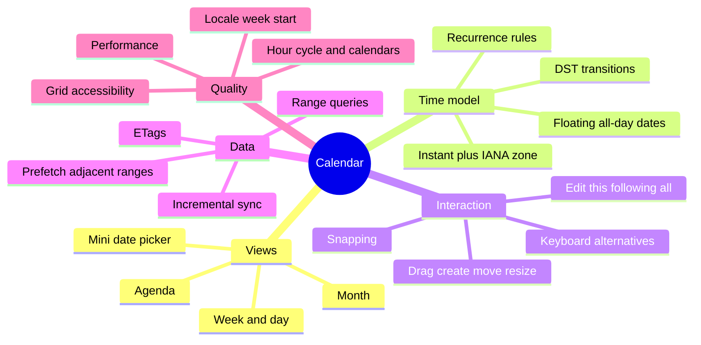
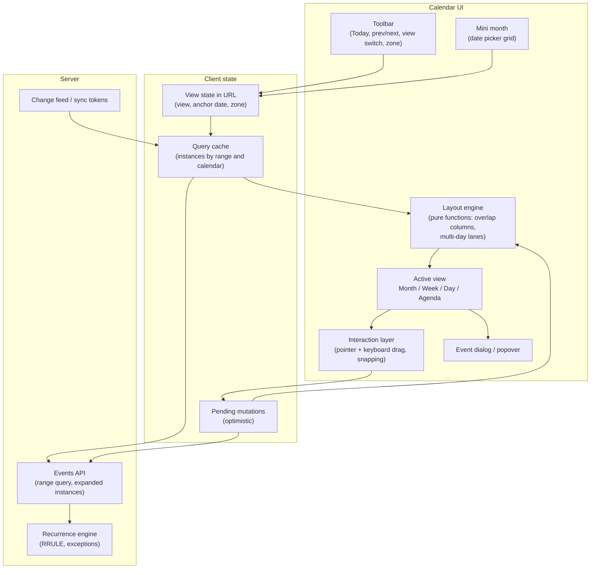
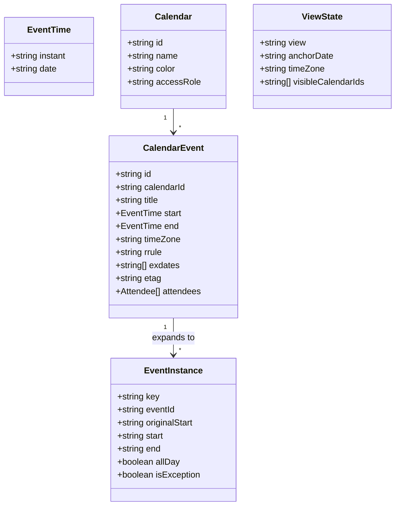
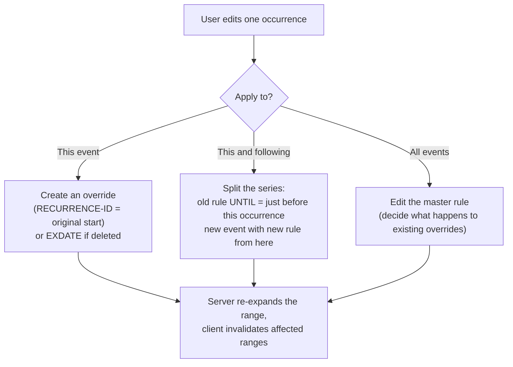
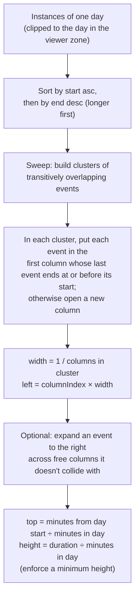
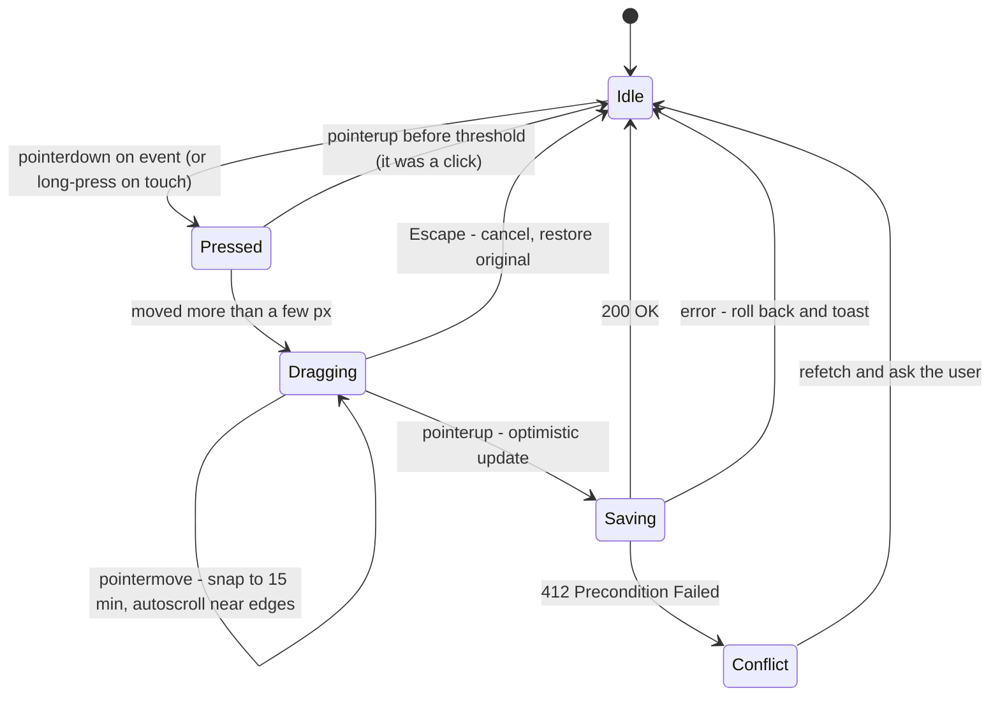
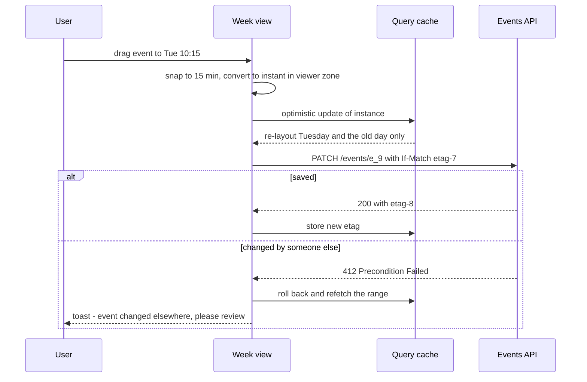
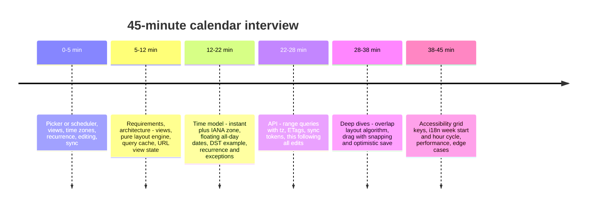

<!-- Generated by scripts/sync-knowledge.js from notes/ and README.md — do not edit here. -->
<!-- sections (line ranges in this file): Table of Contents 19-40 · ELI5 41-53 · Core Concept 54-516 · Interview Walkthrough 517-551 · Real-World Examples 552-748 · Key Points Summary 749-771 · Test Your Understanding 772-841 · Cheat Sheet 842-889 · References & Further Reading 890-921 -->

# Design a Calendar Component

> **Date:** 2026-11-06 · **Last updated:** 2026-11-06
> **Category:** Frontend System Design
> **Sub-Topic:** System Design Cases / Productivity (date picker → scheduler like Google Calendar)
> **Level:** Advanced · **Reading time:** ~38 min
> **Informs:** date/time representation (instant + IANA zone vs floating all-day dates), Temporal vs Date libraries, DST-safe day/week math, recurring events (RRULE expansion, exceptions, this/following/all edits), overlapping-event layout algorithm, range-based fetching and prefetching of adjacent periods, drag-to-move/resize with snapping and optimistic updates, concurrency with ETags, accessible grid keyboard model (APG date picker), locale week start / hour cycle / non-Gregorian calendars, calendar component API (controlled value, views, render slots)

> **Pre-requisite:** [Date, Number & Currency Formatting](./date-number-and-currency-formatting.md) (Temporal, time zones, DST) and [Keyboard Navigation & Focus Management](./keyboard-navigation-and-focus-management.md).
> This case applies **RADIO** to calendars at two sizes: a reusable **date picker** and a full **scheduler** (month/week/day views with events, like Google Calendar or Outlook).

**Previous:** [Design a Map-Based Application](./design-a-map-based-application.md) · **Next:** [Design a Design Tool (Figma-like Canvas)](./design-a-design-tool-figma-like-canvas.md)

---

## Table of Contents

1. [ELI5 — Simple Explanation](#eli5--simple-explanation)
2. [Section 1: Requirements (R)](#section-1-requirements-r)
3. [Section 2: Architecture (A)](#section-2-architecture-a)
4. [Section 3: Data Model (D) — Time Is the Hard Part](#section-3-data-model-d--time-is-the-hard-part)
5. [Section 4: Recurring Events](#section-4-recurring-events)
6. [Section 5: Interface (I)](#section-5-interface-i)
7. [Section 6: Optimizations — Layout of Overlapping Events (O)](#section-6-optimizations--layout-of-overlapping-events-o)
8. [Section 7: Optimizations — Drag, Resize and Optimistic Updates](#section-7-optimizations--drag-resize-and-optimistic-updates)
9. [Section 8: Optimizations — Fetching, Caching and Sync](#section-8-optimizations--fetching-caching-and-sync)
10. [Section 9: Optimizations — Accessibility](#section-9-optimizations--accessibility)
11. [Section 10: Optimizations — i18n, Performance, Edge Cases](#section-10-optimizations--i18n-performance-edge-cases)
12. [Interview Walkthrough](#interview-walkthrough)
13. [Real-World Examples](#real-world-examples)
14. [Key Points Summary](#key-points-summary)
15. [Test Your Understanding (with answers)](#test-your-understanding)
16. [Cheat Sheet](#cheat-sheet)
17. [References & Further Reading](#references--further-reading)

---

## ELI5 — Simple Explanation

Think of a **paper wall calendar shared by a family living in different countries**:
- The **grid** (month, week, day pages) is easy. Writing on it is easy.
- The hard part is **time**: Grandma in New York writes "call at 9:00". For you in Berlin that's 15:00 — except for a couple of weeks each spring and autumn when the two countries change their clocks on different dates, and then it's 14:00.
- "**Every Monday**" isn't 52 separate notes — it's **one rule**. But when one Monday is a holiday you cross out *just that one* (an **exception**), and when the rule changes from June you start a **new rule** from June.
- When two appointments overlap, you draw them **side by side** in narrower columns so both are readable.
- A **birthday** isn't at a particular second — it's a **date** that's the same wherever you are.

> **A calendar is a grid UI on top of a time model. Get the time model right — instants with time zones, floating dates for all-day events, recurrence rules with exceptions — and the UI problems (layout, drag, accessibility) become tractable.**

---

## Core Concept — Step by Step

### Section 1: Requirements (R)

**Questions to ask the interviewer:**

| Question | Why it changes the design |
|---|---|
| **Date picker** or **scheduler**? | A picker is a component-library problem (a11y, i18n, API); a scheduler adds events, layout, drag, sync |
| Which **views**? Month, week, day, agenda, year, resource (rooms/people as columns)? | Each view has its own layout algorithm |
| **Time zones**: single zone, or attendees and events in different zones? | Instant + IANA zone storage, DST-aware rendering |
| **Recurring events**? Exceptions? Edit "this / following / all"? | RRULE model, expansion strategy, series splitting |
| **Editing**: drag to create, move, resize? Keyboard alternatives? | Pointer handling, snapping, optimistic updates, WCAG 2.5.7 |
| **Multiple calendars** (work, personal, shared) and permissions? | Filters, colors, read-only events |
| **Collaboration / sync**: other devices, CalDAV/Google/Outlook import? | Incremental sync, ETags, conflict handling |
| Event volume? (a personal calendar vs a room-booking system with hundreds per day) | Virtualization, layout performance |
| Locales and calendars (week start, 12/24 h, Hijri/Hebrew/Persian)? | Intl-driven rendering; non-Gregorian support |
| Mobile? | Day/agenda first, touch drag with long-press |

**Functional requirements (scheduler scope):**
- Month, week, day and agenda views; navigate with Today / Previous / Next and a mini date picker.
- Show events from several calendars with colors; all-day and multi-day events in a separate row.
- Create (click or drag on empty time), move (drag), resize (drag the bottom edge), edit in a dialog.
- Recurring events with exceptions; "this event / this and following / all events" editing.
- Display in the **viewer's time zone**, optionally a secondary zone column.
- Current-time indicator.

**Non-functional requirements:**
- Correct across **DST transitions** and time zones — wrong times are the worst calendar bug.
- Snappy navigation: the next/previous week is already loaded.
- Drag at 60 fps; optimistic save with rollback.
- Fully keyboard and screen-reader operable.
- Locale-aware: week start, weekday names, hour cycle, number systems, RTL.



---

### Section 2: Architecture (A)



**Key architectural choices:**

| Choice | Decision | Why |
|---|---|---|
| **Layout as pure functions** | `layoutDay(instances, day, zone) → positioned boxes` | Testable without a DOM; easy to memoize and move to a worker |
| **Server expands recurrence for a range** | `GET /events?start&end` returns **instances** | One source of truth for RRULE + exceptions + time zones; clients stay thin. Offline-capable clients may also expand locally |
| **View state in the URL** | `/calendar/week/2026-11-02?tz=Europe/Berlin` | Shareable, back button works, SSR can render the right range |
| **Interaction layer separate from views** | Drag state lives outside event components | Avoids re-rendering every event during a drag |

**Rendering strategy:**
- A calendar app is **personalized and behind login** → no SEO; render client-side or SSR the shell with `private, no-cache` and stream the first range.
- **Week/day views:** absolutely positioned event boxes inside a scrollable time grid (CSS grid for the background lines, absolute positioning for events). Scroll to working hours or "now" on open.
- **Month view:** CSS grid of 5–6 week rows; multi-day events in lanes; "+N more" overflow per cell.
- A **date picker** is a pure client component; consider the native `<input type="date">` first when custom styling isn't required — it's well supported and accessible out of the box, though its display format follows the browser/OS locale.

---

### Section 3: Data Model (D) — Time Is the Hard Part

**Pick the right kind of time value** (see [Date, Number & Currency Formatting](./date-number-and-currency-formatting.md)):

| Event kind | Store as | Example |
|---|---|---|
| **Timed event** | Instant (UTC) **+ the event's IANA time zone** | `start: 2026-11-10T14:00:00Z`, `timeZone: "America/New_York"` |
| **All-day / multi-day** | **Floating dates** (no time, no zone), end **exclusive** | `startDate: 2026-12-24`, `endDate: 2026-12-26` (two days) |
| **Recurring** | Rule anchored in **local time of its zone** + exceptions | `DTSTART;TZID=America/New_York:20260105T090000` + `RRULE:FREQ=WEEKLY;BYDAY=MO` |
| **Reminder** | Offset relative to start | `-PT10M` |

> **Why keep the IANA zone, not just an offset?** `-05:00` is a snapshot. `America/New_York` knows the DST rules, so a weekly 09:00 meeting stays 09:00 in New York all year — and recurrence expansion needs that.

**The DST trap, concretely (2026):**

```text
US DST starts Sun 8 Mar 2026, EU DST starts Sun 29 Mar 2026.
Weekly meeting: Mondays 09:00 America/New_York. Viewer: Europe/Berlin.

Mon  2 Mar   09:00 NY (UTC−5) = 14:00 UTC = 15:00 Berlin (UTC+1)
Mon  9 Mar   09:00 NY (UTC−4) = 13:00 UTC = 14:00 Berlin (UTC+1)   ← one hour earlier for 3 weeks
Mon 30 Mar   09:00 NY (UTC−4) = 13:00 UTC = 15:00 Berlin (UTC+2)   ← back to normal

Day length: Sun 29 Mar 2026 in Berlin has 23 hours (02:00 → 03:00).
           Sun 25 Oct 2026 in Berlin has 25 hours (03:00 → 02:00).
```

Consequences:
- **Never** compute "next day" as `+ 86_400_000 ms`. Add **calendar days** in the viewer's zone.
- A day view must render the real number of hours (23/24/25) — or at least place events by instant, not by "hours since midnight".
- Expanding a recurrence by adding a fixed duration in UTC moves the meeting by an hour after DST — expand in the **rule's zone**.



**Client cache shape:**

```text
calendars.byId          { "work": {color, accessRole: "owner"}, "holidays": {accessRole: "reader"} }
events.byId             { "e_42": { rrule, timeZone, etag, ... } }           ← masters (for editing)
instances[range][calId] [ "e_42:2026-11-09T14:00Z", "e_77", ... ]            ← what views render
instances.byKey         { "e_42:2026-11-09T14:00Z": { start, end, allDay, isException } }
```

- **Instance key** = `eventId + originalStart` — stable even when that occurrence is moved, so an exception replaces the right occurrence.
- Ranges are **aligned** (e.g. whole weeks or months) so navigating back hits the cache.

---

### Section 4: Recurring Events

Recurrence is defined by **iCalendar (RFC 5545)**: `DTSTART` + `RRULE` (`FREQ`, `INTERVAL`, `BYDAY`, `BYMONTHDAY`, `COUNT`, `UNTIL`…), plus `EXDATE` (deleted occurrences) and overrides identified by `RECURRENCE-ID` (moved/edited occurrences).

```text
DTSTART;TZID=America/New_York:20260105T090000
RRULE:FREQ=WEEKLY;BYDAY=MO;UNTIL=20261231T235959Z
EXDATE;TZID=America/New_York:20260525T090000          ← Memorial Day: cancelled
RECURRENCE-ID;TZID=America/New_York:20260601T090000   ← this one moved to 10:00
```

**Editing a recurring event — the three choices:**



**Where to expand:**

| Option | Pros | Cons |
|---|---|---|
| **Server expands per range** ✅ default | One correct implementation; exceptions, time zones and permissions handled centrally | Needs network for each new range |
| **Client expands** (rrule library + zone-aware date library) | Works offline; instant navigation | Must replicate exactly the same rules (DST, `BYDAY` edge cases, exceptions); bigger bundle |
| **Hybrid** | Server for canonical data; client for offline/preview while dragging | Two implementations to keep in sync |

> Guard against **unbounded rules** (`RRULE:FREQ=DAILY` with no `UNTIL`/`COUNT`): always expand **within the requested range** only.

---

### Section 5: Interface (I)

**Server API contract:**

```http
GET  /api/calendars                                      → [{ id, name, color, accessRole }]
GET  /api/events?start=2026-11-02&end=2026-11-09&tz=Europe/Berlin&calendars=work,personal
→ 200 { "instances": [EventInstance], "events": { "e_42": CalendarEvent }, "syncToken": "s_93" }

GET  /api/events/changes?syncToken=s_93                  → { changed: [...], deleted: [...], syncToken: "s_94" }
                                                          → 410 Gone when the token expired → full refetch
POST   /api/events                                        { ...CalendarEvent }           → 201 + ETag
PATCH  /api/events/:id          If-Match: "etag"          { start, end }                 → 200 | 412 Precondition Failed
PATCH  /api/events/:id/instances/:originalStart  If-Match  { start, end }               → 200 (creates override)
POST   /api/events/:id/split    If-Match  { fromOriginalStart, changes }                 → 200 { oldEvent, newEvent }
DELETE /api/events/:id?scope=this|following|all&originalStart=...  If-Match              → 204
```

- **Range parameters are dates in the viewer's zone** (`tz`), so "this week" means this week where the user is.
- **`If-Match` + ETag** prevents lost updates when two people (or two devices) edit the same event; `412` → refetch and ask the user ([Optimistic UI Updates](./optimistic-ui-updates.md)).
- **Sync tokens** give incremental updates (the pattern used by CalDAV's sync-collection and Google Calendar's `syncToken`).

**Component APIs:**

```tsx
// Date picker (component-library level): controlled, locale-aware, headless-friendly
<DatePicker
  value={date}                       // Temporal.PlainDate | null — a DATE, not a Date object
  onChange={setDate}
  min={today} max={inOneYear}
  isDateUnavailable={(d) => isHoliday(d)}
  locale="de-DE"                     // drives week start, month names, numbering
  firstDayOfWeek={undefined}         // override; default from locale
/>

// Scheduler
<Calendar
  view="week"                        // 'month' | 'week' | 'day' | 'agenda'
  date={anchorDate}                  // Temporal.PlainDate
  timeZone="Europe/Berlin"
  events={instances}
  onRangeChange={(start, end) => prefetch(start, end)}
  onEventMove={(inst, newStart, newEnd) => move.mutate({ inst, newStart, newEnd })}
  onEventResize={(inst, newEnd) => resize.mutate({ inst, newEnd })}
  onSlotSelect={(start, end) => openCreateDialog(start, end)}
  slotDuration={{ minutes: 30 }}
  snapDuration={{ minutes: 15 }}
  renderEvent={(inst) => <EventChip instance={inst} />}   // render slot
  isReadOnly={(inst) => calendars[inst.calendarId].accessRole === 'reader'}
/>
```

| API rule | Why |
|---|---|
| Use **date types that match intent** (`PlainDate` for pickers, instants + zone for events) | A JS `Date` for a birthday shifts a day when the zone changes |
| **Controlled** `view` and `date` | URL routing, keyboard shortcuts and the mini-calendar all drive navigation |
| Callbacks report **intent** (`onEventMove`), not raw pixels | The component converts pointer positions to times; the app decides about saving |
| Render slots (`renderEvent`) and a headless core | Product-specific chips without forking the component ([Headless UI](./headless-ui-renderless-components.md)) |

---

### Section 6: Optimizations — Layout of Overlapping Events (O)

Overlapping events in a day column are drawn side by side. A typical day:

```mermaid
gantt
    title One day - overlapping events
    dateFormat HH:mm
    axisFormat %H:%M
    section Column 1
    Standup            :a1, 09:00, 30m
    Design review      :a2, 10:00, 90m
    section Column 2
    1:1 with Ana       :b1, 09:15, 45m
    Lunch              :b2, 12:00, 60m
    section Column 3
    Interview          :c1, 10:30, 60m
```



**Algorithm (the one most calendars use, with variations):**



- Running time: sorting dominates — `O(n log n)` per day; trivial for normal calendars.
- **Clip** multi-day timed events to each day they cover.
- **Minimum height** (e.g. 15–20 minutes worth) keeps 5-minute events clickable — and makes them visually overlap following events; account for it in collision checks if you want no visual overlap.
- **Month view** uses a different algorithm: per week row, assign multi-day segments to the lowest free **lane**; cells show at most N lanes and a "+3 more" button that opens a popover with the full list.

---

### Section 7: Optimizations — Drag, Resize and Optimistic Updates



**Implementation rules:**
- Use **Pointer Events** + `setPointerCapture` so mouse, pen and touch share one code path and the drag continues outside the element.
- Render a **ghost/preview** of the event at its snapped position; don't re-render all events per pointermove — update one element's `transform` (in `requestAnimationFrame`) and commit on drop.
- **Convert pixels → time in the viewer zone**, then snap: `minutes = round(y / pxPerMinute / snap) × snap`; then convert to an instant (DST-aware).
- For **recurring** events, ask "this / following / all" **after** the drop, before saving.
- On touch, start drags with a **long-press** so normal scrolling still works (`touch-action` on the grid matters).
- **Optimistic update:** move the instance in the cache, send `PATCH` with `If-Match`; roll back on error; on `412`, refetch and show a message ("This event was changed by someone else").
- Keyboard alternative (WCAG 2.5.7): "Move" via the event dialog's date/time fields, or keyboard shortcuts on a focused event (e.g. `Alt+Arrow` to shift by a slot) with a live-region announcement of the new time.



---

### Section 8: Optimizations — Fetching, Caching and Sync

- **Fetch by aligned ranges** (week for week view, the 6-week grid for month view) and **prefetch the previous and next range** when idle, so Next/Previous is instant ([Prefetching & Preloading](./prefetching-and-preloading.md)).
- **Cache key** = `(rangeStart, rangeEnd, zone, calendarIds)`. Changing the zone changes which instants belong to "Monday" — refetch or re-bucket.
- **Keep previous data** while the next range loads (no blank grid).
- **Incremental sync:** poll `/changes?syncToken=` (or receive a push/SSE "calendar changed" hint), apply changes to the masters and **invalidate affected ranges**; on `410`, do a full refetch.
- **Invalidate on mutation**: moving an event from Monday to next week touches two ranges; a series edit can touch every cached range — invalidate them all.
- Store recent ranges in IndexedDB for instant startup and read-only offline mode ([Offline-First Architecture](./offline-first-architecture.md)).

---

### Section 9: Optimizations — Accessibility

**Date picker grid** — follow the WAI-ARIA APG **Date Picker Dialog** pattern:

| Key | Action |
|---|---|
| Arrow Left/Right | Previous / next day |
| Arrow Up/Down | Same day previous / next week |
| Home / End | First / last day of the week (locale-aware) |
| Page Up / Page Down | Previous / next month |
| Shift + Page Up / Page Down | Previous / next year |
| Enter / Space | Select the focused date and close |
| Escape | Close and return focus to the trigger |

- `role="grid"` with rows and `gridcell`s, column headers with full weekday names (`abbr` or `aria-label`), **one tab stop** for the grid (roving `tabindex`), `aria-selected` on the chosen date, `aria-current="date"` on today, and `aria-disabled` for unavailable dates.
- The month/year heading is a live region (`aria-live="polite"`) so month changes are announced.
- Every day button's accessible name is a **full date** ("Friday, 6 November 2026"), not just "6".

**Scheduler:**
- Events are focusable buttons/links with names like "Design review, Tuesday 10:00 to 11:30, Work calendar".
- Provide an **agenda (list) view** — the most accessible way to read a schedule, and great on mobile.
- Keyboard: move focus between days/slots with arrows, `Enter` on an empty slot to create, `Enter` on an event to open; shortcuts for views (`d`/`w`/`m`) must be remappable or disable-able (**WCAG 2.1.4 Character Key Shortcuts**).
- **Dragging has an alternative** (WCAG 2.5.7): edit dialog fields or keyboard move.
- Colors: don't rely on color alone for calendars; include names or patterns, and ensure text contrast on colored chips ([Color Contrast & Visual Accessibility](./color-contrast-and-visual-accessibility.md)).

---

### Section 10: Optimizations — i18n, Performance, Edge Cases

**i18n** (see [Internationalization (i18n) Architecture](./internationalization-i18n-architecture.md) and [RTL Layout Support](./rtl-layout-support.md)):
- **Week start** differs by region (Monday in much of Europe, Sunday in the US, Saturday in some Middle-Eastern locales). `Intl.Locale.prototype.getWeekInfo()` exposes `firstDay` and `weekend` — support varies (older engines exposed a `weekInfo` getter), so feature-detect and fall back to CLDR data.
- **Hour cycle:** `Intl.DateTimeFormat(locale, { hour: 'numeric' })` picks 12 h or 24 h; let users override.
- **Names:** weekday/month names from `Intl.DateTimeFormat` (`weekday: 'short'`, `month: 'long'`), never hard-coded arrays.
- **Non-Gregorian calendars:** `Intl` and Temporal support calendars such as `islamic-umalqura`, `hebrew`, `persian`, `japanese`; a calendar UI may need different month lengths and year numbering, not just labels.
- **Week numbers:** ISO 8601 weeks (Monday start, week 1 contains the first Thursday) vs US conventions.
- **RTL:** day columns run right-to-left; drag deltas on the x-axis flip.

**Performance:**
- Layout is pure and memoized **per day**; a drag re-lays out at most two days.
- Week view of a busy room-booking calendar: render only the visible hours plus overscan, or virtualize resource columns ([Virtual Scrolling & Windowing](./virtual-scrolling-and-windowing.md)).
- **Current-time line:** one timer aligned to the next minute boundary, not a 1-second interval; stop it in hidden tabs.
- Date libraries: use **Temporal** where available with a polyfill elsewhere, or a tree-shakable library (`date-fns` + its time-zone package, Luxon). **Moment.js is in maintenance mode** — don't start new code with it.
- Avoid creating `Intl.DateTimeFormat` objects in render loops — cache them per locale/options.

**Edge cases:**

| Case | Handling |
|---|---|
| Event during the **skipped hour** (spring forward) | Temporal's `disambiguation` (`compatible` shifts forward); show the resolved time |
| Event during the **repeated hour** (fall back) | Two instants share a wall time; keep the instant and show the offset if ambiguous |
| **All-day event** shown to someone in another zone | Floating date: same date everywhere — never convert through UTC |
| **Multi-day timed event** across midnight | Clip per day; show "continues" indicators |
| **Event ending at 00:00** next day | Treat end as exclusive; don't render a sliver on the next day |
| **Monthly on the 31st** | RRULE skips months without day 31 (RFC 5545 behavior); show the user what that means |
| **Viewer changes time zone** (travel) | Re-render from instants; offer "show in event's zone" |
| **Read-only calendars** (holidays, shared) | No drag handles; explain why in the dialog |

---

## Interview Walkthrough



**What to say, in order:**
1. **Scope:** "I'll design a week/month scheduler with recurring events, drag to move, multiple calendars; a date picker is a sub-component."
2. **Time model first** — instants + IANA zones, floating all-day dates, the DST example. Interviewers look for this.
3. **Architecture:** views on top of a pure layout engine; query cache by aligned ranges; URL-driven view state.
4. **API:** range query with `tz`, server-side expansion, `If-Match`, sync tokens, series split.
5. **Deep dive:** overlap algorithm, then drag/resize with snapping, optimistic update and 412 handling.
6. **Close** with accessibility (APG grid keys, agenda view, drag alternative), i18n and edge cases.

**Trade-offs to discuss:**

| Decision | Option A | Option B | Lean |
|---|---|---|---|
| Recurrence expansion | Server per range | Client (offline, instant) | Server; client only if offline matters |
| Time library | Temporal (+ polyfill) | date-fns/Luxon | Temporal for new code where the polyfill cost is OK |
| Date picker | Native `<input type="date">` | Custom grid | Native unless design or range selection requires custom |
| Event layout | DOM absolute positioning | Canvas | DOM (accessible, small counts) |
| Concurrency | ETag + `If-Match` | Last write wins | ETags — calendars are shared |
| Fetch unit | Aligned ranges + prefetch | Exact visible range | Aligned (cache hits, instant navigation) |
| Drag commit | Optimistic | Wait for server | Optimistic with rollback and 412 handling |

---

## Real-World Examples

**Example 1 — Types that encode intent:**
```typescript
import type { Temporal } from '@js-temporal/polyfill';   // or the global Temporal where available

export type EventTime =
  | { kind: 'timed'; instant: string; timeZone: string }     // ISO instant + IANA zone
  | { kind: 'allDay'; date: string };                        // ISO plain date, e.g. '2026-12-24' (floating)

export interface CalendarEvent {
  id: string;
  calendarId: string;
  title: string;
  start: EventTime;
  end: EventTime;                     // exclusive
  rrule?: string;                     // RFC 5545 RRULE value
  exdates?: string[];
  etag: string;
}

export interface EventInstance {
  key: string;                        // `${eventId}:${originalStart}`
  eventId: string;
  calendarId: string;
  title: string;
  start: Temporal.ZonedDateTime;      // in the VIEWER's zone, for rendering
  end: Temporal.ZonedDateTime;
  allDay: boolean;
  isException: boolean;
}
```

**Example 2 — DST-safe week math with Temporal (BAD → GOOD):**
```typescript
// ❌ BAD: assumes every day is 24 h and uses the machine's zone
const nextDay = new Date(day.getTime() + 24 * 60 * 60 * 1000);

// ✅ GOOD: calendar arithmetic in an explicit zone
import { Temporal } from '@js-temporal/polyfill';   // drop when native Temporal is available everywhere you ship

export function weekRange(anchor: Temporal.PlainDate, firstDay: number /* 1 = Mon … 7 = Sun */) {
  const offset = (anchor.dayOfWeek - firstDay + 7) % 7;
  const start = anchor.subtract({ days: offset });
  return { start, end: start.add({ days: 7 }) };   // end exclusive
}

export function dayBounds(date: Temporal.PlainDate, timeZone: string) {
  const start = date.toZonedDateTime({ timeZone });           // start of day (handles DST at midnight)
  const end = date.add({ days: 1 }).toZonedDateTime({ timeZone });
  return { start, end, hours: start.hoursInDay };             // 23, 24 or 25
}

// dayBounds(Temporal.PlainDate.from('2026-03-29'), 'Europe/Berlin').hours === 23
```

**Example 3 — Overlap layout for one day (pure, testable):**
```typescript
export interface Box { key: string; top: number; height: number; left: number; width: number }
interface Item { key: string; start: number; end: number }   // minutes from day start, end exclusive

export function layoutDay(items: Item[], minutesInDay: number, minHeightMin = 20): Box[] {
  const sorted = [...items].sort((a, b) => a.start - b.start || b.end - a.end);
  const boxes: Box[] = [];
  let cluster: { item: Item; col: number }[] = [];
  let columnsEnd: number[] = [];      // last end per column in the current cluster
  let clusterEnd = -1;

  const flush = () => {
    const cols = columnsEnd.length;
    for (const { item, col } of cluster) {
      const visualEnd = Math.max(item.end, item.start + minHeightMin);
      boxes.push({
        key: item.key,
        top: item.start / minutesInDay,
        height: (visualEnd - item.start) / minutesInDay,
        left: col / cols,
        width: 1 / cols,
      });
    }
    cluster = []; columnsEnd = []; clusterEnd = -1;
  };

  for (const item of sorted) {
    if (item.start >= clusterEnd && cluster.length) flush();          // no overlap with the cluster → new cluster
    let col = columnsEnd.findIndex((end) => end <= item.start);       // first free column
    if (col === -1) { col = columnsEnd.length; columnsEnd.push(item.end); } else columnsEnd[col] = item.end;
    cluster.push({ item, col });
    clusterEnd = Math.max(clusterEnd, item.end);
  }
  if (cluster.length) flush();
  return boxes;   // fractions → style={{ top: `${top*100}%`, left: `${left*100}%`, ... }}
}
```

**Example 4 — Week column rendering with positioned events:**
```tsx
function DayColumn({ date, instances, timeZone }: { date: Temporal.PlainDate; instances: EventInstance[]; timeZone: string }) {
  const { start: dayStart, end: dayEnd } = dayBounds(date, timeZone);
  const minutesInDay = dayStart.until(dayEnd, { largestUnit: 'minutes' }).minutes;

  const boxes = useMemo(() => layoutDay(
    instances
      .filter((i) => !i.allDay)
      .map((i) => ({
        key: i.key,
        // clip to this day; measure by instants so DST days are correct
        start: Math.max(0, dayStart.until(i.start, { largestUnit: 'minutes' }).minutes),
        end: Math.min(minutesInDay, dayStart.until(i.end, { largestUnit: 'minutes' }).minutes),
      })),
    minutesInDay,
  ), [instances, dayStart, minutesInDay]);

  const byKey = new Map(instances.map((i) => [i.key, i]));
  return (
    <div className="day-column" role="group" aria-label={date.toLocaleString(undefined, { weekday: 'long', day: 'numeric', month: 'long' })}>
      {boxes.map((b) => {
        const inst = byKey.get(b.key)!;
        return (
          <button
            key={b.key}
            className="event"
            style={{ position: 'absolute', top: `${b.top * 100}%`, height: `${b.height * 100}%`,
                     insetInlineStart: `${b.left * 100}%`, width: `${b.width * 100}%` }}
            aria-label={`${inst.title}, ${fmtTime(inst.start)} to ${fmtTime(inst.end)}`}
            onClick={() => openEvent(inst)}
          >
            {inst.title}
          </button>
        );
      })}
    </div>
  );
}
```

**Example 5 — Drag to move: pointer → snapped time → optimistic PATCH with `If-Match`:**
```typescript
const SNAP_MIN = 15;

export function pointerToTime(clientY: number, column: HTMLElement, day: Temporal.PlainDate, timeZone: string) {
  const rect = column.getBoundingClientRect();
  const { start, end } = dayBounds(day, timeZone);
  const minutesInDay = start.until(end, { largestUnit: 'minutes' }).minutes;
  const ratio = Math.min(1, Math.max(0, (clientY - rect.top) / rect.height));
  const snapped = Math.round((ratio * minutesInDay) / SNAP_MIN) * SNAP_MIN;
  return start.add({ minutes: snapped });          // instant-based → correct on 23/25 h days
}

export async function saveMove(ev: CalendarEvent, newStart: Temporal.ZonedDateTime, durationMin: number) {
  const res = await fetch(`/api/events/${ev.id}`, {
    method: 'PATCH',
    headers: { 'Content-Type': 'application/json', 'If-Match': ev.etag },
    credentials: 'include',
    body: JSON.stringify({
      start: { kind: 'timed', instant: newStart.toInstant().toString(), timeZone: ev.start.kind === 'timed' ? ev.start.timeZone : newStart.timeZoneId },
      end:   { kind: 'timed', instant: newStart.add({ minutes: durationMin }).toInstant().toString(),
               timeZone: ev.start.kind === 'timed' ? ev.start.timeZone : newStart.timeZoneId },
    }),
  });
  if (res.status === 412) throw new ConflictError();   // caller rolls back, refetches, informs the user
  if (!res.ok) throw new Error(`HTTP ${res.status}`);
  return { etag: res.headers.get('ETag') };
}
// Wrap in a mutation with onMutate (move in cache) / onError (roll back), as in Optimistic UI Updates.
```

**Example 6 — Roving tabindex for a date-picker grid (keyboard model from the APG):**
```tsx
function useGridKeys(focused: Temporal.PlainDate, setFocused: (d: Temporal.PlainDate) => void, firstDay: number) {
  return (e: React.KeyboardEvent) => {
    const map: Record<string, () => Temporal.PlainDate> = {
      ArrowLeft:  () => focused.subtract({ days: 1 }),
      ArrowRight: () => focused.add({ days: 1 }),
      ArrowUp:    () => focused.subtract({ weeks: 1 }),
      ArrowDown:  () => focused.add({ weeks: 1 }),
      Home:       () => focused.subtract({ days: (focused.dayOfWeek - firstDay + 7) % 7 }),
      End:        () => focused.add({ days: 6 - ((focused.dayOfWeek - firstDay + 7) % 7) }),
      PageUp:     () => focused.subtract(e.shiftKey ? { years: 1 } : { months: 1 }),
      PageDown:   () => focused.add(e.shiftKey ? { years: 1 } : { months: 1 }),
    };
    const next = map[e.key]?.();
    if (next) { e.preventDefault(); setFocused(next); }   // the cell for `next` gets tabIndex=0 and .focus()
  };
}
// In RTL, swap ArrowLeft and ArrowRight.
```

**Other stacks:**
- **Vue:** the same pure layout and Temporal helpers; `computed` per day for layout; FullCalendar has an official Vue adapter; Vuetify ships date pickers.
- **Angular:** Angular Material's datepicker (with pluggable date adapters) for pickers; signals or RxJS for range state; run high-frequency pointer handlers outside the zone in zone-based apps.
- **Svelte:** headless builders (e.g. Bits UI / Melt UI calendars built on `@internationalized/date`) or custom; stores for view state.
- **React:** React Aria's `Calendar`/`DatePicker` (built on `@internationalized/date`) is a strong accessible baseline; FullCalendar and react-big-calendar for schedulers.
- **Native mobile:** iOS `UIDatePicker`/SwiftUI `DatePicker` and EventKit, Android `MaterialDatePicker` and the Calendar Provider — the same instant + zone model and RRULE semantics apply.

---

## Key Points Summary

| Concept | One-Line Explanation |
|---|---|
| **Instant + IANA zone** | Timed events store when they happen and which zone's rules they follow |
| **Floating date** | All-day events have no time zone — same date for everyone; end is exclusive |
| **DST** | Days can be 23 or 25 hours; zones change on different dates — never add 24 h |
| **Temporal** | Modern date/time API; shipped in Chrome and Firefox, polyfill elsewhere |
| **RRULE (RFC 5545)** | One rule + `EXDATE` + `RECURRENCE-ID` overrides represents a series |
| **This / following / all** | Override, split series, or edit master |
| **Server-side expansion** | Range query returns instances; one correct recurrence implementation |
| **Instance key** | `eventId + originalStart` — stable identity for each occurrence |
| **Overlap layout** | Sort, cluster, first-free-column, width = 1/columns |
| **Month lanes** | Multi-day segments in lanes per week row; "+N more" overflow |
| **Pointer Events + capture** | One drag implementation for mouse, pen and touch |
| **Snap in the viewer zone** | Pixels → minutes → instant, DST-aware |
| **ETag + If-Match** | Prevents lost updates on shared calendars; 412 → refetch |
| **Aligned ranges + prefetch** | Instant previous/next navigation, high cache hit rate |
| **APG grid keys** | Arrows, Home/End, PageUp/PageDown (+Shift), roving tabindex |
| **Locale week start/hour cycle** | From Intl, never hard-coded |

---

## Test Your Understanding

**Q1 (Basic):**
Why store a timed event as an instant **plus** an IANA time zone, but an all-day event as a plain date?

<details>
<summary>Answer</summary>

A timed meeting happens at an exact moment, so the **instant** is the truth for every viewer. The **IANA zone** (e.g. `America/New_York`) is also needed because it carries DST rules: recurring occurrences must be generated at 09:00 *New York time* every week, and edits ("move to 10:00") are interpreted in that zone. An offset like `-05:00` is only a snapshot.

An all-day event (a birthday, a holiday, a vacation) isn't a moment — it's a **date** that's the same for everyone. Converting it through UTC shifts it to the previous or next day for viewers in other zones. So store it as a floating date with an **exclusive** end date.
</details>

**Q2 (Application):**
Lay out these events in one day column and give each event's column index and width: A 09:00–10:00, B 09:30–10:30, C 10:00–11:00, D 13:00–14:00.

<details>
<summary>Answer</summary>

Sorted: A, B, C, D. A, B and C form one **cluster** (A overlaps B, B overlaps C — transitive). Columns: A → col 0 (ends 10:00); B starts 09:30 < 10:00 → col 1 (ends 10:30); C starts 10:00 ≥ col 0's end (10:00) → **col 0**. The cluster has **2 columns** → A, B, C each width ½ (A and C left 0, B left ½). D starts at 13:00, after the cluster ends (11:00) → a new cluster with one column → width 1.

Note that C reuses column 0 because end times are exclusive — a naive "count overlaps" approach would make three columns.
</details>

**Q3 (Tricky):**
A weekly team call is set for Mondays at 09:00 in New York. A colleague in Berlin says the call "moved" to 14:00 for three weeks in March 2026, then went back to 15:00. Is that a bug?

<details>
<summary>Answer</summary>

No — it's correct. The US started DST on **8 March 2026**, the EU on **29 March 2026**. In between, New York is UTC−4 while Berlin is still UTC+1, so 09:00 New York = 13:00 UTC = **14:00 Berlin**. After 29 March Berlin is UTC+2 and the call is back at 15:00. The same happens in autumn between the EU change (25 Oct 2026) and the US change (1 Nov 2026).

The bug would be the opposite: expanding the rule in UTC (fixed 14:00 UTC) would move the call to 10:00 for the New York organizer after their DST change. Expansion must happen in the **rule's zone**; display converts to the viewer's zone.
</details>

**Q4 (Tricky):**
Two assistants drag the same meeting at the same time, one to 10:00 and one to 11:00. Both see "Saved". Later the meeting is at 11:00 and the first assistant is confused. How do you prevent this?

<details>
<summary>Answer</summary>

This is a **lost update**. Use **optimistic concurrency** with ETags: each event carries an `etag`; the client sends `PATCH` with `If-Match: "<etag>"`. The first write succeeds and changes the ETag; the second write's `If-Match` no longer matches, so the server returns **412 Precondition Failed**. The second client rolls back its optimistic move, refetches the event, and tells the user it was changed by someone else (optionally offering to apply their change again). Real-time or sync-token updates also push the first change to the second client quickly, making conflicts rarer.
</details>

**Q5 (Application):**
The user edits the 5th occurrence of a weekly series and chooses "This and following events". What happens in the data model and the API?

<details>
<summary>Answer</summary>

The series is **split**: the original master's rule gets an `UNTIL` just before the 5th occurrence (so it keeps occurrences 1–4, with their existing exceptions), and a **new event** is created starting at the 5th occurrence with the edited properties and the remaining rule (adjusting `COUNT` if the original used one). Overrides after the split point must be moved to the new series or dropped — a product decision to confirm. The API does this atomically (`POST /events/:id/split` with `If-Match`), and the client **invalidates every cached range** both series touch, since many weeks change at once.
</details>

**Q6 (System design):**
Design the keyboard and screen-reader experience for a custom date-range picker (check-in/check-out) used on a hotel booking site.

<details>
<summary>Answer</summary>

- A labeled trigger (text inputs that also accept typed dates in the locale's format), opening a **dialog** with one or two month grids.
- Follow the **APG Date Picker Dialog**: `role="grid"`, roving tabindex, arrows by day/week, Home/End by week (locale's first day), PageUp/PageDown by month (Shift for year), Enter/Space to select, Escape to close and return focus to the trigger.
- Each cell's accessible name is the full date plus state ("Friday, 6 November 2026, check-in date"; "unavailable"); `aria-disabled` for blocked dates; `aria-current="date"` for today.
- After choosing check-in, announce "Select check-out date" politely; highlight the range with more than color (borders/patterns) and announce the number of nights.
- Month heading in a polite live region; visible focus ring; minimum target sizes.
- Week start, month names and digits from `Intl` for the user's locale; flip arrow keys in RTL.
- Always allow **typing** dates as an alternative to the grid — often the fastest path for keyboard and screen-reader users.
</details>

---

## Cheat Sheet

**Key Definitions:**
- **Instant:** an exact point on the global timeline (UTC-based).
- **IANA time zone:** a named zone with DST history, e.g. `Europe/Berlin`.
- **Floating date:** a calendar date with no zone (all-day events, birthdays).
- **RRULE / EXDATE / RECURRENCE-ID:** RFC 5545 rule, deleted occurrences, overridden occurrence.
- **Series split:** "this and following" — end the old rule, start a new event.
- **Cluster (layout):** a group of transitively overlapping events sharing a column count.
- **Sync token:** an opaque cursor for incremental changes; expired → full resync.
- **Roving tabindex:** one focusable cell in a grid; arrows move focus.

**Quick Reference:**
```text
Store          timed: instant + IANA zone · all-day: plain date (2026-12-24), end exclusive · recurring: DTSTART;TZID + RRULE + EXDATE + overrides
Math           calendar math in a zone (Temporal / date-fns tz / Luxon) · never +86_400_000 ms · hoursInDay 23/24/25
Expand         server per requested range (bounded) · instance key = eventId + originalStart
Edit series    this → override/EXDATE · following → split · all → master
Fetch          aligned ranges (week / 6-week month grid) · prefetch prev/next · keep previous data · invalidate touched ranges
Concurrency    ETag + If-Match → 412 → refetch and inform
Layout (day)   sort(start asc, end desc) → clusters → first free column → width = 1/cols · min height
Layout (month) lanes per week row · "+N more" popover
Drag           Pointer Events + setPointerCapture · ghost via transform in rAF · snap 15 min in viewer zone · Escape cancels
A11y           APG date picker keys · role=grid + roving tabindex · full-date names · agenda view · drag alternative (2.5.7)
i18n           getWeekInfo() / CLDR week start · Intl names · hour cycle · non-Gregorian calendars · RTL flips arrows
Perf           layout memoized per day · minute-aligned now-line timer · cache Intl formatters · virtualize resources
```

**Common Mistakes to Avoid:**

| Mistake | Why Wrong | Fix |
|---|---|---|
| `new Date(t + 86400000)` for "next day" | DST days are 23/25 h | Calendar arithmetic in an explicit zone |
| Storing only UTC (no zone) for recurring events | Occurrences shift by an hour after DST | Store the IANA zone; expand in it |
| All-day events as UTC midnight | Shows on the wrong day in other zones | Floating date, exclusive end |
| Hard-coded Sunday week start / English names | Wrong for most of the world | `Intl` + week info / CLDR |
| Expanding unbounded RRULEs fully | Infinite or huge loops | Expand only within the requested range |
| Re-rendering every event on pointermove | Janky drag | Move a ghost via `transform`; commit on drop |
| Saving drags without `If-Match` | Lost updates on shared calendars | ETags, 412 handling |
| Fetching the exact visible range on every navigation | Cache misses, spinner on Next | Aligned ranges + prefetch neighbors |
| Grid where every day is a tab stop | 42 tab stops per month | Roving tabindex + arrow keys |
| Day buttons named "6" | No context for screen-reader users | Full date as accessible name |
| Drag-only editing | Fails WCAG 2.5.7, unusable by keyboard | Edit dialog fields, keyboard move |
| Starting new code on Moment.js | Maintenance mode, mutable, large | Temporal (+ polyfill), date-fns, Luxon |
| Single-letter shortcuts that can't be turned off | Fails WCAG 2.1.4 for speech-input users | Remappable / disable-able, or require a modifier |

---

## References & Further Reading

**Core docs**
- MDN: [`Temporal`](https://developer.mozilla.org/en-US/docs/Web/JavaScript/Reference/Global_Objects/Temporal) · [`Intl.DateTimeFormat`](https://developer.mozilla.org/en-US/docs/Web/JavaScript/Reference/Global_Objects/Intl/DateTimeFormat) · [`Intl.Locale.prototype.getWeekInfo()`](https://developer.mozilla.org/en-US/docs/Web/JavaScript/Reference/Global_Objects/Intl/Locale/getWeekInfo)
- MDN: [`<input type="date">`](https://developer.mozilla.org/en-US/docs/Web/HTML/Reference/Elements/input/date) · [Pointer events](https://developer.mozilla.org/en-US/docs/Web/API/Pointer_events) · [`Element.setPointerCapture()`](https://developer.mozilla.org/en-US/docs/Web/API/Element/setPointerCapture)
- MDN: [HTTP conditional requests (`If-Match`, 412)](https://developer.mozilla.org/en-US/docs/Web/HTTP/Guides/Conditional_requests)
- TC39: [Temporal proposal documentation](https://tc39.es/proposal-temporal/docs/)

**Accessibility**
- W3C WAI-ARIA APG: [Date Picker Dialog example](https://www.w3.org/WAI/ARIA/apg/patterns/dialog-modal/examples/datepicker-dialog/) · [Grid pattern](https://www.w3.org/WAI/ARIA/apg/patterns/grid/)
- W3C WAI: [Understanding SC 2.5.7 Dragging Movements](https://www.w3.org/WAI/WCAG22/Understanding/dragging-movements.html) · [Understanding SC 2.1.4 Character Key Shortcuts](https://www.w3.org/WAI/WCAG22/Understanding/character-key-shortcuts.html)

**Specs**
- IETF: [RFC 5545 — iCalendar](https://www.rfc-editor.org/rfc/rfc5545) · [RFC 4791 — CalDAV](https://www.rfc-editor.org/rfc/rfc4791) · [RFC 6578 — Collection Synchronization for WebDAV](https://www.rfc-editor.org/rfc/rfc6578)
- IANA: [Time Zone Database](https://www.iana.org/time-zones)
- Unicode CLDR: [Week data and calendar preferences](https://cldr.unicode.org/)

**Libraries and real-world APIs**
- Google Calendar API: [Synchronize resources efficiently (sync tokens)](https://developers.google.com/workspace/calendar/api/guides/sync) · [Recurring events](https://developers.google.com/workspace/calendar/api/guides/recurringevents)
- React Aria: [Calendar](https://react-spectrum.adobe.com/react-aria/Calendar.html) · [`@internationalized/date`](https://react-spectrum.adobe.com/internationalized/date/)
- FullCalendar: [Documentation](https://fullcalendar.io/docs)
- Moment.js: [Project status](https://momentjs.com/docs/#/-project-status/)

---

> **Previous Topic:** [Design a Map-Based Application](./design-a-map-based-application.md)
> — Tiles, WebGL map rendering, viewport-driven data loading, clustering and geolocation

> **Next Topic:** [Design a Design Tool (Figma-like Canvas)](./design-a-design-tool-figma-like-canvas.md)
> — Canvas/WebGL rendering, scene graphs, hit testing, multiplayer editing and undo

*Saved on: 2026-11-06 | Repo: Frontend System Design Learning Notes*
