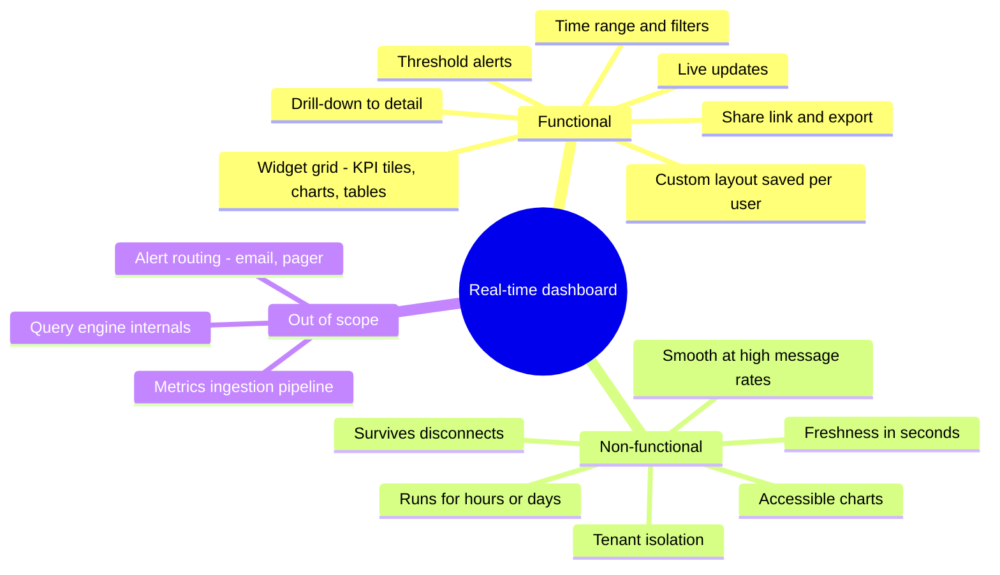
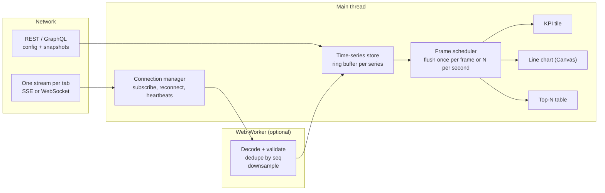
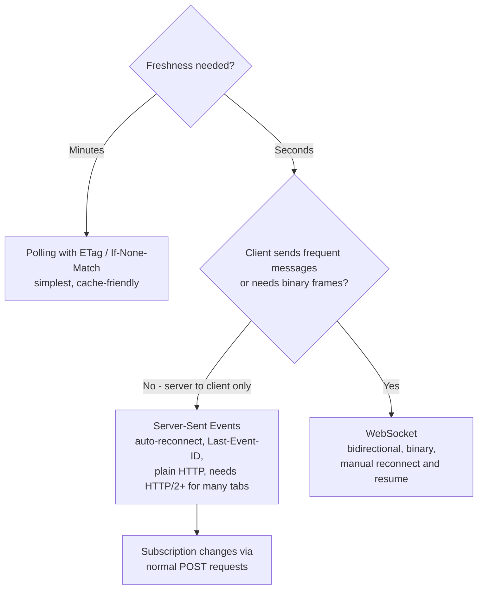
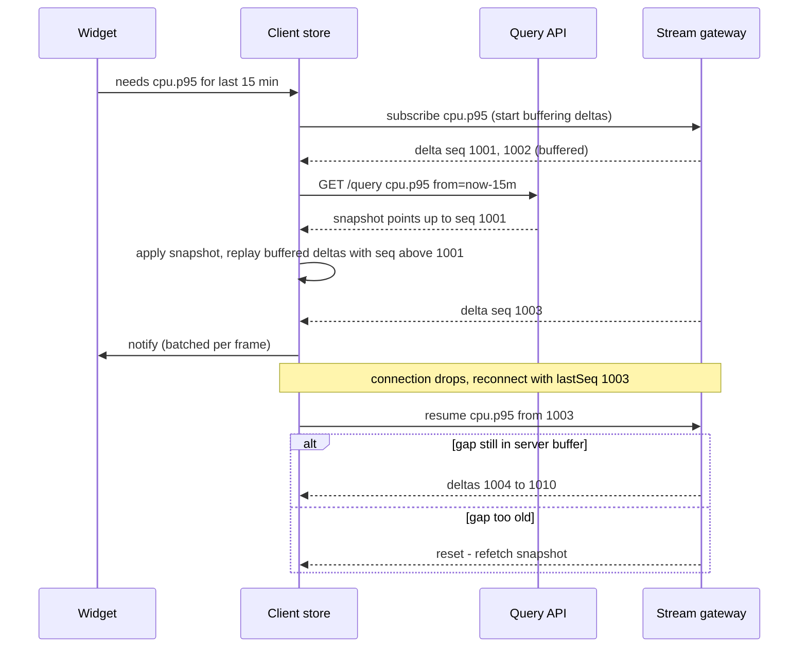
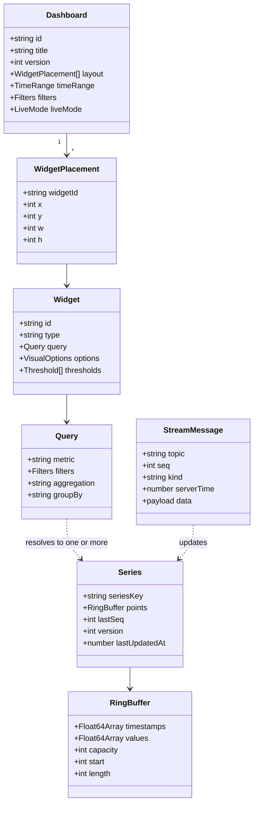
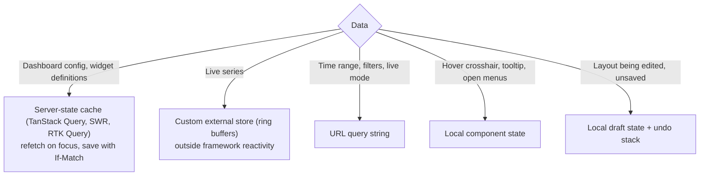
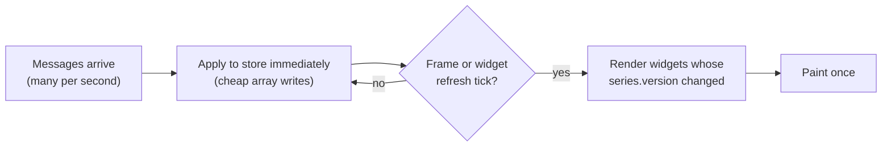
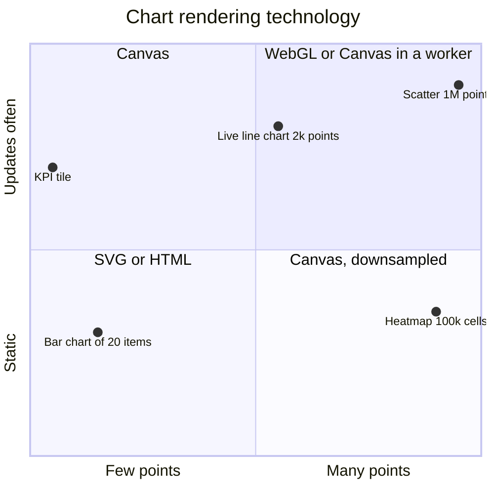
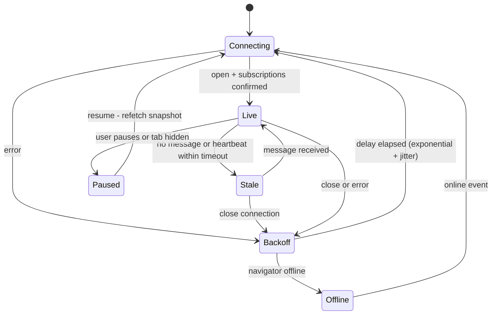

<!-- Generated by scripts/sync-knowledge.js from notes/ and README.md — do not edit here. -->
<!-- sections (line ranges in this file): Table of Contents 19-36 · ELI5 37-49 · Core Concept 50-472 · Framework Comparison 473-485 · Interview Walkthrough 486-531 · Real-World Examples 532-793 · Key Points Summary 794-814 · Test Your Understanding 815-872 · Cheat Sheet 873-918 · References & Further Reading 919-954 -->

# Design a Dashboard with Real-Time Data

> **Date:** 2026-11-06 · **Last updated:** 2026-11-06
> **Category:** Frontend System Design
> **Sub-Topic:** System Design Cases / Analytics Dashboard with Live Updates
> **Level:** Advanced · **Reading time:** ~35 min
> **Informs:** real-time transport choice (polling vs SSE vs WebSocket), snapshot + delta sync and gap recovery, update batching and render throttling, chart rendering technology (SVG vs Canvas vs WebGL), time-series memory bounds and downsampling, Web Worker offloading, multi-tab connection sharing, accessible live charts, dashboard layout persistence

> **Pre-requisite:** [WebSockets, SSE & Long Polling](./websockets-sse-long-polling.md) and [Real-Time Data Sync](./real-time-data-sync.md).
> This note designs a **live operations/analytics dashboard** with the RADIO framework, then shows how to present it in a 45-minute interview.

**Previous:** [Design an E-Commerce Product Page](./design-an-e-commerce-product-page.md) · **Next:** [Design a Multi-Step Form / Wizard](./design-a-multi-step-form-wizard.md)

---

## Table of Contents

1. [ELI5 — Simple Explanation](#eli5--simple-explanation)
2. [Section 1: Requirements (R)](#section-1-requirements-r)
3. [Section 2: Architecture (A)](#section-2-architecture-a)
4. [Section 3: Data Model (D)](#section-3-data-model-d)
5. [Section 4: Interface (I)](#section-4-interface-i)
6. [Section 5: Optimizations (O)](#section-5-optimizations-o)
7. [Framework Comparison](#framework-comparison)
8. [Interview Walkthrough](#interview-walkthrough)
9. [Real-World Examples](#real-world-examples)
10. [Key Points Summary](#key-points-summary)
11. [Test Your Understanding (with answers)](#test-your-understanding)
12. [Cheat Sheet](#cheat-sheet)
13. [References & Further Reading](#references--further-reading)

---

## ELI5 — Simple Explanation

Think of an **airport departures board**:
- The board has many **rows and panels** (widgets). When one flight is delayed, only that row flips — nobody repaints the whole board.
- A **single cable** from the control tower feeds the board (one shared connection), carrying short messages like "BA117 → Gate 22" (deltas), not the whole timetable every second.
- When the board is switched on in the morning it first loads **today's full timetable** (a snapshot) and then listens for changes.
- If the cable is cut for a minute, the board shows **"Last updated 10:42"** and, once reconnected, asks "what did I miss since message #5812?" — or reloads the timetable if it missed too much.
- The flaps can only flip so fast. If the tower sends 100 changes a second, the board shows the **latest state a few times a second** — people can't read faster anyway.

> **A real-time dashboard is a snapshot plus a stream of deltas, merged into a bounded store, and painted at a human pace — not a re-render per message.**

---

## Core Concept — Step by Step

### Section 1: Requirements (R)



**Functional requirements (core):**

| # | Requirement | Notes |
|---|---|---|
| F1 | Grid of widgets: KPI tiles, time-series charts, top-N tables, status lists | Widget = query + visualization |
| F2 | Live updates for the visible time window ("last 15 minutes", sliding) | The core of the problem |
| F3 | Global time range + filters (region, service, environment), per-widget overrides | Changes trigger new snapshots and subscriptions |
| F4 | Pause/resume live mode; switch to a fixed historical range | Also an accessibility requirement (WCAG 2.2.2) |
| F5 | Customize layout (add, remove, drag, resize widgets) and save it | Persisted per user or per team |
| F6 | Visual alerts when a value crosses a threshold | Color **and** icon/text |
| F7 | Shareable URL with dashboard, range and filters; CSV export of a widget | URL is the state |

**Non-functional requirements:**

| Area | Target / constraint |
|---|---|
| **Freshness** | End-to-end latency of a few seconds; show staleness explicitly when it's worse |
| **Throughput** | Stay responsive (INP ≤ 200 ms) while receiving bursts of many messages per second |
| **Longevity** | Wall-screen / NOC tabs stay open for days → bounded memory, no leaks, automatic recovery |
| **Correctness** | No silent gaps or duplicates after reconnects; out-of-order messages handled |
| **Scale** | Tens of widgets per dashboard, thousands of points per chart, many concurrent viewers |
| **Accessibility** | Text alternatives for charts, pause control, no color-only status, keyboard-operable layout editing |
| **Security** | Every subscription authorized per tenant; no data from other tenants over a shared socket |

**Questions to ask the interviewer:**

```text
Freshness   Seconds or minutes? (minutes → polling is fine; seconds → push)
Volume      Messages per second per dashboard? Points per chart? Number of widgets?
Users       Ops wall screen (always on) or analysts (interactive drill-downs)? Mobile?
Data        Does the backend pre-aggregate (per 10 s buckets) or stream raw events?
Direction   Only server → client, or do clients also send commands (acknowledge alert)?
History     How far back can users scroll? Live + historical in one chart?
Layout      Fixed dashboards or user-built ones? Shared with team editing?
Infra       Existing WebSocket gateway? HTTP/2 everywhere? Corporate proxies?
```

---

### Section 2: Architecture (A)

#### 2.1 Rendering strategy

A dashboard is **behind auth, highly interactive and not indexed** — the page itself is a **client-rendered SPA** (optionally with an SSR'd app shell for fast first paint). The interesting architecture is the **data pipeline** inside the client.



| Layer | Responsibility |
|---|---|
| **Dashboard config** | Layout, widget definitions (query + visualization), time range, filters — fetched once, cached, saved with versioning |
| **Connection manager** | **One** connection per tab (not per widget), multiplexing topic subscriptions; backoff, heartbeats, resume |
| **Decoder (worker)** | Parse JSON/binary, validate, drop duplicates, aggregate/downsample — keeps the main thread free |
| **Store** | Normalized series keyed by `seriesKey`; bounded ring buffers; per-series version counters |
| **Scheduler** | Coalesces many store changes into **one render per frame** (or a fixed refresh rate per widget) |
| **Widgets** | Subscribe to just the series they show; charts render to Canvas/WebGL when point counts are high |

#### 2.2 Choosing the transport



| | Polling | SSE (`EventSource`) | WebSocket |
|---|---|---|---|
| Direction | Client pulls | Server → client | Both |
| Reconnect | N/A | Built in (`retry:` field), sends `Last-Event-ID` | You implement it |
| Data | Any HTTP response | UTF-8 text events | Text or binary |
| Proxies/CDNs | Easiest | Plain HTTP; watch buffering proxies | Needs upgrade support |
| Connection limits | — | Over HTTP/1.1, counts against ~6 connections per origin per browser; HTTP/2+ multiplexes | Separate connection each |
| Custom auth headers from browser | Yes | No (`EventSource` can't set headers — use cookies, `withCredentials` for cross-origin) | No — cookies or a short-lived ticket |

**Typical choice:** SSE for "ops dashboard that only listens" (simplest correct thing), WebSocket when the client also sends many messages (acknowledging alerts, changing subscriptions rapidly, collaborative annotation) or when binary encoding matters. See [WebSockets, SSE & Long Polling](./websockets-sse-long-polling.md).

#### 2.3 Snapshot + delta synchronization

The stream alone can't give you history, and the snapshot alone is stale immediately. Combine them with **sequence numbers**:



Rules:
- **Subscribe first, then fetch the snapshot**, buffering deltas — otherwise changes that happen between the snapshot and the subscription are lost.
- **Drop deltas with `seq ≤ lastApplied`** (duplicates after resume) and **detect gaps** (`seq > lastApplied + 1`) → request resume or refetch.
- The server keeps a **bounded replay buffer** per topic; if the client's `lastSeq` is older, it answers **reset**.

See [Real-Time Data Sync](./real-time-data-sync.md).

---

### Section 3: Data Model (D)



**Design decisions:**

| Decision | Recommendation | Why |
|---|---|---|
| **Normalize by series** | Store `Record<seriesKey, Series>`; widgets reference series keys | Two widgets showing the same metric share one buffer and one subscription |
| **Bounded buffers** | Ring buffer sized to visible window ÷ resolution (+ margin) | Memory stays flat in a tab open for days |
| **Typed arrays** | `Float64Array` for timestamps/values in hot series | Compact, fast to iterate, **transferable** from a worker without copying |
| **Server-side aggregation** | Query with a `step` (bucket width) derived from range ÷ chart pixel width | ~1 point per pixel is enough; raw events would overwhelm the network and the renderer |
| **Client downsampling** | Optional (e.g. LTTB, min/max per bucket) for zoomed-out raw data | Keeps visual shape with far fewer points |
| **Time** | Store UTC epoch ms from the **server**; format in the viewer's time zone with `Intl.DateTimeFormat` | Client clocks drift; DST and time zones are display concerns |
| **Version counters** | Increment `series.version` on change; widgets compare versions | Cheap change detection without deep comparisons |
| **URL state** | Dashboard id, time range, filters, `live=1` in the query string | Shareable, reload-safe, Back button works |
| **Layout persistence** | Server-side with an optimistic-concurrency `version` (or ETag) | Two editors don't silently overwrite each other |

**What lives where:**



High-frequency data should **not** go through a general-purpose global store that notifies every subscriber on every change. Use a small external store with per-series subscriptions. See [Client State Management Patterns](./client-state-management-patterns.md).

---

### Section 4: Interface (I)

#### 4.1 Component APIs

```tsx
type TimeRange = { kind: 'relative'; last: '15m' | '1h' | '24h' } | { kind: 'absolute'; from: number; to: number };

type WidgetProps = {
  widget: Widget;                 // query + visualization + thresholds
  timeRange: TimeRange;           // from the dashboard (or a per-widget override)
  live: boolean;                  // paused → stop applying deltas to the view
  refreshHz?: number;             // max redraws per second for this widget (e.g. 1 for tables, 4 for charts)
};

type TimeSeriesChartProps = {
  series: { key: string; label: string; color: string; dash?: number[] }[]; // dash = non-color cue
  getPoints: (key: string) => { timestamps: Float64Array; values: Float64Array; length: number };
  range: { from: number; to: number };
  thresholds?: { value: number; label: string }[];
  unit: string;                   // 'ms', '%', 'req/s'
  ariaSummary: string;            // "p95 latency, last 15 min: 120 to 340 ms, currently 180 ms"
};

type KpiTileProps = {
  label: string;
  value: number | null;           // null → loading or no data
  previous?: number;              // for trend arrow and delta text
  format: Intl.NumberFormatOptions;
  status?: 'ok' | 'warn' | 'critical';
  staleSince?: number;            // shows "updated 40 s ago" when the stream lags
};

// Hook used by widgets: subscribes on mount, unsubscribes on unmount
declare function useSeries(seriesKey: string, range: TimeRange): { version: number; status: 'loading' | 'live' | 'stale' | 'error' };
```

#### 4.2 Server API contract

| Endpoint / message | Purpose |
|---|---|
| `GET /api/dashboards/{id}` | Config + `ETag` (version) |
| `PUT /api/dashboards/{id}` with `If-Match: "v12"` | Save layout; `412 Precondition Failed` if someone else saved first |
| `POST /api/query` `{ metric, filters, from, to, step }` | Snapshot for one or more series; returns points + `seq` watermark |
| `GET /api/stream` (SSE) or `wss://…/stream` (WebSocket) | Live deltas for subscribed topics |
| `POST /api/stream/subscriptions` (SSE variant) | Add/remove topics for this connection id |

**Stream messages (WebSocket variant):**

```json
{ "type": "subscribe", "topics": ["cpu.p95|region=eu", "errors.rate|service=api"], "resume": { "cpu.p95|region=eu": 1003 } }
```

```json
{ "type": "delta", "topic": "cpu.p95|region=eu", "seq": 1004, "points": [[1793872800000, 182.4]] }
```

```json
{ "type": "reset", "topic": "cpu.p95|region=eu", "reason": "resume window exceeded" }
```

```json
{ "type": "heartbeat", "serverTime": 1793872805000 }
```

**SSE wire format** (the `id:` line becomes `Last-Event-ID` on automatic reconnect):

```text
retry: 5000
id: 1004
event: delta
data: {"topic":"cpu.p95|region=eu","points":[[1793872800000,182.4]]}

: heartbeat comment to keep proxies from closing the idle connection
```

**Server responsibilities the frontend depends on:**
- **Authorize every topic** against the user's tenant and permissions — at subscribe time, not just at connect time.
- **Conflate** under load: for "latest value" topics (KPIs) send only the newest value per interval instead of every event.
- **Bounded replay buffer** per topic with `reset` when a resume is impossible.
- **Heartbeats** so both sides detect dead connections that TCP hasn't noticed yet.

---

### Section 5: Optimizations (O)

#### 5.1 Rendering performance



- **Decouple ingest from render.** Write messages into the store as they arrive; render at most **once per animation frame** (`requestAnimationFrame`) and, for most widgets, much less (1–4 times per second). A per-message `setState` is the classic cause of a frozen dashboard.
- **Per-widget subscriptions**: only widgets whose series changed re-render; the grid and siblings don't. In React, `useSyncExternalStore` with a version snapshot; avoid putting fast-changing values in Context.
- **Pick the renderer by data size:**



  SVG is accessible and easy to style but each point is a DOM node; Canvas draws pixels (fast, but you build hit-testing and accessibility yourself); WebGL handles very large point counts. Libraries make different choices (e.g. uPlot and ECharts render to Canvas; D3 commonly to SVG; many libraries offer both) — check each library's docs.
- **Web Worker**: parse, validate, dedupe and downsample off the main thread; send `Float64Array` buffers back as **transferables**. `OffscreenCanvas` lets a worker draw a chart directly; it's supported in current Chromium, Firefox and Safari (WebGL in OffscreenCanvas since Safari 17) — verify on MDN for your targets. See [Web Workers for Heavy Computation](./web-workers-for-heavy-computation.md).
- **Off-screen widgets**: use `IntersectionObserver` to pause rendering — or unsubscribe entirely — for widgets scrolled out of view. Large tables use virtualization ([Virtual Scrolling & Windowing](./virtual-scrolling-and-windowing.md)).
- **Background tabs**: `requestAnimationFrame` doesn't run in hidden tabs and timers are throttled. On `visibilitychange` to hidden, either keep ingesting cheaply or unsubscribe; on visible, **refetch snapshots** instead of replaying minutes of deltas.

#### 5.2 Connection resilience



- **Exponential backoff with jitter** (e.g. 1 s, 2 s, 4 s … capped, randomized) so thousands of dashboards don't reconnect in lockstep after a server deploy.
- **Heartbeat timeout** → mark widgets **stale** visibly ("updated 45 s ago", greyed values) instead of silently showing frozen numbers.
- **Resume with `lastSeq`** per topic; fall back to snapshot refetch on `reset`.
- **Laptop sleep / network change**: listen to `online`/`offline` and `visibilitychange`; treat a long gap as "refetch everything visible".
- **Multiple tabs**: each tab normally opens its own connection. To share one, elect a leader tab with the **Web Locks API** and fan out over **BroadcastChannel**, or use a **SharedWorker** (now in all major engines, but only recently on Chrome for Android — check MDN). Usually only worth it when users open many tabs or servers limit connections per user.

#### 5.3 Accessibility

| Concern | Approach |
|---|---|
| Charts are images to screen readers | Wrap in `<figure>` with a `<figcaption>`/`aria-label` text summary (range, min, max, current); offer a "View as table" toggle |
| Auto-updating content | WCAG 2.2.2 (Pause, Stop, Hide): provide a **Pause live updates** control |
| Announcing updates | **Don't** put live values in `aria-live` — that floods screen readers. Announce only important threshold crossings, politely and throttled |
| Color-only status | Add icons, text ("Critical"), and line dash patterns per series (WCAG 1.4.1); check contrast of lines against the background (1.4.11 non-text contrast) |
| Motion | Respect `prefers-reduced-motion`: no animated transitions between updates |
| Layout editing | Drag-and-drop needs a non-drag alternative (WCAG 2.2 — 2.5.7 Dragging Movements): "Move left/right" buttons or a keyboard mode |
| Focus stability | Re-renders must not steal or reset focus inside tables and menus |

See [Color Contrast & Visual Accessibility](./color-contrast-and-visual-accessibility.md) and [ARIA Roles, States & Properties](./aria-roles-states-and-properties.md).

#### 5.4 i18n, security, edge cases

- **i18n:** `Intl.NumberFormat` with `notation: 'compact'` for big numbers ("1.2K", locale-aware), units via `style: 'unit'`, `Intl.DateTimeFormat` with an explicit `timeZone` (viewer's or a team-wide zone), `Intl.RelativeTimeFormat` for "updated 40 s ago". Axis labels must handle DST transitions (a "day" isn't always 24 hours).
- **Security:** the browser can't set custom headers on `EventSource` or `WebSocket` — authenticate with an HTTP-only cookie or a **short-lived, single-use ticket** obtained over an authenticated request (avoid long-lived tokens in URLs; they end up in logs). Check `Origin` on WebSocket upgrades (cross-site WebSocket hijacking), authorize topics server-side, validate message shapes before use, and never render message strings as HTML. See [Authentication Flows in SPAs](./authentication-flows-in-spas.md).
- **Edge cases:** out-of-order messages (sort or ignore by `seq`), duplicate deltas after resume, clock skew (use server timestamps for points, server time from heartbeats for "ago" labels), series that disappear (deleted host), a widget whose query errors (error state in that tile only), time-range change while a snapshot is in flight (cancel with `AbortController`, ignore stale responses), and memory growth over days (bounded buffers, unsubscribe on unmount — see [Memory Leaks in Frontend Apps](./memory-leaks-in-frontend-apps.md)).

---

## Framework Comparison

| Concern | React | Vue | Angular | Svelte |
|---|---|---|---|---|
| Subscribe to an external live store | `useSyncExternalStore` | Custom composable updating a `shallowRef` | Signals (`signal`, `computed`) or RxJS streams with `async` pipe | Svelte store contract or `$state.raw` updated from the store |
| Avoid deep reactivity on big arrays | Keep buffers outside state; store only a version number | `shallowRef` / `markRaw` for buffers | Keep buffers outside signals; signal a version | `$state.raw` (Svelte 5) instead of deeply reactive `$state` |
| Throttle renders | rAF scheduler / `startTransition` for non-urgent updates | rAF scheduler, `v-memo` for unchanged rows | In zone-based apps, handle socket events with `NgZone.runOutsideAngular` and re-enter on the frame tick | rAF scheduler |
| Streams library fit | Plain hooks, RxJS optional | VueUse (`useWebSocket`, `useEventSource`) | RxJS (`webSocket` subject) is idiomatic | Plain stores |

**Native mobile:** the same stream protocol and resume semantics apply. iOS and Android suspend apps in the background, so treat "returned to foreground" like a long disconnect: reconnect and refetch snapshots. Push notifications (APNs/FCM) carry alerts while the app is closed — the socket can't.

---

## Interview Walkthrough

### How to spend 45 minutes

```mermaid
gantt
    title 45-minute real-time dashboard interview plan
    dateFormat X
    axisFormat %M min
    section Clarify
    Requirements, rates, freshness      :r, 0, 6m
    section Design
    Architecture and transport choice   :a, after r, 9m
    Data model, snapshot plus delta     :d, after a, 7m
    Interface - widgets and messages    :i, after d, 6m
    section Deep dive
    Rendering perf, resilience, a11y    :o, after i, 12m
    section Close
    Trade-offs and wrap-up              :w, after o, 5m
```



| Minutes | What you do | What to say / draw |
|---|---|---|
| 0–6 | Clarify | Freshness (seconds vs minutes), message rate, widget and point counts, who watches (wall screen vs analyst), direction of data |
| 6–15 | Architecture | SPA shell; the client pipeline (connection manager → worker → store → frame scheduler → widgets); transport decision tree |
| 15–22 | Data model | Series normalized by key, ring buffers, server-side `step`, `seq` numbers, URL state for range/filters |
| 22–28 | Interface | `useSeries`, chart props with `ariaSummary`; subscribe/delta/reset/heartbeat messages; layout save with `If-Match` |
| 28–40 | Deep dive | Snapshot + delta ordering, batching per frame, Canvas vs SVG, reconnect state machine, staleness UX, accessibility of live charts |
| 40–45 | Wrap-up | Trade-offs, monitoring (client-side lag = now − point timestamp, reconnect counts, long tasks), next steps |

### Trade-offs to discuss

| Decision | Option A | Option B | Say this |
|---|---|---|---|
| Transport | SSE | WebSocket | "SSE if we only listen — built-in reconnect and resume; WebSocket if clients send a lot or we need binary" |
| Push vs poll | Push stream | Poll every N s with ETag | "If minute-level freshness is fine, polling is simpler, cacheable and scales with plain HTTP" |
| Granularity | Raw events to client | Server-aggregated buckets | "Aggregate on the server to ~1 point per pixel; raw events only for drill-down" |
| Render rate | Every message | Fixed tick per widget | "Humans can't read 50 updates/s; tick at 1–4 Hz, KPIs conflated to latest" |
| Chart tech | SVG | Canvas/WebGL | "SVG for small, accessible charts; Canvas past a few thousand points, with a table alternative" |
| Connections | Per tab | Shared across tabs | "Per tab is simpler; share via Web Locks + BroadcastChannel only if connection count is a problem" |
| Hidden tab | Keep streaming | Unsubscribe, refetch on return | "Unsubscribe after a grace period; a fresh snapshot is cheaper than replaying minutes of deltas" |

**Likely follow-ups:** "What if a client can't keep up?" (server conflation, client drops intermediate values for latest-value topics, backpressure signal), "How do you test it?" (fake stream server with scripted bursts, gaps and duplicates; long-running soak test watching heap size), "1,000 viewers of the same dashboard?" (fan-out at the gateway, shared topic subscriptions, conflation — the client design doesn't change).

---

## Real-World Examples

**Example 1 — Batching updates per frame (BAD → GOOD):**
```tsx
// ❌ BAD: one React state update (and render) per message; 200 msg/s = 200 renders/s
useEffect(() => {
  const ws = new WebSocket(url);
  ws.onmessage = (e) => setPoints((prev) => [...prev, JSON.parse(e.data)]); // also grows forever
  return () => ws.close();
}, [url]);

// ✅ GOOD: write to a bounded store immediately, notify subscribers at most once per frame
type Listener = () => void;

class SeriesStore {
  private series = new Map<string, { buf: RingBuffer; version: number }>();
  private listeners = new Map<string, Set<Listener>>();
  private dirty = new Set<string>();
  private scheduled = false;

  apply(key: string, points: [number, number][]) {
    const s = this.series.get(key);
    if (!s) return;
    for (const [t, v] of points) s.buf.push(t, v);
    s.version++;
    this.dirty.add(key);
    if (!this.scheduled) {
      this.scheduled = true;
      requestAnimationFrame(this.flush); // doesn't run in hidden tabs: that's fine, data is still stored
    }
  }

  private flush = () => {
    this.scheduled = false;
    for (const key of this.dirty) this.listeners.get(key)?.forEach((l) => l());
    this.dirty.clear();
  };

  subscribe(key: string, l: Listener) {
    if (!this.listeners.has(key)) this.listeners.set(key, new Set());
    this.listeners.get(key)!.add(l);
    return () => this.listeners.get(key)!.delete(l);
  }

  ensure(key: string, capacity: number) {
    if (!this.series.has(key)) this.series.set(key, { buf: new RingBuffer(capacity), version: 0 });
  }
  getVersion = (key: string) => this.series.get(key)?.version ?? -1;
  getBuffer = (key: string) => this.series.get(key)?.buf;
}

export const store = new SeriesStore();

// React binding: re-renders only when this series' version changes
import { useSyncExternalStore, useCallback } from 'react';
export function useSeriesVersion(key: string) {
  const subscribe = useCallback((cb: () => void) => store.subscribe(key, cb), [key]);
  return useSyncExternalStore(subscribe, () => store.getVersion(key));
}
```

**Example 2 — A bounded ring buffer on typed arrays:**
```typescript
export class RingBuffer {
  readonly timestamps: Float64Array;
  readonly values: Float64Array;
  private start = 0;
  length = 0;

  constructor(readonly capacity: number) {
    this.timestamps = new Float64Array(capacity);
    this.values = new Float64Array(capacity);
  }

  push(t: number, v: number) {
    const end = (this.start + this.length) % this.capacity;
    this.timestamps[end] = t;
    this.values[end] = v;
    if (this.length < this.capacity) this.length++;
    else this.start = (this.start + 1) % this.capacity; // overwrite the oldest point
  }

  /** Iterate oldest → newest without allocating. */
  forEach(fn: (t: number, v: number, i: number) => void) {
    for (let i = 0; i < this.length; i++) {
      const idx = (this.start + i) % this.capacity;
      fn(this.timestamps[idx], this.values[idx], i);
    }
  }
}
// Capacity example: 15-minute window at 1 point / 5 s = 180 points (+ margin) per series.
```

**Example 3 — WebSocket connection manager with resume, heartbeats and jittered backoff:**
```typescript
type Delta = { type: 'delta'; topic: string; seq: number; points: [number, number][] };
type ServerMsg = Delta | { type: 'reset'; topic: string } | { type: 'heartbeat'; serverTime: number };

export class StreamClient {
  private ws: WebSocket | null = null;
  private lastSeq = new Map<string, number>();
  private topics = new Set<string>();
  private attempt = 0;
  private heartbeatTimer?: ReturnType<typeof setTimeout>;

  constructor(
    private url: string,
    private onDelta: (d: Delta) => void,
    private onReset: (topic: string) => void,          // caller refetches the snapshot
    private onStatus: (s: 'connecting' | 'live' | 'stale' | 'offline') => void,
  ) {}

  connect() {
    this.onStatus('connecting');
    this.ws = new WebSocket(this.url); // auth: HTTP-only cookie or a short-lived ticket in the URL
    this.ws.onopen = () => {
      this.attempt = 0;
      this.send({ type: 'subscribe', topics: [...this.topics], resume: Object.fromEntries(this.lastSeq) });
      this.onStatus('live');
      this.armHeartbeat();
    };
    this.ws.onmessage = (e) => this.handle(JSON.parse(e.data) as ServerMsg);
    this.ws.onclose = () => this.scheduleReconnect();
  }

  subscribe(topic: string) {
    this.topics.add(topic);
    this.send({ type: 'subscribe', topics: [topic] });
  }

  unsubscribe(topic: string) {
    this.topics.delete(topic);
    this.lastSeq.delete(topic);
    this.send({ type: 'unsubscribe', topics: [topic] });
  }

  private handle(msg: ServerMsg) {
    this.armHeartbeat();
    if (msg.type === 'heartbeat') return;
    if (msg.type === 'reset') { this.lastSeq.delete(msg.topic); this.onReset(msg.topic); return; }
    const last = this.lastSeq.get(msg.topic) ?? 0;
    if (msg.seq <= last) return;                                 // duplicate after resume
    if (last && msg.seq > last + 1) { this.onReset(msg.topic); } // gap: resync this topic
    this.lastSeq.set(msg.topic, msg.seq);
    this.onDelta(msg);
  }

  private armHeartbeat() {
    clearTimeout(this.heartbeatTimer);
    this.heartbeatTimer = setTimeout(() => { this.onStatus('stale'); this.ws?.close(); }, 30_000);
  }

  private scheduleReconnect() {
    clearTimeout(this.heartbeatTimer);
    if (!navigator.onLine) {
      this.onStatus('offline');
      addEventListener('online', () => this.connect(), { once: true });
      return;
    }
    const base = Math.min(30_000, 1000 * 2 ** this.attempt++);
    setTimeout(() => this.connect(), base / 2 + Math.random() * (base / 2)); // jitter
  }

  private send(msg: unknown) {
    if (this.ws?.readyState === WebSocket.OPEN) this.ws.send(JSON.stringify(msg));
  }
}
```

**Example 4 — SSE endpoint (Node.js/Express) with ids, retry and heartbeats:**
```javascript
app.get('/api/stream', requireAuth, (req, res) => {
  res.set({
    'Content-Type': 'text/event-stream',
    'Cache-Control': 'no-cache',
    'X-Accel-Buffering': 'no', // tell nginx not to buffer the stream
  });
  res.flushHeaders();
  res.write('retry: 5000\n\n');

  const lastId = Number(req.get('Last-Event-ID') ?? 0); // sent automatically by EventSource on reconnect
  const topics = authorizedTopics(req.user, req.query.topics); // authorize per tenant

  const send = (seq, event, data) => res.write(`id: ${seq}\nevent: ${event}\ndata: ${JSON.stringify(data)}\n\n`);
  const unsubscribe = bus.subscribe(topics, lastId, (msg) => send(msg.seq, msg.type, msg)); // replays from lastId if buffered
  const heartbeat = setInterval(() => res.write(': hb\n\n'), 15000);

  req.on('close', () => { clearInterval(heartbeat); unsubscribe(); });
});
```
```typescript
// Browser side: reconnect and Last-Event-ID are handled by EventSource itself
const es = new EventSource('/api/stream?topics=cpu.p95%7Cregion%3Deu', { withCredentials: true });
es.addEventListener('delta', (e) => worker.postMessage((e as MessageEvent).data));
es.addEventListener('reset', (e) => refetchSnapshot(JSON.parse((e as MessageEvent).data).topic));
es.onerror = () => setStatus(es.readyState === EventSource.CLOSED ? 'offline' : 'connecting');
```
Note that this example uses one `Last-Event-ID` for the whole connection, so the server's sequence must be **per connection** (or encode per-topic positions in the id).

**Example 5 — Decode and downsample in a Web Worker, transfer typed arrays:**
```typescript
// series.worker.ts
self.onmessage = (e: MessageEvent<string>) => {
  const msg = JSON.parse(e.data) as { topic: string; points: [number, number][] };
  const n = msg.points.length;
  const t = new Float64Array(n);
  const v = new Float64Array(n);
  for (let i = 0; i < n; i++) { t[i] = msg.points[i][0]; v[i] = msg.points[i][1]; }
  // ...validate, dedupe, min/max-per-bucket downsampling for large batches...
  (self as unknown as Worker).postMessage({ topic: msg.topic, t, v }, [t.buffer, v.buffer]); // zero-copy transfer
};

// main thread
const worker = new Worker(new URL('./series.worker.ts', import.meta.url), { type: 'module' });
worker.onmessage = (e) => {
  const { topic, t, v } = e.data as { topic: string; t: Float64Array; v: Float64Array };
  store.applyColumns(topic, t, v); // a typed-array variant of apply(): copies straight into the ring buffer
};
```

**Example 6 — Accessible live chart wrapper:**
```tsx
import { useId, useState, type ReactNode } from 'react';

export function LiveChartCard({ title, summary, live, onToggleLive, children, table }: {
  title: string; summary: string; live: boolean; onToggleLive: () => void;
  children: ReactNode; table: ReactNode;
}) {
  const [showTable, setShowTable] = useState(false);
  const captionId = useId(); // never build ids from titles: spaces break aria-labelledby
  return (
    <figure aria-labelledby={captionId} className="widget">
      <figcaption id={captionId}>
        <h3>{title}</h3>
        <p className="visually-hidden">{summary}</p> {/* updated at a slow cadence, not aria-live */}
      </figcaption>
      <div className="widget-actions">
        <button type="button" onClick={onToggleLive}> {/* label changes, so no aria-pressed */}
          {live ? 'Pause live updates' : 'Resume live updates'}
        </button>
        <button type="button" aria-expanded={showTable} onClick={() => setShowTable((s) => !s)}>
          {showTable ? 'Hide data table' : 'Show data table'}
        </button>
      </div>
      {showTable ? table : <div role="img" aria-label={summary}>{children}</div>}
    </figure>
  );
}
```

**Example 7 — Compact, locale-aware numbers and relative "updated" labels:**
```typescript
const compact = new Intl.NumberFormat(navigator.language, { notation: 'compact', maximumFractionDigits: 1 });
compact.format(1234567); // "1.2M" in en-US; other locales use their own abbreviations

const rtf = new Intl.RelativeTimeFormat(navigator.language, { numeric: 'auto' });
const updatedLabel = (serverNow: number, lastPointAt: number) =>
  rtf.format(-Math.round((serverNow - lastPointAt) / 1000), 'second'); // "40 seconds ago"
```

---

## Key Points Summary

| Concept | One-Line Explanation |
|---|---|
| **Snapshot + delta** | Load history with a query, then apply streamed changes ordered by sequence number |
| **Subscribe before snapshot** | Buffer deltas during the snapshot fetch so nothing is lost in between |
| **Sequence numbers** | Detect duplicates (`seq ≤ last`) and gaps (`seq > last + 1`) after reconnects |
| **One connection per tab** | Multiplex topic subscriptions instead of a socket per widget |
| **SSE vs WebSocket** | SSE for server→client with built-in resume; WebSocket for bidirectional or binary |
| **Ingest ≠ render** | Write to the store per message, render once per frame or at a fixed tick |
| **Bounded memory** | Ring buffers sized to the visible window keep long-running tabs flat |
| **Server aggregation** | Request ~1 point per pixel with a `step`; never stream raw events to charts |
| **Canvas/WebGL** | Use for thousands of points; provide a table or summary for accessibility |
| **Worker offload** | Parse/downsample off the main thread; transfer typed arrays |
| **Staleness UX** | Heartbeats + "updated N s ago" instead of silently frozen numbers |
| **Backoff with jitter** | Prevents reconnect storms after deploys or outages |
| **Pause control** | Auto-updating content needs pause/stop (WCAG 2.2.2) |
| **Topic authorization** | Check tenant permissions per subscription on the server |

---

## Test Your Understanding

**Q1 (Basic):**
Why should a dashboard subscribe to the stream **before** fetching the snapshot, not after?

<details>
<summary>Answer</summary>

If you fetch the snapshot first and subscribe afterwards, any change that happens **between** the snapshot being generated and the subscription becoming active is never delivered — a silent gap. Subscribing first and **buffering** deltas closes that window: once the snapshot arrives (with its `seq` watermark), you apply it and replay only buffered deltas with a higher `seq`, discarding the rest as duplicates.
</details>

**Q2 (Application):**
Freshness of 30–60 seconds is acceptable and the dashboard only displays data. Which transport do you choose and why?

<details>
<summary>Answer</summary>

**Polling** (e.g. every 30 s, with `ETag`/`If-None-Match` so unchanged responses are tiny 304s). It's the simplest: no connection state, no reconnect logic, works through every proxy, cacheable at a CDN for shared dashboards, and easy to scale. Push (SSE/WebSocket) earns its complexity when you need seconds-level freshness or the poll rate would be wasteful. Add jitter to the poll interval and stop polling in hidden tabs.
</details>

**Q3 (Tricky):**
The dashboard is smooth for the first hour, but after a day on the NOC wall screen it becomes sluggish and the tab uses several GB of memory. What are the likely causes?

<details>
<summary>Answer</summary>

**Unbounded growth.** Typical culprits: arrays of points that are appended to but never trimmed (`[...prev, point]`), subscriptions or event listeners not removed when widgets unmount or filters change (each change adds another listener), chart library instances re-created without being destroyed, and caches keyed by time range that never evict. Fixes: **ring buffers sized to the visible window**, cleanup in effect teardown / `onUnmounted` / `ngOnDestroy`, destroy chart instances, cap caches, and run a **soak test** that watches heap size over hours. Also check that DevTools/console logging of messages isn't retaining objects.
</details>

**Q4 (Tricky):**
A message burst of 500 updates per second arrives. The CPU is pegged and clicks take seconds to respond. The chart library is already Canvas-based. What do you change?

<details>
<summary>Answer</summary>

The problem is likely **render frequency and main-thread parsing**, not the drawing technology. (1) **Decouple ingest from render**: apply messages to the store cheaply and redraw at most once per frame — or at 1–4 Hz per widget. (2) **Move parsing/dedupe/downsampling to a Web Worker** and transfer typed arrays. (3) Ask the server to **conflate** (latest value per interval for KPIs) or aggregate into buckets. (4) Make sure only affected widgets re-render (per-series subscriptions, no global context updates). Then INP recovers because the main thread has idle time between frames for input handling.
</details>

**Q5 (Application):**
Users complain that numbers sometimes "freeze" without any indication. How do you make staleness visible, and what triggers it?

<details>
<summary>Answer</summary>

Track the **last time data arrived** per connection and per series. The server sends **heartbeats** (e.g. every 15 s); if nothing (heartbeat or data) arrives within a timeout, mark the connection **stale**: grey out values, show "Updated 45 s ago" (computed from server time to avoid clock skew), and start reconnecting with backoff. Per series, compare the last point's timestamp with the expected interval to catch a single dead feed while the connection is healthy. On reconnect, resume from `lastSeq` or refetch snapshots, then clear the stale state.
</details>

**Q6 (System design):**
Design how the dashboard behaves when the user switches to another tab for 20 minutes and comes back.

<details>
<summary>Answer</summary>

While hidden, `requestAnimationFrame` stops and timers get throttled, so rendering pauses anyway. Options: keep the connection and keep writing into ring buffers (cheap, instant return) or, after a grace period, **unsubscribe/close** to save server and battery resources. On `visibilitychange` → visible after a long absence, the cheapest correct move is usually to **refetch snapshots for visible widgets** (and resubscribe) rather than replay 20 minutes of deltas — the server's replay buffer may not even cover it (it would answer `reset`). Show a brief "Refreshing…" state rather than a jump of stale numbers. Native apps behave similarly on returning to the foreground.
</details>

---

## Cheat Sheet

**Key Definitions:**
- **Snapshot:** A query result for a time range, with a sequence watermark
- **Delta:** A streamed change to a series, tagged with a monotonically increasing `seq`
- **Conflation:** Server-side merging of updates so only the latest value per interval is sent
- **Ring buffer:** Fixed-size circular storage that overwrites the oldest entry
- **Downsampling:** Reducing points while preserving visual shape (bucket min/max, LTTB)
- **Heartbeat:** Periodic message proving the connection is alive
- **Backoff with jitter:** Growing, randomized reconnect delays to avoid synchronized storms

**Quick Reference:**
```text
RADIO for a real-time dashboard
R  F: widget grid, live updates, time range + filters, pause, layout editing, thresholds, share/export
   NF: seconds freshness, smooth under bursts, days-long sessions, no gaps/dupes, a11y, tenant isolation
A  CSR SPA; one stream per tab -> (worker) decode -> store (ring buffers) -> frame scheduler -> widgets
   transport: minutes -> polling + ETag | seconds, listen-only -> SSE | bidirectional/binary -> WebSocket
D  Dashboard/Widget/Query config (server state, If-Match saves) | Series by key (external store)
   UTC ms from server, step = range / pixel width, seq per topic, range + filters in URL
I  useSeries(key, range); TimeSeriesChart(getPoints, range, ariaSummary)
   subscribe {topics, resume} | delta {topic, seq, points} | reset {topic} | heartbeat {serverTime}
O  render <= 1/frame (1-4 Hz typical), Canvas/WebGL for big data, worker + transferables
   IntersectionObserver for off-screen widgets, refetch snapshot on tab return
   backoff + jitter, stale indicators, Pause button, table alternative, no aria-live floods
```

**Common Mistakes to Avoid:**

| Mistake | Why Wrong | Fix |
|---|---|---|
| `setState` per message | Hundreds of renders per second, input lag | Store writes per message, render per frame or tick |
| Socket per widget | Connection limits, wasted resources, many reconnects | One multiplexed connection per tab |
| Snapshot before subscribe | Changes between them are lost | Subscribe, buffer, then snapshot and replay by `seq` |
| Unbounded point arrays | Memory grows for days | Ring buffers sized to the window |
| Streaming raw events to charts | Network and render overload | Server aggregation with `step`, conflation |
| Immediate fixed-delay reconnects | Thundering herd after outages | Exponential backoff with jitter |
| Silent frozen values | Users trust stale data | Heartbeats + stale state + "updated N s ago" |
| Live values in `aria-live` | Screen reader flooded | Summaries, pause control, announce only alerts |
| Color-only thresholds and series | Fails for color-blind users | Icons, text, dash patterns |
| Long-lived token in WebSocket URL | Leaks via logs and history | Cookie or short-lived single-use ticket |
| Authorizing only on connect | Users can subscribe to other tenants' topics | Authorize every subscription |
| Deep reactivity on big arrays (Vue/Svelte) | Proxy overhead on every point | `shallowRef`/`markRaw`, `$state.raw` |

---

## References & Further Reading

**Core docs**
- MDN: [Using server-sent events](https://developer.mozilla.org/en-US/docs/Web/API/Server-sent_events/Using_server-sent_events) · [`EventSource`](https://developer.mozilla.org/en-US/docs/Web/API/EventSource)
- MDN: [WebSocket API](https://developer.mozilla.org/en-US/docs/Web/API/WebSockets_API)
- MDN: [`OffscreenCanvas`](https://developer.mozilla.org/en-US/docs/Web/API/OffscreenCanvas) · [Transferable objects](https://developer.mozilla.org/en-US/docs/Web/API/Web_Workers_API/Transferable_objects)
- MDN: [Page Visibility API](https://developer.mozilla.org/en-US/docs/Web/API/Page_Visibility_API) · [Web Locks API](https://developer.mozilla.org/en-US/docs/Web/API/Web_Locks_API) · [Broadcast Channel API](https://developer.mozilla.org/en-US/docs/Web/API/Broadcast_Channel_API)
- MDN: [`Intl.NumberFormat`](https://developer.mozilla.org/en-US/docs/Web/JavaScript/Reference/Global_Objects/Intl/NumberFormat) · [`Intl.RelativeTimeFormat`](https://developer.mozilla.org/en-US/docs/Web/JavaScript/Reference/Global_Objects/Intl/RelativeTimeFormat)
- React: [`useSyncExternalStore`](https://react.dev/reference/react/useSyncExternalStore)
- web.dev: [Interaction to Next Paint (INP)](https://web.dev/articles/inp) · [Optimize long tasks](https://web.dev/articles/optimize-long-tasks)

**Specs**
- WHATWG HTML: [Server-sent events](https://html.spec.whatwg.org/multipage/server-sent-events.html)
- IETF: [RFC 6455 — The WebSocket Protocol](https://www.rfc-editor.org/rfc/rfc6455)
- W3C: [Understanding WCAG 2.2 — Pause, Stop, Hide (2.2.2)](https://www.w3.org/WAI/WCAG22/Understanding/pause-stop-hide.html) · [Dragging Movements (2.5.7)](https://www.w3.org/WAI/WCAG22/Understanding/dragging-movements.html) · [Non-text Contrast (1.4.11)](https://www.w3.org/WAI/WCAG22/Understanding/non-text-contrast.html)

**Framework docs**
- Vue: [Reducing reactivity overhead for large immutable structures](https://vuejs.org/guide/best-practices/performance.html#reduce-reactivity-overhead-for-large-immutable-structures)
- Svelte: [`$state.raw`](https://svelte.dev/docs/svelte/$state#$state.raw)
- Angular: [Signals](https://angular.dev/guide/signals)
- VueUse: [`useWebSocket`](https://vueuse.org/core/useWebSocket/) · [`useEventSource`](https://vueuse.org/core/useEventSource/)

**Deep dives**
- AWS Architecture Blog: [Exponential Backoff and Jitter](https://aws.amazon.com/blogs/architecture/exponential-backoff-and-jitter/)
- Sveinn Steinarsson: [Downsampling Time Series for Visual Representation (LTTB thesis)](https://skemman.is/handle/1946/15343)
- W3C WAI: [Complex images (charts and graphs)](https://www.w3.org/WAI/tutorials/images/complex/)

---

> **Previous Topic:** [Design an E-Commerce Product Page](./design-an-e-commerce-product-page.md)
> — Freshness-split rendering, LCP hero image, variants and add-to-cart

> **Next Topic:** [Design a Multi-Step Form / Wizard](./design-a-multi-step-form-wizard.md)
> — Step state machines, validation, draft persistence and accessible progress

*Saved on: 2026-11-06 | Repo: Frontend System Design Learning Notes*
