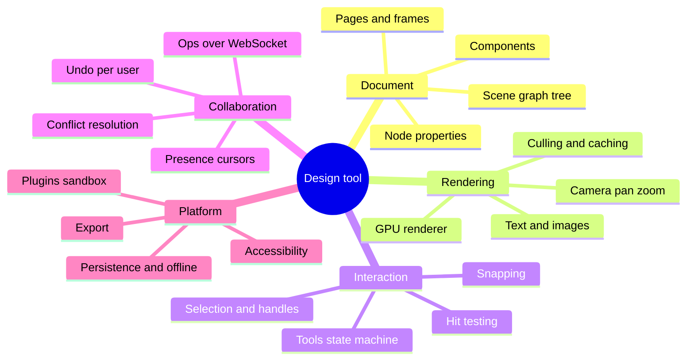
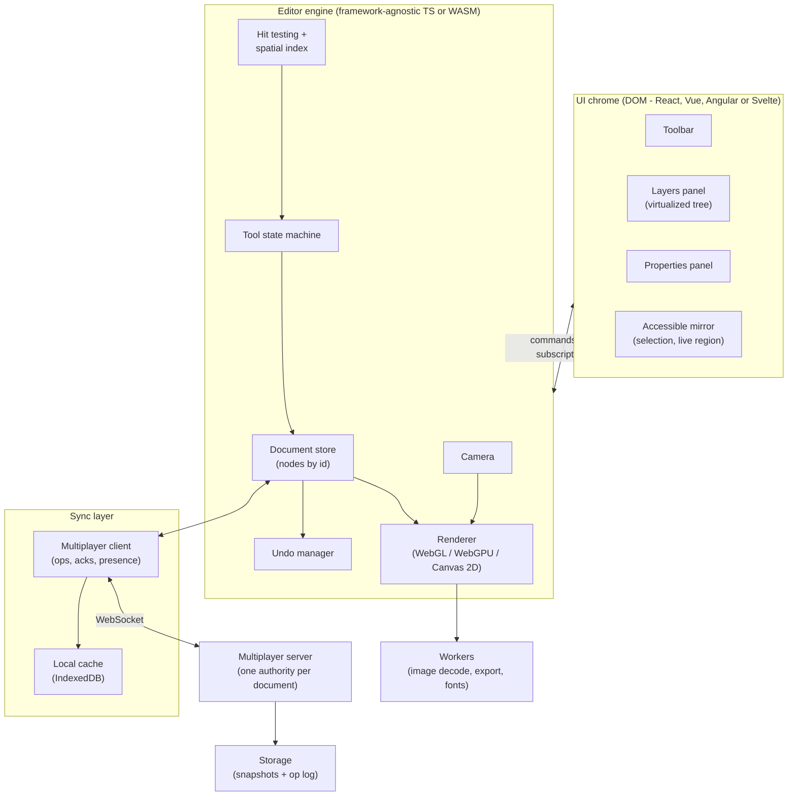
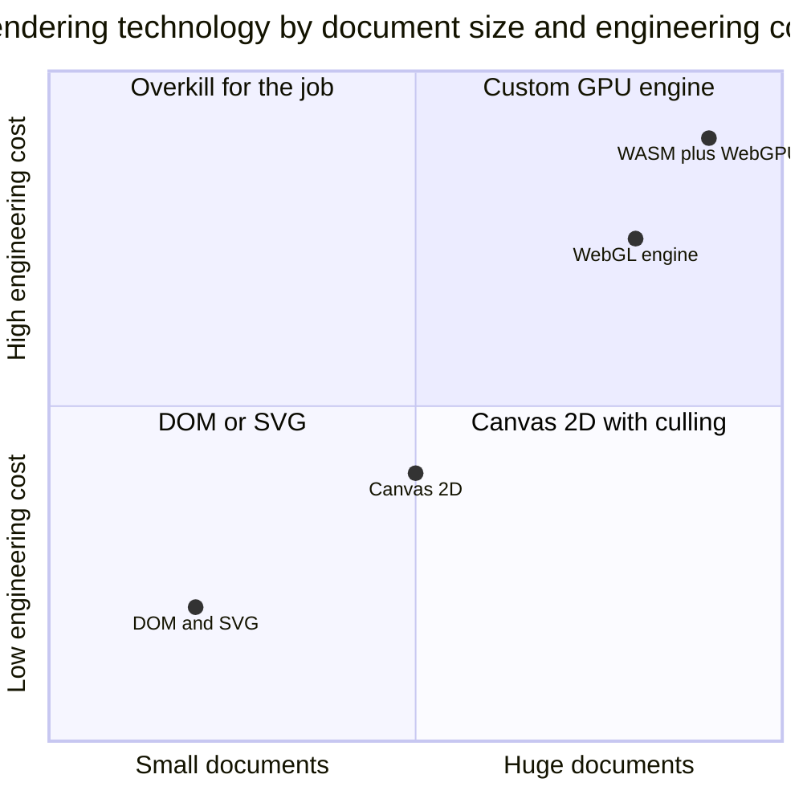
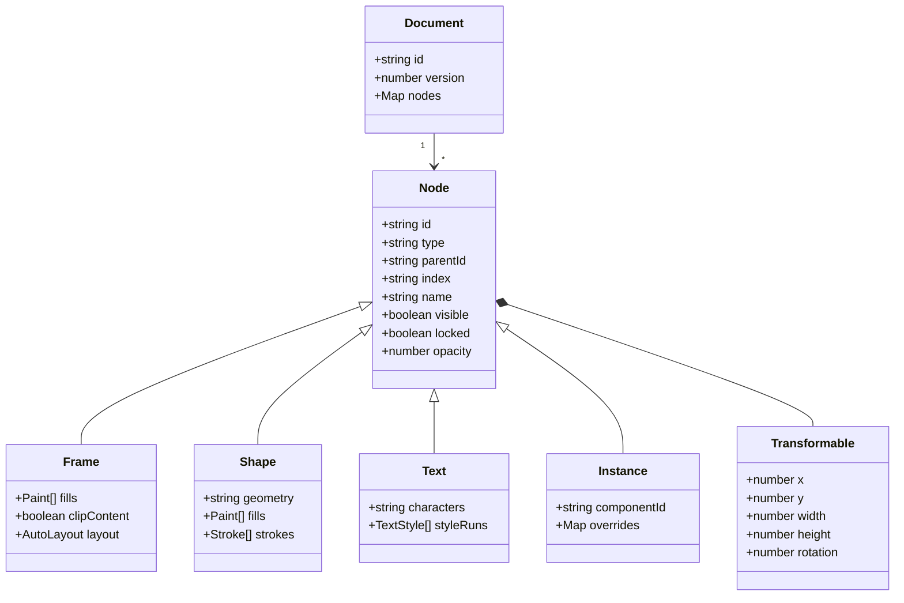
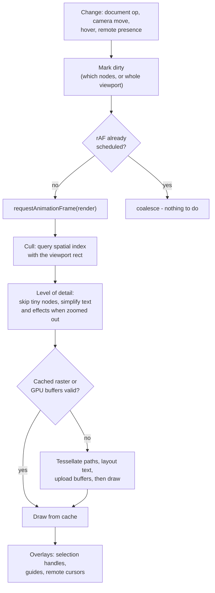
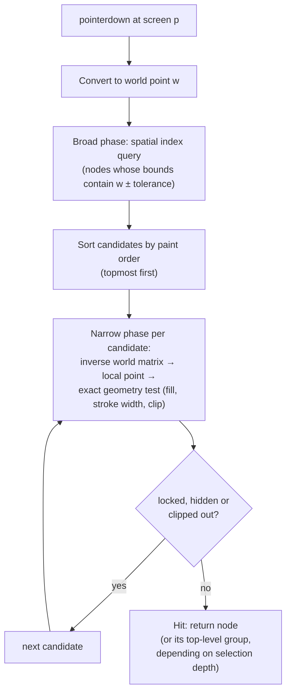
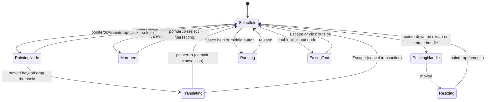
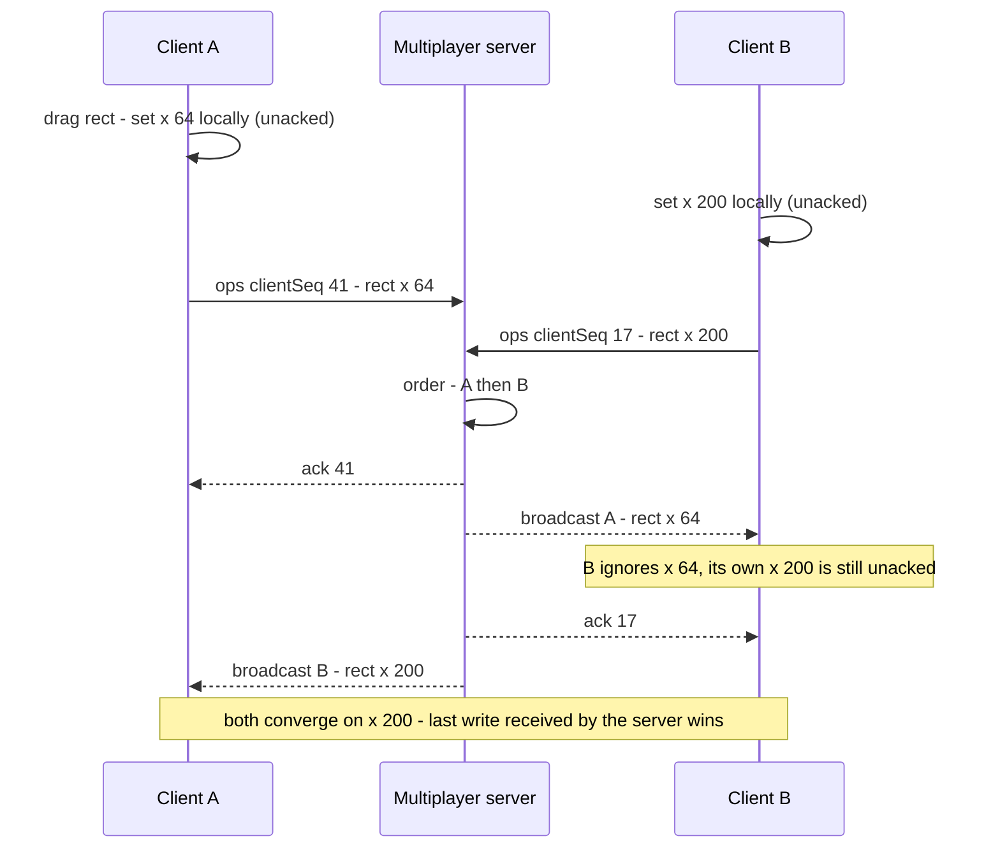
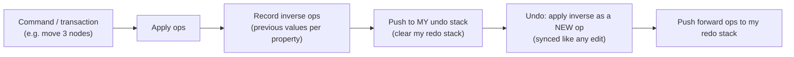
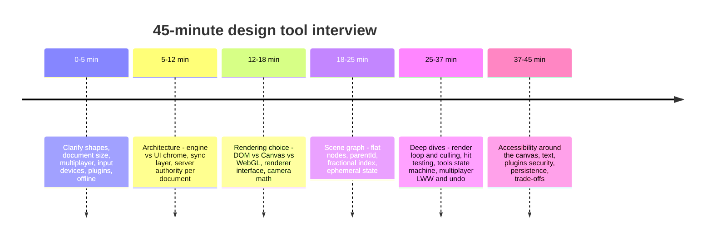

<!-- Generated by scripts/sync-knowledge.js from notes/ and README.md — do not edit here. -->
<!-- sections (line ranges in this file): Table of Contents 19-42 · ELI5 43-56 · Core Concept 57-539 · Interview Walkthrough 540-575 · Real-World Examples 576-781 · Key Points Summary 782-805 · Test Your Understanding 806-879 · Cheat Sheet 880-930 · References & Further Reading 931-968 -->

# Design a Design Tool (Figma-like Canvas)

> **Date:** 2026-11-06 · **Last updated:** 2026-11-06
> **Category:** Frontend System Design
> **Sub-Topic:** System Design Cases / Advanced (infinite canvas editors, real-time collaborative graphics)
> **Level:** Advanced · **Reading time:** ~42 min
> **Informs:** rendering technology for editors (DOM/SVG vs Canvas 2D vs WebGL vs WebGPU, WASM core), scene-graph document model (normalized nodes, parent pointers, fractional indexing), camera and coordinate transforms, render-on-demand loop with viewport culling and spatial indexes, hit testing and selection, tool state machines and pointer input (coalesced events, pointer capture, pinch), multiplayer sync (server-authoritative LWW vs OT vs CRDT, presence), undo/redo in a shared document, canvas accessibility (parallel DOM, layers tree), plugin sandboxing, export and tainted canvases, persistence and offline

> **Pre-requisite:** [Real-Time Data Sync](./real-time-data-sync.md) (OT, CRDTs, presence) and [Web Workers for Heavy Computation](./web-workers-for-heavy-computation.md) (OffscreenCanvas, WASM in workers).
> This is the final case of the roadmap. It applies **RADIO** to the hardest kind of frontend: an **infinite-canvas editor** where many people edit the same vector document at once — Figma, Excalidraw, tldraw, Miro, Canva.

**Previous:** [Design a Calendar Component](./design-a-calendar-component.md) · **Next:** End of the roadmap 🎉

---

## Table of Contents

1. [ELI5 — Simple Explanation](#eli5--simple-explanation)
2. [Section 1: Requirements (R)](#section-1-requirements-r)
3. [Section 2: Architecture (A)](#section-2-architecture-a)
4. [Section 3: Choosing the Rendering Technology](#section-3-choosing-the-rendering-technology)
5. [Section 4: Data Model (D) — The Scene Graph](#section-4-data-model-d--the-scene-graph)
6. [Section 5: Camera and Coordinate Spaces](#section-5-camera-and-coordinate-spaces)
7. [Section 6: Interface (I)](#section-6-interface-i)
8. [Section 7: Optimizations — The Render Loop (O)](#section-7-optimizations--the-render-loop-o)
9. [Section 8: Optimizations — Hit Testing, Selection and Snapping](#section-8-optimizations--hit-testing-selection-and-snapping)
10. [Section 9: Optimizations — Tools and Pointer Input](#section-9-optimizations--tools-and-pointer-input)
11. [Section 10: Optimizations — Multiplayer](#section-10-optimizations--multiplayer)
12. [Section 11: Optimizations — Undo and Redo](#section-11-optimizations--undo-and-redo)
13. [Section 12: Optimizations — Accessibility, Text, Security, Persistence](#section-12-optimizations--accessibility-text-security-persistence)
14. [Interview Walkthrough](#interview-walkthrough)
15. [Real-World Examples](#real-world-examples)
16. [Key Points Summary](#key-points-summary)
17. [Test Your Understanding (with answers)](#test-your-understanding)
18. [Cheat Sheet](#cheat-sheet)
19. [References & Further Reading](#references--further-reading)

---

## ELI5 — Simple Explanation

Imagine a **giant whiteboard the size of a football field**, and you look at it through a **camera** on a drone:
- You can **fly** around (pan) and **move closer or farther** (zoom). The board doesn't move — your camera does.
- Everything on the board is a **sticker** (rectangle, text, image) stuck on **transparent sheets** stacked on top of each other (layers). A sticker can sit inside a **frame** sticker, which can sit inside another — that's a **tree**.
- The camera only **paints what it can see**. Stickers on the other side of the field are skipped.
- When you tap the board, you need to know **which sticker you touched** — the top one under your finger (**hit testing**).
- **Ten friends** draw on the same board at once. A referee (the **server**) decides the final answer when two people change the same sticker at the same moment, and everyone sees each other's **cursors** floating around.
- **Undo** takes back *your* last move, not your friend's.

> **A design tool is a document database (a scene graph) + a camera + a GPU renderer + a tool state machine + a sync engine. The DOM is for the panels around the canvas; the canvas itself is your own mini rendering engine.**

---

## Core Concept — Step by Step

### Section 1: Requirements (R)

**Questions to ask the interviewer:**

| Question | Why it changes the design |
|---|---|
| **What can users create?** Shapes, vector paths, text, images, frames, auto-layout, components? | Scene-graph node types, layout engine, text engine |
| **How big are documents?** Hundreds of nodes, or hundreds of thousands? | DOM/SVG is fine for small; large needs a GPU renderer, culling, spatial index, maybe WASM |
| **Real-time collaboration?** How many concurrent editors per file? | Sync engine (LWW/OT/CRDT), presence, server design |
| **Offline** editing? | Local persistence, op queue, merge on reconnect |
| **Input devices**: mouse, trackpad, touch, pen with pressure? | Pointer Events, coalesced events, gestures |
| **Fidelity**: pixel-exact export, PDF, SVG, code handoff? | Same renderer for export; server-side rendering of thumbnails |
| **Plugins / extensibility**? | Sandbox, permission model, API surface |
| **Platforms**: desktop browser only, or tablets? Desktop app wrapper? | Gesture handling, memory limits on mobile |
| **History / versions**, comments, prototyping? | Snapshots, comment anchors, a separate "viewer" mode |

**Functional requirements (typical interview scope):**
- Infinite canvas with **pan and zoom**; pages; frames.
- Create and edit **rectangles, ellipses, lines, vector paths, text, images**.
- **Select** (click, Shift-click, marquee), **move, resize, rotate**, group, reorder layers.
- **Layers panel** (tree) and **properties panel** (position, size, fill, stroke, text).
- **Snapping and smart guides**.
- **Undo/redo**, copy/paste, duplicate.
- **Real-time multiplayer** with live cursors and selections.
- **Export** selection to PNG/SVG.

**Non-functional requirements:**
- **60 fps** pan/zoom/drag with thousands of visible nodes on a typical laptop.
- **Fast file open** even for large documents (progressive loading).
- **Edits never lost**: autosave, survive reconnects and tab crashes.
- **Convergence**: all clients end up with the same document.
- **Accessible** panels and keyboard operation; a sensible screen-reader story for the canvas.
- **Secure**: untrusted plugins and pasted content can't steal data.



---

### Section 2: Architecture (A)



**The most important boundary:** the **engine** owns the document, camera, tools and rendering; the **UI chrome** is an ordinary component app that reads engine state through subscriptions and sends **commands** (`setFill(ids, color)`). The canvas **does not** re-render through the UI framework — a React re-render per pointermove would never hit 60 fps.

**Rendering strategy (pages, not pixels):**
- **Marketing site, file browser, community pages:** SSR/SSG as usual — fast, indexable.
- **Editor route:** a client-side app (CSR). Load the shell and engine code in parallel with the document snapshot; show the **current page** first and stream the rest. Cache static engine assets (WASM, fonts) aggressively ([Browser Caching Strategies](./browser-caching-strategies.md)).
- **Thumbnails / previews:** rendered server-side with the **same renderer** (e.g. headless or native build of the engine) so they match the editor.

---

### Section 3: Choosing the Rendering Technology

| Technology | How it draws | Good for | Limits |
|---|---|---|---|
| **DOM / HTML + CSS** | One element per shape, browser layout | Small boards, rich text, easy a11y (tldraw renders shapes as DOM/SVG) | Layout/paint per element; thousands of nodes get slow |
| **SVG** | Retained vector DOM | Crisp vectors, easy export, hit testing via DOM events | Same DOM cost; filters/effects expensive |
| **Canvas 2D** | Immediate-mode drawing calls | Whiteboards with simple shapes (Excalidraw uses Canvas 2D) | You implement hit testing, redraw logic; CPU-bound at scale |
| **WebGL 2** | GPU, you write shaders | Large documents, smooth zoom, effects; Figma's renderer historically | Much more code: tessellation, text, antialiasing |
| **WebGPU** | Modern GPU API, compute shaders | Newest engines; compute for effects | Shipped in Chromium (desktop since 2023), Safari 26, Firefox (Windows first) — **keep a WebGL fallback** |
| **WASM core** | C++/Rust engine compiled to WebAssembly, drawing via WebGL/WebGPU | Performance-critical geometry, text layout, shared code with native/server | Bigger download, harder debugging, JS ↔ WASM boundary costs ([WebAssembly (WASM) in Frontend](./webassembly-wasm-in-frontend.md)) |



> Qualitative positions, not measurements. Figma's engineering blog describes a C++ core compiled to WebAssembly that renders with WebGL (and later posts discuss moving to WebGPU). You don't need that in an interview — say **why** you'd pick each tier.

**Interview answer:** start with **Canvas 2D or WebGL behind a renderer interface**, add culling and caching; move hot paths to WASM or WebGPU only when profiling justifies it. Keep the **document model independent of the renderer** so you can swap it.

---

### Section 4: Data Model (D) — The Scene Graph



**Design decisions:**

| Decision | Choice | Why |
|---|---|---|
| **Storage shape** | Flat map `nodesById`, each node has `parentId` | O(1) lookup; moving a node = change one field; easy to sync per property |
| **Child order** | **Fractional index** string per node (`"a0"`, `"a0V"`, `"a1"`), sort siblings by it | Insert between two siblings without renumbering; concurrent inserts don't conflict on a shared array |
| **Transforms** | Local `x, y, rotation` (+ size) relative to parent; **world matrix computed and cached** | Moving a frame moves its children for free; invalidate the cache down the subtree |
| **Properties** | Plain, granular fields (`fills`, `opacity`, `characters`) | Conflict resolution and undo work **per property** |
| **Components** | Main component + instances with **overrides** | Edits to the main propagate; overrides win locally |
| **Ephemeral state** | Selection, hover, camera, presence **outside** the document | Not undoable, not persisted, not synced as document ops |
| **Derived data** | Bounds, world matrices, spatial index, render caches | Recomputed from the document; never synced |

```text
nodesById
  "page:1"   { type: "PAGE",  parentId: "doc",    index: "a0" }
  "frm:9"    { type: "FRAME", parentId: "page:1", index: "a0", x: 0,  y: 0,  width: 1440, height: 900 }
  "rect:12"  { type: "RECT",  parentId: "frm:9",  index: "a0", x: 40, y: 40, width: 200,  height: 120, fills: [...] }
  "text:13"  { type: "TEXT",  parentId: "frm:9",  index: "a1", x: 40, y: 180, characters: "Hello" }

derived (never synced)
  worldMatrix["rect:12"], bounds["rect:12"], rtree, glyph atlas, tile cache
```

---

### Section 5: Camera and Coordinate Spaces

Three coordinate spaces exist in every canvas editor:

| Space | Meaning | Used for |
|---|---|---|
| **Screen (CSS px)** | Relative to the canvas element | Pointer events, DOM overlays |
| **World (document units)** | The infinite board | Node positions, hit testing, snapping |
| **Device px** | Screen × `devicePixelRatio` | Backing-store size of the canvas so lines are crisp on HiDPI |

```text
camera = { x, y, zoom }                 // world point shown at the canvas's top-left, and scale
screen = (world - camera.xy) * zoom
world  = screen / zoom + camera.xy

Zoom around the cursor p (screen) — the world point under p must stay put:
  w      = p / zoom + camera.xy
  zoom'  = clamp(zoom * factor)
  camera.xy' = w - p / zoom'
```

- Size the canvas backing store to `cssSize × devicePixelRatio` and scale the context, or everything looks blurry on HiDPI screens; update on DPR changes (moving the window between monitors) — see [Web APIs (Intersection Observer, ResizeObserver)](./web-apis-intersection-observer-resizeobserver.md).
- Nodes have their own **local** spaces (rotation, nesting); hit testing converts the pointer into each candidate's local space with the **inverse** world matrix.
- **Floating precision:** far from the origin at high zoom, 32-bit floats on the GPU lose precision → jittery rendering. Render relative to the camera (subtract the camera position on the CPU in 64-bit before sending to the GPU).

---

### Section 6: Interface (I)

**Engine API (what the UI chrome and plugins talk to):**

```typescript
interface EditorEngine {
  // Commands (all undoable unless noted; one call = one undo step unless inside a transaction)
  createNode(type: NodeType, props: Partial<NodeProps>, parentId: string, index?: string): string;
  updateNodes(ids: string[], patch: Partial<NodeProps>): void;
  deleteNodes(ids: string[]): void;
  reparent(ids: string[], newParentId: string, index: string): void;
  transaction<T>(label: string, fn: () => T): T;     // groups many changes into one undo step
  undo(): void; redo(): void;

  // Ephemeral (not undoable, not in the document)
  setSelection(ids: string[]): void;
  setTool(tool: 'select' | 'hand' | 'rect' | 'ellipse' | 'pen' | 'text'): void;
  setCamera(cam: { x: number; y: number; zoom: number }): void;

  // Reads + subscriptions (for React/Vue/Angular/Svelte panels)
  getNode(id: string): Readonly<Node> | undefined;
  subscribe(selector: (s: EngineState) => unknown, cb: () => void): () => void;
}
```

**Server contract:**

```http
GET  /api/files/:fileId                      → 200 metadata + snapshot URL + version
GET  /api/files/:fileId/snapshot?page=page:1 → binary snapshot (current page first; other pages lazily)
WS   wss://mp.example.com/files/:fileId      → bidirectional messages below
POST /api/files/:fileId/images               → upload image → { hash, url } (content-addressed)
POST /api/files/:fileId/exports              { nodeIds, format: "png" | "svg" | "pdf", scale } → job id
```

```text
client → server   { t: "ops",  clientSeq: 41, ops: [ { id: "rect:12", set: { x: 64 } }, ... ] }
server → client   { t: "ack",  clientSeq: 41, version: 9012 }
server → all      { t: "ops",  version: 9012, author: "u_7", ops: [...] }
both ways         { t: "presence", cursor: { x, y }, selection: ["rect:12"], viewport: {...} }   (not persisted)
server → client   { t: "reject", clientSeq: 42, reason: "cycle" }                              (e.g. reparent into own child)
```

| API rule | Why |
|---|---|
| **Commands, not setters on objects** | Every change goes through one path → undo, sync, validation, plugins all see it |
| **Transactions** | A drag produces hundreds of updates but must be one undo step and few network messages |
| **Ephemeral vs document state** separated | Presence and selection don't pollute history or storage |
| **Content-addressed images** | Same image pasted twice is stored once; cacheable forever |

---

### Section 7: Optimizations — The Render Loop (O)



**Techniques:**
- **Render on demand**, not every frame: an idle editor should use ~0% CPU. One `requestAnimationFrame` per frame at most, coalescing all changes ([JavaScript Runtime & Event Loop](./javascript-runtime-event-loop.md)).
- **Viewport culling** with a **spatial index** (R-tree or quadtree) of world-space bounds; update entries only for changed nodes.
- **Caching:** cache tessellated geometry and rasterized complex nodes (text blocks, blurred effects) as textures; invalidate on change. Some engines tile the canvas at each zoom level.
- **Level of detail:** when zoomed out, draw tiny nodes as rectangles or skip them; render text as gray bars below a pixel threshold.
- **Separate layers:** draw the document and the **interaction overlay** (handles, marquee, cursors) on separate canvases or passes, so moving a remote cursor doesn't redraw the document.
- **Off the main thread:** `OffscreenCanvas` lets a worker own rendering; images decode with `createImageBitmap` in workers; export runs in a worker ([Web Workers for Heavy Computation](./web-workers-for-heavy-computation.md)). Check MDN for WebGL/WebGPU-in-worker support per browser.
- **Memory:** GPU textures are limited — evict caches for off-screen content; handle `webglcontextlost` (restore and rebuild buffers).

---

### Section 8: Optimizations — Hit Testing, Selection and Snapping



- **Broad phase** keeps it fast: an R-tree query is logarithmic-ish in node count instead of scanning everything.
- **Narrow phase:** for Canvas 2D, `ctx.isPointInPath(path2d, x, y)` and `isPointInStroke` work on `Path2D` objects; for GPU renderers use geometry math, or a **color-ID picking buffer** (render each node with a unique color offscreen, read one pixel).
- **Tolerance:** thin lines need a hit radius in **screen pixels** (e.g. a few px) converted to world units at the current zoom.
- **Selection depth:** a click selects the top-level group/frame child; double-click enters the group (a convention most tools follow); a modifier key selects deep.
- **Marquee:** query the index with the marquee rectangle; decide "intersects" vs "fully contains" (tools differ).
- **Snapping / smart guides:** while dragging, collect candidate edges and centers of nearby nodes from the index; snap if within a few screen pixels; draw guides in the overlay. Disable with a modifier key.

---

### Section 9: Optimizations — Tools and Pointer Input



**Why a state machine:** every tool (select, rectangle, pen, text, hand) is a set of states with explicit transitions. It prevents "stuck drag" bugs, makes `Escape` cancel cleanly, and is easy to test.

**Pointer handling rules:**
- **Pointer Events** for mouse, pen and touch; `setPointerCapture` on pointerdown so drags continue outside the canvas.
- `touch-action: none` on the canvas so the browser doesn't scroll or zoom the page while drawing.
- **`getCoalescedEvents()`** gives the intermediate points the browser merged into one `pointermove` — essential for smooth pen/freehand strokes (supported in Chromium and Firefox, and in Safari since 18.2 — feature-detect). `pressure`, `tiltX/Y` for pens.
- **Trackpad pinch:** Chromium and Firefox report it as `wheel` events with `ctrlKey: true`; Safari also has proprietary `gesture*` events — test on each browser. Two-finger scroll = pan; Ctrl/Cmd + wheel = zoom.
- **Drag threshold** (a few px) separates click from drag.
- **Keyboard:** arrows nudge selection by 1 unit and Shift+arrows by 10 (a common convention); Space-drag pans; shortcuts must not fire while typing in panels or text.
- Apply input in `requestAnimationFrame`, not per event; one transaction per gesture.

---

### Section 10: Optimizations — Multiplayer

See [Real-Time Data Sync](./real-time-data-sync.md) for OT and CRDT fundamentals.

| Approach | How conflicts resolve | Fits a design tool? |
|---|---|---|
| **OT** (operational transformation) | Server transforms concurrent operations against each other | Designed for text sequences; complex for trees of objects |
| **CRDT** (Yjs, Automerge, Loro) | Data types that merge automatically without a central authority | Works well, including peer-to-peer and offline; metadata overhead; tree moves need care |
| **Server-authoritative, per-property last-writer-wins** | Server orders all changes; for the same property of the same object, the last one the server receives wins | Simple and fast for object documents — Figma has described this approach ("CRDT-inspired", with a central server) |

**Figma-style protocol (as described in Figma's multiplayer post):**
- The document is a map of **objects → properties**. Changes to **different properties or objects never conflict**.
- Same property, same object, concurrent writes → **last write the server receives wins**.
- The client applies its own changes **immediately** (optimistic) and keeps them as **unacknowledged**; incoming server values for those properties are **ignored until the ack arrives**, so the UI doesn't flicker back.
- Tree structure uses a **parent pointer** + **fractional index** on each child; the server rejects changes that would create **cycles** (A inside B inside A).



**Presence** (cursors, selections, viewports):
- **Ephemeral** messages on the same socket, **throttled** (e.g. a few to a few dozen per second) and **interpolated** on receivers for smooth movement.
- Never stored or undoable; dropped on disconnect.
- Hide or summarize when many users are in the file; follow mode ("spotlight") is just following someone's viewport.

**Reconnect and offline:** queue unacknowledged ops (and persist them in IndexedDB), resend on reconnect with the last known server version; the server replays missed ops or sends a fresh snapshot.

---

### Section 11: Optimizations — Undo and Redo



- **Command pattern with inverse operations:** store, for each changed property, the previous value. Undo applies those values as a **new change**, so multiplayer sees it as a normal edit.
- **Per-user stacks:** undo only **your** changes. If someone else changed the same property afterwards, a common policy is to still apply your inverse (last write wins), or skip that property — decide and be consistent. Figma's post describes the guiding principle that undoing a lot, then redoing back, should leave the document as it was.
- **Transactions / merging:** a drag (hundreds of moves) is **one** step; typing in a text node merges keystrokes into word-sized steps.
- **Selection is restored** with each undo step (store it in the entry) so users see what changed — but selection itself isn't a document change.
- **Not undoable:** camera, tool changes, presence, remote users' edits.
- **Memory:** cap the history length; store diffs, not snapshots.

---

### Section 12: Optimizations — Accessibility, Text, Security, Persistence

**Accessibility** — a `<canvas>` is a single opaque image to assistive technology, so build the accessible experience **around** it:
- The **layers panel** is the accessible view of the document: a `role="tree"` with names, types and nesting; selecting there selects on the canvas ([ARIA Roles, States & Properties](./aria-roles-states-and-properties.md)).
- The **properties panel** is a normal form — labeled inputs for X, Y, W, H, fill, text.
- **Keyboard parity:** Tab between regions; select next/previous sibling, enter group, nudge, resize via inputs; no action that **requires** dragging (WCAG 2.5.7).
- Announce selection changes and results ("Rectangle 12 selected, 200 by 120") via a polite live region.
- Optionally keep a **hidden parallel DOM** of focusable nodes (or ARIA on a fallback subtree inside `<canvas>`) for the current frame — expensive to sync, so scope it to visible or selected content.
- Respect `prefers-reduced-motion` (animated camera moves) and forced-colors for the chrome; make handles and focus indicators visible on any background.
- For **exported** content and prototypes, let authors set alt text and semantics.

**Text** — the hardest part of a custom renderer:
- Shaping (ligatures, Arabic joining, Indic scripts), bidi, line breaking and font fallback need a real text engine — either the **browser's** (Canvas `fillText`/DOM measurement) or a bundled one (e.g. HarfBuzz compiled to WASM) for identical results across platforms.
- **Editing** uses a hidden `<textarea>`/`contenteditable` overlay positioned over the text node so **IME composition**, spellcheck, accessibility and clipboard work; the canvas draws the result.
- **Fonts:** load web fonts with the CSS Font Loading API before measuring; the Local Font Access API (`queryLocalFonts`) is **Chromium-only** and permission-gated — always have a fallback ([Font Loading Strategies](./font-loading-strategies.md)).

**Security:**
- **Plugins** run untrusted code: isolate them (a sandboxed iframe on another origin and/or a separate JS VM such as QuickJS compiled to WASM — Figma has written about using a sandboxed VM for plugin logic plus an iframe for plugin UI). Expose a narrow, permissioned API; never give plugins the page's cookies or DOM.
- **Pasted SVG/HTML** may contain scripts or external references — parse into your own node model; never inject it as markup ([XSS Prevention](./xss-prevention-reflected-stored-dom.md)).
- **Tainted canvas:** drawing a cross-origin image without CORS (`crossorigin` + `Access-Control-Allow-Origin`) taints the canvas, and then `toBlob`/`getImageData` throw — serve user images from your origin or with CORS ([CORS & Same-Origin Policy](./cors-and-same-origin-policy.md)).
- Authorization per file and per action on the server (viewers can't send ops); validate every op server-side (types, bounds, cycles).

**Persistence and loading:**
- Server stores **snapshots + an op log**; clients load a binary snapshot (current page first) then apply ops since that version.
- Cache recent documents in **IndexedDB** for instant reopen and offline editing; mark pending ops and resync.
- **Autosave** is implicit — every acked op is saved; show a clear "Saving… / All changes saved / Offline" indicator.
- Images are **content-addressed** uploads (hash → URL), decoded off the main thread, and downscaled (mipmaps) for low zoom levels.

**Clipboard:** the Async Clipboard API can write several representations at once (`ClipboardItem` with `text/html`, `image/png`, `text/plain`) so pasting into other apps works; your own app can embed its node data in the HTML. Custom MIME types have limited, browser-specific support — feature-detect.

---

## Interview Walkthrough



**What to say, in order:**
1. **Scope and scale** — "How many nodes? How many simultaneous editors?" These two numbers choose the renderer and the sync model.
2. **Draw the engine/chrome split.** The canvas is a custom renderer; panels are normal components fed by subscriptions.
3. **Rendering:** pick a tier and justify it; show the camera formulas; mention DPR.
4. **Scene graph:** flat map, parent pointers, fractional indexing, derived data not synced.
5. **Deep dive** where the interviewer leans: render loop (dirty flag, culling, caching), hit testing (broad + narrow phase), or multiplayer (per-property LWW, unacked local changes, cycles, presence).
6. **Undo:** per-user stacks of inverse ops, transactions.
7. **Close** with accessibility (layers tree, keyboard parity), text/IME, plugin sandboxing, tainted canvas, persistence.

**Trade-offs to discuss:**

| Decision | Option A | Option B | Lean |
|---|---|---|---|
| Renderer | DOM/SVG (fast to build, accessible) | Canvas/WebGL (scales) | DOM/SVG for small whiteboards; GPU for a Figma-class tool |
| Engine language | TypeScript | C++/Rust → WASM | TypeScript first; WASM for proven hot paths |
| Sync model | Server-authoritative LWW per property | CRDT library | LWW + server for object docs with a central server; CRDT for offline/peer-to-peer |
| Child order | Array of child IDs | Fractional index per child | Fractional (concurrent inserts) |
| Text | Browser text APIs | Bundled shaping engine (WASM) | Browser first; bundled when cross-platform fidelity matters |
| Rendering cadence | Continuous loop | On demand (dirty + rAF) | On demand |
| Accessibility | Parallel DOM for all nodes | Layers tree + panels + announcements | Layers tree first; parallel DOM scoped to visible/selected |

---

## Real-World Examples

**Example 1 — Camera math (screen ↔ world, zoom around the cursor):**
```typescript
export interface Camera { x: number; y: number; zoom: number }   // world point at the canvas top-left

export const toWorld = (c: Camera, sx: number, sy: number) => ({ x: sx / c.zoom + c.x, y: sy / c.zoom + c.y });
export const toScreen = (c: Camera, wx: number, wy: number) => ({ x: (wx - c.x) * c.zoom, y: (wy - c.y) * c.zoom });

export function zoomAt(c: Camera, sx: number, sy: number, factor: number, min = 0.02, max = 256): Camera {
  const w = toWorld(c, sx, sy);
  const zoom = Math.min(max, Math.max(min, c.zoom * factor));
  return { zoom, x: w.x - sx / zoom, y: w.y - sy / zoom };       // keeps w under the cursor
}

// Wheel: Ctrl/Cmd (or trackpad pinch, reported as ctrlKey in Chromium/Firefox) zooms; otherwise pan.
canvas.addEventListener('wheel', (e) => {
  e.preventDefault();                                              // needs { passive: false }
  const rect = canvas.getBoundingClientRect();
  const sx = e.clientX - rect.left, sy = e.clientY - rect.top;
  camera = e.ctrlKey || e.metaKey
    ? zoomAt(camera, sx, sy, Math.exp(-e.deltaY * 0.01))
    : { ...camera, x: camera.x + e.deltaX / camera.zoom, y: camera.y + e.deltaY / camera.zoom };
  requestRender();
}, { passive: false });
```

**Example 2 — Render on demand with culling (Canvas 2D, HiDPI-correct):**
```typescript
import RBush from 'rbush';

interface Item { minX: number; minY: number; maxX: number; maxY: number; id: string }
const index = new RBush<Item>();          // world-space bounds; update only for changed nodes

let scheduled = false;
export function requestRender() {
  if (scheduled) return;                  // coalesce many changes into one frame
  scheduled = true;
  requestAnimationFrame(() => { scheduled = false; render(); });
}

function render() {
  const dpr = window.devicePixelRatio || 1;
  const { clientWidth: w, clientHeight: h } = canvas;
  if (canvas.width !== Math.round(w * dpr) || canvas.height !== Math.round(h * dpr)) {
    canvas.width = Math.round(w * dpr);   // backing store in device pixels
    canvas.height = Math.round(h * dpr);
  }
  const ctx = canvas.getContext('2d')!;
  ctx.setTransform(1, 0, 0, 1, 0, 0);
  ctx.clearRect(0, 0, canvas.width, canvas.height);
  ctx.setTransform(dpr * camera.zoom, 0, 0, dpr * camera.zoom, -camera.x * camera.zoom * dpr, -camera.y * camera.zoom * dpr);

  const tl = toWorld(camera, 0, 0), br = toWorld(camera, w, h);
  const visible = index.search({ minX: tl.x, minY: tl.y, maxX: br.x, maxY: br.y });   // culling
  visible.sort((a, b) => paintOrder(a.id) - paintOrder(b.id));

  for (const item of visible) {
    const sizeOnScreen = (item.maxX - item.minX) * camera.zoom;
    if (sizeOnScreen < 0.5) continue;                                 // level of detail: skip sub-pixel nodes
    drawNode(ctx, doc.nodes.get(item.id)!);
  }
  drawOverlay();   // selection handles, guides, remote cursors — ideally a second canvas
}
```

**Example 3 — Hit testing: broad phase with the index, narrow phase with `Path2D`:**
```typescript
export function hitTest(sx: number, sy: number): string | null {
  const p = toWorld(camera, sx, sy);
  const tol = 4 / camera.zoom;                                       // 4 screen px, in world units
  const candidates = index.search({ minX: p.x - tol, minY: p.y - tol, maxX: p.x + tol, maxY: p.y + tol });
  candidates.sort((a, b) => paintOrder(b.id) - paintOrder(a.id));    // topmost first

  for (const c of candidates) {
    const node = doc.nodes.get(c.id)!;
    if (!node.visible || node.locked) continue;
    const inv = worldMatrix(node.id).inverse();                      // DOMMatrix
    const local = inv.transformPoint(new DOMPoint(p.x, p.y));
    const path = geometryPath(node);                                 // cached Path2D in local space
    hitCtx.lineWidth = (node.strokeWidth ?? 0) + tol * 2;
    if ((node.fills?.length && hitCtx.isPointInPath(path, local.x, local.y)) ||
        hitCtx.isPointInStroke(path, local.x, local.y)) {
      return selectableAncestor(node.id);                            // respect group selection depth
    }
  }
  return null;
}
// hitCtx is an offscreen 2D context with an identity transform, used only for path tests.
```

**Example 4 — Fractional indexing for layer order:**
```typescript
import { generateKeyBetween } from 'fractional-indexing';

// siblings sorted by index: ["a0", "a1", "a2"]
const between = generateKeyBetween('a0', 'a1');   // a key that sorts between "a0" and "a1"
const atEnd   = generateKeyBetween('a2', null);   // after the last
const atStart = generateKeyBetween(null, 'a0');   // before the first

// Move "rect:12" above "text:13" = change ONE property → one small op, no renumbering of siblings
engine.updateNodes(['rect:12'], { index: generateKeyBetween(indexOf('text:13'), indexOfNextSibling('text:13')) });
// If two users insert at the same spot concurrently they can get equal keys —
// break ties deterministically (e.g. by node id) or add a random suffix.
```

**Example 5 — Undo manager with transactions and inverse ops:**
```typescript
type Patch = Record<string, Record<string, unknown>>;   // nodeId → { prop: value }
interface Entry { label: string; forward: Patch; inverse: Patch; selectionBefore: string[] }

export class UndoManager {
  private undoStack: Entry[] = [];
  private redoStack: Entry[] = [];
  private open: Entry | null = null;

  begin(label: string, selection: string[]) { this.open ??= { label, forward: {}, inverse: {}, selectionBefore: selection }; }

  record(id: string, prop: string, before: unknown, after: unknown) {
    if (!this.open) throw new Error('record() outside a transaction');
    (this.open.inverse[id] ??= {});
    if (!(prop in this.open.inverse[id])) this.open.inverse[id][prop] = before;   // keep the FIRST before-value
    (this.open.forward[id] ??= {})[prop] = after;                                 // keep the LAST after-value
  }

  commit() {
    if (this.open && Object.keys(this.open.forward).length) {
      this.undoStack.push(this.open);
      if (this.undoStack.length > 500) this.undoStack.shift();                    // cap memory
      this.redoStack = [];
    }
    this.open = null;
  }

  undo(apply: (p: Patch) => void, select: (ids: string[]) => void) {
    const e = this.undoStack.pop(); if (!e) return;
    apply(e.inverse);               // applied as a NEW change → synced to collaborators
    select(e.selectionBefore);
    this.redoStack.push(e);
  }

  redo(apply: (p: Patch) => void) {
    const e = this.redoStack.pop(); if (!e) return;
    apply(e.forward);
    this.undoStack.push(e);
  }
}
// A drag: begin() on pointerdown, record() per frame, commit() on pointerup → ONE undo step.
```

**Example 6 — Smooth freehand input with coalesced events (BAD → GOOD):**
```typescript
// ❌ BAD: one point per pointermove → jagged strokes on fast pen movement; renders per event
canvas.addEventListener('pointermove', (e) => { stroke.push([e.offsetX, e.offsetY]); render(); });

// ✅ GOOD: capture, take all coalesced points, render once per frame
canvas.addEventListener('pointerdown', (e) => {
  canvas.setPointerCapture(e.pointerId);
  undo.begin('Draw', selection);
  stroke = [];
});
canvas.addEventListener('pointermove', (e) => {
  if (!canvas.hasPointerCapture(e.pointerId)) return;
  const events = typeof e.getCoalescedEvents === 'function' ? e.getCoalescedEvents() : [e];
  for (const ev of events) {
    const p = toWorld(camera, ev.offsetX, ev.offsetY);
    stroke.push([p.x, p.y, ev.pressure || 0.5]);
  }
  requestRender();
});
canvas.addEventListener('pointerup', () => { engine.createNode('path', { points: simplify(stroke) }, currentFrame); undo.commit(); });
// CSS: canvas { touch-action: none; }  — stop the browser from panning/zooming the page
```

**Example 7 — Feeding engine state to the UI chrome without re-rendering the canvas:**
```tsx
import { useSyncExternalStore } from 'react';

export function useEngine<T>(selector: (s: EngineState) => T): T {
  return useSyncExternalStore(
    (cb) => engine.subscribe(selector, cb),       // notify only when the selected slice changes
    () => selector(engine.getState()),
  );
}

function PropertiesPanel() {
  const selected = useEngine((s) => s.selectionSummary);   // memoized in the engine: ids, shared props
  if (!selected) return <p>Nothing selected</p>;
  return (
    <form aria-label="Selection properties">
      <label>W <input type="number" value={selected.width} onChange={(e) => engine.updateNodes(selected.ids, { width: +e.target.value })} /></label>
      <label>H <input type="number" value={selected.height} onChange={(e) => engine.updateNodes(selected.ids, { height: +e.target.value })} /></label>
    </form>
  );
}
```

**Other stacks:**
- **Vue:** keep the engine **outside** Vue's reactivity (`markRaw`); expose slices via a small store that subscribes to the engine; panels are ordinary components.
- **Angular:** wrap the engine in a service exposing signals for selection and tool state; run pointer and rAF work **outside the Angular zone** in zone-based apps.
- **Svelte:** a readable store backed by `engine.subscribe`; the canvas lives in an action or `onMount`.
- **Libraries and SDKs:** Konva, Fabric.js and PixiJS (rendering), the tldraw SDK (full canvas editor), Excalidraw (embeddable whiteboard); Yjs/Automerge/Loro for CRDT sync; hosted services such as Liveblocks for presence and storage.
- **Native / desktop:** a WASM or native core can be shared with desktop wrappers and native mobile viewers; Apple PencilKit and Android's ink APIs exist for pen-first native apps.

---

## Key Points Summary

| Concept | One-Line Explanation |
|---|---|
| **Engine vs chrome** | The canvas is your own renderer; panels are normal components fed by subscriptions |
| **Renderer tiers** | DOM/SVG → Canvas 2D → WebGL → WebGPU/WASM, chosen by document size and fidelity |
| **Scene graph** | Flat `nodesById` with `parentId` and per-property fields |
| **Fractional index** | Order siblings with sortable strings; insert between without renumbering |
| **Derived data** | World matrices, bounds, spatial index, caches — recomputed, never synced |
| **Camera** | `screen = (world − camera) × zoom`; zoom around the cursor keeps the world point fixed |
| **DPR** | Backing store = CSS size × `devicePixelRatio` for crisp output |
| **Render on demand** | Dirty flag + one rAF; idle editor uses no CPU |
| **Culling + LOD** | R-tree query by viewport; skip or simplify tiny nodes |
| **Hit testing** | Broad phase (index) → narrow phase (inverse matrix + exact geometry), topmost first |
| **Tool state machine** | Explicit states for each tool; Escape cancels cleanly |
| **Coalesced events** | Recover all pointer samples for smooth strokes |
| **Per-property LWW + server** | Simple convergence for object documents; unacked local values win until ack |
| **Presence** | Throttled, interpolated, ephemeral — never stored or undoable |
| **Per-user undo** | Inverse ops applied as new changes; one transaction per gesture |
| **Canvas a11y** | Layers tree + properties form + announcements + keyboard parity |
| **Tainted canvas** | Cross-origin images without CORS block export |

---

## Test Your Understanding

**Q1 (Basic):**
Why shouldn't the canvas be rendered through React (or Vue/Angular/Svelte) components, one per shape, in a Figma-class editor?

<details>
<summary>Answer</summary>

Component frameworks reconcile a tree on every state change; a drag produces a pointermove every few milliseconds, and documents can have thousands of visible nodes. Re-rendering components (and the DOM nodes behind them) per frame costs far more than the ~16 ms budget. A canvas/GPU renderer draws the visible nodes directly from the document in one pass, with culling and caching. The framework is still ideal for the **chrome** (toolbar, layers, properties), which subscribes to small slices of engine state. For small whiteboards a DOM/SVG renderer is fine — tldraw shows that approach works — but it doesn't scale to very large documents.
</details>

**Q2 (Application):**
Write the camera update for "zoom in by 10% around the mouse pointer" and explain why it's needed.

<details>
<summary>Answer</summary>

With `screen = (world − camera) × zoom`:

```text
w = p / zoom + camera          (world point under the pointer p)
zoom' = zoom × 1.1
camera' = w − p / zoom'
```

Without adjusting the camera, zoom would scale around the canvas's top-left corner and the content under the cursor would slide away. Keeping `w` fixed under `p` is what makes trackpad pinch and Ctrl+wheel feel natural.
</details>

**Q3 (Tricky):**
Two users concurrently change the fill of the same rectangle: A sets red, B sets blue. With a server-authoritative per-property LWW model, what does each user see over time, and why doesn't A's screen flicker?

<details>
<summary>Answer</summary>

Both apply their change **locally** immediately (A sees red, B sees blue) and send it. The server orders them — say A's arrives first, then B's. The server acks A and broadcasts "red" to B; B **ignores** it because B has an **unacknowledged** local value for that same property. Then the server acks B and broadcasts "blue" to A; A has no pending change for `fill` anymore, so it applies blue. Final state on both: **blue** (the last write the server received).

A doesn't flicker because the server's echo of its own change isn't re-applied as a separate value, and B doesn't flicker to red and back because unacknowledged local values take precedence until their ack arrives — the approach Figma described for its multiplayer system.
</details>

**Q4 (Tricky):**
Users report that "Export as PNG" fails with a `SecurityError` only in files that contain images pasted from other websites. Why, and how do you fix it?

<details>
<summary>Answer</summary>

The images were drawn into the canvas from a **cross-origin URL without CORS approval**, which **taints** the canvas. After that, reading pixels (`toBlob`, `toDataURL`, `getImageData`) throws a `SecurityError` to prevent cross-origin data leaks. Fix: when an image is pasted, **upload it to your own storage** (content-addressed) and draw it from your origin or a CDN that sends `Access-Control-Allow-Origin`, loading it with `crossOrigin = 'anonymous'` (or via `fetch` + `createImageBitmap`). Never draw arbitrary third-party URLs directly.
</details>

**Q5 (Application):**
How do you make sure a single drag of 20 selected shapes is one undo step and doesn't flood the network?

<details>
<summary>Answer</summary>

Wrap the gesture in a **transaction**: `begin()` on pointerdown, apply position changes locally each frame (recording the **first** before-value and the **last** after-value per property), `commit()` on pointerup → one undo entry whose inverse restores all 20 original positions. For the network, **coalesce** ops per frame or per short interval and send only the latest value per property (intermediate positions don't matter for convergence); presence can carry the live drag preview for collaborators at a throttled rate. `Escape` aborts the transaction by applying the inverse.
</details>

**Q6 (System design):**
A canvas is inaccessible by default. Describe a practical accessibility design for a collaborative design tool.

<details>
<summary>Answer</summary>

- **Layers panel as the primary accessible model:** a `role="tree"` with node names, types and nesting; arrow-key navigation; selecting in the tree selects on the canvas and vice versa.
- **Properties panel as a form:** labeled inputs for position, size, rotation, colors, text — these are also the **non-drag alternative** for moving and resizing (WCAG 2.5.7).
- **Keyboard parity:** shortcuts for tools, nudging with arrows, entering/exiting groups, zoom to selection; shortcuts never fire while typing; remappable single-key shortcuts (WCAG 2.1.4).
- **Announcements:** a polite live region for selection changes and results ("3 layers selected", "Moved 10 px right"); collaborator activity summarized, not narrated per cursor move.
- **Text editing** through a real `<textarea>`/`contenteditable` overlay so screen readers and IMEs work.
- Optionally a **scoped parallel DOM** for visible/selected nodes for spatial exploration.
- Visible focus for handles, forced-colors support for chrome, reduced motion for camera animations, and author-provided alt text for exports and prototypes.
</details>

---

## Cheat Sheet

**Key Definitions:**
- **Scene graph:** tree of nodes (pages, frames, shapes, text) stored as a flat map with parent pointers.
- **Fractional indexing:** sortable string keys that allow inserting between any two siblings.
- **Camera:** world offset + zoom mapping world coordinates to screen coordinates.
- **Culling:** skipping nodes outside the viewport, usually via an R-tree/quadtree.
- **Broad / narrow phase:** cheap bounding-box candidate search, then exact geometry test.
- **LWW (last-writer-wins):** for one property, the most recent write (as ordered by the server) wins.
- **Presence:** ephemeral collaborator state — cursors, selections, viewports.
- **Tainted canvas:** a canvas that drew cross-origin pixels without CORS; pixel reads throw.

**Quick Reference:**
```text
Split           engine (doc, camera, tools, renderer) ↔ UI chrome via commands + subscriptions
Renderer        DOM/SVG (small) · Canvas 2D (medium) · WebGL (large) · WebGPU/WASM (proven need, with fallback)
Doc             nodesById · parentId · fractional index · per-property fields · derived data not synced
Camera          screen = (world − cam) × zoom · zoom at cursor: cam' = w − p / zoom' · canvas size × DPR
Render          dirty flag → one rAF → cull (R-tree) → LOD → cached buffers → overlay pass
Hit test        world point → index query ± tolerance/zoom → topmost first → inverse matrix → isPointInPath/Stroke
Input           Pointer Events · setPointerCapture · touch-action: none · getCoalescedEvents · ctrlKey wheel = pinch
Tools           state machine per tool · drag threshold · Escape cancels transaction
Sync            ops over WebSocket · server orders · per-property LWW · unacked local wins · reject cycles · resend on reconnect
Presence        throttled + interpolated · ephemeral · same socket
Undo            per-user stack · inverse ops applied as new ops · one transaction per gesture · restore selection
A11y            layers tree · properties form · live region · keyboard parity (2.5.7) · text via textarea overlay
Security        plugins in sandbox (iframe/VM) · parse pasted SVG · same-origin/CORS images · server validates ops
Persistence     snapshot + op log · current page first · IndexedDB cache · content-addressed images
```

**Common Mistakes to Avoid:**

| Mistake | Why Wrong | Fix |
|---|---|---|
| One framework component per shape | Re-render per frame can't hit 60 fps at scale | Custom renderer; framework for chrome only |
| Continuous render loop | Burns CPU/battery when idle | Render on demand (dirty + rAF) |
| Drawing every node every frame | Cost grows with document size | Spatial-index culling + LOD + caches |
| Ignoring `devicePixelRatio` | Blurry output on HiDPI | Backing store × DPR, scale context |
| Children stored as an ordered array | Concurrent inserts/reorders conflict | Fractional index on each child |
| Syncing derived data (bounds, matrices) | Wasted bandwidth, inconsistency | Sync only source properties |
| Selection/camera in undo history | Undo feels broken | Ephemeral state outside the document |
| Global undo across users | Undoing a collaborator's work | Per-user stacks of inverse ops |
| One undo step per pointermove | Undo replays a drag frame by frame | Transactions per gesture |
| Hit testing with bounding boxes only | Clicking near a rotated/thin shape selects it | Inverse matrix + exact geometry + screen-px tolerance |
| Drawing third-party image URLs directly | Tainted canvas breaks export | Upload to own origin / CORS images |
| Running plugin code in the page | Full access to user data and session | Sandboxed iframe/VM with a narrow API |
| Canvas-only UI | Inaccessible | Layers tree, properties form, announcements |
| Text input drawn only on canvas | Breaks IME, spellcheck, screen readers | Hidden textarea/contenteditable overlay |

---

## References & Further Reading

**Core docs**
- MDN: [Canvas API](https://developer.mozilla.org/en-US/docs/Web/API/Canvas_API) · [Optimizing canvas](https://developer.mozilla.org/en-US/docs/Web/API/Canvas_API/Tutorial/Optimizing_canvas) · [`OffscreenCanvas`](https://developer.mozilla.org/en-US/docs/Web/API/OffscreenCanvas)
- MDN: [`CanvasRenderingContext2D.isPointInPath()`](https://developer.mozilla.org/en-US/docs/Web/API/CanvasRenderingContext2D/isPointInPath) · [`Path2D`](https://developer.mozilla.org/en-US/docs/Web/API/Path2D) · [`DOMMatrix`](https://developer.mozilla.org/en-US/docs/Web/API/DOMMatrix)
- MDN: [WebGL API](https://developer.mozilla.org/en-US/docs/Web/API/WebGL_API) · [WebGPU API](https://developer.mozilla.org/en-US/docs/Web/API/WebGPU_API)
- MDN: [Pointer events](https://developer.mozilla.org/en-US/docs/Web/API/Pointer_events) · [`PointerEvent.getCoalescedEvents()`](https://developer.mozilla.org/en-US/docs/Web/API/PointerEvent/getCoalescedEvents) · [`touch-action`](https://developer.mozilla.org/en-US/docs/Web/CSS/touch-action)
- MDN: [Allowing cross-origin use of images and canvas (tainted canvas)](https://developer.mozilla.org/en-US/docs/Web/HTML/How_to/CORS_enabled_image)
- MDN: [Clipboard API](https://developer.mozilla.org/en-US/docs/Web/API/Clipboard_API) · [Local Font Access API](https://developer.mozilla.org/en-US/docs/Web/API/Local_Font_Access_API)

**Engineering write-ups (Figma)**
- Figma: [Building a professional design tool on the web](https://www.figma.com/blog/building-a-professional-design-tool-on-the-web/)
- Figma: [How Figma's multiplayer technology works](https://www.figma.com/blog/how-figmas-multiplayer-technology-works/)
- Figma: [Realtime editing of ordered sequences](https://www.figma.com/blog/realtime-editing-of-ordered-sequences/)
- Figma: [How to build a plugin system on the web and also sleep well at night](https://www.figma.com/blog/how-we-built-the-figma-plugin-system/)
- Figma: [Engineering blog](https://www.figma.com/blog/) (WebAssembly, rendering and WebGPU posts)

**Collaboration and data structures**
- Yjs: [Documentation](https://docs.yjs.dev/) · Automerge: [Documentation](https://automerge.org/)
- Martin Kleppmann et al.: [A highly-available move operation for replicated trees](https://martin.kleppmann.com/papers/move-op.pdf)
- rocicorp: [fractional-indexing](https://github.com/rocicorp/fractional-indexing) · Vladimir Agafonkin: [rbush (R-tree)](https://github.com/mourner/rbush)

**Open-source editors to study**
- [tldraw](https://tldraw.dev/) · [Excalidraw](https://github.com/excalidraw/excalidraw)

**Accessibility**
- W3C WAI-ARIA APG: [Tree View pattern](https://www.w3.org/WAI/ARIA/apg/patterns/treeview/)
- W3C WAI: [Understanding SC 2.5.7 Dragging Movements](https://www.w3.org/WAI/WCAG22/Understanding/dragging-movements.html)

---

> **Previous Topic:** [Design a Calendar Component](./design-a-calendar-component.md)
> — Month/week/day views, time zones and DST, recurring events, overlap layout and an accessible grid

> **Next Topic:** End of the roadmap 🎉
> — You've covered browser internals, rendering, state, performance, design systems, accessibility, security, testing, observability, advanced topics and fifteen system design cases. Revisit any phase and practice the RADIO walkthroughs out loud.

*Saved on: 2026-11-06 | Repo: Frontend System Design Learning Notes*
