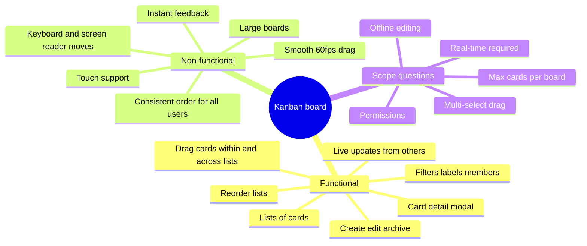
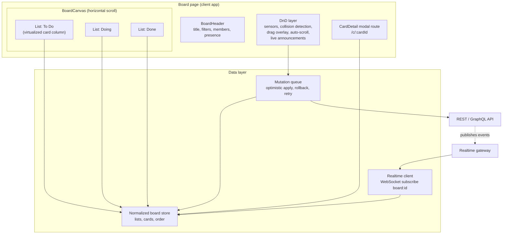
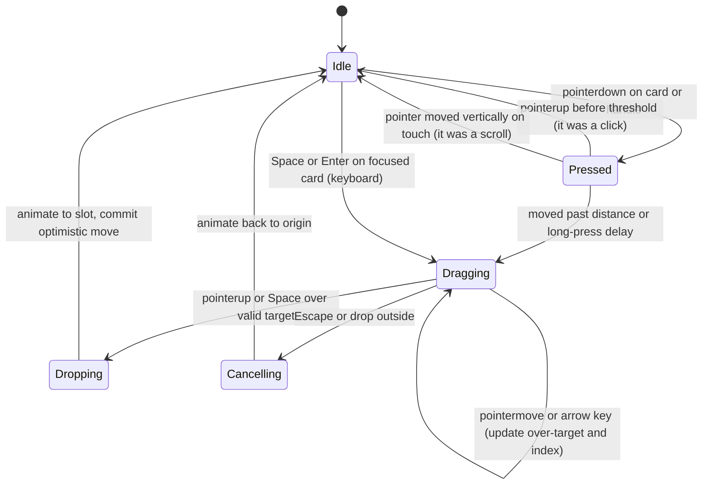
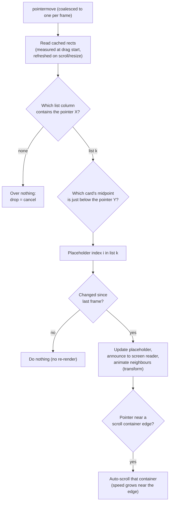
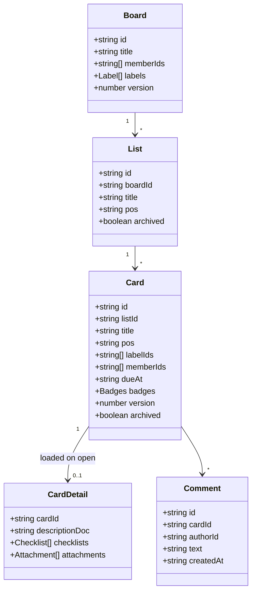
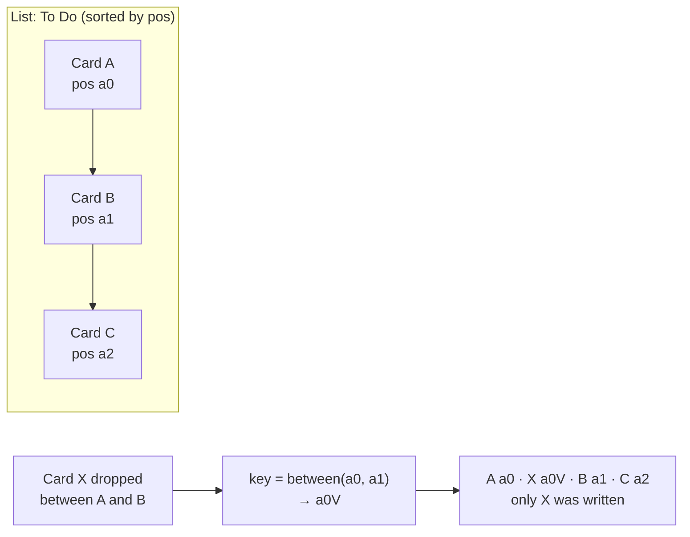
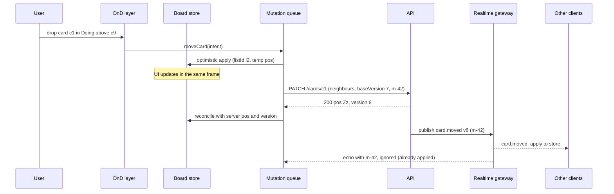
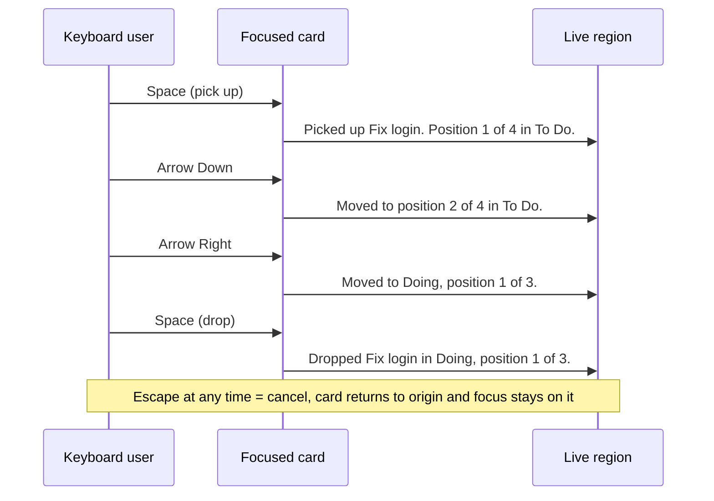
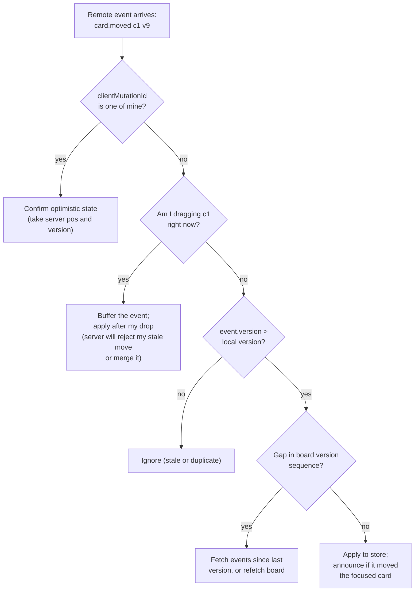

<!-- Generated by scripts/sync-knowledge.js from notes/ and README.md — do not edit here. -->
<!-- sections (line ranges in this file): Table of Contents 19-38 · ELI5 39-52 · Core Concept 53-523 · Interview Walkthrough 524-566 · Real-World Examples 567-757 · Key Points Summary 758-779 · Test Your Understanding 780-862 · Cheat Sheet 863-906 · References & Further Reading 907-943 -->

# Design a Drag-and-Drop Board (Trello)

> **Date:** 2026-11-06 · **Last updated:** 2026-11-06
> **Category:** Frontend System Design
> **Sub-Topic:** System Design Cases / Collaborative drag-and-drop board
> **Level:** Advanced · **Reading time:** ~38 min
> **Informs:** drag-and-drop library choice (native HTML DnD vs pointer events), ordering strategy (fractional positions vs indexes), optimistic move with rollback, real-time board sync and conflict handling, normalized board state, keyboard and screen-reader drag alternatives (WCAG 2.5.7), drag performance and auto-scroll, list virtualization

> **Pre-requisite:** [Optimistic UI Updates](./optimistic-ui-updates.md) and [Real-Time Data Sync](./real-time-data-sync.md).
> This case combines a demanding **interaction** (drag and drop across scrolling containers) with a demanding **data problem** (ordering shared by many users editing at once).

**Previous:** [Design a Video Player (YouTube)](./design-a-video-player-youtube.md) · **Next:** [Design a Rich Text Editor](./design-a-rich-text-editor.md)

---

## Table of Contents

1. [ELI5 — Simple Explanation](#eli5--simple-explanation)
2. [Section 1: Requirements (R)](#section-1-requirements-r)
3. [Section 2: Architecture (A)](#section-2-architecture-a)
4. [Section 3: The Drag Interaction Engine](#section-3-the-drag-interaction-engine)
5. [Section 4: Data Model (D) — Entities and Ordering](#section-4-data-model-d--entities-and-ordering)
6. [Section 5: Interface (I)](#section-5-interface-i)
7. [Section 6: Optimizations (O) — Performance](#section-6-optimizations-o--performance)
8. [Section 7: Optimizations (O) — Accessibility and i18n](#section-7-optimizations-o--accessibility-and-i18n)
9. [Section 8: Optimizations (O) — Real-Time, Security, Offline and Edge Cases](#section-8-optimizations-o--real-time-security-offline-and-edge-cases)
10. [Interview Walkthrough](#interview-walkthrough)
11. [Real-World Examples](#real-world-examples)
12. [Key Points Summary](#key-points-summary)
13. [Test Your Understanding](#test-your-understanding)
14. [Cheat Sheet](#cheat-sheet)
15. [References & Further Reading](#references--further-reading)

---

## ELI5 — Simple Explanation

Think of a **wall of sticky notes** in a team room, arranged in columns: *To Do*, *Doing*, *Done*.

- You **pick up** a note, **carry** it, and the other notes **slide apart** to show where it would land (the **placeholder**).
- You **drop** it. Everyone in the room sees it moved, because it's one shared wall (**real-time sync**).
- Instead of numbering notes 1, 2, 3 (and renumbering every note when you squeeze one in), each note has a **position number with room between them**: 100, 200, 300. Squeezing between 100 and 200? Use **150**. Nothing else changes (**fractional ordering**).
- A colleague who can't use their hands says *"move the 'Fix login' note to Doing, second place"*. The wall must support that too (**keyboard and a "Move" menu**).
- If two people grab the same note at the same moment, the wall needs a **rule** for whose move wins (**conflict resolution**).

> **One-line takeaway: a Trello-style board is a pointer/keyboard interaction engine on top of normalized, fractionally ordered data. Moves are applied optimistically, sent as a single small update, and broadcast to other viewers in real time, with an accessible non-drag way to do the same move.**

---

## Core Concept — Step by Step

Organized with **RADIO**: Requirements → Architecture → Data model → Interface → Optimizations.

### Section 1: Requirements (R)



**Functional requirements**

| # | Requirement | Notes |
|---|---|---|
| F1 | Board shows **lists** (columns) of **cards**, horizontally scrollable | Each list scrolls vertically |
| F2 | **Drag a card** within a list or to another list; **drag lists** to reorder | Placeholder shows the drop position |
| F3 | Create, rename, archive cards and lists inline | Optimistic |
| F4 | **Card detail** (description, checklist, comments, attachments) as a URL-addressable modal | `/c/:cardId` deep links |
| F5 | **Filters** (label, member, due date) and search within the board | Drag must still work while filtered |
| F6 | **Real-time**: other users' moves, edits and presence appear live | WebSocket |
| F7 | **Non-drag alternative**: move via keyboard and via a "Move" menu (board, list, position) | WCAG 2.5.7 |

**Non-functional requirements**

| Quality | Goal |
|---|---|
| **Responsiveness** | Drag follows the pointer every frame; drop feels instant (optimistic) |
| **Consistency** | Every client converges to the **same order**; no duplicated or lost cards |
| **Scale** | Boards with many lists and hundreds or thousands of cards stay smooth (virtualize long lists) |
| **Accessibility** | Full keyboard and screen-reader support for moving; visible focus; announcements |
| **Devices** | Mouse, touch (long-press to drag, scroll otherwise), pen; responsive layout |
| **Resilience** | Failed moves roll back with a clear message; reconnects resync |

**Questions to ask**

```text
1. How big can a board get (lists × cards)?             → virtualization, payload strategy
2. Is real-time collaboration required, and how many concurrent viewers?
3. Offline editing? (changes the conflict story a lot)
4. Multi-select drag? Drag between boards?
5. Do filters/sorting views exist where "position" is not the manual order?
6. Permissions: observers vs members vs admins?
7. Mobile web, native apps, or both?
```

---

### Section 2: Architecture (A)

**Rendering strategy.** A board is an **authenticated, highly interactive app**: SEO doesn't matter, and the content is per-user. Use a **client-rendered app shell** (or SSR of the shell plus first board payload for faster first paint), with the board data fetched/streamed as JSON and kept in a client cache. The card detail is a **modal route** so it has a URL, survives reload and supports Back.



**Responsibilities:**

| Module | Owns | Doesn't own |
|---|---|---|
| **DnD layer** | Pointer/keyboard sensors, hit testing, drag preview, placeholder index, auto-scroll, announcements | Persisting anything |
| **Board store** | Normalized entities and the derived ordered views per list | Network |
| **Mutation queue** | Optimistic apply, request, rollback on failure, de-duplicating its own echoes | Rendering |
| **Realtime client** | Subscribing, applying remote events, resync after reconnect | Conflict policy (server decides) |
| **Server** | Authoritative order, validation, permissions, broadcasting events | UI |

---

### Section 3: The Drag Interaction Engine

**Native HTML Drag and Drop vs pointer-event engines**

| | **Native HTML DnD** (`draggable`, `dragstart`, `dragover`, `drop`) | **Pointer-event engine** (`pointerdown/move/up`) |
|---|---|---|
| Who tracks the pointer | The browser | Your code (or library) |
| Drag preview | Browser snapshot; limited styling (`setDragImage`) | Any DOM you render (a "drag overlay") |
| Cross-window / from desktop (files) | ✅ Yes | ❌ Only within the page |
| Touch | Historically inconsistent across mobile browsers | ✅ Unified mouse/touch/pen |
| Keyboard | ❌ None built in | Must be added (libraries do) |
| Data during drag | `dataTransfer` data readable only on `drop` (types visible during `dragover`) | Plain JS state |
| Libraries | **Pragmatic drag and drop** (Atlassian), SortableJS | **dnd-kit**, @hello-pangea/dnd, Angular CDK DragDrop, svelte-dnd-action |

> **Status check (late 2026):** `react-beautiful-dnd`, long the default for Trello-like boards, is **deprecated and archived** by Atlassian. Atlassian recommends **Pragmatic drag and drop** (framework-agnostic, built on native DnD). The community fork **`@hello-pangea/dnd`** keeps the old API alive for migrations. **dnd-kit** remains a popular React choice (a newer framework-agnostic generation of dnd-kit is in development; check its docs for status).

**Drag lifecycle.** Model it as a state machine so cancel, drop and remote updates are well-defined:



**Activation constraints** separate clicks, scrolls and drags: e.g. "drag starts after the pointer moves N px" for mouse, and "after a short long-press" for touch. Put `touch-action: none` on **drag handles** only, otherwise touch users can't scroll the list.

**Hit testing (collision detection).** On every animation frame of a drag, the engine decides **which list** and **which index** the dragged card is over:



Libraries ship strategies for this: dnd-kit has `closestCenter`, `closestCorners`, `rectIntersection` and `pointerWithin`; Pragmatic drag and drop's hitbox package computes the **closest edge** of a drop target.

**On drop**, the engine produces one **intent**: `moveCard({ cardId, toListId, beforeCardId, afterCardId })`. The data layer turns neighbours into a position (Section 4). The engine never talks to the server directly.

---

### Section 4: Data Model (D) — Entities and Ordering



**Normalized client store:**

```typescript
interface BoardState {
  board: Board;
  lists: Record<string, List>;               // by id
  cards: Record<string, Card>;               // by id (summary fields only)
  // Derived, memoized per list: card ids sorted by `pos`
  // cardIdsByList: Record<listId, string[]>
}
```

Why normalized ([Data Normalization & Caching](./data-normalization-and-caching.md)):
- A move is **one field change** on one entity (`card.listId`, `card.pos`), not array surgery in two nested lists.
- Remote events (`card.updated`) patch one record; every view of that card updates.
- Only the two affected lists recompute their sorted id arrays; unaffected lists keep the same array reference, so memoized list components don't re-render.

**Ordering strategies**

| Strategy | Move cost | Problems |
|---|---|---|
| **Integer index** (0, 1, 2…) | Rewrite every item after the insertion point | Many writes per move; concurrent moves conflict constantly |
| **Linked list** (`prevId`/`nextId`) | Update about 3 records | Hard to query in order, fragile under concurrency, cycles possible |
| **Float position** (Trello's public API exposes a numeric `pos`) | Write **one** record: midpoint of neighbours | Precision runs out after many bisections at the same spot (on the order of 50 for doubles) → periodic rebalance |
| **Fractional index strings** (`"a0"`, `"a0V"`, `"a1"`…) | Write **one** record: a key between neighbours | Keys grow slowly with repeated inserts at one spot; ties need a tiebreaker (e.g. id) |



**Rules that keep ordering safe:**
- The client sends **neighbours** (`beforeId`/`afterId`), or a proposed position. The **server computes or validates the final `pos`**, because the client's view may be stale or filtered.
- **Ties** (two clients insert between the same neighbours at the same time) are broken deterministically: sort by `(pos, id)`.
- **Rebalance** occasionally on the server (rewrite one list's positions evenly) and broadcast it as a single `list.rebalanced` event.
- With **filters on**, positions still work: the new key falls between the two *visible* neighbours, and hidden cards keep their relative order. Index-based APIs break here; position keys don't.

---

### Section 5: Interface (I)

**Component API (React):**

```tsx
interface BoardProps {
  boardId: string;
  filter?: CardFilter;                            // derived view; never mutates order
  onCardOpen?(cardId: string): void;              // navigates to /c/:cardId
}

interface ListColumnProps {
  listId: string;
  cardIds: string[];                              // already sorted and filtered
  renderCard(cardId: string): React.ReactNode;    // card renderer injected (testable)
}

interface MoveCardIntent {
  cardId: string;
  toListId: string;
  beforeCardId: string | null;                    // card that will be ABOVE it
  afterCardId: string | null;                     // card that will be BELOW it
  source: 'pointer' | 'keyboard' | 'menu';        // analytics and announcements
}
```

The same `moveCard(intent)` function is called by **pointer drag, keyboard drag and the "Move" menu**, so all three share validation, optimistic logic and announcements.

**Server API contract:**

```http
GET /api/boards/b1?include=lists,cards
```

```json
{
  "board": { "id": "b1", "title": "Launch", "version": 1832 },
  "lists": [
    { "id": "l1", "title": "To Do", "pos": "a0" },
    { "id": "l2", "title": "Doing", "pos": "a1" }
  ],
  "cards": [
    { "id": "c1", "listId": "l1", "title": "Fix login", "pos": "a0", "labelIds": ["red"], "version": 7 },
    { "id": "c2", "listId": "l1", "title": "Write docs", "pos": "a1", "labelIds": [], "version": 3 }
  ]
}
```

```http
PATCH /api/cards/c1
Content-Type: application/json
Idempotency-Key: 6f1c2a8e-move-c1

{ "listId": "l2", "afterCardId": null, "beforeCardId": "c9", "baseVersion": 7, "clientMutationId": "m-42" }
```

```json
{ "id": "c1", "listId": "l2", "pos": "Zz", "version": 8 }
```

| Endpoint / channel | Purpose | Notes |
|---|---|---|
| `GET /api/boards/:id?include=lists,cards` | Initial board (card **summaries** only) | Card details load on open |
| `PATCH /api/cards/:id` | Move or edit a card | Neighbour ids + `baseVersion`; server returns final `pos` and `version` |
| `PATCH /api/lists/:id` | Rename / reorder a list | Same ordering scheme for lists |
| `POST /api/cards` | Create (client may propose an id) | Client-generated ids simplify optimistic creates |
| `GET /api/cards/:id` | Card detail for the modal | Cached separately |
| WebSocket `subscribe board:b1` | Live events | `card.moved`, `card.updated`, `list.created`, `presence`… each with `version`, `actorId`, `clientMutationId` |
| `GET /api/boards/:id/events?since=1832` | Catch up after reconnect | Or full refetch if too far behind |

---

### Section 6: Optimizations (O) — Performance



| Technique | Why |
|---|---|
| **Drag a lightweight overlay**, moved with `transform: translate3d()` | Moving the real element re-flows lists; transforms stay on the compositor ([Animation Performance](./animation-performance-css-vs-js.md)) |
| **Measure rects at drag start**, refresh only on scroll/resize | Avoids layout reads on every `pointermove` (layout thrashing) |
| **One state update per frame**: coalesce `pointermove` with `requestAnimationFrame` | Caps drag work at one update per frame, whatever the input device's event rate |
| **Re-render only when the placeholder index changes** | Most pointer moves don't change the drop target |
| **Memoize card components** keyed by id; pass ids, not objects | A move re-renders two lists, not the board ([React Performance](./react-performance-memo-usememo-usecallback.md)) |
| **Animate neighbours with FLIP** or the View Transitions API | Smooth reflow animation without per-frame layout |
| **Virtualize long lists** (and very wide boards) | Hundreds of cards per list overwhelm the DOM; the DnD library must support it ([Virtual Scrolling & Windowing](./virtual-scrolling-and-windowing.md)) |
| **Card summaries in the board payload**, details on demand | Smaller initial JSON; faster first render |
| **Prefetch card detail on hover/focus** | Modal opens instantly ([Prefetching & Preloading](./prefetching-and-preloading.md)) |
| **Lazy-load the card-detail editor** (rich text, attachments) | Not needed to show the board ([Code Splitting & Lazy Loading](./code-splitting-and-lazy-loading.md)) |
| `user-select: none` during drag | Prevents accidental text selection |

> **Virtualization + DnD caveat:** the dragged card's source element may be unmounted when its list scrolls it out of view. Use a drag overlay (rendered outside the list) and a library that supports virtual lists.

---

### Section 7: Optimizations (O) — Accessibility and i18n

**WCAG 2.2 SC 2.5.7 Dragging Movements (Level AA)** requires that anything done by dragging can also be done with a **single pointer without dragging** (unless dragging is essential). For a board that means a **"Move" button/menu**, plus a full **keyboard** path.



| Concern | What to build |
|---|---|
| **Keyboard drag** | Focusable cards; Space/Enter pick up and drop; arrows move within/between lists; Escape cancels; focus stays on the moved card afterwards |
| **Screen-reader announcements** | `aria-live="polite"` region (or `ariaNotify()` where supported) announcing pick-up, position changes, drop and cancel, with **names and positions** ("2 of 5 in Doing") |
| **Instructions** | Visually hidden instructions referenced by `aria-describedby` on draggable cards |
| **Non-drag alternative** | Card menu → "Move…" dialog: board, list, position select ([Accessible Forms & Error Handling](./accessible-forms-and-error-handling.md)) |
| **Semantics** | Lists as labelled regions/lists (`<section aria-labelledby>` + `<ul>`); cards as list items containing a button/link that opens details |
| **Don't misuse ARIA** | `aria-grabbed`/`aria-dropeffect` are deprecated in ARIA 1.1 — use announcements instead ([ARIA Roles, States & Properties](./aria-roles-states-and-properties.md)) |
| **Focus management** | Opening the card modal traps focus and restores it to the card on close ([Keyboard Navigation & Focus Management](./keyboard-navigation-and-focus-management.md)) |
| **Target size and visibility** | Drag handles large enough to hit (WCAG 2.5.8 Target Size, AA); focus not hidden by sticky headers (2.4.11) |
| **Reduced motion** | Respect `prefers-reduced-motion` for drop animations |

`ariaNotify()` is newer and not in every browser — MDN lists it in current Chromium, Firefox and Safari releases, but feature-detect and fall back to a live region.

**i18n:**
- Announcement strings are **templates with plurals and placeholders** (ICU MessageFormat), not concatenated English ([Internationalization (i18n) Architecture](./internationalization-i18n-architecture.md)).
- **RTL:** lists flow right-to-left, so **Arrow Left/Right meaning flips** for "previous/next list", and auto-scroll directions follow the logical direction ([RTL Layout Support](./rtl-layout-support.md)).
- Due dates and counts via `Intl.DateTimeFormat`/`Intl.RelativeTimeFormat`/`Intl.PluralRules`.

---

### Section 8: Optimizations (O) — Real-Time, Security, Offline and Edge Cases

**Conflict handling** ([Real-Time Data Sync](./real-time-data-sync.md)):



| Conflict | Policy |
|---|---|
| Two users move the **same card** | Server orders the writes; the later write wins (per field). The loser's client receives the authoritative event and its UI snaps to it (optionally a toast: "Moved by Sam") |
| Two users insert **between the same neighbours** | Both succeed; equal or near-equal positions sorted by `(pos, id)` → deterministic for everyone |
| Move into a list someone **archived** | Server rejects (409/422) → client **rolls back** and explains |
| `baseVersion` stale on an edit | Server rejects or merges per field; client refetches the card |

**Security**
- **Authorization on every mutation** server-side (board membership, role); the client hiding a button is not security.
- Card titles, descriptions and comments are user content: render as text or sanitize rich text ([XSS Prevention](./xss-prevention-reflected-stored-dom.md)); attachments served from a separate origin with `Content-Disposition` where needed.
- WebSocket: authenticate the connection, authorize **each subscription** (`board:b1`), and never broadcast events for boards a user can't see ([WebSockets & SSE & Long Polling](./websockets-sse-long-polling.md)).
- CSRF protection on cookie-authenticated mutations ([CSRF Protection](./csrf-protection.md)).
- When reading native DnD `dataTransfer` (e.g. text dropped from other apps), treat it as untrusted input.

**Offline (if in scope):** queue mutations in IndexedDB with client ids, replay on reconnect, and let the server's ordering and version rules decide; position keys make replayed moves cheap and mostly conflict-free ([Offline-First Architecture](./offline-first-architecture.md)). CRDT-based ordering is an option for fully offline collaboration, at much higher complexity.

**Edge cases checklist**

```text
✓ Drop outside any list           → cancel, animate back, no request
✓ Escape mid-drag                 → cancel; focus returns to the card
✓ Empty list                      → still a valid drop target (min-height drop zone)
✓ Request fails / times out       → roll back to the snapshot, toast with "Retry"
✓ Double-fire (retry after timeout) → Idempotency-Key makes the second PATCH a no-op
✓ Remote move of the card I'm dragging → defer, then reconcile after my drop
✓ Card deleted remotely while open → close modal with a message
✓ Nested scrolling (board X, list Y) → auto-scroll the right container; refresh cached rects on scroll
✓ Touch                            → long-press to drag, normal swipe scrolls; touch-action none on handles only
✓ Filtered view                    → compute position from visible neighbours; never send indexes
✓ Position precision exhausted     → server rebalances the list and broadcasts once
✓ Many cards (1000s)               → virtualize; overlay-based dragging
✓ Link or button inside a card     → don't start drags from interactive children; use a handle or activation distance
✓ bfcache / reconnect              → catch up via events?since=version or refetch
```

---

## Interview Walkthrough

```mermaid
gantt
    title 45-minute plan for the Trello board
    dateFormat mm
    axisFormat %M
    section Clarify
    Requirements and scale questions :r, 00, 5m
    section Design
    Architecture and modules :a, after r, 8m
    Drag engine and hit testing :g, after a, 8m
    Data model and ordering :d, after g, 8m
    Interface and API :i, after d, 6m
    section Deepen
    Real-time conflicts, a11y, perf :o, after i, 8m
    Trade-offs and wrap-up :w, after o, 2m
```



| Minute | What to cover | Key line to say |
|---|---|---|
| 0–5 | Scale, real-time, offline, multi-select, devices | "I'll assume real-time collaboration, no offline, up to ~thousands of cards per board." |
| 5–13 | Component tree + data layer diagram; CSR app shell, card modal route | "The DnD layer only emits intents; the data layer owns persistence." |
| 13–21 | Pointer vs native DnD, activation constraints, rect caching, collision detection, auto-scroll | "I'll measure once at drag start and only re-render when the drop index changes." |
| 21–29 | Normalized store, **fractional positions**, server-computed `pos`, tie-break, rebalance | "A move writes one record." |
| 29–35 | `moveCard` intent, PATCH with neighbours + version + idempotency key, WebSocket events | "Pointer, keyboard and menu all call the same function." |
| 35–43 | Optimistic + rollback, conflict flow, WCAG 2.5.7 keyboard/menu, virtualization | "Here's what happens when two people move the same card." |
| 43–45 | Trade-offs and what you'd measure (drag frame rate, move error rate) | |

**Trade-offs to discuss:**

| Decision | Option A | Option B | Lean |
|---|---|---|---|
| DnD foundation | Native HTML DnD (Pragmatic DnD) | Pointer engine (dnd-kit, CDK) | Native: cross-window/file drops, small runtime. Pointer: full control of preview and touch. Both need custom keyboard support |
| Ordering | Float `pos` | Fractional-index strings | Strings avoid precision limits; floats are simpler. Either way, one write per move |
| Who computes `pos` | Client | Server (from neighbours) | Server, because the client may be stale or filtered; the client can propose one for optimistic display |
| Sync model | Server-authoritative events | CRDT | Server events are simpler and enough when online; CRDTs for offline-heavy collaboration |
| Conflict policy | Last writer wins per field | Reject on stale version | LWW for moves (low stakes, easy to redo); version checks for text fields |
| Payload | Whole board | Summaries + lazy details | Summaries; details on open |
| Large lists | Render all | Virtualize | Virtualize beyond a few hundred cards; needs DnD support |

---

## Real-World Examples

**Example 1 — Fractional positions with a tiebreaker (TypeScript):**
```typescript
import { generateKeyBetween } from 'fractional-indexing'; // rocicorp/fractional-indexing

type Ordered = { id: string; pos: string };

export const byPos = (a: Ordered, b: Ordered) =>
  a.pos < b.pos ? -1 : a.pos > b.pos ? 1 : a.id < b.id ? -1 : a.id > b.id ? 1 : 0;

/** Position for an item dropped between `before` (above) and `after` (below). */
export function positionBetween(before: Ordered | null, after: Ordered | null): string {
  // generateKeyBetween(null, null) → first key; (a, null) → after a; (null, b) → before b
  return generateKeyBetween(before?.pos ?? null, after?.pos ?? null);
}
```

> Compare position strings by **code unit order** (`<`, `>`), not `localeCompare`, so that every client and the database sort the same way. Make sure your database column uses a binary/"C" collation.

**Example 2 — Optimistic move with rollback (TanStack Query, BAD → GOOD):**
```typescript
// ❌ BAD: wait for the server, then refetch the whole board → the card "jumps back" for a moment
async function onDrop(intent: MoveCardIntent) {
  await api.moveCard(intent);
  await queryClient.invalidateQueries({ queryKey: ['board', boardId] });
}

// ✅ GOOD: apply locally, send one PATCH, roll back on failure
export function useMoveCard(boardId: string) {
  const queryClient = useQueryClient();
  const key = ['board', boardId];
  return useMutation({
    mutationFn: (intent: MoveCardIntent & { clientMutationId: string }) => api.moveCard(intent),
    onMutate: async (intent) => {
      await queryClient.cancelQueries({ queryKey: key });            // don't let a refetch overwrite us
      const snapshot = queryClient.getQueryData<BoardState>(key);
      queryClient.setQueryData<BoardState>(key, (s) => s && applyMove(s, intent)); // temp pos from neighbours
      pendingMutations.add(intent.clientMutationId);                  // so we ignore our own echo
      return { snapshot };
    },
    onError: (_err, intent, ctx) => {
      if (ctx?.snapshot) queryClient.setQueryData(key, ctx.snapshot); // roll back
      pendingMutations.delete(intent.clientMutationId);
      toast.error('Couldn’t move the card. It was put back.');
    },
    onSuccess: (serverCard, intent) => {
      queryClient.setQueryData<BoardState>(key, (s) => s && upsertCard(s, serverCard)); // authoritative pos/version
      pendingMutations.delete(intent.clientMutationId);
    },
  });
}
```

> In a busy board, prefer **patching the store from server responses and socket events** over invalidating the whole board after each move. See [Optimistic UI Updates](./optimistic-ui-updates.md) and [React Query (TanStack Query)](./react-query-tanstack-query.md).

**Example 3 — Sortable lists with dnd-kit (pointer + keyboard sensors):**
```tsx
import { DndContext, DragOverlay, KeyboardSensor, PointerSensor, closestCorners, useSensor, useSensors, type DragEndEvent } from '@dnd-kit/core';
import { SortableContext, sortableKeyboardCoordinates, useSortable, verticalListSortingStrategy } from '@dnd-kit/sortable';
import { CSS } from '@dnd-kit/utilities';

function SortableCard({ id }: { id: string }) {
  const { attributes, listeners, setNodeRef, transform, transition, isDragging } = useSortable({ id });
  return (
    <li
      ref={setNodeRef}
      style={{ transform: CSS.Transform.toString(transform), transition, opacity: isDragging ? 0.4 : 1 }}
      {...attributes}   // role, tabIndex, aria-describedby (instructions)
      {...listeners}    // pointer + keyboard activators
    >
      <CardSummary id={id} />
    </li>
  );
}

export function Board({ lists }: { lists: { id: string; cardIds: string[] }[] }) {
  const sensors = useSensors(
    useSensor(PointerSensor, { activationConstraint: { distance: 6 } }),  // clicks still work
    useSensor(KeyboardSensor, { coordinateGetter: sortableKeyboardCoordinates }),
  );
  const moveCard = useMoveCardIntent();
  const [activeId, setActiveId] = useState<string | null>(null);

  const onDragEnd = ({ active, over }: DragEndEvent) => {
    setActiveId(null);
    if (!over) return;                                                     // dropped outside → cancel
    moveCard(computeIntent(lists, String(active.id), String(over.id)));    // neighbours → intent
  };

  return (
    <DndContext sensors={sensors} collisionDetection={closestCorners}
      onDragStart={({ active }) => setActiveId(String(active.id))} onDragEnd={onDragEnd}
      onDragCancel={() => setActiveId(null)}>
      {lists.map((list) => (
        <SortableContext key={list.id} id={list.id} items={list.cardIds} strategy={verticalListSortingStrategy}>
          <ul aria-label={listTitle(list.id)}>{list.cardIds.map((id) => <SortableCard key={id} id={id} />)}</ul>
        </SortableContext>
      ))}
      <DragOverlay>{activeId ? <CardSummary id={activeId} /> : null}</DragOverlay>
    </DndContext>
  );
}
```

> Cross-list moves also need `onDragOver` handling to move the placeholder between lists during the drag — see dnd-kit's multiple-containers example. dnd-kit's `DndContext` also accepts `accessibility={{ announcements, screenReaderInstructions }}` for localized announcements.

**Example 4 — Same idea in other stacks:**
```typescript
// Angular CDK: connected drop lists
// <div cdkDropListGroup>
//   <ul *ngFor="let list of lists" cdkDropList [cdkDropListData]="list.cards" (cdkDropListDropped)="drop($event)">
//     <li *ngFor="let card of list.cards" cdkDrag>{{ card.title }}</li>
//   </ul>
// </div>
import { Component, inject } from '@angular/core';
import { CdkDragDrop } from '@angular/cdk/drag-drop';

@Component({ selector: 'app-board', templateUrl: './board.html' /* imports: CdkDropListGroup, CdkDropList, CdkDrag */ })
export class BoardComponent {
  private board = inject(BoardStore);

  drop(event: CdkDragDrop<Card[]>) {
    const list = event.container.data;
    // Translate CDK indexes into NEIGHBOURS before calling the shared moveCard() — never persist indexes
    const card = event.previousContainer.data[event.previousIndex];
    const target = event.container === event.previousContainer ? list.filter((c) => c !== card) : list;
    const before = target[event.currentIndex - 1] ?? null;
    const after = target[event.currentIndex] ?? null;
    this.board.moveCard({
      cardId: card.id, toListId: this.board.listIdOf(list), source: 'pointer',
      beforeCardId: before?.id ?? null, afterCardId: after?.id ?? null,
    });
  }
}

// Vue 3: vue-draggable-plus / vuedraggable (SortableJS) — handle the @end event the same way.
// Svelte: svelte-dnd-action — use:dndzone={{ items }} with on:consider / on:finalize.
// Vanilla / any framework: Pragmatic drag and drop — draggable(), dropTargetForElements(), monitorForElements().
// Native mobile: iOS UICollectionView drag/drop delegates or SwiftUI .draggable/.dropDestination;
//                Android RecyclerView + ItemTouchHelper, or Compose drag-and-drop modifiers.
```

**Example 5 — Accessible "Move" dialog (non-drag alternative):**
```tsx
export function MoveCardDialog({ card, lists, onMove, onClose }: MoveDialogProps) {
  const [listId, setListId] = useState(card.listId);
  const targetCards = useCardsInList(listId).filter((c) => c.id !== card.id);
  const [index, setIndex] = useState(0);

  return (
    <dialog open aria-labelledby="move-title" onClose={onClose}>
      <h2 id="move-title">Move “{card.title}”</h2>
      <label>List
        <select value={listId} onChange={(e) => { setListId(e.target.value); setIndex(0); }}>
          {lists.map((l) => <option key={l.id} value={l.id}>{l.title}</option>)}
        </select>
      </label>
      <label>Position
        <select value={index} onChange={(e) => setIndex(Number(e.target.value))}>
          {Array.from({ length: targetCards.length + 1 }, (_, i) => <option key={i} value={i}>{i + 1}</option>)}
        </select>
      </label>
      <button type="button" onClick={() => onMove({
        cardId: card.id, toListId: listId, source: 'menu',
        beforeCardId: targetCards[index - 1]?.id ?? null, afterCardId: targetCards[index]?.id ?? null,
      })}>Move</button>
      <button type="button" onClick={onClose}>Cancel</button>
    </dialog>
  );
}
// Use showModal() on a ref for a real modal (focus trap + inert background); shown inline here for brevity.
```

**Example 6 — Live announcer with `ariaNotify` fallback:**
```typescript
const region = Object.assign(document.createElement('div'), { className: 'visually-hidden' });
region.setAttribute('aria-live', 'polite');
document.body.append(region);

export function announce(message: string) {
  const el = document.activeElement as (Element & { ariaNotify?: (m: string) => void }) | null;
  if (el?.ariaNotify) { el.ariaNotify(message); return; }   // newer API; feature-detect
  region.textContent = '';                                   // reset so repeated text is re-announced
  requestAnimationFrame(() => { region.textContent = message; });
}
// announce(t('dnd.moved', { card: 'Fix login', list: 'Doing', position: 2, total: 5 }));
```

---

## Key Points Summary

| Concept | One-Line Explanation |
|---|---|
| **RADIO** | Requirements → Architecture → Data model → Interface → Optimizations |
| **DnD layer vs data layer** | The engine emits move *intents*; the data layer applies, persists and reconciles |
| **Native DnD vs pointer engine** | Native: cross-window, browser preview, no keyboard. Pointer: full control, unified touch |
| **react-beautiful-dnd** | Deprecated/archived; use Pragmatic DnD, dnd-kit or the @hello-pangea/dnd fork |
| **Activation constraint** | Distance or long-press threshold that separates click/scroll from drag |
| **Collision detection** | Decides target list and index from cached rects on each frame |
| **Fractional position** | Key between neighbours → a move writes one record |
| **Server-computed pos** | The client sends neighbours; the server decides, tie-breaks by id and rebalances |
| **Optimistic move** | Apply locally, PATCH, reconcile with the server's answer or roll back |
| **clientMutationId** | Lets a client ignore the echo of its own change |
| **Versioned events** | Detect stale or duplicate events and gaps → resync |
| **WCAG 2.5.7** | Every drag needs a non-drag single-pointer alternative ("Move" menu) |
| **Keyboard drag** | Space picks up/drops, arrows move, Escape cancels, live announcements |
| **Drag overlay + transforms** | Smooth 60 fps dragging without layout thrash |
| **Virtualization** | Needed for long lists; requires overlay-based dragging |

---

## Test Your Understanding

**Q1 (Basic):** Why store a `pos` value on each card instead of the card's index in the list?

<details>
<summary>Answer</summary>

With indexes, inserting a card at position 2 changes the index of **every card after it**, so one move becomes many writes, and two concurrent moves in the same list almost always conflict. With a **sortable position** (a float midpoint or a fractional-index string), the moved card gets a value **between its new neighbours** and nothing else changes: **one write per move**. That's cheaper, conflicts less, works with filtered views (visible neighbours still bound the new position), and makes real-time events small (`card.moved {id, listId, pos}`).
</details>

**Q2 (Basic):** What does WCAG 2.5.7 require of a drag-and-drop board, and how do you satisfy it?

<details>
<summary>Answer</summary>

SC 2.5.7 Dragging Movements (WCAG 2.2, Level AA) says functionality that uses dragging must also be achievable with a **single pointer without dragging**, unless dragging is essential. Reordering cards isn't essential dragging, so you need an alternative, such as a **"Move…" menu/dialog** (choose list and position) or click-to-pick-up and click-to-place. Separately, keyboard users need a keyboard path (SC 2.1.1): focusable cards, Space to pick up and drop, arrows to move, Escape to cancel, with live-region announcements of positions.
</details>

**Q3 (Application):** Dragging feels janky on a board with 40 lists and 2,000 cards. Profiling shows long tasks during `pointermove`. What do you change?

<details>
<summary>Answer</summary>

- **Stop reading layout on every move:** cache card and list rects at drag start and refresh only on scroll/resize; avoid `getBoundingClientRect()` inside the move loop.
- **Coalesce to one update per frame** with `requestAnimationFrame`.
- **Only re-render when the drop target or index changes**, not on every pixel.
- **Move a drag overlay with `transform`**, not the real element, and animate neighbours with transforms (FLIP).
- **Memoize cards** and pass ids so only the source and target lists re-render.
- **Virtualize** long lists (and off-screen columns) so the DOM is small, using a DnD approach that supports virtualization.
- Verify in the DevTools Performance panel: no long tasks during drag and frames within budget.
</details>

**Q4 (Application):** Walk through what happens, end to end, when a user drops a card into another list while a colleague is watching the same board.

<details>
<summary>Answer</summary>

1. The DnD layer resolves the drop to an intent `{cardId, toListId, beforeCardId, afterCardId}`.
2. The mutation queue **snapshots** state, **applies the move optimistically** (temporary position between neighbours) and records a `clientMutationId`.
3. It sends `PATCH /cards/:id` with neighbours, `baseVersion` and an **Idempotency-Key**.
4. The server checks permissions, computes the final `pos` (tie-break, rebalance if needed), bumps `version`, persists, responds, and **publishes** `card.moved` to the board channel.
5. The originating client reconciles with the server's `pos/version` and **ignores the echo** carrying its own `clientMutationId`.
6. The colleague's client checks the version, applies the event to its normalized store, and only the two affected lists re-render (optionally animated, and announced if it moved their focused card).
7. On failure, the originator rolls back to the snapshot and shows a retry toast.
</details>

**Q5 (Tricky):** Alice is mid-drag on card C when a WebSocket event says Bob just moved C to another list. What should Alice's client do?

<details>
<summary>Answer</summary>

Don't yank the card out from under Alice's pointer. **Buffer remote events for the dragged entity** until her drag ends:
- If she **cancels**, apply Bob's move (the card animates to Bob's list).
- If she **drops**, send her move with the `baseVersion` she started from. The server applies its policy: for low-stakes moves, usually **last writer wins**, so Alice's later move stands and is broadcast to Bob; under a strict version policy it returns a conflict, and Alice's client rolls back to the server state and tells her "Bob moved this card".

Either way all clients converge on the server's ordering, and nobody sees the card duplicated or flickering mid-drag. Events for *other* cards can still be applied during the drag, but cached rects must be refreshed if they shift the layout.
</details>

**Q6 (Tricky):** Your team uses float positions. After months, a support ticket shows two cards that keep swapping order on refresh. What happened and how do you fix it for good?

<details>
<summary>Answer</summary>

Repeated inserts at the same spot halve the gap each time. Doubles have limited precision, so after on the order of fifty bisections between the same neighbours, the midpoint **can't be represented** and equals one neighbour, giving **duplicate positions**. If the sort has no tiebreaker (or the database returns ties in arbitrary order), the two cards **swap unpredictably**.

Fix: (1) sort by **`(pos, id)`** everywhere so ties are deterministic; (2) detect "no room" on the server and **rebalance** the list (re-space positions evenly) in one transaction, broadcasting one event; (3) or switch to **fractional-index strings**, which can always produce a key between two distinct keys (they get longer), and still keep the id tiebreaker for concurrent identical inserts.
</details>

**Q7 (System design):** Product wants offline support for the board on flaky mobile connections. What changes in your design?

<details>
<summary>Answer</summary>

- **Persist** the normalized board and a **mutation outbox** in IndexedDB; render from local data first.
- **Client-generated ids** for created cards and lists, so offline creates can be referenced by later offline moves.
- On reconnect, **replay the outbox in order** with idempotency keys; the server applies its ordering and conflict rules and returns authoritative state; then fetch `events?since=version` to catch up.
- Position keys help: a replayed move is still "between these neighbours". If a neighbour was deleted meanwhile, the server places the card next to the remaining neighbour or at the end.
- Surface **sync status** (pending/failed) per card; let users resolve rejected changes.
- For truly offline-first multi-user editing, consider a **CRDT** (e.g. a sequence CRDT or fractional indexes inside Yjs/Automerge documents). It's powerful but adds payload size and complexity; justify it with product needs. See [Offline-First Architecture](./offline-first-architecture.md).
</details>

---

## Cheat Sheet

**Key Definitions:**
- **Intent:** `{cardId, toListId, beforeCardId, afterCardId}` — what the user asked for, independent of input method
- **Placeholder:** the gap showing where the dragged item will land
- **Activation constraint:** distance/delay before a press becomes a drag
- **Collision detection:** algorithm mapping pointer position to drop target and index
- **Fractional index:** sortable key generated between two neighbours
- **Rebalance:** re-spacing a list's positions when keys run out of room or grow too long
- **Echo suppression:** ignoring your own change when it comes back over the socket

**Quick Reference:**
```text
Library      React: dnd-kit | Pragmatic DnD | @hello-pangea/dnd (rbd fork)   (react-beautiful-dnd = deprecated)
             Angular: CDK DragDrop · Vue: vue-draggable-plus / vuedraggable · Svelte: svelte-dnd-action
Drag perf    overlay + transform · cache rects at start · rAF-coalesced moves · re-render on index change only
Touch        long-press activation · touch-action: none on handles only
Order        pos between neighbours (float or fractional string) · sort by (pos, id) · server computes/rebalances
Move API     PATCH /cards/:id { listId, beforeCardId, afterCardId, baseVersion, clientMutationId } + Idempotency-Key
Optimistic   snapshot → apply → request → reconcile | rollback + toast
Realtime     versioned events · ignore own echo · defer events for the dragged card · resync on gaps
A11y         WCAG 2.5.7 Move menu · Space pick/drop · arrows move · Esc cancel · live announcements with positions
Scale        summaries in board payload · details on open · virtualize long lists
```

**Common Mistakes to Avoid:**

| Mistake | Why Wrong | Fix |
|---|---|---|
| Persisting array indexes | Many writes per move; breaks with filters and concurrency | Position keys between neighbours |
| Floats without tiebreaker or rebalance | Precision exhaustion → duplicate positions → flicker | Sort by `(pos, id)`; rebalance; or fractional strings |
| Starting new projects on react-beautiful-dnd | Deprecated and archived | Pragmatic DnD, dnd-kit, or the hello-pangea fork for migrations |
| Calling the API from drag callbacks | DnD and persistence tangled; keyboard/menu paths duplicate logic | One `moveCard(intent)` for all input methods |
| `getBoundingClientRect()` on every `pointermove` | Layout thrash, long tasks | Cache rects; refresh on scroll/resize |
| Re-rendering the whole board on every move | Jank on big boards | Normalized store, memoized lists/cards |
| `touch-action: none` on whole lists | Touch users can't scroll | Only on handles; long-press activation |
| Drag-only reordering | Fails WCAG 2.5.7; unusable for keyboard and screen-reader users | Keyboard drag + "Move" dialog + announcements |
| Using `aria-grabbed` / `aria-dropeffect` | Deprecated in ARIA 1.1; poor support | Live-region announcements and instructions |
| Applying remote moves to the card being dragged | Card jumps away from the pointer | Buffer until drop/cancel |
| Refetching the whole board after each move | Flicker and wasted bandwidth | Patch from response and events |
| Trusting the client's permission checks | Anyone can call the API | Authorize every mutation and subscription server-side |

---

## References & Further Reading

**Core docs**
- MDN: [HTML Drag and Drop API](https://developer.mozilla.org/en-US/docs/Web/API/HTML_Drag_and_Drop_API) · [`DataTransfer`](https://developer.mozilla.org/en-US/docs/Web/API/DataTransfer)
- MDN: [Pointer events](https://developer.mozilla.org/en-US/docs/Web/API/Pointer_events) · [`setPointerCapture()`](https://developer.mozilla.org/en-US/docs/Web/API/Element/setPointerCapture) · [`touch-action`](https://developer.mozilla.org/en-US/docs/Web/CSS/touch-action)
- MDN: [ARIA live regions](https://developer.mozilla.org/en-US/docs/Web/Accessibility/ARIA/Guides/Live_regions) · [`Element.ariaNotify()`](https://developer.mozilla.org/en-US/docs/Web/API/Element/ariaNotify)
- MDN: [View Transition API](https://developer.mozilla.org/en-US/docs/Web/API/View_Transition_API)

**Accessibility**
- W3C: [Understanding SC 2.5.7 Dragging Movements](https://www.w3.org/WAI/WCAG22/Understanding/dragging-movements.html)
- W3C: [Understanding SC 2.5.8 Target Size (Minimum)](https://www.w3.org/WAI/WCAG22/Understanding/target-size-minimum.html)
- Atlassian Design: [Pragmatic drag and drop — accessibility guidelines](https://atlassian.design/components/pragmatic-drag-and-drop/accessibility-guidelines)

**Libraries**
- [Pragmatic drag and drop](https://atlassian.design/components/pragmatic-drag-and-drop/about) · [GitHub](https://github.com/atlassian/pragmatic-drag-and-drop)
- [react-beautiful-dnd (archived)](https://github.com/atlassian/react-beautiful-dnd) · [@hello-pangea/dnd](https://github.com/hello-pangea/dnd)
- [dnd-kit docs](https://docs.dndkit.com/) · [Angular CDK Drag and Drop](https://material.angular.dev/cdk/drag-drop/overview)
- [vue-draggable-plus](https://github.com/Alfred-Skyblue/vue-draggable-plus) · [svelte-dnd-action](https://github.com/isaacHagoel/svelte-dnd-action) · [SortableJS](https://github.com/SortableJS/Sortable)
- [rocicorp/fractional-indexing](https://github.com/rocicorp/fractional-indexing)

**Ordering and collaboration**
- Figma: [Realtime editing of ordered sequences](https://www.figma.com/blog/realtime-editing-of-ordered-sequences/)
- Trello developer docs: [Cards API (`pos` parameter)](https://developer.atlassian.com/cloud/trello/rest/api-group-cards/)
- Ink & Switch (Kleppmann et al.): [Local-first software](https://www.inkandswitch.com/local-first/)

**Related notes**
- [Optimistic UI Updates](./optimistic-ui-updates.md) · [Real-Time Data Sync](./real-time-data-sync.md) · [Virtual Scrolling & Windowing](./virtual-scrolling-and-windowing.md) · [Keyboard Navigation & Focus Management](./keyboard-navigation-and-focus-management.md)

---

> **Previous Topic:** [Design a Video Player (YouTube)](./design-a-video-player-youtube.md)
> — Adaptive streaming, player state machines and media accessibility

> **Next Topic:** [Design a Rich Text Editor](./design-a-rich-text-editor.md)
> — Document models, contenteditable, selection, collaboration and sanitization

*Saved on: 2026-11-06 | Repo: Frontend System Design Learning Notes*
