<!-- Generated by scripts/sync-knowledge.js from notes/ and README.md — do not edit here. -->
<!-- sections (line ranges in this file): Table of Contents 19-38 · ELI5 39-51 · Core Concept 52-513 · Interview Walkthrough 514-554 · Real-World Examples 555-833 · Key Points Summary 834-852 · Test Your Understanding 853-913 · Cheat Sheet 914-956 · References & Further Reading 957-996 -->

# Design a News Feed (Facebook/Twitter)

> **Date:** 2026-11-06 · **Last updated:** 2026-11-06
> **Category:** Frontend System Design
> **Sub-Topic:** System Design Cases / Social Feed
> **Level:** Advanced · **Reading time:** ~32 min
> **Informs:** feed rendering strategy (SSR first page vs CSR), cursor pagination and infinite scroll, list virtualization with variable heights, normalized post/user cache, optimistic reactions and posting, real-time "new posts" delivery (SSE/WebSocket/polling), media loading and CLS, feed accessibility (`role="feed"`), user-generated content security, offline drafts

> **Pre-requisite:** [Pagination & Infinite Scroll](./pagination-and-infinite-scroll.md), [Virtual Scrolling & Windowing](./virtual-scrolling-and-windowing.md) and [Data Normalization & Caching](./data-normalization-and-caching.md).
> This is the first **full system design case**. It is organised with **RADIO** — Requirements, Architecture, Data model, Interface, Optimizations — followed by how to present it in a 45-minute interview.

**Previous:** [Monorepo Tooling (Turborepo, Nx)](./monorepo-tooling-turborepo-nx.md) · **Next:** [Design an Autocomplete / Typeahead](./design-an-autocomplete-typeahead.md)

---

## Table of Contents

1. [ELI5 — Simple Explanation](#eli5--simple-explanation)
2. [Section 1: Requirements](#section-1-requirements)
3. [Section 2: Architecture](#section-2-architecture)
4. [Section 3: Data Model](#section-3-data-model)
5. [Section 4: Interface — Component and Server APIs](#section-4-interface--component-and-server-apis)
6. [Section 5: Optimizations — Performance](#section-5-optimizations--performance)
7. [Section 6: Optimizations — Real-Time Updates](#section-6-optimizations--real-time-updates)
8. [Section 7: Optimizations — Optimistic Interactions and the Composer](#section-7-optimizations--optimistic-interactions-and-the-composer)
9. [Section 8: Optimizations — Accessibility, i18n, Security, Offline, Edge Cases](#section-8-optimizations--accessibility-i18n-security-offline-edge-cases)
10. [Interview Walkthrough](#interview-walkthrough)
11. [Real-World Examples](#real-world-examples)
12. [Key Points Summary](#key-points-summary)
13. [Test Your Understanding](#test-your-understanding)
14. [Cheat Sheet](#cheat-sheet)
15. [References & Further Reading](#references--further-reading)

---

## ELI5 — Simple Explanation

Imagine a **conveyor belt of postcards** in front of you.

- You only ever **see the few postcards in front of you**. The belt quietly brings more from the back room before you reach the end (**infinite scroll + prefetching**), and the cards that went past are packed away so the table doesn't overflow (**virtualization**).
- Every postcard was written by someone. Instead of writing the author's full address on every card, there's **one address book**, and each card says "from #42" (**normalization**).
- When you press ❤️, the heart turns red **immediately**, and a helper walks to the post office to tell them. If the post office says no, the helper quietly turns it back and tells you (**optimistic update + rollback**).
- When new postcards arrive at the top, nobody shoves them under your nose while you're reading. A little sign says **"5 new posts ↑"** and you choose when to look (**real-time without layout shift**).

> **A news feed is a never-ending, personalised list: load it in cursor-based pages, render only what's visible, store each entity once, respond to taps instantly, and never move content under the reader's eyes.**

---

## Core Concept — Step by Step

### Section 1: Requirements

**Functional requirements (agree on these first):**

| # | Requirement | In scope? |
|---|---|---|
| F1 | Show a personalised, **infinitely scrolling** list of posts (text, images, video, link previews) | ✅ core |
| F2 | **React** (like), comment count, share | ✅ like is core; comments open a detail view |
| F3 | **Compose** a post with text and images | ✅ |
| F4 | See that **new posts** arrived while reading | ✅ |
| F5 | Ranking algorithm, ads auction, notifications service | ❌ backend — mention, don't design |
| F6 | Full comment threads, DMs, stories | ❌ separate features |

**Non-functional requirements:**

| Quality | Target / meaning |
|---|---|
| **Performance** | Fast first posts (LCP ≤ 2.5 s at p75 per Core Web Vitals), responsive taps (INP ≤ 200 ms), no jumps (CLS ≤ 0.1) |
| **Scalability on the client** | Smooth after scrolling hundreds of posts on a mid-range phone — bounded DOM and memory |
| **Reliability** | Works on flaky mobile networks; retries; never loses a draft |
| **Accessibility** | Screen-reader and keyboard usable; the WAI-ARIA feed pattern |
| **i18n** | RTL, localized dates/numbers, mixed-direction user text |
| **Security** | User-generated content can never execute script |

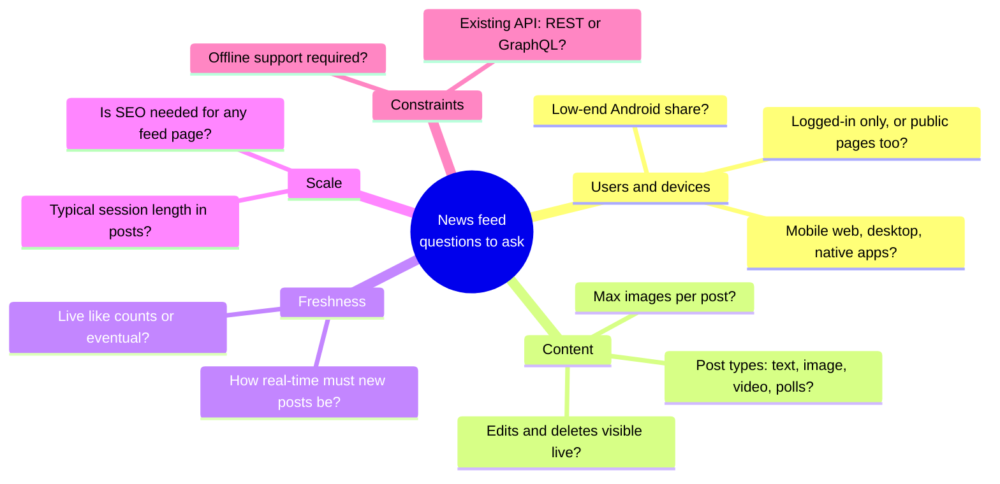

> **State assumptions out loud:** "Logged-in home feed, mobile-first responsive web, REST or GraphQL backend we can shape, ranking done server-side, new-post awareness within ~a minute is fine, like counts may lag."

---

### Section 2: Architecture

**Component architecture:**

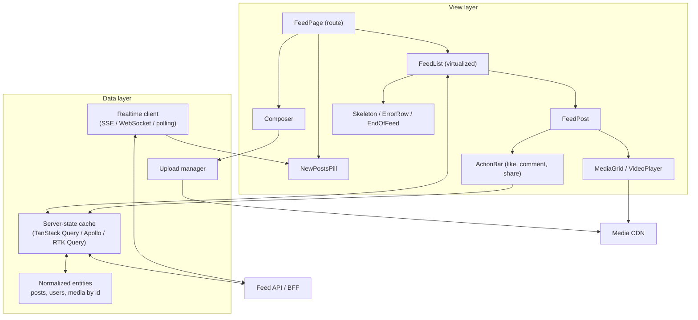

| Component | Responsibility |
|---|---|
| **FeedPage** | Route; owns layout, scroll restoration, the "new posts" pill |
| **FeedList** | Paging trigger (sentinel), virtualization, loading/error/end states |
| **FeedPost** | Presentational: header, body, media, actions. Memoized; receives a **post id** (or a stable object) |
| **Composer** | Draft text, attachments, upload progress, submit with optimistic insert |
| **Data layer** | Fetching, caching, normalization, mutations, realtime merges — no UI logic |

**Rendering strategy:**

| Option | Verdict for a logged-in home feed |
|---|---|
| **CSR only** (shell + skeletons, fetch on mount) | Simple; slower first posts (JS must load, then fetch) |
| **SSR first page + hydrate** | Faster LCP — posts are in the HTML; the CDN can't cache it (personalized, `private`) |
| **Streaming SSR / React Server Components** | Shell streams immediately, first posts stream as ready; heavy post rendering stays on the server |
| **SSG / ISR** | ❌ personalized content; fine for public profile pages or a logged-out "explore" page |

**Recommendation:** stream the **app shell + first page** from the server (SSR or RSC), hydrate, then fetch further pages **client-side**. Public post permalinks can be SSR'd and edge-cached for SEO and link previews (Open Graph tags).

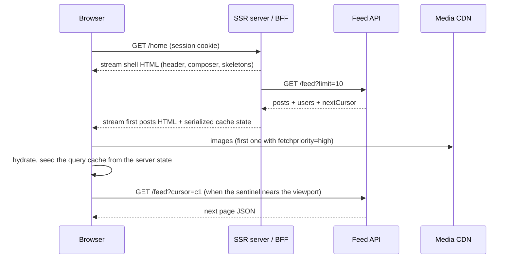

> **Framework mapping:** Next.js (App Router, RSC + streaming), Remix / React Router framework mode (loaders + `defer`-style streaming), Nuxt (`useFetch` in SSR + hydration), Angular (SSR with hydration and `HttpClient` transfer cache), SvelteKit (`load` functions + streaming promises). Native apps render natively and call the same JSON API.

---

### Section 3: Data Model

**Client entities:**

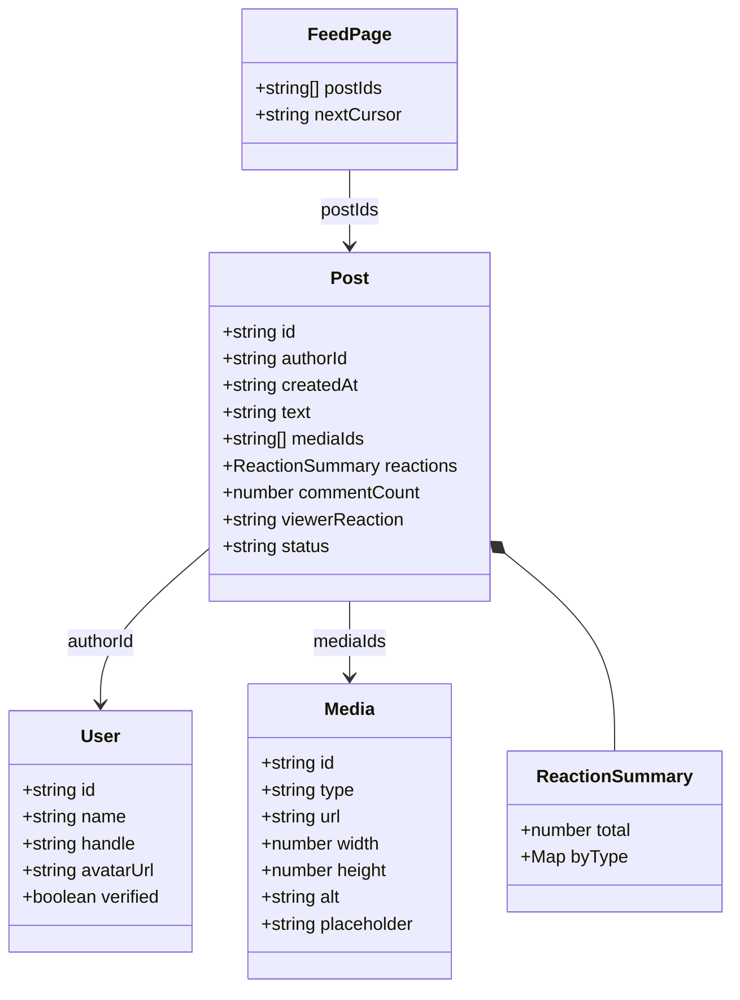

| Entity | Source | Lifetime / owner |
|---|---|---|
| `Post`, `User`, `Media` | Server state | Query cache, **normalized by id** |
| `FeedPage` (ids + cursor) | Server state | Query cache, one list per feed (`home`, `following`, a profile) |
| Draft text, attachments | Client state | Composer state, persisted to `localStorage`/IndexedDB |
| "N new posts" buffer | Client state | Realtime store, until the user reveals them |
| Scroll position, expanded "see more" | UI state | Component state / history state |

**Why normalize?** The same author appears on many posts; the same post can appear in the home feed, a profile and a search result. When you like a post, **every** place that shows it must update.

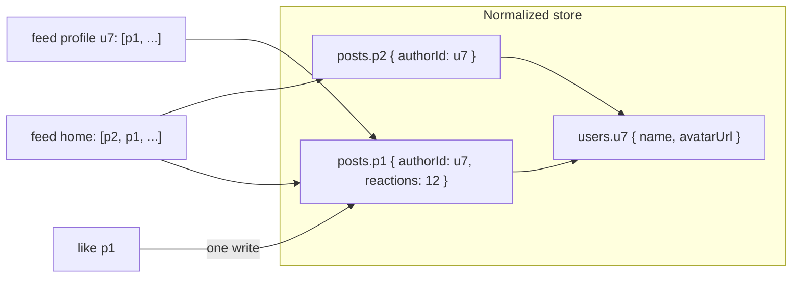

**Caching policy:**

| Data | Strategy |
|---|---|
| Feed pages | `staleTime` ~30–60 s; on refocus, **don't** silently replace the list — fetch "anything newer?" and show the pill |
| Old pages far above the viewport | Drop or cap retained pages (TanStack Query `maxPages` with bi-directional cursors, or evict manually) to bound memory |
| Users | Long `staleTime`; shared across feeds |
| Media | Immutable CDN URLs, `Cache-Control: public, max-age=31536000, immutable` |
| Feed API responses | `Cache-Control: private, no-cache` — personalized, never in a shared cache |

> **Tools:** TanStack Query stores pages as returned (normalize at the API boundary or keep posts denormalized and update with `setQueryData`); Apollo Client and Relay normalize automatically by `__typename` + `id`; RTK Query has `createEntityAdapter`. See [Data Normalization & Caching](./data-normalization-and-caching.md).

---

### Section 4: Interface — Component and Server APIs

**Component APIs (TypeScript):**

```typescript
type FeedKind = { type: 'home' } | { type: 'profile'; userId: string } | { type: 'hashtag'; tag: string };

interface FeedListProps {
  feed: FeedKind;
  pageSize?: number;                 // default 10
  renderEmpty?: () => React.ReactNode;
  onPostVisible?: (postId: string) => void; // impression analytics
}

interface FeedPostProps {
  postId: string;                    // reads entities from the cache; stable prop → cheap memo
  position: number;                  // 1-based, for aria-posinset
  onOpenComments: (postId: string) => void;
}

interface ComposerProps {
  maxLength?: number;                // e.g. 280 / 5000
  maxAttachments?: number;
  onPosted?: (postId: string) => void;
}
```

**Server API contract (REST; a GraphQL connection is equivalent):**

```http
GET /api/feed?cursor=eyJ0cyI6MTczMH0&limit=10 HTTP/1.1
Accept: application/json
```

```json
{
  "items": [
    {
      "id": "p_981",
      "authorId": "u_7",
      "createdAt": "2026-11-06T09:12:44Z",
      "text": "Shipping the new design system today 🎉",
      "mediaIds": ["m_55"],
      "reactions": { "total": 128, "byType": { "like": 120, "love": 8 } },
      "viewerReaction": null,
      "commentCount": 14
    }
  ],
  "includes": {
    "users": { "u_7": { "id": "u_7", "name": "Ana Silva", "handle": "ana", "avatarUrl": "https://cdn.example/a/u_7.webp", "verified": false } },
    "media": { "m_55": { "id": "m_55", "type": "image", "url": "https://cdn.example/m/m_55", "width": 1600, "height": 900, "alt": "Component library screenshot", "placeholder": "LEHV6nWB2yk8pyo0adR*.7kCMdnj" } }
  },
  "nextCursor": "eyJ0cyI6MTcyOX0",
  "hasMore": true
}
```

| Endpoint | Purpose | Notes |
|---|---|---|
| `GET /api/feed?cursor&limit` | Page of the ranked feed | **Cursor**, not offset — stable when new posts arrive at the top |
| `GET /api/feed/new?since=<newestId>` | Count / ids of posts newer than what the client has | Cheap polling fallback |
| `GET /api/feed/stream` | SSE: `new_posts`, `post_updated`, `post_deleted` events | Or a WebSocket channel if the app already has one |
| `POST /api/posts` | Create a post (`Idempotency-Key` header) | Returns the created `Post`; idempotency makes retries safe |
| `PUT /api/posts/{id}/reaction` / `DELETE` | Set / remove the viewer's reaction | Idempotent by design (PUT the state, not "toggle") |
| `POST /api/uploads` | Get a pre-signed upload URL | Client uploads media straight to object storage |

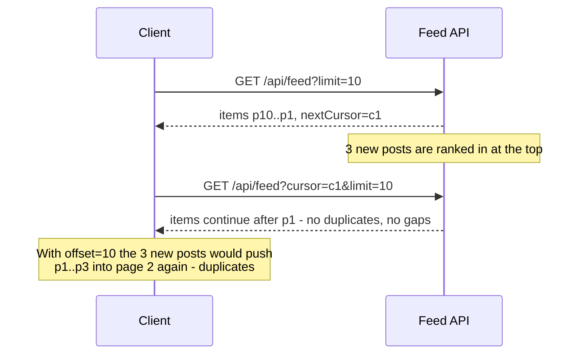

**Why `PUT reaction` and not `POST /like` toggle?** A toggle isn't idempotent: a retried request after a timeout could un-like. Sending the **desired state** (`PUT {type:"like"}` / `DELETE`) makes retries and double taps safe.

---

### Section 5: Optimizations — Performance

**List rendering — keep the DOM bounded:**

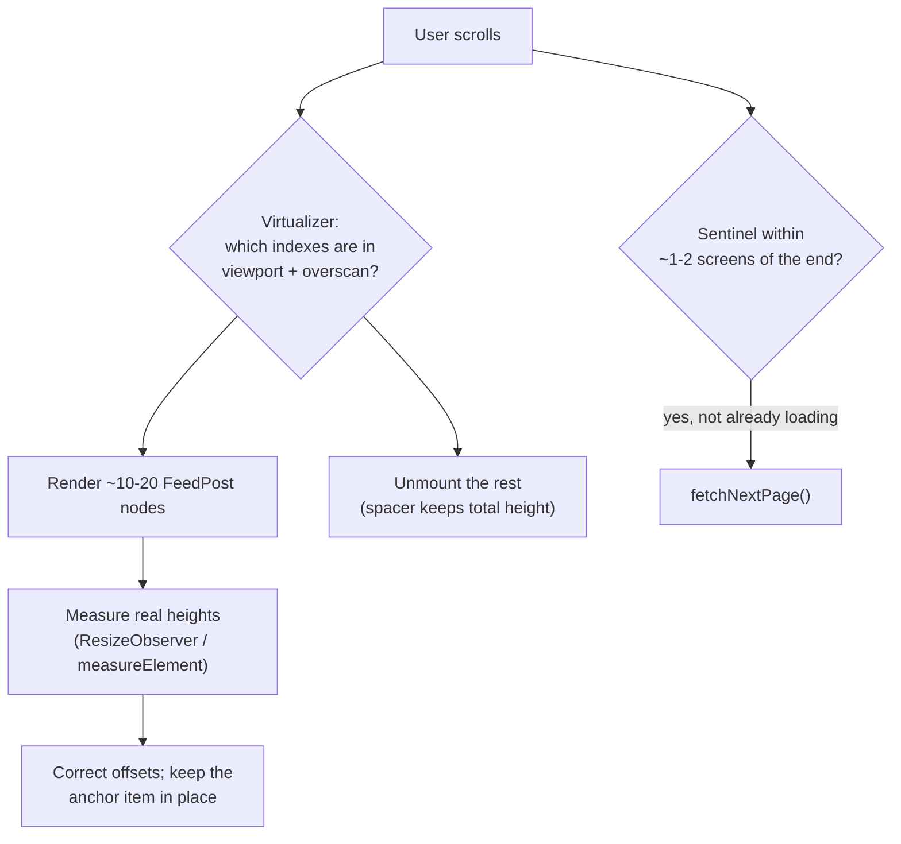

| Technique | Why |
|---|---|
| **Virtualization** (TanStack Virtual, react-virtuoso, Angular CDK, native recyclers) | DOM size and memory stay flat after hundreds of posts |
| **Variable-height measurement** | Posts differ in height; estimate, then measure and correct |
| **`content-visibility: auto` + `contain-intrinsic-size`** | Lighter alternative: keeps nodes in the DOM (find-in-page, a11y) but skips rendering off-screen ones. Supported in current Chrome, Firefox and Safari — check MDN for versions |
| **Prefetch the next page early** | IntersectionObserver sentinel with a generous `rootMargin` (e.g. one or two viewports) |
| **Reserve media space** | `width`/`height` or `aspect-ratio` from the API → no CLS when images load |
| **LCP image** | First post's image: no `loading="lazy"`, `fetchpriority="high"`; the rest `loading="lazy"` |
| **Responsive images** | `srcset` + `sizes`, AVIF/WebP from an image CDN; placeholder (blurhash/thumbhash/dominant color) |
| **Video** | `preload="none"` or `metadata`, poster image, autoplay **muted** only while in view, pause when scrolled away |
| **Code splitting** | Composer extras (emoji picker, GIF search), video player and comment drawer load on demand |
| **Cheap re-renders** | Memoized `FeedPost` keyed by id; a like re-renders one post, not the list |
| **INP** | Like handler updates state synchronously, network in the background; defer analytics |

> **Virtualization caveats:** browser find-in-page can't see unmounted posts; screen readers see only rendered posts (use `aria-setsize`/`aria-posinset`); scroll restoration needs saved measurements. Measure first — `content-visibility` or simply capping retained pages may be enough. See [Virtual Scrolling & Windowing](./virtual-scrolling-and-windowing.md).

**Scroll anchoring:** when content **above** the viewport changes size (an image loads, a post is removed), the reading position must not jump. CSS scroll anchoring (`overflow-anchor`) handles many cases natively; it is in Chromium and Firefox and reached Safari only in a very recent release (per MDN's compatibility data). Virtualizers do their own anchoring when correcting measured sizes.

---

### Section 6: Optimizations — Real-Time Updates

| Transport | Fit for a feed |
|---|---|
| **Polling** `GET /feed/new?since=` every 30–60 s while visible | Simplest; good enough for "new posts" awareness; pause when `document.hidden` |
| **SSE** (`EventSource`) | One-way server → client, auto-reconnect, works over HTTP/2 — a natural fit for "new posts" and counter updates |
| **WebSocket** | Bi-directional; worth it if the app already has a socket (chat, presence) |
| **Push notifications** | Re-engagement while the app is closed — not for in-feed updates |

See [WebSockets, SSE & Long Polling](./websockets-sse-long-polling.md) and [Real-Time Data Sync](./real-time-data-sync.md).

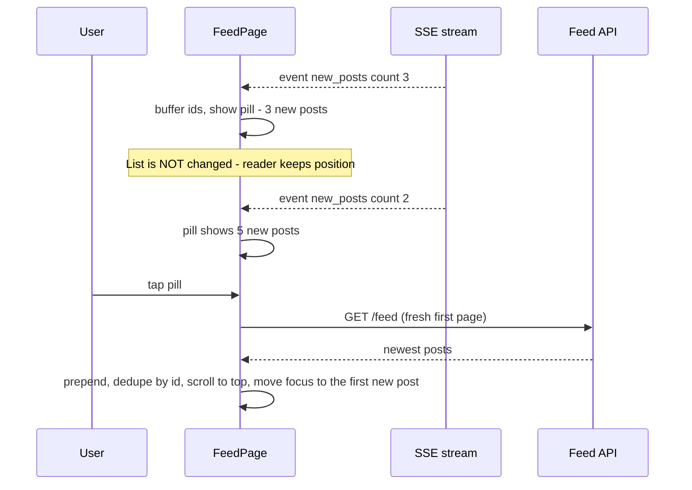

**Rules:**
- **Never auto-insert above the reader.** It causes layout shift and lost position. Auto-insert only when the user is already at the very top (and even then, consider the pill).
- **Updates to visible posts** (like counts, edits) can be patched in place — they don't move other content much. Throttle counter updates.
- **Deletes**: replace the post with a small "This post was removed" row or remove it with scroll anchoring, so the list doesn't jump.
- **Reconnect with a cursor** (`Last-Event-ID` for SSE) so no events are lost after a network blip; on long gaps, refetch instead of replaying.
- **Background tabs:** close or slow down the stream on `visibilitychange`, and refresh on return.

---

### Section 7: Optimizations — Optimistic Interactions and the Composer

**Optimistic like:**

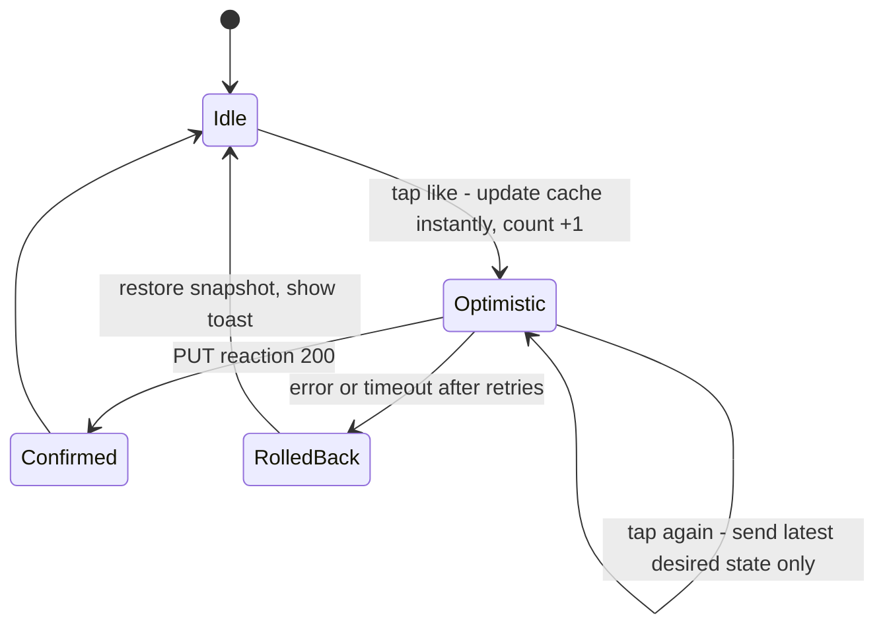

- Snapshot the previous value, write the optimistic value, **cancel in-flight refetches** for that query so they don't overwrite it, roll back on error.
- **Rapid taps:** debounce or serialise per post and send only the final desired state.
- Server is the source of truth: after settle, reconcile the count from the response (others liked it too).

**Composer and posting:**

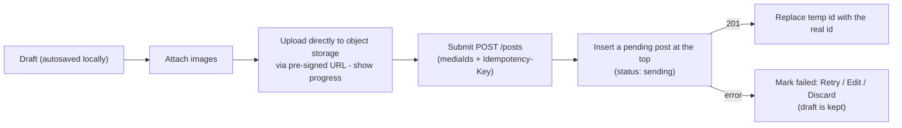

| Concern | Decision |
|---|---|
| Large media | Upload before submit, in parallel, with progress and cancel; resize/compress on the client where possible |
| Duplicate posts on retry | Same `Idempotency-Key` for every retry of one submit (an IETF draft header widely used by payment APIs) |
| Temp ids | `tmp_<uuid>` until the server responds; never use it in URLs |
| Losing work | Persist drafts to `localStorage`/IndexedDB; warn on navigation with unsaved text |
| Mentions / hashtags | Typeahead inside the composer — see [Design an Autocomplete / Typeahead](./design-an-autocomplete-typeahead.md) |

---

### Section 8: Optimizations — Accessibility, i18n, Security, Offline, Edge Cases

**Accessibility — the WAI-ARIA feed pattern:**

| Element | Markup |
|---|---|
| Feed container | `role="feed"`, `aria-label="Home feed"`, `aria-busy="true"` while a page is loading |
| Each post | `<article>` (role `article`), `aria-labelledby` → author + time, `aria-describedby` → body, `aria-posinset`, `aria-setsize` (`-1` when the total is unknown) |
| Keyboard | APG recommends `Page Down`/`Page Up` to move between articles and `Ctrl+End`/`Ctrl+Home` to leave the feed; each article is focusable (`tabindex="0"`) |
| Infinite scroll | Footer becomes unreachable — offer a **"Load more" button** fallback and don't put essential links in the footer |
| New posts pill | A real `<button>`; announce politely (`aria-live="polite"` region) without stealing focus |
| Media | Alt text from the author (prompt for it in the composer); captions for video; respect `prefers-reduced-motion` for autoplay |
| Actions | `aria-pressed` on the like toggle; accessible names that include the count ("Like, 128 likes") |

**i18n:**
- `Intl.RelativeTimeFormat` for "3 min ago"; `Intl.DateTimeFormat` for absolute timestamps in a `<time datetime>` element.
- `Intl.NumberFormat(locale, { notation: 'compact' })` for "1.2K" likes; `Intl.PluralRules`/ICU messages for "1 comment / 5 comments".
- **`dir="auto"`** on user-generated text so an Arabic post inside an English UI renders correctly; logical CSS properties for RTL layouts. See [RTL Layout Support](./rtl-layout-support.md).
- Optional "Translate post" button calling a translation API — never translate silently.

**Security:**
- Render post text as **text** (`{post.text}` in JSX, `{{ }}` in Vue/Angular/Svelte). Parse links/mentions/hashtags into tokens and render elements — never build HTML strings.
- If rich text is unavoidable, sanitize on the server **and** with DOMPurify on the client; consider Trusted Types and a strict CSP. See [XSS Prevention](./xss-prevention-reflected-stored-dom.md).
- Validate link schemes (`https:` only — no `javascript:`), add `rel="noopener noreferrer nofollow ugc"` to user links.
- Link previews are generated **server-side** (avoids SSRF from the client and leaking the user's IP to arbitrary sites).
- CSRF protection on mutations (SameSite cookies + token), rate limiting on posting.

**Offline and poor networks:**
- Persist the last feed pages (persisted query cache in IndexedDB) and show them with an "offline" banner.
- Queue new posts and reactions while offline; retry when `online` fires. Background Sync (`SyncManager`) is Chromium-only, so always keep an in-app retry path. See [Offline-First Architecture](./offline-first-architecture.md).

**Edge cases checklist:**

```text
□ Duplicates across pages (ranking changed between requests)   → dedupe by id when appending
□ Post deleted / author blocked while visible                    → tombstone row, keep scroll position
□ Back from post detail                                          → restore scroll + cached pages (no refetch jump)
□ Very long text                                                 → clamp with "See more" (button, aria-expanded)
□ Tab left open for hours                                        → refresh on visibility; the cursor may expire → restart from top
□ Empty feed (new user)                                          → onboarding suggestions, not a blank page
□ Page request fails mid-scroll                                  → inline error row with Retry; keep loaded posts
□ End of feed                                                    → explicit "You're all caught up"
□ Mixed-direction text, emoji, very long words/URLs              → dir="auto", overflow-wrap: anywhere
```

---

## Interview Walkthrough

**How to spend 45 minutes:**

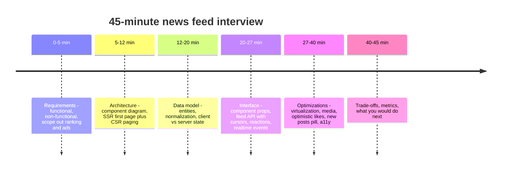

| Phase | What to say / draw | Signals the interviewer looks for |
|---|---|---|
| **Requirements** | List F1–F4, state non-goals, ask about devices, freshness, SEO | You scope before designing |
| **Architecture** | Component tree + data layer + API/CDN; rendering choice with a reason | Separation of concerns; rendering trade-off |
| **Data model** | `Post`, `User`, `Media`, `FeedPage`; normalized store | Why normalization; server vs client state |
| **Interface** | Cursor pagination response; `PUT` reaction; SSE events | Cursor vs offset; idempotency |
| **Optimizations** | Pick 3–4 deep dives — don't list 20 things shallowly | Depth: you know *why* and the failure modes |
| **Wrap-up** | Metrics: LCP/INP/CLS, scroll jank, error rates, engagement | You'd measure, not guess |

**Trade-offs to discuss explicitly:**

| Decision | Option A | Option B | Lean |
|---|---|---|---|
| Rendering | CSR (simple, cacheable shell) | SSR/streaming first page (faster LCP) | SSR first page, CSR after |
| Pagination | Offset (simple, jump to page) | Cursor (stable under inserts) | **Cursor** |
| Long lists | Full virtualization (bounded DOM) | `content-visibility` / page cap (keeps find-in-page, simpler a11y) | Start simple, virtualize when measured |
| New posts | Auto-insert | Pill + user-initiated reveal | **Pill** |
| Realtime transport | Polling | SSE / WebSocket | Polling or SSE; WebSocket if one already exists |
| Data store | Denormalized query cache | Normalized entities | Normalized (or Apollo/Relay) once posts appear in many views |
| Likes | Wait for server | Optimistic + rollback | **Optimistic** |
| Payload | Embed author in each post | Side-load `includes.users` | Side-load (smaller, normalizes naturally) |

> **Avoid:** spending 15 minutes on the ranking algorithm or database sharding. Mention that ranking is server-side and move on — this is a **frontend** design.

---

## Real-World Examples

**Example 1 — Typed API client with cursor pagination:**
```typescript
export interface Post {
  id: string;
  authorId: string;
  createdAt: string;
  text: string;
  mediaIds: string[];
  reactions: { total: number; byType: Record<string, number> };
  viewerReaction: string | null;
  commentCount: number;
}
export interface User { id: string; name: string; handle: string; avatarUrl: string; verified: boolean }
export interface Media { id: string; type: 'image' | 'video'; url: string; width: number; height: number; alt: string; placeholder?: string }

export interface FeedPage {
  items: Post[];
  includes: { users: Record<string, User>; media: Record<string, Media> };
  nextCursor: string | null;
  hasMore: boolean;
}

export async function fetchFeed(cursor: string | null, signal?: AbortSignal): Promise<FeedPage> {
  const params = new URLSearchParams({ limit: '10' });
  if (cursor) params.set('cursor', cursor);
  const res = await fetch(`/api/feed?${params}`, { signal, credentials: 'same-origin' });
  if (!res.ok) throw new Error(`Feed request failed: ${res.status}`);
  return res.json();
}
```

**Example 2 — Infinite query with dedupe and a prefetching sentinel (React + TanStack Query v5):**
```tsx
import { useInfiniteQuery } from '@tanstack/react-query';
import { useEffect, useMemo, useRef } from 'react';

export function useHomeFeed() {
  const query = useInfiniteQuery({
    queryKey: ['feed', 'home'],
    queryFn: ({ pageParam, signal }) => fetchFeed(pageParam, signal),
    initialPageParam: null as string | null,
    getNextPageParam: (last) => (last.hasMore ? last.nextCursor : undefined),
    staleTime: 60_000,
    refetchOnWindowFocus: false, // don't reshuffle the list under the reader; use the pill instead
  });

  // Flatten pages and drop duplicates (ranking can shift between requests)
  const posts = useMemo(() => {
    const seen = new Set<string>();
    return (query.data?.pages ?? []).flatMap((p) => p.items).filter((post) => {
      if (seen.has(post.id)) return false;
      seen.add(post.id);
      return true;
    });
  }, [query.data]);

  return { ...query, posts };
}

export function LoadMoreSentinel({ onVisible, disabled }: { onVisible: () => void; disabled: boolean }) {
  const ref = useRef<HTMLDivElement>(null);
  useEffect(() => {
    const el = ref.current;
    if (!el || disabled) return;
    const io = new IntersectionObserver(
      ([entry]) => entry.isIntersecting && onVisible(),
      { rootMargin: '0px 0px 1500px 0px' }, // start fetching ~1-2 screens early
    );
    io.observe(el);
    return () => io.disconnect();
  }, [onVisible, disabled]);
  return <div ref={ref} aria-hidden="true" />;
}
```

**Example 3 — Accessible, virtualized feed (TanStack Virtual, window scrolling):**
```tsx
import { useWindowVirtualizer } from '@tanstack/react-virtual';
import { useRef } from 'react';

export function FeedList() {
  const { posts, fetchNextPage, hasNextPage, isFetchingNextPage } = useHomeFeed();
  const listRef = useRef<HTMLDivElement>(null);

  const virtualizer = useWindowVirtualizer({
    count: posts.length,
    estimateSize: () => 420,              // rough guess; real heights are measured
    overscan: 4,
    scrollMargin: listRef.current?.offsetTop ?? 0,
  });

  return (
    <div
      ref={listRef}
      role="feed"
      aria-label="Home feed"
      aria-busy={isFetchingNextPage}
      style={{ height: virtualizer.getTotalSize(), position: 'relative' }}
    >
      {virtualizer.getVirtualItems().map((row) => {
        const post = posts[row.index];
        return (
          <div
            key={post.id}
            data-index={row.index}
            ref={virtualizer.measureElement}
            style={{
              position: 'absolute', top: 0, left: 0, width: '100%',
              transform: `translateY(${row.start - virtualizer.options.scrollMargin}px)`,
            }}
          >
            <FeedPost postId={post.id} position={row.index + 1} setSize={hasNextPage ? -1 : posts.length} />
          </div>
        );
      })}
      <div style={{ position: 'absolute', top: virtualizer.getTotalSize(), width: '100%' }}>
        {hasNextPage ? (
          <>
            <LoadMoreSentinel onVisible={() => fetchNextPage()} disabled={isFetchingNextPage} />
            <button type="button" onClick={() => fetchNextPage()} disabled={isFetchingNextPage}>
              {isFetchingNextPage ? 'Loading…' : 'Load more posts'}
            </button>
          </>
        ) : (
          <p>You're all caught up.</p>
        )}
      </div>
    </div>
  );
}

function FeedPost({ postId, position, setSize }: { postId: string; position: number; setSize: number }) {
  const post = usePost(postId);           // selector over the normalized cache
  const author = useUser(post.authorId);
  return (
    <article
      tabIndex={0}
      aria-posinset={position}
      aria-setsize={setSize}
      aria-labelledby={`${postId}-author`}
      aria-describedby={`${postId}-text`}
    >
      <header>
        <span id={`${postId}-author`}>{author.name}</span>{' '}
        <time dateTime={post.createdAt}>{formatRelative(post.createdAt)}</time>
      </header>
      <p id={`${postId}-text`} dir="auto">{post.text}</p>
      <PostMedia ids={post.mediaIds} eager={position === 1} />
      <LikeButton post={post} />
    </article>
  );
}
```

**Example 4 — Optimistic like with rollback (BAD → GOOD):**
```tsx
// ❌ BAD: waits for the network (slow INP), toggles server-side (retry may un-like)
async function onLikeBad(id: string) {
  await fetch(`/api/posts/${id}/like`, { method: 'POST' });
  await queryClient.invalidateQueries({ queryKey: ['feed'] }); // refetches every page
}

// ✅ GOOD: send the desired state, update instantly, roll back on error
import { useMutation, useQueryClient, type InfiniteData } from '@tanstack/react-query';

export function useSetReaction() {
  const qc = useQueryClient();
  const key = ['feed', 'home'];

  return useMutation({
    mutationFn: ({ id, liked }: { id: string; liked: boolean }) =>
      fetch(`/api/posts/${id}/reaction`, {
        method: liked ? 'PUT' : 'DELETE',
        headers: { 'Content-Type': 'application/json' },
        body: liked ? JSON.stringify({ type: 'like' }) : undefined,
      }).then((r) => { if (!r.ok) throw new Error(String(r.status)); }),

    onMutate: async ({ id, liked }) => {
      await qc.cancelQueries({ queryKey: key });        // in-flight refetch must not overwrite us
      const previous = qc.getQueryData<InfiniteData<FeedPage>>(key);
      qc.setQueryData<InfiniteData<FeedPage>>(key, (data) => data && {
        ...data,
        pages: data.pages.map((page) => ({
          ...page,
          items: page.items.map((p) => p.id !== id ? p : {
            ...p,
            viewerReaction: liked ? 'like' : null,
            reactions: { ...p.reactions, total: p.reactions.total + (liked ? 1 : -1) },
          }),
        })),
      });
      return { previous };
    },
    onError: (_err, _vars, ctx) => {
      if (ctx?.previous) qc.setQueryData(key, ctx.previous);
      toast('Could not update your reaction. Please try again.');
    },
  });
}
```

**Example 5 — "New posts" pill over SSE:**
```tsx
import { useEffect, useState } from 'react';

export function useNewPostsCount() {
  const [count, setCount] = useState(0);
  useEffect(() => {
    let es: EventSource | null = null;
    const open = () => {
      es = new EventSource('/api/feed/stream');           // same-origin: cookies are sent
      es.addEventListener('new_posts', (e) => {
        const { count: n } = JSON.parse((e as MessageEvent).data) as { count: number };
        setCount((c) => c + n);
      });
    };
    const onVisibility = () => {
      if (document.hidden) { es?.close(); es = null; } else if (!es) { open(); }
    };
    open();
    document.addEventListener('visibilitychange', onVisibility);
    return () => { es?.close(); document.removeEventListener('visibilitychange', onVisibility); };
  }, []);
  return { count, reset: () => setCount(0) };
}

export function NewPostsPill({ onReveal }: { onReveal: () => void }) {
  const { count, reset } = useNewPostsCount();
  return (
    <>
      <div aria-live="polite" className="visually-hidden">
        {count > 0 ? `${count} new posts available` : ''}
      </div>
      {count > 0 && (
        <button type="button" className="new-posts-pill" onClick={() => { reset(); onReveal(); }}>
          ↑ {count} new posts
        </button>
      )}
    </>
  );
}
```

**Example 6 — Media without layout shift:**
```html
<!-- First post: LCP candidate → eager + high priority -->


<!-- Later posts: lazy -->


<!-- Video: nothing downloads until needed -->
<video poster="https://img.example/v_9-poster.jpg" preload="none" muted playsinline controls width="1280" height="720"></video>
```

**Example 7 — Other stacks:**
```text
Vue / Nuxt     @tanstack/vue-query useInfiniteQuery · @tanstack/vue-virtual or vue-virtual-scroller
               {{ post.text }} escapes; avoid v-html for user content · useIntersectionObserver (VueUse)
Angular        HttpClient + a signal/RxJS store or TanStack Query for Angular · CDK cdk-virtual-scroll-viewport
               (core strategy needs a fixed itemSize; autosize lives in @angular/cdk-experimental)
               @defer (on viewport) for heavy post parts · SSR with hydration + HttpClient transfer cache
Svelte / Kit   @tanstack/svelte-query · load() streams the first page · an IntersectionObserver action
               {post.text} escapes; never {@html} untrusted text
iOS            UICollectionView + diffable data source / SwiftUI List or LazyVStack; prefetching APIs
Android        RecyclerView + Paging 3 / Jetpack Compose LazyColumn + Paging (collectAsLazyPagingItems)
React Native   FlatList (windowed) or FlashList; keyExtractor = post id; onEndReached for paging
```

---

## Key Points Summary

| Concept | One-Line Explanation |
|---|---|
| **RADIO** | Requirements → Architecture → Data model → Interface → Optimizations |
| **Rendering** | Stream SSR/RSC for the shell + first page, then client-side paging |
| **Cursor pagination** | Stable under new inserts — no duplicates or gaps, unlike offset |
| **Normalization** | Store each post/user once; every view reads the same entity |
| **Virtualization** | Render only visible posts; measure variable heights |
| **Media** | Reserve space with width/height; prioritise the LCP image; lazy-load the rest |
| **New posts pill** | Buffer realtime arrivals; reveal on user action — no layout shift |
| **Optimistic reactions** | Update instantly, send the desired state (`PUT`/`DELETE`), roll back on error |
| **Idempotency-Key** | Safe retries for post creation |
| **`role="feed"`** | APG pattern: articles with `aria-posinset`/`aria-setsize`, `aria-busy` while loading |
| **UGC security** | Render as text, tokenise links, sanitize rich text, validate URL schemes |
| **Offline** | Cache last pages, queue writes, retry on reconnect |

---

## Test Your Understanding

**Q1 (Basic):** Why do feeds use cursor pagination instead of `?page=3` / `?offset=20`?

<details>
<summary>Answer</summary>

A feed changes at the **top** constantly. With offsets, if three posts are inserted after page 1 loads, `offset=10` now starts three items earlier, so page 2 repeats three posts (duplicates); deletions cause **skipped** posts. A cursor encodes "continue after this item" (e.g. a ranking position or timestamp + id), so the next page starts exactly where the previous one ended regardless of inserts. Cursors also let the server use efficient keyset queries instead of scanning and discarding `offset` rows. The trade-off — you can't jump to "page 50" — doesn't matter for a feed.
</details>

**Q2 (Application):** A user scrolls 400 posts on a mid-range Android phone and the page becomes janky and eventually crashes. Diagnose and fix.

<details>
<summary>Answer</summary>

The DOM and memory grow without bound: 400 posts × (images, video elements, event listeners, React fibers). Layout and style recalculation get slower with DOM size, decoded images use memory, and autoplaying videos keep decoders busy.

Fixes, in order: **virtualize** the list (render only viewport + overscan, measure variable heights) or at least use `content-visibility: auto` with `contain-intrinsic-size`; **cap retained pages** in the cache (drop pages far above, re-fetch on scroll back); lazy-load images with correct `sizes` so phones get small files; **pause and unload** videos that leave the viewport; memoize `FeedPost` so a like doesn't re-render 400 items. Verify with the Performance panel and memory snapshots, and track INP in the field.
</details>

**Q3 (Tricky):** Your realtime channel delivers new posts and you prepend them to the list immediately. Users complain they "lose their place" and CLS spikes. Why, and what's the better design?

<details>
<summary>Answer</summary>

Prepending content **above the viewport** pushes everything down; unless the browser or virtualizer anchors perfectly, the post being read jumps away. Unexpected shifts not caused by user input count toward **CLS**. It's also disorienting for screen-reader users whose reading position changes.

Better: **buffer** new posts and show a "N new posts" pill (a real button + polite live-region announcement). When tapped, prepend, dedupe, scroll to the top and move focus to the first new post — a user-initiated change. Auto-insert only when the user is already at the top. In-place updates (like counts) are fine because they barely change layout.
</details>

**Q4 (Tricky):** A user double-taps "like" on a slow network; the first request times out and is retried; the post ends up **un-liked**. What went wrong in the API design and client logic?

<details>
<summary>Answer</summary>

The API was a **toggle** (`POST /like` flips the state), which is not idempotent: the retry and the second tap each flipped it again. Fix the contract: send the **desired state** — `PUT /posts/{id}/reaction` to like, `DELETE` to unlike — so any number of retries converge on the same result. On the client, keep the optimistic state as the source of the *intended* value, serialise or debounce per post so only the latest desired state is sent, cancel in-flight refetches before writing optimistic data, and reconcile with the server's response when the request settles.
</details>

**Q5 (Application):** How do you make an infinite feed accessible to keyboard and screen-reader users?

<details>
<summary>Answer</summary>

Use the **WAI-ARIA feed pattern**: a container with `role="feed"` and an accessible name; each post is an `<article>` with `aria-labelledby` (author/time), `aria-describedby` (body), `aria-posinset` and `aria-setsize` (`-1` when the total is unknown, which matters even more under virtualization). Set `aria-busy="true"` while loading so assistive tech doesn't announce half-updated content. Make articles focusable and support `Page Down`/`Page Up` between articles and `Ctrl+End`/`Ctrl+Home` to leave the feed. Provide a **"Load more" button** as a fallback, keep the footer content reachable elsewhere, announce new posts politely, give media alt text and captions, use `aria-pressed` on the like toggle, and honour `prefers-reduced-motion` for autoplay.
</details>

**Q6 (System design):** The PM wants the feed to load "instantly" on repeat visits and to work on the subway (offline). Design it.

<details>
<summary>Answer</summary>

- **App shell** precached by a Service Worker (hashed assets, `immutable`), so the UI renders without the network.
- **Persist the query cache** (last few feed pages, users, media metadata) to IndexedDB; on start, render cached posts immediately with a "Last updated 2 h ago" note, then revalidate in the background (stale-while-revalidate). New results go into the **pill**, not over the cached list.
- **Images:** cache recently viewed thumbnails with a size-capped runtime cache; show placeholders for uncached media.
- **Offline writes:** reactions and posts go into an outbox (IndexedDB) with idempotency keys, shown as "pending"; flush on `online` (Background Sync where available — Chromium only — plus an in-app retry).
- **Edge cases:** expired session while offline, conflicting edits, quota eviction (handle missing cache gracefully), clearing personal data on logout (`Clear-Site-Data`).
- **SSR trade-off:** with a strong client cache, a cached shell + client fetch may beat SSR on repeat visits; keep SSR for first visits. Measure LCP for both cohorts.
</details>

---

## Cheat Sheet

**Key Definitions:**
- **RADIO:** Requirements, Architecture, Data model, Interface, Optimizations — a structure for frontend system design answers.
- **Cursor:** opaque token meaning "continue after this item".
- **Normalized cache:** entities stored once by id; lists hold ids.
- **Virtualization (windowing):** render only visible rows plus overscan.
- **Optimistic update:** apply the expected result before the server confirms; roll back on failure.
- **Idempotency key:** client-generated id that lets the server deduplicate retries.
- **Feed pattern:** WAI-ARIA `role="feed"` with `article` children and position metadata.

**Quick Reference:**
```text
R  F: infinite list, react, compose, new-post awareness   NF: LCP/INP/CLS, low-end phones, a11y, i18n, UGC safety
   Ask: devices? realtime needs? SEO? media types? offline? API shape?
A  FeedPage → Composer | NewPostsPill | FeedList → FeedPost → Media + ActionBar
   Data layer: query cache + normalized entities + realtime client + upload manager
   Render: stream SSR/RSC shell + first page → hydrate → client paging
D  Post, User, Media, FeedPage{postIds, nextCursor}; drafts + pill buffer = client state
I  GET /feed?cursor&limit → {items, includes{users,media}, nextCursor, hasMore}
   PUT|DELETE /posts/:id/reaction · POST /posts (Idempotency-Key) · SSE /feed/stream
O  virtualize + measure · prefetch next page early · width/height on media · LCP image high priority
   pill for new posts · optimistic likes · role=feed · dir=auto · text not HTML · outbox offline
```

**Common Mistakes to Avoid:**

| Mistake | Why Wrong | Fix |
|---|---|---|
| Offset pagination | Duplicates/gaps as new posts arrive | Cursor pagination + dedupe by id |
| Rendering every loaded post | DOM/memory grow forever → jank, crashes | Virtualize or `content-visibility`; cap retained pages |
| Auto-prepending realtime posts | Layout shift, lost reading position | "N new posts" pill, user-initiated reveal |
| Images without dimensions | CLS as images load | `width`/`height` or `aspect-ratio` from the API |
| Lazy-loading the first image | Delays LCP | Eager + `fetchpriority="high"` for the first, lazy for the rest |
| Toggle-style like endpoint | Retries flip state | `PUT`/`DELETE` desired state; optimistic UI |
| `invalidateQueries` on every like | Refetches all pages, list reshuffles | Patch the cache entry; reconcile from the response |
| `dangerouslySetInnerHTML` / `v-html` for posts | Stored XSS | Render text; tokenise links; sanitize if rich text |
| Refetch-on-focus replacing the list | Content jumps when the user returns | Disable for the feed; check for newer posts → pill |
| No "Load more" fallback | Keyboard users can't reach the footer; no recovery from errors | Button fallback + inline retry row |
| Designing the ranking backend in a frontend interview | Wastes time, misses frontend depth | State it's server-side; go deep on client concerns |

---

## References & Further Reading

**Patterns & accessibility**
- W3C WAI-ARIA APG: [Feed pattern](https://www.w3.org/WAI/ARIA/apg/patterns/feed/) · [Infinite scrolling feed example](https://www.w3.org/WAI/ARIA/apg/patterns/feed/examples/feed/)
- MDN: [ARIA `feed` role](https://developer.mozilla.org/en-US/docs/Web/Accessibility/ARIA/Reference/Roles/feed_role) · [`aria-setsize`](https://developer.mozilla.org/en-US/docs/Web/Accessibility/ARIA/Reference/Attributes/aria-setsize) · [`aria-busy`](https://developer.mozilla.org/en-US/docs/Web/Accessibility/ARIA/Reference/Attributes/aria-busy)

**Performance**
- web.dev: [Virtualize large lists with react-window](https://web.dev/articles/virtualize-long-lists-react-window) · [`content-visibility`](https://web.dev/articles/content-visibility)
- web.dev: [Optimize Cumulative Layout Shift](https://web.dev/articles/optimize-cls) · [Optimize LCP](https://web.dev/articles/optimize-lcp) · [Fetch Priority](https://web.dev/articles/fetch-priority)
- MDN: [Intersection Observer API](https://developer.mozilla.org/en-US/docs/Web/API/Intersection_Observer_API) · [`overflow-anchor`](https://developer.mozilla.org/en-US/docs/Web/CSS/overflow-anchor)

**Data & realtime**
- TanStack Query: [Infinite queries](https://tanstack.com/query/latest/docs/framework/react/guides/infinite-queries) · [Optimistic updates](https://tanstack.com/query/latest/docs/framework/react/guides/optimistic-updates)
- TanStack Virtual: [Introduction](https://tanstack.com/virtual/latest/docs/introduction)
- GraphQL: [Pagination and connections](https://graphql.org/learn/pagination/)
- MDN: [Using server-sent events](https://developer.mozilla.org/en-US/docs/Web/API/Server-sent_events/Using_server-sent_events)
- IETF draft: [The Idempotency-Key HTTP header field](https://datatracker.ietf.org/doc/draft-ietf-httpapi-idempotency-key-header/)

**i18n & security**
- MDN: [`Intl.RelativeTimeFormat`](https://developer.mozilla.org/en-US/docs/Web/JavaScript/Reference/Global_Objects/Intl/RelativeTimeFormat) · [`Intl.NumberFormat`](https://developer.mozilla.org/en-US/docs/Web/JavaScript/Reference/Global_Objects/Intl/NumberFormat) · [`dir` attribute](https://developer.mozilla.org/en-US/docs/Web/HTML/Reference/Global_attributes/dir)
- OWASP: [Cross Site Scripting Prevention Cheat Sheet](https://cheatsheetseries.owasp.org/cheatsheets/Cross_Site_Scripting_Prevention_Cheat_Sheet.html)

**Framework & platform docs**
- Angular CDK: [Scrolling (virtual scroll)](https://material.angular.dev/cdk/scrolling/overview)
- Android: [Paging library overview](https://developer.android.com/topic/libraries/architecture/paging/v3-overview)
- React Native: [`FlatList`](https://reactnative.dev/docs/flatlist) · [Optimizing FlatList configuration](https://reactnative.dev/docs/optimizing-flatlist-configuration)

**Deep dives**
- GreatFrontEnd: [Front End System Design — RADIO framework](https://www.greatfrontend.com/front-end-system-design-playbook/framework)
- Meta Engineering: [Rebuilding our tech stack for the new Facebook.com](https://engineering.fb.com/2020/05/08/web/facebook-redesign/)

---

> **Previous Topic:** [Monorepo Tooling (Turborepo, Nx)](./monorepo-tooling-turborepo-nx.md)
> — Task graphs, caching and CI for many apps in one repository

> **Next Topic:** [Design an Autocomplete / Typeahead](./design-an-autocomplete-typeahead.md)
> — Debounced search-as-you-type with caching, race handling and the combobox pattern

*Saved on: 2026-11-06 | Repo: Frontend System Design Learning Notes*
