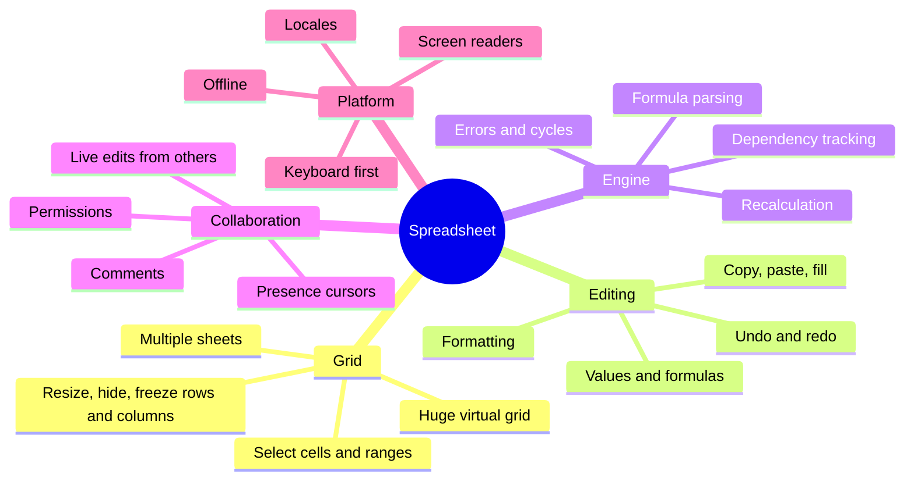
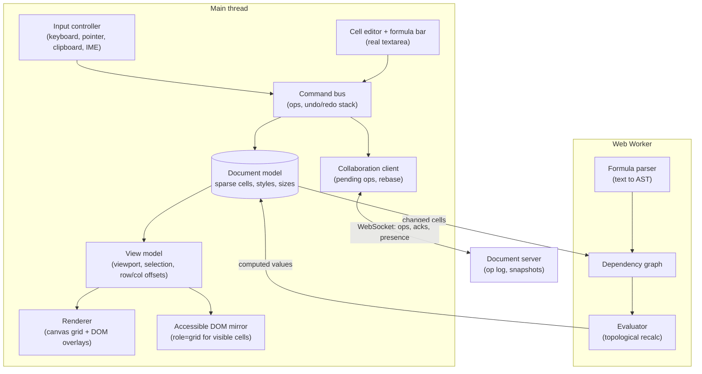
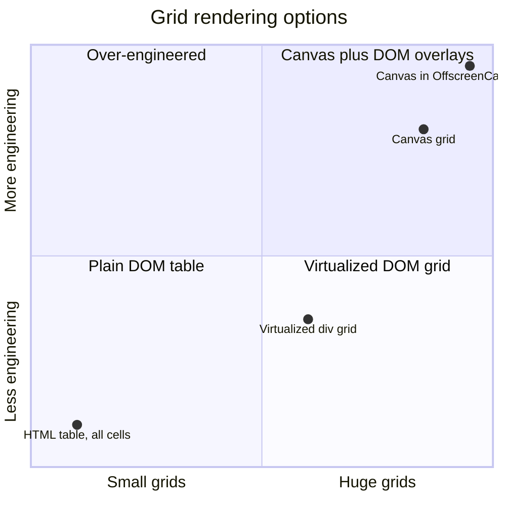
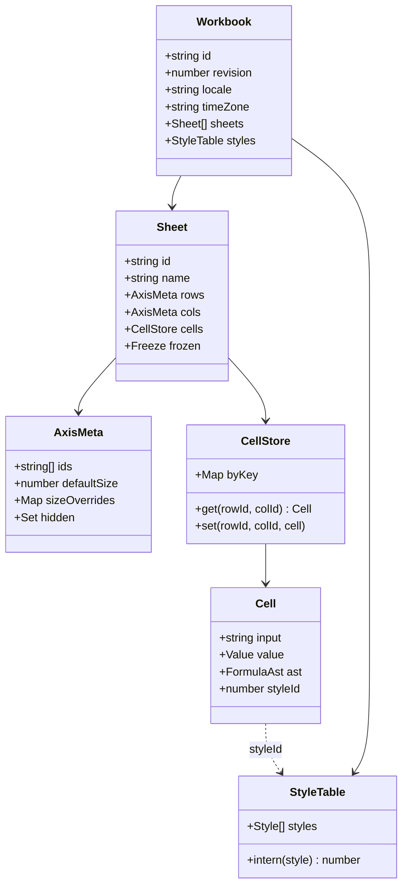
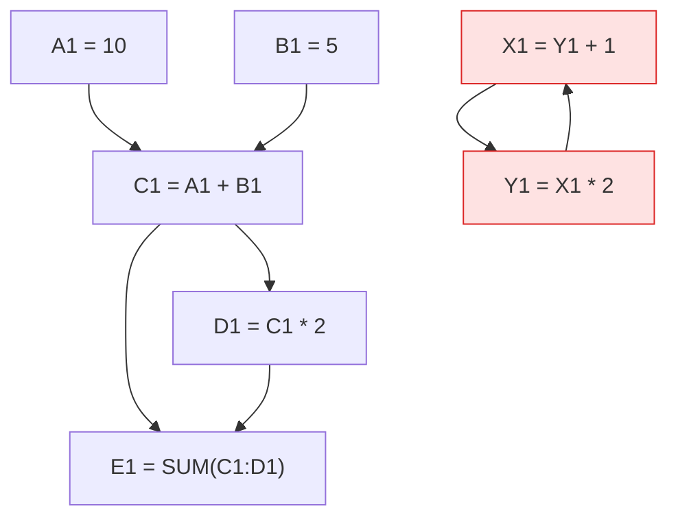
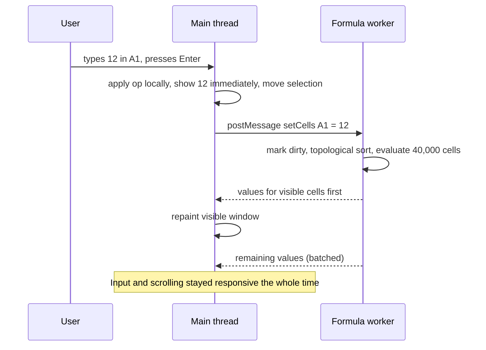
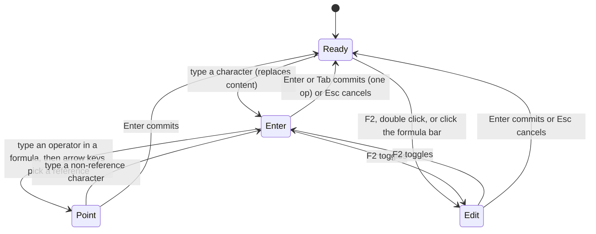
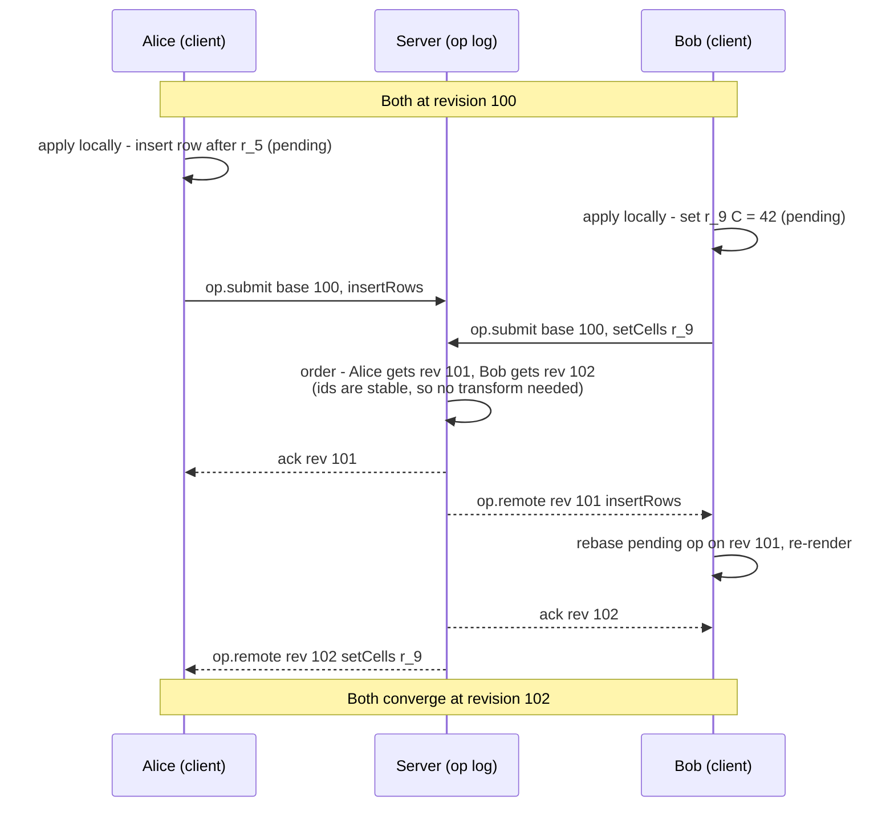

<!-- Generated by scripts/sync-knowledge.js from notes/ and README.md — do not edit here. -->
<!-- sections (line ranges in this file): Table of Contents 19-39 · ELI5 40-52 · Core Concept 53-542 · Interview Walkthrough 543-585 · Framework and Platform Comparison 586-600 · Real-World Examples 601-888 · Key Points Summary 889-911 · Test Your Understanding 912-988 · Cheat Sheet 989-1040 · References & Further Reading 1041-1078 -->

# Design a Spreadsheet (Google Sheets)

> **Date:** 2026-11-06 · **Last updated:** 2026-11-06
> **Category:** Frontend System Design
> **Sub-Topic:** System Design Cases / Productivity — Spreadsheet Grid, Formula Engine & Collaboration
> **Level:** Advanced · **Reading time:** ~40 min
> **Informs:** DOM virtualization vs canvas rendering for large grids, sparse cell storage and style interning, variable row/column sizes (prefix sums), formula parsing and dependency-graph recalculation, moving computation to Web Workers, collaborative editing (server-ordered ops, OT vs CRDT), undo/redo with commands, ARIA grid pattern for virtualized grids, clipboard interop, locale-aware number parsing, CSV/formula injection

> **Pre-requisite:** [Virtual Scrolling & Windowing](./virtual-scrolling-and-windowing.md) and [Web Workers for Heavy Computation](./web-workers-for-heavy-computation.md).
> A spreadsheet is the hardest common "grid" problem: millions of potential cells, a small programming language (formulas), and several people editing at once.

**Previous:** [Design a Chat Application UI](./design-a-chat-application-ui.md) · **Next:** [Design a Video Player (YouTube)](./design-a-video-player-youtube.md)

---

## Table of Contents

1. [ELI5 — Simple Explanation](#eli5--simple-explanation)
2. [Section 1: R — Requirements](#section-1-r--requirements)
3. [Section 2: A — Architecture](#section-2-a--architecture)
4. [Section 3: D — Data Model](#section-3-d--data-model)
5. [Section 4: The Formula Engine](#section-4-the-formula-engine)
6. [Section 5: I — Interface (Component API, Operations and Server API)](#section-5-i--interface-component-api-operations-and-server-api)
7. [Section 6: O — Rendering and Scrolling Performance](#section-6-o--rendering-and-scrolling-performance)
8. [Section 7: O — Collaboration, Undo and Offline](#section-7-o--collaboration-undo-and-offline)
9. [Section 8: O — Accessibility, i18n, Security and Edge Cases](#section-8-o--accessibility-i18n-security-and-edge-cases)
10. [Interview Walkthrough](#interview-walkthrough)
11. [Framework and Platform Comparison](#framework-and-platform-comparison)
12. [Real-World Examples](#real-world-examples)
13. [Key Points Summary](#key-points-summary)
14. [Test Your Understanding (with answers)](#test-your-understanding)
15. [Cheat Sheet](#cheat-sheet)
16. [References & Further Reading](#references--further-reading)

---

## ELI5 — Simple Explanation

Picture a **huge sheet of graph paper** the size of a football field, and you're looking at it through a **window frame**:
- You never draw the whole field — only the squares visible through the window. When you slide the window, you draw the new squares (**virtualization / canvas rendering**).
- Most squares are **empty**. You only keep notes for the squares that have something written in them (**sparse storage**).
- Some squares hold **recipes** instead of numbers: "C1 = A1 + B1". When A1 changes, you follow the arrows to everything that uses A1, and recompute them **in the right order** (**dependency graph + topological recalculation**). If two recipes point at each other forever, you write "circular!" instead of looping.
- A **helper in the back room** does the long sums so you can keep writing (**Web Worker**).
- Friends edit the same sheet from other rooms. Everyone sends their changes to a **referee** who numbers them; if two changes clash, the referee's order wins and everyone adjusts (**server-ordered operations**).

> **One-line takeaway: store only non-empty cells, draw only the visible ones, recalculate only what depends on the change (off the main thread), and let a server order everyone's edits.**

---

## Core Concept — Step by Step

This case follows **RADIO** (Requirements → Architecture → Data model → Interface → Optimizations), with an extra section on the formula engine because it's the part interviewers dig into.

### Section 1: R — Requirements



**Functional requirements:**

| # | Requirement | Notes |
|---|---|---|
| F1 | Scrollable grid with row numbers and column letters, much larger than the screen | Sparse data, smooth scrolling |
| F2 | Select a cell, a range, whole rows/columns; keyboard navigation | Arrow keys, Shift+arrows, Ctrl/Cmd+arrows |
| F3 | Edit cells: values, text, dates, **formulas** (`=SUM(A1:A10)`) | In-cell editor and formula bar |
| F4 | **Recalculate** dependent cells automatically | Errors: `#DIV/0!`, `#REF!`, circular references |
| F5 | **Copy / paste** within the app and with Excel/other sheets | TSV + HTML clipboard formats |
| F6 | **Undo / redo** | Per user in collaborative mode |
| F7 | Insert / delete / resize / hide / freeze rows and columns | References must adjust |
| F8 | Formatting (number formats, bold, colours) | Many cells, few distinct styles |
| F9 | **Real-time collaboration** with presence (others' selections) | Conflict handling |
| F10 | Multiple sheets (tabs), sort/filter, comments | Mention; deep-dive only if asked |

**Non-functional requirements:**

| Concern | Target |
|---|---|
| **Scroll performance** | Scrolling and selection keep up with the display's frame rate on a large sheet |
| **Input latency** | Typing in a cell and moving the selection feel instant (good INP) — recalculation must never block input |
| **Scale** | Tens of thousands of rows × hundreds of columns in the browser; memory grows with **filled** cells, not grid size |
| **Correctness** | Formulas evaluate deterministically; every collaborator converges on the same values |
| **Accessibility** | Usable with keyboard and screen readers (ARIA grid semantics) |
| **i18n** | Locale-specific number/date input and display; RTL sheets |
| **Durability** | No lost edits on network drops; offline editing optional |

**Questions to ask the interviewer:**

```text
- How big must a sheet get (rows x columns, filled cells)? Read-mostly or edit-heavy?
- Formulas: a small set (SUM, AVERAGE, IF) or Excel-compatible breadth?
- Real-time collaboration required? How many simultaneous editors?
- Offline editing? Mobile?
- Import/export formats (CSV, XLSX)? Clipboard interop with Excel?
- Is the backend in scope (storage, op log), or only the client?
- Accessibility level required (WCAG 2.2 AA)?
```

---

### Section 2: A — Architecture

#### 2.1 Layers and threads



| Layer | Responsibility |
|---|---|
| **Document model** | Source of truth on the client: cell inputs, computed values, styles, row/column metadata |
| **Command bus** | Every change is an **operation** (`setCells`, `insertRows`…). Ops feed undo, collaboration and persistence |
| **Formula engine (worker)** | Parse, track dependencies, recalculate. Off the main thread so typing never waits for maths |
| **View model** | Which rows/cols are visible, pixel offsets, selection, frozen panes |
| **Renderer** | Draws the visible window; overlays real DOM for the editor, selection handles and menus |
| **Accessible mirror** | DOM `grid` of the visible cells for assistive technology (needed if the grid is drawn on canvas) |

#### 2.2 Rendering strategy: DOM virtualization vs canvas



| | **Virtualized DOM grid** | **Canvas grid** (+ DOM overlays) |
|---|---|---|
| How | Render only visible rows/cells as elements, reuse them while scrolling | Draw text, lines and fills for the visible window on a `<canvas>` |
| Pros | Native text selection, accessibility, CSS styling, easier to build | Very fast for dense grids; one element; full control of drawing |
| Cons | Hundreds to thousands of nodes per frame at large viewports; layout/style cost on fast scrolls | Must re-implement text layout, hit-testing, hi-DPI, and **accessibility** (needs a DOM mirror) |
| Good for | Data grids, admin tables, moderate sheets | Spreadsheet products at scale, design tools |

> Google announced in 2021 that **Google Docs** would move to canvas-based rendering, and large spreadsheet/grid products commonly draw their grids on canvas. For an interview, **start with a virtualized DOM grid** and explain the move to canvas once node counts and scroll performance demand it. Either way, the **cell editor stays a real DOM `<textarea>`** (IME, spellcheck, accessibility, clipboard).

**Page-level rendering:** the app shell can be SSR/static, but the sheet is a **CSR** application (authenticated, no SEO). Load the **first visible window of data first**, then the rest of the sheet in chunks.

---

### Section 3: D — Data Model



**Key decisions:**

| Decision | Why |
|---|---|
| **Sparse cell storage** (`Map` keyed by row+column, or per-row maps / column chunks) | A grid of 100,000 × 1,000 positions is 100 million slots; most are empty. Memory must scale with filled cells |
| Store **`input`** (what the user typed) and **`value`** (computed) separately | Show `=SUM(A1:A3)` in the formula bar and `42` in the cell; recompute values without losing the formula |
| **Style interning** (`styleId` → shared style object) | 50,000 bold cells share one style record (flyweight pattern), not 50,000 copies |
| **Stable row/column ids** + an ordered id list per axis | Inserting a row doesn't rewrite every cell key, and collaborative ops can target "row r_8f2" instead of "row 7" (which shifts) |
| **Row heights / column widths as defaults + overrides**, indexed by a **prefix-sum structure** | Convert scroll offset ↔ row index quickly even with custom heights and hidden rows (Example 2) |
| Workbook **`locale` and `timeZone`** | Parsing "1,5" or "3/4/2026" and evaluating `TODAY()` depend on them |
| **Typed values**: number, string, boolean, error, empty (and date as a number with a date format) | Matches spreadsheet semantics: dates are serial numbers plus a display format |

> **Date serial numbers:** spreadsheets store dates as day counts from an epoch. For compatibility with Excel (which inherited Lotus 1-2-3's treatment of 1900 as a leap year), many products count from **30 December 1899**. Pick one convention and document it, because import/export depends on it.

**Client caching:** keep the current sheet in memory; persist the last snapshot + pending ops in **IndexedDB** for fast reopen and offline editing ([Offline-First Architecture](./offline-first-architecture.md)).

---

### Section 4: The Formula Engine

#### 4.1 Pipeline

```mermaid
flowchart LR
    TXT["=SUM(A1:A3) * B1"] --> LEX["Lexer<br/>tokens"]
    LEX --> PARSE["Parser<br/>(operator precedence)"]
    PARSE --> AST["AST<br/>Mul(Sum(Range A1:A3), Ref B1)"]
    AST --> DEPS["Extract references<br/>A1:A3, B1"]
    DEPS --> GRAPH["Update dependency graph<br/>edges: A1, A2, A3, B1 to C1"]
    GRAPH --> DIRTY["Mark dirty:<br/>C1 and all its dependents"]
    DIRTY --> TOPO["Topological order<br/>(detect cycles)"]
    TOPO --> EVALUATE["Evaluate each dirty cell once"]
    EVALUATE --> OUT["New values to the UI"]
```



- **Parse once** when the formula is entered; keep the AST. Re-parse only when the input text changes.
- **References are relative** in meaning: copying `=A1+B1` from C1 to C2 produces `=A2+B2`. Storing references internally as **offsets** (R1C1-style) makes fill/copy trivial; display them in A1 notation.

#### 4.2 Dependency graph and recalculation



Editing **A1** dirties C1, D1, E1. A **topological order** (C1 → D1 → E1) guarantees each is computed once, after its inputs. X1 ↔ Y1 is a **cycle**: they never reach in-degree 0 in Kahn's algorithm, so both get a circular-reference error (Excel and Sheets also offer optional iterative calculation, off by default).

**Scaling the graph:**
- **Range nodes:** `=SUM(A:A)` shouldn't create one edge per cell in column A. Store the dependency on the **range** and check "does this changed cell fall inside any watched range?" with an interval index.
- **Volatile functions** (`NOW()`, `TODAY()`, `RAND()`) recalculate on every recalculation pass — use them sparingly.
- **Incremental, interruptible recalculation:** process dirty cells in batches and post partial results so visible cells update first; show a "Calculating…" indicator for long chains.
- **Errors propagate** as values (`#DIV/0!`, `#REF!`, `#VALUE!`), not exceptions.

#### 4.3 Why a Web Worker



Recalculation can touch thousands of cells; done on the main thread, it shows up as long tasks and bad INP. In the worker it runs in parallel with input and rendering. Send **only diffs** across the boundary (structured clone copies data), and keep the worker as the owner of the engine state. See [Web Workers for Heavy Computation](./web-workers-for-heavy-computation.md) and [JavaScript Runtime & Event Loop](./javascript-runtime-event-loop.md).

---

### Section 5: I — Interface (Component API, Operations and Server API)

#### 5.1 Component API

```tsx
<Spreadsheet
  workbookId="wb_42"
  locale="de-DE"                     // parsing and formatting
  readOnly={!canEdit}
  onSelectionChange={(sel) => setStatusBar(sel)}
  renderCellEditor={(props) => <CellEditor {...props} />}   // custom editors (date picker, dropdown)
/>
```

```typescript
// Imperative API for toolbars, macros and tests — all mutations go through ops
interface SpreadsheetApi {
  getCell(ref: string): { input: string; value: CellValue; styleId: number };
  apply(op: Op): void;                         // the only way to change the document
  undo(): void;
  redo(): void;
  select(range: string): void;                 // "B2:D10"
  subscribe(event: 'change' | 'selection' | 'recalc', fn: () => void): () => void;
}
```

#### 5.2 Operations (the document's "API")

```typescript
type Op =
  | { type: 'setCells'; sheetId: string; cells: { rowId: string; colId: string; input: string }[] }
  | { type: 'setStyle'; sheetId: string; range: RangeById; styleId: number }
  | { type: 'insertRows'; sheetId: string; afterRowId: string | null; newRowIds: string[] }
  | { type: 'deleteRows'; sheetId: string; rowIds: string[] }
  | { type: 'resizeCols'; sheetId: string; colIds: string[]; width: number };
```

Ops are small, serializable and reference **stable ids**. The same op stream drives local state, undo, the server log and offline replay.

#### 5.3 Cell editing modes

Keyboard behaviour depends on the editing mode, so model it explicitly:



*(Cell editing modes, modelled on Excel's Ready / Enter / Edit / Point modes — arrow keys mean different things in each.)*

#### 5.4 Server API

| Endpoint / channel | Purpose |
|---|---|
| `GET /api/workbooks/:id` | Metadata, sheets, styles, axis metadata, current `revision` |
| `GET /api/workbooks/:id/sheets/:sheetId/cells?rows=0-199&cols=0-49` | **Chunked** cell data, first visible window first |
| WebSocket `op.submit { clientOpId, baseRevision, op }` | Submit an op based on the revision the client has seen |
| WebSocket `op.ack { clientOpId, revision }` | Server accepted and ordered it |
| WebSocket `op.remote { revision, op, userId }` | Someone else's op, in server order |
| WebSocket `presence { userId, selection, color }` | Others' cursors/selections (lossy, throttled) |
| `GET /api/workbooks/:id/ops?afterRevision=` | Catch-up after reconnect |
| `POST /api/workbooks/:id/export?format=xlsx` | Server-side export (large files) |

> Server-computed values: the server (or a headless engine) can also evaluate formulas, so exports, APIs and email digests see the same results as the browser. The client engine gives instant feedback; the server is authoritative for stored values if they disagree.

---

### Section 6: O — Rendering and Scrolling Performance

**Scrolling architecture:**

```text
┌ scroll container (overflow: auto) ─────────────────────────────┐
│  spacer div sized to the total sheet width × height             │  ← gives native scrollbars, momentum
│  ┌ sticky viewport layer (position: sticky; top: 0; left: 0) ─┐ │
│  │  canvas (or virtualized DOM) drawing ONLY visible cells    │ │  ← redraw on scroll, once per frame
│  │  frozen rows / columns drawn in their own regions          │ │
│  │  DOM overlays: selection, fill handle, cell editor         │ │
│  └────────────────────────────────────────────────────────────┘ │
└─────────────────────────────────────────────────────────────────┘
```

| Technique | Detail |
|---|---|
| **Draw only the visible window** (+ a small overscan) | Find the first visible row with the prefix-sum index (Example 2), draw until the viewport is full |
| **One redraw per frame** | Coalesce scroll, selection and data events into a single `requestAnimationFrame` paint |
| **Hi-DPI canvas** | Back the canvas with `cssSize × devicePixelRatio` pixels and scale the context; listen for DPR changes (browser zoom, moving to another monitor) |
| **Cache text measurement** | `measureText` is expensive; cache widths per (font, string) and only measure when content overflows |
| **Dirty rectangles** | Remote edits outside the viewport cost nothing; inside, repaint only affected cells |
| **Huge scroll extents** | Browsers cap element sizes (in the tens of millions of CSS pixels, differing per engine). Past that, map a scaled scroll position to rows or use custom scrollbars |
| **Keep the main thread free** | Engine in a worker; optionally render with `OffscreenCanvas` in a worker too (check MDN support for your targets) |
| **Chunked loading** | Fetch cells for the visible window first, then neighbouring chunks during idle time |
| **Big operations as one op** | Pasting 50,000 cells = one `setCells` op, one undo entry, one recalc pass, one repaint |

Related: [Virtual Scrolling & Windowing](./virtual-scrolling-and-windowing.md), [Memory Leaks in Frontend Apps](./memory-leaks-in-frontend-apps.md) (detach listeners and worker ports when closing a sheet).

---

### Section 7: O — Collaboration, Undo and Offline

#### 7.1 Server-ordered operations



- **Optimistic local apply** for instant feedback; pending ops are **rebased** on remote ops as they arrive ([Optimistic UI Updates](./optimistic-ui-updates.md)).
- **Stable row/column ids** remove most transformation work: "set row `r_9`" is still correct after someone inserts a row above it. Index-based ops ("set row 7") would need **operational transformation** (OT) to shift indices.
- **Same-cell conflicts:** the later op in server order wins (last-writer-wins per cell). Show the change visibly (flash the cell, presence colour) so it isn't silent.
- **Delete vs edit:** Bob edits a cell in a row Alice deleted → the server drops or rejects Bob's op; Bob's client removes the pending edit and can notify him.
- **Formulas referencing deleted cells** become `#REF!`, exactly as in single-user mode.

| Approach | How | Fit |
|---|---|---|
| **Central server ordering + rebase** (OT-style) | Server assigns revisions; clients transform/rebase pending ops | ✅ Classic choice for online docs; Google Docs is the well-known OT example |
| **CRDT** (e.g. Yjs, Automerge) | Data types that merge without a central order | ✅ Peer-to-peer, offline-heavy; larger metadata; spreadsheet semantics (formulas, structural ops) still need design |
| **Locking** (cell/range locks) | One editor per range | ⚠️ Simple, but poor UX for real-time collaboration |

See [Real-Time Data Sync](./real-time-data-sync.md).

#### 7.2 Undo / redo

- **Command pattern:** every op has an **inverse** (`setCells` stores the previous inputs; `insertRows` ↔ `deleteRows`). Undo applies the inverse as a **new op**, so it flows through collaboration like any other edit.
- **Per-user undo** in collaboration: Ctrl+Z undoes **your** last op, not Bob's — the inverse may need rebasing over ops that came later.
- One user action = one undo entry (a 50,000-cell paste, a fill-down, a sort).

#### 7.3 Offline

- Persist pending ops and the last snapshot in IndexedDB; keep editing offline.
- On reconnect, fetch ops after your `baseRevision`, rebase pending ops, submit them. Conflicts resolve by the same server-order rules.
- Long offline sessions can produce surprising merges — show a "changes synced" / "conflicts resolved" summary.

---

### Section 8: O — Accessibility, i18n, Security and Edge Cases

**Accessibility (WAI-ARIA grid pattern)**

| Need | Implementation |
|---|---|
| Semantics | `role="grid"` → `role="row"` → `role="gridcell"`, with `role="columnheader"` / `role="rowheader"` for the A, B, C… and 1, 2, 3… headers |
| Virtualized size | `aria-rowcount` / `aria-colcount` on the grid (total size) and `aria-rowindex` / `aria-colindex` on rendered rows/cells (1-based), so "row 5,021 of 10,000" is announced even though only 40 rows exist in the DOM |
| Focus | **One tab stop** for the grid; arrows move the active cell. Use roving `tabindex` or `aria-activedescendant` on the grid container |
| State | `aria-selected` for selected cells; `aria-readonly` for protected ranges |
| Editing | F2 / Enter opens the real `<textarea>` editor with a label like "C5, formula"; Esc returns focus to the grid |
| Announcements | Cell address + value (and "has formula", "has comment") on move; a polite live region for "Calculating…" and collaborator changes in the active cell |
| Canvas rendering | Keep a **DOM mirror** of the visible cells for assistive tech; the canvas is `aria-hidden` |
| Keyboard map | Arrows, Shift+arrows, Ctrl/Cmd+arrows (jump to data edge), Home/End, Ctrl+Home, PageUp/PageDown, Ctrl+Space / Shift+Space (column / row selection), F2, Enter, Tab, Esc |

See [ARIA Roles, States & Properties](./aria-roles-states-and-properties.md) and [Keyboard Navigation & Focus Management](./keyboard-navigation-and-focus-management.md).

**i18n**
- **Input parsing depends on locale:** "1,5" is one and a half in `de-DE` and fifteen-ish nonsense in `en-US`; "3/4/2026" is March 4 or 3 April. Parse with the workbook locale; display with `Intl.NumberFormat` / `Intl.DateTimeFormat`.
- **Formula argument separators** differ: locales with a decimal comma typically use `;` between arguments (`=SUM(A1;B1)`). Store formulas in a **canonical form** (dot decimal, comma separator, English function names) and translate at the edges.
- **RTL sheets:** column A on the right, mirrored navigation (ArrowLeft moves to the next column). Cell text direction per cell (`dir="auto"` in the editor). See [RTL Layout Support](./rtl-layout-support.md).
- **Time zone** of the workbook drives `NOW()`/`TODAY()` — not the viewer's device. See [Internationalization (i18n) Architecture](./internationalization-i18n-architecture.md).

**Security**
- **CSV / formula injection on export:** a cell containing `=HYPERLINK(...)` or `=cmd|...` exported to CSV may be executed by desktop spreadsheet software when opened. When exporting **untrusted** content, neutralize cells beginning with `=`, `+`, `-`, `@`, tab or carriage return (e.g. prefix with `'`) — see OWASP's CSV Injection page (Example 7).
- **Pasted HTML** from the clipboard is untrusted: parse it with `DOMParser` (an inert document — scripts don't run) and read **text** from cells; never insert it into the live DOM.
- **Network functions** (Sheets-style `IMPORTDATA`, `IMAGE`) should be fetched by the **server** with SSRF protection and rate limits, not by each viewer's browser.
- **Permissions** (view / comment / edit, protected ranges) are enforced by the server on every op; the client only mirrors them in the UI.
- **Scripting/macros** run in a sandbox (server-side, or a sandboxed iframe/worker), never with access to the user's session in the main page.
- Cell text is rendered as **text** (canvas `fillText` is inherently safe; DOM rendering must not use `innerHTML`). See [XSS Prevention](./xss-prevention-reflected-stored-dom.md).

**Edge cases**

| Case | Handling |
|---|---|
| Circular reference | Cells in the cycle show a circular-reference error; optional iterative calc with a max iteration count |
| Whole-column ranges (`A:A`) | Range dependency node, not one edge per cell |
| Floating point (`=0.1+0.2`) | Display rounding through number formats; don't "fix" the stored double |
| Merged cells | Selection and navigation treat the merge as one cell; copying/pasting into a merge needs rules |
| Hidden / filtered rows | Size 0 in the offset index; skipped by navigation, still included in formulas unless the function ignores hidden rows |
| Frozen panes | Drawn in separate regions that don't scroll on that axis |
| Paste larger than the sheet | Auto-extend rows/cols, or reject with a message |
| Paste from Excel | Prefer `text/html` (keeps structure); fall back to `text/plain` TSV (quoted cells may contain tabs/newlines) |
| Text overflow | Long text spills into empty neighbours to the right (left in RTL); clipped when the neighbour has content |
| Browser zoom / DPR change | Re-size the canvas backing store and redraw |
| IME input in a cell | Use the real `<textarea>` editor; don't commit on Enter while `isComposing` |
| Very large paste or sort | One op, one undo entry, progress UI, recalculation in batches |

---

## Interview Walkthrough

```mermaid
gantt
    title 45-minute spreadsheet interview
    dateFormat mm
    axisFormat %M
    section Clarify
    Scope, scale, collaboration       :a1, 00, 5m
    section Design
    Layers, threads, rendering choice :a2, after a1, 9m
    Data model, sparse store, sizes   :a3, after a2, 7m
    section Deep dives
    Formula engine and recalculation  :a4, after a3, 10m
    Collaboration and undo            :a5, after a4, 7m
    section Wrap up
    A11y, i18n, security, edge cases  :a6, after a5, 5m
    Trade-offs                        :a7, after a6, 2m
```



**Script:**

1. **Clarify (≈5 min).** Sheet size, formula breadth, collaboration, offline, import/export. Write the F1–F10 list, mark what's in scope.
2. **Architecture (≈9 min).** Draw the layers: input → command bus → document model → (worker) formula engine → view model → renderer, plus collaboration client and a11y mirror. State the rendering choice: "virtualized DOM grid first; canvas + DOM overlays when node count limits us; the editor is always a real textarea."
3. **Data model (≈7 min).** Sparse map, `input` vs `value`, style interning, stable row/column ids, prefix sums for sizes.
4. **Formula engine (≈10 min).** Parse to AST, extract references, dependency graph, dirty marking, topological recalculation, cycle detection, range nodes, volatile functions, worker + diffs.
5. **Collaboration (≈7 min).** Ops with stable ids, optimistic apply, server revisions, rebase, last-writer-wins per cell, per-user undo via inverse ops.
6. **Wrap up (≈7 min).** ARIA grid with `aria-rowindex`/`aria-colindex`, locale parsing, CSV injection, edge cases; then trade-offs.

**Trade-offs to discuss:**

| Trade-off | Option A | Option B | Say this |
|---|---|---|---|
| Rendering | Virtualized DOM: accessible, simpler | Canvas: fastest at scale, more to build | "DOM until measurements say otherwise; canvas needs an a11y mirror" |
| Where formulas run | Main thread: simple | Worker: responsive | "Worker as soon as recalculation can exceed a frame or two" |
| Cell keys | Row/col **indices** | Stable **ids** + order arrays | "Ids: inserts don't rewrite keys and collaboration needs fewer transforms" |
| Collaboration | Server-ordered ops (OT-style) | CRDT | "Server ordering for an online-first product; CRDT if offline/peer-to-peer is central" |
| Recalc authority | Client engine | Server engine | "Client for instant feedback, server authoritative for stored results and exports" |
| Load strategy | Whole sheet up front | Viewport chunks | "Chunks for big sheets; the formula engine may still need precedents outside the viewport" |
| Undo in collaboration | Global undo | Per-user undo | "Per-user, with inverse ops rebased over later edits" |

---

## Framework and Platform Comparison

| Stack | Approach |
|---|---|
| **React** | Keep the engine and document model **outside** React state; subscribe with `useSyncExternalStore`. Never render one component per cell for large sheets — render visible rows (virtualizer) or a canvas. Canvas-based grids such as Glide Data Grid exist for React |
| **Vue** | Engine outside reactivity (`markRaw`/`shallowRef`) — deep reactivity over a 100k-cell map is expensive; expose computed slices for the viewport |
| **Angular** | Engine in a service; signals for viewport and selection; `ChangeDetectionStrategy.OnPush`; run scroll/pointer handlers outside the zone (or zoneless) to avoid change-detection storms |
| **Svelte** | Engine as a plain class; `$state.raw` / stores for viewport slices; canvas drawing in an action |
| **Framework-agnostic** | Spreadsheet components (e.g. Handsontable) and formula engines (e.g. HyperFormula) — check their licences for commercial use |
| **iOS / Android** | Native grid views (custom collection-view layout on iOS, custom lazy layout in Compose on Android) drawing visible cells; the same op protocol and server engine; formula engine shared via the server or a cross-platform core |

> The pattern across all stacks is the same: **the framework renders the chrome** (toolbar, menus, dialogs, formula bar), and **a framework-agnostic core** owns cells, formulas and ops.

---

## Real-World Examples

**Example 1 — Sparse cell store with style interning (TypeScript):**
```typescript
type CellValue = number | string | boolean | { error: string } | null;
type Cell = { input: string; value: CellValue; styleId: number };
type Style = { bold?: boolean; color?: string; numberFormat?: string };

export class StyleTable {
  private styles: Style[] = [{}];                 // id 0 = default style
  private index = new Map<string, number>([['{}', 0]]);
  intern(style: Style): number {
    const key = JSON.stringify(style, Object.keys(style).sort()); // stable key regardless of property order
    let id = this.index.get(key);
    if (id === undefined) {
      id = this.styles.push(style) - 1;
      this.index.set(key, id);
    }
    return id;
  }
  get(id: number): Style { return this.styles[id]; }
}

export class CellStore {
  private rows = new Map<string, Map<string, Cell>>();   // rowId → (colId → Cell): only filled cells exist
  get(rowId: string, colId: string): Cell | undefined { return this.rows.get(rowId)?.get(colId); }
  set(rowId: string, colId: string, cell: Cell | undefined) {
    let row = this.rows.get(rowId);
    if (!cell) { row?.delete(colId); if (row?.size === 0) this.rows.delete(rowId); return; }
    if (!row) this.rows.set(rowId, (row = new Map()));
    row.set(colId, cell);
  }
  deleteRow(rowId: string) { this.rows.delete(rowId); }  // O(1) thanks to stable ids
}
```

**Example 2 — Variable row heights: offset ↔ index with a Fenwick tree:**
```typescript
// prefix(k) = total height of the first k rows; indexAt(y) = row containing pixel y. Both O(log n).
export class SizeIndex {
  private t: Float64Array;
  constructor(private n: number, defaultSize: number) {
    this.t = new Float64Array(n + 1);
    for (let i = 1; i <= n; i++) {                    // O(n) build
      this.t[i] += defaultSize;
      const j = i + (i & -i);
      if (j <= n) this.t[j] += this.t[i];
    }
  }
  /** Change row `index` (0-based) by `delta` px — e.g. resize, or hide (delta = -height). */
  add(index: number, delta: number) {
    for (let i = index + 1; i <= this.n; i += i & -i) this.t[i] += delta;
  }
  /** Total size of rows [0, count). */
  prefix(count: number): number {
    let s = 0;
    for (let i = count; i > 0; i -= i & -i) s += this.t[i];
    return s;
  }
  /** 0-based index of the row that contains pixel offset y. */
  indexAt(y: number): number {
    let pos = 0;
    let rem = y;
    for (let step = 1 << Math.floor(Math.log2(this.n)); step > 0; step >>= 1) {
      const next = pos + step;
      if (next <= this.n && this.t[next] <= rem) { pos = next; rem -= this.t[next]; }
    }
    return Math.min(pos, this.n - 1);
  }
}

// Usage while scrolling:
const rows = new SizeIndex(100_000, 21);
rows.add(4, 40 - 21);                          // row 5 is now 40 px tall
const first = rows.indexAt(scrollTop);         // first visible row
const offsetY = rows.prefix(first) - scrollTop; // where to start drawing it (≤ 0)
```

**Example 3 — Dependency graph with topological recalculation and cycle detection:**
```typescript
export class DependencyGraph {
  private dependents = new Map<string, Set<string>>();  // cell → cells that read it
  private precedents = new Map<string, Set<string>>();  // cell → cells it reads

  setDependencies(cell: string, reads: string[]) {
    for (const p of this.precedents.get(cell) ?? []) this.dependents.get(p)?.delete(cell);
    this.precedents.set(cell, new Set(reads));
    for (const p of reads) {
      if (!this.dependents.has(p)) this.dependents.set(p, new Set());
      this.dependents.get(p)!.add(cell);
    }
  }

  /** Cells to recompute after `changed`, in a safe order, plus any cells stuck in cycles. */
  recalcPlan(changed: string[]): { order: string[]; cyclic: string[] } {
    // 1. Collect every transitive dependent (the "dirty" set)
    const dirty = new Set<string>();
    const stack = [...changed];
    while (stack.length) {
      for (const d of this.dependents.get(stack.pop()!) ?? []) {
        if (!dirty.has(d)) { dirty.add(d); stack.push(d); }
      }
    }
    // 2. Kahn's algorithm restricted to the dirty set
    const indegree = new Map<string, number>();
    for (const c of dirty) {
      let n = 0;
      for (const p of this.precedents.get(c) ?? []) if (dirty.has(p)) n++;
      indegree.set(c, n);
    }
    const queue = [...dirty].filter((c) => indegree.get(c) === 0);
    const order: string[] = [];
    while (queue.length) {
      const c = queue.shift()!;
      order.push(c);
      for (const d of this.dependents.get(c) ?? []) {
        if (!dirty.has(d)) continue;
        const n = indegree.get(d)! - 1;
        indegree.set(d, n);
        if (n === 0) queue.push(d);
      }
    }
    // 3. Anything never reaching in-degree 0 is in (or downstream of) a cycle
    const cyclic = [...dirty].filter((c) => !order.includes(c));
    return { order, cyclic };
  }
}

const g = new DependencyGraph();
g.setDependencies('C1', ['A1', 'B1']);
g.setDependencies('D1', ['C1']);
g.setDependencies('E1', ['C1', 'D1']);
g.recalcPlan(['A1']);   // { order: ['C1', 'D1', 'E1'], cyclic: [] }
```

> Production engines use a `Set` for the "visited" check in step 3, range nodes instead of per-cell edges, and incremental batching. `order.includes` is O(n) and only fine for an example.

**Example 4 — Formula worker boundary:**
```typescript
// main.ts
const engine = new Worker(new URL('./formula.worker.ts', import.meta.url), { type: 'module' });
engine.onmessage = (e: MessageEvent<{ type: 'values'; updates: [string, CellValue][] }>) => {
  for (const [key, value] of e.data.updates) model.setComputed(key, value);
  scheduleRepaint();                              // one rAF-coalesced repaint
};
export const submitEdit = (key: string, input: string) =>
  engine.postMessage({ type: 'setCells', cells: [[key, input]], visible: viewport.visibleKeys() });

// formula.worker.ts
self.onmessage = (e: MessageEvent<{ type: 'setCells'; cells: [string, string][]; visible: string[] }>) => {
  if (e.data.type !== 'setCells') return;
  const changed = e.data.cells.map(([key]) => key);
  for (const [key, input] of e.data.cells) engineState.setInput(key, input);   // parse + update graph
  const { order, cyclic } = engineState.graph.recalcPlan(changed);

  // Evaluate in dependency order (inputs are final before each cell is computed)…
  const results = [...changed, ...order].map((k) => [k, engineState.evaluate(k)] as [string, CellValue]);
  for (const k of cyclic) results.push([k, { error: '#CYCLE!' }]);

  // …but DELIVER visible cells first so the viewport repaints immediately
  const visible = new Set(e.data.visible);
  self.postMessage({ type: 'values', updates: results.filter(([k]) => visible.has(k)) });
  self.postMessage({ type: 'values', updates: results.filter(([k]) => !visible.has(k)) });
};
// For very long chains, evaluate `order` in time-boxed batches and post after each batch.
```

**Example 5 — Hi-DPI canvas drawing of the visible window:**
```typescript
export function drawGrid(canvas: HTMLCanvasElement, view: {
  width: number; height: number; scrollTop: number; scrollLeft: number;
  rows: SizeIndex; cols: SizeIndex; rowCount: number; colCount: number;
  text: (r: number, c: number) => string;
}) {
  const dpr = window.devicePixelRatio || 1;
  if (canvas.width !== Math.round(view.width * dpr)) {      // resize backing store only when needed
    canvas.width = Math.round(view.width * dpr);
    canvas.height = Math.round(view.height * dpr);
    canvas.style.width = `${view.width}px`;
    canvas.style.height = `${view.height}px`;
  }
  const ctx = canvas.getContext('2d')!;
  ctx.setTransform(dpr, 0, 0, dpr, 0, 0);                    // draw in CSS pixels
  ctx.clearRect(0, 0, view.width, view.height);
  ctx.font = '13px system-ui, sans-serif';
  ctx.textBaseline = 'middle';
  ctx.strokeStyle = '#e2e8f0';

  const r0 = view.rows.indexAt(view.scrollTop);
  const c0 = view.cols.indexAt(view.scrollLeft);
  for (let r = r0, y = view.rows.prefix(r0) - view.scrollTop; r < view.rowCount && y < view.height; r++) {
    const h = view.rows.prefix(r + 1) - view.rows.prefix(r);
    for (let c = c0, x = view.cols.prefix(c0) - view.scrollLeft; c < view.colCount && x < view.width; c++) {
      const w = view.cols.prefix(c + 1) - view.cols.prefix(c);
      if (w > 0 && h > 0) {
        ctx.strokeRect(Math.round(x) + 0.5, Math.round(y) + 0.5, w, h);   // +0.5 → crisp 1px lines
        const t = view.text(r, c);
        if (t) ctx.fillText(t, x + 4, y + h / 2, w - 8);                  // maxWidth clips long text
      }
      x += w;
    }
    y += h;
  }
}
// Call from a single requestAnimationFrame callback per frame; redraw when DPR changes:
// matchMedia(`(resolution: ${devicePixelRatio}dppx)`).addEventListener('change', redrawAndRelisten)
```

**Example 6 — ARIA grid for a virtualized DOM grid (React):**
```tsx
export function GridView({ totalRows, totalCols, firstRow, visibleRows, cols, active, onKeyDown }: {
  totalRows: number; totalCols: number; firstRow: number; visibleRows: string[][];
  cols: string[]; active: { r: number; c: number }; onKeyDown: React.KeyboardEventHandler;
}) {
  const cellId = (r: number, c: number) => `cell-${r}-${c}`;
  return (
    <div
      role="grid"
      aria-label="Budget 2027, Sheet 1"
      aria-rowcount={totalRows + 1}          // +1 for the header row
      aria-colcount={totalCols + 1}          // +1 for the row-header column
      aria-activedescendant={cellId(active.r, active.c)}
      tabIndex={0}                            // ONE tab stop; arrows move the active cell
      onKeyDown={onKeyDown}
    >
      <div role="row" aria-rowindex={1}>
        <div role="columnheader" aria-colindex={1} />
        {cols.map((name, c) => <div key={name} role="columnheader" aria-colindex={c + 2}>{name}</div>)}
      </div>
      {visibleRows.map((cells, i) => {
        const r = firstRow + i;
        return (
          <div key={r} role="row" aria-rowindex={r + 2}>
            <div role="rowheader" aria-colindex={1}>{r + 1}</div>
            {cells.map((text, c) => (
              <div key={c} id={cellId(r, c)} role="gridcell" aria-colindex={c + 2}
                   aria-selected={active.r === r && active.c === c}>
                {text}
              </div>
            ))}
          </div>
        );
      })}
    </div>
  );
}
```

> The active cell must be rendered for `aria-activedescendant` to work — keep it in the rendered window (scroll it into view before moving focus). Vue, Angular and Svelte use the same attributes; Angular CDK's `cdk-virtual-scroll-viewport` or TanStack Virtual can supply the visible window.

**Example 7 — Clipboard interop and CSV injection (BAD → GOOD):**
```typescript
// Copy: give other apps both HTML (structure) and TSV (plain text)
document.addEventListener('copy', (e) => {
  if (!grid.hasFocus()) return;
  const rows = grid.selectedValues();                       // string[][]
  const esc = (s: string) => s.replace(/[&<>"]/g, (ch) => `&#${ch.charCodeAt(0)};`);
  e.clipboardData!.setData('text/plain', rows.map((r) => r.join('\t')).join('\n'));
  e.clipboardData!.setData('text/html',
    `<table>${rows.map((r) => `<tr>${r.map((v) => `<td>${esc(v)}</td>`).join('')}</tr>`).join('')}</table>`);
  e.preventDefault();
});

// Paste: parse HTML in an INERT document — never inject it into the page
document.addEventListener('paste', (e) => {
  if (!grid.hasFocus()) return;
  const html = e.clipboardData!.getData('text/html');
  const rows = html
    ? [...new DOMParser().parseFromString(html, 'text/html').querySelectorAll('tr')]
        .map((tr) => [...tr.querySelectorAll('td,th')].map((td) => td.textContent ?? ''))
    : e.clipboardData!.getData('text/plain').split(/\r?\n/).map((line) => line.split('\t'));
  grid.apply({ type: 'setCells', sheetId: grid.sheetId, cells: grid.cellsFromSelection(rows) }); // ONE op
  e.preventDefault();
});

// ❌ BAD: CSV export writes untrusted text verbatim → "=HYPERLINK(...)" runs as a formula in desktop apps
const toCsvBad = (rows: string[][]) => rows.map((r) => r.join(',')).join('\n');

// ✅ GOOD: quote every field and neutralize formula-looking text (OWASP CSV Injection guidance)
const neutralize = (v: string) => (/^[=+\-@\t\r]/.test(v) ? `'${v}` : v);
const toCsv = (rows: string[][]) =>
  rows.map((r) => r.map((v) => `"${neutralize(v).replace(/"/g, '""')}"`).join(',')).join('\r\n');
```

> Prefixing with `'` changes the data (a legitimate `-5` becomes `'-5`), so apply it to **untrusted text** cells, keep real numbers as numbers, and document the behaviour for users who re-import the file.

---

## Key Points Summary

| Concept | One-Line Explanation |
|---|---|
| **Sparse storage** | Memory scales with filled cells, not grid dimensions |
| **Input vs value** | Keep the typed formula and the computed result separately |
| **Style interning** | Many cells share one style record by id |
| **Stable row/col ids** | Inserts/deletes don't rewrite keys; fewer collaborative transforms |
| **Prefix sums (Fenwick)** | O(log n) offset ↔ row index with variable sizes and hidden rows |
| **Virtualized DOM vs canvas** | DOM is simpler and accessible; canvas scales further but needs an a11y mirror |
| **Real textarea editor** | IME, spellcheck, clipboard and a11y come for free |
| **Formula pipeline** | Lex → parse → AST → references → dependency graph → topological recalc |
| **Cycle detection** | Cells that never reach in-degree 0 are circular |
| **Range nodes** | `SUM(A:A)` depends on a range, not a million edges |
| **Worker recalculation** | Heavy recalc off the main thread keeps typing and scrolling responsive |
| **Ops + command bus** | Every change is a serializable op: undo, sync, offline replay |
| **Server ordering** | Revisions + rebase make all clients converge; last writer wins per cell |
| **Per-user undo** | Inverse ops applied as new ops, rebased over later edits |
| **ARIA grid** | `aria-rowcount`/`aria-rowindex` describe the full sheet while only a window is rendered |
| **CSV injection** | Neutralize formula-looking untrusted text on export |

---

## Test Your Understanding

**Q1 (Basic):**
Why store spreadsheet cells in a sparse map instead of a 2D array, and what extra structure do you need for rows with custom heights?

<details>
<summary>Answer</summary>

A 2D array allocates every position: 100,000 rows × 1,000 columns is 100 million slots, almost all empty, which wastes memory and makes inserts (shifting arrays) expensive. A **sparse map** (keyed by row+column id, or per-row maps) stores only filled cells, so memory follows the data.

Row heights also need a fast **offset ↔ index** mapping: "which row is at `scrollTop = 1,234,567`?" and "what's the y offset of row 50,000?". Summing heights each time is O(n). A **prefix-sum structure** (Fenwick tree or segment tree) over defaults + overrides answers both in O(log n) and supports resizing/hiding rows (height 0) in O(log n).
</details>

**Q2 (Application):**
A user changes A1. C1 = A1 + B1, D1 = C1 × 2, E1 = SUM(C1:D1). Walk through what the engine does, and why the order matters.

<details>
<summary>Answer</summary>

1. The op sets A1's input; A1 has no formula, so its value is the parsed number.
2. The engine finds A1's **transitive dependents** through the dependency graph: C1 (reads A1), D1 (reads C1), E1 (reads C1 and D1). That's the dirty set.
3. It computes a **topological order** over the dirty set: C1 → D1 → E1.
4. It evaluates each once in that order and sends the new values (visible ones first) to the UI.

Order matters because E1 reads both C1 and D1: evaluating E1 before D1 would use D1's **stale** value and then need a second pass (or show a wrong number briefly). Topological order guarantees every input is final before a cell is evaluated, so each cell is computed exactly once.
</details>

**Q3 (Tricky):**
X1 = Y1 + 1 and Y1 = X1 × 2. What should happen, and how does the algorithm detect it without looping forever?

<details>
<summary>Answer</summary>

It's a **circular reference**. Both cells should show a circular-reference error (and anything depending on them shows an error too), unless the user enables iterative calculation with a max iteration count and tolerance.

Detection falls out of Kahn's algorithm: within the dirty set, X1 has an in-degree of 1 (from Y1) and Y1 has an in-degree of 1 (from X1). Neither ever reaches 0, so neither enters the queue. After the queue empties, any dirty cell **not** in the output order is in a cycle or downstream of one. No recursion means no infinite loop or stack overflow. (A DFS with "visiting/visited" colouring works too.)
</details>

**Q4 (Tricky):**
Alice inserts a row above row 5 at the same moment Bob types 42 into C7. With index-based ops, what goes wrong? How does your design avoid it?

<details>
<summary>Answer</summary>

With **indices**, Bob's op says "set row 7, column C = 42". If the server applies Alice's insert first, the row Bob meant is now row 8; applying "row 7" writes 42 into the **wrong row**. Fixing it requires **operational transformation**: the server (or clients) shift Bob's index by one because an insert happened above it — and every op type pair needs such transform rules.

With **stable row/column ids**, Bob's op says "set row `r_9f2`, column `c_3`". Alice's insert adds a new id into the row order array; `r_9f2` still identifies the same row wherever it moves. Server ordering and a simple rebase of pending ops are enough. Remaining conflicts are semantic ones (Bob edits a row Alice **deleted** → op dropped, Bob notified; two edits to one cell → last writer in server order wins).
</details>

**Q5 (System design):**
Your DOM-based grid stutters when users scroll a 200-column sheet quickly on a 4K monitor. Profiling shows long style/layout work. What are your options, in order?

<details>
<summary>Answer</summary>

1. **Measure the window:** at 4K, a viewport can show many hundreds to thousands of cells. Make sure you only render visible rows **and columns** (column virtualization too), with a modest overscan.
2. **Cheapen each cell:** fixed-size absolutely positioned cells (`transform` for position), `contain: strict` on cells/rows, no per-cell components with heavy hooks, no layout reads during scroll, recycle DOM nodes instead of creating new ones.
3. **Coalesce work:** one update per `requestAnimationFrame`; move recalculation and data formatting to a worker.
4. **Switch the grid body to canvas:** draw the visible window on a `<canvas>` (hi-DPI aware, cached text measurement), keep DOM overlays for selection and the editor, and add a DOM **accessibility mirror** of the visible cells with `aria-rowindex`/`aria-colindex`.
5. Optionally move drawing to `OffscreenCanvas` in a worker where supported.

The trade-off: canvas wins on raw throughput but you take on text layout, hit-testing and accessibility yourself.
</details>

**Q6 (System design):**
A German user types `1,5` into a cell and `=SUMME(A1;A2)` into another; an American collaborator opens the same sheet. What should each see, and how should the data be stored?

<details>
<summary>Answer</summary>

Parse input with the **workbook's locale** (or the editor's input locale, if the product separates them): in `de-DE`, `1,5` is the number **1.5**. Store the canonical **number 1.5**, not the string. Display uses each viewer's formatting rules: the German user sees `1,5`, the American sees `1.5` (if the product formats by viewer locale; many spreadsheets format by the **document** locale for consistency — decide and document it).

Formulas: store a **canonical form** — English function names, `.` decimals, `,` argument separator: `=SUM(A1,A2)`. Translate at the edges: the German UI shows and accepts `=SUMME(A1;A2)` (if function names are localized), the American UI shows `=SUM(A1,A2)`. This keeps storage, collaboration ops, server evaluation and exports locale-independent. Dates follow the same rule: store serial numbers, parse and format per locale, and evaluate `TODAY()` in the workbook's time zone.
</details>

---

## Cheat Sheet

**Key Definitions:**
- **Sparse storage:** only non-empty cells are stored.
- **AST:** the parsed tree of a formula, e.g. `Mul(Sum(Range), Ref)`.
- **Precedents / dependents:** cells a formula reads / cells that read this cell.
- **Topological order:** an order where every cell comes after all of its precedents.
- **Volatile function:** recalculated on every pass (`NOW`, `TODAY`, `RAND`).
- **Fenwick tree:** array-backed structure for prefix sums with O(log n) update and query.
- **Op:** a small serializable description of a change, used for undo, sync and persistence.
- **Rebase:** re-applying pending local ops on top of newly received remote ops.
- **ARIA grid:** `role="grid"` with rows and gridcells; one tab stop, arrow-key navigation.

**Quick Reference:**
```text
DATA       Map<rowId, Map<colId, {input, value, styleId}>> · styles interned · stable row/col ids
SIZES      default + overrides in a Fenwick tree → indexAt(scrollTop), prefix(row) in O(log n)
RENDER     visible window only · one rAF per frame · DOM virtualization → canvas + overlays at scale
           editor = real <textarea> · hi-DPI canvas (size × devicePixelRatio, setTransform)
ENGINE     lex → parse → AST → refs → graph → dirty set → Kahn topological order → evaluate
           cycles = never reach in-degree 0 · range nodes for A:A · volatile = always dirty
           runs in a Web Worker · send diffs, visible cells first
OPS        setCells / setStyle / insertRows / deleteRows / resize — by ids, one op per user action
COLLAB     optimistic apply → submit {baseRevision, op} → server orders → ack/remote → rebase pending
           same cell: last writer (server order) wins · edit in deleted row: dropped + notify
UNDO       inverse op applied as a NEW op · per-user · one entry per action (paste, fill, sort)
A11Y       role=grid · aria-rowcount/colcount + aria-rowindex/colindex · one tab stop · F2 edit
I18N       parse with workbook locale · canonical formulas (SUM, '.', ',') · workbook time zone
SECURITY   CSV injection (= + - @ tab CR) · pasted HTML via DOMParser only · server-side fetch functions
```

**Common Mistakes to Avoid:**

| Mistake | Why Wrong | Fix |
|---|---|---|
| Dense 2D array for cells | Memory explodes; inserts shift everything | Sparse map keyed by stable ids |
| One framework component per cell for the whole sheet | Millions of components; slow mount and updates | Virtualize or draw on canvas |
| Recalculating every formula on every edit | Wasted work, long tasks | Dirty set + topological order |
| Recursive evaluation without cycle checks | Stack overflow or infinite loop | Kahn's algorithm / visit colouring |
| Formula engine on the main thread | Typing and scrolling freeze during recalc | Web Worker with diff messages |
| Summing row heights on every scroll | O(n) per frame | Prefix-sum structure |
| Canvas without DPR scaling | Blurry text on hi-DPI screens | Backing store × `devicePixelRatio` |
| Canvas grid with no accessible DOM | Screen readers see nothing | DOM mirror with ARIA grid semantics |
| Every cell a tab stop | Thousands of Tab presses to leave the grid | One tab stop + arrow keys |
| Index-based collaborative ops | Edits land in the wrong row after inserts | Stable ids (or full OT) |
| Undo that reverts other users' edits | Destroys collaborators' work | Per-user undo with inverse ops |
| Storing locale-formatted strings | `"1,5"` breaks for other locales and formulas | Store canonical numbers and formulas |
| Exporting untrusted text to CSV verbatim | Formula injection in desktop apps | Neutralize `= + - @` prefixes, quote fields |
| Inserting pasted HTML into the DOM | XSS | `DOMParser` + read `textContent` |

---

## References & Further Reading

**Accessibility**
- W3C WAI-ARIA APG: [Grid Pattern](https://www.w3.org/WAI/ARIA/apg/patterns/grid/) · [Data Grid Examples](https://www.w3.org/WAI/ARIA/apg/patterns/grid/examples/data-grids/)
- MDN: [ARIA `grid` role](https://developer.mozilla.org/en-US/docs/Web/Accessibility/ARIA/Roles/grid_role) · [`aria-rowindex`](https://developer.mozilla.org/en-US/docs/Web/Accessibility/ARIA/Attributes/aria-rowindex) · [`aria-activedescendant`](https://developer.mozilla.org/en-US/docs/Web/Accessibility/ARIA/Attributes/aria-activedescendant)

**Rendering and performance**
- MDN: [Optimizing canvas](https://developer.mozilla.org/en-US/docs/Web/API/Canvas_API/Tutorial/Optimizing_canvas) · [`OffscreenCanvas`](https://developer.mozilla.org/en-US/docs/Web/API/OffscreenCanvas) · [`Window.devicePixelRatio`](https://developer.mozilla.org/en-US/docs/Web/API/Window/devicePixelRatio)
- web.dev: [Use web workers to run JavaScript off the browser's main thread](https://web.dev/articles/off-main-thread)
- web.dev: [Optimize long tasks](https://web.dev/articles/optimize-long-tasks)

**Formulas and recalculation**
- Microsoft Learn: [Excel Recalculation](https://learn.microsoft.com/en-us/office/client-developer/excel/excel-recalculation)
- Microsoft Learn: [Excel incorrectly assumes that the year 1900 is a leap year](https://learn.microsoft.com/en-us/troubleshoot/microsoft-365-apps/excel/wrongly-assumes-1900-is-leap-year)
- HyperFormula: [Documentation](https://hyperformula.handsontable.com/)

**Collaboration**
- Figma Blog: [How Figma's multiplayer technology works](https://www.figma.com/blog/how-figmas-multiplayer-technology-works/)
- Yjs: [Documentation](https://docs.yjs.dev/) · Automerge: [Documentation](https://automerge.org/)

**Clipboard and security**
- MDN: [Clipboard API](https://developer.mozilla.org/en-US/docs/Web/API/Clipboard_API) · [`ClipboardEvent.clipboardData`](https://developer.mozilla.org/en-US/docs/Web/API/ClipboardEvent/clipboardData) · [`DOMParser`](https://developer.mozilla.org/en-US/docs/Web/API/DOMParser)
- OWASP: [CSV Injection](https://owasp.org/www-community/attacks/CSV_Injection)

**Grids in frameworks**
- Glide Data Grid: [GitHub](https://github.com/glideapps/glide-data-grid)
- TanStack: [Virtual](https://tanstack.com/virtual/latest)
- Angular CDK: [Scrolling](https://material.angular.dev/cdk/scrolling/overview)

---

> **Previous Topic:** [Design a Chat Application UI](./design-a-chat-application-ui.md)
> — Real-time transport, optimistic sends, ordering and a bottom-anchored message list

> **Next Topic:** [Design a Video Player (YouTube)](./design-a-video-player-youtube.md)
> — Adaptive streaming, buffering, custom controls and media accessibility

*Saved on: 2026-11-06 | Repo: Frontend System Design Learning Notes*
