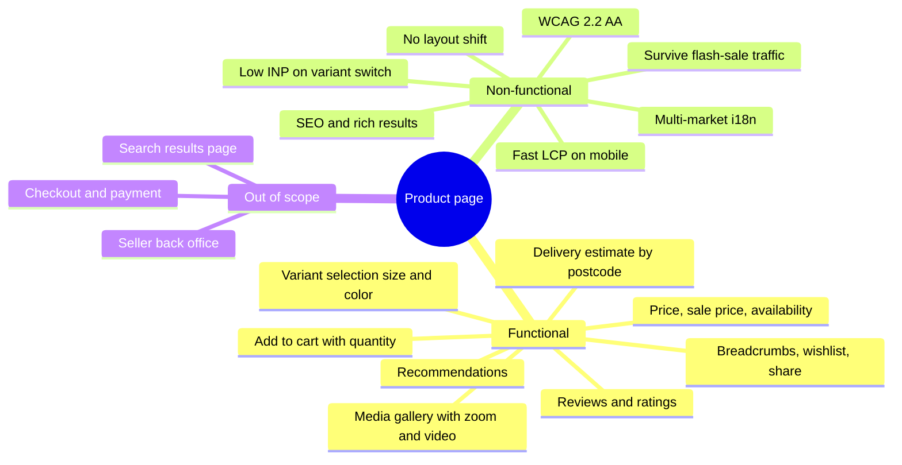
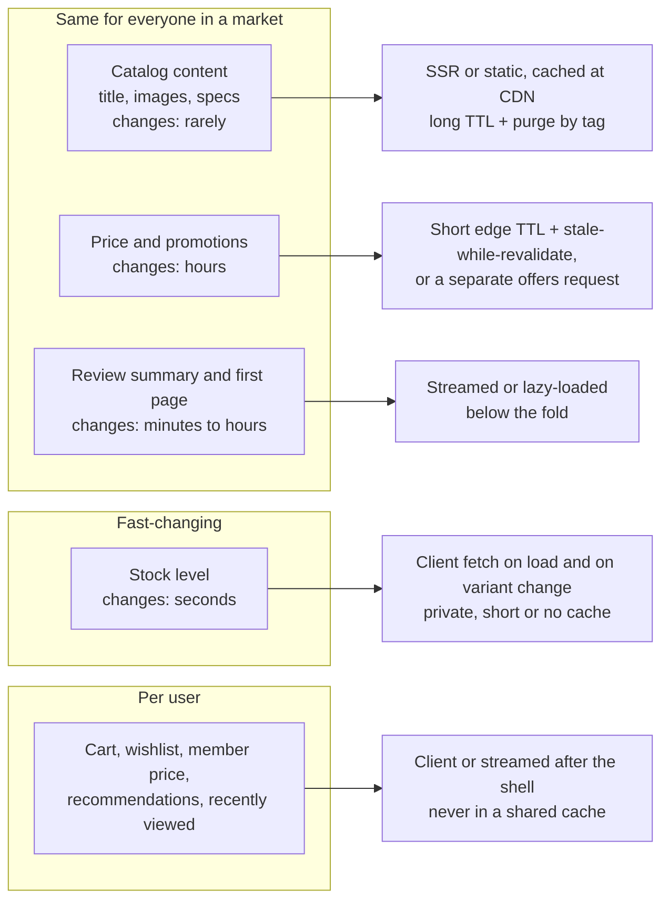
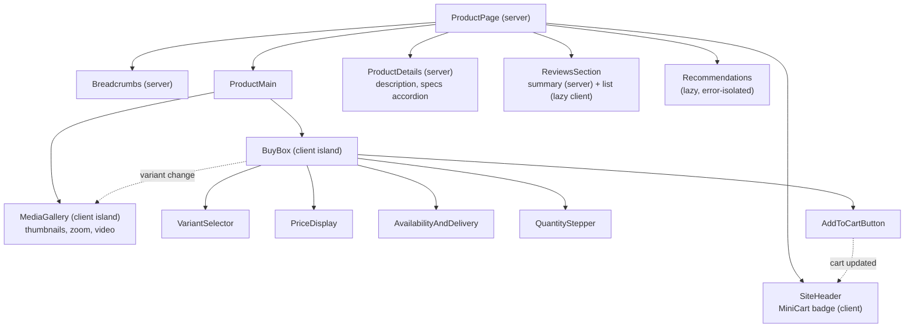
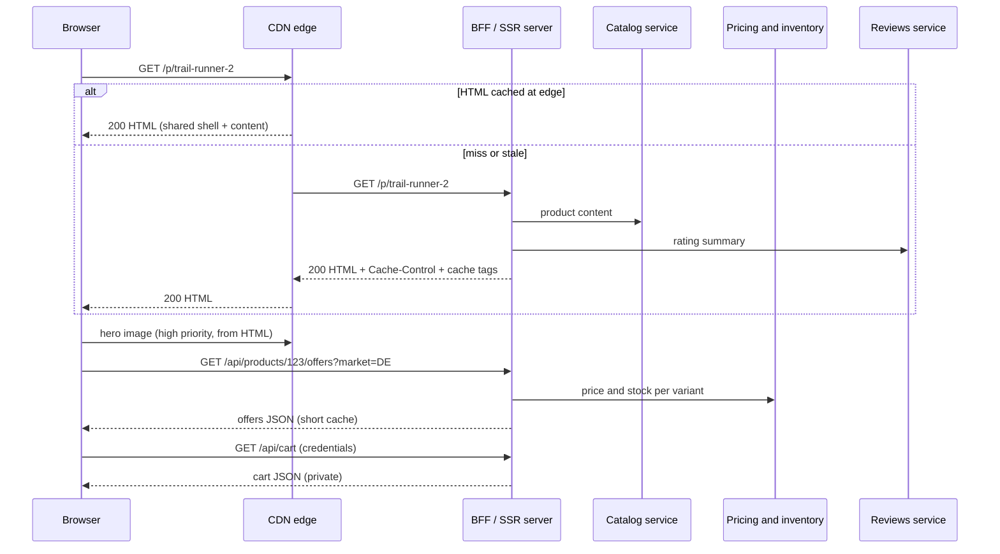
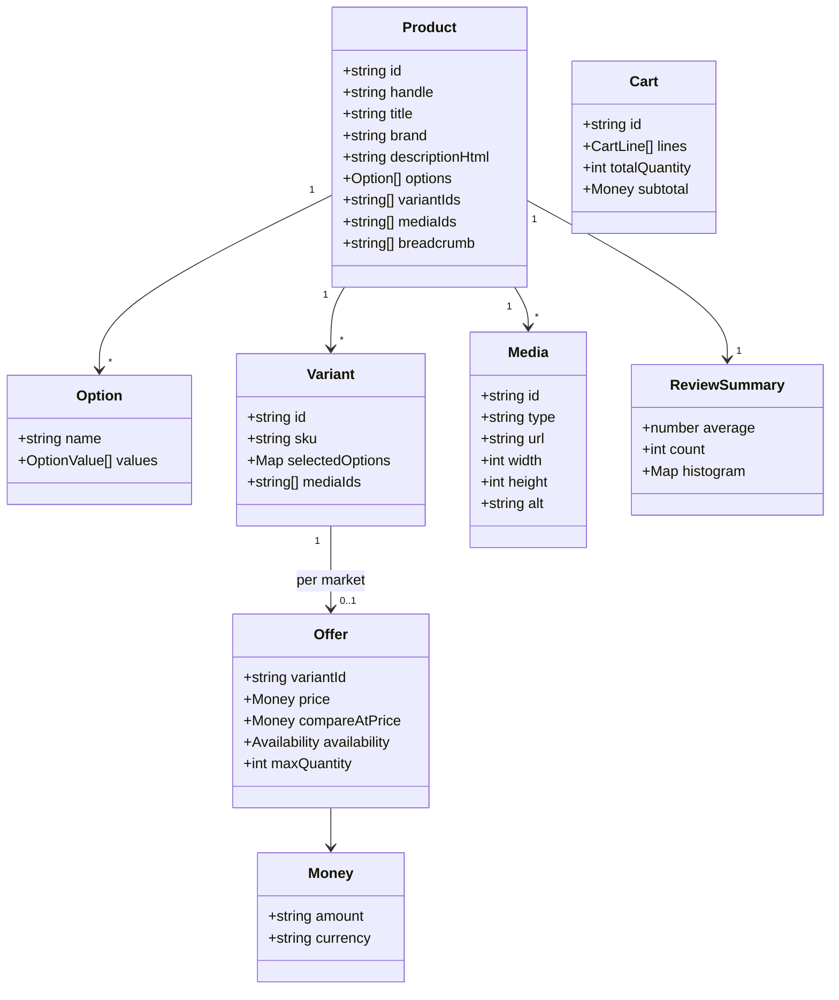
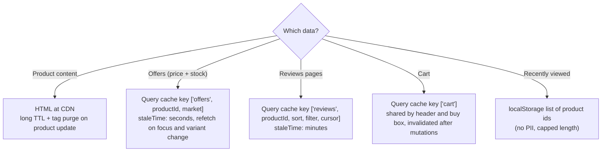
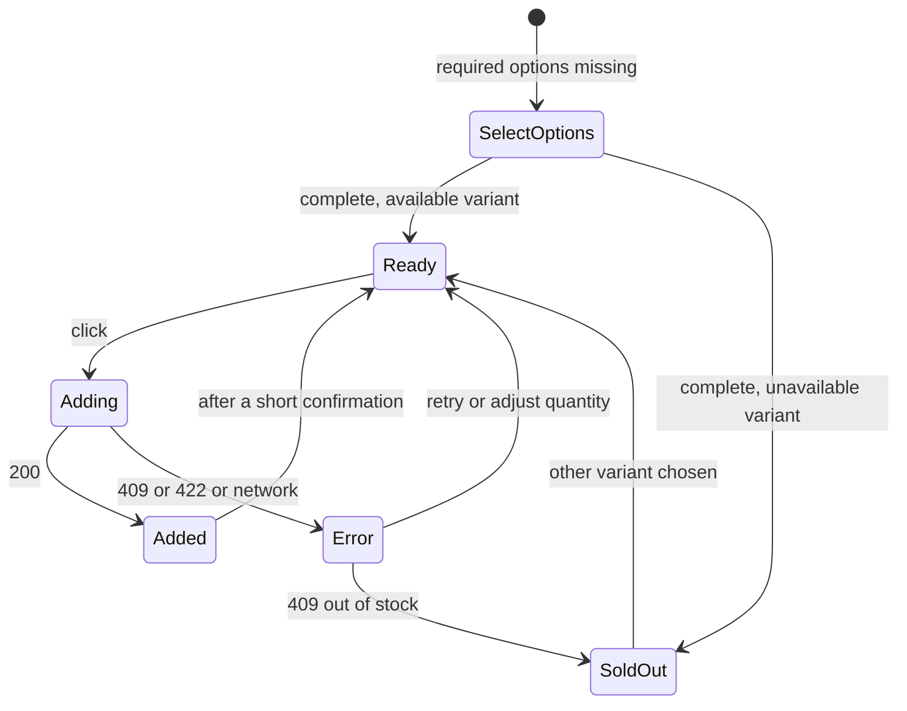
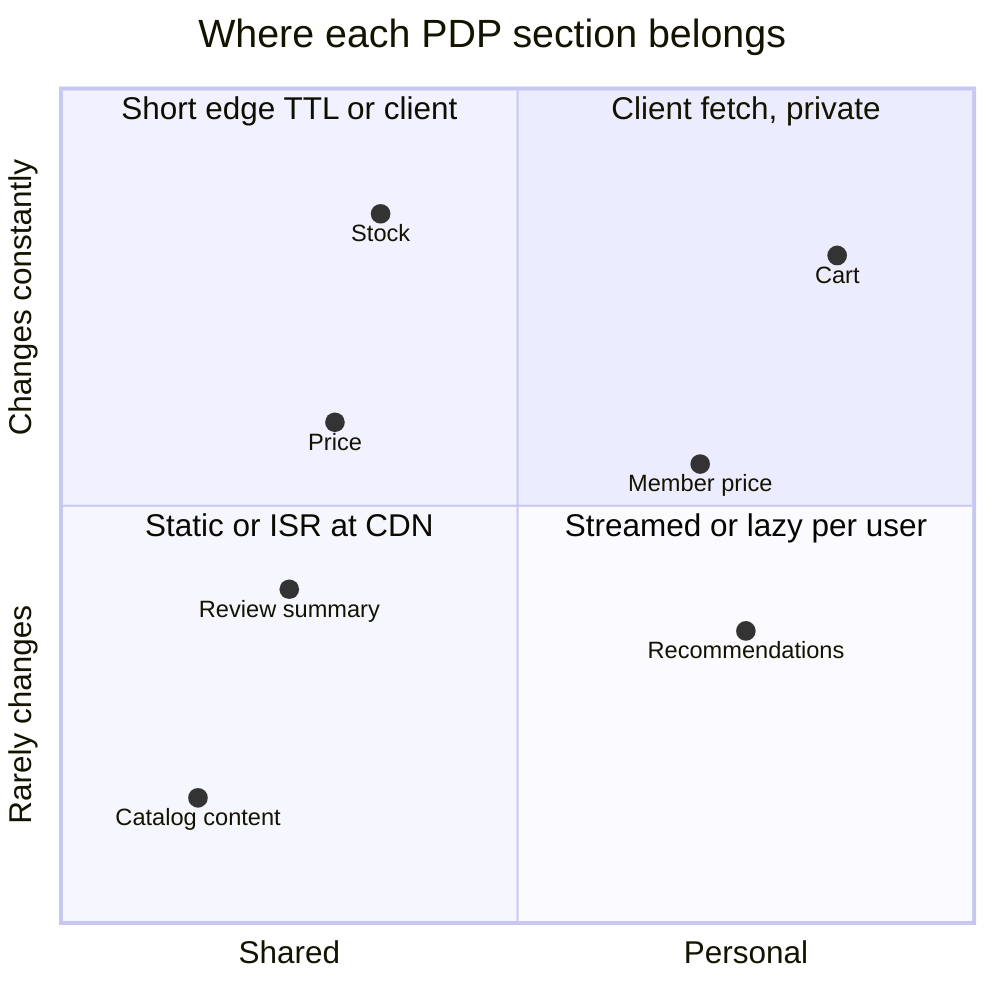

<!-- Generated by scripts/sync-knowledge.js from notes/ and README.md — do not edit here. -->
<!-- sections (line ranges in this file): Table of Contents 19-36 · ELI5 37-49 · Core Concept 50-512 · Framework Comparison 513-525 · Interview Walkthrough 526-571 · Real-World Examples 572-823 · Key Points Summary 824-843 · Test Your Understanding 844-912 · Cheat Sheet 913-959 · References & Further Reading 960-1002 -->

# Design an E-Commerce Product Page

> **Date:** 2026-11-06 · **Last updated:** 2026-11-09
> **Category:** Frontend System Design
> **Sub-Topic:** System Design Cases / E-Commerce Product Detail Page (PDP)
> **Level:** Advanced · **Reading time:** ~35 min
> **Informs:** rendering strategy per data freshness (catalog vs price vs stock vs personalization), CDN cache keys and tag-based invalidation, LCP hero image strategy, variant selection and URL state, add-to-cart mutation and idempotency, SEO structured data and canonical URLs, third-party script budget, money formatting and multi-market pricing

> **Pre-requisite:** [Server-Side Rendering (SSR)](./server-side-rendering-ssr.md), [Image Optimization](./image-optimization.md) and [Core Web Vitals (LCP, INP, CLS)](./core-web-vitals-lcp-inp-cls.md).
> This note designs the **product detail page (PDP)** of an online store end to end with the RADIO framework, then shows how to present it in a 45-minute interview.

**Previous:** [Design a Rich Text Editor](./design-a-rich-text-editor.md) · **Next:** [Design a Dashboard with Real-Time Data](./design-a-dashboard-with-real-time-data.md)

---

## Table of Contents

1. [ELI5 — Simple Explanation](#eli5--simple-explanation)
2. [Section 1: Requirements (R)](#section-1-requirements-r)
3. [Section 2: Architecture (A)](#section-2-architecture-a)
4. [Section 3: Data Model (D)](#section-3-data-model-d)
5. [Section 4: Interface (I)](#section-4-interface-i)
6. [Section 5: Optimizations (O)](#section-5-optimizations-o)
7. [Framework Comparison](#framework-comparison)
8. [Interview Walkthrough](#interview-walkthrough)
9. [Real-World Examples](#real-world-examples)
10. [Key Points Summary](#key-points-summary)
11. [Test Your Understanding (with answers)](#test-your-understanding)
12. [Cheat Sheet](#cheat-sheet)
13. [References & Further Reading](#references--further-reading)

---

## ELI5 — Simple Explanation

Think of a **shop window**:
- The **mannequin, the backdrop and the product description card** are arranged once and look the same to every passer-by. That is the **catalog content**: render it once, copy it to every CDN "shop window" in the world.
- The **price tag** changes a few times a day (sales, promotions). It needs a quick check before you trust it.
- The **"only 3 left!" sign** can change every minute. It must be checked almost live.
- The **"Hi Sam, this matches the jacket you bought"** note is different for every person. It can never be part of the shared window display.
- When you say "I'll take it" (**Add to cart**), the assistant nods immediately — but the till (the server) still checks that the item is really in stock and what it really costs.

> **A product page is several pages glued together, each with a different freshness and audience: cache the shared parts hard, fetch the volatile and personal parts separately, and let the server stay the source of truth for price and stock.**

---

## Core Concept — Step by Step

### Section 1: Requirements (R)

Spend the first minutes **narrowing scope**. A PDP can grow into a whole store; pick the core.



**Functional requirements (core):**

| # | Requirement | Notes |
|---|---|---|
| F1 | Show product content: title, brand, description, specs, breadcrumbs | Same for every visitor in a market |
| F2 | Media gallery: images, zoom, optional video/360° | The hero image is usually the LCP element |
| F3 | Select variant (color, size, …) | Price, stock and images can differ per variant (SKU) |
| F4 | Show price, compare-at/sale price, availability, delivery estimate | Volatile and market-dependent |
| F5 | Add to cart with quantity, see mini-cart feedback | The main conversion action |
| F6 | Reviews: rating summary, paginated list, filters, sorting | User-generated content (UGC) |
| F7 | Recommendations ("similar", "frequently bought together", "recently viewed") | Often personalized |

**Non-functional requirements:**

| Area | Target / constraint |
|---|---|
| **Performance** | Core Web Vitals "good" at the 75th percentile: LCP ≤ 2.5 s, INP ≤ 200 ms, CLS ≤ 0.1 — on mid-range phones over mobile networks |
| **SEO** | Server-rendered content, one canonical URL per product, structured data (Product, Offer, AggregateRating, Breadcrumb) |
| **Scale** | Traffic spikes (launches, sales) must be absorbed mostly by the CDN, not the origin |
| **Correctness** | Price and stock shown are a *hint*; the cart and checkout re-validate on the server |
| **Accessibility** | WCAG 2.2 AA: keyboard, screen readers, no color-only information |
| **i18n** | Locale-specific currency, number formats, tax display rules, RTL layouts |
| **Resilience** | A failing reviews or recommendations service must not break the page |

**Questions to ask the interviewer:**

```text
Catalog     How many variants per product (2 or 2,000)? Do variants have their own images?
Business    Single brand or marketplace (multiple sellers/offers per product)?
Users       Logged-in personalization? Member prices? B2B price lists?
Markets     Which countries, currencies, languages? Tax-inclusive or tax-exclusive prices?
Traffic     Flash sales / drops? Bot traffic? Expected peak vs normal ratio?
Platforms   Web only, or do native apps share the same APIs?
Ownership   Do we own a BFF (backend-for-frontend), or call microservices directly?
Content     Is content managed in a CMS (rich marketing blocks) or only in the catalog?
```

---

### Section 2: Architecture (A)

#### 2.1 Split the page by freshness and audience

The key design move is to **classify every piece of data** before choosing a rendering strategy.



| Part | Freshness | Audience | Rendering | Cache |
|---|---|---|---|---|
| Catalog content | Rare | Market | Server (SSR/SSG/ISR) | CDN, long TTL, purge on change |
| Price | Hours | Market (or segment) | Server, or client offer call | Short edge TTL + SWR |
| Stock | Seconds | Market/warehouse | Client fetch | `private`/`no-cache` or a few seconds at the edge |
| Reviews | Minutes | Market | Server for page 1 (SEO), client for more | Edge TTL of minutes |
| Cart, wishlist, member price | Live | User | Client (or streamed) | `private`, app-level cache |
| Recommendations | Minutes | User/segment | Lazy, client or streamed | Per-user or per-segment |

**Rendering strategy:** **server-render a cacheable shell with the catalog content**, then add the volatile and personal parts. Two common shapes:

1. **Edge-cached HTML + client islands.** HTML is identical for all users in a market, cached at the CDN; the buy box fetches offers/stock and the header fetches the cart after hydration. Very cheap to serve at peak.
2. **Streaming SSR with Suspense / Server Components.** The server sends the shell and content immediately and streams slower sections (reviews, recommendations) as they resolve. Personalization is possible on the server, but then the HTML cannot be shared at the edge, so keep personal sections out of the cached part (or use partial prerendering / server islands where your framework supports them).

A pure **CSR** PDP is a poor fit: the LCP image is discovered late (after JS runs), and crawlers get an empty shell. See [Client-Side Rendering (CSR)](./client-side-rendering-csr.md).

#### 2.2 Component architecture



- **Server components** (or plain SSR markup): breadcrumbs, title, description, specs, review summary — no JS shipped for them where the framework allows.
- **Client islands**: gallery, buy box, mini-cart, reviews pagination. These are the interactive parts and the only ones that need hydration.
- **Shared state** between islands is small: the **selected variant** (gallery and buy box) and the **cart** (buy box and header). Put the selected variant in the **URL** and the cart in a server-state cache (TanStack Query, SWR, Apollo, or a store).

#### 2.3 System context and request flow



The **BFF** aggregates microservices into page-shaped responses, keeps secrets server-side and lets web and native apps share contracts. See [Authentication Architecture (BFF Pattern)](./authentication-architecture-bff-pattern.md).

---

### Section 3: Data Model (D)



**Design decisions:**

| Decision | Recommendation | Why |
|---|---|---|
| **Content vs offer split** | `Product`/`Variant`/`Media` (cacheable) separate from `Offer` (price + stock) | Different freshness → different cache policies and endpoints |
| **Normalize** | Store variants and media by id (`Record<id, Variant>`), reference by id | Variant switch is a lookup, not a search; images shared between variants aren't duplicated |
| **Variant lookup** | Precompute `optionKey → variantId` (e.g. `"color=red\|size=M"`) | O(1) resolution of a selection; easy "which combinations exist" checks |
| **Money** | Decimal string or integer minor units + ISO 4217 currency code; format with `Intl.NumberFormat` | Floats can't represent many decimal amounts exactly; currencies have 0, 2 or 3 minor digits |
| **Availability** | Enum (`IN_STOCK`, `LOW_STOCK`, `OUT_OF_STOCK`, `PREORDER`, `BACKORDER`) rather than raw counts | Hides exact stock (competitive info), stays valid longer, maps to schema.org `availability` |
| **Selected variant** | In the URL (`?variant=4567` or a path segment) | Shareable, survives reload and Back, lets SSR render the right variant |
| **Cart** | Server-owned, identified by a cart id in an HTTP-only cookie; client keeps a cached copy | Cart survives devices/sessions for logged-in users; totals are computed server-side |

**Client caching tiers:**



See [Data Normalization & Caching](./data-normalization-and-caching.md) and [Server State vs Client State](./server-state-vs-client-state.md).

---

### Section 4: Interface (I)

#### 4.1 Component APIs

```tsx
// Buy box pieces: controlled, data-in / events-out, no fetching inside leaf components
type VariantSelectorProps = {
  options: { name: string; values: { value: string; label: string; swatch?: string }[] }[];
  selected: Record<string, string>;                        // { color: 'red', size: 'M' }
  isAvailable: (name: string, value: string) => boolean;   // combination exists and has stock
  onChange: (name: string, value: string) => void;
};

type MediaGalleryProps = {
  media: Media[];               // already ordered for the selected variant
  initialIndex?: number;
  priorityFirst?: boolean;      // first image is the LCP candidate
};

type PriceDisplayProps = {
  price: Money;
  compareAtPrice?: Money;       // shows "was" price when higher
  locale: string;               // 'de-DE'
  taxNote?: 'incl' | 'excl';    // market-specific legal text
};

type AddToCartButtonProps = {
  variantId: string | null;     // null = selection incomplete
  quantity: number;
  availability: Availability;
  onAdded?: (cart: Cart) => void;
};
```

Principles (see [Component API Design](./component-api-design.md)): leaf components are **presentational and controlled**; a container (`BuyBox`) owns the selection, reads offers, and wires the mutation.

#### 4.2 Server API contract

| Endpoint | Purpose | Cache |
|---|---|---|
| `GET /p/{handle}` | HTML page | `Cache-Control: no-cache` for browsers + edge TTL (`s-maxage` / `CDN-Cache-Control`) + cache tags |
| `GET /api/products/{id}?locale=de-DE` | Content (for native apps / client nav) | `public, max-age=300, s-maxage=3600, stale-while-revalidate=86400` |
| `GET /api/products/{id}/offers?market=DE` | Price + availability for **all** variants | `public, max-age=0, s-maxage=30, stale-while-revalidate=30` (or `private, no-cache` if prices are personalized) |
| `GET /api/products/{id}/reviews?cursor=…&sort=recent&rating=5` | Paginated reviews | `public, s-maxage=300` |
| `GET /api/cart` | Current cart | `private, no-cache` |
| `POST /api/cart/lines` | Add line (`variantId`, `quantity`) with `Idempotency-Key` header | Not cached |
| `GET /api/recommendations?productId=…` | Personalized or similar items | `private` if personalized |

The TTLs above are **example values** — pick yours from business tolerance for stale prices.

**Offers response (one request for every variant, so variant switching needs no network):**

```json
{
  "productId": "123",
  "market": "DE",
  "currency": "EUR",
  "generatedAt": "2026-11-06T10:15:00Z",
  "offers": {
    "4567": { "price": "89.95", "compareAtPrice": "119.95", "availability": "IN_STOCK", "maxQuantity": 5 },
    "4568": { "price": "89.95", "compareAtPrice": null, "availability": "LOW_STOCK", "maxQuantity": 2 },
    "4569": { "price": "89.95", "compareAtPrice": null, "availability": "OUT_OF_STOCK", "maxQuantity": 0 }
  }
}
```

**Add-to-cart contract:**

```http
POST /api/cart/lines HTTP/1.1
Content-Type: application/json
Idempotency-Key: 6f1c2b8e-2d7a-4a59-9c1e-0b8f4f6f9a11

{ "variantId": "4567", "quantity": 1 }
```

| Response | Meaning | UI |
|---|---|---|
| `200` + cart | Line added (or quantity merged) | Update mini-cart, announce "Added to cart" |
| `409` `OUT_OF_STOCK` | Stock ran out since page load | Refetch offers, mark variant sold out, keep the user on the page |
| `422` `QUANTITY_LIMIT` | Above per-order or stock limit | Clamp quantity, explain the limit |
| `5xx` / network error | Unknown outcome | Retry **with the same Idempotency-Key** so a retried request doesn't add twice |

> `Idempotency-Key` is an **IETF draft** (httpapi WG), not a final RFC, but the pattern is widely used by payment and commerce APIs. The server must store the key with the result and replay it for duplicates.

GraphQL is equally valid here (one query for content, a separate one for offers so they can be cached differently). See [REST vs GraphQL vs gRPC-Web](./rest-vs-graphql-vs-grpc-web.md).

---

### Section 5: Optimizations (O)

#### 5.1 Performance — LCP, CLS, INP

```mermaid
flowchart TD
    L["LCP = hero product image"] --> L1["Real img in server HTML<br/>(not CSS background, not JS-inserted)"]
    L --> L2["fetchpriority=high, never loading=lazy"]
    L --> L3["srcset + sizes, AVIF/WebP via picture or image CDN"]
    L --> L4["Image CDN on the same connection or preconnected"]
    C["CLS"] --> C1["width/height or aspect-ratio on every image"]
    C --> C2["Reserve space for price, badges, reviews, banners"]
    C --> C3["No late-injected promo bars above the fold"]
    I["INP"] --> I1["All variant data preloaded - switch is a local lookup"]
    I --> I2["Preload variant images on hover/focus of a swatch"]
    I --> I3["Defer third-party tags, chat, review widgets"]
    I --> I4["Split zoom, video, 360 viewer into lazy chunks"]
```



- **Hero image:** the single biggest LCP lever. Only the **first** gallery image gets `fetchpriority="high"`; thumbnails and other slides are lazy. Supported in Chromium 101+, Firefox 132+ and Safari 17.2+ (check MDN). A JS carousel that renders images only after hydration delays LCP — server-render the first slide as a plain ``. See [Image Optimization](./image-optimization.md).
- **Variant switch** must feel instant: fetch offers for all variants at once, keep media normalized, swap the URL with `history.replaceState` (or the router's equivalent) without a full navigation, and wrap heavy updates in `startTransition` (React) so the selection highlight paints first.
- **Third-party scripts** (tag managers, A/B tools, review widgets, chat) are the most common cause of poor INP on commerce pages. Load them after the page is interactive or on interaction, and give them a budget. See [Performance Budgets](./performance-budgets.md).
- **Next navigation:** prefetch likely next pages (cart, related products) on hover/viewport. The **Speculation Rules API** can prefetch or prerender them; it is Chromium-only by default as of late 2026 (Safari has prefetch behind a flag, Firefox is experimenting) — treat it as progressive enhancement. See [Prefetching & Preloading](./prefetching-and-preloading.md).
- **bfcache:** shoppers bounce between listing and product pages with Back. Keep the PDP bfcache-eligible (no `unload`, no `no-store` on HTML) and refresh cart badge + offers on `pageshow` with `persisted === true`.

#### 5.2 Add-to-cart states



- **Don't disable the button silently** when options are missing. Keep it enabled and, on click, show "Please select a size" next to the selector and move focus there — a disabled button gives no reason and can't be focused by keyboard users.
- **Optimistic or not?** Updating the cart **badge** optimistically is fine; claiming "Added!" before the server answers is risky because stock failures are realistic. A common compromise: pending state on the button (≈ hundreds of ms), then a confirmation drawer driven by the server response. See [Optimistic UI Updates](./optimistic-ui-updates.md).

#### 5.3 Accessibility

| Element | Pattern |
|---|---|
| Variant options | `fieldset` + `legend` + native radio inputs (styled), not clickable `div`s. Sold-out values stay focusable and are announced ("Size M, sold out") |
| Color swatches | Visible or accessible **text name** for every color — never color alone (WCAG 1.4.1) |
| Price | Real text; strikethrough "was" price also labelled in text ("Was €119.95, now €89.95") since `<s>`/`<del>` semantics are not announced by every screen reader |
| Price/stock change | Polite live region (`aria-live="polite"`) announces the new price after a variant change |
| Gallery | Buttons with labels ("Next image, 2 of 6"), meaningful `alt`, zoom reachable by keyboard, no autoplay |
| Rating | Text equivalent: "4.6 out of 5, 1,284 reviews" — not just star glyphs |
| Add-to-cart feedback | Live region message + mini-cart as a dialog that moves focus in and returns it on close |
| Target size | Swatches and steppers meet WCAG 2.2 target size minimum (24×24 CSS px, or spacing equivalent) |

See [Accessible Forms & Error Handling](./accessible-forms-and-error-handling.md) and [Keyboard Navigation & Focus Management](./keyboard-navigation-and-focus-management.md).

#### 5.4 SEO

- **Server-render** title, description, price, availability and the first reviews.
- **One canonical URL** per product; variant URLs either canonicalize to the product or are indexable on purpose (e.g. separate color pages). Decide explicitly — mixing the two dilutes signals.
- **Structured data (JSON-LD):** `Product` with `offers` (`price`, `priceCurrency`, `availability`), `aggregateRating`, `review`, plus `BreadcrumbList`. For variants, Google documents `ProductGroup` with `hasVariant` and `variesBy`. Keep structured data **consistent with visible content**.
- **`hreflang`** alternates for each market/language version.

#### 5.5 i18n and multi-market pricing

- Prices come **from the server per market**, already in the market currency, with tax rules applied. Don't convert with a client-side exchange rate — the legal price, rounding and taxes differ per market.
- Format with `Intl.NumberFormat(locale, { style: 'currency', currency })`. Currency minor digits vary (JPY has 0, EUR 2, KWD 3) — `Intl` handles this.
- Tax display (incl. VAT vs "plus tax"), unit prices and delivery texts are legal requirements in some markets — model them as data, not hard-coded strings.
- Layout must work in RTL (gallery arrows flip, use logical CSS properties). See [Internationalization (i18n) Architecture](./internationalization-i18n-architecture.md) and [RTL Layout Support](./rtl-layout-support.md).

#### 5.6 Security

- **Reviews and Q&A are untrusted input.** Render as text; if rich text is allowed, sanitize on the server and with a vetted sanitizer (e.g. DOMPurify) on the client. Never inject into JSON-LD without escaping `<`. See [XSS Prevention](./xss-prevention-reflected-stored-dom.md).
- **Never trust client price.** The cart API receives `variantId` + `quantity` only and computes prices server-side.
- **Cart mutations** with cookie auth need CSRF protection (SameSite cookies + token or custom header). See [CSRF Protection](./csrf-protection.md).
- **Third-party scripts** run with full page privileges — limit them, use a CSP, and use SRI for static third-party files. See [Content Security Policy (CSP)](./content-security-policy-csp.md).
- **Edge caching must never store personalized HTML** (cart contents, member prices, `Set-Cookie`) under a shared cache key.

#### 5.7 Resilience and edge cases

| Situation | Handling |
|---|---|
| Reviews/recommendations service down | Each section has its own error boundary / Suspense fallback; page still sells |
| Offers service down | Show content, hide price or show "Price unavailable", disable purchase with a reason — better than a stale wrong price |
| Stock runs out between view and add | `409` → refetch offers, mark variant sold out, suggest alternatives / "Notify me" |
| Price changes during the session | Cart shows the server price; consider an "updated price" notice in cart |
| Product discontinued | `404`/`410` with related products, or keep the page with "No longer available" if it still ranks |
| Many variants (hundreds) | Fetch offers lazily per option group, virtualize long lists, don't render every combination |
| Flash sale | Edge-cache HTML and content APIs, rate-limit cart mutations, consider a waiting-room page at the edge |
| A/B tests | Decide the bucket at the edge (no client-side flicker) and keep the number of HTML variants small to protect the cache hit rate. See [Feature Flags & A/B Testing](./feature-flags-and-a-b-testing.md) |



---

## Framework Comparison

| Concern | React / Next.js (App Router) | Vue / Nuxt | Angular | Svelte / SvelteKit | Astro |
|---|---|---|---|---|---|
| Cached content shell | Server Components + `fetch` cache options / `'use cache'` (APIs differ by version) | `routeRules` with `swr` / `isr` / `prerender` | SSR + hydration; prerender routes | `prerender` option or SSR + CDN headers | Static/SSR pages by default |
| Volatile sections | Client components, Suspense streaming | `<ClientOnly>`, lazy components, `useFetch({ server: false })` | `@defer (on viewport)` blocks, incremental hydration | Return promises from `load` to stream | `server:defer` server islands, `client:*` islands |
| Invalidation on product update | `revalidateTag` / `revalidatePath` | Nitro cache + CDN purge | CDN purge | CDN purge | CDN purge |
| LCP image helper | `next/image` with `priority`/`preload` (prop names vary by version) | `@nuxt/image` (`<NuxtImg preload>`) | `NgOptimizedImage` with `priority` | `@sveltejs/enhanced-img` or image CDN | `astro:assets` `<Image>` |

**Native mobile (iOS/Android):** reuse the same BFF endpoints (content and offers split the same way), cache content on device with an HTTP cache or local DB, and map web product URLs to app screens with Universal Links / App Links so shared links open the right variant.

---

## Interview Walkthrough

### How to spend 45 minutes

```mermaid
gantt
    title 45-minute PDP interview plan
    dateFormat X
    axisFormat %M min
    section Clarify
    Requirements and scope          :r, 0, 5m
    section Design
    Architecture and rendering      :a, after r, 8m
    Data model and caching          :d, after a, 7m
    Interface - components and API  :i, after d, 7m
    section Deep dive
    Optimizations - LCP, variants, cart, a11y :o, after i, 13m
    section Close
    Trade-offs and wrap-up          :w, after o, 5m
```



| Minutes | What you do | What to say / draw |
|---|---|---|
| 0–5 | Clarify | Ask about variants, markets, personalization, traffic spikes, SEO. Write F1–F7 and the NFR targets on the board |
| 5–13 | Architecture | Draw the **freshness × audience** split, then the component tree. State: "server-rendered shared shell at the CDN, client islands for buy box and cart" |
| 13–20 | Data model | Product/Variant/Media vs Offer split, `optionKey → variantId`, money as decimal + currency, selected variant in URL |
| 20–27 | Interface | Component props for `VariantSelector` and `AddToCartButton`; endpoints with their cache headers; add-to-cart errors and idempotency |
| 27–40 | Deep dive | Pick what the interviewer cares about: LCP hero image, instant variant switch, add-to-cart states, accessibility of selectors, SEO structured data |
| 40–45 | Wrap-up | Summarize trade-offs, monitoring (RUM for LCP/INP, add-to-cart error rate), what you'd do next |

### Trade-offs to discuss

| Decision | Option A | Option B | Say this |
|---|---|---|---|
| Price in HTML? | Render price in cached HTML (great for SEO, no flash) | Fetch price client-side (always fresh) | "Render it with a short edge TTL plus purge on price change, and re-validate in the buy box; checkout is the final authority" |
| Personalization | Server-render it (one request) | Client/streamed after shell | "Personal parts would make the HTML uncacheable; keep them out of the shared shell" |
| Variant URL | Query param (`?variant=`) | Path per variant | "Query param + canonical to the product, unless SEO wants separate color pages" |
| Offers payload | All variants at once | Per variant on demand | "All at once until variant count is large, then per option group" |
| Add to cart | Optimistic "Added" | Wait for server | "Optimistic badge, server-confirmed message — stock failures are real" |
| Gallery | Rich JS carousel | Server-rendered first image + lazy enhancement | "First image is plain HTML with high priority; the carousel enhances it" |
| Reviews | SSR all | SSR summary + first page, client for rest | "First page for SEO and trust, the rest on demand" |

**Likely follow-ups:** "How do you invalidate the CDN when a price changes?" (tag-based purge from a catalog/pricing event), "What if stock is wrong?" (server re-validates at add-to-cart and checkout), "How do you measure success?" (RUM Core Web Vitals per template, add-to-cart rate, error rates — see [Real User Monitoring (RUM)](./real-user-monitoring-rum.md)).

---

## Real-World Examples

**Example 1 — Next.js App Router page: cached content, streamed sections, client buy box:**
```tsx
// app/p/[handle]/page.tsx  (Server Component)
// Note: Next.js caching APIs changed between major versions (fetch defaults, 'use cache', revalidateTag signature).
// Check the docs for your version before copying the cache options.
import { Suspense } from 'react';
import { notFound } from 'next/navigation';
import { BuyBox } from './BuyBox';            // 'use client'
import { MediaGallery } from './MediaGallery'; // 'use client'
import { ReviewsSection, ReviewsSkeleton } from './Reviews';
import { Recommendations } from './Recommendations';
import { ProductJsonLd } from './ProductJsonLd';

async function getProduct(handle: string) {
  const res = await fetch(`${process.env.BFF_URL}/api/products/by-handle/${handle}`, {
    next: { revalidate: 3600, tags: [`product:${handle}`] }, // purge by tag on catalog update
  });
  if (res.status === 404) return null;
  if (!res.ok) throw new Error(`Product fetch failed: ${res.status}`);
  return res.json() as Promise<Product>;
}

export default async function ProductPage({ params }: { params: Promise<{ handle: string }> }) {
  const { handle } = await params; // params is a Promise in Next.js 15+
  const product = await getProduct(handle);
  if (!product) notFound();

  return (
    <main>
      <ProductJsonLd product={product} />
      <div className="pdp-grid">
        <MediaGallery media={product.media} priorityFirst />
        <BuyBox product={product} /> {/* fetches offers + cart on the client */}
      </div>
      <section aria-labelledby="details-heading">
        <h2 id="details-heading">Details</h2>
        <div dangerouslySetInnerHTML={{ __html: product.descriptionHtml /* sanitized by the CMS/BFF */ }} />
      </section>
      <Suspense fallback={<ReviewsSkeleton />}>
        <ReviewsSection productId={product.id} />
      </Suspense>
      <Suspense fallback={null}>
        <Recommendations productId={product.id} />
      </Suspense>
    </main>
  );
}
```

```typescript
// app/api/webhooks/catalog/route.ts — catalog service calls this when a product changes
import { revalidateTag } from 'next/cache';

export async function POST(req: Request) {
  if (req.headers.get('x-webhook-secret') !== process.env.CATALOG_WEBHOOK_SECRET) {
    return new Response('Unauthorized', { status: 401 });
  }
  const { handle } = await req.json();
  revalidateTag(`product:${handle}`); // newer Next.js versions also take a cache profile argument
  return Response.json({ revalidated: true });
}
```

**Example 2 — Variant resolution and availability (framework-agnostic TypeScript):**
```typescript
type Selection = Record<string, string>;
type Variant = { id: string; selectedOptions: Selection };
type Availability = 'IN_STOCK' | 'LOW_STOCK' | 'OUT_OF_STOCK' | 'PREORDER' | 'BACKORDER';

const optionKey = (sel: Selection, names: string[]) => names.map((n) => `${n}=${sel[n]}`).join('|');

export function buildVariantIndex(variants: Variant[], optionNames: string[]) {
  const byKey = new Map<string, string>();
  for (const v of variants) byKey.set(optionKey(v.selectedOptions, optionNames), v.id);
  return byKey;
}

const purchasable = (a?: Availability) => a === 'IN_STOCK' || a === 'LOW_STOCK' || a === 'PREORDER' || a === 'BACKORDER';

/** Is `name=value` selectable, given the other options the user already picked? */
export function isValueAvailable(
  name: string,
  value: string,
  selected: Selection,
  variants: Variant[],
  availabilityById: Record<string, Availability>,
) {
  return variants.some(
    (v) =>
      v.selectedOptions[name] === value &&
      Object.entries(selected).every(([n, val]) => n === name || !val || v.selectedOptions[n] === val) &&
      purchasable(availabilityById[v.id]),
  );
}

// URL sync without a navigation (keeps INP low, keeps Back meaningful only for real navigations)
export function writeVariantToUrl(variantId: string) {
  const url = new URL(location.href);
  url.searchParams.set('variant', variantId);
  history.replaceState(history.state, '', url);
}
```

**Example 3 — Accessible variant selector (BAD → GOOD):**
```tsx
// ❌ BAD: divs are not focusable, no group label, color-only, sold out is just greyed out
<div className="sizes">
  {sizes.map((s) => <div key={s} className={s === size ? 'on' : ''} onClick={() => setSize(s)}>{s}</div>)}
</div>

// ✅ GOOD: native radios in a fieldset; sold-out values stay focusable and are announced
export function OptionGroup({ name, label, values, selected, isAvailable, onChange }: {
  name: string; label: string; values: { value: string; label: string }[];
  selected?: string; isAvailable: (name: string, value: string) => boolean;
  onChange: (name: string, value: string) => void;
}) {
  return (
    <fieldset className="option-group">
      <legend>{label}{selected ? `: ${values.find((v) => v.value === selected)?.label}` : ''}</legend>
      {values.map((v) => {
        const available = isAvailable(name, v.value);
        const id = `${name}-${v.value}`;
        return (
          <span key={v.value} className="option">
            <input
              type="radio" id={id} name={name} value={v.value}
              checked={selected === v.value}
              onChange={() => onChange(name, v.value)}
              aria-describedby={available ? undefined : `${id}-note`}
            />
            <label htmlFor={id} data-unavailable={!available || undefined}>{v.label}</label>
            {!available && <span id={`${id}-note`} className="visually-hidden">sold out</span>}
          </span>
        );
      })}
    </fieldset>
  );
}
```
Vue, Svelte and Angular use the same HTML: `<fieldset>`, `<legend>`, `<input type="radio">` bound with `v-model`, `bind:group` or a reactive form control.

**Example 4 — Add to cart with TanStack Query (optimistic badge, idempotent retries):**
```tsx
import { useMutation, useQueryClient } from '@tanstack/react-query';
import { useRef } from 'react';

export function useAddToCart() {
  const queryClient = useQueryClient();
  const idempotencyKey = useRef<string | null>(null);

  return useMutation({
    mutationFn: async (input: { variantId: string; quantity: number }) => {
      idempotencyKey.current ??= crypto.randomUUID(); // same key for retries of this attempt
      const res = await fetch('/api/cart/lines', {
        method: 'POST',
        credentials: 'include',
        headers: { 'Content-Type': 'application/json', 'Idempotency-Key': idempotencyKey.current },
        body: JSON.stringify(input),
      });
      if (!res.ok) throw Object.assign(new Error('ADD_FAILED'), { status: res.status, body: await res.json().catch(() => null) });
      return (await res.json()) as Cart;
    },
    retry: (count, err: any) => count < 2 && (err.status === undefined || err.status >= 500), // only unknown outcomes
    onMutate: async (input) => {
      await queryClient.cancelQueries({ queryKey: ['cart'] });
      const previous = queryClient.getQueryData<Cart>(['cart']);
      queryClient.setQueryData<Cart>(['cart'], (old) =>
        old ? { ...old, totalQuantity: old.totalQuantity + input.quantity } : old); // badge only
      return { previous };
    },
    onError: (err: any, _input, ctx) => {
      if (ctx?.previous) queryClient.setQueryData(['cart'], ctx.previous);
      if (err.status === 409) queryClient.invalidateQueries({ queryKey: ['offers'] }); // stock changed
    },
    onSuccess: (cart) => queryClient.setQueryData(['cart'], cart),
    onSettled: () => { idempotencyKey.current = null; },
  });
}
```

**Example 5 — The LCP hero image (BAD → GOOD):**
```html
<!-- ❌ BAD: background image is invisible to the preload scanner; lazy-loaded hero; no dimensions -->
<div class="hero" style="background-image: url(/img/123-large.jpg)"></div>


<!-- ✅ GOOD: in the server HTML, high priority, responsive, modern formats, space reserved -->
<picture>
  <source type="image/avif"
          srcset="/img/123/w400.avif 400w, /img/123/w800.avif 800w, /img/123/w1200.avif 1200w"
          sizes="(min-width: 1024px) 50vw, 100vw">
  
</picture>
```

**Example 6 — JSON-LD structured data, safely escaped:**
```tsx
export function ProductJsonLd({ product, offer }: { product: Product; offer?: Offer }) {
  const data = {
    '@context': 'https://schema.org',
    '@type': 'Product',
    name: product.title,
    image: product.media.filter((m) => m.type === 'image').map((m) => m.url),
    brand: { '@type': 'Brand', name: product.brand },
    sku: product.defaultVariant.sku,
    ...(product.reviewSummary.count > 0 && {
      aggregateRating: {
        '@type': 'AggregateRating',
        ratingValue: product.reviewSummary.average,
        reviewCount: product.reviewSummary.count,
      },
    }),
    ...(offer && {
      offers: {
        '@type': 'Offer',
        price: offer.price.amount,
        priceCurrency: offer.price.currency,
        availability: offer.availability === 'OUT_OF_STOCK' ? 'https://schema.org/OutOfStock' : 'https://schema.org/InStock',
        url: product.canonicalUrl,
      },
    }),
  };
  // Escape "<" so a product name or review containing </script> can't break out of the tag
  return <script type="application/ld+json" dangerouslySetInnerHTML={{ __html: JSON.stringify(data).replace(/</g, '\\u003c') }} />;
}
```

**Example 7 — Money formatting per market:**
```typescript
// BAD: float math and hand-made formatting
const total = 0.1 + 0.2;            // 0.30000000000000004
const label = '€' + total.toFixed(2); // wrong symbol position and separators for many locales

// GOOD: server sends decimal strings in the market currency; Intl formats them
const fmt = (amount: string, currency: string, locale: string) =>
  new Intl.NumberFormat(locale, { style: 'currency', currency }).format(Number(amount)); // display only

fmt('89.95', 'EUR', 'de-DE'); // "89,95 €"
fmt('12000', 'JPY', 'ja-JP'); // "￥12,000" (no minor digits)
fmt('89.95', 'USD', 'en-US'); // "$89.95"
```
Converting to `Number` is fine **for display**; arithmetic on money (totals, discounts, tax) belongs on the server or in a decimal library.

---

## Key Points Summary

| Concept | One-Line Explanation |
|---|---|
| **Freshness × audience split** | Classify each section (content, price, stock, personal) before choosing rendering and cache |
| **Cached shell** | Server-render shared content and cache it at the CDN with tag-based purge |
| **Islands for interactivity** | Only the gallery, buy box, cart and reviews pagination need client JS |
| **Content vs offer** | Separate endpoints so price/stock can be fresh while content is cached long |
| **Variant index** | Precomputed `optionKey → variantId` makes selection O(1) and instant |
| **Variant in URL** | Shareable, reload-safe, SSR-friendly; canonical to the product unless intentionally indexed |
| **Money** | Decimal string or minor units + currency; format with `Intl.NumberFormat`; compute on the server |
| **LCP hero** | Plain `` in server HTML, `fetchpriority="high"`, responsive, never lazy |
| **Add to cart** | Server validates stock and price; idempotency key for retries; handle 409/422 |
| **Accessibility** | Native radios in fieldsets, text for colors and ratings, live regions for changes |
| **SEO** | SSR content + JSON-LD Product/Offer/AggregateRating + canonical + hreflang |
| **Resilience** | Error boundaries per section; failing reviews/recs never block buying |
| **Personalization** | Never in shared-cache HTML; client-fetched or streamed separately |

---

## Test Your Understanding

**Q1 (Basic):**
Why is it a bad idea to render the exact stock count ("Only 3 left") into HTML that the CDN caches for an hour?

<details>
<summary>Answer</summary>

Stock changes in seconds, but the cached HTML is served unchanged to everyone for an hour. Users would see "3 left" after it sold out, or "out of stock" after a restock, and the claim may even be misleading to consumers. Treat stock as **volatile data**: fetch an availability enum client-side (or with a very short edge TTL) and re-validate on add-to-cart. The cached HTML can carry content and a coarse availability for SEO, but the buy box must refresh it.
</details>

**Q2 (Application):**
Assign a rendering and caching strategy to each section: title/description, hero image, price, stock, reviews list, "recommended for you", mini-cart.

<details>
<summary>Answer</summary>

- **Title/description:** SSR/SSG/ISR into the shared HTML, CDN with long TTL + tag purge — same for everyone, needed for SEO.
- **Hero image:** plain `` in that HTML with `fetchpriority="high"`, hashed/immutable image URLs from an image CDN — it is the LCP element.
- **Price:** in the HTML with a short edge TTL (and purge on price change) for SEO and no flash, re-checked by the buy box offers call — it changes in hours and must be correct at checkout.
- **Stock:** client fetch of an availability enum, short or no caching — changes in seconds.
- **Reviews list:** summary + first page server-rendered or streamed (SEO, trust), further pages client-side with minute-level caching.
- **Recommended for you:** lazy client or streamed section, `private` — personal data must not enter shared HTML.
- **Mini-cart:** client query with `private, no-cache`, shared cache key across header and buy box — per user and live.
</details>

**Q3 (Tricky):**
After replacing the static hero image with a React carousel library, LCP got much worse but the image files are identical. Why, and how do you fix it?

<details>
<summary>Answer</summary>

The carousel renders its slides only **after JavaScript downloads, parses and hydrates**, so the browser's preload scanner can't discover the image in the HTML. Some carousels also add `loading="lazy"` to all slides or render them via CSS backgrounds. LCP now includes JS time. Fix: server-render the **first slide as a plain ``** with `fetchpriority="high"`, explicit dimensions and responsive `srcset`, and let the carousel enhance it after hydration (or preload the image with `<link rel="preload" as="image" imagesrcset=… imagesizes=…>` if it can't be in markup). Lazy-load only the other slides.
</details>

**Q4 (Tricky):**
Product URLs look like `/p/trail-runner-2?variant=4568`. Marketing shares variant links; SEO says Google is indexing hundreds of near-duplicate URLs. What do you do?

<details>
<summary>Answer</summary>

Decide whether variants are **separate search targets**. Usually they're not: keep the `?variant=` parameter for UX (shareable, SSR selects the right variant) but set `<link rel="canonical" href="/p/trail-runner-2">` on every variant URL, so signals consolidate on one page. If certain variants (e.g. colors) deserve their own ranking, give them distinct, indexable URLs with their own canonical and describe the family with `ProductGroup` + `hasVariant`/`variesBy` structured data. The mistake is the undecided middle ground: self-canonical variant URLs with nearly identical content.
</details>

**Q5 (Application):**
The user clicks "Add to cart", the request times out, and the user clicks again. The cart ends up with 2 items. How do you prevent this?

<details>
<summary>Answer</summary>

A timeout means **unknown outcome** — the first request may have succeeded. Generate an **Idempotency-Key** per add attempt and reuse it for automatic retries and for a re-click while the attempt is still pending; the server stores the key with its result and replays the stored result for duplicates instead of adding again. On the client, also disable re-submission while the mutation is pending (show the pending state, not a dead button). Only generate a new key once the previous attempt has settled with a known result.
</details>

**Q6 (System design):**
A sneaker drop will bring a huge traffic spike to one PDP at 10:00. What changes in your design?

<details>
<summary>Answer</summary>

- **Serve almost everything from the edge:** pre-warm the cached HTML and content API, long edge TTLs with `stale-while-revalidate` / `stale-if-error`, so origin load doesn't scale with visitors.
- **Offers/stock** via a lightweight, heavily cached endpoint (a few seconds at the edge) — exact counts are meaningless at that scale; show availability states.
- **Protect the write path:** rate-limit add-to-cart per user/IP, bot protection, idempotency, and possibly a **virtual waiting room** at the edge that admits users in batches.
- **Degrade gracefully:** turn off recommendations, personalization and non-critical third-party scripts via feature flags.
- **Make the client polite:** no tight polling; back-off with jitter on errors.
- **Observe:** RUM and error rates for add-to-cart in real time, plus synthetic checks before the drop.
</details>

---

## Cheat Sheet

**Key Definitions:**
- **PDP:** Product detail page — one product, its variants, price, stock and reviews
- **Variant / SKU:** A purchasable combination of options (e.g. red, size M)
- **Offer:** Price + availability of a variant in a market
- **BFF:** Backend-for-frontend aggregating catalog, pricing, inventory, reviews for the page
- **Cache tag:** Label on cached responses so a product update can purge all of them at once
- **Idempotency key:** Client-generated id letting the server deduplicate retried writes
- **Canonical URL:** The URL search engines should treat as the primary version of a page

**Quick Reference:**
```text
RADIO for a PDP
R  F: content, gallery, variants, price/stock, add to cart, reviews, recs
   NF: LCP <= 2.5 s, INP <= 200 ms, CLS <= 0.1 (p75), SEO, flash-sale scale, WCAG 2.2 AA, multi-market
A  shared shell SSR/ISR at CDN  +  client islands (gallery, buy box, cart)  +  streamed/lazy reviews & recs
D  Product / Variant / Media (cacheable)  vs  Offer (price + availability, volatile)  vs  Cart (private)
   optionKey -> variantId index, money = decimal string + currency, variant id in URL
I  GET /p/{handle}            no-cache + edge TTL + tags
   GET /api/products/{id}/offers   s-maxage=seconds (or private)
   POST /api/cart/lines       Idempotency-Key, 409 OUT_OF_STOCK, 422 QUANTITY_LIMIT
O  hero  fetchpriority=high, never lazy, srcset/sizes, dimensions
   radios in fieldset, text for colors and ratings, aria-live for price change
   JSON-LD Product + Offer + AggregateRating (+ ProductGroup for variants), canonical, hreflang
   error boundary per section, no personal data in shared cache, sanitize reviews
```

**Common Mistakes to Avoid:**

| Mistake | Why Wrong | Fix |
|---|---|---|
| Client-side rendering the whole PDP | Late LCP discovery, weak SEO, slow on mid-range phones | SSR/ISR shell, hydrate only islands |
| Personalized data in CDN-cached HTML | Leaks one user's data to others or kills the hit rate | Personal parts client-side/streamed, `private` |
| Lazy-loading or CSS-background hero image | Preload scanner can't find it → poor LCP | `` in HTML with `fetchpriority="high"` |
| Fetching offers per variant on every click | Network round trip on each selection → poor INP | One offers call for all variants (or per option group) |
| Clickable `div` swatches without text | Not keyboard/screen-reader accessible, color-only | Native radios + `legend` + text names |
| Float arithmetic on prices | Rounding errors, wrong totals | Decimal strings/minor units; server computes |
| Trusting price sent by the client | Price tampering | Cart API accepts variant id + quantity only |
| Retrying add-to-cart without a key | Duplicate lines on timeouts | `Idempotency-Key`, reused for retries |
| Disabled add button with no explanation | Users don't know what's missing; not focusable | Enabled button + inline "Select a size" + focus |
| One failing widget breaks the page | Reviews outage = no sales | Error boundary + Suspense per section |
| Unescaped JSON-LD | `</script>` in content enables XSS | Escape `<` as `\u003c` |
| Every variant URL self-canonical | Near-duplicate pages compete in search | Canonical to product unless intentionally indexed |

---

## References & Further Reading

**Core docs**
- web.dev: [Largest Contentful Paint (LCP)](https://web.dev/articles/lcp) · [Optimize LCP](https://web.dev/articles/optimize-lcp)
- web.dev: [Optimize resource loading with the Fetch Priority API](https://web.dev/articles/fetch-priority)
- web.dev: [Interaction to Next Paint (INP)](https://web.dev/articles/inp) · [Cumulative Layout Shift (CLS)](https://web.dev/articles/cls)
- web.dev: [Back/forward cache](https://web.dev/articles/bfcache)
- MDN: [`` element (`srcset`, `sizes`, `fetchpriority`)](https://developer.mozilla.org/en-US/docs/Web/HTML/Reference/Elements/img)
- MDN: [`Intl.NumberFormat`](https://developer.mozilla.org/en-US/docs/Web/JavaScript/Reference/Global_Objects/Intl/NumberFormat)
- MDN: [Speculation Rules API](https://developer.mozilla.org/en-US/docs/Web/API/Speculation_Rules_API)

**SEO**
- Google Search Central: [Product structured data](https://developers.google.com/search/docs/appearance/structured-data/product)
- Google Search Central: [Product variant structured data (`ProductGroup`)](https://developers.google.com/search/docs/appearance/structured-data/product-variants)
- Google Search Central: [Consolidate duplicate URLs (canonical)](https://developers.google.com/search/docs/crawling-indexing/consolidate-duplicate-urls)
- schema.org: [Product](https://schema.org/Product) · [Offer](https://schema.org/Offer)

**Accessibility**
- W3C WAI-ARIA APG: [Radio Group pattern](https://www.w3.org/WAI/ARIA/apg/patterns/radio/) · [Carousel pattern](https://www.w3.org/WAI/ARIA/apg/patterns/carousel/)
- W3C: [Understanding WCAG 2.2 — Use of Color (1.4.1)](https://www.w3.org/WAI/WCAG22/Understanding/use-of-color.html) · [Target Size (Minimum) (2.5.8)](https://www.w3.org/WAI/WCAG22/Understanding/target-size-minimum.html)

**Framework docs**
- Next.js: [Caching and revalidating](https://nextjs.org/docs/app/getting-started/caching-and-revalidating) · [`revalidateTag`](https://nextjs.org/docs/app/api-reference/functions/revalidateTag)
- Nuxt: [Hybrid rendering (route rules)](https://nuxt.com/docs/guide/concepts/rendering#hybrid-rendering)
- Angular: [Deferrable views (`@defer`)](https://angular.dev/guide/templates/defer) · [Incremental hydration](https://angular.dev/guide/incremental-hydration) · [NgOptimizedImage](https://angular.dev/guide/image-optimization)
- SvelteKit: [Streaming with promises](https://svelte.dev/docs/kit/load#Streaming-with-promises)
- Astro: [Server islands](https://docs.astro.build/en/guides/server-islands/)
- TanStack Query: [Optimistic updates](https://tanstack.com/query/latest/docs/framework/react/guides/optimistic-updates)

**Specs & deep dives**
- IETF draft: [The Idempotency-Key HTTP Header Field](https://datatracker.ietf.org/doc/draft-ietf-httpapi-idempotency-key-header/)
- IETF: [RFC 9111 — HTTP Caching](https://www.rfc-editor.org/rfc/rfc9111) · [RFC 9213 — Targeted Cache-Control](https://www.rfc-editor.org/rfc/rfc9213)
- Chrome for Developers: [Prerender pages in Chrome for instant page navigations](https://developer.chrome.com/docs/web-platform/prerender-pages)

---

> **Previous Topic:** [Design a Rich Text Editor](./design-a-rich-text-editor.md)
> — Document model, selections, collaborative editing

> **Next Topic:** [Design a Dashboard with Real-Time Data](./design-a-dashboard-with-real-time-data.md)
> — Live widgets, streaming transport, update batching and charts

*Saved on: 2026-11-06 | Repo: Frontend System Design Learning Notes*
