<!-- Generated by scripts/sync-knowledge.js from notes/ and README.md — do not edit here. -->
<!-- sections (line ranges in this file): Table of Contents 19-41 · ELI5 42-55 · Core Concept 56-534 · Decision Matrix 535-563 · Real-World Examples 564-791 · Key Points Summary 792-811 · Test Your Understanding 812-889 · Cheat Sheet 890-936 · References & Further Reading 937-975 -->

# Design Tokens

> **Date:** 2026-11-06 · **Last updated:** 2026-11-06
> **Category:** Frontend System Design
> **Sub-Topic:** Design Systems & Components / Design System
> **Level:** Intermediate · **Reading time:** ~28 min
> **Informs:** token tiers and naming, single source of truth between Figma and code, theming and dark mode architecture, multi-brand support, token build pipeline (DTCG + Style Dictionary), CSS custom properties vs build-time constants, cross-platform (web, iOS, Android) consistency, design-system versioning

> **Pre-requisite:** [Component Architecture & Design Systems](./component-architecture-and-design-systems.md) (what a design system contains) and [Atomic Design Methodology](./atomic-design-methodology.md) (tokens sit beneath atoms).
> This note covers **design tokens** end to end: what they are, how to structure and name them, the W3C DTCG file format, the build pipeline that turns one JSON source into CSS, TypeScript, Swift and Kotlin, and how tokens power theming.

**Previous:** [Atomic Design Methodology](./atomic-design-methodology.md) · **Next:** [Component API Design](./component-api-design.md)

---

## Table of Contents

1. [ELI5 — Simple Explanation](#eli5--simple-explanation)
2. [Section 1: What a Design Token Is](#section-1-what-a-design-token-is)
3. [Section 2: Token Categories](#section-2-token-categories)
4. [Section 3: Token Tiers — Primitive, Semantic, Component](#section-3-token-tiers--primitive-semantic-component)
5. [Section 4: Naming Tokens](#section-4-naming-tokens)
6. [Section 5: The DTCG Format](#section-5-the-dtcg-format)
7. [Section 6: The Token Pipeline](#section-6-the-token-pipeline)
8. [Section 7: Tokens on the Web — CSS Custom Properties](#section-7-tokens-on-the-web--css-custom-properties)
9. [Section 8: Theming, Modes and Multi-Brand](#section-8-theming-modes-and-multi-brand)
10. [Section 9: Tokens on Native Platforms](#section-9-tokens-on-native-platforms)
11. [Section 10: Design Tool Integration](#section-10-design-tool-integration)
12. [Section 11: Governance, Versioning and Enforcement](#section-11-governance-versioning-and-enforcement)
13. [Decision Matrix — Where Tokens Resolve](#decision-matrix--where-tokens-resolve)
14. [Real-World Examples](#real-world-examples)
15. [Key Points Summary](#key-points-summary)
16. [Test Your Understanding (with answers)](#test-your-understanding)
17. [Cheat Sheet](#cheat-sheet)
18. [References & Further Reading](#references--further-reading)

---

## ELI5 — Simple Explanation

Imagine a **paint shop** that serves many painters.

- Instead of saying "mix 70% red, 14% green, 9% blue", the shop gives every colour a **name on a tin**: `Brick Red 600`. That's a **primitive token**.
- Painters don't even ask for "Brick Red". They ask for **"the colour for warning signs"**. The shop's chart says *warning signs → Brick Red 600*. That's a **semantic token**.
- If the city decides warning signs should be orange next year, the shop changes **one line on the chart**. Every painter who asked for "warning-sign colour" automatically gets orange. Nobody repaints by hand.
- At night (dark mode), the chart has a second column: *warning signs → a lighter red that's visible in the dark*.
- The shop also ships the same chart to painters who use different paint systems (web, iPhone, Android), each in their own units.

> **Design tokens are named design decisions — colours, spacing, type, motion — stored once in a platform-neutral file and generated into every platform's code, so design and every app stay in sync and themes become a mapping change, not a code change.**

---

## Core Concept — Step by Step

### Section 1: What a Design Token Is

A **design token** is a **name–value pair** that records a design decision, plus metadata such as its type and description.

```text
name:        color.text.danger
value:       → {color.red.600} → #B42318
type:        color
description: Error text on default surfaces
```

The term is usually credited to Salesforce's Lightning Design System team (around 2014), whose open-source tool **Theo** converted token files into platform formats. The idea has since become standard across design systems, and the **W3C Design Tokens Community Group (DTCG)** now maintains a shared file format.

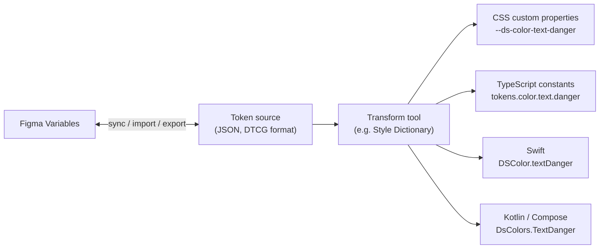

**Why not just a Sass file or a JS object?**

| Approach | Problem |
|---|---|
| Hard-coded values in components (`#B42318`) | Change = find and replace across repos; no theming |
| Sass/LESS variables | Web only; compile-time only, so no runtime theme switching; designers can't read them |
| A JS theme object | Web/JS only; CSS files and native apps can't consume it |
| **Platform-neutral token file + build step** ✅ | One source; every platform gets idiomatic output; designers and engineers share names |

> A token is a **decision**, not just a value. `#B42318` is a value. "Danger text uses red 600" is a decision. Tokens capture the decision so it can change in one place.

---

### Section 2: Token Categories

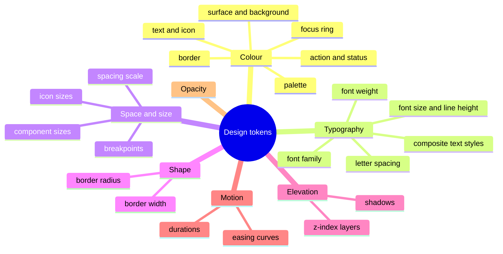

| Category | Example tokens | Notes |
|---|---|---|
| **Colour** | `color.text.default`, `color.surface.raised`, `color.action.primary.bg` | Largest category; most theming happens here |
| **Typography** | `font.family.sans`, `font.size.300`, `text.body.md` (composite) | Composite tokens bundle family, size, weight, line height |
| **Spacing** | `space.100` … `space.800`, `space.inset.md` | A consistent scale (often 4 px or 8 px based) |
| **Sizing** | `size.control.md`, `size.icon.sm` | Minimum target sizes belong here (accessibility) |
| **Radius / border** | `radius.control`, `border.width.default` | Shape language of the brand |
| **Elevation** | `shadow.raised`, `z.modal` | z-index tokens prevent "z-index: 99999" wars |
| **Motion** | `duration.fast`, `easing.standard` | Pair with `prefers-reduced-motion` handling |
| **Breakpoints** | `breakpoint.md` | Can't be used as `var()` inside `@media` (Section 7) |

---

### Section 3: Token Tiers — Primitive, Semantic, Component

Most mature systems use **two or three tiers**. Each tier references the one below it through **aliases**.

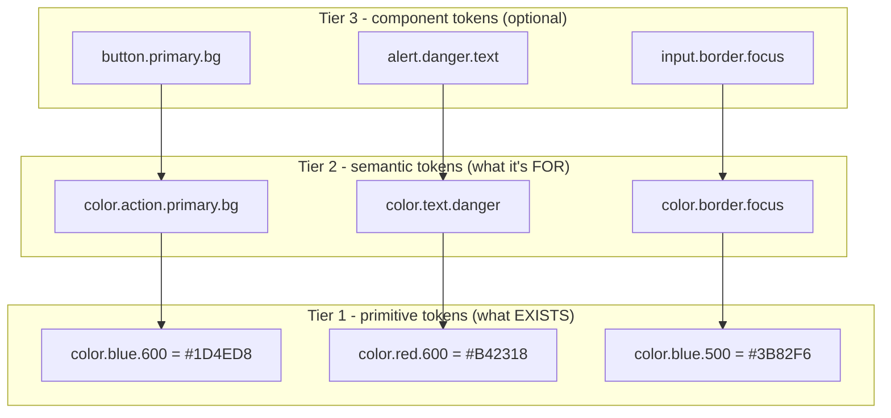

| Tier | Also called | Answers | Referenced by | Changes when |
|---|---|---|---|---|
| **Primitive** | global, reference, base, core | "Which colours, sizes, fonts exist?" | Other tokens only | The brand palette changes (rare) |
| **Semantic** | alias, system, decision | "What is this value **for**?" | Components and app code | A theme, mode or brand switches |
| **Component** | specific, local | "What does this part of this component use?" | One component | A single component needs to diverge |

**Material Design 3** is a public example of exactly this structure: reference tokens (`md.ref.palette.primary40`), system tokens (`md.sys.color.primary`) and component tokens (`md.comp.filled-button.container.color`).

**The rules that make tiers work:**
1. **Components and apps use semantic (or component) tokens, never primitives.** `color.blue.600` in a component means dark mode needs a code change.
2. **Primitives are never themed.** `blue.600` is always the same blue. Themes remap **semantic** tokens to different primitives.
3. **Component tokens are optional.** They give fine-grained control (useful for white-label products) but multiply the number of tokens. Many teams add them only where a component genuinely needs to diverge.

```text
Light theme:  color.text.default → color.gray.900
Dark theme:   color.text.default → color.gray.50
Component:    .card { color: var(--ds-color-text-default) }   ← never changes
```

---

### Section 4: Naming Tokens

Names are the token API. A rename is a breaking change for every consumer, so pick a convention early and write it down.

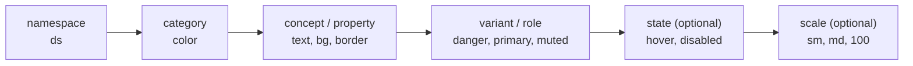

```text
--ds-color-action-primary-bg-hover
  │   │     │      │      │   └─ state
  │   │     │      │      └──── property
  │   │     │      └─────────── variant
  │   │     └────────────────── concept
  │   └──────────────────────── category
  └──────────────────────────── namespace (avoids clashes with app or third-party vars)
```

| Guideline | Good | Bad | Why |
|---|---|---|---|
| Semantic names describe **purpose** | `color.text.danger` | `color.text.red` | "Red" is wrong the day danger becomes orange |
| Primitive names describe **value** | `color.red.600` | `color.danger.600` | Primitives aren't tied to meaning |
| Use a **scale**, not adjectives, for many steps | `space.100 … space.800` | `space.tiny`, `space.huge`, `space.huger` | Adjectives run out; numeric steps leave room to insert values |
| T-shirt sizes for few steps | `radius.sm`, `radius.md`, `radius.lg` | `radius.3`, `radius.7` | Readable when the set is small |
| Consistent order of parts | Always `category.concept.variant.state` | Mixed orders | Predictable autocomplete and search |
| Namespace in output | `--ds-…` | `--primary` | Avoids collisions with apps and libraries |

> Names in the JSON source use dot paths (`color.text.danger`). The build tool converts them per platform: `--ds-color-text-danger` in CSS, `colorTextDanger` in JS, `DSColor.textDanger` in Swift.

---

### Section 5: The DTCG Format

The **Design Tokens Community Group** (a W3C Community Group) publishes the **Design Tokens Format Module**: a JSON format that tools can exchange. It reached its **first stable version in 2025**. It's a Community Group specification, not a W3C Recommendation, and it's still evolving; check [designtokens.org](https://www.designtokens.org/) for the current version.

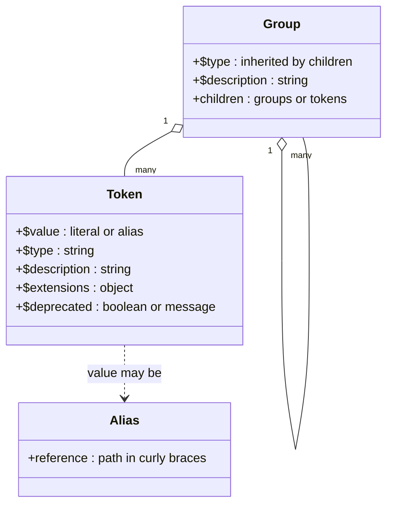

**Core rules of the format:**

| Feature | Rule |
|---|---|
| **Tokens vs groups** | An object with `$value` is a token; any other object is a group |
| **Reserved keys** | Properties starting with `$` are format properties; other keys are child names |
| **`$type`** | `color`, `dimension`, `fontFamily`, `fontWeight`, `duration`, `cubicBezier`, `number`, plus composites such as `typography`, `shadow`, `border`, `transition`, `gradient`, `strokeStyle` |
| **Type inheritance** | A `$type` on a group applies to tokens inside it that don't declare their own |
| **Aliases** | A `$value` of `"{color.red.600}"` references another token by its path |
| **`$extensions`** | Vendor-specific data (namespaced, e.g. a Figma variable ID) that tools must preserve |
| **`$deprecated`** | Marks a token as deprecated, optionally with a message explaining what to use instead |

**Value shapes changed between drafts and the stable spec.** Older drafts and many existing files use strings (`"#B42318"`, `"16px"`). The stable spec uses **objects**: colours have a `colorSpace` and `components` (with an optional `hex` fallback), and dimensions and durations have `value` + `unit`. Check which form your tools read before migrating.

```json
{
  "color": {
    "$type": "color",
    "red": {
      "600": {
        "$value": { "colorSpace": "srgb", "components": [0.706, 0.137, 0.094], "hex": "#b42318" }
      }
    },
    "text": {
      "danger": {
        "$value": "{color.red.600}",
        "$description": "Error and destructive text on default surfaces"
      }
    }
  },
  "space": {
    "$type": "dimension",
    "400": { "$value": { "value": 16, "unit": "px" } }
  },
  "duration": {
    "$type": "duration",
    "fast": { "$value": { "value": 150, "unit": "ms" } }
  }
}
```

**Themes and modes** (light/dark, brands, density) aren't part of the core token format. The DTCG has worked on a separate companion specification for resolving sets of tokens into themes; until your tools support it, most teams keep one file (or folder) per mode and let the build tool combine them (Section 8).

---

### Section 6: The Token Pipeline

Tokens are only useful if every platform receives them automatically. The typical pipeline:

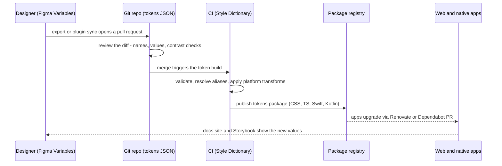

**Transforms** are the heart of the build: the same token becomes different code per platform.

| Token | CSS | TypeScript | iOS (Swift) | Android (Compose) |
|---|---|---|---|---|
| `color.text.danger` | `--ds-color-text-danger: #b42318;` | `colorTextDanger = '#b42318'` | `UIColor(red: 0.706, ...)` / `Color(...)` | `Color(0xFFB42318)` |
| `space.400` (16 px) | `--ds-space-400: 1rem;` (if converting to rem) | `space400 = '1rem'` | `16` (points) | `16.dp` |
| `duration.fast` | `--ds-duration-fast: 150ms;` | `durationFast = 150` | `0.15` (seconds) | `150` (ms) |

**Tooling options** (verify current features on each project's site):

| Tool | Role |
|---|---|
| **Style Dictionary** (Amazon, open source) | The most widely used build tool; recent major versions read the DTCG format and support custom transforms and formats |
| **Tokens Studio for Figma** | Figma plugin that edits tokens and syncs them with Git |
| **Figma Variables** | Figma's native tokens, with collections and modes; export via plugins or the REST API (API access depends on plan) |
| **Terrazzo** (formerly Cobalt UI) | DTCG-focused token build tool |
| **Tailwind CSS v4 `@theme`** | Defines tokens as CSS variables that also generate utility classes |

**What CI should check before publishing:**
- Every alias resolves (no broken `{…}` references, no cycles).
- No primitive is referenced directly from component tokens if your rules forbid it.
- **Contrast** of semantic text/background pairs meets WCAG (4.5:1 for normal text, 3:1 for large text and UI components) in every theme.
- The generated output diff is shown in the pull request, so reviewers see the real change.

---

### Section 7: Tokens on the Web — CSS Custom Properties

On the web, tokens are usually delivered as **CSS custom properties**, because they can change at runtime and cascade through the DOM.

```css
/* tokens.css (generated) */
:root {
  --ds-color-gray-50: #f9fafb;
  --ds-color-gray-900: #111827;
  --ds-color-red-600: #b42318;

  --ds-color-text-default: var(--ds-color-gray-900);
  --ds-color-surface-default: #ffffff;
  --ds-color-text-danger: var(--ds-color-red-600);

  --ds-space-200: 0.5rem;
  --ds-space-400: 1rem;
  --ds-radius-control: 0.375rem;
  --ds-duration-fast: 150ms;
}
```

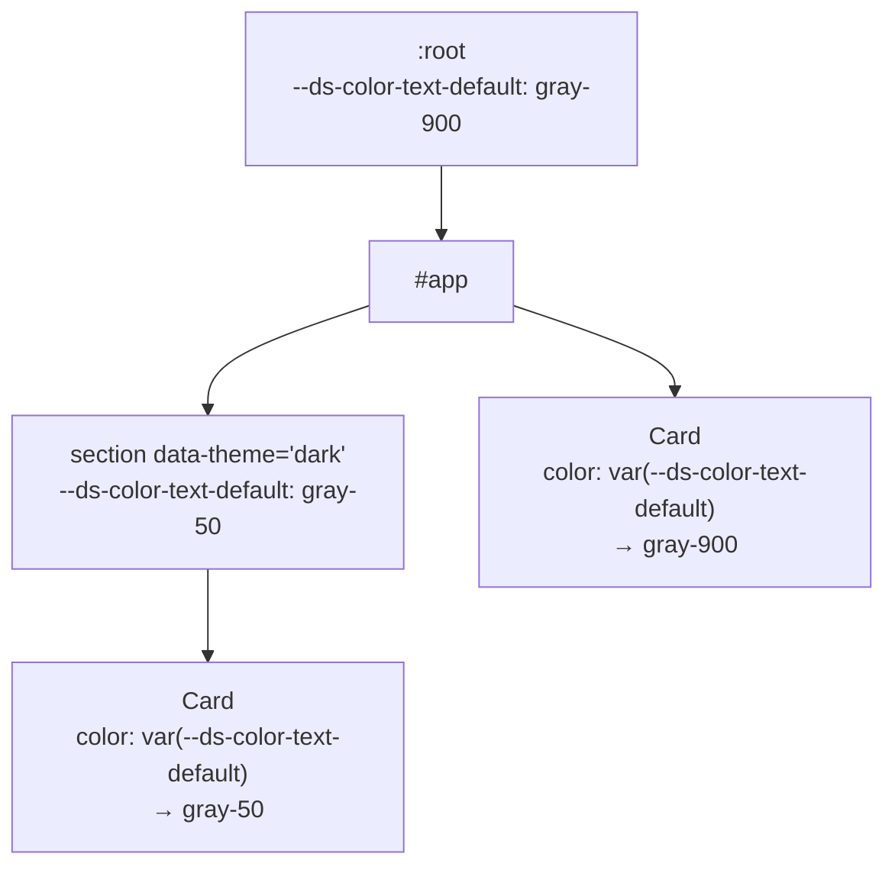

Custom properties **inherit**, so a subtree can be re-themed by redefining a few semantic variables on its root element. The same `Card` CSS renders correctly in both places.

**Build-time vs runtime tokens:**

| | CSS custom properties (runtime) | Build-time constants (Sass, JS, Tailwind classes) |
|---|---|---|
| Theme switching without reload | ✅ Change variables on an element | ❌ Need separate CSS bundles or class swaps |
| Nested / scoped themes | ✅ Inherit through the DOM | ❌ Hard |
| Use inside `@media` / `@container` conditions | ❌ `var()` doesn't work in media or container query conditions | ✅ Values are inlined at build time |
| Typos | Silently fall back to the initial value (or the `var()` fallback) | Caught at build time |
| Works in Server Components / no JS | ✅ Pure CSS | ✅ |

**Useful modern CSS around tokens** (support checked against MDN browser-compat-data):

| Feature | What it adds | Support |
|---|---|---|
| `@property` | Registers a custom property with a **type**, initial value and inheritance, so it can animate and is validated | Chrome 85, Safari 16.4, Firefox 128 |
| `light-dark()` | Picks one of two colours based on the element's used `color-scheme` | Chrome 123, Firefox 120, Safari 17.5 |
| `color-mix()` | Derives tints, shades and alpha variants from a token | Chrome 111, Firefox 113, Safari 16.2 |
| `color-scheme` | Tells the browser which schemes a page/element supports (form controls, scrollbars) | Widely supported |
| `@custom-media` | Named media queries (would allow breakpoint tokens in `@media`) | **Not shipped** in Chrome or Safari; Firefox 148 behind a preference. Use a build step (e.g. PostCSS) instead |

```css
/* Breakpoint tokens can't be var() in a media query */
@media (min-width: var(--ds-breakpoint-md)) { }   /* ❌ invalid, ignored */
@media (min-width: 48rem) { }                      /* ✅ value inlined by the build */
```

---

### Section 8: Theming, Modes and Multi-Brand

A **theme** is a mapping from **semantic tokens** to **primitive tokens**. Modes multiply: brand × colour scheme × contrast × density.

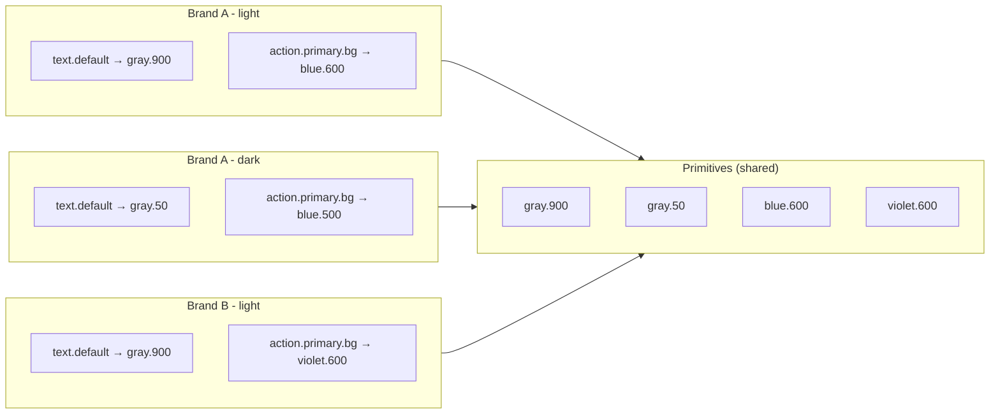

**Three ways to ship modes on the web:**

| Strategy | How | Pros | Cons |
|---|---|---|---|
| **Attribute-scoped variables** | `:root` (light) + `[data-theme="dark"]` overrides | Runtime switch, nested themes, one CSS file | All modes' variables shipped to everyone |
| **`light-dark()` in semantic tokens** | `--ds-color-text-default: light-dark(#111827, #f9fafb)` + `color-scheme` | Very compact; follows the OS automatically | Only two modes (light/dark); needs fairly recent browsers |
| **One CSS file per brand** | Build `brand-a.css`, `brand-b.css`; load the right one | Each user downloads only their brand | Switching brand at runtime needs a new stylesheet |

**Respect user preferences:**
- `prefers-color-scheme` for the default mode; let users override and remember the choice.
- `prefers-contrast: more` (supported in all major engines) can switch to a high-contrast semantic mapping.
- `prefers-reduced-motion` can set motion duration tokens to near zero.
- `forced-colors: active` (Windows High Contrast) overrides your colours; test that focus rings and borders still show.

**Avoid the "flash of wrong theme"** in SSR apps: decide the theme **before first paint**, either on the server (cookie → `data-theme` on `<html>`) or with a tiny blocking inline script in `<head>` that reads the stored preference. Deep dive: [Theming & Dark Mode](./theming-and-dark-mode.md).

> **Dark mode is not "invert the colours".** Dark surfaces need lighter, less saturated accents, elevation is shown with lighter surfaces rather than shadows, and every text/background pair must be re-checked for contrast. That's why dark mode is a separate semantic mapping designed by people, not a formula.

---

### Section 9: Tokens on Native Platforms

Native apps can't read CSS variables. The pipeline generates **platform-native resources** from the same source, so a decision made once reaches every app.

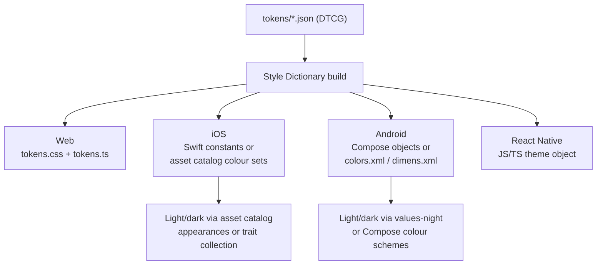

| Platform | Typical output | Dark mode mechanism |
|---|---|---|
| **Web** | CSS custom properties + TS constants | `[data-theme]`, `prefers-color-scheme`, `light-dark()` |
| **iOS (SwiftUI/UIKit)** | Swift extensions on `Color`/`UIColor`, or asset catalog colour sets | Asset catalog "Any/Dark" appearances or dynamic `UIColor` providers |
| **Android (Compose / Views)** | Kotlin objects for Compose, or `colors.xml`, `dimens.xml` | `values-night/` resources, or separate Compose `ColorScheme`s chosen with `isSystemInDarkTheme()` |
| **React Native** | JS/TS theme object | `useColorScheme()` + a theme context; no CSS variables |
| **Flutter** | Dart constants / `ThemeData` | `ThemeData` for light and dark, `ThemeMode` |

**Units differ per platform**: web uses `px`/`rem`, iOS uses points, Android uses `dp` (and `sp` for text). The token source stays in one unit, and transforms convert. Decide early whether text sizes scale with the user's font-size settings (they should: `rem` on the web, Dynamic Type on iOS, `sp` on Android).

---

### Section 10: Design Tool Integration

Tokens fail when Figma and code drift apart. Two-way sync is the goal; a **single source of truth** is the requirement.

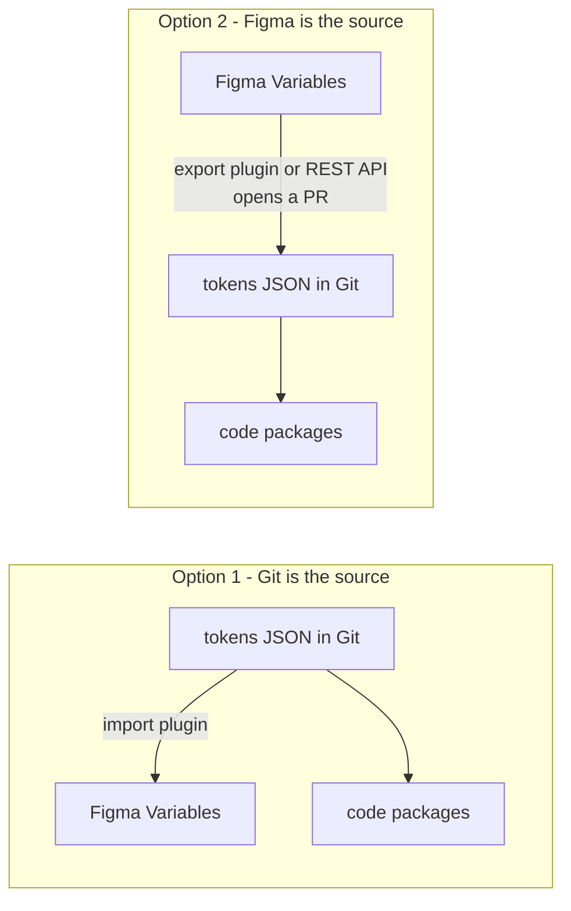

| Choice | Works well when | Watch out for |
|---|---|---|
| **Git as source of truth** | Engineering-heavy teams; tokens need review, tests and versioning | Designers need tooling (Tokens Studio, import scripts) to stay in sync |
| **Figma as source of truth** | Design-led teams that iterate in Figma | Every change must still go through a PR; Figma's model (collections, modes, variable types) doesn't map 1:1 to DTCG types |

**Figma Variables mapping:**
- A **collection** groups variables (e.g. "Primitives", "Semantic").
- **Modes** in a collection (Light, Dark, Brand B) map naturally to themes.
- A variable can **alias** another variable, which maps to a token alias.
- Variable types are limited (colour, number, string, boolean); composite tokens like typography and shadow live in **styles** instead, so exporting them needs plugin logic.

---

### Section 11: Governance, Versioning and Enforcement

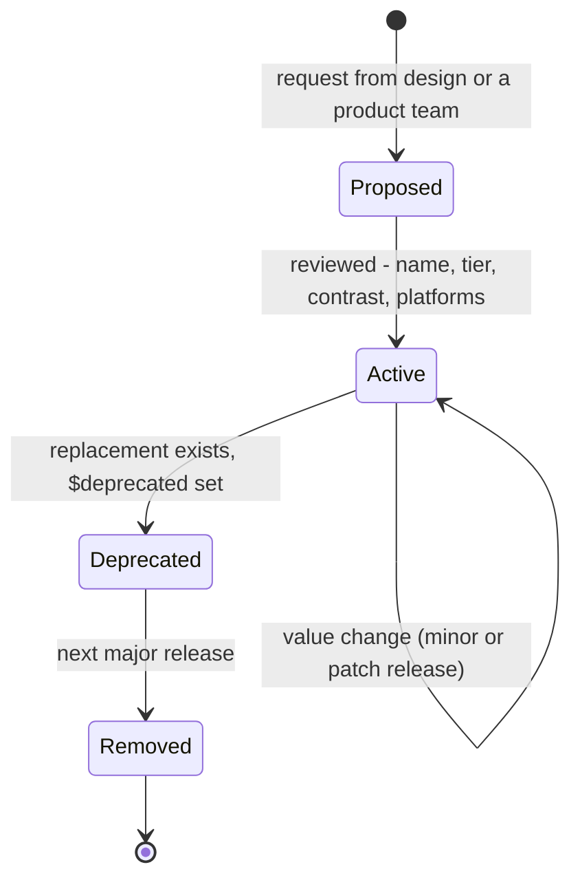

| Change | SemVer impact | Why |
|---|---|---|
| Add a token | **Minor** | Nobody depends on it yet |
| Change a semantic token's value (e.g. new brand blue) | **Minor or patch**, by team policy | Consumers get the change automatically, which is the point; announce it and run visual regression |
| Rename or remove a token | **Major** | Every reference breaks (CSS silently, TS loudly) |
| Change a token's type or unit | **Major** | Consumers' math and layouts can break |

**Enforce token usage** so values don't leak back into code:
- **Stylelint**: plugins such as `stylelint-declaration-strict-value` can require `var(--…)` for colour, spacing and radius properties.
- **TypeScript**: generate a union type of token names, so `token('color.text.dangr')` fails to compile.
- **Tailwind**: restrict the theme to your tokens (remove the default palette) so only approved values exist as classes.
- **Codemods** for renames: replace `--ds-color-danger` with `--ds-color-text-danger` across repos.
- **Usage analytics**: scan repos for raw hex values and unknown custom properties to find drift.

---

## Decision Matrix — Where Tokens Resolve

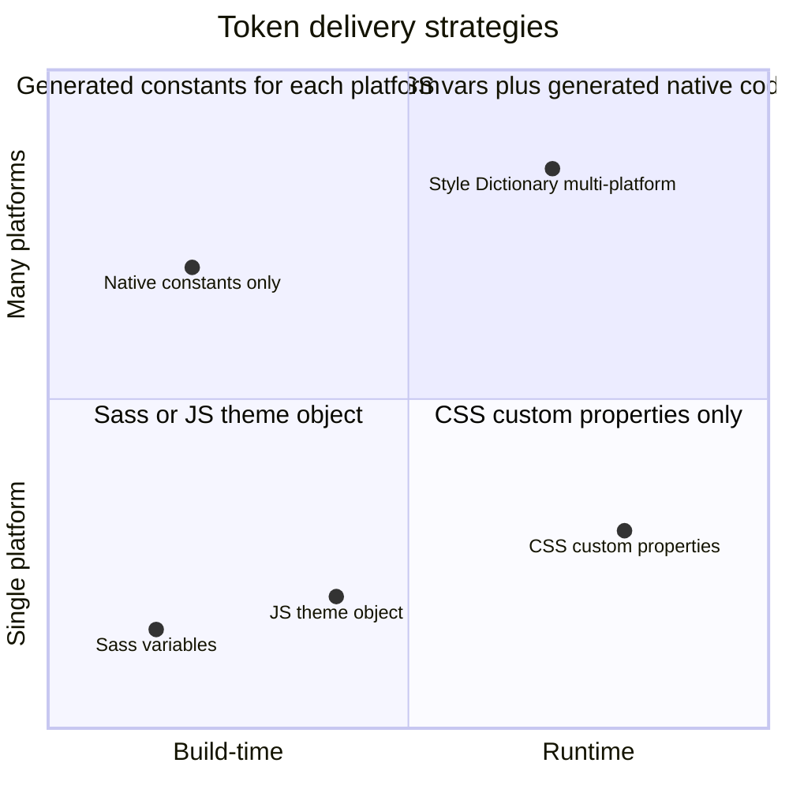

| Situation | Recommendation |
|---|---|
| One web app, no theming | CSS custom properties from a small token file; still use semantic names |
| Web app with light/dark and user choice | Semantic tokens as CSS variables scoped by `[data-theme]`, default from `prefers-color-scheme` |
| White-label product, many brands | Primitive + semantic + selected component tokens; per-brand CSS files or runtime brand switch |
| Web + iOS + Android | DTCG JSON in Git → Style Dictionary → CSS, TS, Swift, Kotlin packages |
| Tailwind-based app | Tokens as CSS variables, exposed through Tailwind v4 `@theme` so utilities and custom CSS share them |
| React Native | Generated TS theme object + context; no CSS variables |

---

## Real-World Examples

**Example 1 — A tiered token source (DTCG, using the older string values many tools still expect):**
```json
{
  "color": {
    "$type": "color",
    "gray":  { "50": { "$value": "#f9fafb" }, "900": { "$value": "#111827" } },
    "blue":  { "500": { "$value": "#3b82f6" }, "600": { "$value": "#1d4ed8" } },
    "red":   { "400": { "$value": "#f97066" }, "600": { "$value": "#b42318" } }
  },
  "semantic": {
    "$type": "color",
    "text": {
      "default": { "$value": "{color.gray.900}" },
      "danger":  { "$value": "{color.red.600}", "$description": "Errors and destructive actions" }
    },
    "action": {
      "primary": { "bg": { "$value": "{color.blue.600}" } }
    }
  }
}
```

```json
{
  "semantic": {
    "$type": "color",
    "text": {
      "default": { "$value": "{color.gray.50}" },
      "danger":  { "$value": "{color.red.400}" }
    },
    "action": {
      "primary": { "bg": { "$value": "{color.blue.500}" } }
    }
  }
}
```

> The first block shows the primitives (`tokens/primitives.json`) and the light mapping (`tokens/themes/light.json`) together for brevity. The second block is `tokens/themes/dark.json`: it overrides only the **semantic** tokens; primitives are shared.

**Example 2 — Building light and dark CSS with Style Dictionary (ESM, recent major versions):**
```javascript
// build-tokens.mjs — run with: node build-tokens.mjs
import StyleDictionary from 'style-dictionary';

const themes = [
  { name: 'light', selector: ':root', files: ['tokens/primitives.json', 'tokens/themes/light.json'] },
  { name: 'dark', selector: '[data-theme="dark"]', files: ['tokens/primitives.json', 'tokens/themes/dark.json'] },
];

for (const theme of themes) {
  const sd = new StyleDictionary({
    source: theme.files,
    platforms: {
      css: {
        transformGroup: 'css',
        prefix: 'ds',
        buildPath: 'dist/css/',
        files: [{
          destination: `${theme.name}.css`,
          format: 'css/variables',
          options: { selector: theme.selector, outputReferences: true },
          // only emit semantic tokens in the dark file; primitives come from light.css
          filter: theme.name === 'dark' ? (token) => token.path[0] === 'semantic' : undefined,
        }],
      },
      ts: {
        transformGroup: 'js',
        buildPath: 'dist/ts/',
        files: [{ destination: `${theme.name}.js`, format: 'javascript/es6' }],
      },
    },
  });
  await sd.buildAllPlatforms();
}
```

> Style Dictionary's API, option names and DTCG support differ between major versions (the class-based `new StyleDictionary()` + `await buildAllPlatforms()` API is the modern one). Check the docs for your version, especially for the stable DTCG object values.

**Example 3 — Consuming tokens in components (BAD → GOOD):**
```css
/* ❌ BAD: raw values and primitive tokens — dark mode and rebrands need code edits */
.alert-danger {
  color: #b42318;
  background: var(--ds-color-red-50);
  padding: 12px 16px;
  border-radius: 6px;
}

/* ✅ GOOD: semantic tokens only — themes remap them, this file never changes */
.alert-danger {
  color: var(--ds-semantic-text-danger);
  background: var(--ds-semantic-surface-danger);
  padding: var(--ds-space-300) var(--ds-space-400);
  border-radius: var(--ds-radius-container);
}

/* Derived variants from a token (no extra token needed for a hover tint) */
.button-primary:hover {
  background: color-mix(in oklch, var(--ds-semantic-action-primary-bg), black 12%);
}

/* Motion tokens respect user preferences in one place */
@media (prefers-reduced-motion: reduce) {
  :root { --ds-duration-fast: 0ms; --ds-duration-normal: 0ms; }
}
```

**Example 4 — Compact light/dark with `light-dark()` and a typed custom property:**
```css
:root {
  color-scheme: light dark;   /* follow the OS by default */
  --ds-text-default: light-dark(#111827, #f9fafb);
  --ds-surface-default: light-dark(#ffffff, #0b0f19);
}
:root[data-theme="light"] { color-scheme: light; }   /* user override */
:root[data-theme="dark"]  { color-scheme: dark; }

/* @property: typed, animatable, with a safe initial value */
@property --ds-progress {
  syntax: '<percentage>';
  inherits: false;
  initial-value: 0%;
}
.progress-bar {
  background: linear-gradient(to right, var(--ds-accent) var(--ds-progress), transparent 0);
  transition: --ds-progress var(--ds-duration-normal, 200ms) ease-out;
}
```

**Example 5 — Type-safe token access in TypeScript:**
```typescript
// generated: dist/ts/token-names.ts
export const tokenNames = [
  'semantic.text.default',
  'semantic.text.danger',
  'semantic.action.primary.bg',
  'space.300',
  'space.400',
] as const;
export type TokenName = (typeof tokenNames)[number];

// helper used by components (CSS-in-JS, inline styles, canvas, charts)
export function cssVar(name: TokenName): string {
  return `var(--ds-${name.replaceAll('.', '-')})`;
}

// usage
const style = { color: cssVar('semantic.text.danger') };   // ✅
// cssVar('semantic.text.dangr');                          // ❌ compile error
```

**Example 6 — The same tokens in Tailwind v4, Vue, Angular, Svelte and React Native:**
```css
/* Tailwind CSS v4: tokens as theme variables generate utilities (bg-action-primary, text-danger) */
@import "tailwindcss";
@import "@acme/tokens/css/light.css";

@theme inline {
  --color-action-primary: var(--ds-semantic-action-primary-bg);
  --color-danger: var(--ds-semantic-text-danger);
  --spacing: 0.25rem;
}
```

```html
<!-- Vue 3 SFC: scoped styles consume the same token variables -->
<script setup lang="ts">
const props = defineProps<{ tone?: 'default' | 'danger' }>();
</script>
<template><p :class="['text', props.tone]"><slot /></p></template>
<style scoped>
.text { color: var(--ds-semantic-text-default); font: var(--ds-text-body-md); }
.text.danger { color: var(--ds-semantic-text-danger); }
</style>
```

```typescript
// Angular: tokens are plain CSS variables; host bindings can set component-level overrides
import { Component, input } from '@angular/core';

@Component({
  selector: 'ds-badge',
  template: `<ng-content />`,
  styles: `:host { display: inline-flex; padding: var(--ds-space-100) var(--ds-space-200);
                   border-radius: var(--ds-radius-pill); background: var(--badge-bg, var(--ds-semantic-surface-subtle)); }`,
  host: { '[style.--badge-bg]': 'bg()' },
})
export class BadgeComponent {
  bg = input<string | undefined>(undefined);
}
```

```html
<!-- Svelte 5: --custom-property props pass tokens into a child component -->
<Slider --track-color="var(--ds-semantic-action-primary-bg)" />
```

```tsx
// React Native: no CSS variables — use the generated JS tokens with a theme context
import { useColorScheme, StyleSheet, Text } from 'react-native';
import { light, dark } from '@acme/tokens/rn';

export function DangerText({ children }: { children: string }) {
  const t = useColorScheme() === 'dark' ? dark : light;
  return <Text style={[styles.base, { color: t.semanticTextDanger }]}>{children}</Text>;
}
const styles = StyleSheet.create({ base: { fontSize: 16 } });
```

> Angular Material and Vuetify ship their own token systems (Angular Material's M3 theming emits `--mat-sys-*` system variables; Vuetify has a theme configuration). Map your semantic tokens onto theirs rather than overriding individual component styles. Check each library's theming guide for the current API.

**Example 7 — Enforcing tokens with Stylelint:**
```json
{
  "plugins": ["stylelint-declaration-strict-value"],
  "rules": {
    "scale-unlimited/declaration-strict-value": [
      ["/color$/", "fill", "stroke", "background-color", "border-radius", "z-index"],
      { "ignoreValues": ["currentColor", "transparent", "inherit", "0"] }
    ]
  }
}
```

---

## Key Points Summary

| Concept | One-Line Explanation |
|---|---|
| **Design token** | A named design decision (name + value + type) stored platform-neutrally |
| **Primitive tokens** | The raw palette and scales (`color.red.600`); never themed, never used directly in components |
| **Semantic tokens** | Purpose names (`color.text.danger`) that themes remap; what components use |
| **Component tokens** | Optional per-component overrides (`button.primary.bg`); use sparingly |
| **Alias** | A token whose value references another (`{color.red.600}`) |
| **DTCG format** | W3C Community Group JSON format (`$value`, `$type`, aliases); first stable version in 2025 |
| **Style Dictionary** | Build tool that transforms one token source into CSS, JS, Swift, Kotlin and more |
| **CSS custom properties** | Runtime, inheritable delivery of tokens on the web; enable nested themes |
| **Theme** | A mapping of semantic tokens to primitives (light, dark, brand, high contrast) |
| **`light-dark()`** | CSS function choosing between two colours based on `color-scheme` |
| **No `var()` in media queries** | Breakpoint tokens must be inlined at build time |
| **Single source of truth** | Git or Figma, but changes always flow through review into generated packages |
| **Token SemVer** | Add = minor; rename/remove/type change = major |

---

## Test Your Understanding

**Q1 (Basic):**
What's the difference between a primitive token and a semantic token? Which should a `Button` component's CSS reference, and why?

<details>
<summary>Answer</summary>

A **primitive** token names a raw value that exists in the palette or scale: `color.blue.600 = #1d4ed8`. It says nothing about usage. A **semantic** token names a **purpose** and aliases a primitive: `color.action.primary.bg → {color.blue.600}`.

The `Button` should reference the **semantic** token (or a component token that aliases it). Themes, dark mode and rebrands work by remapping semantic tokens to different primitives. If the button used `blue.600` directly, dark mode would need a code change in the component, and you couldn't make "primary action" violet for brand B without also changing every other use of `blue.600`.
</details>

**Q2 (Application):**
Design the token architecture for a white-label banking app sold to five banks, each with its own brand colours, all needing light and dark mode, on web, iOS and Android.

<details>
<summary>Answer</summary>

- **Source:** DTCG JSON in Git. `primitives/` holds each bank's palette plus shared neutrals. `semantic/` holds one mapping per **brand × mode** (`bank-a/light.json`, `bank-a/dark.json`, …), each overriding only semantic tokens. A small set of **component tokens** where banks differ in shape (button radius, card elevation).
- **Build:** Style Dictionary runs once per brand × mode and per platform: CSS variable files (`:root` / `[data-theme="dark"]` per brand), TS constants and name types, Swift (asset catalog colour sets with light/dark appearances), and Kotlin Compose colour schemes.
- **Delivery on the web:** each bank's app loads only its own brand CSS (smaller payload); dark mode switches at runtime via `data-theme`, defaulting to `prefers-color-scheme`.
- **Quality:** CI checks alias resolution and **WCAG contrast** for every text/background pair in every brand × mode (brand colours chosen by clients often fail contrast; catch it before release). Visual regression runs per brand and mode.
- **Governance:** components may only reference semantic/component tokens (Stylelint + TS types); renames are majors with codemods.
</details>

**Q3 (Tricky):**
A developer writes `@media (min-width: var(--ds-breakpoint-md)) { … }` and the styles never apply. Why? How do you share breakpoint tokens?

<details>
<summary>Answer</summary>

`var()` is only valid in **property values**. Media query (and container query) conditions are evaluated outside the cascade, before custom properties are resolved for any element, so `var()` there is invalid and the rule is ignored. The CSS `@custom-media` rule would solve this, but per MDN's compat data it hasn't shipped in Chrome or Safari, and Firefox has it only behind a preference.

Share breakpoints at **build time**: generate them into Sass variables, a PostCSS custom-media file (the PostCSS plugin replaces them with literal values), Tailwind's theme config, and JS constants (for `matchMedia`). Keep them in the token source so all platforms agree. Also consider whether a component should use a **container query** instead; its breakpoint values still have to be literals.
</details>

**Q4 (Tricky):**
You rename `--ds-color-danger` to `--ds-color-text-danger` in a minor release. TypeScript apps get no errors, but production shows black error text. What happened, and how should renames be handled?

<details>
<summary>Answer</summary>

CSS custom properties fail **silently**. `color: var(--ds-color-danger)` now references an undefined property, so the declaration becomes "invalid at computed-value time" and `color` falls back to its inherited value (often the default text colour). There's no build error because CSS doesn't check variable names, and TS types don't cover CSS files.

Handle renames as **breaking changes**: (1) ship the new name and keep the old one as an alias (`--ds-color-danger: var(--ds-color-text-danger)`) marked `$deprecated` in the source, (2) warn via lint (Stylelint can flag deprecated names), (3) provide a **codemod**, (4) remove the alias in the next **major**. Visual regression tests in consuming apps catch the remaining cases.
</details>

**Q5 (System design):**
Your team keeps tokens in Figma Variables and engineers copy values into code by hand. Values drift every sprint. Propose a process and toolchain.

<details>
<summary>Answer</summary>

1. **Pick one source of truth.** Either Git (designers edit through Tokens Studio or an import plugin) or Figma (an export plugin or the Variables REST API, if your plan allows it, produces DTCG JSON).
2. **Automate the flow.** A Figma change becomes a **pull request** on the tokens repo with a readable diff. No manual copying.
3. **Review and test in CI.** Validate aliases, run contrast checks, render a token docs page and a Storybook preview for reviewers.
4. **Build and publish** with Style Dictionary into versioned packages (CSS, TS, native). Apps upgrade through Renovate/Dependabot PRs and run visual regression.
5. **Map Figma structure to tiers.** One collection for primitives, one for semantics with modes (Light/Dark/brands). Designers apply semantic variables in mock-ups, so Figma layers and code use the same names.
6. **Enforce in code** with Stylelint rules and generated TS types so hard-coded values can't creep back.
</details>

**Q6 (Application):**
When should you add **component tokens** (e.g. `button.primary.bg`) instead of letting components use semantic tokens directly?

<details>
<summary>Answer</summary>

Add component tokens when a component must be able to **diverge from the semantic layer** without affecting anything else:
- **White-label or multi-brand** products where a client wants "our buttons are pill-shaped and green" while links stay blue.
- Components whose parts don't fit a general semantic token (e.g. `tooltip.bg`, which is dark in both light and dark themes).
- When designers want to tune one component per theme.

Don't add them by default for every property of every component. Each one becomes public API: more tokens to name, document, keep in sync with Figma and version. A good middle ground is to define component tokens as aliases of semantic tokens (`button.primary.bg → {semantic.action.primary.bg}`), add them only for components that actually need overrides, and keep all other components on semantic tokens.
</details>

---

## Cheat Sheet

**Key Definitions:**
- **Design token:** Named, typed design decision stored in a platform-neutral format
- **Primitive / reference token:** Raw value in a palette or scale (`color.red.600`)
- **Semantic / system token:** Purpose-based alias (`color.text.danger`) that themes remap
- **Component token:** Alias scoped to one component (`button.primary.bg`)
- **Alias:** A token value that references another token (`{color.red.600}`)
- **DTCG:** W3C Design Tokens Community Group and its JSON Format Module
- **Transform:** Build step converting a token to a platform's syntax and units
- **Mode / theme:** A set of semantic-to-primitive mappings (light, dark, brand, contrast)

**Quick Reference:**
```text
Tiers        primitive (what exists) → semantic (what it's for) → component (optional)
Rule         components use SEMANTIC tokens; themes remap semantic → primitive; primitives never themed
Naming       namespace-category-concept-variant-state-scale   e.g. --ds-color-action-primary-bg-hover
DTCG         $value, $type, $description, $extensions, $deprecated; aliases "{a.b.c}"; group $type inherits
Stable spec  colour = { colorSpace, components, hex? }   dimension/duration = { value, unit }
Pipeline     Figma or Git → PR → CI (validate, contrast) → Style Dictionary → CSS / TS / Swift / Kotlin → packages
Web          CSS custom properties (runtime, inherit) · [data-theme] scopes · light-dark() · color-mix()
Not allowed  var() inside @media / @container conditions → inline breakpoints at build time
Preferences  prefers-color-scheme · prefers-contrast · prefers-reduced-motion · forced-colors
SSR          set data-theme before first paint (cookie on server or inline head script)
Native       iOS asset catalog colour sets · Android values-night / Compose ColorScheme · RN theme object
SemVer       add = minor · value change = minor/patch (announce) · rename/remove/type = MAJOR + codemod
Enforce      Stylelint strict-value · generated TS token types · Tailwind theme limited to tokens
```

**Common Mistakes to Avoid:**

| Mistake | Why Wrong | Fix |
|---|---|---|
| Components reference primitive tokens | Themes and rebrands need code edits | Reference semantic or component tokens only |
| Naming semantic tokens by colour (`text.red`) | Name lies when the value changes | Name by purpose (`text.danger`) |
| Hand-copying values from Figma | Drift every sprint | Automated sync + PR + generated packages |
| Theming primitives (`blue.600` changes in dark mode) | Every use of that primitive changes, including ones that shouldn't | Keep primitives fixed; remap semantic tokens |
| `var()` in media queries | Invalid; the rule is ignored | Build-time breakpoints |
| Renaming tokens in a minor release | CSS fails silently in consuming apps | Deprecate with alias → codemod → remove in a major |
| Component tokens for everything | Explosion of public API to maintain | Add them only where divergence is needed |
| Dark mode by inverting colours | Poor contrast, harsh accents | Designed semantic mapping, contrast-checked in CI |
| No namespace (`--primary`) | Collisions with apps and third-party CSS | Prefix (`--ds-…`) |
| Flash of wrong theme in SSR | Light page flashes before dark mode applies | Decide the theme before first paint |
| Ignoring units across platforms | 16 px web vs 16 dp vs 16 pt confusion, broken text scaling | One source unit + platform transforms; scalable text units |

---

## References & Further Reading

**Specs & community**
- W3C Design Tokens Community Group: [designtokens.org](https://www.designtokens.org/) · [Design Tokens Format Module](https://www.designtokens.org/tr/drafts/format/)
- W3C: [Design Tokens Community Group page](https://www.w3.org/community/design-tokens/)
- GitHub: [design-tokens/community-group](https://github.com/design-tokens/community-group)

**Tools**
- Style Dictionary: [Documentation](https://styledictionary.com/) · [DTCG support](https://styledictionary.com/info/dtcg/)
- Tokens Studio: [Documentation](https://docs.tokens.studio/)
- Figma: [Guide to variables](https://help.figma.com/hc/en-us/articles/15339657135383-Guide-to-variables-in-Figma) · [Variables REST API](https://developers.figma.com/docs/rest-api/variables/)
- Tailwind CSS: [Theme variables](https://tailwindcss.com/docs/theme)
- Stylelint plugin: [stylelint-declaration-strict-value](https://github.com/AndyOGo/stylelint-declaration-strict-value)

**CSS (MDN)**
- MDN: [Using CSS custom properties](https://developer.mozilla.org/en-US/docs/Web/CSS/CSS_cascading_variables/Using_CSS_custom_properties)
- MDN: [`@property`](https://developer.mozilla.org/en-US/docs/Web/CSS/@property) · [`light-dark()`](https://developer.mozilla.org/en-US/docs/Web/CSS/color_value/light-dark) · [`color-mix()`](https://developer.mozilla.org/en-US/docs/Web/CSS/color_value/color-mix) · [`color-scheme`](https://developer.mozilla.org/en-US/docs/Web/CSS/color-scheme)
- MDN: [`prefers-color-scheme`](https://developer.mozilla.org/en-US/docs/Web/CSS/@media/prefers-color-scheme) · [`prefers-contrast`](https://developer.mozilla.org/en-US/docs/Web/CSS/@media/prefers-contrast) · [`forced-colors`](https://developer.mozilla.org/en-US/docs/Web/CSS/@media/forced-colors)
- W3C: [WCAG 2.2 — Contrast (Minimum)](https://www.w3.org/WAI/WCAG22/Understanding/contrast-minimum.html)

**Design systems using tokens**
- Material Design 3: [Design tokens](https://m3.material.io/foundations/design-tokens/overview)
- Salesforce Lightning Design System: [Design tokens](https://www.lightningdesignsystem.com/design-tokens/)
- Adobe Spectrum: [Design tokens](https://spectrum.adobe.com/page/design-tokens/)
- Angular Material: [Theming](https://material.angular.dev/guide/theming)

**Deep dives**
- Nathan Curtis (EightShapes): [Naming Tokens in Design Systems](https://medium.com/eightshapes-llc/naming-tokens-in-design-systems-9e86c7444676)
- Related notes: [Theming & Dark Mode](./theming-and-dark-mode.md) · [CSS Architecture](./css-architecture-css-in-js-tailwind-css-modules.md) · [Color Contrast & Visual Accessibility](./color-contrast-and-visual-accessibility.md)

---

> **Previous Topic:** [Atomic Design Methodology](./atomic-design-methodology.md)
> — Five levels of composition, from atoms to pages; tokens sit beneath the atoms

> **Next Topic:** [Component API Design](./component-api-design.md)
> — Designing props, events, slots and defaults that stay stable as a component library grows

*Saved on: 2026-11-06 | Repo: Frontend System Design Learning Notes*
