<!-- Generated by scripts/sync-knowledge.js from notes/ and README.md — do not edit here. -->
<!-- sections (line ranges in this file): Table of Contents 19-44 · ELI5 45-56 · Core Concept 57-551 · System Design Angle 552-605 · Real-World Examples 606-733 · Key Points Summary 734-759 · Test Your Understanding 760-849 · Cheat Sheet 850-907 · References & Further Reading 908-951 -->

# DNS Resolution & CDN

> **Date:** 2026-11-06 · **Last updated:** 2026-11-06
> **Category:** Frontend System Design
> **Sub-Topic:** Networking / Infrastructure
> **Level:** Intermediate · **Reading time:** ~30 min
> **Informs:** CDN strategy, cache invalidation, global latency, preconnect/dns-prefetch, edge caching

> **Pre-requisite:** [HTTP/1.1 vs HTTP/2 vs HTTP/3](./http1-vs-http2-vs-http3.md) (what travels over a connection) and [Critical Rendering Path](./critical-rendering-path.md) (why the first bytes matter).
> This note covers **everything that happens before and around the request**: how a hostname becomes an IP address, and how a CDN puts your bytes physically close to the user.

**Previous:** [HTTP/1.1 vs HTTP/2 vs HTTP/3](./http1-vs-http2-vs-http3.md) · **Next:** [TCP/TLS Handshake](./tcp-tls-handshake.md)

---

## Table of Contents

1. [ELI5 — Simple Explanation](#eli5--simple-explanation)
2. [Section 1: Why DNS and CDNs Matter to Frontend Engineers](#section-1-why-dns-and-cdns-matter-to-frontend-engineers)
3. [Section 2: The DNS Resolution Path](#section-2-the-dns-resolution-path)
4. [Section 3: DNS Record Types You Will Actually Use](#section-3-dns-record-types-you-will-actually-use)
5. [Section 4: TTLs and DNS Caching](#section-4-ttls-and-dns-caching)
6. [Section 5: dns-prefetch and preconnect](#section-5-dns-prefetch-and-preconnect)
7. [Section 6: Encrypted DNS — DoH and DoT](#section-6-encrypted-dns--doh-and-dot)
8. [Section 7: What a CDN Is — Edge PoPs](#section-7-what-a-cdn-is--edge-pops)
9. [Section 8: Routing Users to the Edge — Anycast vs DNS-Based](#section-8-routing-users-to-the-edge--anycast-vs-dns-based)
10. [Section 9: Cache Keys and Cache Hit Ratio](#section-9-cache-keys-and-cache-hit-ratio)
11. [Section 10: Origin Shielding and Tiered Caching](#section-10-origin-shielding-and-tiered-caching)
12. [Section 11: Cache-Control at the Edge](#section-11-cache-control-at-the-edge)
13. [Section 12: Purge and Invalidation Strategies](#section-12-purge-and-invalidation-strategies)
14. [Section 13: Dynamic Content at the Edge](#section-13-dynamic-content-at-the-edge)
15. [Section 14: Image CDNs](#section-14-image-cdns)
16. [System Design Angle — Global Latency, Multi-CDN, Failure Modes](#system-design-angle--global-latency-multi-cdn-failure-modes)
17. [Real-World Examples](#real-world-examples)
18. [Key Points Summary](#key-points-summary)
19. [Test Your Understanding (with answers)](#test-your-understanding)
20. [Cheat Sheet](#cheat-sheet)
21. [References & Further Reading](#references--further-reading)

---

## ELI5 — Simple Explanation

Imagine you want to send a letter to "Grandma".

- **DNS is the phone book.** You know the *name* (`shop.example.com`) but the post office needs an *address* (`203.0.113.7`). First you check your own memory (browser cache), then the family notebook (OS cache), then you ask the town librarian (**recursive resolver**). If the librarian doesn't know, she asks the national directory (**root**), which says "ask the `.com` office" (**TLD**), which says "ask Example Inc.'s own receptionist" (**authoritative server**). The librarian writes the answer down for a while (**TTL**) so the next person gets it instantly.
- **A CDN is a chain of local warehouses.** Instead of every order shipping from one factory on another continent (**origin**), copies of popular items sit in a warehouse in your city (**edge PoP**). Most orders are filled locally (**cache hit**); only unusual ones go back to the factory (**cache miss**).
- **Purging** is telling every warehouse "throw away the old version of this item". It is far easier if every new version gets a **new product code** (hashed file names) — then nobody ever needs to throw anything away.

> **One-line takeaway: DNS turns a name into the *nearest useful* address, and a CDN makes sure that address is physically close and already holds your bytes — together they decide how many milliseconds of pure distance every user pays before your app even starts.**

---

## Core Concept — Step by Step

### Section 1: Why DNS and CDNs Matter to Frontend Engineers

Before the browser can send `GET /`, it has to do **connection setup**. DNS is the very first step, and the CDN decides how far each later step has to travel.

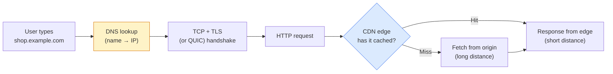

| Frontend concern | DNS / CDN lever |
|---|---|
| **TTFB / LCP** | Edge cache hit for HTML and the LCP image; edge close to the user |
| **Third-party origins** (fonts, analytics, APIs) | Each new hostname = a DNS lookup + new connection → `preconnect` / `dns-prefetch`, or self-host |
| **Deploys** | Hashed asset names + short-lived HTML → no purge needed for most releases |
| **Availability** | DNS and the CDN are both single points of failure unless designed otherwise |
| **Security** | TLS terminates at the edge; WAF / DDoS protection live there; cache poisoning is an edge bug |

> Rule of thumb: **every distinct hostname on the critical path costs at least one DNS lookup and one new connection** on a cold visit. Fewer origins → fewer round trips (see [TCP/TLS Handshake](./tcp-tls-handshake.md)).

---

### Section 2: The DNS Resolution Path

#### 2.1 The layers of caching

A lookup walks down a chain of caches and **stops at the first one that has a fresh answer**:

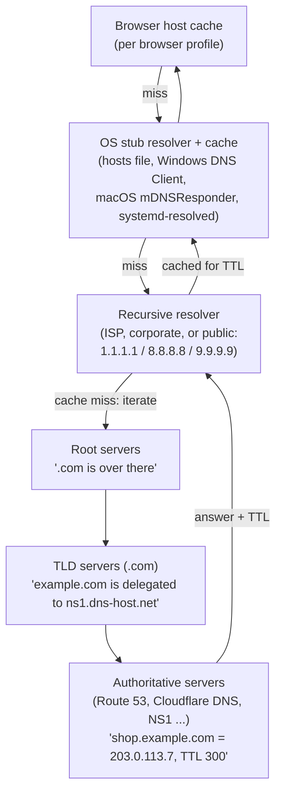

| Layer | Who runs it | Notes |
|---|---|---|
| **Browser cache** | The browser | Short-lived, per profile. Some browsers use their own DNS client (needed for DoH / HTTPS records); others call the OS |
| **OS stub resolver** | Operating system | Checks the **hosts file** and its own cache; forwards to the configured resolver. It does *not* walk the hierarchy itself |
| **Recursive resolver** | ISP, company, or public DNS provider | Does the real work, caches aggressively for **all** of its users — so popular names are almost always hot here |
| **Root servers** | 13 named identities (`a`–`m.root-servers.net`) | Each is many anycast instances worldwide; they only answer "who handles this TLD?" |
| **TLD servers** | Registry (e.g. Verisign for `.com`) | Answer "who is authoritative for `example.com`?" (the **NS** delegation) |
| **Authoritative servers** | Your DNS provider | The source of truth for your records |

#### 2.2 Iterative vs recursive

- The **client → recursive resolver** query is *recursive*: "give me the final answer".
- The **resolver → root/TLD/authoritative** queries are *iterative*: each server answers with a **referral** ("ask them") until the authoritative server gives the final answer.

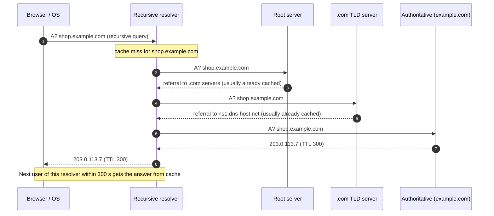

**What does it cost?** From the client's point of view a DNS lookup is normally **one round trip to the resolver** (UDP, port 53). On a resolver **cache miss**, add the resolver's own round trips to the authoritative servers. Root and TLD referrals are cached for long periods (delegations in the root zone carry multi-day TTLs), so in practice a miss usually costs one extra trip to *your* authoritative server.

#### 2.3 Details that bite in production

- **CNAME chains** are followed by the *resolver*, which returns the whole chain in one response. The client doesn't pay an extra round trip per hop, but every hop is another cache entry that can miss on the resolver (and another provider you depend on).
- **Negative caching**: "this name does not exist" (NXDOMAIN) is cached too, for a period derived from the zone's SOA record ([RFC 2308](https://datatracker.ietf.org/doc/html/rfc2308)). Creating a record right after users queried it can appear "not to work" for a while.
- **IPv4 + IPv6**: browsers typically ask for both **A** and **AAAA** records and race connections using **Happy Eyeballs** ([RFC 8305](https://datatracker.ietf.org/doc/html/rfc8305)) so a broken IPv6 path doesn't stall the page.
- **UDP → TCP**: large responses (many records, DNSSEC signatures) may be truncated over UDP and retried over TCP — slower. Keep record sets lean.

---

### Section 3: DNS Record Types You Will Actually Use

| Record | Maps | Frontend relevance |
|---|---|---|
| **A** | name → IPv4 address | The basic answer |
| **AAAA** | name → IPv6 address | Mobile networks are heavily IPv6; serve both |
| **CNAME** | name → another *name* (alias) | `www.example.com CNAME example.cdn-provider.net` — how most CDNs are attached |
| **ALIAS / ANAME / CNAME flattening** | apex name → resolved IPs of another name | **Provider-specific**, not a standard record type; lets the zone apex (`example.com`) point at a CDN |
| **NS** | zone → its authoritative servers | Delegation; changing DNS provider = changing NS at the registrar |
| **SOA** | zone metadata | Serial number, negative-caching TTL |
| **TXT** | name → free text | Domain verification, SPF/DMARC for email, ACME DNS-01 challenges for TLS certs |
| **CAA** | which CAs may issue certs | Restricts certificate issuance (relevant to [TCP/TLS Handshake](./tcp-tls-handshake.md)) |
| **MX** | mail servers | Not frontend, but often broken during "DNS migrations" |
| **HTTPS / SVCB** | name → connection parameters | ALPN (e.g. `h3`), port, IP hints, ECH config — see 3.2 |

#### 3.1 Why can't I put a CNAME at the apex?

A CNAME says "this name is *only* an alias" — per [RFC 1034](https://datatracker.ietf.org/doc/html/rfc1034) a name with a CNAME cannot have other records. But the **zone apex** (`example.com`) must carry **SOA** and **NS** records. So `example.com CNAME my-site.cdn.net` is invalid.

Workarounds:

| Option | How it works | Trade-off |
|---|---|---|
| **ALIAS / ANAME / CNAME flattening** (Route 53 Alias, Cloudflare CNAME flattening, DNSimple ALIAS, …) | Your DNS provider resolves the target itself and answers with plain A/AAAA records | Vendor-specific; with DNS-based CDNs the answer is resolved from the *DNS provider's* vantage point, which can reduce mapping accuracy unless provider and CDN integrate |
| **Redirect apex → `www`** | Apex serves a tiny 301 to `www.example.com`, which is a CNAME | Costs a redirect (extra request, possibly a new connection) on bare-domain visits |
| **Static anycast IPs from the CDN** | Some CDNs give fixed anycast IPs you can put in A records | Ties you to that CDN's addressing |
| **HTTPS record in AliasMode** | `example.com HTTPS 0 my-site.cdn.net.` (see below) | Clients that don't query HTTPS records still need A/AAAA — so it complements, not replaces, the above |

#### 3.2 HTTPS and SVCB records ([RFC 9460](https://datatracker.ietf.org/doc/html/rfc9460), 2023)

The **HTTPS** record (a specialisation of **SVCB**) lets the DNS answer tell the browser *how* to connect, not just *where*:

```text
example.com.  300  IN  HTTPS  1 . alpn="h3,h2" ipv4hint=203.0.113.7 ipv6hint=2001:db8::7
;             TTL     type    │ │  │            └ IP hints: can skip a separate A/AAAA wait
;                             │ │  └ supported protocols: client may try HTTP/3 on the FIRST visit
;                             │ └ "." = the service is at this same name
;                             └ priority 1 = ServiceMode (0 would be AliasMode)
```

What it enables:

- **HTTP/3 on the first connection** — without it, the browser only learns about `h3` from an `Alt-Svc` response header *after* a TCP connection (see [HTTP/1.1 vs HTTP/2 vs HTTP/3](./http1-vs-http2-vs-http3.md)).
- **HTTPS upgrade** — the presence of an HTTPS record signals the site supports HTTPS, so `http://` navigations can be upgraded without a redirect round trip.
- **Encrypted Client Hello (ECH)** — the `ech` parameter carries the public key used to encrypt the TLS ClientHello (hides the hostname/SNI).
- **AliasMode at the apex** — priority `0` aliases the apex to another name, like a CNAME that is legal at the apex.

> **Support varies.** Safari has used HTTPS records since iOS 14 / macOS 11; Chrome and Firefox use them mainly when their own DNS client is in use (for example with secure DNS enabled), notably for ECH. Treat HTTPS records as a **progressive enhancement** and always publish A/AAAA too.

---

### Section 4: TTLs and DNS Caching

The **TTL** (time to live, in seconds) on each record tells resolvers how long they may cache it.

| TTL | Pros | Cons | Typical use |
|---|---|---|---|
| **Long** (hours–days) | Fewer lookups, resilient if the authoritative DNS is briefly unreachable | Changes propagate slowly | NS records, stable MX, static IPs |
| **Medium** (5–60 min) | Balanced | — | Most A/AAAA/CNAME records |
| **Short** (≤ 60 s) | Fast failover and traffic steering | More resolver misses → more lookups hit your authoritative DNS; slower first lookups | CDN hostnames, multi-CDN steering, failover records |

Things to know:

- TTL is a **maximum**, not a promise. Resolvers may evict earlier, and some resolvers **clamp** very low or very high TTLs to their own min/max.
- **Browsers keep their own short-lived cache** on top of the OS and resolver caches — the exact duration is implementation-defined. Long-lived connections also "pin" an IP: a user with an open HTTP/2 connection keeps using the old IP regardless of DNS.
- **"DNS propagation" is really cache expiry.** Nothing is pushed — every resolver simply holds the old answer until its TTL runs out.

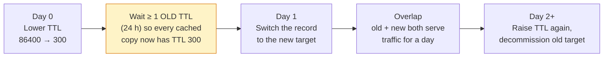

> **Migration rule:** lower the TTL **at least one full old-TTL before** the switch. Lowering it at the moment of the switch does nothing for resolvers that already cached the old record with the old TTL.

---

### Section 5: dns-prefetch and preconnect

The HTML parser discovers third-party origins late (inside CSS, JS, or after a redirect). Resource hints let you start connection setup **early, in parallel**:

```html
<!-- Full warm-up: DNS + TCP + TLS. Use for the few origins you will DEFINITELY hit early. -->
<link rel="preconnect" href="https://cdn.example.com">

<!-- Fonts are fetched in CORS "anonymous" mode → that needs a SEPARATE connection.
     Without crossorigin, the warmed connection won't be used for the font. -->
<link rel="preconnect" href="https://fonts.gstatic.com" crossorigin>

<!-- DNS only: very cheap. Use for "probably" origins, or as a fallback. -->
<link rel="dns-prefetch" href="https://api.analytics-vendor.com">
```

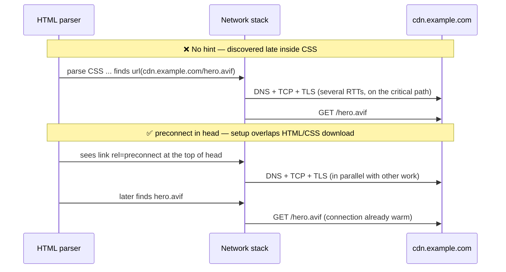

| Hint | Does | Cost | Use when |
|---|---|---|---|
| `dns-prefetch` | DNS lookup only | Tiny (one small UDP exchange) | Origin *might* be used; many third parties |
| `preconnect` | DNS + TCP + TLS | CPU for crypto, a socket, server resources. Chrome closes it if unused for ~10 s | Origin **will** be used early — keep to a handful |
| `Link:` header / **103 Early Hints** | Same hints, sent by the server before the HTML is ready | — | Hints for the HTML's own critical origins |

```http
HTTP/1.1 103 Early Hints
Link: <https://cdn.example.com>; rel=preconnect
Link: <https://fonts.gstatic.com>; rel=preconnect; crossorigin
```

> **Don't preconnect to your own origin** (the connection already exists for the HTML) and don't preconnect to 10 origins "just in case" — the extra handshakes compete with critical requests. The deeper cost model is in [TCP/TLS Handshake](./tcp-tls-handshake.md).

---

### Section 6: Encrypted DNS — DoH and DoT

Classic DNS is **plaintext UDP**: anyone on the path (Wi-Fi operator, ISP) can see and tamper with which names you look up.

| | **DoT** — DNS over TLS | **DoH** — DNS over HTTPS |
|---|---|---|
| Spec | [RFC 7858](https://datatracker.ietf.org/doc/html/rfc7858) | [RFC 8484](https://datatracker.ietf.org/doc/html/rfc8484) |
| Transport | TLS on dedicated **port 853** | Ordinary HTTPS on **port 443** |
| Blockable? | Easy to block/identify by port | Blends in with web traffic |
| Typical user | OS level (e.g. Android "Private DNS") | Browsers ("Secure DNS" settings), apps |

What frontend engineers should know:

- With secure DNS on, the **browser may bypass the OS resolver** and talk to a DoH provider directly. Debugging "works on my machine" DNS issues now means checking browser settings too.
- Encrypted DNS hides the *lookup*; the hostname was historically still visible in the TLS **SNI** field — closing that gap is the job of **ECH** (see [TCP/TLS Handshake](./tcp-tls-handshake.md)).
- Public resolvers differ on **EDNS Client Subnet** (ECS, [RFC 7871](https://datatracker.ietf.org/doc/html/rfc7871)) — sending part of the user's IP to authoritative servers improves CDN mapping but leaks information. Cloudflare's 1.1.1.1, for instance, does not send ECS for privacy reasons. This matters for DNS-based CDN routing (Section 8).
- **DNSSEC** (signatures on DNS records) protects *integrity* end-to-end; DoH/DoT protect the *client-to-resolver hop*. They solve different problems.

---

### Section 7: What a CDN Is — Edge PoPs

A **Content Delivery Network** is a globally distributed set of **Points of Presence (PoPs)** — data centres full of caching reverse proxies — sitting between users and your **origin**.

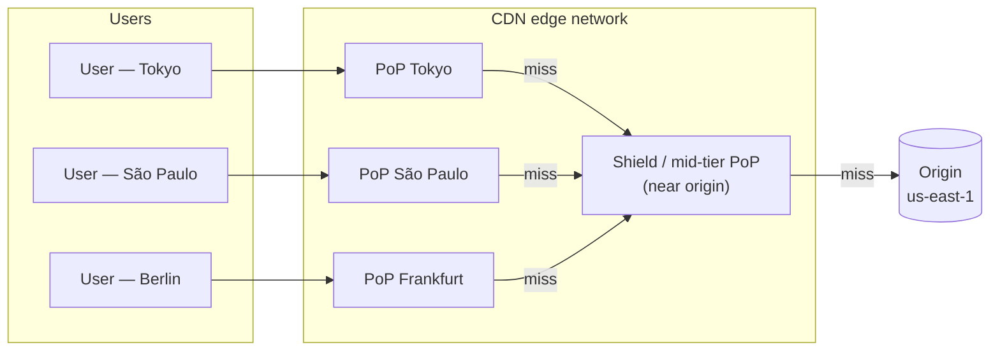

What the edge gives you, even beyond caching:

| Capability | Why it helps |
|---|---|
| **Short RTT to the user** | TCP/TLS/QUIC handshakes complete against a nearby PoP, not a far-away origin |
| **Caching** | Repeat requests never leave the region |
| **Warm, long-lived origin connections** | Even uncacheable requests benefit: the edge→origin leg reuses tuned, pre-established connections |
| **Protocol upgrade** | Edge speaks HTTP/2 / HTTP/3 to browsers even if the origin only speaks HTTP/1.1 |
| **Compression & image optimisation** | Brotli/gzip, format negotiation (Section 14) |
| **Security** | DDoS absorption, WAF, bot management, TLS termination |
| **Compute** | Edge functions for redirects, A/B bucketing, auth checks, personalisation (Section 13) |

---

### Section 8: Routing Users to the Edge — Anycast vs DNS-Based

How does a user in Berlin end up at the Frankfurt PoP? Two main techniques (many CDNs combine them):

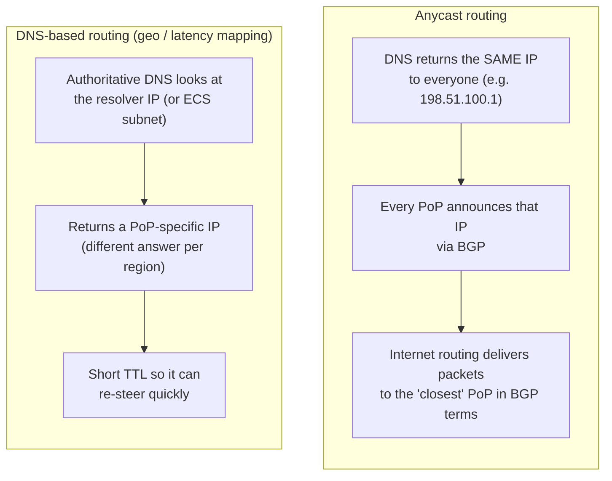

| | **Anycast** | **DNS-based** |
|---|---|---|
| Who chooses the PoP | Internet routing (BGP) | The CDN's authoritative DNS |
| Granularity | Network topology — "closest" in BGP path terms, not always geographically | Based on the **resolver's** location (or ECS subnet) — wrong if the user uses a far-away resolver |
| Failover | Withdraw the BGP route → traffic shifts automatically | Change DNS answers → limited by TTL and caching |
| DDoS | Attack traffic spreads across all PoPs | Attack concentrates on the PoPs that were returned |
| Well-known examples | Cloudflare (whole network is anycast) | Akamai and Amazon CloudFront are well-known DNS-mapping designs |

> **Why "closest" isn't always closest:** with DNS-based routing, a user in Jakarta whose phone uses a resolver in Singapore is mapped as if they were in Singapore. With anycast, a peering arrangement can send traffic to a PoP that is geographically farther but fewer network hops away. Always measure **real-user latency**, not maps.

---

### Section 9: Cache Keys and Cache Hit Ratio

#### 9.1 The cache key

The **cache key** is what the CDN uses to decide "is this the same object?". A typical default:

```text
cache key = scheme + host + path + query string   (+ any headers listed in Vary)
https://shop.example.com/products?id=42&utm_source=mail
```

Every distinct key is a separate cache entry that must be filled from origin. **Accidental key variation is the #1 cause of low hit ratios:**

| Source of variation | Effect | Fix |
|---|---|---|
| Tracking params (`utm_*`, `fbclid`, `gclid`) | Same page cached N times | Strip them from the cache key at the edge |
| Param order (`?a=1&b=2` vs `?b=2&a=1`) | Duplicate entries | Normalise / sort query params |
| `Vary: User-Agent` | Thousands of UA strings → near-zero hit ratio | Vary on a *normalised* device class you compute at the edge, or don't vary |
| `Vary: Cookie` | Effectively one cache entry per user | Don't cache personalised responses; split public vs private |
| Case / trailing slash differences | Duplicates | Normalise or redirect to one canonical URL |

`Vary: Accept-Encoding` is fine (few values, and CDNs normalise it). `Vary: Accept` is legitimate for image format negotiation, but **not every CDN honours arbitrary `Vary` values** — check your vendor's docs.

> **Security:** anything that changes the response but is **not** part of the key (an "unkeyed" header like `X-Forwarded-Host`) can let an attacker store a poisoned response for everyone — **web cache poisoning**. Either add it to the key or make the origin ignore it.

#### 9.2 Cache hit ratio (CHR)

```text
cache hit ratio  = hits / (hits + misses)                 (by request count)
byte hit ratio   = bytes served from cache / total bytes  (by volume — what drives origin bandwidth cost)
origin offload   = 1 − (origin requests / edge requests)
```

- A **high CHR on static assets** (hashed JS/CSS/images) is expected; the interesting number is usually **HTML and API CHR**.
- CHR is **per PoP**. A long-tail URL might be hot globally but still miss in each of dozens of PoPs → this is what shielding (next section) fixes.
- Watch `Age`, `X-Cache`, `CF-Cache-Status` (vendor-specific) response headers to see HIT/MISS/STALE per request.

---

### Section 10: Origin Shielding and Tiered Caching

Without shielding, a miss in *every* PoP goes straight to origin. With **origin shielding** (also "tiered cache" / "mid-tier"), edge misses go to a designated **shield PoP** near the origin first.

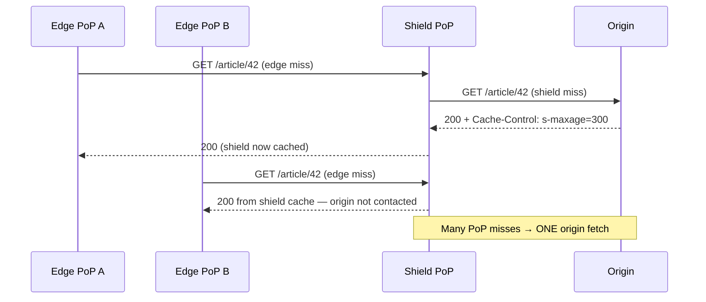

Related protection: **request collapsing (coalescing)** — when 1,000 requests for the same uncached URL arrive at once, the CDN sends **one** request to origin and fans the response out to all waiters. This prevents a **cache stampede** (thundering herd) after an expiry or a purge.

| Benefit | Cost |
|---|---|
| Higher effective hit ratio, much lower origin load | One extra hop on a full miss (edge → shield → origin) |
| Origin can sit behind a small, allow-listed set of shield IPs | Shield PoP becomes an important dependency — pick one near the origin |

---

### Section 11: Cache-Control at the Edge

The origin's `Cache-Control` header tells **both** the browser (a *private* cache) and the CDN (a *shared* cache) what to do. The directives come from [RFC 9111 (HTTP Caching)](https://datatracker.ietf.org/doc/html/rfc9111) and [RFC 5861](https://datatracker.ietf.org/doc/html/rfc5861).

| Directive | Applies to | Meaning |
|---|---|---|
| `max-age=N` | Browser **and** CDN | Fresh for N seconds |
| `s-maxage=N` | **Shared caches only** (CDN) | Overrides `max-age` for the CDN; also implies `proxy-revalidate` |
| `public` | Both | May be stored by shared caches even when they normally wouldn't (e.g. requests with `Authorization`) |
| `private` | Browser only | CDN must **not** store it |
| `no-cache` | Both | May store, but must **revalidate** with origin before every reuse |
| `no-store` | Both | Don't store at all |
| `immutable` | Browser | "Will never change during its freshness lifetime" — skip revalidation on reload (Firefox and Safari honour it; harmless elsewhere) |
| `stale-while-revalidate=N` | Both (support varies) | After expiry, serve stale for up to N s **while** refreshing in the background |
| `stale-if-error=N` | Both (support varies) | Serve stale for up to N s if origin errors / is down |

**CDN-only targeting:** sometimes you want the CDN to cache for a day but the browser for a minute. Options:

- `s-maxage` (standard, but any shared cache — including corporate proxies — obeys it).
- **`CDN-Cache-Control`** ([RFC 9213](https://datatracker.ietf.org/doc/html/rfc9213)) — a targeted header that CDNs which support it use *instead of* `Cache-Control`, and that is not forwarded to browsers by those CDNs.
- Vendor headers such as `Surrogate-Control` (Fastly, Akamai) — check your vendor.

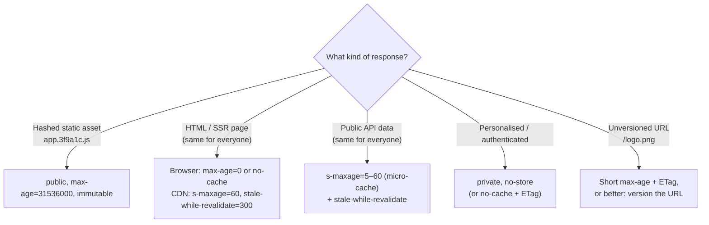

Watch-outs:

- Defaults differ by vendor (e.g. Cloudflare caches by file extension and does **not** cache HTML unless you configure it; others honour origin headers or apply a default TTL). **Never rely on defaults — set explicit headers.**
- Many CDNs will **not cache a response that sets a cookie** (`Set-Cookie`) by default. A session cookie on a "public" page silently drops CHR to zero.
- Browser support for `stale-while-revalidate` and `immutable` is not universal — check MDN compatibility; CDN support is broader.

---

### Section 12: Purge and Invalidation Strategies

> *"There are only two hard things in Computer Science: cache invalidation and naming things."* — Phil Karlton

The best invalidation strategy is **not needing one**:

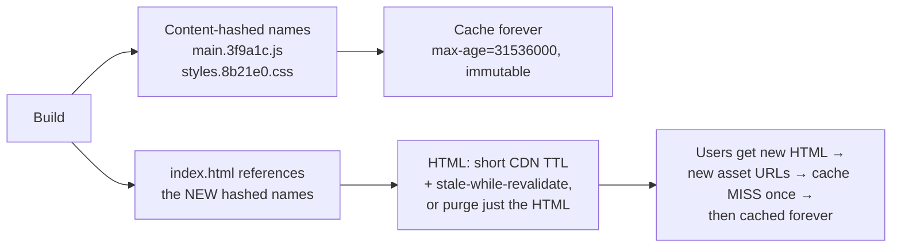

| Strategy | How | Pros | Cons |
|---|---|---|---|
| **Versioned / hashed URLs** | New content → new URL | No purge, atomic deploys, infinite TTL | Only works for assets you reference from something else (HTML must still update) |
| **Short TTL + SWR** | `s-maxage=60, stale-while-revalidate=600` | Self-healing; no purge tooling | Content up to TTL seconds stale |
| **Purge by URL** | API call per URL | Precise | You must know every URL (incl. variants: `?page=2`, encodings) |
| **Purge by tag / surrogate key** | Origin tags responses (`Surrogate-Key: product-42 category-7` on Fastly, `Cache-Tag` on Cloudflare — plan availability varies); purge the tag | One call invalidates every page showing product 42 | Vendor-specific; needs tagging discipline |
| **Soft purge** | Mark stale instead of deleting (Fastly) | Combined with SWR / stale-if-error, users never see a miss storm | Vendor-specific |
| **Purge everything** | Nuke the cache | Simple | **Stampede** on origin; global CHR drops to zero |

Two rules for deploys:

1. **Keep old hashed assets available** for a while after a deploy. Users with an old HTML page still open will request `main.OLDHASH.js` (e.g. lazy-loaded chunks) — a 404 there breaks the app.
2. **Order matters:** upload new assets first, then publish/purge the HTML that references them. Never the other way round.

---

### Section 13: Dynamic Content at the Edge

"Dynamic" doesn't mean "uncacheable". A spectrum:

| Technique | Example | Notes |
|---|---|---|
| **Micro-caching** | Cache a public API response for 1–10 s | Under heavy traffic, collapses thousands of identical requests into one origin hit per few seconds |
| **SWR on HTML** | `s-maxage=60, stale-while-revalidate=3600` | The pattern behind ISR-style rendering (Phase 2) |
| **Split public/private** | Cache the page shell; fetch the user's cart client-side or via a separate `private` request | Most effective way to raise HTML CHR |
| **Edge Side Includes (ESI)** | The CDN assembles the page from fragments with different TTLs | Supported by some CDNs (e.g. Akamai, Fastly); vendor-specific |
| **Edge compute** | Cloudflare Workers, Fastly Compute, CloudFront Functions / Lambda@Edge, Vercel / Netlify edge functions | Redirects, geolocation, A/B bucketing, auth-token checks, header rewrites — **before** cache lookup or origin |
| **Edge rendering** | SSR running in edge functions | Fast only if its **data** is also close; an edge function calling a single-region database makes multiple long round trips (see *Edge Rendering*, Phase 2) |
| **Uncacheable but accelerated** | Checkout POSTs | Still benefits from nearby TLS termination and warm edge→origin connections |

> **A/B tests and personalisation:** bucket users at the edge with a cookie and include the **bucket** (not the user ID) in the cache key → two cached variants instead of one per user.

---

### Section 14: Image CDNs

Images are often the **LCP element** and the largest bytes on the page. An image CDN transforms images on the fly and caches each variant:

```html
<!-- One master image at origin; the CDN produces sized, re-encoded variants -->

```

| Feature | How |
|---|---|
| **Resize** | URL params (`w=`, `h=`, `fit=`) — never ship a 4000 px image into a 400 px slot |
| **Format negotiation** | Browser sends `Accept: image/avif,image/webp,...`; CDN returns AVIF/WebP/JPEG accordingly and must vary its cache on that (`Vary: Accept` or an internal normalised key) |
| **Quality / compression** | `q=` or "auto" quality |
| **Client hints** | `Sec-CH-DPR`, `Sec-CH-Width`, `Sec-CH-Viewport-Width` — Chromium-only, opt-in via `Accept-CH`; don't depend on them for correctness |
| **Variant explosion control** | Limit allowed widths (e.g. a fixed ladder of sizes) so the cache isn't filled with `w=1199`, `w=1201`… — also blocks abuse |

Examples: Cloudinary, imgix, Cloudflare Images, Fastly Image Optimizer, Akamai Image & Video Manager, and framework loaders such as Next.js `<Image>` that front one of these. *(Deep dive: Image Optimization, Phase 4.)*

---

## System Design Angle — Global Latency, Multi-CDN, Failure Modes

### Global latency budget

Distance is physics: light in fibre travels at roughly two-thirds of its speed in a vacuum, and real routes are longer than great-circle distance. Intercontinental round trips therefore cost **tens to hundreds of milliseconds**, and a cold HTTPS visit needs several of them (DNS, TCP, TLS, request). The design goals:

```text
1. Terminate connections near the user           → CDN edge / anycast
2. Serve as many bytes as possible from the edge → high CHR (static + HTML + public API)
3. When you must go to origin, go once            → shielding + request collapsing + warm connections
4. Put data near compute                          → edge KV / regional replicas before "SSR at the edge"
5. Minimise distinct hostnames on the critical path → fewer DNS lookups + handshakes
```

> **No more "shared CDN cache" benefit:** browsers now **partition the HTTP cache by top-level site** (Chrome since v86, Firefox and Safari likewise). A library loaded from a public CDN by site A is **not** reused by site B. Loading jQuery/React from a public CDN therefore only adds a DNS lookup + connection; self-hosting on your own CDN origin is usually faster.

### Multi-CDN

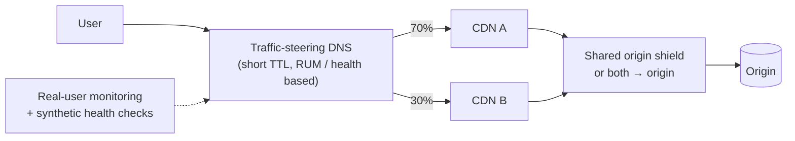

| Why | Cost |
|---|---|
| Survive a full CDN outage | Two configs to keep identical (cache keys, headers, redirects, WAF rules) |
| Better performance per region (each CDN wins somewhere) | Purges must hit **both**; certs must be on **both** |
| Commercial leverage | Each CDN sees ~half the traffic → **lower CHR per CDN**, more origin load |
| | Steering DNS itself becomes a critical dependency |

Keep config in code (Terraform/vendor APIs) and run the same contract tests against both CDNs.

### Failure modes

| Failure | What users see | Mitigation |
|---|---|---|
| **Authoritative DNS outage** (e.g. the 2016 DDoS on DNS provider Dyn) | Site unreachable once resolver caches expire | Secondary DNS provider (two providers in NS), sensible TTLs |
| **CDN-wide outage / bad config push** (e.g. Fastly, June 2021) | 5xx or timeouts globally | Multi-CDN or a tested "bypass to origin" DNS runbook; know your TTLs |
| **Origin down** | Errors on misses | `stale-if-error`, soft purge, serve-stale settings, static fallback pages |
| **Cache stampede after purge-all / expiry** | Origin overload, slow pages | Request collapsing, shielding, SWR, avoid purge-all |
| **Low CHR from key fragmentation** | High TTFB, high origin bill | Normalise keys, drop `Vary: User-Agent/Cookie`, strip tracking params |
| **Caching private data** (`Set-Cookie` or user data cached as public) | **Data leak** between users | Default to `private`; explicit allow-list of cacheable routes; test with two accounts |
| **Web cache poisoning / deception** | Attacker-controlled content served to everyone, or private pages cached | Key on every header that changes output; don't cache by extension alone (`/account.css` trick) |
| **Stale DNS after migration** | Some users hit the old host for hours | Lower TTL a full TTL in advance; keep the old target alive during overlap |
| **Old assets deleted on deploy** | `ChunkLoadError` for users with an open tab | Retain previous builds' assets; retry/reload on chunk errors |

---

## Real-World Examples

**Example 1 — Resource hints for third-party origins:**
```html
<!-- ❌ BAD: 8 preconnects "just in case" — handshakes fight the HTML/CSS for bandwidth & CPU,
     and the font preconnect lacks crossorigin so the font fetch can't use it -->
<link rel="preconnect" href="https://fonts.gstatic.com">
<link rel="preconnect" href="https://www.example.com"> <!-- own origin: pointless -->
<link rel="preconnect" href="https://ads1.vendor.com">
<!-- ...5 more... -->

<!-- ✅ GOOD: preconnect only to the 1–3 origins on the critical path; dns-prefetch the rest -->
<link rel="preconnect" href="https://cdn.example.com">
<link rel="preconnect" href="https://fonts.gstatic.com" crossorigin>
<link rel="dns-prefetch" href="https://www.googletagmanager.com">
<link rel="dns-prefetch" href="https://ads1.vendor.com">
```

**Example 2 — Inspect DNS from the terminal:**
```bash
# Final answer + TTL
dig shop.example.com +noall +answer

# Walk the delegation chain yourself: root → .com → authoritative
dig shop.example.com +trace

# Ask a specific resolver (compare answers per resolver — DNS-based CDN mapping)
dig @1.1.1.1 shop.example.com +short
dig @8.8.8.8 shop.example.com +short

# HTTPS / SVCB record (needs a reasonably recent dig)
dig example.com HTTPS +short

# Is a CDN attached via CNAME?
dig www.example.com CNAME +short
```

```powershell
# Windows equivalents
Resolve-DnsName shop.example.com
Resolve-DnsName example.com -Type HTTPS
ipconfig /displaydns     # OS DNS cache
ipconfig /flushdns       # clear it
```

**Example 3 — Measure where the time goes with `curl -w`:**
```bash
curl -s -o /dev/null https://shop.example.com/ -w '
   DNS lookup:   %{time_namelookup}s
   TCP connect:  %{time_connect}s
   TLS done:     %{time_appconnect}s
   First byte:   %{time_starttransfer}s
   Total:        %{time_total}s
   HTTP version: %{http_version}
'
# Values are cumulative from the start. Run it twice: the second DNS time is usually ~0 (cached).
```

**Example 4 — Origin cache headers (nginx) for hashed assets vs HTML:**
```nginx
# Hashed build output: cache forever, everywhere
location ~* \.[0-9a-f]{8,}\.(js|css|woff2|avif|webp|png|svg)$ {
    add_header Cache-Control "public, max-age=31536000, immutable" always;
}

# HTML: browser always revalidates; CDN keeps it 60 s and may serve stale for 5 min while refreshing
location / {
    add_header Cache-Control "no-cache" always;
    add_header CDN-Cache-Control "max-age=60, stale-while-revalidate=300, stale-if-error=86400" always;
    try_files $uri /index.html;
}

# Personalised API: never in a shared cache
location /api/me {
    add_header Cache-Control "private, no-store" always;
    proxy_pass http://app;
}
```

**Example 5 — Is it a HIT? Read the response headers:**
```bash
curl -sI https://shop.example.com/assets/main.3f9a1c.js | grep -iE 'cache-control|age|x-cache|cf-cache-status|vary'
```
```http
HTTP/2 200
cache-control: public, max-age=31536000, immutable
age: 48211
cf-cache-status: HIT
vary: Accept-Encoding
```
`Age` = seconds the object has been in a shared cache. `Age: 0` on every request → you are probably missing the cache.

**Example 6 — Purge by URL vs by tag:**
```bash
# ❌ BAD: purge everything after every CMS edit → stampede on origin, global CHR → 0
curl -X POST "https://api.cloudflare.com/client/v4/zones/$ZONE_ID/purge_cache" \
  -H "Authorization: Bearer $TOKEN" -H "Content-Type: application/json" \
  --data '{"purge_everything":true}'

# ✅ GOOD (Cloudflare): purge only the affected URLs
curl -X POST "https://api.cloudflare.com/client/v4/zones/$ZONE_ID/purge_cache" \
  -H "Authorization: Bearer $TOKEN" -H "Content-Type: application/json" \
  --data '{"files":["https://shop.example.com/products/42"]}'

# ✅ BETTER (Fastly): origin sends "Surrogate-Key: product-42" on every page showing product 42,
#    then one soft purge marks all of them stale (served stale while refetched)
curl -X POST "https://api.fastly.com/service/$SERVICE_ID/purge/product-42" \
  -H "Fastly-Key: $FASTLY_TOKEN" -H "Fastly-Soft-Purge: 1"
```

**Example 7 — Measure DNS and connection time for real users:**
```javascript
// Navigation (the HTML document)
const [nav] = performance.getEntriesByType('navigation');
console.table({
  dns:  nav.domainLookupEnd - nav.domainLookupStart,
  tcp:  nav.connectEnd - nav.connectStart,          // includes TLS
  tls:  nav.secureConnectionStart > 0 ? nav.connectEnd - nav.secureConnectionStart : 0,
  ttfb: nav.responseStart - nav.requestStart,
  protocol: nav.nextHopProtocol,                    // "h2", "h3", "http/1.1"
});

// Third-party resources report 0 for these phases unless the server sends
// Timing-Allow-Origin: https://www.example.com   (or *)
```

---

## Key Points Summary

| Concept | One-Line Explanation |
|---|---|
| **Recursive resolver** | Does the iterative root → TLD → authoritative walk and caches answers for many users |
| **Authoritative server** | The source of truth for your zone's records |
| **TTL** | Max seconds a resolver may cache a record; "propagation" = waiting for TTLs to expire |
| **CNAME** | Alias to another name; illegal at the zone apex |
| **ALIAS / flattening** | Provider-specific way to point the apex at a CDN hostname |
| **HTTPS / SVCB record** | DNS tells the client protocols (h3), hints and ECH keys before connecting |
| **dns-prefetch** | Resolve a hostname early — cheap |
| **preconnect** | DNS + TCP + TLS early — powerful but costly; only a few origins |
| **DoH / DoT** | Encrypted client-to-resolver DNS (port 443 / 853) |
| **PoP / edge** | CDN data centre near users; terminates connections and caches |
| **Anycast** | One IP announced from every PoP; BGP picks the route |
| **DNS-based routing** | CDN's DNS returns a regional IP based on resolver location / ECS |
| **Cache key** | What makes two requests "the same" object; fragmentation kills hit ratio |
| **Origin shield** | Mid-tier PoP that collapses many edge misses into one origin fetch |
| **s-maxage / CDN-Cache-Control** | Freshness for shared caches only |
| **stale-while-revalidate** | Serve stale instantly while refreshing in the background |
| **Hashed assets + immutable** | Never purge static files — new content gets a new URL |
| **Purge by tag** | Invalidate every URL tagged with an entity in one call |
| **Multi-CDN** | Resilience and per-region performance at the cost of config and CHR |

---

## Test Your Understanding

**Q1 (Basic):**
Walk through what happens, cache by cache, the *first* time a user's laptop looks up `shop.example.com`, and why the second visitor on the same ISP gets the answer faster.

<details>
<summary>Answer</summary>

1. **Browser cache** → miss. 2. **OS stub resolver** (hosts file, OS cache) → miss; it forwards a *recursive* query to the configured resolver. 3. **Recursive resolver** → cache miss for this name, so it queries *iteratively*: a **root** server refers it to the `.com` TLD servers, which refer it to `example.com`'s **authoritative** servers, which return the A/AAAA records with a TTL. (Root and TLD referrals are almost always already cached, so usually only the authoritative step is real work.) 4. The answer is cached at the resolver, OS and browser.

The second visitor on the same ISP uses the **same recursive resolver**, which now has the answer cached for the TTL — their lookup costs only one short round trip to the resolver, with no authoritative query.
</details>

**Q2 (Basic):**
Your marketing team wants `example.com` (no `www`) to point at your CDN, which gives you a hostname `example.cdn-provider.net`. Why can't you add a CNAME, and what are your options?

<details>
<summary>Answer</summary>

The apex must hold **SOA** and **NS** records, and a CNAME cannot coexist with any other record at the same name (RFC 1034). Options:

- Use your DNS provider's **ALIAS / ANAME / CNAME flattening** — it resolves the CDN hostname and answers with A/AAAA (vendor-specific; mapping accuracy depends on provider/CDN integration).
- Use **static anycast IPs** the CDN provides, in plain A/AAAA records.
- **301 the apex to `www`**, which is a normal CNAME (costs a redirect for bare-domain visitors).
- Additionally publish an **HTTPS record in AliasMode** for clients that support it — but keep A/AAAA because not every client queries HTTPS records.
</details>

**Q3 (Application):**
You're moving the site from an old host to a new CDN on Friday. The A record currently has a TTL of 86400. What exactly do you do, and when?

<details>
<summary>Answer</summary>

- **Thursday or earlier (≥ 24 h before):** lower the TTL to e.g. 300. Resolvers that cached the old record with TTL 86400 can keep it for up to 24 h — the new low TTL only takes effect once those copies expire.
- **Friday:** switch the record. Within ~5 minutes most resolvers pick up the new target.
- **Keep the old host serving** for at least a day — some resolvers clamp TTLs, and browsers with long-lived connections keep talking to the old IP.
- **After it's stable:** raise the TTL again and decommission the old host.

Why: DNS changes are not pushed; "propagation" is just caches expiring, so the TTL that matters is the one resolvers saw **before** your change.
</details>

**Q4 (Application):**
The CDN dashboard shows an HTML cache hit ratio of 3%, even though the pages are the same for every visitor. Name four likely causes and how you'd confirm each.

<details>
<summary>Answer</summary>

1. **Responses aren't cacheable** — `Cache-Control: private/no-store`, or no `s-maxage` and a CDN that doesn't cache HTML by default. *Confirm:* `curl -sI` the page and read `Cache-Control` / the vendor cache-status header.
2. **`Set-Cookie` on every response** (session or analytics cookie) — many CDNs refuse to cache it. *Confirm:* look for `Set-Cookie` in the headers.
3. **Cache key fragmentation** — `utm_*`/`fbclid` params, unsorted query strings, `Vary: User-Agent` or `Vary: Cookie`. *Confirm:* group edge logs by path ignoring the query, compare unique keys vs unique paths.
4. **TTL too short relative to traffic per PoP**, or many PoPs each missing once (long tail). *Confirm:* CHR by PoP; enable **origin shielding / tiered cache** and **stale-while-revalidate**.

Fix order: make it cacheable → strip cookies from public pages → normalise the key → add SWR and shielding.
</details>

**Q5 (Tricky):**
After a deploy, some users report a blank page with `ChunkLoadError: Loading chunk 17 failed`. You use hashed file names and `immutable` caching. What happened, and how do you prevent it?

<details>
<summary>Answer</summary>

Those users still have the **old HTML / old JS entry** in memory (an open tab, or a cached HTML page). When they navigate, the old code lazy-loads `chunk-17.OLDHASH.js` — but the deploy **deleted the old build's files** from the origin (and the CDN had never cached that particular chunk, or it got evicted), so the request 404s.

Prevention:
- **Keep previous builds' assets** for days/weeks (upload new files alongside old, never replace the directory).
- Deploy order: **assets first, HTML last**.
- Give HTML a short TTL / `no-cache` so users pick up the new entry quickly.
- In the app, catch chunk-load failures and **reload once** to fetch the new HTML.

Hashing makes caching safe; it doesn't make **deleting** old files safe.
</details>

**Q6 (Tricky / System design):**
You run a news site with breaking-news spikes of 50× normal traffic. Articles are edited frequently in the first hour. Design the caching and invalidation strategy.

<details>
<summary>Answer</summary>

- **Static assets:** hashed names, `public, max-age=31536000, immutable` — never purged.
- **Article HTML:** identical for all anonymous readers, so cache at the edge: `CDN-Cache-Control: max-age=60, stale-while-revalidate=600, stale-if-error=86400` and `Cache-Control: no-cache` for browsers. SWR means readers never wait on origin during a spike; `stale-if-error` keeps the site up if origin falls over.
- **Edits:** origin tags each page with surrogate keys (`article-123`, `section-politics`, `homepage`), and the CMS issues a **soft purge by tag** on publish — every page showing that article is refreshed within seconds without a miss storm.
- **Origin protection:** **shielding / tiered cache + request collapsing**, so a 50× spike becomes at most one origin fetch per object per refresh interval.
- **Personalisation** (logged-in name, paywall state): keep it out of the cached HTML — fetch it client-side from a `private` endpoint or decide it at the edge with a small cookie-bucketed variant.
- **Resilience:** health-checked failover (multi-CDN or a bypass runbook), secondary DNS, and RUM on TTFB per region.

The key idea: **SWR + tag purges** give near-real-time freshness *and* near-100% hit ratio; purge-all would cause exactly the stampede you're trying to avoid.
</details>

---

## Cheat Sheet

**Key Definitions:**
- **Stub resolver:** OS component that forwards queries; doesn't walk the hierarchy.
- **Recursive resolver:** walks root → TLD → authoritative and caches for its users.
- **Authoritative server:** holds the zone's real records.
- **TTL:** max cache lifetime of a record (seconds). Lower it *one full old TTL* before a change.
- **CNAME / ALIAS:** alias to another name / provider-specific apex alias.
- **HTTPS (SVCB) record:** connection hints (ALPN `h3`, IP hints, ECH) delivered via DNS.
- **PoP / edge:** CDN location close to users. **Origin:** your servers.
- **Anycast:** same IP from every PoP; BGP picks. **DNS-based routing:** CDN DNS answers per region.
- **Cache key:** identity of a cached object (URL + `Vary`'d headers).
- **CHR:** hits / (hits + misses). **Shield:** mid-tier cache in front of origin.
- **s-maxage / CDN-Cache-Control:** freshness for shared caches only.
- **SWR:** serve stale while revalidating in the background.

**Quick Reference — headers by content type:**
```text
Hashed static asset (main.3f9a1c.js)  →  Cache-Control: public, max-age=31536000, immutable
HTML, same for everyone               →  Cache-Control: no-cache
                                          CDN-Cache-Control: max-age=60, stale-while-revalidate=300
Public API (same for everyone)        →  Cache-Control: public, s-maxage=10, stale-while-revalidate=60
Personalised / authenticated          →  Cache-Control: private, no-store
Unversioned file (/favicon.ico)       →  Cache-Control: public, max-age=86400   (or version it)
Image negotiated by Accept            →  Vary: Accept   (or the CDN's built-in format negotiation)
```

**Quick Reference — commands:**
```text
dig name +noall +answer        answer + remaining TTL
dig name +trace                full delegation walk
dig @1.1.1.1 name +short       ask a specific resolver
dig name HTTPS                 HTTPS/SVCB record
curl -w '%{time_namelookup} %{time_connect} %{time_appconnect} %{time_starttransfer}'
curl -sI url | grep -i age     is it coming from a shared cache?
chrome://net-internals/#dns    browser DNS cache (Chrome) — clear host cache
ipconfig /flushdns             Windows OS DNS cache
```

**Common Mistakes to Avoid:**

| Mistake | Why Wrong | Fix |
|---|---|---|
| Lowering TTL at the moment of a migration | Resolvers keep the old record for the *old* TTL | Lower it ≥ one old-TTL in advance |
| CNAME at the zone apex | Conflicts with SOA/NS; invalid per RFC 1034 | ALIAS/flattening, anycast A records, or redirect to `www` |
| `preconnect` to many origins / own origin | Wasted handshakes compete with critical requests; Chrome drops unused ones after ~10 s | Preconnect 1–3 critical origins; `dns-prefetch` the rest |
| Font `preconnect` without `crossorigin` | Fonts use an anonymous CORS connection — the warmed one isn't used | `<link rel="preconnect" href="…" crossorigin>` |
| Long `max-age` on unversioned URLs | Users stuck with old files; purge can't reach browser caches | Hash file names; short TTL for HTML |
| `Vary: User-Agent` / `Vary: Cookie` on public pages | Cache fragments into per-UA / per-user entries | Normalise at the edge; separate private data |
| `Set-Cookie` on cacheable pages | Many CDNs won't cache it — or worse, cache one user's cookie | Strip cookies from public responses |
| Purge-everything on every content change | Stampede on origin, CHR drops to zero | Purge by URL/tag, soft purge, SWR |
| Deleting old hashed assets on deploy | Open tabs fail with `ChunkLoadError` | Keep previous builds' assets; assets first, HTML last |
| Loading libraries from public CDNs "for shared caching" | Browser caches are partitioned per site — no cross-site reuse | Bundle and serve from your own CDN |
| Trusting CDN defaults | Defaults differ per vendor (HTML caching, default TTLs, cookie handling) | Set explicit `Cache-Control` for every route |
| Single DNS provider, single CDN, no runbook | Provider outage = total outage | Secondary DNS, multi-CDN or tested bypass, `stale-if-error` |

---

## References & Further Reading

**Core docs**
- MDN: [What is a domain name?](https://developer.mozilla.org/en-US/docs/Learn_web_development/Howto/Web_mechanics/What_is_a_domain_name)
- MDN: [HTTP caching](https://developer.mozilla.org/en-US/docs/Web/HTTP/Guides/Caching)
- MDN: [`Cache-Control`](https://developer.mozilla.org/en-US/docs/Web/HTTP/Reference/Headers/Cache-Control) · [`Vary`](https://developer.mozilla.org/en-US/docs/Web/HTTP/Reference/Headers/Vary) · [`Age`](https://developer.mozilla.org/en-US/docs/Web/HTTP/Reference/Headers/Age)
- MDN: [`rel="preconnect"`](https://developer.mozilla.org/en-US/docs/Web/HTML/Reference/Attributes/rel/preconnect) · [`rel="dns-prefetch"`](https://developer.mozilla.org/en-US/docs/Web/HTML/Reference/Attributes/rel/dns-prefetch)
- MDN: [`PerformanceResourceTiming`](https://developer.mozilla.org/en-US/docs/Web/API/PerformanceResourceTiming) · [`Timing-Allow-Origin`](https://developer.mozilla.org/en-US/docs/Web/HTTP/Reference/Headers/Timing-Allow-Origin)

**Performance (web.dev / Chrome)**
- web.dev: [Establish network connections early (preconnect & dns-prefetch)](https://web.dev/articles/preconnect-and-dns-prefetch)
- web.dev: [Content delivery networks (CDNs)](https://web.dev/articles/content-delivery-networks)
- web.dev: [Love your cache ❤️](https://web.dev/articles/love-your-cache)
- web.dev: [Use image CDNs to optimize images](https://web.dev/articles/image-cdns)
- web.dev: [Optimize Time to First Byte](https://web.dev/articles/optimize-ttfb)
- Chrome for Developers: [Gaining security and privacy by partitioning the cache](https://developer.chrome.com/blog/http-cache-partitioning)
- Chrome for Developers: [103 Early Hints](https://developer.chrome.com/docs/web-platform/early-hints)

**Vendor learning centres**
- Cloudflare: [What is DNS?](https://www.cloudflare.com/learning/dns/what-is-dns/) · [DNS record types](https://www.cloudflare.com/learning/dns/dns-records/) · [What is a CDN?](https://www.cloudflare.com/learning/cdn/what-is-a-cdn/)
- Cloudflare: [What is Anycast?](https://www.cloudflare.com/learning/cdn/glossary/anycast-network/) · [DNS over TLS vs. DNS over HTTPS](https://www.cloudflare.com/learning/dns/dns-over-tls/)
- Fastly: [Purging](https://www.fastly.com/documentation/guides/full-site-delivery/purging/working-with-surrogate-keys/) · [Cache freshness and TTLs](https://www.fastly.com/documentation/guides/concepts/edge-state/cache/cache-freshness/)

**Specs**
- IETF: [RFC 1034 — Domain Names: Concepts and Facilities](https://datatracker.ietf.org/doc/html/rfc1034) · [RFC 1035 — Implementation and Specification](https://datatracker.ietf.org/doc/html/rfc1035)
- IETF: [RFC 2308 — Negative Caching of DNS Queries](https://datatracker.ietf.org/doc/html/rfc2308)
- IETF: [RFC 9460 — SVCB and HTTPS Resource Records](https://datatracker.ietf.org/doc/html/rfc9460)
- IETF: [RFC 8484 — DNS over HTTPS](https://datatracker.ietf.org/doc/html/rfc8484) · [RFC 7858 — DNS over TLS](https://datatracker.ietf.org/doc/html/rfc7858)
- IETF: [RFC 7871 — EDNS Client Subnet](https://datatracker.ietf.org/doc/html/rfc7871) · [RFC 8305 — Happy Eyeballs v2](https://datatracker.ietf.org/doc/html/rfc8305)
- IETF: [RFC 9111 — HTTP Caching](https://datatracker.ietf.org/doc/html/rfc9111) · [RFC 5861 — stale-while-revalidate / stale-if-error](https://datatracker.ietf.org/doc/html/rfc5861) · [RFC 9213 — Targeted Cache-Control (CDN-Cache-Control)](https://datatracker.ietf.org/doc/html/rfc9213)

**Deep dives**
- PortSwigger Research: [Practical Web Cache Poisoning](https://portswigger.net/research/practical-web-cache-poisoning)
- Ilya Grigorik: [High Performance Browser Networking](https://hpbn.co/) — free online book (latency, DNS, TCP)

---

> **Previous Topic:** [HTTP/1.1 vs HTTP/2 vs HTTP/3](./http1-vs-http2-vs-http3.md)
> — What travels over the connection, and how each protocol version multiplexes it

> **Next Topic:** [TCP/TLS Handshake](./tcp-tls-handshake.md)
> — What it costs to open that connection, round trip by round trip

*Saved on: 2026-11-06 | Repo: Frontend System Design Learning Notes*
