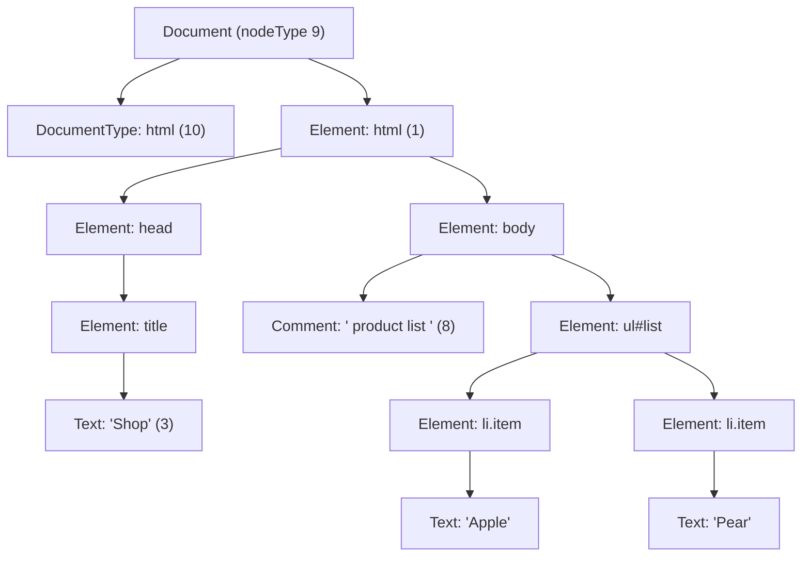
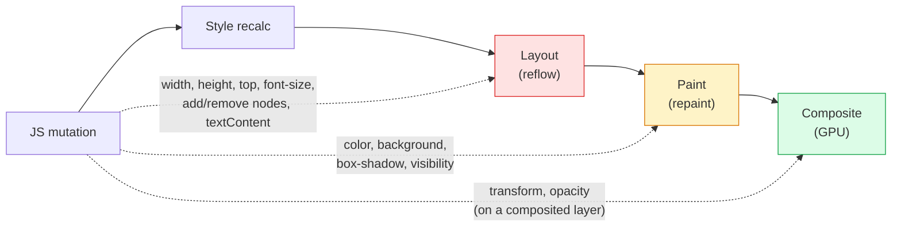
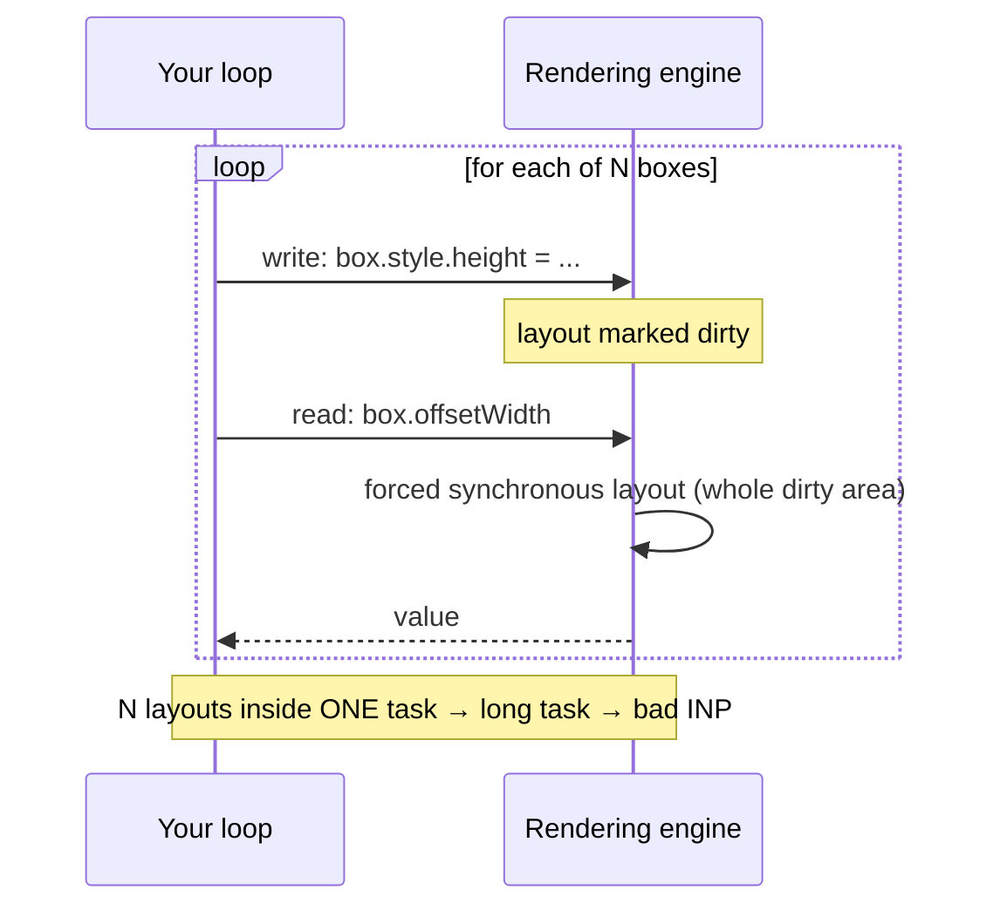
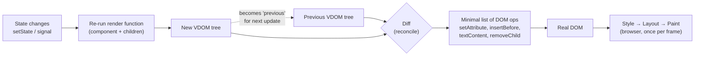
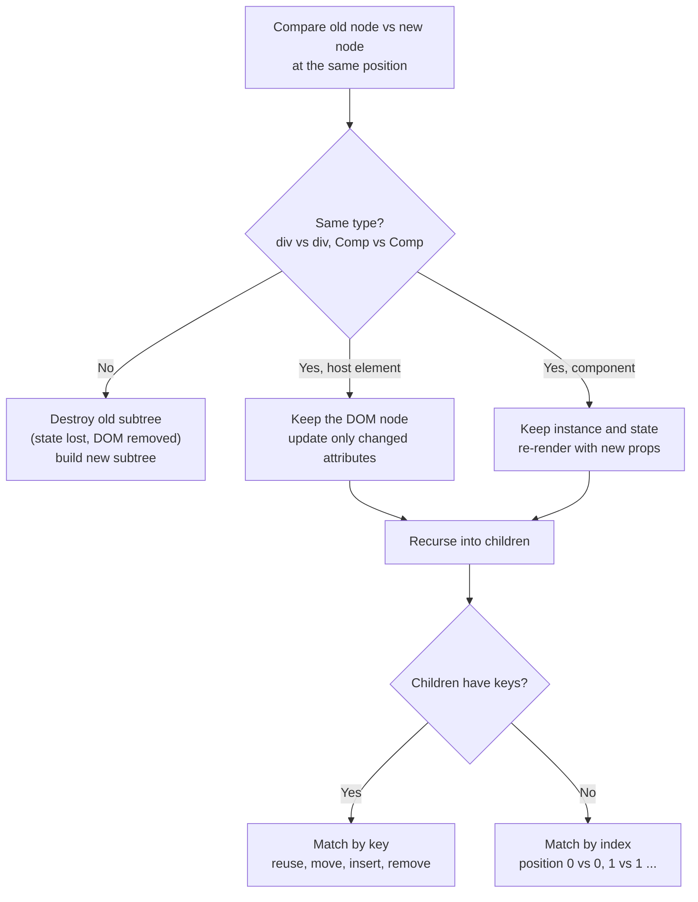
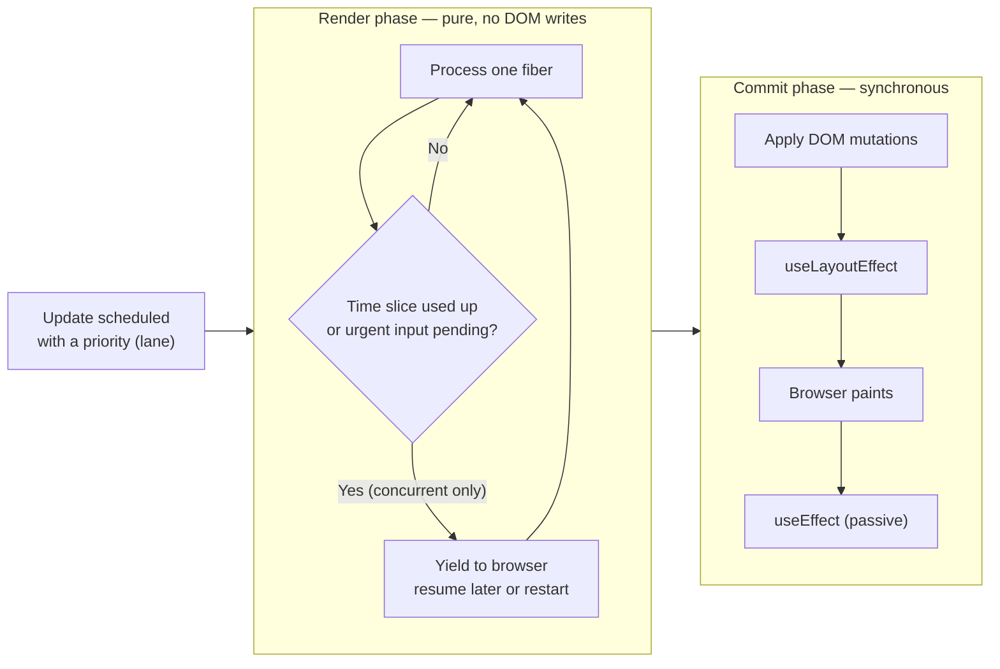
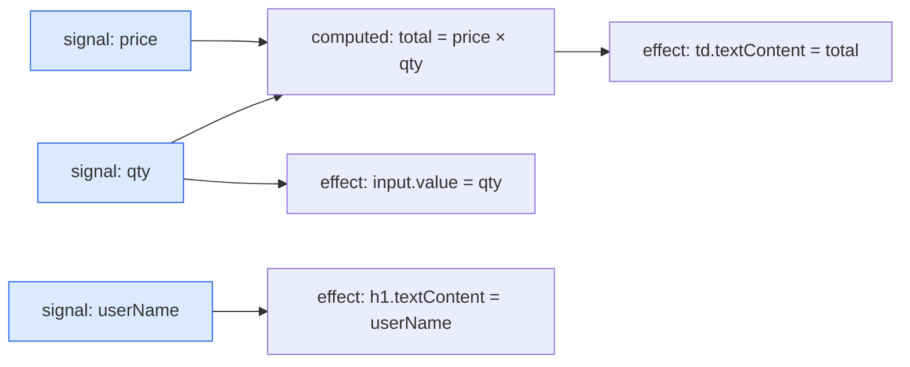
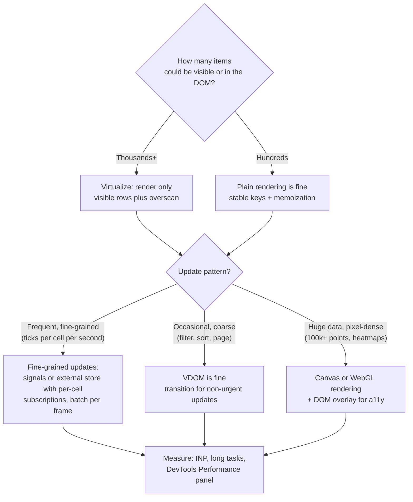

<!-- Generated by scripts/sync-knowledge.js from notes/ and README.md — do not edit here. -->
<!-- sections (line ranges in this file): Table of Contents 19-41 · ELI5 42-54 · Core Concept 55-526 · System Design Angle 527-566 · Real-World Examples 567-682 · Key Points Summary 683-706 · Test Your Understanding 707-789 · Cheat Sheet 790-848 · References & Further Reading 849-896 -->

# DOM & Virtual DOM

> **Date:** 2026-11-06 · **Last updated:** 2026-11-06
> **Category:** Frontend System Design
> **Sub-Topic:** Browser Internals / Rendering
> **Level:** Intermediate · **Reading time:** ~35 min
> **Informs:** DOM update strategy, framework choice (VDOM vs signals), list rendering performance, INP

> **Pre-requisite:** [How Browsers Work](./how-browsers-work.md) (DOM → style → layout → paint) and [Critical Rendering Path](./critical-rendering-path.md).
> This note explains **what the DOM really is, what touching it costs**, and how frameworks (Virtual DOM, signals, compilers) decide *which* DOM operations to run.

**Previous:** [JavaScript Runtime & Event Loop](./javascript-runtime-event-loop.md) · **Next:** [HTTP/1.1 vs HTTP/2 vs HTTP/3](./http1-vs-http2-vs-http3.md)

---

## Table of Contents

1. [ELI5 — Simple Explanation](#eli5--simple-explanation)
2. [Section 1: The DOM Tree & Node Types](#section-1-the-dom-tree--node-types)
3. [Section 2: DOM vs HTML Source vs Render Tree](#section-2-dom-vs-html-source-vs-render-tree)
4. [Section 3: What DOM Operations Really Cost](#section-3-what-dom-operations-really-cost)
5. [Section 4: Layout Thrashing, Batching & DocumentFragment](#section-4-layout-thrashing-batching--documentfragment)
6. [Section 5: The Virtual DOM Concept](#section-5-the-virtual-dom-concept)
7. [Section 6: Diffing & Reconciliation](#section-6-diffing--reconciliation)
8. [Section 7: React Fiber — Conceptually](#section-7-react-fiber--conceptually)
9. [Section 8: When the Virtual DOM Is NOT Faster](#section-8-when-the-virtual-dom-is-not-faster)
10. [Section 9: Fine-Grained Reactivity & Signals](#section-9-fine-grained-reactivity--signals)
11. [Section 10: Compiled Approaches & Incremental DOM](#section-10-compiled-approaches--incremental-dom)
12. [Section 11: Shadow DOM (Briefly)](#section-11-shadow-dom-briefly)
13. [System Design Angle — Rendering Large Lists & Dashboards](#system-design-angle--rendering-large-lists--dashboards)
14. [Real-World Examples](#real-world-examples)
15. [Key Points Summary](#key-points-summary)
16. [Test Your Understanding (with answers)](#test-your-understanding)
17. [Cheat Sheet](#cheat-sheet)
18. [References & Further Reading](#references--further-reading)

---

## ELI5 — Simple Explanation

Imagine a **huge LEGO city** on a table (the **DOM**). Visitors look at it all the time (the screen).

- **Changing the real city is expensive**: every time you move a building, a crew has to re-check that nothing overlaps (**layout**) and repaint the streets (**paint**).
- **Approach 1 — Virtual DOM:** you keep a **paper blueprint** of the city. When something changes, you draw a **new blueprint**, compare it with the old one line by line (**diff**), and send the crew a short list: "move house #12, repaint shop #40" (**patch**). Drawing and comparing paper is cheap — but you redraw the *whole district* every time.
- **Approach 2 — Signals (fine-grained):** you tie a **string** from each piece of data directly to the exact brick that shows it. Pull the "price" string and only that one brick changes. No blueprint, no comparison.
- **Approach 3 — Being a bad crew boss (layout thrashing):** you move a building, then ask "how tall is it now?", move another, ask again… The crew must re-measure the whole city after every question.

> **One-line takeaway: the DOM is the browser's live object tree for the page. Touching it is not slow by itself — making the browser *recalculate layout and repaint* is. Virtual DOM, signals and compilers are just different strategies for running the *fewest* DOM operations with the *least* bookkeeping.**

---

## Core Concept — Step by Step

### Section 1: The DOM Tree & Node Types

The **Document Object Model (DOM)** is a **tree of objects** the browser builds from HTML (and keeps updating as JS runs). It is defined by the [WHATWG DOM Standard](https://dom.spec.whatwg.org/) and exposed to JS as objects like `document`, `Element`, `Text`.

```html
<!DOCTYPE html>
<html>
  <head><title>Shop</title></head>
  <body>
    <!-- product list -->
    <ul id="list">
      <li class="item">Apple</li>
      <li class="item">Pear</li>
    </ul>
  </body>
</html>
```



> The diagram omits the **whitespace text nodes** that the newlines/indentation between tags also produce. They are real nodes — that is why `ul.childNodes.length` is 5 here, while `ul.children.length` is 2.

| Node type | `nodeType` | Example | Notes |
|---|---|---|---|
| **Element** | 1 | `<li>`, `<div>` | Has attributes, children, styles |
| **Attr** | 2 | `class="item"` | A node, but **not** a child in the tree |
| **Text** | 3 | `"Apple"`, whitespace | Leaf node; also created for whitespace between tags |
| **Comment** | 8 | `<!-- … -->` | Kept in the DOM, not rendered |
| **Document** | 9 | `document` | Root of the tree |
| **DocumentType** | 10 | `<!DOCTYPE html>` | Triggers standards mode |
| **DocumentFragment** | 11 | `new DocumentFragment()`, `<template>.content`, shadow roots | Lightweight container with no parent |

Other values (CDATA = 4, processing instruction = 7) appear mainly in XML documents; 5, 6 and 12 are deprecated.

**Inheritance chain** (why `div.addEventListener` and `div.textContent` both work):

```text
EventTarget → Node → Element → HTMLElement → HTMLDivElement
                 ↘ CharacterData → Text / Comment
                 ↘ Document, DocumentFragment → ShadowRoot
```

**Live vs static collections** — a classic source of bugs and slow loops:

| API | Returns | Live? |
|---|---|---|
| `el.childNodes` | `NodeList` (all nodes) | **Live** — updates as the tree changes |
| `el.children`, `getElementsByClassName()`, `getElementsByTagName()` | `HTMLCollection` (elements only) | **Live** |
| `querySelectorAll()` | `NodeList` | **Static** snapshot |

```javascript
// ❌ Infinite loop: the live collection grows as we append
const items = document.getElementsByClassName('item');
for (let i = 0; i < items.length; i++) list.append(items[i].cloneNode(true));

// ✅ Snapshot first (static NodeList or Array.from)
for (const item of document.querySelectorAll('.item')) list.append(item.cloneNode(true));
```

---

### Section 2: DOM vs HTML Source vs Render Tree

Three things people mix up:

| | **HTML source** | **DOM** | **Render tree / layout tree** |
|---|---|---|---|
| What | Text bytes from the server | Live object tree in memory | Visual boxes the browser will lay out |
| Changes when | Never (it's a file) | JS mutates it; parser builds it | DOM or CSSOM changes |
| Includes `display:none` elements? | Yes | Yes | **No** |
| Includes `<head>`, `<script>`? | Yes | Yes | **No** (not rendered) |
| Includes `::before` content? | No | No | **Yes** (pseudo-elements generate boxes) |

- The parser **fixes invalid HTML**: a `<tr>` written directly inside `<table>` gets an implied `<tbody>`; unclosed `<p>` tags are closed. **DevTools → Elements shows the DOM, not the source** ("View Source" shows the source).
- Mutating the DOM (`appendChild`, `classList.add`, `style.x = …`) changes the *object tree immediately*, but the browser only **re-runs style → layout → paint** later, at the next rendering opportunity — unless you force it earlier (Section 4).

---

### Section 3: What DOM Operations Really Cost

"The DOM is slow" is a half-truth. A JS → DOM call has some binding overhead (the DOM is implemented in C++/Rust, not JS), but in modern engines that per-call cost is small. **The real cost is the rendering work the mutation invalidates.**



| Change | Triggers | Relative cost |
|---|---|---|
| Geometry (`width`, `margin`, `top`, font size, inserting/removing nodes, changing text) | Style → **Layout** → Paint → Composite | 🔴 Highest — can ripple to ancestors/siblings |
| Visual only (`color`, `background-color`, `box-shadow`) | Style → **Paint** → Composite | 🟡 Medium |
| `transform`, `opacity` on an element with its own compositor layer | Style → **Composite** only | 🟢 Cheapest — can run off the main thread |

Terminology:

- **Reflow** = Firefox's historic name for **layout**: computing every box's position and size.
- **Repaint** = recording draw commands (paint) for affected areas.
- **DOM size multiplies everything**: style recalc and layout cost scale with how many nodes are affected. Lighthouse flags pages whose DOM is very large (its [DOM size audit](https://developer.chrome.com/docs/lighthouse/performance/dom-size) has used thresholds of roughly 800 body nodes for a warning and 1,400 for an error — treat these as rough guides, not hard limits). Large DOMs also increase memory and make `querySelectorAll` slower.

> **Containment helps the browser limit the blast radius.** `contain: layout paint` (or `content-visibility: auto`) tells the browser that changes inside an element can't affect layout outside it — so it can skip work. `content-visibility: auto` even skips rendering of off-screen subtrees entirely (Baseline across modern browsers since 2024).

---

### Section 4: Layout Thrashing, Batching & DocumentFragment

#### 4.1 Forced synchronous layout

Normally the browser is lazy: you write 50 style changes, it lays out **once** before the next paint. But if you **read** a layout-dependent value (`offsetHeight`, `getBoundingClientRect()`, `scrollTop`, `getComputedStyle()`…) while layout is dirty, the browser must **run layout right now**, inside your JS, to give you a correct answer. Paul Irish maintains the list: [What forces layout/reflow](https://gist.github.com/paulirish/5d52fb081b3570c81e3a).

Doing write → read → write → read in a loop is **layout thrashing**:



```javascript
// ❌ Thrashing: N forced layouts
for (const box of boxes) {
  box.style.height = box.offsetWidth * 0.5 + 'px'; // read after the previous iteration's write
}

// ✅ Batch: all reads, then all writes → 1 layout (later, before paint)
const widths = boxes.map((box) => box.offsetWidth);
boxes.forEach((box, i) => { box.style.height = widths[i] * 0.5 + 'px'; });
```

#### 4.2 Batching strategies

| Technique | What it does | When |
|---|---|---|
| **Read-then-write** | Group all layout reads before any writes | Any loop touching geometry |
| **`requestAnimationFrame`** | Defer writes to just before the next frame | Visual updates, animations |
| **`ResizeObserver` / `IntersectionObserver`** | Browser gives you sizes/visibility at the right time — no polling reads | Responsive components, lazy loading |
| **Toggle a class** instead of many inline styles | One style invalidation | Theming, state changes |
| **Detach, mutate, re-attach** | Edit a subtree while it's out of the document | Heavy rebuilds of one region |
| **FastDOM-style scheduler** | Library queues reads and writes into separate phases | Large codebases with many authors |

#### 4.3 DocumentFragment, `append`, `innerHTML`

```javascript
// Build 1,000 rows off-document, insert once
const frag = document.createDocumentFragment();
for (const product of products) {
  const li = document.createElement('li');
  li.textContent = product.name;          // textContent: no HTML parsing, no XSS
  frag.append(li);
}
list.append(frag);                        // fragment's children MOVE into the list; frag is now empty
```

Be precise about *why* this helps:

- Browsers **already defer layout** while a task mutates the DOM without reading layout, so appending 1,000 `<li>` directly in a loop does **not** cause 1,000 reflows. The fragment's real benefits are **one insertion into the live document** (fewer mutation-observer records, fewer per-insert steps) and a clean "build, then attach" structure.
- `parent.append(...nodes)` and `parent.replaceChildren(...nodes)` accept many nodes at once and are often just as convenient.
- `innerHTML = '<li>…</li>'` invokes the HTML parser; it is fast for big static chunks but **destroys existing nodes** (losing event listeners, focus, input state) and is an **XSS risk** with untrusted data. Use `textContent` for text, `createElement` for structure, or `<template>` + `cloneNode(true)` for repeated markup. (The Sanitizer API's `setHTML()` is being rolled out across browsers — check [MDN](https://developer.mozilla.org/en-US/docs/Web/API/Element/setHTML) before relying on it.)

---

### Section 5: The Virtual DOM Concept

A **Virtual DOM (VDOM)** is a **plain JS object tree that describes what the UI should look like**. Popularised by React (2013), also used by Vue, Preact, Inferno and others.

```javascript
// JSX: <li className="item">Apple</li>  compiles to roughly:
const vnode = { type: 'li', props: { className: 'item', children: 'Apple' }, key: null };
```

The **programming model** is the real innovation: you write `UI = f(state)` declaratively, and the framework figures out the DOM operations.



What the VDOM buys you:

| Benefit | Explanation |
|---|---|
| **Declarative UI** | Describe the end state; no hand-written "if this changed, update that node" code |
| **Batching** | Many state changes → one render → one set of DOM writes (React 18+ batches automatically) |
| **No read/write interleaving** | The framework writes the DOM in one commit phase — avoids accidental thrashing |
| **Renderer independence** | The same tree can target DOM, native views (React Native), canvas, terminals, PDF… |
| **Server rendering** | The tree can be serialised to HTML on the server (SSR) |

What it costs: building new objects every render (allocation + GC), and **diffing time proportional to the size of the re-rendered subtree — not to the size of the actual change** (Section 8).

---

### Section 6: Diffing & Reconciliation

**Reconciliation** = deciding which DOM nodes to keep, update, move, create or destroy, by comparing the old and new trees. A generic minimal tree-edit-distance algorithm is roughly **O(n³)** — far too slow for UI. React (and most VDOM libraries) use **O(n) heuristics** instead ([React's legacy reconciliation doc](https://legacy.reactjs.org/docs/reconciliation.html)):



The two heuristics:

1. **Different element types ⇒ different trees.** Changing `<div>` to `<section>` (or `<UserCard>` to `<AdminCard>`) unmounts the whole subtree — DOM nodes and component state are thrown away. React does not try to detect moves across different parents.
2. **Keys identify children across renders.** Among siblings, a stable `key` tells the reconciler "this is the same item as before, even if it moved".

#### Why keys matter

```text
Old:  [ A(key=a) , B(key=b) , C(key=c) ]
New:  [ Z(key=z) , A(key=a) , B(key=b) , C(key=c) ]   ← item inserted at the top

With keys:   reuse A, B, C (move nothing, just insertBefore Z)         → 1 DOM insert
By index:    0: A→Z (update), 1: B→A (update), 2: C→B (update), 3: insert C
             → 3 updates + 1 insert, AND component state stays at the old index
```

| Key choice | Result |
|---|---|
| **Stable unique id** (`item.id`) | ✅ Correct reuse, minimal DOM work, state follows the item |
| **Array index** | ⚠️ Fine only for static lists that never reorder/insert/delete; otherwise inputs/checkboxes show the **wrong item's state** |
| **`Math.random()` / `crypto.randomUUID()` at render** | ❌ New key every render → every item remounts (slow, loses focus/state) |

> Keys only need to be unique **among siblings**, not globally. Changing a component's `key` on purpose is the idiomatic way to **reset** its state ([React docs](https://react.dev/learn/preserving-and-resetting-state)).

---

### Section 7: React Fiber — Conceptually

Before React 16, reconciliation was a **recursive, synchronous** walk ("stack reconciler"): once a big update started, it held the main thread until done — a long task. **Fiber** (React 16, 2017) re-implemented the reconciler so rendering work can be **split into units, paused, prioritised and resumed**.

- A **fiber** is a JS object per component/element: `type`, `key`, `props`, `state`, pointers to `child`, `sibling`, `return` (parent), plus `alternate` (the same fiber in the other tree) and flags describing pending DOM effects.
- React keeps **two trees** — `current` (what's on screen) and `workInProgress` (being built) — and swaps them on commit (double buffering).
- Work happens in **two phases**:



| Concept | Meaning |
|---|---|
| **Render phase** | Calls your components, builds/diffs the work-in-progress tree. Can be **interrupted** in concurrent rendering, so it must be pure (no side effects) |
| **Commit phase** | Applies all DOM changes in one go. **Never interrupted** — the user never sees a half-updated UI |
| **Lanes / priorities** | Urgent updates (typing, clicks) can interrupt non-urgent ones (`startTransition`, `useDeferredValue`) |
| **Time slicing** | React's scheduler yields back to the browser every few milliseconds during concurrent renders (the scheduler's default slice is about 5 ms) |

Important nuances:

- Fiber makes rendering **interruptible**, not **cheaper**. Total work is the same; it is just scheduled so input stays responsive (helps **INP**).
- Only **concurrent features** (`startTransition`, `useDeferredValue`, Suspense-driven updates) get time slicing. A normal synchronous update still renders to completion.
- The **React Compiler** (v1.0 released October 2025) automatically memoizes components and values at build time, reducing how much of the tree re-renders — it attacks the "re-render too much" problem rather than the diffing algorithm itself.

---

### Section 8: When the Virtual DOM Is NOT Faster

**Myth:** "The Virtual DOM is faster than the real DOM."
**Reality:** VDOM *always* ends with real DOM operations. So VDOM cost = **render + diff + the same DOM operations**. It can only beat *naive* code (e.g. `innerHTML` the whole list on every change); it can never beat *precise* hand-written updates. Rich Harris made this argument in [Virtual DOM is pure overhead](https://svelte.dev/blog/virtual-dom-is-pure-overhead).

```text
Update the price of 1 row in a 10,000-row table (no memoization):

Hand-written / signals:  find that <td> → td.textContent = '$12'           ≈ 1 DOM write
Virtual DOM:             re-run <Table> render → 10,000 row vnodes created
                         → diff 10,000 rows → discover 1 change → 1 DOM write
```

| Situation | Why VDOM struggles | Mitigation |
|---|---|---|
| **Tiny change in a huge tree** | Diff cost ∝ re-rendered subtree, not ∝ change | `React.memo`, React Compiler, move state down, split components |
| **High-frequency updates** (live prices, cursors, 60 fps drags) | Render + diff per update allocates lots of short-lived objects → GC pressure | Signals/stores with fine-grained subscriptions, direct DOM/canvas for the hot path |
| **Very large DOM** | No algorithm helps if 50,000 nodes must exist | **Virtualize** (render only visible rows) |
| **Animations** | Re-rendering per frame is wasted work | CSS transitions / Web Animations API on `transform`/`opacity` |
| **Memory-constrained devices** | Two trees (current + work-in-progress) + DOM | Smaller trees, virtualization |

> The VDOM's value is **developer productivity with acceptable performance by default** — not raw speed. Most apps are dominated by network, bundle size and DOM size, not by diffing.

---

### Section 9: Fine-Grained Reactivity & Signals

**Signals** flip the model: instead of "re-run the component and diff", each piece of state **knows exactly which computations and DOM nodes depend on it**.



Changing `price` re-runs `total` and **one** effect that writes **one** text node. `userName`'s effect never runs. No tree is rebuilt or diffed.

A tiny, runnable signals implementation shows the core idea (automatic dependency tracking):

```javascript
let currentEffect = null;

function signal(initial) {
  let value = initial;
  const subscribers = new Set();
  return {
    get value() {
      if (currentEffect) subscribers.add(currentEffect); // track who read me
      return value;
    },
    set value(next) {
      if (Object.is(next, value)) return;
      value = next;
      [...subscribers].forEach((run) => run());          // notify only dependents
    },
  };
}

function effect(fn) {
  const run = () => {
    const prev = currentEffect;
    currentEffect = run;
    try { fn(); } finally { currentEffect = prev; }
  };
  run();
}

// Usage
const count = signal(0);
const label = document.createElement('span');
document.body.append(label);
effect(() => { label.textContent = `Count: ${count.value}`; }); // runs once now…
count.value++;                                                   // …and again only when count changes
```

*(Real libraries add cleanup of stale dependencies, batching, glitch-free ordering of computeds, and ownership/disposal.)*

| Framework | Model | Notes |
|---|---|---|
| **SolidJS** | Signals + compiled JSX, **no VDOM** | Components run **once**; JSX compiles to real DOM creation plus effects bound to signals |
| **Svelte 5** (runes: `$state`, `$derived`, `$effect`) | Compiler + signal-based runtime, **no VDOM** | Svelte 3/4 used compile-time dirty-checking; Svelte 5 (2024) moved to signals for finer-grained updates |
| **Vue 3** | Proxy-based reactivity (`ref`, `reactive`, `computed`) **+ VDOM** | Reactivity tracks dependencies **per component**, so only affected components re-render (no manual `memo`); the compiler adds patch flags and static hoisting to shrink diffs. **Vapor Mode** — an opt-in VDOM-free compile mode — is being introduced in Vue 3.6 pre-releases; check its status before adopting |
| **Angular** | `signal()`, `computed()`, `effect()` + compiled templates | Signals let Angular update only components that read changed signals; Angular is moving away from Zone.js-based global change detection toward **zoneless** apps |
| **Preact** | VDOM + optional `@preact/signals` | A signal passed directly into JSX text can update that text node without re-rendering the component |
| **React** | VDOM; no built-in signals | Re-render + diff; React Compiler auto-memoizes; external stores via `useSyncExternalStore` |

> **Standardisation:** a [TC39 Signals proposal](https://github.com/tc39/proposal-signals) (Stage 1 at the time of writing) aims to give frameworks a shared reactive primitive. Don't depend on it shipping soon.

**Trade-offs of signals:** you must read signals inside a tracking scope (destructuring a value too early loses reactivity), debugging "why did this update?" means following a dependency graph rather than a component tree, and very coarse changes (replace the whole dataset) still produce lots of DOM work — the advantage is biggest for **many small, independent updates**.

---

### Section 10: Compiled Approaches & Incremental DOM

Three non-VDOM families, all trying to remove runtime diffing:

```mermaid
flowchart TB
    subgraph VD["Virtual DOM (React)"]
        V1["Render → new tree in memory"] --> V2["Diff whole subtree"] --> V3["Patch DOM"]
    end
    subgraph CP["Compiled + fine-grained (Svelte, Solid)"]
        C1["Build time: compiler knows<br/>which nodes are dynamic"] --> C2["Runtime: state change<br/>runs only that node's update"]
    end
    subgraph IDOM["Incremental DOM (Angular Ivy)"]
        I1["Template compiled to<br/>instructions"] --> I2["Walk instructions against<br/>the REAL DOM, update in place"]
    end
    subgraph TL["Tagged templates (Lit)"]
        L1["Static parts parsed once<br/>into a template"] --> L2["Only dynamic 'holes'<br/>are compared and updated"]
    end
```



| Approach | How it works | Strength | Weakness |
|---|---|---|---|
| **Compiler-driven fine-grained** (Svelte, Solid) | The compiler sees the template, separates static from dynamic parts, and generates code that updates exact nodes | Smallest runtime work per update; often small output for small apps | Framework-specific syntax/semantics; generated code grows with component count |
| **Incremental DOM** ([Google library](https://google.github.io/incremental-dom/); the idea behind Angular's Ivy renderer) | Templates compile to instructions (`elementOpen`, `text`, `elementClose`) executed against the real DOM, diffing in place — **no second in-memory tree** | Lower memory; tree-shakable instructions | Still walks the template on each check |
| **Tagged template literals** (Lit / lit-html) | Static HTML is parsed once into a `<template>`; dynamic expressions are tracked by position | No VDOM, small runtime, native Web Components friendly | Compares expression values per render (cheap, but not zero) |
| **Block / hybrid VDOM** (Vue 3 compiler optimizations) | VDOM, but the compiler marks static subtrees and dynamic "blocks" so the diff skips static parts | Keeps the VDOM model with much less diffing | Still a VDOM runtime |

---

### Section 11: Shadow DOM (Briefly)

**Shadow DOM** lets an element host a **separate, encapsulated DOM subtree** (a *shadow root*). It's the encapsulation half of **Web Components**.

```javascript
class PriceTag extends HTMLElement {
  constructor() {
    super();
    const root = this.attachShadow({ mode: 'open' });   // 'closed' hides el.shadowRoot from outside JS
    // <style> is scoped to this shadow root; <slot> is where the host's light-DOM children render
    root.innerHTML = `
      <style>span { color: green; font-weight: 700; }</style>
      <span><slot></slot></span>`;
  }
}
customElements.define('price-tag', PriceTag);
// <price-tag>$12</price-tag>
```

| Concept | Meaning |
|---|---|
| **Style encapsulation** | Styles inside don't leak out; most outside styles don't leak in (inherited properties and CSS custom properties *do* pass through) |
| **`<slot>`** | Placeholder where the host's light-DOM children are rendered |
| **Declarative Shadow DOM** | `<template shadowrootmode="open">` creates the shadow root from HTML — works with SSR, no JS needed (supported in all modern browsers since 2024) |
| **Not the same as VDOM** | Shadow DOM is a **real browser feature for encapsulation**; VDOM is a **framework technique for diffing**. They solve unrelated problems |

*(Full deep dive: [Web Components & Shadow DOM](./web-components-and-shadow-dom.md).)*

---

## System Design Angle — Rendering Large Lists & Dashboards

Typical prompt: *"Design a trading dashboard with a 50,000-row live table, charts and filters."* The rendering model is a core decision.



Decision checklist:

| Concern | Recommendation |
|---|---|
| **DOM size** | Virtualize long lists ([TanStack Virtual](https://tanstack.com/virtual/latest), react-window, Angular CDK virtual scroll). For long *documents*, `content-visibility: auto` + `contain-intrinsic-size` skips off-screen rendering while keeping content in the DOM (find-in-page, a11y) |
| **Update frequency** | Coalesce socket messages and apply them **once per animation frame**; don't re-render per message |
| **Re-render scope** | Keep high-frequency state close to the cell (signals, store selectors, `memo`); never keep live ticks in a top-level context that re-renders the whole table |
| **Responsiveness (INP)** | Mark filters/sorts as non-urgent (`startTransition` / `useDeferredValue`), keep input handlers tiny, chunk heavy work or move it to a Worker |
| **Keys** | Stable row ids — essential for sorting and live insertions |
| **Accessibility** | Virtualized grids need correct `aria-rowcount` / `aria-rowindex`; canvas needs an accessible DOM alternative |
| **Framework choice** | VDOM (React) is fine for most dashboards with good state design; signal-based frameworks (Solid, Svelte 5, Vue, Angular signals) make fine-grained high-frequency updates the default rather than an optimization |

```text
Batched live updates — one render per frame, no matter how many messages:

socket msg ─┐
socket msg ─┼─► pending Map(rowId → patch) ─► requestAnimationFrame ─► apply all patches ─► 1 render / 1 layout
socket msg ─┘
```

---

## Real-World Examples

**Example 1 — Stable keys (React):**
```jsx
// ❌ BAD: index keys — inserting at the top shifts every row's state (checkbox ticks the wrong row)
{todos.map((todo, i) => <TodoRow key={i} todo={todo} />)}

// ❌ BAD: random keys — every row remounts on every render
{todos.map((todo) => <TodoRow key={crypto.randomUUID()} todo={todo} />)}

// ✅ GOOD: stable id from the data
{todos.map((todo) => <TodoRow key={todo.id} todo={todo} />)}
```

**Example 2 — Batch live updates into one frame (framework-agnostic):**
```javascript
const pending = new Map();      // rowId → latest price
let scheduled = false;

socket.addEventListener('message', (event) => {
  const { id, price } = JSON.parse(event.data);
  pending.set(id, price);                       // later messages overwrite earlier ones
  if (!scheduled) {
    scheduled = true;
    requestAnimationFrame(flush);
  }
});

function flush() {
  scheduled = false;
  for (const [id, price] of pending) {
    const cell = document.querySelector(`[data-row="${CSS.escape(String(id))}"] .price`);
    if (cell) cell.textContent = price.toFixed(2);   // writes only — no layout reads
  }
  pending.clear();
}
```

**Example 3 — Virtualize a 100,000-row list (React + TanStack Virtual):**
```jsx
import { useRef } from 'react';
import { useVirtualizer } from '@tanstack/react-virtual';

export function BigList({ rows }) {
  const parentRef = useRef(null);
  const virtualizer = useVirtualizer({
    count: rows.length,
    getScrollElement: () => parentRef.current,
    estimateSize: () => 36,   // px per row (estimate)
    overscan: 8,              // extra rows above/below the viewport
  });

  return (
    <div ref={parentRef} style={{ height: 600, overflow: 'auto' }}>
      <div style={{ height: virtualizer.getTotalSize(), position: 'relative' }}>
        {virtualizer.getVirtualItems().map((item) => (
          <div
            key={rows[item.index].id}
            style={{
              position: 'absolute', top: 0, left: 0, width: '100%',
              height: item.size, transform: `translateY(${item.start}px)`,
            }}
          >
            {rows[item.index].name}
          </div>
        ))}
      </div>
    </div>
  );
}
// DOM holds ~30 rows instead of 100,000 → fast mount, fast style/layout, low memory.
```

**Example 4 — Same counter in a VDOM framework vs a signals framework:**
```jsx
// --- Counter.jsx (React) ---
import { useState } from 'react';
// setCount re-runs Counter() and diffs its output
function Counter() {
  const [count, setCount] = useState(0);
  console.log('render');                       // logs on EVERY click
  return <button onClick={() => setCount(count + 1)}>{count}</button>;
}

// --- Counter.jsx (SolidJS) ---
import { createSignal } from 'solid-js';
// Counter() runs ONCE; only the text node bound to count() updates
function Counter() {
  const [count, setCount] = createSignal(0);
  console.log('setup');                        // logs once
  return <button onClick={() => setCount(count() + 1)}>{count()}</button>;
}
```

**Example 5 — Skip rendering off-screen sections of a long page:**
```css
/* Each section's rendering is skipped until it nears the viewport.
   contain-intrinsic-size reserves space (and remembers the real size with 'auto') to avoid scrollbar jumps. */
.feed-section {
  content-visibility: auto;
  contain-intrinsic-size: auto 800px;
}
```

**Example 6 — Animate without layout:**
```css
/* ❌ BAD: animating 'left' triggers layout + paint every frame */
.toast { transition: left 300ms; }

/* ✅ GOOD: transform/opacity can be handled by the compositor */
.toast { transition: transform 300ms, opacity 300ms; }
.toast.is-hidden { transform: translateX(110%); opacity: 0; }
```

---

## Key Points Summary

| Concept | One-Line Explanation |
|---|---|
| **DOM** | Live tree of node objects the browser builds from HTML and exposes to JS |
| **Node types** | Element (1), Text (3), Comment (8), Document (9), DocumentType (10), DocumentFragment (11) |
| **Live collection** | `children`, `getElementsBy*` update automatically; `querySelectorAll` is a static snapshot |
| **Reflow / layout** | Recomputing box geometry — the most expensive step a mutation can trigger |
| **Repaint** | Redrawing pixels for visual-only changes |
| **Composite-only** | `transform`/`opacity` on a layer — cheapest updates |
| **Layout thrashing** | Interleaved reads and writes forcing synchronous layout repeatedly |
| **DocumentFragment** | Off-document container; inserting it moves its children in one operation |
| **Virtual DOM** | JS object description of the UI; diffed to compute DOM patches |
| **Reconciliation** | O(n) heuristic diff: type change ⇒ rebuild; keys ⇒ match siblings |
| **Keys** | Stable identity for list items; index keys break on reorder, random keys remount |
| **React Fiber** | Interruptible, prioritised reconciler: render phase (pausable) + commit phase (atomic) |
| **VDOM speed myth** | VDOM = render + diff + DOM ops; it can't beat precise direct updates |
| **Signals** | Reactive values that track dependents and update exactly what read them |
| **Incremental DOM** | Diff templates against the real DOM in place — no second tree (Angular Ivy) |
| **Shadow DOM** | Native encapsulated subtree with scoped styles and slots — unrelated to VDOM |
| **Virtualization** | Render only visible rows — the #1 fix for huge lists in any framework |

---

## Test Your Understanding

**Q1 (Basic):**
Why does `ul.childNodes.length` often differ from `ul.children.length`? Which one is live?

<details>
<summary>Answer</summary>

`childNodes` contains **all** child nodes — including **text nodes created by whitespace/newlines** between tags and comment nodes — while `children` contains **only element nodes**. In the Section 1 example, `childNodes` has 5 entries (3 whitespace text nodes + 2 `<li>`) and `children` has 2. **Both are live**: they reflect later DOM changes automatically. Only `querySelectorAll()` returns a static snapshot, which is why it's the safer choice when you mutate the tree while iterating.
</details>

**Q2 (Application):**
This code takes 400 ms on a page with 2,000 cards. Why, and how do you fix it?

```javascript
cards.forEach((card) => {
  card.style.height = card.querySelector('.body').scrollHeight + 'px';
});
```

<details>
<summary>Answer</summary>

It's **layout thrashing**. Each iteration **writes** a height (invalidating layout) and the next iteration **reads** `scrollHeight`, which forces the browser to run **layout synchronously** to return a correct value. That's ~2,000 forced layouts in a single task — a long task that also hurts INP.

Fix: **batch reads, then writes**:

```javascript
const heights = cards.map((card) => card.querySelector('.body').scrollHeight); // N reads, 1 layout
cards.forEach((card, i) => { card.style.height = heights[i] + 'px'; });        // N writes, layout once later
```

Better still: avoid JS measurement entirely (let CSS grid/flex size the cards with `height: auto`), or react to size changes with `ResizeObserver`, which delivers sizes at the right point in the frame instead of forcing layout.
</details>

**Q3 (Application):**
A todo list uses `key={index}`. Users report that after deleting the first todo, the checkbox state "jumps" to the wrong item. Explain using the reconciliation rules.

<details>
<summary>Answer</summary>

The reconciler matches children **by key**. With index keys, after deleting item 0, the item that was at index 1 now has key `0`. React sees "key 0 still exists, same component type" → it **keeps the old component instance and its state** (including the uncontrolled checkbox's DOM state) and just passes new props. So the state that belonged to the deleted item is now displayed next to a different todo, and the last instance is unmounted. Using a **stable id** (`key={todo.id}`) lets React see that key `a` was removed and keys `b`, `c` are unchanged, so it removes exactly one DOM node and state stays with its item.
</details>

**Q4 (Tricky):**
"React uses a Virtual DOM, so it's faster than vanilla JS." True or false?

<details>
<summary>Answer</summary>

**False as a general statement.** A VDOM update = **re-render** (create new vnode objects) + **diff** + the **same real DOM operations** a hand-written update would perform. It cannot be faster than precise direct DOM updates; it can be faster than *naive* vanilla code (e.g. rebuilding a list with `innerHTML` on every change, or thrashing layout). The VDOM's real benefits are the **declarative model**, automatic **batching**, avoiding accidental read/write interleaving, and renderer independence. Fiber adds **interruptibility** (responsiveness), not raw speed.
</details>

**Q5 (Tricky):**
In a signal-based framework, a teammate writes `const { price } = props;` at the top of a SolidJS component and the price never updates on screen. Why? Why wouldn't the same line break a React component?

<details>
<summary>Answer</summary>

In Solid, a component function **runs once**. Reactivity comes from **reading signals inside a tracking scope** (JSX expressions, `createEffect`, `createMemo`); Solid's props are reactive getters. Destructuring at the top **reads `props.price` once, outside any tracking scope**, captures a plain value, and nothing subscribes to future changes. (Use `props.price` inside JSX, or `splitProps`/`mergeProps`.)

React works differently: every state/prop change **re-runs the whole component function**, so the destructured value is fresh on each render. This illustrates the core model difference — **re-execute and diff** vs **run once and subscribe**.
</details>

**Q6 (System design):**
You're designing a monitoring dashboard: a 20,000-row table where ~500 cells update per second via WebSocket, plus a search filter. Users complain typing in the filter is laggy. Outline the rendering strategy.

<details>
<summary>Answer</summary>

1. **Virtualize** the table so only ~30–50 rows exist in the DOM (smaller style/layout cost, fast mount).
2. **Coalesce socket updates**: buffer messages in a `Map` keyed by row id and apply them **once per `requestAnimationFrame`**, not per message.
3. **Narrow re-render scope**: subscribe each visible cell/row to its own data (signals, store selectors, `React.memo` with stable props) so a tick re-renders one cell, not the table. Don't put live data in a top-level context.
4. **Keep the input responsive (INP)**: update the input value urgently; mark the filtering/re-render as non-urgent (`startTransition`/`useDeferredValue`), debounce, or filter in a **Web Worker** for very large datasets.
5. **Stable keys** (row ids) so sorting/filtering reuses rows.
6. **Write-only DOM updates** in the hot path; animate highlights with `opacity`/`transform` or class toggles.
7. **Measure** with the DevTools Performance panel (long tasks, forced reflow warnings) and field INP.

Framework choice: React works with careful state design; a signals-based framework makes step 3 the default.
</details>

---

## Cheat Sheet

**Key Definitions:**
- **DOM:** live object tree of the document (WHATWG DOM Standard); DevTools Elements shows it, not the source.
- **Reflow (layout):** recompute geometry. **Repaint:** redraw pixels. **Composite:** combine layers on the GPU.
- **Forced synchronous layout:** reading geometry while layout is dirty; repeated in a loop = **layout thrashing**.
- **Virtual DOM:** JS description of UI → diff → patch. **Reconciliation:** the diff algorithm (type + key heuristics).
- **Fiber:** React's interruptible reconciler; render phase pausable, commit phase atomic.
- **Signal:** reactive value with automatic dependency tracking; updates only its dependents.
- **Incremental DOM:** compiled instructions diff against the real DOM in place.
- **Shadow DOM:** native encapsulated subtree (scoped CSS, slots).

**Quick Reference:**
```text
WHAT A CHANGE COSTS
geometry (width, top, text, add/remove) → style → LAYOUT → paint → composite   🔴
visual (color, background, shadow)      → style → PAINT → composite            🟡
transform / opacity (own layer)         → style → COMPOSITE                    🟢

DOM UPDATE RULES
1. Read all layout values first, then write          (no thrashing)
2. Write visuals in requestAnimationFrame             (one per frame)
3. Toggle classes, not 20 inline styles
4. textContent for text; never innerHTML with untrusted data
5. Build big subtrees off-document, insert once      (DocumentFragment / append(...nodes))
6. Huge lists → virtualize; long pages → content-visibility: auto

RECONCILIATION (VDOM)
type changed            → destroy + rebuild subtree (state lost)
same host element       → update changed attributes only
same component          → keep state, re-render with new props
lists                   → key = stable id (never index if order changes, never random)

CHOOSING A RENDERING MODEL
mostly forms/CRUD, coarse updates      → VDOM (React/Vue) is fine
many tiny high-frequency updates       → signals / fine-grained (Solid, Svelte 5, Vue, Angular signals)
100k+ data points, pixel-dense         → canvas/WebGL + accessible DOM layer
any framework, thousands of rows       → virtualization first
```

**Common Mistakes to Avoid:**

| Mistake | Why Wrong | Fix |
|---|---|---|
| "VDOM is faster than the DOM" | VDOM adds render + diff on top of the same DOM ops | Treat VDOM as a productivity model; optimize re-render scope |
| Reading `offsetHeight` inside a write loop | Forces synchronous layout every iteration | Batch reads, then writes; use `ResizeObserver` |
| `key={index}` on reorderable lists | State and DOM attach to the wrong item | `key={item.id}` |
| Random keys generated during render | Every item remounts each render | Stable ids from data |
| Swapping wrapper element type conditionally (`div` ↔ `section`) | Tears down the whole subtree and its state | Keep the same element type; toggle attributes/classes |
| Rendering 10,000+ rows into the DOM | Huge style/layout/memory cost | Virtualize or paginate |
| Pushing every WebSocket message into state | One render per message → long tasks, bad INP | Coalesce per animation frame |
| Animating `top`/`left`/`width` | Layout + paint every frame | Animate `transform`/`opacity` |
| `innerHTML` with user data | XSS, destroys listeners and state | `textContent`, `createElement`, sanitization |
| Iterating a live `HTMLCollection` while mutating | Skipped items or infinite loops | `querySelectorAll` or `Array.from()` first |
| Destructuring props/signals too early in Solid/Svelte/Vue | Reads once, loses reactivity | Read reactive values inside the tracking scope |
| Assuming Shadow DOM is a VDOM | Different problems (encapsulation vs diffing) | Use Shadow DOM for component isolation only |

---

## References & Further Reading

**Core docs**
- MDN: [Document Object Model (DOM)](https://developer.mozilla.org/en-US/docs/Web/API/Document_Object_Model)
- MDN: [`Node.nodeType`](https://developer.mozilla.org/en-US/docs/Web/API/Node/nodeType) · [`DocumentFragment`](https://developer.mozilla.org/en-US/docs/Web/API/DocumentFragment) · [`NodeList`](https://developer.mozilla.org/en-US/docs/Web/API/NodeList)
- MDN: [`content-visibility`](https://developer.mozilla.org/en-US/docs/Web/CSS/content-visibility) · [`contain`](https://developer.mozilla.org/en-US/docs/Web/CSS/contain)
- MDN: [Using shadow DOM](https://developer.mozilla.org/en-US/docs/Web/API/Web_components/Using_shadow_DOM)

**Performance (web.dev / Chrome)**
- web.dev: [Avoid large, complex layouts and layout thrashing](https://web.dev/articles/avoid-large-complex-layouts-and-layout-thrashing)
- web.dev: [Rendering performance](https://web.dev/articles/rendering-performance)
- web.dev: [content-visibility: the new CSS property that boosts your rendering performance](https://web.dev/articles/content-visibility)
- web.dev: [Optimize Interaction to Next Paint](https://web.dev/articles/optimize-inp)
- web.dev: [Virtualize large lists with react-window](https://web.dev/articles/virtualize-long-lists-react-window)
- Chrome for Developers: [Avoid an excessive DOM size](https://developer.chrome.com/docs/lighthouse/performance/dom-size)
- Paul Irish: [What forces layout/reflow](https://gist.github.com/paulirish/5d52fb081b3570c81e3a)

**Specs**
- WHATWG: [DOM Standard](https://dom.spec.whatwg.org/)
- TC39: [Signals proposal](https://github.com/tc39/proposal-signals)

**Frameworks**
- React: [Rendering Lists (keys)](https://react.dev/learn/rendering-lists) · [Preserving and Resetting State](https://react.dev/learn/preserving-and-resetting-state) · [React Compiler](https://react.dev/learn/react-compiler)
- React (legacy docs): [Reconciliation](https://legacy.reactjs.org/docs/reconciliation.html)
- Andrew Clark: [React Fiber Architecture](https://github.com/acdlite/react-fiber-architecture)
- Vue: [Rendering Mechanism](https://vuejs.org/guide/extras/rendering-mechanism.html) · [Reactivity in Depth](https://vuejs.org/guide/extras/reactivity-in-depth.html)
- Solid: [Intro to reactivity](https://docs.solidjs.com/concepts/intro-to-reactivity)
- Svelte: [What are runes?](https://svelte.dev/docs/svelte/what-are-runes) · [Introducing runes](https://svelte.dev/blog/runes)
- Angular: [Signals guide](https://angular.dev/guide/signals)
- Google: [Incremental DOM](https://google.github.io/incremental-dom/)
- Lit: [Lit documentation — templates](https://lit.dev/docs/templates/overview/)
- TanStack: [Virtual](https://tanstack.com/virtual/latest)

**Deep dives**
- Rich Harris: [Virtual DOM is pure overhead](https://svelte.dev/blog/virtual-dom-is-pure-overhead)
- Ryan Carniato: [A Hands-on Introduction to Fine-Grained Reactivity](https://dev.to/ryansolid/a-hands-on-introduction-to-fine-grained-reactivity-3ndf)
- web.dev: [Declarative Shadow DOM](https://web.dev/articles/declarative-shadow-dom)
- [JS Framework Benchmark](https://github.com/krausest/js-framework-benchmark) — compare frameworks on standard DOM operations (read the methodology before quoting numbers)

---

> **Previous Topic:** [JavaScript Runtime & Event Loop](./javascript-runtime-event-loop.md)
> — How JS executes on the main thread, and why long tasks block rendering

> **Next Topic:** [HTTP/1.1 vs HTTP/2 vs HTTP/3](./http1-vs-http2-vs-http3.md)
> — How the bytes for your DOM, CSS and JS actually travel over the network

*Saved on: 2026-11-06 | Repo: Frontend System Design Learning Notes*
