<!-- Generated by scripts/sync-knowledge.js from notes/ and README.md — do not edit here. -->
<!-- sections (line ranges in this file): Table of Contents 19-41 · ELI5 42-53 · Core Concept 54-452 · Framework Comparison 453-503 · Real-World Examples 504-717 · Key Points Summary 718-737 · Test Your Understanding 738-825 · Cheat Sheet 826-880 · References & Further Reading 881-921 -->

# E2E Testing (Playwright, Cypress)

> **Date:** 2026-11-06 · **Last updated:** 2026-11-06
> **Category:** Frontend System Design
> **Sub-Topic:** Testing / End-to-End Testing
> **Level:** Intermediate · **Reading time:** ~32 min
> **Informs:** E2E tool choice (Playwright vs Cypress vs WebDriver-based), which user journeys get E2E coverage, cross-browser test matrix, locator conventions, auth and test-data strategy, real vs mocked backend in E2E, flaky-test policy, CI sharding and artifacts, preview-deployment gating, native mobile E2E tooling (Detox, Maestro, Appium, XCUITest, Espresso)

> **Pre-requisite:** [Integration Testing](./integration-testing.md) (what's real vs faked below E2E) and [Authentication Flows in SPAs](./authentication-flows-in-spas.md) (the login flows E2E tests must get past).
> This note covers **testing the running app in real browsers, the way a user would**: how Playwright and Cypress work, how to write tests that don't flake, how to handle auth, data and network, and how to run E2E in CI. Both tools release often; version-specific details are flagged, so check the [Playwright docs](https://playwright.dev/docs/intro) and [Cypress docs](https://docs.cypress.io/) for your version.

**Previous:** [Integration Testing](./integration-testing.md) · **Next:** [Visual Regression Testing](./visual-regression-testing.md)

---

## Table of Contents

1. [ELI5 — Simple Explanation](#eli5--simple-explanation)
2. [Section 1: What E2E Tests Are For](#section-1-what-e2e-tests-are-for)
3. [Section 2: How the Tools Work Under the Hood](#section-2-how-the-tools-work-under-the-hood)
4. [Section 3: Playwright Essentials](#section-3-playwright-essentials)
5. [Section 4: Cypress Essentials](#section-4-cypress-essentials)
6. [Section 5: Locators That Survive Redesigns](#section-5-locators-that-survive-redesigns)
7. [Section 6: Waiting Without Sleeping](#section-6-waiting-without-sleeping)
8. [Section 7: Authentication and Test Data](#section-7-authentication-and-test-data)
9. [Section 8: Real Backend or Mocked Network](#section-8-real-backend-or-mocked-network)
10. [Section 9: Flaky Tests](#section-9-flaky-tests)
11. [Section 10: Running E2E in CI](#section-10-running-e2e-in-ci)
12. [Section 11: Structuring a Suite — Page Objects and Fixtures](#section-11-structuring-a-suite--page-objects-and-fixtures)
13. [Framework Comparison](#framework-comparison)
14. [Real-World Examples](#real-world-examples)
15. [Key Points Summary](#key-points-summary)
16. [Test Your Understanding](#test-your-understanding)
17. [Cheat Sheet](#cheat-sheet)
18. [References & Further Reading](#references--further-reading)

---

## ELI5 — Simple Explanation

Before a theatre opens a new play, there's a **dress rehearsal**: the real stage, real costumes, real lights and sound, with the actors running the whole show from curtain-up to the final bow. If a door sticks or a spotlight points the wrong way, the rehearsal catches it, even though every actor knew their lines (unit tests) and every scene worked in the practice room (integration tests).

An E2E test is that dress rehearsal for your web app. A robot opens a **real browser**, goes to your **real deployed app**, which talks to a **real backend**, and then clicks, types and checks the screen like a customer would.

Dress rehearsals are expensive and slow, and sometimes fail for silly reasons (a fuse blows). So you don't rehearse every line every day. You rehearse the **scenes that must never fail on opening night**: signing up, logging in, paying.

> **E2E tests prove that the critical user journeys work in a real browser against the real system. Keep them few, focused on what matters most, and free of fixed waits.**

---

## Core Concept — Step by Step

### Section 1: What E2E Tests Are For

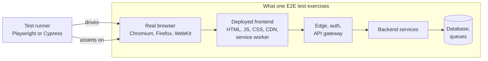

E2E catches what lower levels can't:

| Problem | Caught by integration tests (jsdom + MSW)? | Caught by E2E? |
|---|---|---|
| Real API changed shape | ❌ fakes drift | ✅ |
| Cookie `SameSite`/`Secure` settings break login across subdomains | ❌ | ✅ |
| CSP header blocks your analytics or payment script | ❌ | ✅ |
| CSS hides the "Pay" button at mobile width | ❌ no layout in jsdom | ✅ |
| Safari-only behaviour (date input, `position: sticky` inside overflow) | ❌ | ✅ on WebKit (an approximation of Safari) |
| Wrong environment variable in the production build | ❌ | ✅ against a preview deploy |
| Off-by-one in a price formatter | ✅ faster | ✅ but slow to diagnose |

**What to cover with E2E:** the **critical user journeys** (CUJs): flows where a failure costs money, data or trust. Typical examples are sign-up, login and logout, search → product → cart → checkout, creating and saving the core object of your product, and permissions (a viewer can't edit).

**What not to cover with E2E:** every validation message, every empty state, every edge case. Those belong in [integration tests](./integration-testing.md), where they are faster and more deterministic. See [Testing Strategies & Pyramid](./testing-strategies-and-pyramid.md) for the overall mix.

---

### Section 2: How the Tools Work Under the Hood

The two tools have **different architectures**, and that difference explains most of their trade-offs.

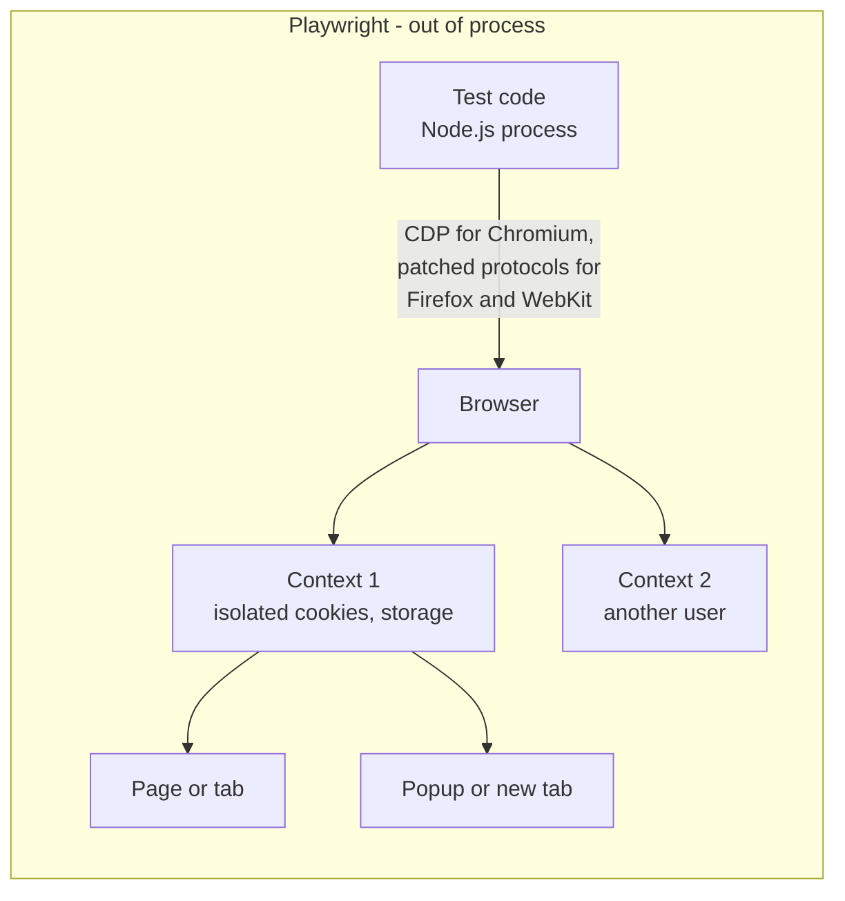

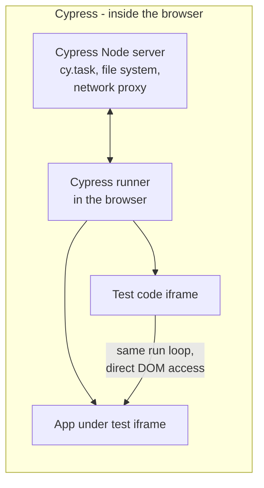

| | **Playwright** | **Cypress** |
|---|---|---|
| Where tests run | In **Node.js**, controlling the browser over a protocol | **Inside the browser**, next to your app, plus a Node server process |
| Browsers | Chromium, Firefox, WebKit (Playwright's own builds); branded Chrome and Edge via `channel` | Chrome-family (Chrome, Edge, Electron) and Firefox; WebKit is **experimental** |
| Multiple tabs, popups, windows | ✅ First-class | ❌ Not supported in one test (workarounds exist) |
| Multiple origins in one test | ✅ | ✅ via `cy.origin()` |
| Multiple users at once (chat, collaboration) | ✅ Several browser contexts in one test | ❌ Not directly |
| iframes | ✅ `frameLocator` | ⚠️ Limited, needs workarounds |
| Languages | TypeScript/JavaScript (test runner); also Python, Java, .NET bindings | JavaScript/TypeScript |
| Async model | Standard `async`/`await` | Command **queue** with chained commands (not promises) |
| Parallelism | Built-in workers and `--shard`, free | Parallel and load-balanced runs through **Cypress Cloud** (commercial, has a free tier), or manual spec splitting |
| Debugging | Trace Viewer, UI mode, Inspector, codegen | Interactive runner with time-travel snapshots |
| Component testing | Available, marked **experimental** in the docs | Supported for React, Vue, Angular, Svelte |
| License | Apache 2.0 | MIT (app); Cloud is a paid service |

**Note on WebKit:** Playwright's WebKit is built from WebKit sources. It's the closest automated proxy for Safari on most CI machines, but it's **not Safari**. For Safari-specific bugs, also test on real Safari or real iOS devices (e.g. a cloud device farm).

---

### Section 3: Playwright Essentials

**Locators + auto-waiting + web-first assertions** are the core of Playwright.

```typescript
import { test, expect } from '@playwright/test';

test('user can add a todo', async ({ page }) => {
  await page.goto('/todos');
  await page.getByRole('textbox', { name: 'New todo' }).fill('Write E2E tests');
  await page.getByRole('textbox', { name: 'New todo' }).press('Enter');

  // Web-first assertion: retries until it passes or the expect timeout runs out
  await expect(page.getByRole('listitem').filter({ hasText: 'Write E2E tests' })).toBeVisible();
  await expect(page.getByRole('status')).toHaveText('1 item left');
});
```

| Concept | What it means |
|---|---|
| **Locator** | A *recipe* for finding an element (`page.getByRole(...)`), evaluated each time it's used, so it never goes stale |
| **Strictness** | Actions on a locator that matches several elements **throw**. Narrow it with `filter`, `getByRole(…, { name })` or chaining |
| **Auto-waiting (actionability)** | Before `click`, Playwright waits until the element is attached, visible, stable (not animating), receives events (not covered) and enabled |
| **Web-first assertions** | `await expect(locator).toHaveText(...)` retries; the default expect timeout is 5 s |
| **Test isolation** | Each test gets a fresh **browser context** (like a new incognito profile): cookies and storage don't leak |
| **Fixtures** | `({ page, request, context })` are injected; you define your own with `test.extend` |
| **Projects** | Run the same tests across browsers, devices, or setups (e.g. an auth setup project) |
| **Tooling** | `npx playwright codegen`, `--ui` (UI mode), `--debug`, Trace Viewer (`show-trace`), HTML report |
| **Other features** | `page.route` (network mocking), `page.clock` (control time), `toHaveScreenshot` ([visual regression](./visual-regression-testing.md)), `toMatchAriaSnapshot` (accessibility-tree snapshots) |

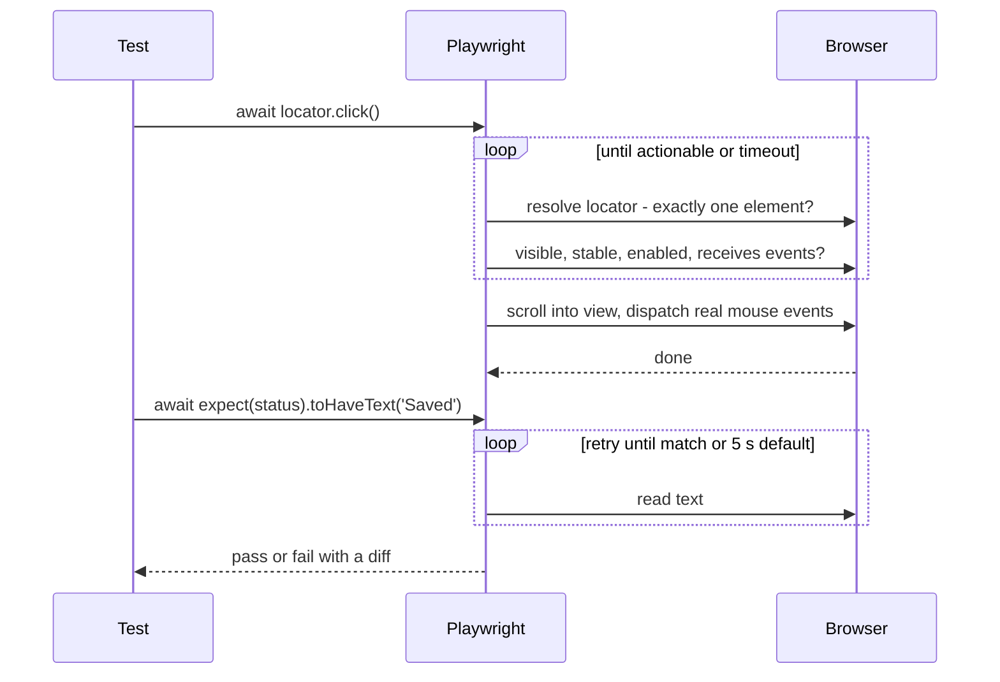

---

### Section 4: Cypress Essentials

Cypress commands are **enqueued** and run later, in order. Each query command **retries** until its following assertion passes or the command times out (4 s by default).

```javascript
describe('todos', () => {
  it('adds a todo', () => {
    cy.visit('/todos');
    cy.get('input[aria-label="New todo"]').type('Write E2E tests{enter}');

    // .should() retries the query and the assertion together
    cy.contains('li', 'Write E2E tests').should('be.visible');
    cy.get('[role="status"]').should('have.text', '1 item left');
  });
});
```

| Concept | What it means |
|---|---|
| **Command queue** | `cy.*` calls don't run immediately. Don't mix them with `async`/`await` or store their "return values" in variables. Use `.then()` or aliases |
| **Retry-ability** | Queries (`get`, `find`, `contains`) and their assertions retry; actions (`click`, `type`) run once, after actionability checks |
| **`cy.intercept`** | Spy on or stub network requests; `cy.wait('@alias')` waits for one |
| **`cy.session`** | Caches and restores cookies/storage after login across tests |
| **`cy.origin`** | Runs commands against a second origin (e.g. an identity provider page) |
| **`cy.task`** | Runs Node code (seed a database, read a file) from a test |
| **Test isolation** | On by default in current versions: page, cookies and storage are cleared between tests |
| **Testing Library for Cypress** | `@testing-library/cypress` adds `cy.findByRole(...)` and friends |

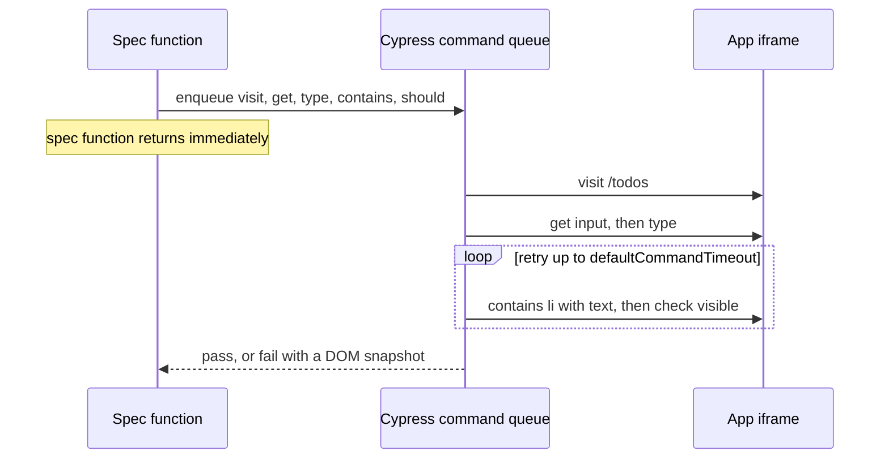

---

### Section 5: Locators That Survive Redesigns

The same priority as [React Testing Library](./react-testing-library-patterns.md) applies: **find things the way users do**.

| Rank | Playwright | Cypress | Why |
|---|---|---|---|
| 1 | `page.getByRole('button', { name: 'Checkout' })` | `cy.findByRole('button', { name: 'Checkout' })` (Testing Library plugin) | Accessible role and name: stable and enforces accessibility |
| 2 | `page.getByLabel('Email')` | `cy.findByLabelText('Email')` | Form fields |
| 3 | `page.getByText('Order confirmed')` | `cy.contains('Order confirmed')` | Visible content |
| 4 | `page.getByTestId('price-chart')` | `cy.get('[data-cy="price-chart"]')` | Non-semantic elements; a contract between devs and tests |
| ❌ | `page.locator('div.card > div:nth-child(3) button')` | `cy.get('.btn-primary')` | Breaks on any markup or styling change |
| ❌ | XPath tied to layout | XPath tied to layout | Same, and harder to read |

**Test IDs are a deliberate fallback.** When you use them, name them after meaning (`data-testid="cart-total"`), not appearance (`"blue-box"`), and keep them in production builds unless you have a reason to strip them. Removing them only in production means E2E against production can't use them.

**Text and i18n:** when tests run in several locales, either pin one locale for E2E or read labels from the same translation files the app uses.

---

### Section 6: Waiting Without Sleeping

Fixed waits are the most common cause of slow **and** flaky E2E suites: too short on a slow CI machine, wasted time on a fast one.

```typescript
// ❌ BAD: guesses how long things take
await page.click('text=Save');
await page.waitForTimeout(3000);
expect(await page.textContent('.toast')).toBe('Saved');

// ✅ GOOD: wait for the state the user waits for
await page.getByRole('button', { name: 'Save' }).click();
await expect(page.getByRole('status')).toHaveText('Saved');

// ✅ GOOD: wait for a specific response when the UI gives no signal
const saved = page.waitForResponse((r) => r.url().endsWith('/api/doc') && r.request().method() === 'PUT');
await page.getByRole('button', { name: 'Save' }).click();
expect((await saved).ok()).toBeTruthy();
```

```javascript
// Cypress equivalents
cy.intercept('PUT', '/api/doc').as('save');
cy.contains('button', 'Save').click();
cy.wait('@save').its('response.statusCode').should('eq', 200);
cy.get('[role="status"]').should('have.text', 'Saved');
```

| Instead of | Use |
|---|---|
| `waitForTimeout(n)` / `cy.wait(n)` | A web-first assertion on the visible result |
| Polling with your own loop | `expect.poll(...)` / `expect(...).toPass()` (Playwright) or `.should(callback)` (Cypress) |
| Waiting for "network idle" | Waiting for the specific response or UI state; background requests (analytics, polling) make "idle" unreliable |
| Long global timeouts | Default timeouts, raised only where a step is genuinely slow (e.g. a report export) |
| Racing animations | Wait for the end state; Playwright waits for stable elements; consider `prefers-reduced-motion` in tests |

---

### Section 7: Authentication and Test Data

Logging in through the UI in **every** test is slow and multiplies flakiness. Log in **once**, save the session, and reuse it.

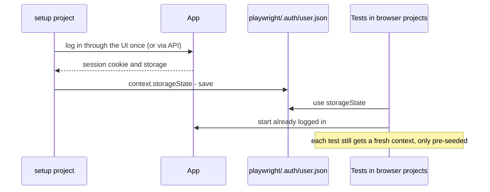

| Approach | Playwright | Cypress |
|---|---|---|
| Reuse a session | **Setup project** + `storageState` | `cy.session(id, setup, { validate })` |
| Log in without the UI | `request.post('/api/login')` then save `storageState` | `cy.request('POST', '/api/login', …)` inside `cy.session` |
| Several roles | One storage file per role (`admin.json`, `viewer.json`) | One `cy.session` id per role |
| Third-party identity provider (OAuth/OIDC) | Prefer a test-only login path or the provider's test tenant; avoid scripting a third-party login page on every run | Same; `cy.origin` if you must drive the IdP page |
| MFA | Test-only bypass in non-production, or generate TOTP codes from a test secret | Same |

**Test data rules:**
- **Create what each test needs** through an API or database seed, in `beforeEach` or a fixture, with **unique names** (`order-${testInfo.workerIndex}-${Date.now()}`), so parallel workers don't collide.
- **Don't depend on data left by another test**. Every test must pass alone and in any order.
- **Clean up** or use disposable tenants and accounts; for shared staging, tag test data so a job can purge it.
- **Never run destructive E2E against production** with real customer data. Production checks should be read-only [synthetic monitoring](./synthetic-monitoring.md) with dedicated accounts.

---

### Section 8: Real Backend or Mocked Network

E2E traditionally means "real backend", but both tools can intercept the network. The choice depends on what the test is for.

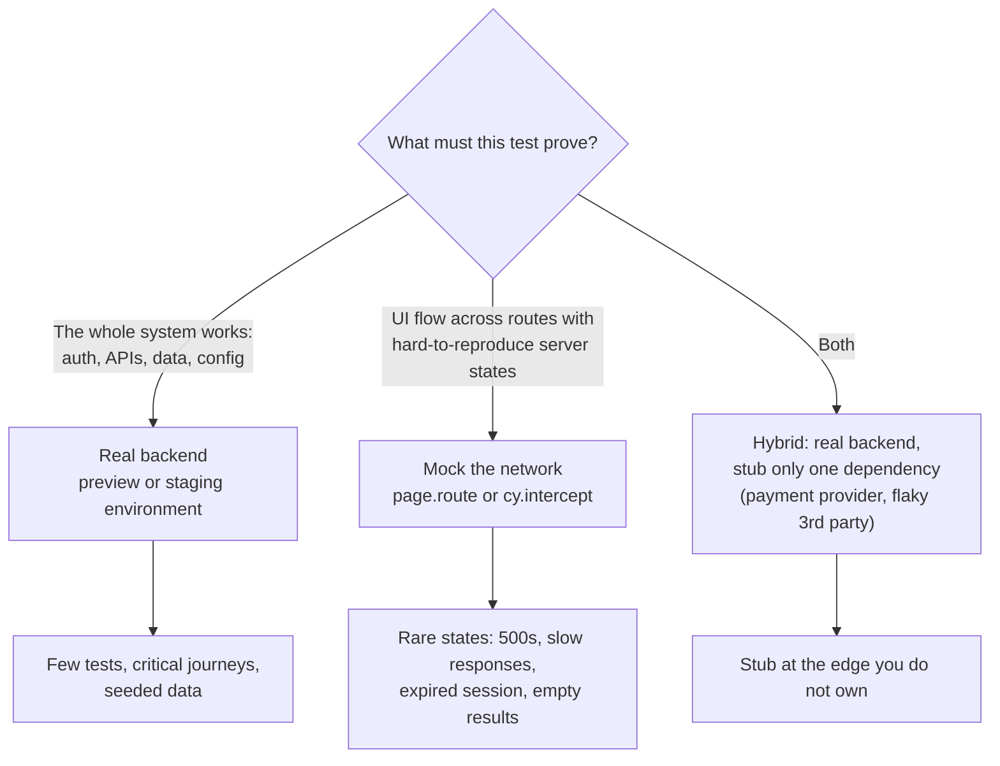

```typescript
// Playwright: force a server error for one test
await page.route('**/api/orders', (route) =>
  route.fulfill({ status: 500, json: { message: 'Internal error' } }),
);

// Playwright: modify a real response
await page.route('**/api/feature-flags', async (route) => {
  const response = await route.fetch();
  const json = await response.json();
  await route.fulfill({ response, json: { ...json, newCheckout: true } });
});
```

```javascript
// Cypress: stub with a fixture file, or simulate a slow response
cy.intercept('GET', '/api/products*', { fixture: 'products.json' }).as('products');
cy.intercept('GET', '/api/products*', (req) => {
  req.reply({ delay: 2000, fixture: 'products.json' });
});
```

> A fully mocked "E2E" suite is really a browser-based integration suite. That's useful, but it can't catch the backend, config and contract problems that are E2E's main job. Keep at least the critical journeys running against a real backend.

---

### Section 9: Flaky Tests

A **flaky test** passes and fails on the same code. Flakiness destroys trust: people start re-running jobs and ignoring red builds.

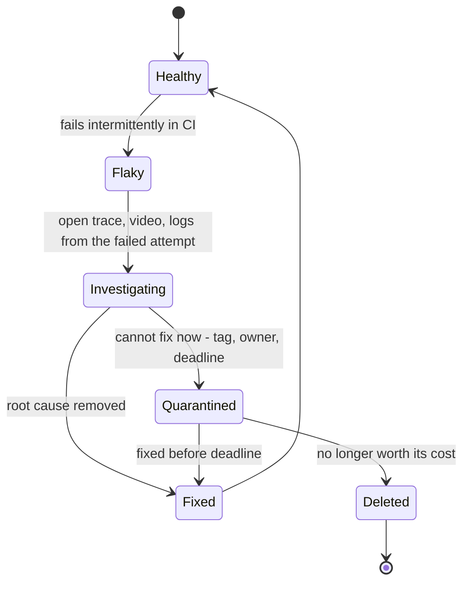

| Root cause | Fix |
|---|---|
| Fixed waits, racing the UI | Web-first assertions; wait for responses or UI state |
| Shared or leftover test data | Unique data per test; seed in fixtures; no inter-test dependencies |
| Order dependence | Make tests independent; run in parallel and in random order to expose it |
| Animations and transitions | Wait for stable state; disable or shorten animations in the test environment |
| Time, time zones, locales | `page.clock` / `cy.clock`; set `timezoneId` and `locale` in Playwright config |
| Third-party scripts (chat widgets, ads, A/B tools) | Block or stub them in E2E |
| Slow or overloaded test environment | Right-size it; fewer, faster tests; don't share one staging database across many parallel suites |
| Real bugs (race conditions in the app) | Fix the app; flaky tests sometimes reveal real user-facing races |

**Retries:** configure a small number of retries in CI (e.g. `retries: 2`) and record traces on the first retry. A test that passes only on retry is still **flaky**. Both Playwright's reports and Cypress Cloud flag it. Use retries to keep the pipeline moving while you fix the test, not to hide the problem.

---

### Section 10: Running E2E in CI

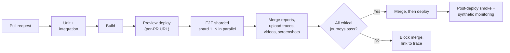

- **Target a real deployment**: a per-PR preview URL (`BASE_URL`), or start the app in CI with Playwright's `webServer` option. Testing the production build catches build-time and config bugs that `npm run dev` hides.
- **Parallelise:** Playwright runs workers per machine and shards across machines (`--shard=1/4`), then merges blob reports into one HTML report. Cypress parallelises through Cypress Cloud or by splitting spec files across CI jobs yourself.
- **Keep artifacts for failures only:** `trace: 'on-first-retry'`, `video: 'retain-on-failure'`, `screenshot: 'only-on-failure'` (Playwright); Cypress records screenshots on failure and video if enabled.
- **Browsers in CI:** install with `npx playwright install --with-deps`, or use the official Playwright or Cypress Docker images so browser versions and fonts are pinned.
- **Time budget:** if the E2E stage takes too long to gate every PR, run the critical-journey subset (tagged `@smoke`, `--grep @smoke`) on PRs and the full suite on merge or nightly.

---

### Section 11: Structuring a Suite — Page Objects and Fixtures

As suites grow, repeated selectors and flows need a home.

| Pattern | Idea | Pros | Cons |
|---|---|---|---|
| **Page Object Model (POM)** | A class per page or component with locators and actions (`checkoutPage.payWith(card)`) | Central place for locators; readable tests | Can grow into a second app; avoid putting assertions on everything inside it |
| **Playwright fixtures** | `test.extend` injects ready-made objects (a logged-in page, a seeded order, a page object) | Setup and teardown in one place; composable; lazy | Playwright-specific |
| **Cypress custom commands** | `Cypress.Commands.add('login', …)` | Short, readable specs | Global namespace; type declarations needed for TypeScript |
| **Plain helper functions** | `await addToCart(page, 'Lamp')` | Simple, no framework magic | Less structure for large suites |

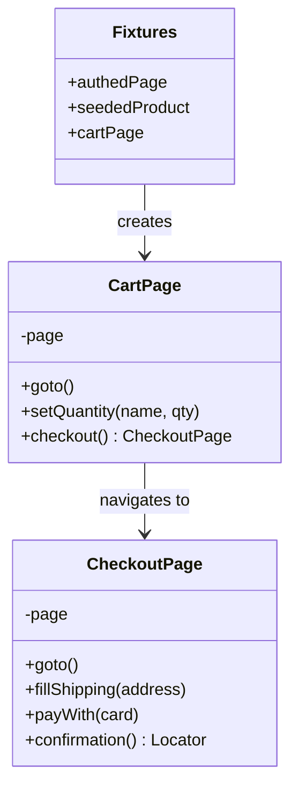

Rule of thumb: **page objects hold locators and actions; tests hold assertions**, so each test reads as a user story.

---

## Framework Comparison

E2E tests drive the **browser**, so for web apps they work the same whether the app is React, Vue, Angular, Svelte, or server-rendered. The framework mostly affects how you start the app (`webServer.command`) and whether you also use the tool's component testing. Angular's old **Protractor** runner has been deprecated and is end-of-life; Angular projects now use Playwright, Cypress or WebdriverIO.

| Tool | Approach | Best for | Notes |
|---|---|---|---|
| **Playwright** | Out-of-process, protocol-driven; Chromium, Firefox, WebKit | Cross-browser, multi-tab, multi-user, large parallel suites | Free sharding; trace viewer; several language bindings |
| **Cypress** | In-browser, command queue | Teams that value the interactive runner and time-travel debugging; component + E2E in one tool | Single tab; WebKit experimental; parallelisation through Cloud or manual splitting |
| **WebdriverIO** | W3C WebDriver and WebDriver BiDi | Teams needing WebDriver standards, real-device and mobile (via Appium) in one framework | Works with Selenium Grid and cloud device farms |
| **Selenium** | W3C WebDriver, many languages | Large existing suites, Java/Python/C# teams, grid infrastructure | Lower-level; you build waiting and structure yourself |
| **Puppeteer** | Browser automation library (Chrome and Firefox) | Scripts, scraping, PDF generation | Not a test runner; pair with Jest/Vitest if used for tests |

**Native mobile E2E** uses different tools, because there's no DOM:

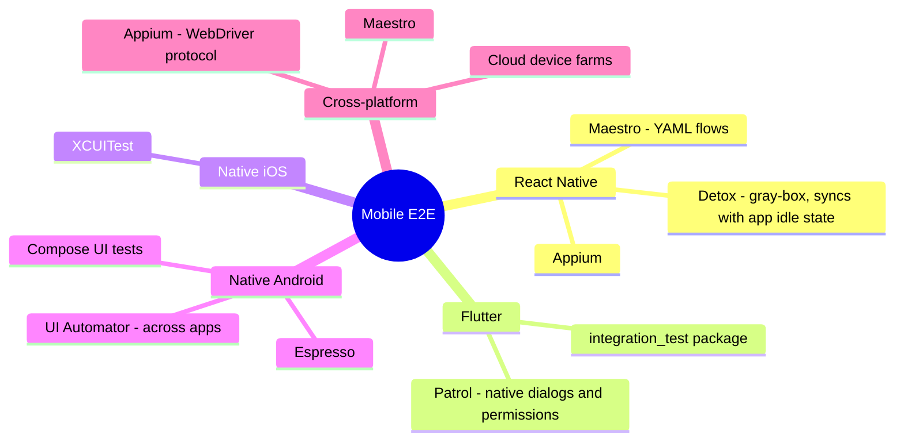

**A short history**, to explain why there are so many tools:

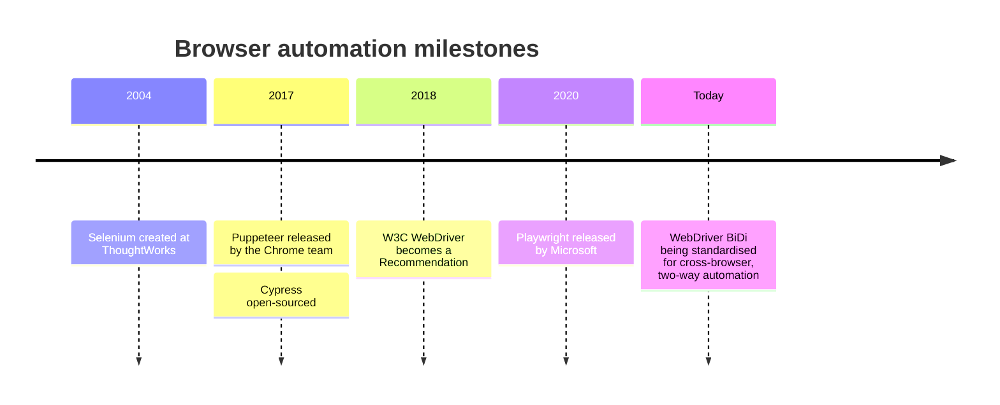

---

## Real-World Examples

**Example 1 — Playwright config for a real project:**
```typescript
// playwright.config.ts
import { defineConfig, devices } from '@playwright/test';

export default defineConfig({
  testDir: './e2e',
  fullyParallel: true,
  forbidOnly: !!process.env.CI,            // fail CI if someone left test.only
  retries: process.env.CI ? 2 : 0,
  reporter: process.env.CI ? 'blob' : 'html',
  use: {
    baseURL: process.env.BASE_URL ?? 'http://localhost:3000',
    trace: 'on-first-retry',
    screenshot: 'only-on-failure',
    video: 'retain-on-failure',
    locale: 'en-US',
    timezoneId: 'UTC',
  },
  projects: [
    { name: 'setup', testMatch: /.*\.setup\.ts/ },
    {
      name: 'chromium',
      use: { ...devices['Desktop Chrome'], storageState: 'playwright/.auth/user.json' },
      dependencies: ['setup'],
    },
    {
      name: 'webkit-mobile',
      use: { ...devices['iPhone 13'], storageState: 'playwright/.auth/user.json' },
      dependencies: ['setup'],
    },
  ],
  webServer: process.env.BASE_URL
    ? undefined // testing a deployed preview
    : { command: 'npm run build && npm run start', url: 'http://localhost:3000', reuseExistingServer: !process.env.CI },
});
```

**Example 2 — Auth setup project (log in once):**
```typescript
// e2e/auth.setup.ts
import { test as setup, expect } from '@playwright/test';

const authFile = 'playwright/.auth/user.json'; // add playwright/.auth to .gitignore

setup('authenticate', async ({ page }) => {
  await page.goto('/login');
  await page.getByLabel('Email').fill(process.env.E2E_USER_EMAIL!);
  await page.getByLabel('Password').fill(process.env.E2E_USER_PASSWORD!);
  await page.getByRole('button', { name: 'Sign in' }).click();
  await page.waitForURL('/dashboard');
  await expect(page.getByRole('button', { name: 'Account menu' })).toBeVisible();
  await page.context().storageState({ path: authFile });
});
```

**Example 3 — A critical journey with fixtures and seeded data (Playwright):**
```typescript
// e2e/fixtures.ts
import { test as base, expect } from '@playwright/test';

type Product = { id: string; name: string };

export const test = base.extend<{ product: Product }>({
  product: async ({ request }, use, testInfo) => {
    const name = `Lamp ${testInfo.workerIndex}-${Date.now()}`;           // unique per worker and run
    const res = await request.post('/api/test/products', { data: { name, price: 39.5, stock: 10 } });
    expect(res.ok()).toBeTruthy();
    const product = (await res.json()) as Product;
    await use(product);
    await request.delete(`/api/test/products/${product.id}`);            // teardown
  },
});
export { expect };

// e2e/checkout.spec.ts
import { test, expect } from './fixtures';

test('customer buys a product @smoke', async ({ page, product }) => {
  await page.goto(`/products/${product.id}`);
  await page.getByRole('button', { name: `Add ${product.name} to cart` }).click();
  await page.getByRole('link', { name: /cart/i }).click();
  await page.getByRole('button', { name: 'Checkout' }).click();

  await page.getByLabel('Card number').fill('4242 4242 4242 4242'); // provider test card in a test environment
  await page.getByRole('button', { name: 'Pay now' }).click();

  await expect(page.getByRole('heading', { name: 'Order confirmed' })).toBeVisible();
});
```

**Example 4 — Two users in one test (real-time collaboration):**
```typescript
test('comment appears for the other user in real time', async ({ browser }) => {
  const alice = await browser.newContext({ storageState: 'playwright/.auth/alice.json' });
  const bob = await browser.newContext({ storageState: 'playwright/.auth/bob.json' });
  const alicePage = await alice.newPage();
  const bobPage = await bob.newPage();

  await alicePage.goto('/docs/shared-doc');
  await bobPage.goto('/docs/shared-doc');

  await alicePage.getByRole('textbox', { name: 'Add a comment' }).fill('Looks good!');
  await alicePage.getByRole('button', { name: 'Post' }).click();

  await expect(bobPage.getByRole('article').filter({ hasText: 'Looks good!' })).toBeVisible();
  await alice.close();
  await bob.close();
});
```

**Example 5 — The same journey in Cypress with `cy.session` (BAD → GOOD):**
```javascript
// ❌ BAD: UI login in every test, CSS selectors, fixed wait
it('checkout', () => {
  cy.visit('/login');
  cy.get('#email').type('ada@example.com');
  cy.get('#password').type('secret');
  cy.get('.btn-primary').click();
  cy.wait(3000);
  cy.visit('/products/42');
  cy.get('.add-btn').click();
});

// ✅ GOOD: cached session via API, role-based queries, wait on a named request
// cypress/support/commands.js
Cypress.Commands.add('login', (email, password) => {
  cy.session([email, password], () => {
    cy.request('POST', '/api/login', { email, password }); // sets the session cookie
  }, {
    validate() { cy.request('/api/me').its('status').should('eq', 200); },
  });
});

// cypress/e2e/checkout.cy.js  (uses @testing-library/cypress)
it('adds a product to the cart', () => {
  cy.login(Cypress.env('E2E_USER_EMAIL'), Cypress.env('E2E_USER_PASSWORD'));
  cy.intercept('POST', '/api/cart/items').as('addToCart');

  cy.visit('/products/42');
  cy.findByRole('button', { name: /add .* to cart/i }).click();
  cy.wait('@addToCart').its('response.statusCode').should('eq', 201);
  cy.findByRole('status', { name: /cart/i }).should('contain.text', '1 item');
});
```

**Example 6 — Sharded Playwright run in GitHub Actions:**
```yaml
name: e2e
on: pull_request

jobs:
  e2e:
    runs-on: ubuntu-latest
    strategy:
      fail-fast: false
      matrix:
        shard: [1, 2, 3, 4]
    steps:
      - uses: actions/checkout@v4
      - uses: actions/setup-node@v4
        with:
          node-version: 22
      - run: npm ci
      - run: npx playwright install --with-deps
      - run: npx playwright test --shard=${{ matrix.shard }}/4
        env:
          BASE_URL: ${{ vars.PREVIEW_URL }}   # or omit and let webServer start the app
      - uses: actions/upload-artifact@v4
        if: ${{ !cancelled() }}
        with:
          name: blob-report-${{ matrix.shard }}
          path: blob-report
          retention-days: 7

  merge-reports:
    if: ${{ !cancelled() }}
    needs: e2e
    runs-on: ubuntu-latest
    steps:
      - uses: actions/checkout@v4
      - uses: actions/setup-node@v4
        with:
          node-version: 22
      - run: npm ci
      - uses: actions/download-artifact@v4
        with:
          path: all-blob-reports
          pattern: blob-report-*
          merge-multiple: true
      - run: npx playwright merge-reports --reporter html ./all-blob-reports
      - uses: actions/upload-artifact@v4
        with:
          name: html-report
          path: playwright-report
```

**Example 7 — Accessibility scan inside an E2E journey:**
```typescript
import AxeBuilder from '@axe-core/playwright';

test('checkout page has no detectable WCAG A/AA violations', async ({ page }) => {
  await page.goto('/checkout');
  const results = await new AxeBuilder({ page }).withTags(['wcag2a', 'wcag2aa']).analyze();
  expect(results.violations).toEqual([]);
});
// Cypress: cypress-axe → cy.injectAxe(); cy.checkA11y();
// Automated scans find only part of the issues — see Accessibility Testing.
```

---

## Key Points Summary

| Concept | One-Line Explanation |
|---|---|
| **E2E test** | Real browser, real deployed app, real backend, driven like a user |
| **Critical user journeys** | Cover the flows that must never break; leave edge cases to integration tests |
| **Playwright** | Out-of-process, Chromium/Firefox/WebKit, multi-tab and multi-context, free sharding |
| **Cypress** | Runs inside the browser, command queue with retries, time-travel runner, single tab |
| **Locators** | Role and label first; test IDs as a deliberate fallback; never layout-based CSS |
| **Auto-wait / retry-ability** | Tools wait for actionable elements and retry assertions, so don't add sleeps |
| **Fixed waits** | The top cause of slow and flaky suites; wait for UI state or a specific response |
| **Session reuse** | Log in once (`storageState`, `cy.session`); don't log in through the UI in every test |
| **Test data** | Seed per test through APIs, unique per worker, cleaned up; no inter-test dependencies |
| **Network mocking in E2E** | For rare server states; keep critical journeys on a real backend |
| **Flaky tests** | Investigate with traces, quarantine with an owner, fix the cause; retries aren't a fix |
| **CI** | Test the production build or preview deploy; shard; keep traces and videos on failure |
| **Mobile** | Detox, Maestro, Appium, XCUITest, Espresso, Flutter `integration_test` |

---

## Test Your Understanding

**Q1 (Basic):**
What's the key architectural difference between Playwright and Cypress, and name two practical consequences.

<details>
<summary>Answer</summary>

**Playwright** runs test code in a separate Node.js process and controls the browser over automation protocols (CDP for Chromium, Playwright's patched builds for Firefox and WebKit). **Cypress** runs test code **inside the browser**, in the same run loop as the app, with a Node server alongside.

Consequences:
- Playwright can drive **multiple tabs, popups, browser contexts and users** in one test. Cypress works within one tab.
- Playwright supports **WebKit** as a first-class engine; Cypress's WebKit support is experimental.
- Cypress has **direct DOM access and an interactive time-travel runner**, which many find easier for debugging. Its commands are a queue rather than promises, so `async`/`await` patterns don't apply.
- Playwright includes **free sharding**; Cypress's built-in parallelisation and load balancing come through Cypress Cloud.
</details>

**Q2 (Application):**
Your team wants E2E tests for every form validation message in a 40-field insurance application. What do you recommend instead, and what *should* the E2E suite cover?

<details>
<summary>Answer</summary>

Validation messages are **edge cases of one component or feature**. Test them in **integration tests** (RTL + MSW, or the framework's equivalent), which are fast and deterministic and can trigger every server-side validation response with a fake.

E2E should cover the **critical journeys**: a user completes and submits a valid application end to end against the real backend; a returning user resumes a saved draft; maybe one representative server-side rejection to prove the error path is wired through the real API. That gives confidence the system works together without a slow, flaky suite of hundreds of E2E tests.
</details>

**Q3 (Tricky):**
A Playwright test does `await page.click('.save'); await page.waitForTimeout(2000); expect(await page.locator('.toast').textContent()).toBe('Saved');`. It passes locally and fails roughly once in ten CI runs. Explain the failure and rewrite it.

<details>
<summary>Answer</summary>

Two problems:
1. **The fixed wait** guesses timing. On a slower CI runner, the save may take longer than 2 s, so the toast isn't there yet. On a fast run, the toast may already have disappeared.
2. **`textContent()` with a plain `expect`** reads once, with no retry. Only web-first assertions retry.

Also, `.save` and `.toast` are CSS selectors tied to styling.

```typescript
await page.getByRole('button', { name: 'Save' }).click();
await expect(page.getByRole('status')).toHaveText('Saved');
```

The assertion retries until the text matches (default 5 s), passing as soon as the UI is ready and failing with a clear message if it never is.
</details>

**Q4 (Tricky):**
Your Cypress test logs in via the UI in `beforeEach`. Someone switches it to `cy.request('/api/login')` but the tests now fail with 401 on the first page load in some specs. `cy.session` was not used. What's likely happening, and what's the right setup?

<details>
<summary>Answer</summary>

`cy.request` does set cookies from the response, but with **test isolation** on (the current default), Cypress clears cookies, storage and the page between tests. If the login call happens in a `before` hook (once per file) rather than `beforeEach`, every test after the first starts logged out. Also check whether the app stores its token in `localStorage` from a client-side flow, which an API login wouldn't populate.

The right setup is **`cy.session`**: wrap the API login in `cy.session([user], setup, { validate })` and call it in `beforeEach`. The first call runs the login and caches cookies, `localStorage` and `sessionStorage`. Later tests restore that snapshot, and `validate` re-logs in if the session has expired.
</details>

**Q5 (Application):**
Product wants confidence that real-time comments work: when Alice comments, Bob sees it without refreshing. Which tool would you pick and how would you write it?

<details>
<summary>Answer</summary>

**Playwright**, because it can open **two isolated browser contexts** (two users, separate cookies) in one test. Cypress runs one tab and can't drive two simultaneous sessions directly.

Steps: create contexts with each user's `storageState` (prepared by a setup project), open the same document in both, post a comment as Alice, and `await expect(bobPage.getByRole('article').filter({ hasText: … })).toBeVisible()`. The web-first assertion waits for the WebSocket/SSE update without fixed sleeps. Seed a fresh document per test so parallel runs don't interfere (see Example 4).
</details>

**Q6 (System design):**
Design the E2E strategy for a multi-team SaaS product (web app plus React Native app), deployed many times a day, with an OAuth login and a third-party payment provider.

<details>
<summary>Answer</summary>

- **Scope:** a tagged `@smoke` set of critical journeys per team (sign-up, login, create the core object, invite a teammate, upgrade plan / pay, permissions), owned by the feature teams. Everything else lives in integration tests.
- **Tool:** Playwright for web (Chromium on every PR; Firefox, WebKit and mobile viewports on merge or nightly), plus a small check on real Safari or iOS through a device cloud. **Detox or Maestro** for the React Native app's top journeys.
- **Environments:** each PR deploys a preview. `@smoke` runs against it and **gates merge**. The full suite runs post-merge on staging. After production deploys, read-only smoke checks run as **synthetic monitoring** with dedicated accounts.
- **Auth:** a setup project logs in once per role and saves `storageState`. For OAuth, use the IdP's test tenant or a non-production test login path instead of scripting the provider's page on every run.
- **Data:** API-seeded fixtures with unique names per worker; disposable tenants per run; nightly cleanup job.
- **Payments:** real flow with the provider's **test mode and test cards** in a couple of journeys; elsewhere stub the payment call at the network edge.
- **Reliability:** no fixed waits (lint rule), role-based locators, `retries: 2` with traces on first retry, flaky-test dashboard, quarantine with owners and deadlines.
- **CI speed:** shard across machines, merge blob reports, upload traces and videos only on failure. Keep the PR gate within an agreed time budget and move slower suites to post-merge.
</details>

---

## Cheat Sheet

**Key Definitions:**
- **E2E test:** Drives the real app in a real browser against the real backend, like a user
- **Critical user journey (CUJ):** A flow whose failure costs revenue, data or trust
- **Locator (Playwright):** A lazily evaluated, strict recipe for finding an element
- **Actionability:** Checks before an action (attached, visible, stable, enabled, receives events)
- **Web-first assertion:** An assertion that retries until it passes or times out
- **Command queue (Cypress):** `cy.*` calls are enqueued and run in order later, with retry-able queries
- **storageState / cy.session:** Saved cookies and storage used to skip repeated logins
- **Flaky test:** A test that passes and fails on the same code

**Quick Reference:**
```text
Playwright
  locate ...... page.getByRole('button', { name: 'Save' }) · getByLabel · getByText · getByTestId
  assert ...... await expect(locator).toBeVisible() / toHaveText() / toHaveURL()   (default 5 s, retries)
  network ..... await page.route('**/api/x', r => r.fulfill({ status: 500, json: {...} }))
  auth ........ setup project → context.storageState({ path }) → use: { storageState }
  users ....... browser.newContext() per user
  time ........ page.clock.install() / setFixedTime(); use: { timezoneId, locale }
  debug ....... npx playwright test --ui | --debug | codegen | show-trace trace.zip
  CI .......... --shard=1/4 + blob reporter + merge-reports; trace: 'on-first-retry'

Cypress
  locate ...... cy.findByRole(...) (Testing Library) · cy.contains('button', 'Save') · cy.get('[data-cy=x]')
  assert ...... .should('have.text', 'Saved')   (default 4 s, retries query + assertion)
  network ..... cy.intercept('POST', '/api/x').as('x'); cy.wait('@x')
  auth ........ cy.session(id, () => cy.request('POST', '/api/login', creds), { validate })
  multi-origin  cy.origin('https://idp.example', () => {...})
  node code ... cy.task('db:seed')

Never: fixed sleeps · CSS/XPath layout selectors · UI login in every test · tests depending on each other
```

**Common Mistakes to Avoid:**

| Mistake | Why Wrong | Fix |
|---|---|---|
| E2E for every edge case | Slow, flaky, expensive suite | E2E for critical journeys; edge cases in integration tests |
| `waitForTimeout` / `cy.wait(ms)` | Too short on slow CI, wasted time on fast runs | Web-first assertions; wait for a specific response |
| CSS/XPath selectors tied to layout | Break on every redesign | Role/label/text locators; meaningful test IDs |
| Logging in through the UI in every test | Slow; multiplies flakiness | `storageState` setup project / `cy.session` |
| Tests that depend on earlier tests' data | Order-dependent failures in parallel | Seed per test; unique names; cleanup |
| Fully mocked network in "E2E" | Misses backend, contract and config bugs | Real backend for critical journeys; mock only rare states or third parties |
| Running against `npm run dev` only | Misses production build and config issues | Test the production build or a preview deploy |
| Plain `expect(await locator.textContent())` | Reads once, no retry | `await expect(locator).toHaveText()` |
| Mixing `async`/`await` with Cypress commands | Commands are queued, not promises | Chain commands; use `.then()` and aliases |
| Retries hiding flakiness permanently | Bugs and slow suites persist | Track flaky tests; quarantine with owner; fix root cause |
| Destructive E2E against production | Real customer data at risk | Read-only synthetic checks with dedicated accounts |
| Treating Playwright WebKit as Safari | Engine build differs from shipping Safari | Add real Safari/iOS runs for Safari-critical flows |
| Uploading every video and trace | Storage cost, slow CI | `retain-on-failure` / `on-first-retry` |

---

## References & Further Reading

**Playwright**
- Playwright: [Getting started](https://playwright.dev/docs/intro) · [Best practices](https://playwright.dev/docs/best-practices)
- Playwright: [Locators](https://playwright.dev/docs/locators) · [Auto-waiting (actionability)](https://playwright.dev/docs/actionability) · [Assertions](https://playwright.dev/docs/test-assertions)
- Playwright: [Authentication](https://playwright.dev/docs/auth) · [Fixtures](https://playwright.dev/docs/test-fixtures) · [Mock APIs](https://playwright.dev/docs/mock)
- Playwright: [Sharding](https://playwright.dev/docs/test-sharding) · [Continuous Integration](https://playwright.dev/docs/ci) · [Trace viewer](https://playwright.dev/docs/trace-viewer)
- Playwright: [Clock](https://playwright.dev/docs/clock) · [Accessibility testing](https://playwright.dev/docs/accessibility-testing) · [Browsers](https://playwright.dev/docs/browsers)

**Cypress**
- Cypress: [Why Cypress](https://docs.cypress.io/app/get-started/why-cypress) · [Best practices](https://docs.cypress.io/app/core-concepts/best-practices)
- Cypress: [Retry-ability](https://docs.cypress.io/app/core-concepts/retry-ability) · [Introduction to Cypress (command queue)](https://docs.cypress.io/app/core-concepts/introduction-to-cypress)
- Cypress: [`cy.session`](https://docs.cypress.io/api/commands/session) · [`cy.intercept`](https://docs.cypress.io/api/commands/intercept) · [`cy.origin`](https://docs.cypress.io/api/commands/origin)
- Cypress: [Trade-offs](https://docs.cypress.io/app/references/trade-offs)
- Testing Library: [Cypress Testing Library](https://testing-library.com/docs/cypress-testing-library/intro)

**Standards & other tools**
- W3C: [WebDriver](https://www.w3.org/TR/webdriver2/) · [WebDriver BiDi](https://w3c.github.io/webdriver-bidi/)
- [WebdriverIO](https://webdriver.io/docs/what-is-webdriverio) · [Selenium](https://www.selenium.dev/documentation/) · [Puppeteer](https://pptr.dev/)
- Deque: [axe-core for Playwright](https://github.com/dequelabs/axe-core-npm/tree/develop/packages/playwright)

**Mobile**
- [Detox](https://wix.github.io/Detox/) · [Maestro](https://docs.maestro.dev/) · [Appium](https://appium.io/docs/en/latest/)
- Apple: [User interface tests (XCUIAutomation)](https://developer.apple.com/documentation/xcuiautomation)
- Android: [Espresso](https://developer.android.com/training/testing/espresso)
- Flutter: [Integration testing](https://docs.flutter.dev/testing/integration-tests)

**Deep dives**
- Google Testing Blog: [Just Say No to More End-to-End Tests](https://testing.googleblog.com/2015/04/just-say-no-to-more-end-to-end-tests.html)
- Martin Fowler: [Eradicating Non-Determinism in Tests](https://martinfowler.com/articles/nonDeterminism.html)
- Angular: [Protractor repository (deprecation notice)](https://github.com/angular/protractor)

---

> **Previous Topic:** [Integration Testing](./integration-testing.md)
> — Testing real features together with only the network and other edges faked

> **Next Topic:** [Visual Regression Testing](./visual-regression-testing.md)
> — Catching unintended visual changes with screenshot comparison

*Saved on: 2026-11-06 | Repo: Frontend System Design Learning Notes*
