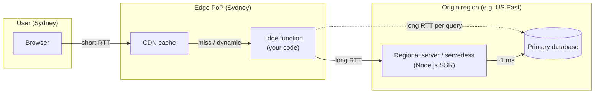
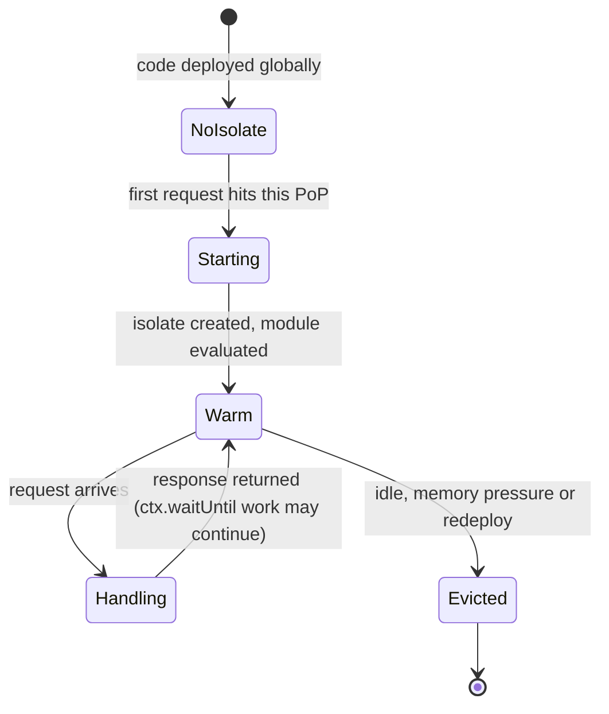
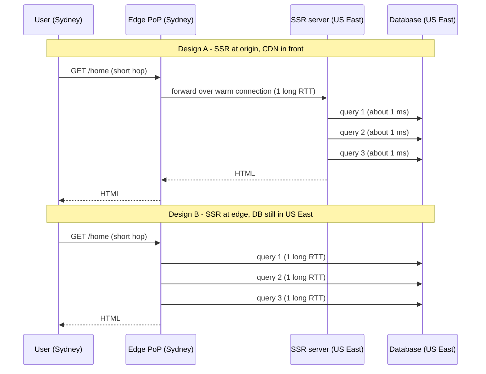
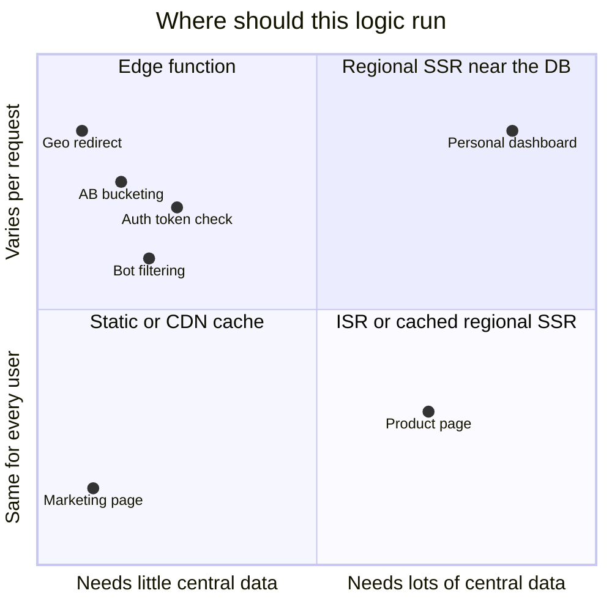
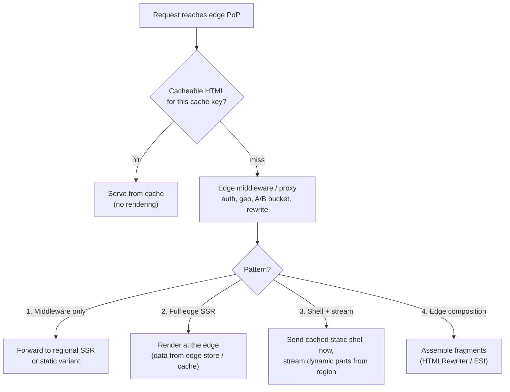
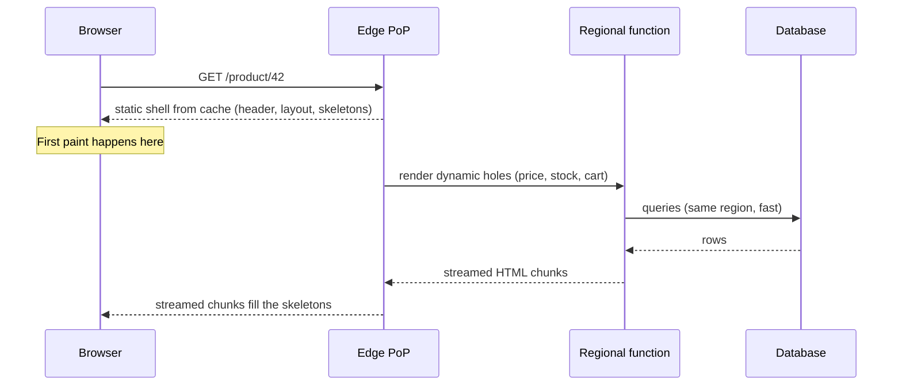
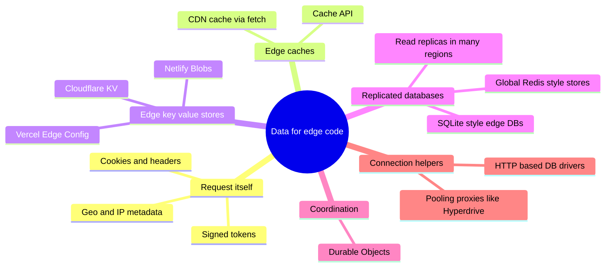
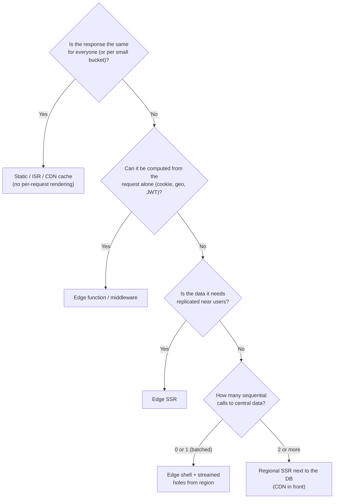

<!-- Generated by scripts/sync-knowledge.js from notes/ and README.md — do not edit here. -->
<!-- sections (line ranges in this file): Table of Contents 19-38 · ELI5 39-52 · Core Concept 53-335 · Decision Matrix 336-361 · Real-World Examples 362-550 · Key Points Summary 551-569 · Test Your Understanding 570-645 · Cheat Sheet 646-692 · References & Further Reading 693-727 -->

# Edge Rendering

> **Date:** 2026-11-06 · **Last updated:** 2026-11-06
> **Category:** Frontend System Design
> **Sub-Topic:** Rendering & Architecture / Rendering Patterns
> **Level:** Advanced · **Reading time:** ~28 min
> **Informs:** where SSR runs (edge vs regional vs origin), TTFB for global users, data locality and database placement, personalization and A/B testing at the CDN, middleware/proxy design, runtime choice (Edge vs Node.js)

> **Pre-requisite:** [Server-Side Rendering (SSR)](./server-side-rendering-ssr.md) (what rendering on a server costs) and [DNS Resolution & CDN](./dns-resolution-and-cdn.md) (what an edge PoP is).
> This note answers one question: **when does moving server code to the CDN edge make pages faster — and when does it make them slower?**

**Previous:** [Island Architecture](./island-architecture.md) · **Next:** [Micro-Frontends Architecture](./micro-frontends-architecture.md)

---

## Table of Contents

1. [ELI5 — Simple Explanation](#eli5--simple-explanation)
2. [Section 1: What "Edge" Means](#section-1-what-edge-means)
3. [Section 2: The Edge Runtime — Isolates, Not Servers](#section-2-the-edge-runtime--isolates-not-servers)
4. [Section 3: The Latency Math — Why Data Locality Decides Everything](#section-3-the-latency-math--why-data-locality-decides-everything)
5. [Section 4: What Runs Well at the Edge](#section-4-what-runs-well-at-the-edge)
6. [Section 5: Edge SSR Patterns](#section-5-edge-ssr-patterns)
7. [Section 6: Data at the Edge](#section-6-data-at-the-edge)
8. [Section 7: Platforms and Framework Support](#section-7-platforms-and-framework-support)
9. [Section 8: Limits, Costs and Failure Modes](#section-8-limits-costs-and-failure-modes)
10. [Decision Matrix — Where Should This Code Run?](#decision-matrix--where-should-this-code-run)
11. [Real-World Examples](#real-world-examples)
12. [Key Points Summary](#key-points-summary)
13. [Test Your Understanding (with answers)](#test-your-understanding)
14. [Cheat Sheet](#cheat-sheet)
15. [References & Further Reading](#references--further-reading)

---

## ELI5 — Simple Explanation

Imagine a pizza chain.

- **Origin SSR** = one central kitchen. Every pizza is made there and driven across the country. Customers far away wait for the drive.
- **CDN caching** = frozen pizzas stocked at a corner shop near every customer. Instant — but everybody gets the same pizza.
- **Edge rendering** = a small kitchen in every corner shop that bakes a pizza **to order**, right next to the customer.

But here's the catch: if the corner kitchen must **phone the central warehouse for every ingredient** (cheese... wait... tomato... wait... basil... wait), it's slower than just baking in the central kitchen, which has the warehouse next door.

> **Edge rendering wins only when the code AND the data it needs are close to the user. Compute near the user plus data far away = more long round trips, not fewer.**

---

## Core Concept — Step by Step

### Section 1: What "Edge" Means

"The edge" is the network of **CDN points of presence (PoPs)** that sit close to users — usually hundreds of cities. Historically PoPs only **cached** bytes. Now they can **run your code** on every request.



Three places your server code can run:

| Placement | Where | Typical runtime | Strength | Weakness |
|---|---|---|---|---|
| **Origin / regional** | One (or a few) cloud regions | Node.js, Deno, Bun, Java, Go… in containers or serverless | Next to the database; full runtime; no API limits | Far from distant users |
| **Edge** | Every (or most) CDN PoPs | V8 isolates or WebAssembly with Web-standard APIs | Near every user; fast startup; scales out automatically | Far from your data; restricted APIs; CPU limits |
| **Client** | The user's device | Browser JS | Zero network for interactions | Must download JS first; weak devices |

**Edge rendering** = running the SSR step (or part of it) in an edge function, so HTML is produced in the PoP nearest the user.

> **"Edge" is a marketing word with fuzzy borders.** Some products called "edge" run in every PoP (Cloudflare Workers, CloudFront Functions); others run in a smaller set of regional edge locations (AWS Lambda@Edge runs at regional edge caches); and some platforms let "edge" functions run in a chosen region. Always check *where* the code physically executes.

---

### Section 2: The Edge Runtime — Isolates, Not Servers

Most JavaScript edge platforms run code in **V8 isolates**: many tenants share one process, each in its own sandboxed heap. There's no container or VM to boot per customer.



| Property | Isolate-based edge (Workers, Vercel Edge runtime, Netlify/Deno edge) | Container/VM serverless (Lambda, Cloud Run, Vercel Node.js functions) |
|---|---|---|
| **Startup** | Very fast — Cloudflare, for example, pre-warms the isolate during the TLS handshake | Slower cold starts (runtime boot + module load); platforms mitigate with warm pools |
| **APIs** | Web-standard: `fetch`, `Request`/`Response`, `URL`, Streams, `crypto.subtle`, `TextEncoder`, `caches` | Full Node.js (`fs`, `net`, native addons) |
| **Node.js compatibility** | Partial and opt-in (e.g. Cloudflare's `nodejs_compat` flag) | Complete |
| **Raw TCP** | Usually not available, or only via a platform API (e.g. Cloudflare's `connect()`) | Yes — normal DB drivers work |
| **Limits** | Tight CPU-time, memory and bundle-size limits per request | Generous (seconds to minutes, GBs of memory) |
| **Global state** | Per-isolate memory is **not** shared or durable — treat it as a cache at best | Per-instance, also not durable |

**The shared API baseline.** The Web-standard subset these runtimes share is being standardised by **WinterTC** (Ecma TC55, the successor of the WinterCG community group) as a "minimum common API". Code written against `Request`/`Response` and `fetch` ports between Cloudflare, Deno, Bun, Vercel, Netlify and Node.js.

> **Rule:** if your server code needs `fs`, a native module, or a long-lived TCP connection pool, it is not an edge workload without changes.

---

### Section 3: The Latency Math — Why Data Locality Decides Everything

Light in optical fibre travels at about 200,000 km/s — roughly **1 ms of round-trip time per 100 km** of distance, before routing detours. Sydney to US-East is about 15,700 km great-circle, so the **physical floor** for one round trip is ~157 ms; real routes are slower.

Now compare two designs for a page that needs **three sequential database queries** (user → cart → recommendations):



```text
Design A (origin SSR):  1 long RTT  + 3 × ~1 ms         ≈ 1 long RTT
Design B (edge SSR):    3 long RTTs (one per sequential query)  ≈ 3 long RTTs  ← slower!
Design C (edge SSR + edge-replicated data or cache): 0 long RTTs   ← fastest, but needs data at the edge
```

Rules that fall out of this:

1. **Count the round trips to data, not the distance to the user.** Edge SSR helps only if the page needs **zero or one** trip to a far region.
2. **Sequential awaits multiply the penalty.** Parallelise (`Promise.all`) or batch into one call to a regional BFF.
3. **The CDN already gives you a near-user TLS termination.** Origin SSR behind a CDN pays the long distance **once**, over a pre-warmed edge-to-origin connection.
4. **Static and cached content beats both.** A cache hit at the edge needs no rendering at all.

This is why platforms added **placement controls**: Cloudflare **Smart Placement** can run a Worker near its backend instead of near the user, and Vercel/Next.js let you pin a function to a region (`preferredRegion`). "Edge runtime" and "runs at the edge" are not the same thing.

---

### Section 4: What Runs Well at the Edge

The best edge workloads need **only the request itself** (URL, headers, cookies, geo) or **small, read-mostly data** replicated to the edge.



| Workload | Why it fits the edge |
|---|---|
| **Redirects and rewrites** (locale, vanity URLs, legacy paths) | Pure function of URL + headers |
| **Geolocation routing / content** | Geo data is attached to the request by the platform |
| **A/B test bucketing** | Read or set a cookie, rewrite to a pre-rendered variant — both variants stay cacheable |
| **Auth gating** | Verify a signed JWT/session cookie with `crypto.subtle` — no DB call; redirect to login if invalid |
| **Feature flags** | Flags from an edge-replicated store (e.g. Vercel Edge Config, Cloudflare KV) |
| **Header manipulation** | Security headers, CSP nonces, cache-key normalisation |
| **Bot / abuse filtering, rate limiting** | Reject bad traffic before it costs origin compute |
| **Personalising a cached page** | Fetch a cached shell, inject a small personalised fragment (HTML streaming rewrite) |
| **Full SSR of pages whose data is edge-local** | e.g. a docs site reading from an edge KV store |

**Poor fits:** pages that need several queries against a single-region relational DB, heavy CPU work (image processing, big Markdown/MDX compilation, PDF generation), anything needing native Node.js modules, and long-running jobs.

---

### Section 5: Edge SSR Patterns



**Pattern 1 — Edge middleware + regional rendering (most common).** The edge decides *which* page (auth, locale, variant) and the origin or a static file renders it. Cheap, safe and gives most of the benefit.

**Pattern 2 — Full edge SSR.** The framework's server bundle runs in the edge function. Works well when data comes from an edge KV/cache, an edge-replicated database, or a fast public API that is itself globally cached.

**Pattern 3 — Static shell + streamed dynamic holes.** The edge sends a pre-rendered shell immediately (fast TTFB/FCP), and the personalised parts **stream** in from a function placed near the data. This is the idea behind Next.js **Partial Prerendering** (in Next.js 16 delivered through "Cache Components") and, conceptually, the "server islands" in Astro. See [Streaming SSR & React Server Components](./streaming-ssr-and-react-server-components.md) and [Island Architecture](./island-architecture.md).



**Pattern 4 — Edge composition.** The edge stitches together independently cached fragments (header, product body, personalised banner) — with Cloudflare's `HTMLRewriter`, Edge Side Includes on CDNs that support it, or framework-level composition. Useful for [Micro-Frontends](./micro-frontends-architecture.md) composed on the server.

---

### Section 6: Data at the Edge

If you want full edge SSR, you need data that is **close** or **cheap to reach**.



| Option | Consistency | Good for | Watch out for |
|---|---|---|---|
| **Request-only data** (cookies, geo, JWT) | N/A | Auth gating, routing, bucketing | Don't trust unsigned cookies |
| **Edge KV** (e.g. Cloudflare KV, Vercel Edge Config) | **Eventually consistent** — Cloudflare documents that writes can take on the order of a minute to reach all locations | Flags, config, redirects, rarely changing content | Not for counters, carts, or read-after-write flows |
| **CDN cache of API responses** | TTL / SWR based | Public catalogue data | Never cache per-user data under a shared key |
| **Read replicas near PoPs** | Replication lag | Read-heavy pages | Writes still go to the primary; read-your-own-writes needs routing tricks |
| **Strongly consistent edge objects** (e.g. Cloudflare Durable Objects) | Strong, per object | Chat rooms, collaborative docs, rate limits | Each object lives in one location; design keys carefully |
| **HTTP-based DB drivers / pooling proxies** (e.g. Neon's serverless driver, Cloudflare Hyperdrive) | Same as the DB | Talking to Postgres/MySQL from runtimes without TCP pools | Still a long RTT if the DB is far — pair with placement controls |

> **Read-your-own-writes trap:** a user saves their profile (write to the primary in US East), the next request renders at the Sydney edge from a replica that hasn't caught up, and the old name appears. Mitigate by routing the user to the primary for a short window after a write, using version tokens, or updating the UI optimistically on the client.

---

### Section 7: Platforms and Framework Support

**Platforms** (names change often — confirm current features in each vendor's docs):

| Platform | Execution model | Notes |
|---|---|---|
| **Cloudflare Workers** | V8 isolates in Cloudflare's PoPs | KV, D1, R2, Durable Objects, Hyperdrive, Smart Placement, `HTMLRewriter`; opt-in Node.js compatibility |
| **Vercel** | Edge runtime (isolates) and Node.js runtime in Vercel Functions | Vercel's docs now generally recommend the **Node.js runtime** for most functions and keep the Edge runtime for lightweight work; Routing Middleware runs before the cache |
| **Netlify Edge Functions** | Deno-based | `context.geo`, `context.next()` to modify origin responses |
| **Deno Deploy** | Deno isolates, multi-region | Web-standard APIs, Deno KV |
| **Fastly Compute** | WebAssembly | JS, Rust, Go and more compiled to Wasm |
| **AWS CloudFront Functions** | Lightweight JS at CloudFront edge locations | Viewer request/response only; very small limits, no network calls — headers, redirects, URL rewrites |
| **AWS Lambda@Edge** | Node.js/Python at regional edge caches | More capable than CloudFront Functions, slower to start, not every PoP |
| **Akamai EdgeWorkers** | JS at Akamai edge | Pairs with Akamai's ESI support |

**Frameworks** — most modern meta-frameworks have an adapter or preset for Web-standard runtimes:

| Framework | How you target the edge |
|---|---|
| **Next.js (React)** | Per route: `export const runtime = 'edge'`. Middleware historically ran on the Edge runtime; **Next.js 16 renamed `middleware.ts` to `proxy.ts`, which runs on Node.js** (middleware remains for Edge use, deprecated). Some newer features require the Node.js runtime — check the docs |
| **React Router v7 / Remix** | Cloudflare (and other) adapters; the server is built on `Request`/`Response` |
| **SvelteKit** | `@sveltejs/adapter-cloudflare`, `adapter-netlify` (edge option), `adapter-vercel` |
| **Nuxt (Vue)** | Nitro deployment presets for Cloudflare, Vercel Edge, Netlify Edge, Deno Deploy |
| **Astro** | `@astrojs/cloudflare`, Netlify and Vercel adapters; on-demand routes run in the target runtime |
| **Angular** | `@angular/ssr` provides `AngularAppEngine`, a Fetch-API-based engine for non-Node runtimes — see the Angular SSR guide for its current status |
| **SolidStart, Qwik City, Hono** | Built on Web-standard request handlers; deploy to most edge runtimes |

**Native mobile:** iOS/Android apps don't "render" HTML at the edge, but the same rules apply to the **APIs and BFFs** they call — an edge-hosted endpoint is fast only if its data is edge-local. Server-driven UI payloads can be cached and personalised at the edge exactly like HTML.

---

### Section 8: Limits, Costs and Failure Modes

| Concern | What happens | Mitigation |
|---|---|---|
| **Data far away** | Multiple long round trips → slower than origin SSR | Placement controls, edge data, batch into one regional call |
| **CPU-time limits** | Heavy renders get terminated | Keep edge code light; move heavy work to regional functions or build time |
| **Bundle-size limits** | Large server bundles fail to deploy | Split routes; keep heavy dependencies out of edge routes |
| **Missing Node.js APIs** | Library crashes at runtime (`fs`, `net`, `Buffer` assumptions) | Choose Web-standard libraries; enable compatibility flags; test on the real runtime locally (e.g. `wrangler dev`) |
| **No TCP pooling** | Every invocation opens new DB connections, or can't at all | HTTP-based drivers, pooling proxies |
| **Per-isolate globals** | In-memory caches differ between PoPs and vanish on eviction | Use KV/cache APIs; never rely on module state for correctness |
| **Caching personalised HTML** | One user's data served to another | `Cache-Control: private`, cache key on bucket not user, separate public shell from private data |
| **Debuggability** | Logs spread across hundreds of PoPs | Structured logs with PoP/region IDs, tail logs, tracing |
| **Vendor lock-in** | Platform-specific APIs (`request.cf`, `context.geo`, KV bindings) | Keep business logic on Web-standard APIs; isolate platform calls in a thin adapter |
| **Cost model** | Billing by requests and CPU time, not instance hours | Cache aggressively so most requests never invoke the function |

---

## Decision Matrix — Where Should This Code Run?



| Scenario | Recommendation | Why |
|---|---|---|
| Marketing site, docs, blog | **SSG/ISR on the CDN**, edge middleware for locale | No per-request rendering needed |
| Global e-commerce product page | **Cached shell + streamed price/stock** from region, edge A/B bucketing | Most of the page is public; personalised parts are small |
| Logged-in dashboard on one Postgres | **Regional SSR** (or CSR + regional API), edge only for auth redirect | Many queries against one region |
| Geo-specific landing pages | **Edge rewrite to pre-rendered variants** | Variant count is small and cacheable |
| Multi-region app with replicated reads | **Edge or multi-region SSR** reading from local replicas | Data is already near users |
| Heavy server work (PDF, image, MDX compile) | **Regional function** or build time | Edge CPU limits |

---

## Real-World Examples

**Example 1 — Cloudflare Worker: geo-aware redirect + cached response (TypeScript):**
```typescript
// src/index.ts — Cloudflare Workers module syntax
export interface Env {
  FLAGS: KVNamespace; // edge KV binding declared in wrangler config
}

const LOCALES: Record<string, string> = { DE: 'de', FR: 'fr', JP: 'ja' };

export default {
  async fetch(request: Request, env: Env, ctx: ExecutionContext): Promise<Response> {
    const url = new URL(request.url);

    // 1. Pure request-based logic: perfect for the edge
    if (url.pathname === '/') {
      const country = (request.cf?.country as string | undefined) ?? 'US';
      const locale = LOCALES[country] ?? 'en';
      return Response.redirect(`${url.origin}/${locale}/`, 302);
    }

    // 2. Small, read-mostly data from edge KV (eventually consistent)
    const banner = (await env.FLAGS.get('promo-banner')) ?? '';

    // 3. Edge cache for a public API response
    const cache = caches.default;
    const cached = await cache.match(request);
    if (cached) return cached;

    const origin = await fetch(request);
    const response = new Response(origin.body, origin);
    response.headers.set('Cache-Control', 'public, max-age=60');
    response.headers.set('X-Promo', banner);
    ctx.waitUntil(cache.put(request, response.clone())); // don't block the user
    return response;
  },
} satisfies ExportedHandler<Env>;
```

**Example 2 — Next.js A/B bucketing at the edge, keeping both variants static:**
```typescript
// proxy.ts (Next.js 16+). On Next.js 15 and earlier: middleware.ts exporting `middleware`.
import { NextResponse, type NextRequest } from 'next/server';

const COOKIE = 'ab-home';

export function proxy(request: NextRequest) {
  let bucket = request.cookies.get(COOKIE)?.value;
  if (bucket !== 'a' && bucket !== 'b') {
    bucket = Math.random() < 0.5 ? 'a' : 'b';
  }

  // Rewrite (URL in the address bar stays "/") to a pre-rendered variant
  const url = request.nextUrl.clone();
  url.pathname = `/home-${bucket}`;
  const response = NextResponse.rewrite(url);

  response.cookies.set(COOKIE, bucket, {
    path: '/',
    maxAge: 60 * 60 * 24 * 30,
    sameSite: 'lax',
  });
  return response;
}

export const config = { matcher: ['/'] };
```
> Two cached variants instead of one render per user. Note: `request.geo` and `request.ip` were removed from `NextRequest` in Next.js 15; on Vercel use the `geolocation()` / `ipAddress()` helpers from `@vercel/functions`.

**Example 3 — BAD → GOOD: edge SSR with a far-away database (Next.js App Router):**
```tsx
// ❌ BAD: runs at the edge, but makes 3 sequential trips to a database in one region
export const runtime = 'edge';

export default async function Page() {
  const user = await db.user.find(session.userId);         // long RTT #1
  const cart = await db.cart.find(user.cartId);             // long RTT #2 (depends on #1)
  const recs = await db.recs.forUser(user.id);              // long RTT #3 (could be parallel!)
  return <Home user={user} cart={cart} recs={recs} />;
}
```
```tsx
// ✅ GOOD option A: keep the Node.js runtime and pin the function next to the database
export const runtime = 'nodejs';
export const preferredRegion = 'iad1'; // same region as the DB (Vercel region ID)

export default async function Page() {
  const user = await db.user.find(session.userId);
  const [cart, recs] = await Promise.all([db.cart.find(user.cartId), db.recs.forUser(user.id)]);
  return <Home user={user} cart={cart} recs={recs} />;
}

// ✅ GOOD option B: stay at the edge but make ONE call to a regional BFF that does the joins
// const data = await fetch('https://bff.internal.example.com/home', { headers: { cookie } }).then(r => r.json());
```

**Example 4 — Personalise a cached page with `HTMLRewriter` (Cloudflare):**
```typescript
export default {
  async fetch(request: Request): Promise<Response> {
    // The shell is public and cached at the edge for everyone
    const shell = await fetch(request, { cf: { cacheEverything: true, cacheTtl: 300 } });

    const name = getCookie(request, 'display_name') ?? 'there';

    // Stream-rewrite only the personal fragment; the rest passes through untouched
    const personalised = new HTMLRewriter()
      .on('[data-greeting]', {
        element(el) {
          el.setInnerContent(`Hi, ${name}!`); // text by default → HTML-escaped (XSS-safe)
        },
      })
      .transform(shell);

    const response = new Response(personalised.body, personalised);
    response.headers.set('Cache-Control', 'private, no-store'); // the personalised result must not be shared
    return response;
  },
};

function getCookie(request: Request, name: string): string | undefined {
  const match = request.headers.get('Cookie')?.match(new RegExp(`(?:^|; )${name}=([^;]*)`));
  return match ? decodeURIComponent(match[1]) : undefined;
}
```

**Example 5 — Let the platform move the Worker next to the backend (Cloudflare Smart Placement):**
```toml
# wrangler.toml
name = "storefront-ssr"
main = "src/index.ts"
compatibility_date = "2026-10-01"
compatibility_flags = ["nodejs_compat"]

[placement]
mode = "smart"   # run near the backend it talks to, when that is measurably faster
```

**Example 6 — Targeting Web-standard runtimes in other frameworks:**
```javascript
// SvelteKit — svelte.config.js
import adapter from '@sveltejs/adapter-cloudflare';
export default { kit: { adapter: adapter() } };
```
```typescript
// Nuxt (Vue) — nuxt.config.ts: pick a Nitro preset for the target runtime
export default defineNuxtConfig({
  nitro: { preset: 'cloudflare_module' }, // others exist for Vercel Edge, Netlify Edge, Deno Deploy
});
```
```javascript
// Astro — astro.config.mjs
import { defineConfig } from 'astro/config';
import cloudflare from '@astrojs/cloudflare';
export default defineConfig({ output: 'server', adapter: cloudflare() });
```
```typescript
// Angular — a Fetch-API request handler from @angular/ssr (check the SSR guide for status)
import { AngularAppEngine, createRequestHandler } from '@angular/ssr';

const angularApp = new AngularAppEngine();
export const reqHandler = createRequestHandler(async (req: Request) => {
  return (await angularApp.handle(req)) ?? new Response('Not found', { status: 404 });
});
```

**Example 7 — Verifying a session JWT at the edge without a database call:**
```typescript
// Next.js proxy/middleware or any edge handler (on Cloudflare, read the secret from `env` instead)
import { jwtVerify } from 'jose'; // jose works on Web Crypto, so it runs in edge runtimes

const secret = new TextEncoder().encode(process.env.SESSION_SECRET);

export async function requireSession(request: Request): Promise<Response | null> {
  const token = request.headers.get('Cookie')?.match(/(?:^|; )session=([^;]+)/)?.[1];
  if (!token) return Response.redirect(new URL('/login', request.url), 302);
  try {
    await jwtVerify(token, secret, { algorithms: ['HS256'] });
    return null; // continue to the page
  } catch {
    return Response.redirect(new URL('/login', request.url), 302);
  }
}
```
> Stateless verification is fast, but revocation needs a short token lifetime or a deny-list in edge KV. See *Authentication Architecture (BFF Pattern)* in Phase 10.

---

## Key Points Summary

| Concept | One-Line Explanation |
|---|---|
| **Edge** | CDN PoPs close to users that can now run code per request |
| **Edge rendering** | Running SSR (or part of it) in an edge function |
| **V8 isolates** | Lightweight sandboxes with very fast startup and Web-standard APIs |
| **Data locality** | Edge compute is fast only if its data is edge-local or reached in ≤ 1 trip |
| **Sequential awaits** | Each dependent query to a far DB adds a full long round trip |
| **Placement controls** | Smart Placement / `preferredRegion` run code near the data instead |
| **Edge middleware** | The most useful edge workload: auth, geo, A/B, rewrites, headers |
| **Shell + stream** | Static shell from the edge, dynamic holes streamed from the region |
| **Edge KV** | Fast global reads, eventually consistent writes |
| **WinterTC** | Ecma TC55 — standardising the common Web API surface for server runtimes |
| **Runtime limits** | CPU time, bundle size, no `fs`, limited Node.js APIs, no TCP pools |
| **Caching first** | A cache hit beats any rendering location |

---

## Test Your Understanding

**Q1 (Basic):**
What is the difference between "edge caching" and "edge rendering"? Give one workload suited to each.

<details>
<summary>Answer</summary>

**Edge caching** stores a response that was produced elsewhere and replays it to everyone who shares the cache key — no code runs per request. Good for hashed assets, SSG/ISR pages and public API responses.

**Edge rendering** runs your code in the PoP for each request (or each cache miss) and can produce a different response per user. Good for work that depends on the request: A/B bucketing, geo redirects, auth gating, or SSR whose data is available at the edge. Caching is cheaper and faster whenever the response can be shared, so prefer it first.
</details>

**Q2 (Application):**
Your team moved a logged-in dashboard from Node.js SSR in `us-east` to edge SSR. European users report that TTFB got **worse**. The page makes four sequential Postgres queries to `us-east`. Explain and fix.

<details>
<summary>Answer</summary>

Before the move, the request crossed the Atlantic **once** (edge → origin over a warm connection) and the four queries took ~1 ms each inside the region. After the move, rendering happens in Europe and **each query crosses the Atlantic**, so four sequential queries mean four long round trips, plus new DB connections from a runtime without TCP pooling.

Fixes, best first: move the rendering back next to the DB (Node.js runtime with `preferredRegion`, or Cloudflare Smart Placement); or keep only middleware at the edge (auth redirect) and render regionally; or replace the four queries with **one** call to a regional BFF, parallelised server-side. Edge SSR would only make sense with read replicas near European users.
</details>

**Q3 (Tricky):**
An engineer stores a request counter in a module-level `let count = 0` in an edge function to implement rate limiting. In testing it works. In production abusive clients are barely limited. Why?

<details>
<summary>Answer</summary>

Module state lives in **one isolate in one PoP**. Production traffic is spread across many PoPs and many isolates, and isolates are evicted and recreated at any time, so each copy sees only a fraction of the requests and resets unpredictably. Locally there was a single isolate, which hid the problem.

Use a **coordinated store**: the platform's rate-limiting feature, a strongly consistent per-key object (e.g. a Durable Object keyed by client), or a global Redis-style store. An eventually consistent KV is also wrong for counters.
</details>

**Q4 (Tricky):**
You personalise the home page at the edge with the user's name, then set `Cache-Control: public, s-maxage=300` so the CDN can cache it. What goes wrong, and what is the correct design?

<details>
<summary>Answer</summary>

The CDN caches the **first** personalised response under a key that is just the URL, and serves "Hi, Alice!" to everyone for five minutes — a privacy incident.

Correct design: cache only the **public shell** (`public, s-maxage=...`), then personalise **after** the cache lookup (e.g. stream-rewrite a small fragment with `HTMLRewriter`, or fetch the personal part client-side) and mark the final response `private` / `no-store`. If you vary by a small bucket (A/B group, country), put the **bucket** — not the user ID — in the cache key.
</details>

**Q5 (System design):**
Design rendering for a global news site: home and article pages are the same for everyone, but there's a per-region "top stories" module, a logged-in "saved articles" badge, and an A/B test on the article layout.

<details>
<summary>Answer</summary>

- **Article and home HTML:** pre-render (SSG/ISR) and cache at the CDN with `s-maxage` + `stale-while-revalidate`, purged on publish. No per-request rendering.
- **Regional top stories:** small set of variants, so render one per region and let **edge middleware rewrite** to the region's variant based on geo. Cache key includes the region, not the user.
- **A/B layout:** edge middleware assigns a sticky bucket cookie and rewrites to `/article-a/...` or `/article-b/...`; both stay cacheable.
- **Saved-articles badge:** per-user, so fetch it **client-side** from a regional API with `private, no-cache`, or stream it as a dynamic hole. Never bake it into cached HTML.
- Result: nearly every request is a cache hit; edge code does only routing; the only per-user call is tiny and off the critical path.
</details>

**Q6 (Application):**
Your Next.js route uses `export const runtime = 'edge'` and imports a PDF library that uses `fs` and `Buffer`. The build or the request fails. What are your options?

<details>
<summary>Answer</summary>

The Edge runtime exposes Web-standard APIs, not the full Node.js API, so libraries that depend on `fs` or native modules don't work there. Options:

1. Switch this route to `runtime = 'nodejs'`. PDF generation is CPU-heavy and a poor edge fit anyway, so this is usually the right call.
2. Use a library written for Web-standard runtimes (`Uint8Array`, Web Streams, `fetch`).
3. On platforms with Node.js compatibility layers (e.g. Cloudflare's `nodejs_compat`), check whether the specific APIs are supported. `fs` generally isn't available as a real filesystem.

Keep only the request-routing part of the feature at the edge.
</details>

---

## Cheat Sheet

**Key Definitions:**
- **Edge / PoP:** A CDN location close to users that can cache and run code
- **Edge function:** Code executed per request in a PoP, usually in a V8 isolate or Wasm sandbox
- **Edge SSR:** Server rendering performed inside an edge function
- **Edge middleware / proxy:** Edge code that runs before the cache or the page — redirects, rewrites, auth, headers
- **Data locality:** How close the data is to the code that needs it
- **Smart Placement / preferred region:** Platform features that run a function near its backend instead of near the user
- **Edge KV:** Globally replicated, read-optimised, eventually consistent key-value store
- **WinterTC:** Ecma TC55, standardising a common Web API set for server-side JS runtimes

**Quick Reference:**
```text
Edge is great for:   redirects · rewrites · geo · A/B buckets · JWT checks · headers · bot filtering
                     · personalising a cached shell · SSR whose data is edge-local
Edge is bad for:     many sequential queries to one-region DB · heavy CPU · native Node modules
                     · long-running jobs · strongly consistent counters in module state

Latency rule:        long RTTs to data  ×  number of sequential calls  =  the real cost
Physics:             ~1 ms RTT per 100 km of fibre (floor), real routes slower
Order of preference: CDN cache hit > edge function on request data > edge SSR with edge data
                     > edge shell + streamed regional holes > regional SSR next to DB

Next.js:             export const runtime = 'edge' | 'nodejs'   ·   export const preferredRegion = '...'
                     Next.js 16: middleware.ts → proxy.ts (Node.js runtime)
Cloudflare:          [placement] mode = "smart"   ·   caches.default   ·   HTMLRewriter   ·   ctx.waitUntil
Personalised output: Cache-Control: private / no-store  ·  cache key on bucket, never on user ID
```

**Common Mistakes to Avoid:**

| Mistake | Why Wrong | Fix |
|---|---|---|
| Moving SSR to the edge while the DB stays in one region | Each query becomes a long round trip | Render regionally, use placement controls, or replicate data |
| Sequential `await`s in edge code | Long RTTs add up | `Promise.all`, or one batched BFF call |
| Module-level state for counters or sessions | Isolates are per PoP and short-lived | Durable Objects / global store / platform rate limiter |
| Caching personalised HTML publicly | Leaks one user's data to others | Cache the shell; personalise after cache; `private` |
| Edge KV for read-after-write data | Eventually consistent — stale reads | Primary DB or strongly consistent objects |
| Heavy CPU work at the edge | CPU-time limits terminate it | Regional function or build time |
| Importing Node-only libraries in edge routes | Runtime crash or build failure | Web-standard libraries or the Node.js runtime |
| Assuming "edge runtime" means "runs near the user" | Some platforms place it in a region | Check the platform's execution location |
| Platform APIs sprinkled through business logic | Lock-in, hard to test | Thin adapter around `request.cf` / `context.geo` / bindings |
| Rendering at the edge what could be static | Pays compute per request for no gain | SSG/ISR + CDN; edge only for routing |

---

## References & Further Reading

**Platforms**
- Cloudflare: [How Workers works](https://developers.cloudflare.com/workers/reference/how-workers-works/)
- Cloudflare: [Smart Placement](https://developers.cloudflare.com/workers/configuration/smart-placement/)
- Cloudflare: [HTMLRewriter](https://developers.cloudflare.com/workers/runtime-apis/html-rewriter/)
- Cloudflare: [How KV works](https://developers.cloudflare.com/kv/concepts/how-kv-works/) · [Durable Objects](https://developers.cloudflare.com/durable-objects/) · [Hyperdrive](https://developers.cloudflare.com/hyperdrive/)
- Cloudflare blog: [Eliminating cold starts with Cloudflare Workers](https://blog.cloudflare.com/eliminating-cold-starts-with-cloudflare-workers/)
- Vercel: [Edge runtime](https://vercel.com/docs/functions/runtimes/edge) · [Configuring regions for Vercel Functions](https://vercel.com/docs/functions/configuring-functions/region)
- Netlify: [Edge Functions overview](https://docs.netlify.com/edge-functions/overview/)
- Deno: [Deno Deploy docs](https://docs.deno.com/deploy/)
- AWS: [Differences between CloudFront Functions and Lambda@Edge](https://docs.aws.amazon.com/AmazonCloudFront/latest/DeveloperGuide/edge-functions-choosing.html)
- Fastly: [Compute documentation](https://www.fastly.com/documentation/guides/compute/)

**Frameworks**
- Next.js: [Edge and Node.js runtimes](https://nextjs.org/docs/app/api-reference/edge) · [Route segment config (`runtime`, `preferredRegion`)](https://nextjs.org/docs/app/api-reference/file-conventions/route-segment-config) · [`proxy.js`](https://nextjs.org/docs/app/api-reference/file-conventions/proxy)
- SvelteKit: [adapter-cloudflare](https://svelte.dev/docs/kit/adapter-cloudflare)
- Nuxt: [Deploy to Cloudflare](https://nuxt.com/deploy/cloudflare)
- Astro: [@astrojs/cloudflare](https://docs.astro.build/en/guides/integrations-guide/cloudflare/)
- Angular: [Server-side and hybrid rendering](https://angular.dev/guide/ssr)

**Standards & performance**
- WinterTC (Ecma TC55): [wintertc.org](https://wintertc.org/)
- web.dev: [Time to First Byte (TTFB)](https://web.dev/articles/ttfb)
- web.dev: [Rendering on the Web](https://web.dev/articles/rendering-on-the-web)

---

> **Previous Topic:** [Island Architecture](./island-architecture.md)
> — Static HTML with small, independently hydrated interactive islands

> **Next Topic:** [Micro-Frontends Architecture](./micro-frontends-architecture.md)
> — Splitting one frontend into independently built and deployed pieces owned by different teams

*Saved on: 2026-11-06 | Repo: Frontend System Design Learning Notes*
