<!-- Generated by scripts/sync-knowledge.js from notes/ and README.md — do not edit here. -->
<!-- sections (line ranges in this file): Table of Contents 19-41 · ELI5 42-55 · Core Concept 56-430 · System Design Angle 431-478 · Real-World Examples 479-683 · Key Points Summary 684-704 · Test Your Understanding 705-786 · Cheat Sheet 787-831 · References & Further Reading 832-868 -->

# Error Tracking (Sentry, Datadog RUM)

> **Date:** 2026-11-06 · **Last updated:** 2026-11-06
> **Category:** Frontend System Design
> **Sub-Topic:** Monitoring & Observability / Error Tracking
> **Level:** Intermediate · **Reading time:** ~28 min
> **Informs:** error-tracking vendor choice, SDK initialization and bundle cost, source map and release pipeline, issue grouping and alerting, error sampling vs session sampling, PII scrubbing and consent, frontend-to-backend trace correlation, ad-blocker resilience

> **Pre-requisite:** [Error Boundaries & Global Error Handling](./error-boundaries-and-global-error-handling.md) (how errors are caught) and [Module Bundling & Build Systems](./module-bundling-and-build-systems.md) (minification and source maps).
> This note covers what happens **after** an error is caught: capturing it with context, de-minifying it, grouping it into issues and getting the right engineer to fix it.

**Previous:** [Error Boundaries & Global Error Handling](./error-boundaries-and-global-error-handling.md) · **Next:** [Real User Monitoring (RUM)](./real-user-monitoring-rum.md)

---

## Table of Contents

1. [ELI5 — Simple Explanation](#eli5--simple-explanation)
2. [Section 1: What an Error Tracker Does](#section-1-what-an-error-tracker-does)
3. [Section 2: Anatomy of an Error Event](#section-2-anatomy-of-an-error-event)
4. [Section 3: Source Maps, Debug IDs and Releases](#section-3-source-maps-debug-ids-and-releases)
5. [Section 4: Grouping and Fingerprinting](#section-4-grouping-and-fingerprinting)
6. [Section 5: Noise, Sampling and Quotas](#section-5-noise-sampling-and-quotas)
7. [Section 6: Privacy, PII and Consent](#section-6-privacy-pii-and-consent)
8. [Section 7: Loading the SDK — Timing, Bundle Cost and Ad Blockers](#section-7-loading-the-sdk--timing-bundle-cost-and-ad-blockers)
9. [Section 8: Connecting Frontend Errors to Backend Traces](#section-8-connecting-frontend-errors-to-backend-traces)
10. [Section 9: Sentry vs Datadog RUM (and Alternatives)](#section-9-sentry-vs-datadog-rum-and-alternatives)
11. [Section 10: Framework and Mobile Integrations](#section-10-framework-and-mobile-integrations)
12. [Section 11: The Triage Workflow — Alerts, Ownership, Release Health](#section-11-the-triage-workflow--alerts-ownership-release-health)
13. [System Design Angle — Choosing and Rolling Out Error Tracking](#system-design-angle--choosing-and-rolling-out-error-tracking)
14. [Real-World Examples](#real-world-examples)
15. [Key Points Summary](#key-points-summary)
16. [Test Your Understanding (with answers)](#test-your-understanding)
17. [Cheat Sheet](#cheat-sheet)
18. [References & Further Reading](#references--further-reading)

---

## ELI5 — Simple Explanation

Imagine an airline with thousands of planes:

- Every plane has a **black box** (the **SDK**). It records what happened just before a problem — the last actions of the crew (**breadcrumbs**), the weather (**browser, OS, network**), the flight number (**release**) and, for some flights, a cockpit video (**session replay**).
- When something goes wrong, the black box sends a **report** to headquarters (the **error tracker**).
- The report is written in a **shorthand code** (minified JavaScript). Headquarters has the **codebook** (the **source map**) that turns `a.b is undefined at x.js:1:48213` back into `cart.total is undefined at CartSummary.tsx:42`.
- Headquarters doesn't open a new investigation for each report. Reports describing the **same fault** are stacked into **one case file** (an **issue**), with a counter: *"seen 12,400 times by 3,100 passengers since flight 2.14 took off"*.
- A duty engineer is **paged only** when a new kind of fault appears, an old one returns, or reports suddenly spike.

> **An error tracker turns millions of raw, minified crash reports into a short, de-minified, prioritized list of issues — each with the context needed to fix it and an owner to fix it.**

---

## Core Concept — Step by Step

### Section 1: What an Error Tracker Does

Catching errors (previous note) is only the start. An error-tracking system runs a pipeline from the user's browser to an engineer's to-do list:

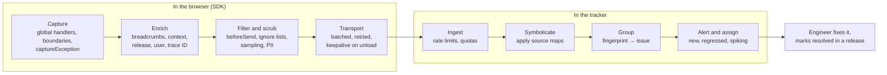

| Stage | Question it answers | Typical knobs |
|---|---|---|
| **Capture** | Did we see it at all? | Automatic global handlers, framework integrations, manual `captureException` |
| **Enrich** | What was the user doing, on what, in which version? | `release`, `environment`, user ID, tags, breadcrumbs, replay |
| **Filter / scrub** | Is it worth sending, and is it safe? | `beforeSend`, ignore/deny lists, sampling, PII rules |
| **Transport** | Did it arrive? | Batching, retry, `keepalive`, tunnel/proxy |
| **Symbolicate** | Which line of *our source* failed? | Source maps uploaded per release |
| **Group** | Is this a new problem or an old one? | Default stack-based grouping, custom fingerprints |
| **Alert / assign** | Who needs to know, and how urgently? | Alert rules, ownership rules, integrations (Slack, PagerDuty, Jira) |

> **Error tracking vs RUM:** error tracking focuses on **exceptions** (what broke and why). RUM ([next note](./real-user-monitoring-rum.md)) focuses on **experience** (sessions, page views, Web Vitals, resources, user actions). Datadog bundles errors into its RUM SDK; Sentry started from errors and added tracing, replay and Web Vitals. The two overlap more every year.

---

### Section 2: Anatomy of an Error Event

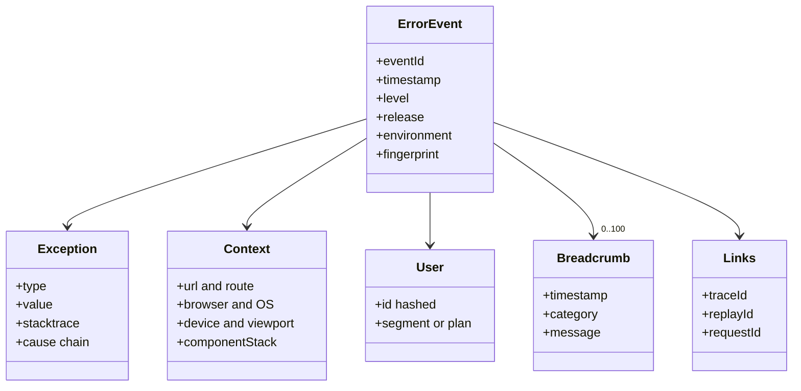

| Part | Example | Why it matters |
|---|---|---|
| **Exception** | `TypeError: Cannot read properties of undefined (reading 'total')` + stack | The *what* and *where* |
| **Cause chain** | `Error('Saving invoice failed', { cause })` | Keeps the original low-level error when you wrap it |
| **Release / version** | `web@2026.11.06-3f9a1c` | Which deploy introduced it; which source maps to apply |
| **Environment** | `production`, `staging`, `preview` | Don't page anyone for staging noise |
| **Breadcrumbs** | Clicks, navigations, `fetch` calls (URL + status), console messages | The steps that led to the crash |
| **Tags** | `route:/checkout`, `feature_flag.new_cart:on`, `tenant_tier:enterprise` | Filtering, searching, spotting patterns |
| **User** | Opaque ID (not email), plan | Count **affected users**, not just events |
| **Context** | Browser, OS, viewport, connection type, React component stack | Reproduce the environment |
| **Links** | Trace ID, replay ID, server request ID | Jump to the backend trace or watch the replay |

**Breadcrumbs are the most underrated feature.** A stack trace tells you *where* the code failed; breadcrumbs tell you *how the user got there* (e.g. "clicked Apply coupon → `POST /api/coupon` 409 → navigated to /checkout → crash").

---

### Section 3: Source Maps, Debug IDs and Releases

Production JavaScript is minified, so a raw stack frame looks like `at e (app-3f9a1c.js:1:48213)`. A **source map** (standardized as ECMA-426) maps generated positions back to original files, lines and names.

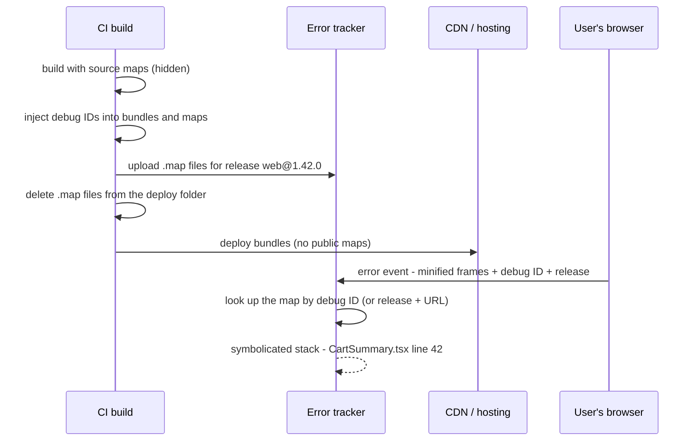

**Key practices:**

| Practice | Why |
|---|---|
| **Generate "hidden" source maps** (e.g. Vite `build.sourcemap: 'hidden'`, webpack `hidden-source-map`) | Maps are produced but the bundle has no `//# sourceMappingURL` comment, so browsers don't fetch them |
| **Upload maps in CI, then don't deploy them publicly** | The tracker can symbolicate; the public can't read your original source (unless you choose to publish it) |
| **Use debug IDs where the vendor supports them** | A unique ID injected into both the bundle and its map links them reliably, without depending on URLs or release names |
| **Set the same `release` in the SDK and the upload** | Without debug IDs, the tracker matches maps by release + file URL; a mismatch means unreadable stacks |
| **Upload before (or during) deploy** | Errors arriving before maps exist may stay minified |
| **Mind the order with SRI** | Debug-ID injection rewrites bundles; compute [Subresource Integrity](./subresource-integrity-sri.md) hashes **after** injection and deploy exactly the uploaded files |
| **Associate commits** | Trackers can show "suspect commits" and resolve issues automatically when a fixing commit ships |

**Vendor tooling (check docs for current package names — they change):**
- **Sentry:** bundler plugins (in current docs `@sentry/bundler-plugins`, e.g. `@sentry/bundler-plugins/vite`; older setups use `@sentry/vite-plugin` / `@sentry/webpack-plugin`) or `sentry-cli`. They inject debug IDs, upload maps and can delete them afterwards.
- **Datadog:** `@datadog/datadog-ci` — `datadog-ci sourcemaps upload ./dist --service … --release-version … --minified-path-prefix …`, or the newer debug-ID flow (`datadog-ci sourcemaps inject` then `upload --debug-id`). The `service` and `version` in `datadogRum.init` must match the upload when not using debug IDs.

---

### Section 4: Grouping and Fingerprinting

A tracker receives **events**; humans work on **issues**. Grouping decides which events belong to the same issue.

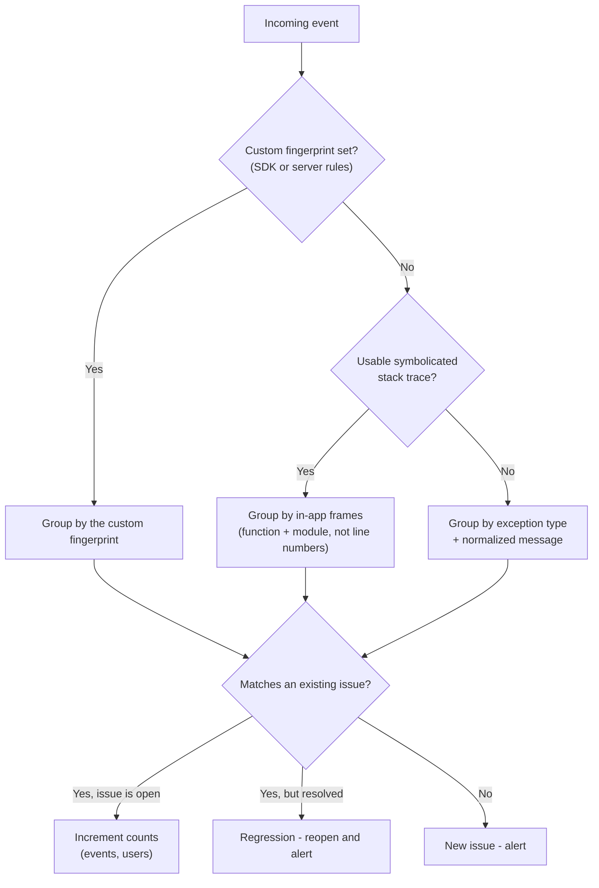

**Common grouping problems:**

| Problem | Symptom | Fix |
|---|---|---|
| **Over-splitting** | Same bug appears as hundreds of issues because messages include IDs (`Order 81723 not found`) | Keep variable data out of messages (put it in context/tags), or set a fingerprint |
| **Over-merging** | Every API failure lands in one issue because they share the same `fetch` wrapper stack | Custom fingerprint by `[error type, endpoint, status]` |
| **Minified stacks** | Grouping on meaningless frames; new issue on every release | Fix the source map upload |
| **Third-party frames** | Errors grouped by an extension's or vendor's stack | Mark frames as not in-app; filter extension URLs |

Sentry and Datadog both allow **client-side fingerprints** and **server-side grouping rules**; Sentry also lets you merge issues manually. See each vendor's grouping docs in the references.

---

### Section 5: Noise, Sampling and Quotas

Without noise control, the signal disappears and the bill grows.

**Typical noise sources:**

| Source | Example | Handling |
|---|---|---|
| Browser extensions | Frames from `chrome-extension://`, `moz-extension://` | `denyUrls` / `allowUrls` (only your domains), vendor inbound filters |
| Benign browser messages | `ResizeObserver loop completed with undelivered notifications` | `ignoreErrors` |
| Cross-origin `Script error.` | No stack | Fix `crossorigin` on your scripts; ignore the rest |
| Bots and crawlers | Old engines failing on modern syntax | Vendor bot filters, ignore unsupported browsers |
| Aborted requests | `AbortError` when the user navigates away | Don't report aborts |
| Expected domain errors | 401, 404, validation | Handle in the UI; don't send as exceptions |
| Error loops | Same error thousands of times per session | SDK deduplication + per-session rate limiting |

**Sampling — the most important design difference between tools:**

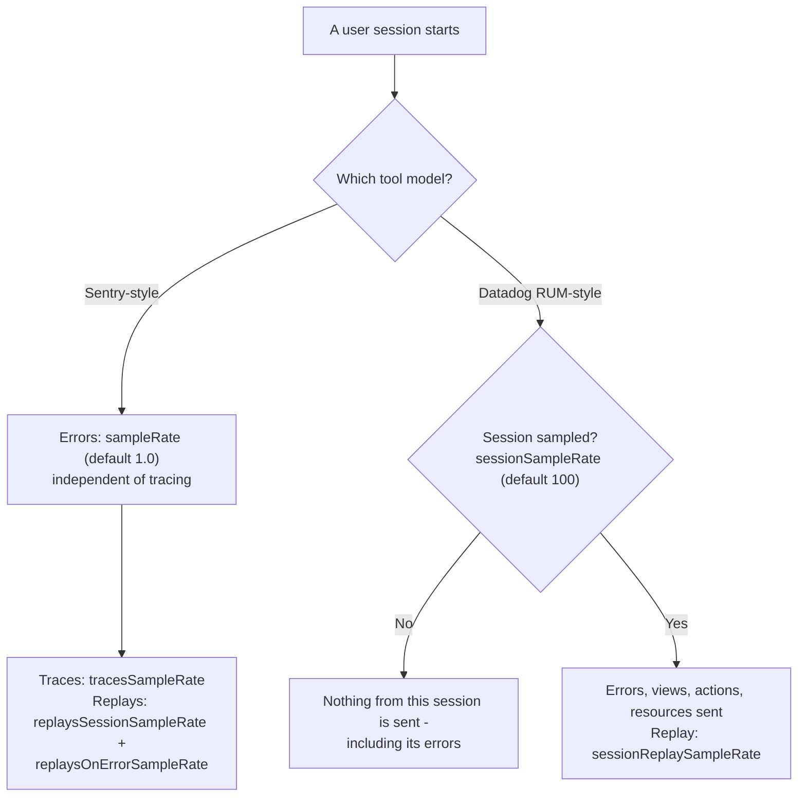

- **Error-first tools** (Sentry's model) let you keep **100% of errors** while sampling the expensive data (traces, replays). Sampling *errors* is risky: rare bugs vanish.
- **Session-based RUM tools** (Datadog's model) sample **whole sessions**: a 10% `sessionSampleRate` means you see roughly 10% of errors. Choose the rate knowing this, and consider separate error capture (e.g. Datadog's Browser Logs SDK, or a higher session rate) if every error must be seen.
- **"Replay on error"** is the cost-effective pattern: record a buffer in memory and keep the replay only for sessions that hit an error (Sentry `replaysOnErrorSampleRate`; Datadog offers manual start via `startSessionReplayRecordingManually` + `startSessionReplayRecording()`).
- **Quotas and spike protection:** a bad deploy can produce millions of events in minutes. Use vendor spike protection/rate limits so one incident doesn't consume a month's quota.

---

### Section 6: Privacy, PII and Consent

Error events can easily contain personal data: URLs with emails or tokens, request bodies, form values in breadcrumbs, user names in exception messages, and screens in replays.

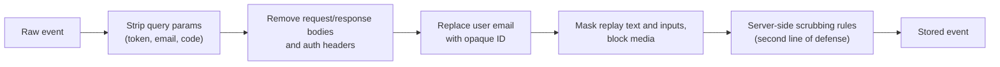

| Control | Sentry | Datadog RUM |
|---|---|---|
| Hook to edit/drop events | `beforeSend(event, hint)`, `beforeBreadcrumb` | `beforeSend(event, context)` |
| What the SDK collects automatically | `dataCollection` option (SDK v10.57+; the default in v11; replaces the deprecated `sendDefaultPii`) | Init options (`trackResources`, `trackUserInteractions`, …) |
| Replay privacy | Masks all text and blocks media by default (`maskAllText`, `blockAllMedia`); per-element classes to mask/unmask | `defaultPrivacyLevel` (default `mask-user-input`; `mask` hides all text), `data-dd-privacy` attributes |
| Consent | Initialize only after consent, or keep a minimal setup until consent | `trackingConsent: 'not-granted'` then `setTrackingConsent('granted')` |
| Server-side scrubbing | Data scrubbing / advanced scrubbing rules | Sensitive Data Scanner |
| Data residency | US and EU data regions; self-hosting available | Region-specific sites (`site` option, e.g. US and EU sites) |

**Rules:** identify users by an **opaque ID**, never send passwords/tokens/payment data, scrub on the client **and** on the server, decide replay masking with your privacy/legal team, and document the processing (GDPR/CCPA). Remember to allow the tracker's ingest host in your [CSP](./content-security-policy-csp.md) `connect-src`.

---

### Section 7: Loading the SDK — Timing, Bundle Cost and Ad Blockers

**The timing trade-off:** errors thrown before the SDK initializes are lost; but a big SDK in the critical path hurts load performance.

```mermaid
gantt
    title SDK loading strategies - what is covered when (illustrative)
    dateFormat X
    axisFormat %s
    section Early sync init
    SDK in main bundle and init first   :a1, 0, 2
    Errors captured                     :a2, 2, 10
    section Async CDN loader
    App boots                           :b1, 0, 3
    SDK downloads in parallel           :b2, 0, 4
    Early errors buffered by stub       :b3, 0, 4
    Errors captured                     :b4, 4, 10
    section Lazy replay
    Core error SDK                      :c1, 0, 2
    Replay loaded after idle            :c2, 5, 7
```

| Strategy | Pros | Cons |
|---|---|---|
| **Bundle the SDK, init in the first module** (`import './instrument'` first) | Catches errors during boot; versioned with your code | Adds to the main bundle |
| **Async CDN loader** (both vendors offer one) | Doesn't block rendering | May miss early errors unless a small stub queues them |
| **Lazy-load heavy features** (replay, feedback widget) | Core errors early, heavy code later | Slight complexity; replay misses the very start |
| **Tree-shake unused integrations** | Smaller bundle | Requires the modular SDK import style |

**Ad blockers and privacy extensions** commonly block requests to well-known tracking hosts, so a share of events never arrives. Mitigations: Sentry's **`tunnel`** option (send events to an endpoint on **your own domain** that forwards them) and Datadog's **`proxy`** option. Respect the user's privacy choices — use this for reliability, not to bypass consent.

---

### Section 8: Connecting Frontend Errors to Backend Traces

A frontend error like "Failed to save order" is often a **backend** failure. Distributed tracing links them:

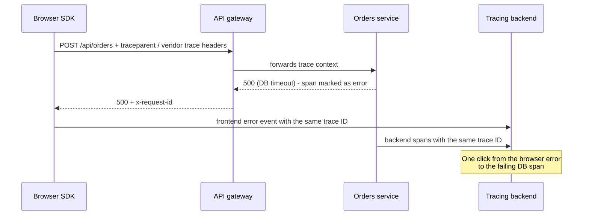

- **Configure which URLs get trace headers:** Sentry `tracePropagationTargets`, Datadog `allowedTracingUrls`. Never send them to third-party domains.
- **Header formats:** W3C Trace Context (`traceparent`, `tracestate`) is the standard; vendors also use their own headers (Sentry `sentry-trace` + `baggage`; Datadog's own headers, selectable with `propagatorTypes`).
- **CORS gotcha:** for cross-origin APIs, adding trace headers makes requests **preflighted**, and the server must list them in `Access-Control-Allow-Headers` — otherwise the request fails. Roll out on same-origin APIs first, and see [CORS & Same-Origin Policy](./cors-and-same-origin-policy.md).
- **Request IDs:** even without full tracing, log the server's `x-request-id` on the frontend error event.

---

### Section 9: Sentry vs Datadog RUM (and Alternatives)

| Dimension | Sentry | Datadog RUM + Error Tracking |
|---|---|---|
| **Origin and focus** | Developer-first error tracking, expanded to tracing, replay, logs, profiling | Full-stack observability platform; browser RUM is one product among infra, APM, logs |
| **Sampling model** | Errors sampled independently (default: all), traces and replays sampled separately | Session-based: unsampled sessions send nothing, including errors |
| **Issue workflow** | Issues with assignment, ownership rules, suspect commits, release health, resolve-in-release | Error Tracking issues grouped from RUM errors, correlated with APM/logs |
| **Session replay** | Yes, privacy masking on by default | Yes, `defaultPrivacyLevel` |
| **Backend correlation** | Sentry tracing across its SDKs; OpenTelemetry support | Strongest when the backend already uses Datadog APM |
| **Hosting** | SaaS (US/EU) or self-hosted | SaaS on regional sites |
| **Framework SDKs** | Dedicated SDKs for React, Next.js, Vue, Nuxt, Angular, Svelte/SvelteKit, Remix/React Router, React Native, native mobile and many backends | Browser SDK + React plugin (`@datadog/browser-rum-react`); mobile SDKs (iOS, Android, React Native, Flutter) |
| **Typical fit** | Teams wanting deep error triage with code context | Organizations already standardized on Datadog for infra/APM |

**Alternatives worth knowing:** BugSnag, Rollbar, New Relic Browser, Elastic RUM, LogRocket (replay-centric), PostHog (product analytics with error tracking), Grafana Faro (open-source web SDK feeding Grafana), and **OpenTelemetry JS** in the browser (vendor-neutral instrumentation; check the OpenTelemetry docs for the current maturity of browser support). Pricing and features change often — compare against current vendor pages, not blog posts.

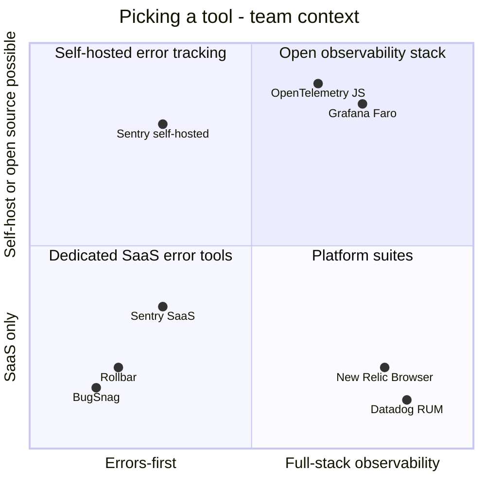

*(Positions are qualitative, to illustrate the trade-off axes — not a ranking.)*

---

### Section 10: Framework and Mobile Integrations

| Stack | Sentry | Datadog |
|---|---|---|
| **React** | `@sentry/react`: `Sentry.ErrorBoundary`, `Sentry.reactErrorHandler()` for React 19 `createRoot` hooks, router integrations | `@datadog/browser-rum-react`: `reactPlugin()`, `ErrorBoundary`, `addReactError` (also usable in `onCaughtError`) |
| **Next.js** | `@sentry/nextjs`: client, server and edge init; `instrumentation.ts` `onRequestError` → `Sentry.captureRequestError` | Browser SDK on the client; APM/tracer on the server |
| **Vue / Nuxt** | `@sentry/vue` (pass the `app` to `init`), `@sentry/nuxt` | Browser SDK; report from `app.config.errorHandler` with `datadogRum.addError` |
| **Angular** | `@sentry/angular`: `Sentry.createErrorHandler()` as the `ErrorHandler` provider | Browser SDK; call `datadogRum.addError` in a custom `ErrorHandler` |
| **Svelte / SvelteKit** | `@sentry/svelte`, `@sentry/sveltekit` (hooks integration) | Browser SDK; report from `handleError` / `<svelte:boundary onerror>` |
| **React Native** | `@sentry/react-native` (JS + native crashes) | `@datadog/mobile-react-native` |
| **Native iOS / Android** | Sentry Cocoa / Android SDKs (crashes, ANRs) | Datadog iOS / Android SDKs |

> **Avoid double reporting.** If an `ErrorBoundary` from the SDK already reports caught errors, don't also report them in `onCaughtError` (the Datadog React plugin docs call this out explicitly). Pick **one** reporting point per error path.

---

### Section 11: The Triage Workflow — Alerts, Ownership, Release Health

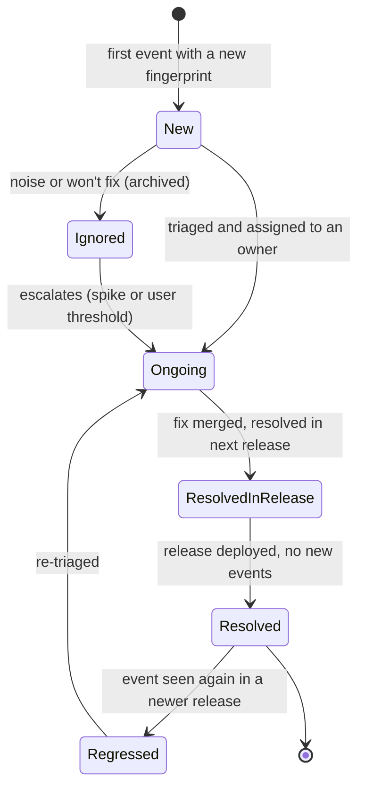

**Alerting that doesn't cause alert fatigue:**

| Alert | Trigger | Route to |
|---|---|---|
| **New issue in production** | First seen, after the release is out | Owning team's channel |
| **Regression** | A resolved issue reappears | Owner + the release author |
| **Spike** | Event or affected-user count jumps vs baseline | On-call (page if user-impacting) |
| **Release health drop** | Crash-free sessions/users fall after a deploy | Release manager; consider rollback or flag off |
| **High-value path** | Any error on `/checkout` or payment routes | On-call immediately |

**Ownership:** map routes, file paths or tags to teams (ownership rules, `CODEOWNERS` integration) so issues are assigned automatically. Unowned issues are never fixed.

**Release health** (crash-free sessions/users, adoption per release) turns error tracking into a **deploy gate**: combine it with [feature flags](./feature-flags-and-a-b-testing.md) and canary releases so a bad release is turned off before most users see it.

**Triage loop:** prioritize by **affected users × severity of the path**, not raw event count (one user in a reload loop can generate thousands of events). After fixing, add a regression test at the right layer ([Testing Strategies & Pyramid](./testing-strategies-and-pyramid.md)).

---

## System Design Angle — Choosing and Rolling Out Error Tracking

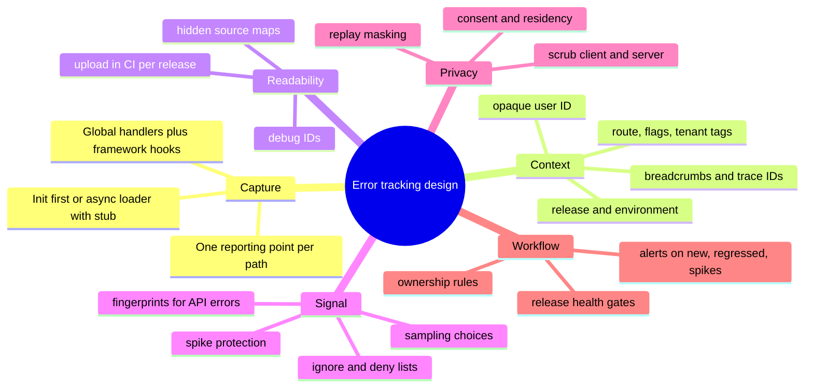

**Decision checklist for a design review:**

| Decision | Questions | Typical answer |
|---|---|---|
| Vendor | Is the org already on an observability platform? Self-hosting or data residency needs? | Use the platform the backend uses if correlation matters; Sentry for error-first workflows |
| Sampling | Must every error be seen? Budget? | Errors 100%, traces 5–20%, replay on error only (tune to traffic and budget) |
| Load strategy | How heavy is the SDK? Are boot errors important? | Core SDK early; replay and feedback lazy |
| Source maps | Can source be public? | Hidden maps uploaded in CI, deleted from deploy |
| Privacy | Which PII might appear? Consent rules? | Opaque IDs, scrub URLs/bodies, masked replay, init after consent where required |
| Correlation | Same-origin API? Can the backend accept trace headers? | Trace headers to own APIs only; request IDs at minimum |
| Workflow | Who owns which routes? What pages someone? | Ownership rules; page only for spikes and critical paths |
| Micro-frontends | Multiple teams in one page? | One SDK instance; tag events by remote/owner (see [Micro-frontends Architecture](./micro-frontends-architecture.md)) |

---

## Real-World Examples

**Example 1 — Sentry for a React 19 SPA (instrument first):**
```typescript
// src/instrument.ts — imported as the FIRST line of main.tsx
import * as Sentry from '@sentry/react';

Sentry.init({
  dsn: import.meta.env.VITE_SENTRY_DSN,
  release: import.meta.env.VITE_RELEASE,          // same value used for the source map upload
  environment: import.meta.env.MODE,
  integrations: [
    Sentry.browserTracingIntegration(),
    Sentry.replayIntegration(),                    // masks all text and blocks media by default
  ],
  tracesSampleRate: 0.1,                           // illustrative — tune to traffic and budget
  tracePropagationTargets: [/^\//, /^https:\/\/api\.example\.com/],
  replaysSessionSampleRate: 0,                     // no replay for healthy sessions
  replaysOnErrorSampleRate: 1.0,                   // keep the replay when an error happens
  allowUrls: [/https:\/\/(www\.)?example\.com/],  // only our scripts
  ignoreErrors: [/ResizeObserver loop/, 'AbortError'],
  beforeSend(event, hint) {
    // Drop expected domain errors; scrub tokens from URLs
    const err = hint.originalException as { name?: string; status?: number } | undefined;
    if (err?.name === 'HttpError' && err.status && err.status < 500) return null;
    if (event.request?.url) event.request.url = event.request.url.replace(/([?&]token=)[^&]+/, '$1[Filtered]');
    return event;
  },
});
```
```tsx
// src/main.tsx
import './instrument';                             // must run before the app code
import * as Sentry from '@sentry/react';
import { createRoot } from 'react-dom/client';
import { App } from './App';

createRoot(document.getElementById('root')!, {
  onUncaughtError: Sentry.reactErrorHandler(),
  onCaughtError: Sentry.reactErrorHandler(),
  onRecoverableError: Sentry.reactErrorHandler(),
}).render(<App />);
```

**Example 2 — Datadog RUM with the React plugin:**
```typescript
// src/rum.ts
import { datadogRum } from '@datadog/browser-rum';
import { reactPlugin } from '@datadog/browser-rum-react';

datadogRum.init({
  applicationId: import.meta.env.VITE_DD_APP_ID,
  clientToken: import.meta.env.VITE_DD_CLIENT_TOKEN,   // client tokens are designed to be public
  site: 'datadoghq.eu',                                // your org's Datadog site
  service: 'web-shop',
  env: 'production',
  version: import.meta.env.VITE_RELEASE,               // must match the source map upload
  sessionSampleRate: 100,                              // errors from unsampled sessions are NOT collected
  sessionReplaySampleRate: 10,
  defaultPrivacyLevel: 'mask-user-input',
  allowedTracingUrls: [(url) => url.startsWith('https://api.example.com')],
  trackingConsent: 'not-granted',                      // flip after the consent banner
  plugins: [reactPlugin({ router: false })],
  beforeSend: (event) => {
    if (event.type === 'error' && event.error.message.includes('ResizeObserver loop')) return false;
    return true;
  },
});

export function onConsentGranted() {
  datadogRum.setTrackingConsent('granted');
}
```
```tsx
// Reporting caught render errors — choose ONE of: Datadog ErrorBoundary, addReactError in your own boundary, or onCaughtError
import { ErrorBoundary } from '@datadog/browser-rum-react';

export function Shell() {
  return (
    <ErrorBoundary fallback={({ resetError }) => <button onClick={resetError}>Retry</button>}>
      <Routes />
    </ErrorBoundary>
  );
}
```

**Example 3 — Context that makes issues actionable:**
```typescript
import * as Sentry from '@sentry/react';
import { datadogRum } from '@datadog/browser-rum';

export function identify(user: { id: string; plan: string }) {
  // ✅ opaque ID, no email or name
  Sentry.setUser({ id: user.id });
  Sentry.setTag('plan', user.plan);
  datadogRum.setUser({ id: user.id, plan: user.plan });
}

export function onFlagsLoaded(flags: Record<string, boolean>) {
  for (const [key, on] of Object.entries(flags)) Sentry.setTag(`flag.${key}`, on ? 'on' : 'off');
}

export async function applyCoupon(code: string) {
  Sentry.addBreadcrumb({ category: 'checkout', message: 'apply coupon', level: 'info' }); // no coupon value
  try {
    return await api('/api/coupon', { method: 'POST', body: JSON.stringify({ code }) });
  } catch (err) {
    // Group API failures by endpoint + status, not by the shared fetch-wrapper stack
    Sentry.withScope((scope) => {
      const status = (err as { status?: number }).status ?? 0;
      scope.setFingerprint(['api-error', 'POST /api/coupon', String(status)]);
      scope.setTag('endpoint', 'POST /api/coupon');
      Sentry.captureException(err);
    });
    throw err;
  }
}
```

**Example 4 — Source maps in CI (BAD → GOOD):**
```bash
# ❌ BAD: public maps, no release, upload after users already hit errors
vite build --sourcemap          # maps deployed next to bundles, readable by anyone
deploy ./dist

# ✅ GOOD (Datadog, release-based matching)
export RELEASE="web@$(git rev-parse --short HEAD)"
VITE_RELEASE="$RELEASE" vite build              # build.sourcemap: 'hidden' in vite.config
npx datadog-ci sourcemaps upload ./dist \
  --service web-shop \
  --release-version "$RELEASE" \
  --minified-path-prefix https://cdn.example.com/assets
find ./dist -name '*.map' -delete               # don't ship maps publicly
deploy ./dist
```
```typescript
// ✅ GOOD (Sentry bundler plugin — injects debug IDs, uploads, deletes maps)
// vite.config.ts — package name per current Sentry docs; older projects use '@sentry/vite-plugin'
import { defineConfig } from 'vite';
import react from '@vitejs/plugin-react';
import { sentryVitePlugin } from '@sentry/bundler-plugins/vite';

export default defineConfig({
  build: { sourcemap: 'hidden' },
  plugins: [
    react(),
    sentryVitePlugin({                            // keep it LAST in the plugins array
      org: 'acme',
      project: 'web-shop',
      authToken: process.env.SENTRY_AUTH_TOKEN,   // CI secret, never in client code
      release: { name: process.env.RELEASE },
      sourcemaps: { filesToDeleteAfterUpload: ['./dist/**/*.map'] },
    }),
  ],
});
```

**Example 5 — A same-origin tunnel to survive ad blockers (Sentry):**
```typescript
// Client: Sentry.init({ dsn, tunnel: '/monitoring' , ... })

// Server (Express) — forward only envelopes for YOUR project
import express from 'express';
const app = express();
const SENTRY_HOST = 'o123456.ingest.sentry.io';   // from your DSN
const PROJECT_IDS = new Set(['7654321']);

app.post('/monitoring', express.text({ type: '*/*', limit: '1mb' }), async (req, res) => {
  try {
    const header = JSON.parse(req.body.split('\n')[0]);
    const dsn = new URL(header.dsn);
    const projectId = dsn.pathname.replace('/', '');
    if (dsn.hostname !== SENTRY_HOST || !PROJECT_IDS.has(projectId)) return res.sendStatus(400);
    const upstream = await fetch(`https://${SENTRY_HOST}/api/${projectId}/envelope/`, {
      method: 'POST',
      body: req.body,
    });
    res.sendStatus(upstream.status);
  } catch {
    res.sendStatus(400);
  }
});
```
> Datadog's equivalent is the `proxy` init option. Validate what you forward — an open proxy can be abused.

**Example 6 — Other frameworks:**
```typescript
// Vue 3
import * as Sentry from '@sentry/vue';
const app = createApp(App);
Sentry.init({ app, dsn: import.meta.env.VITE_SENTRY_DSN, release: import.meta.env.VITE_RELEASE });

// Angular (standalone)
import * as Sentry from '@sentry/angular';
bootstrapApplication(AppComponent, {
  providers: [{ provide: ErrorHandler, useValue: Sentry.createErrorHandler() }],
});

// Any framework + Datadog: report from the framework's global hook
app.config.errorHandler = (err) => datadogRum.addError(err);          // Vue
// class DdErrorHandler implements ErrorHandler { handleError(e: unknown) { datadogRum.addError(e); } } // Angular
```

---

## Key Points Summary

| Concept | One-Line Explanation |
|---|---|
| **Error tracker** | Captures, enriches, de-minifies, groups and alerts on production errors |
| **Event vs issue** | Events are occurrences; an issue is a group of events with the same fingerprint |
| **Breadcrumbs** | The trail of user and network actions before the error |
| **Release / version** | Ties errors to a deploy and to the right source maps |
| **Source maps** | Map minified stacks back to source; upload privately, don't serve publicly |
| **Debug IDs** | Unique IDs injected into bundle + map for reliable matching |
| **Fingerprinting** | Custom grouping keys to fix over-splitting or over-merging |
| **Error vs session sampling** | Sentry samples errors separately; Datadog RUM drops errors from unsampled sessions |
| **Replay on error** | Keep replays only for sessions that hit an error |
| **PII scrubbing** | `beforeSend` + server rules; opaque user IDs; masked replays |
| **Tunnel / proxy** | Send events through your domain to survive ad blockers |
| **Trace propagation** | Trace headers link a browser error to backend spans; mind CORS |
| **Release health** | Crash-free sessions/users per release as a deploy gate |
| **Ownership + alerts** | Route new, regressed and spiking issues to the owning team |

---

## Test Your Understanding

**Q1 (Basic):**
What's the difference between an **event** and an **issue**, and why do trackers prioritize by **affected users** rather than event count?

<details>
<summary>Answer</summary>

An **event** is one occurrence of an error, sent by one browser at one moment. An **issue** is a **group** of events the tracker considers the same problem, based on a fingerprint (usually the symbolicated in-app stack, or a custom key).

Event counts are easily skewed: a single user stuck in a render loop or retry loop can send thousands of events, while a bug that silently breaks checkout for 2,000 users may send one event each. **Affected users** (and the importance of the path) is a much better measure of impact, which is why you set an opaque user ID on events.
</details>

**Q2 (Application):**
After a deploy, every new error shows frames like `at t (index-8c1f.js:1:90211)`. Source maps were "uploaded". List the likely causes and how to fix the pipeline.

<details>
<summary>Answer</summary>

Likely causes:
- **Release/version mismatch:** the SDK's `release` (Sentry) or `version` (Datadog) differs from the value used at upload, so the tracker can't find the maps.
- **Wrong URL prefix:** the uploaded paths don't match where the bundles are served (e.g. missing the CDN prefix for Datadog's `--minified-path-prefix`).
- **Maps uploaded after the errors arrived**, or for a different build than the one deployed (e.g. a rebuild between upload and deploy changed the hashes).
- **Debug IDs** not injected, or bundles modified after injection (e.g. another minification or rewrite step after the plugin).
- Source map generation disabled in the production build.

Fix: generate **hidden** maps in the same build that is deployed, inject **debug IDs** and upload in that CI job, use **one** release identifier for the SDK and the upload, deploy exactly the uploaded artifacts, and delete `.map` files from the public deploy.
</details>

**Q3 (Tricky):**
Your team set Datadog RUM `sessionSampleRate: 10` to reduce cost. A week later, a crash affecting a small enterprise customer is missing from Error Tracking even though the customer reported it. Why, and what are the options?

<details>
<summary>Answer</summary>

Datadog RUM samples **whole sessions**. With a 10% rate, about 90% of sessions send **nothing** — including their errors — so a bug affecting few users can easily be missed entirely.

Options: raise `sessionSampleRate` (accepting cost), sample **differently by segment** (e.g. decide the rate at init from the tenant tier), capture errors separately with an error-first channel (Datadog's Browser Logs SDK forwarding errors, or an error-first tool), and use replay sampling — rather than session sampling — as the main cost lever. The general lesson: decide whether **every error must be seen**, and pick a sampling model that guarantees it.
</details>

**Q4 (Tricky):**
You enable trace propagation to `https://api.example.com` from `https://app.example.com`. Immediately, some API calls fail in the browser with CORS errors, though nothing else changed. Why?

<details>
<summary>Answer</summary>

Trace propagation adds **custom request headers** (e.g. `traceparent`, `baggage`, or vendor-specific headers). Custom headers make cross-origin requests **non-simple**, so the browser sends a **preflight `OPTIONS`** and requires the server to list those headers in **`Access-Control-Allow-Headers`**. The API doesn't allow them, so the preflight fails and the real request is never sent.

Fix: add the trace headers to the API's CORS allow-list (and handle preflights efficiently, e.g. with `Access-Control-Max-Age`), or limit `tracePropagationTargets` / `allowedTracingUrls` to origins that are ready. Never propagate to third-party domains.
</details>

**Q5 (Application):**
Every failed API call lands in one giant Sentry issue titled `HttpError: Request failed`, while a separate bug shows up as 400 issues: `Order 81723 not found`, `Order 81724 not found`… Fix both.

<details>
<summary>Answer</summary>

- **Over-merging:** all API errors are thrown from the same `fetch` wrapper, so their stacks (and messages) are identical. Set a **custom fingerprint** such as `['api-error', method + endpoint template, status]`, and add the endpoint and status as tags.
- **Over-splitting:** the message contains a variable ID, so message-based grouping creates a new issue per order. Use a **stable message** (`Order not found`) and put the ID in context/extra data, or set a fingerprint that ignores it.

Both point to one rule: **messages and fingerprints should describe the kind of problem; variable data belongs in context.**
</details>

**Q6 (System design):**
You're introducing error tracking to a large e-commerce site (React + Next.js, backend on Datadog APM, EU customers, strict consent rules, heavy ad-blocker usage). Outline the design.

<details>
<summary>Answer</summary>

- **Vendor:** with the backend on Datadog APM, Datadog RUM gives one-click frontend → backend correlation; Sentry is a strong alternative if error triage depth matters more. Either way, use an EU data region.
- **Capture:** init early (Next.js client instrumentation file) with framework integrations; one reporting point per error path (SDK boundary *or* `onCaughtError`); server errors via `instrumentation.ts` `onRequestError` / server SDK.
- **Sampling:** if Datadog, set the session rate high enough that critical errors aren't lost (or add an error-first channel); replay sampled low, with masked text/inputs.
- **Context:** release = commit SHA; opaque user ID; tags for route, locale, feature flags, A/B variant.
- **Source maps:** hidden maps, debug IDs, uploaded in CI, deleted from the deploy; SRI computed after injection.
- **Privacy:** `trackingConsent: 'not-granted'` until consent (or init after consent), `beforeSend` scrubbing of URLs and bodies, server-side scanners, CSP `connect-src` for the intake or proxy host.
- **Delivery:** same-origin `proxy`/`tunnel` endpoint with validation, to reduce ad-blocker loss.
- **Correlation:** trace headers only to first-party API origins, with CORS allow-headers updated.
- **Workflow:** ownership rules per route/team, alerts on new/regressed/spiking issues, page on checkout errors, release health as a canary gate with feature-flag rollback.
</details>

---

## Cheat Sheet

**Key Definitions:**
- **DSN / client token:** Public identifiers that tell the SDK where to send events (not secrets; the upload auth token *is* a secret)
- **Breadcrumb:** A small record of an action before the error (click, navigation, request, log)
- **Symbolication:** Turning minified frames into source frames using source maps
- **Debug ID:** A unique ID embedded in a bundle and its source map to match them
- **Fingerprint:** The key that decides which issue an event belongs to
- **Release health:** Crash-free sessions/users and adoption per release
- **Tunnel / proxy:** First-party endpoint that forwards SDK traffic to the vendor

**Quick Reference:**
```text
Init:        import './instrument' FIRST (or async loader with a queueing stub)
Context:     release, environment, opaque user id, tags (route, flags, tenant), breadcrumbs
React 19:    createRoot(el, { onCaughtError, onUncaughtError, onRecoverableError }) → SDK handler
Sentry:      sampleRate (errors, default 1.0) · tracesSampleRate · replaysSessionSampleRate · replaysOnErrorSampleRate
             beforeSend · ignoreErrors · allowUrls/denyUrls · tracePropagationTargets · tunnel · dataCollection
Datadog:     sessionSampleRate (default 100 — unsampled sessions send NO errors) · sessionReplaySampleRate
             beforeSend · defaultPrivacyLevel · allowedTracingUrls · trackingConsent · proxy · addError
Source maps: hidden maps → inject debug IDs → upload in CI → delete .map → deploy same artifacts
Grouping:    stable messages; variable data in context; fingerprint API errors by endpoint + status
Privacy:     no emails/tokens/bodies; mask replays; scrub client + server; consent; data region; CSP connect-src
Alerts:      new issue · regression · spike · release health drop · any error on critical paths
```

**Common Mistakes to Avoid:**

| Mistake | Why Wrong | Fix |
|---|---|---|
| Initializing the SDK late (after the app boots) | Boot-time errors are never captured | Import the instrument file first or use a loader stub |
| Public source maps | Exposes original source to anyone | Hidden maps, upload privately, delete before deploy |
| Release in SDK ≠ release in upload | Stacks stay minified | One release ID from CI used everywhere (or debug IDs) |
| Variable data in error messages | Hundreds of duplicate issues | Stable messages + context; custom fingerprints |
| Sampling errors (or sessions) aggressively | Rare but severe bugs disappear | Keep errors at 100%; sample traces and replays instead |
| Sending emails, tokens, bodies | Privacy and compliance violations | Opaque IDs, `beforeSend`, server-side scrubbing |
| Recording replays unmasked | Captures personal data on screen | Keep default masking; unmask only reviewed elements |
| Reporting the same error from two places | Duplicate events, wrong counts | One reporting point per path |
| Trace headers to every origin | CORS failures, leaking headers to third parties | Allow-list first-party APIs; update CORS allow-headers |
| Alerting on every event | Alert fatigue, real incidents ignored | Alert on new, regressed, spiking and critical-path issues |
| No ownership rules | Issues pile up unassigned | Map routes/paths/tags to teams |
| Treating ad-blocked loss as zero errors | Silent blind spots | Tunnel/proxy on your domain; compare with server logs |

---

## References & Further Reading

**Sentry**
- [JavaScript / React SDK setup](https://docs.sentry.io/platforms/javascript/guides/react/)
- [Configuration options (`sampleRate`, `beforeSend`, `ignoreErrors`, `tunnel`, `dataCollection`)](https://docs.sentry.io/platforms/javascript/configuration/options/)
- [Source maps](https://docs.sentry.io/platforms/javascript/sourcemaps/) · [Uploading with Vite](https://docs.sentry.io/platforms/javascript/sourcemaps/uploading/vite/)
- [Session Replay privacy](https://docs.sentry.io/platforms/javascript/session-replay/privacy/)
- [Event grouping](https://docs.sentry.io/concepts/data-management/event-grouping/)
- [Release health](https://docs.sentry.io/product/releases/health/)
- [Using the `tunnel` option](https://docs.sentry.io/platforms/javascript/troubleshooting/#using-the-tunnel-option)
- Framework guides: [Next.js](https://docs.sentry.io/platforms/javascript/guides/nextjs/) · [Vue](https://docs.sentry.io/platforms/javascript/guides/vue/) · [Angular](https://docs.sentry.io/platforms/javascript/guides/angular/) · [SvelteKit](https://docs.sentry.io/platforms/javascript/guides/sveltekit/) · [React Native](https://docs.sentry.io/platforms/react-native/)

**Datadog**
- [Browser RUM client setup](https://docs.datadoghq.com/real_user_monitoring/application_monitoring/browser/setup/client/)
- [Collecting browser errors](https://docs.datadoghq.com/real_user_monitoring/application_monitoring/browser/collecting_browser_errors/)
- [Advanced configuration (`beforeSend`, user, context)](https://docs.datadoghq.com/real_user_monitoring/application_monitoring/browser/advanced_configuration/)
- [Upload JavaScript source maps](https://docs.datadoghq.com/real_user_monitoring/guide/upload-javascript-source-maps/)
- [Error Tracking](https://docs.datadoghq.com/real_user_monitoring/error_tracking/)
- [Connect RUM and traces](https://docs.datadoghq.com/real_user_monitoring/platform/connect_rum_and_traces/)
- [Session Replay privacy options](https://docs.datadoghq.com/real_user_monitoring/session_replay/browser/privacy_options/)
- [Browser SDK source (GitHub)](https://github.com/DataDog/browser-sdk)

**Standards and alternatives**
- ECMA-426: [Source map format specification](https://tc39.es/ecma426/) · MDN: [`SourceMap` header](https://developer.mozilla.org/en-US/docs/Web/HTTP/Reference/Headers/SourceMap)
- W3C: [Trace Context](https://www.w3.org/TR/trace-context/)
- OpenTelemetry: [JavaScript in the browser](https://opentelemetry.io/docs/languages/js/getting-started/browser/)
- Grafana: [Frontend Observability (Faro)](https://grafana.com/docs/grafana-cloud/monitor-applications/frontend-observability/)

---

> **Previous Topic:** [Error Boundaries & Global Error Handling](./error-boundaries-and-global-error-handling.md)
> — Catching, containing and recovering from errors in the browser

> **Next Topic:** [Real User Monitoring (RUM)](./real-user-monitoring-rum.md)
> — Measuring real users' experience: sessions, Web Vitals, resources and actions

*Saved on: 2026-11-06 | Repo: Frontend System Design Learning Notes*
