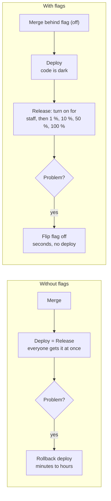
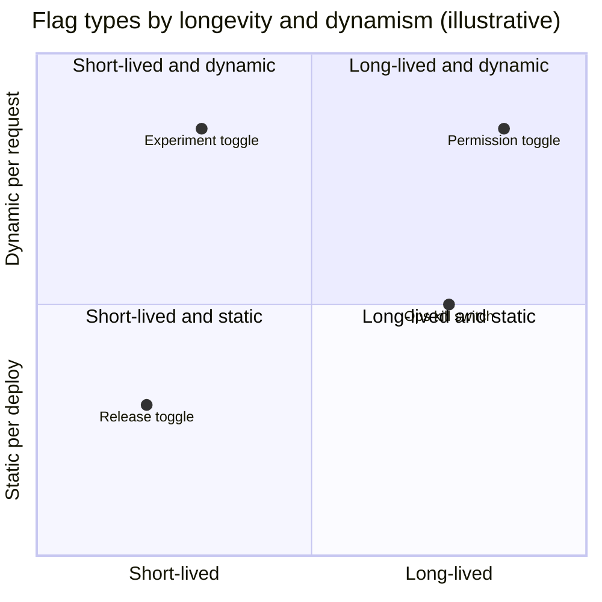
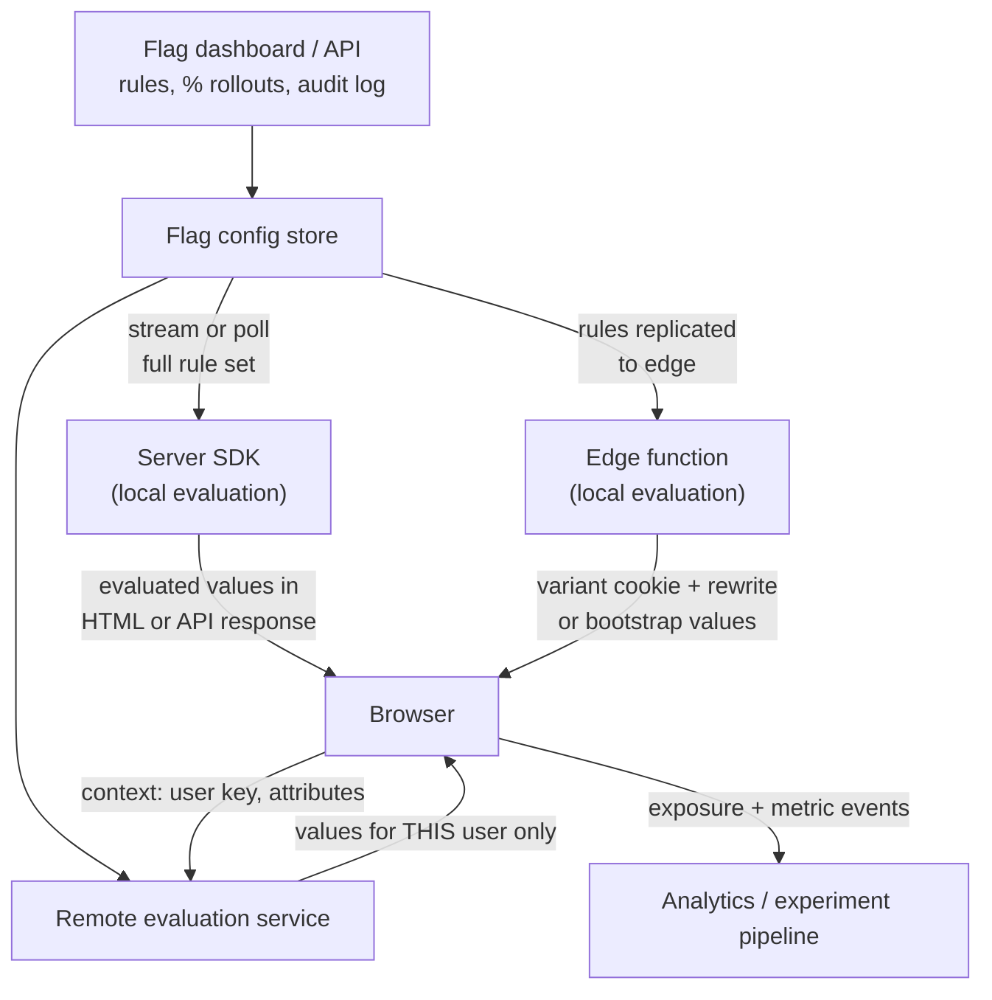
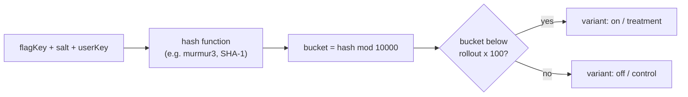
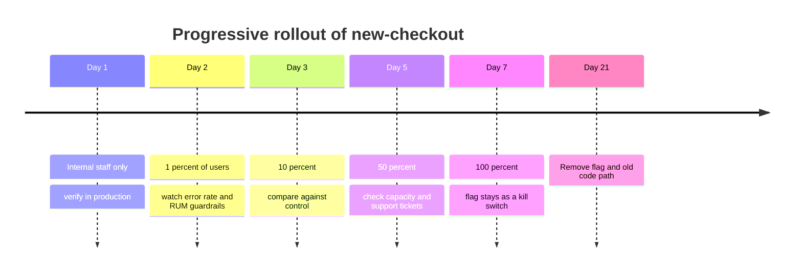
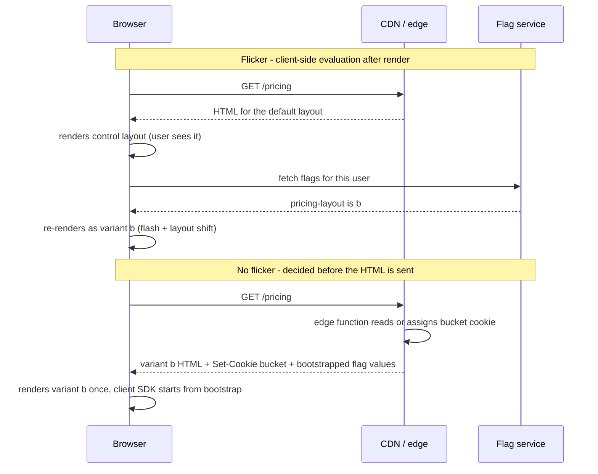
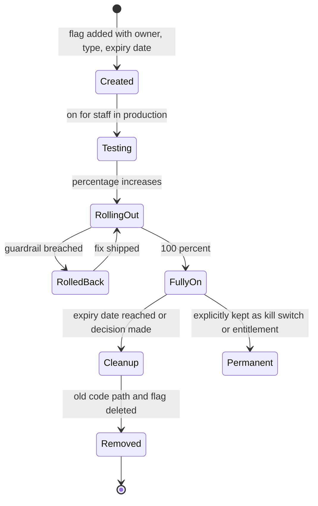
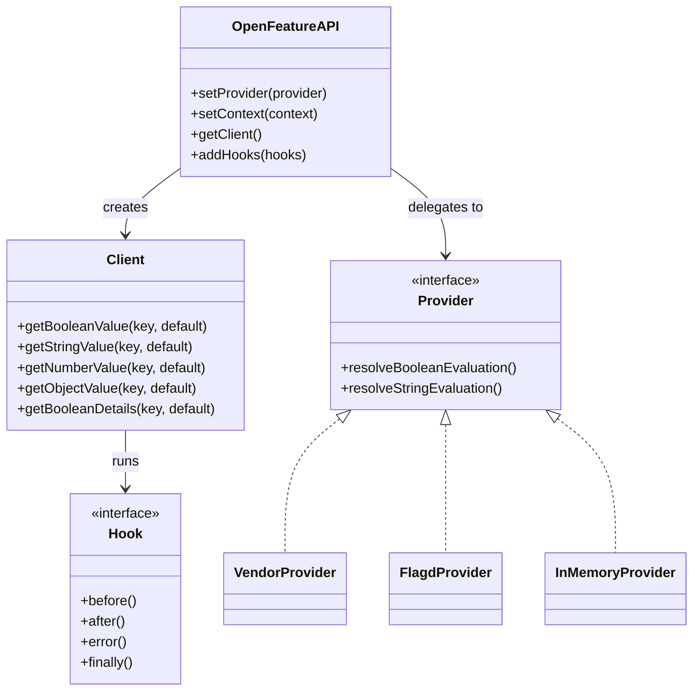
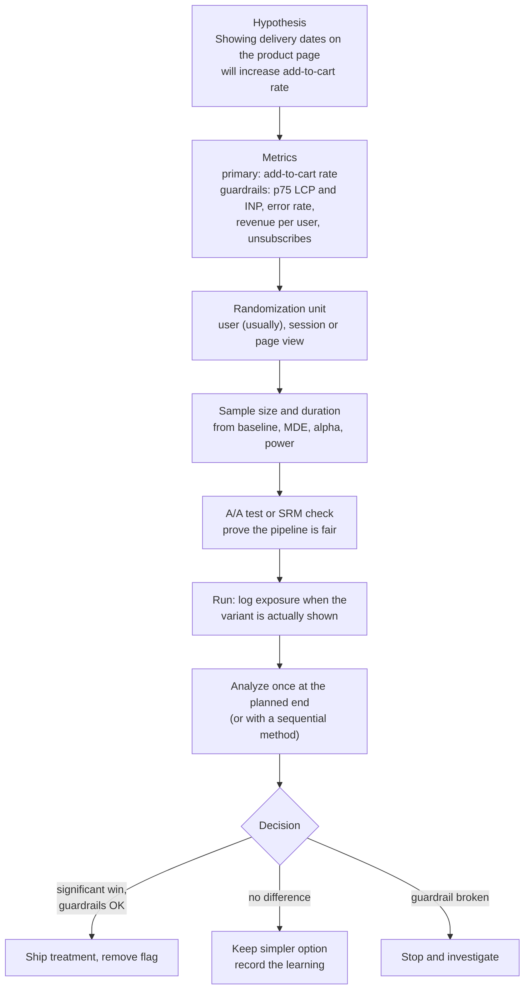
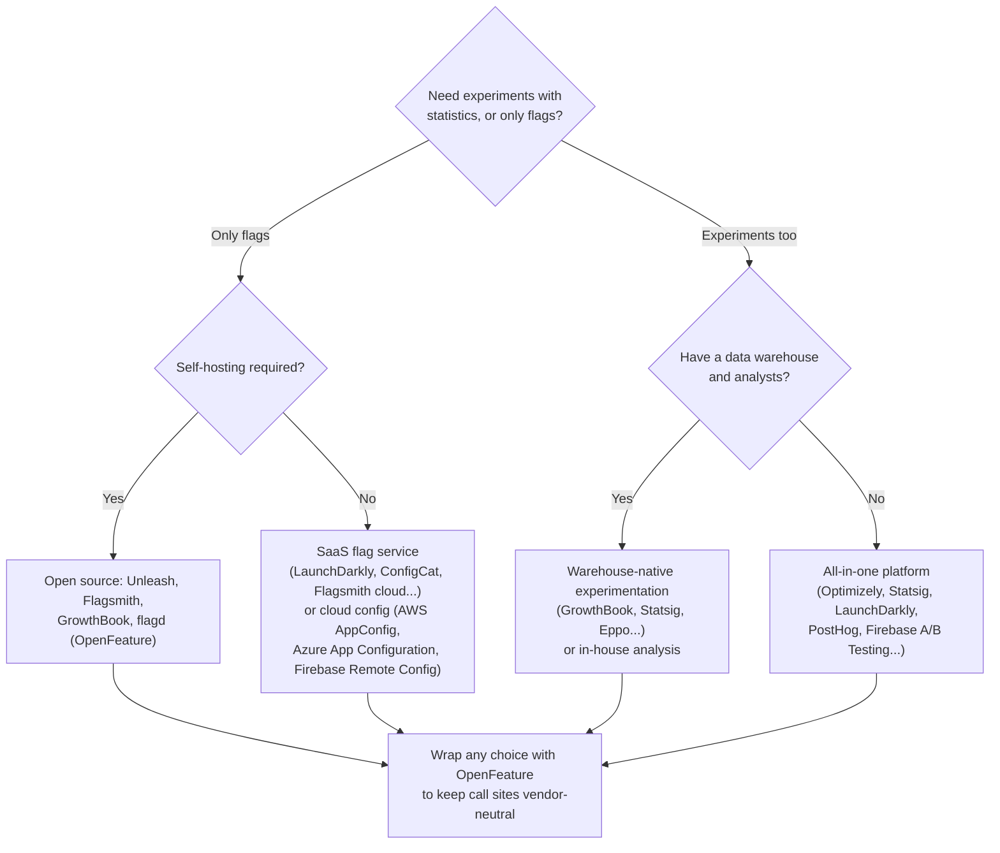

<!-- Generated by scripts/sync-knowledge.js from notes/ and README.md — do not edit here. -->
<!-- sections (line ranges in this file): Table of Contents 19-43 · ELI5 44-55 · Core Concept 56-437 · Build vs Buy 438-465 · Framework and Platform Notes 466-480 · Real-World Examples 481-622 · Key Points Summary 623-645 · Test Your Understanding 646-713 · Cheat Sheet 714-762 · References & Further Reading 763-794 -->

# Feature Flags & A/B Testing

> **Date:** 2026-11-06 · **Last updated:** 2026-11-06
> **Category:** Frontend System Design
> **Sub-Topic:** Monitoring & Observability / Experimentation and Release Control
> **Level:** Intermediate · **Reading time:** ~34 min
> **Informs:** decoupling deploy from release, flag types and lifetimes, client vs server vs edge flag evaluation, flicker-free variant rendering, CDN caching with variants, percentage rollouts and kill switches, experiment design (randomization unit, sample size, guardrails), exposure logging, flag cleanup and technical debt, vendor vs OpenFeature vs in-house

> **Pre-requisite:** [Real User Monitoring (RUM)](./real-user-monitoring-rum.md) (guardrail metrics come from RUM) and [Edge Rendering](./edge-rendering.md) (where flicker-free assignment happens).
> This note covers **two tools that share one mechanism**: feature flags control *who gets which code path*, and A/B tests use that control to *measure* which path is better.

**Previous:** [Synthetic Monitoring](./synthetic-monitoring.md) · **Next:** [Analytics Architecture](./analytics-architecture.md)

---

## Table of Contents

1. [ELI5 — Simple Explanation](#eli5--simple-explanation)
2. [Section 1: Deploy Is Not Release](#section-1-deploy-is-not-release)
3. [Section 2: Types of Flags](#section-2-types-of-flags)
4. [Section 3: How Flag Evaluation Works](#section-3-how-flag-evaluation-works)
5. [Section 4: Targeting, Bucketing and Progressive Rollouts](#section-4-targeting-bucketing-and-progressive-rollouts)
6. [Section 5: Flags in the Frontend — Flicker, SSR and the Edge](#section-5-flags-in-the-frontend--flicker-ssr-and-the-edge)
7. [Section 6: Flags, Bundles and Caching](#section-6-flags-bundles-and-caching)
8. [Section 7: Flag Lifecycle and Technical Debt](#section-7-flag-lifecycle-and-technical-debt)
9. [Section 8: OpenFeature — a Vendor-Neutral API](#section-8-openfeature--a-vendor-neutral-api)
10. [Section 9: A/B Testing Fundamentals](#section-9-ab-testing-fundamentals)
11. [Section 10: Sample Size, Duration and Peeking](#section-10-sample-size-duration-and-peeking)
12. [Section 11: Trustworthy Results — SRM, Exposure and Pitfalls](#section-11-trustworthy-results--srm-exposure-and-pitfalls)
13. [Section 12: Privacy, SEO and Safety](#section-12-privacy-seo-and-safety)
14. [Build vs Buy](#build-vs-buy)
15. [Framework and Platform Notes](#framework-and-platform-notes)
16. [Real-World Examples](#real-world-examples)
17. [Key Points Summary](#key-points-summary)
18. [Test Your Understanding (with answers)](#test-your-understanding)
19. [Cheat Sheet](#cheat-sheet)
20. [References & Further Reading](#references--further-reading)

---

## ELI5 — Simple Explanation

**Feature flags** are like **light switches an electrician installs before the lamp is finished**. The wiring (code) goes into the house (production) today, but the switch stays *off*. When the lamp is ready, you flip the switch: no new wiring needed. If the lamp sparks, you flip it off again in one second.

You can also install **smart switches**: "on for the kitchen staff only", "on in 10 % of the rooms", "on for guests from Spain".

**A/B testing** is a restaurant trying **two versions of the menu**. Half the tables (chosen by coin flip, not by the waiter's taste) get menu A, half get menu B. After enough dinners, you compare how much each half ordered. The coin flip matters: if the waiter gave the new menu only to friendly-looking tables, you'd learn nothing.

> **One-line takeaway: flags let you ship code dark and turn it on gradually or off instantly; A/B tests use random flag assignment plus careful statistics to learn whether a change actually helped.**

---

## Core Concept — Step by Step

### Section 1: Deploy Is Not Release



| Benefit | How flags deliver it |
|---|---|
| **Trunk-based development** | Unfinished work merges to `main` behind an off flag; no long-lived branches |
| **Progressive delivery** | Expose to a growing percentage while watching errors and RUM |
| **Instant rollback** | Turn the flag off; no rebuild, no CDN purge |
| **Targeted release** | Beta customers, internal staff, one country, one plan tier |
| **Experiments** | Random assignment to variants with measurement |
| **Operational control** | Kill switches to shed load (disable recommendations during a traffic spike) |

The cost: every flag is a **branch in production code** that multiplies the states your app can be in. Flags are useful only when they are **short-lived or deliberately permanent**, owned and cleaned up.

---

### Section 2: Types of Flags

Pete Hodgson's taxonomy (published on martinfowler.com) classifies flags by **how long they live** and **how dynamic** their decision is:



| Type | Purpose | Lifetime | Decided by | Example |
|---|---|---|---|---|
| **Release toggle** | Hide unfinished or not-yet-launched work | Days to weeks | Mostly on/off, sometimes % rollout | `new-checkout` |
| **Experiment toggle** | Assign users to variants and measure | Length of the experiment | Random bucketing per user | `pricing-page-layout: control / b / c` |
| **Ops toggle / kill switch** | Turn off expensive or risky features under load or failure | Can be long-lived | Operators, sometimes automation | `disable-recommendations` |
| **Permission / entitlement** | Features by plan, role or beta program | Permanent | User attributes | `advanced-analytics` for Pro plan |

> **Don't let a release toggle become a permission system.** Entitlements belong in your authorization model and must be enforced **on the server**. A client-side flag is a UI hint; anyone can flip it in DevTools.

---

### Section 3: How Flag Evaluation Works

A flag system has three parts: a **control plane** (UI/API where rules are edited), a **delivery mechanism** (how rules or values reach your app) and an **SDK** that evaluates flags against a **context** (who is asking).



| Evaluation location | How it works | Pros | Cons |
|---|---|---|---|
| **Server-side (local)** | SDK downloads all rules, evaluates in-process per request | Fast (no network per check), rules stay private, no flicker with SSR | Needs a server; values must be passed to the client |
| **Edge** | Rules replicated to edge storage; evaluated in middleware | Flicker-free even for static/CDN pages; very low latency | Limited runtime; caching needs care |
| **Client-side, remote evaluation** | Browser sends its context; service returns evaluated values | Works for pure SPAs and mobile apps | Network round trip at startup (flicker risk); context leaves the device |
| **Client-side, local evaluation** | Browser downloads rules and evaluates | No per-user call | **Exposes all rules and targeting lists** (emails, account IDs, unreleased feature names) to anyone; avoid for sensitive targeting |

**Context** is the input: a stable **targeting key** (user ID, or an anonymous device ID) plus attributes (country, plan, app version, browser). Keep it minimal; it may be sent to a third party.

**Updates:** server SDKs typically hold a streaming connection (often SSE) or poll, so a flag flip propagates in seconds without restarts. Browser SDKs may also stream; decide whether a mid-session flip should change the UI (it usually shouldn't for experiments, because it confuses users and corrupts measurement).

**Defaults are your safety net.** Every evaluation passes a **default value** used when the SDK is not ready, the network fails or the flag was deleted. The default must be the **safe, old behaviour**.

---

### Section 4: Targeting, Bucketing and Progressive Rollouts

Percentage rollouts and experiments need assignment that is **random across users** but **stable for each user**. The standard trick is **deterministic hashing**:



| Property | Why it matters |
|---|---|
| **Deterministic** | Same user gets the same variant on every request, server and client, with no stored assignment |
| **Flag key in the hash** | Different flags bucket independently; being in the first 10 % of one rollout says nothing about another |
| **Salt** | Re-randomize a flag (new salt) when restarting an experiment, so old exposure doesn't carry over |
| **Monotonic ramp** | Raising a rollout from 10 % to 25 % keeps the original 10 % in; users don't flip back and forth |
| **Targeting rules first** | Rules like "staff → on", "country = DE → off" are evaluated before the percentage split |

**Anonymous → logged-in users:** an anonymous visitor is bucketed by a device ID (first-party cookie or local storage). When they log in, the user ID may hash into a different bucket. Choose deliberately: keep the device ID as the key through the session, or "alias" device and user IDs in your analytics. Changing variant at login is a classic cause of broken experiments.

**A typical progressive rollout** (an example schedule, adjust to your risk and traffic):



Automate the guardrails where you can: if the error rate or p75 INP for the "on" group exceeds the "off" group by more than an agreed margin, pause or roll back automatically.

---

### Section 5: Flags in the Frontend — Flicker, SSR and the Edge

The frontend-specific problem is **flicker** (also called "flash of original content"): the page renders the default UI, then the flag value arrives and the UI swaps. It looks broken, causes **layout shift (CLS)** and **biases experiments** because users briefly see both variants.



| Approach | Flicker | Notes |
|---|---|---|
| **Evaluate on the server (SSR) and render the right variant** | None | Pass evaluated values to the client (serialized in the HTML) so hydration matches |
| **Evaluate at the edge, rewrite to a variant page** | None | Works for static/SSG pages; each variant can be cached separately |
| **Bootstrap**: embed evaluated flags in the HTML, client SDK starts from them | None for the first render | Client SDK keeps updating in the background |
| **Cached flags** from the previous visit (local storage) | None on repeat visits; possible change on first visit | Stale values for one session; acceptable for many release toggles, not for experiments |
| **Hide until ready** (skeleton or `visibility: hidden` with a short timeout) | Hidden, not removed | Hurts LCP; always add a timeout that falls back to the default |
| **Client-side only, render then swap** | Yes | Acceptable only for below-the-fold or non-visual flags |

> **Hydration mismatch:** if the server renders variant B but the client SDK initially returns the default A, React/Vue/Svelte hydration will complain or re-render. Always initialize the client SDK from the **same values the server used**.

---

### Section 6: Flags, Bundles and Caching

**Bundle size.** `if (flag) <NewCheckout/> else <OldCheckout/>` ships **both** components to everyone. For large variants, load the code for the active path only:

```tsx
const NewCheckout = lazy(() => import('./NewCheckout'));
const OldCheckout = lazy(() => import('./OldCheckout'));
// only the chosen chunk is downloaded (see Code Splitting & Lazy Loading)
```

**Security.** Code behind an off flag is still **in the bundle** (unless it is split and never requested). Assume anyone can read and enable it. Don't hide secrets, unreleased pricing or unannounced product names in client code just because a flag is off.

**CDN caching.** A cached HTML page can only be one variant. Options:

| Pattern | How | Watch out |
|---|---|---|
| **Edge rewrite to variant URL** | Edge function assigns a bucket cookie and rewrites `/pricing` → `/pricing/_b` internally | Each variant is cached under its own key; canonical URL stays `/pricing` |
| **Cache key includes the bucket** | CDN configured to add the bucket cookie's value (not the whole `Cookie` header) to the cache key | Never `Vary: Cookie` (see [Browser Caching Strategies](./browser-caching-strategies.md)) |
| **Cache the shell, flag on the client** | Static HTML for all, flags only affect below-the-fold or client-only parts | Flicker for anything visible early |
| **Don't cache personalized HTML** | `private, no-cache` for flagged pages | Loses edge performance |

---

### Section 7: Flag Lifecycle and Technical Debt



**Flag debt** is real: every stale flag is dead code, an untested combination and a trap for the next engineer. Practices:

| Practice | How |
|---|---|
| **Owner and expiry on every flag** | Required fields in the flag tool or a typed registry in code |
| **Cleanup ticket created with the flag** | Removal is part of the definition of done |
| **Stale-flag reports** | Flags at 100 % (or 0 %) for N weeks, flags not evaluated recently |
| **Lint / codemods** | Ban raw string keys; a typed registry makes dead flags visible to the compiler |
| **Limit nesting** | A flag inside another flag's branch doubles the states; avoid or document it |
| **Never reuse a flag key** | Old code that still reads the key will wake up with a new meaning |

> **A real warning:** in 2012 the trading firm Knight Capital suffered a major loss within an hour after a deployment where one server still ran old code, and a **repurposed** flag activated that obsolete code path. The details are in the U.S. SEC's order on the incident. Never reuse flag names; delete old code paths.

---

### Section 8: OpenFeature — a Vendor-Neutral API

**OpenFeature** is a CNCF project that defines a **standard API and SDKs** for feature flag evaluation. Your code talks to OpenFeature; a **provider** connects it to LaunchDarkly, Flagsmith, GrowthBook, Unleash, flagd, environment variables or your own system. Switching vendors means changing the provider, not every call site.



| Concept | Meaning |
|---|---|
| **Provider** | Adapter to a flag backend |
| **Evaluation context** | Targeting key + attributes |
| **Hooks** | Before/after/error callbacks; used for logging, telemetry (e.g. OpenTelemetry spans) and validation |
| **Static vs dynamic context** | Web/mobile SDKs use a **static context** (one user per app; values resolved up front, evaluations are synchronous). Server SDKs use **dynamic context** (a different user per request) |
| **flagd** | OpenFeature's own open-source flag daemon, configured from files or a control plane |

There are OpenFeature SDKs for the web, React, Angular, Node.js, Java, Go, .NET, Python, iOS, Android and more; check the OpenFeature ecosystem page for current status per language.

---

### Section 9: A/B Testing Fundamentals

An **online controlled experiment** randomly splits users into **control** (current experience) and one or more **treatments**, then compares metrics. Randomization is what lets you claim **causation**: the groups differ only by the change, so a significant difference in the metric is caused by the change (up to statistical error).



| Term | Meaning |
|---|---|
| **Primary metric (OEC)** | The one metric that decides the experiment, agreed before it starts. Kohavi et al. call a composite of these the *Overall Evaluation Criterion* |
| **Guardrail metrics** | Must not get worse: performance (LCP, INP), errors, revenue, latency, unsubscribes |
| **Randomization unit** | What is assigned: **user** (consistent experience, most common), session, page view, or account/team for B2B (to avoid colleagues seeing different UIs) |
| **MDE** | Minimum detectable effect: the smallest change worth detecting |
| **α (significance level)** | Accepted false-positive rate, conventionally 0.05 |
| **Power (1 − β)** | Probability of detecting a true effect of size MDE, conventionally 0.8 |
| **p-value** | Probability of seeing a difference at least this large if there were truly no effect; **not** "the probability that B is better" |
| **Confidence interval** | Range of effect sizes consistent with the data; more informative than a p-value alone |

**Frontend performance is a guardrail in every experiment.** A variant that loads an extra 200 KB of JavaScript may "win" on a short-term click metric and still hurt long-term retention. Join RUM data to experiment assignments so you can compare p75 LCP and INP per variant (see [Real User Monitoring (RUM)](./real-user-monitoring-rum.md)).

---

### Section 10: Sample Size, Duration and Peeking

A common rule of thumb for **two variants, α = 0.05 (two-sided) and 80 % power** is:

```text
n per variant ≈ 16 × σ² / δ²

  σ² = variance of the metric        (for a conversion rate p:  σ² = p × (1 − p))
  δ  = absolute effect to detect (MDE)

Worked example:
  baseline conversion p = 5 %  →  σ² = 0.05 × 0.95 = 0.0475
  MDE = 0.5 percentage points (10 % relative) → δ = 0.005, δ² = 0.000025
  n ≈ 16 × 0.0475 / 0.000025 = 30,400 users per variant  (≈ 60,800 total)

Halve the MDE → you need about 4× as many users.
```

| Decision | Guidance |
|---|---|
| **Duration** | Compute from the sample size and your eligible traffic, then round up to **whole weeks** so weekday/weekend behaviour is balanced |
| **Traffic allocation** | 50/50 maximizes power for two variants; smaller treatment shares (for risk) need longer runs |
| **More variants** | Each extra variant needs its own sample and increases false positives; correct for multiple comparisons |
| **Low traffic** | Test bolder changes (bigger MDE), use metrics closer to the change (higher sensitivity), or accept that A/B testing isn't the right tool |
| **Variance reduction** | Techniques like CUPED use pre-experiment data to reduce variance and shorten tests; many platforms offer it |

**Peeking:** if you check a classic fixed-horizon test every day and stop as soon as p < 0.05, the real false-positive rate is far higher than 5 %, because you gave chance many opportunities to cross the line. Either:
- **Fix the horizon**: decide the sample size up front and only make the decision at the end, or
- **Use a sequential method** designed for continuous monitoring (for example always-valid p-values / confidence sequences, or group-sequential designs). Many experimentation platforms implement one; check which yours uses.

---

### Section 11: Trustworthy Results — SRM, Exposure and Pitfalls

**Sample Ratio Mismatch (SRM):** if you configured 50/50 and got a significantly different split, something in assignment, delivery or logging is broken, and the results can't be trusted, no matter how good they look. Check it with a chi-square test on the counts:

```text
expected per arm = total / 2
χ² = Σ (observed − expected)² / expected        (1 degree of freedom for 2 arms)
χ² > 3.84  → p < 0.05
χ² > 10.83 → p < 0.001   (a common, stricter SRM alarm threshold)
```

Frontend causes of SRM: a variant that crashes before the exposure event is sent; a slower variant whose users leave before tracking loads; ad blockers blocking one variant's analytics call; redirect-based tests losing users on the redirect; bots favouring one variant; caching that serves one variant more often.

**Exposure logging:** log the exposure **when the user actually sees the variant** (component rendered), not when the flag was evaluated. Otherwise users who never reached the feature dilute the effect.

| Pitfall | Effect | Mitigation |
|---|---|---|
| **Flicker** | Users see both variants; variant B looks worse | Server/edge assignment, bootstrapping |
| **Assignment changes at login** | Users switch variants, effects mix | Stable key strategy; alias IDs |
| **Novelty / primacy effects** | Early results differ from long-term behaviour | Run full weeks; look at effect over time; consider long-term holdouts |
| **Interacting experiments** | Two tests on the same page change each other's outcome | Mutually exclusive layers for overlapping UI; most platforms support this |
| **Twyman's law** | "Any figure that looks interesting or different is usually wrong" | Treat surprising wins as bugs until proven otherwise; check SRM, logging, segments |
| **Segment fishing** | Searching many segments for a "win" finds false positives | Pre-register segments; correct for multiple comparisons |
| **Synthetic and bot traffic** | Non-converting sessions skew variants | Filter tagged synthetic traffic and bots (see [Synthetic Monitoring](./synthetic-monitoring.md)) |
| **No A/A test** | Pipeline bugs go unnoticed | Run A/A tests periodically: they should show "no difference" about 95 % of the time at α = 0.05 |

---

### Section 12: Privacy, SEO and Safety

| Topic | Guidance |
|---|---|
| **Context data** | Send only the attributes targeting needs; prefer IDs and coarse attributes over emails and names. Third-party flag services receive this context |
| **Consent** | Whether experiment assignment and measurement need consent depends on jurisdiction and on what is stored (cookies, identifiers). Decide with your privacy/legal team; the assignment cookie itself may fall under cookie rules |
| **Client-visible rules** | Avoid client-side local evaluation for flags whose rules contain customer lists or confidential plans |
| **Authorization** | Flags never replace server-side permission checks |
| **SEO** | Google's guidance on website testing: don't cloak (show crawlers different content than users), use `rel="canonical"` on variant URLs pointing to the original, use **302** (temporary) redirects for redirect tests, and end tests promptly. See [SEO for SPAs & Dynamic Content](./seo-for-spas-and-dynamic-content.md) |
| **Audit and approvals** | Flag changes are production changes: keep an audit log, require review for flags on critical paths, alert on changes during incidents |
| **Kill switches are code too** | Test that turning a kill switch off actually works and that the "off" path is still healthy |

---

## Build vs Buy



| Option | Good for | Watch out |
|---|---|---|
| **Environment variables / build-time flags** | Compile-time switches, dead-code elimination | Changing them needs a deploy; no targeting |
| **Config file / remote JSON** | Small teams, a handful of flags | No audit log, no gradual rollout, no stats |
| **Open-source flag service** | Control, data residency, cost | You operate it |
| **SaaS flags + experiments** | Speed, mature SDKs, stats engines, approvals | Cost, data leaves your infrastructure, vendor lock-in (reduce with OpenFeature) |
| **In-house experimentation** | Very large scale, custom metrics | Statistics and pipeline correctness are hard; SRM checks and A/A tests are mandatory |

> Product names and capabilities change frequently. Evaluate on: SDK quality for your stacks (web, SSR, edge, mobile), bootstrapping support, evaluation latency, stats method (fixed vs sequential, variance reduction), warehouse integration, audit/approvals, and pricing model.

---

## Framework and Platform Notes

| Stack | Typical pattern |
|---|---|
| **React** | Provider at the root (vendor SDK or `@openfeature/react-sdk`), hooks like `useBooleanFlagValue('key', false)`; split large variants with `lazy()` |
| **Next.js (App Router)** | Evaluate in Server Components or in the request-time edge layer (`middleware.ts`, renamed `proxy.ts` in Next.js 16) and pass values down; Vercel's open-source Flags SDK (`flags` package) wraps this pattern. Keep flags out of statically cached pages unless you rewrite per variant |
| **Vue / Nuxt** | `provide`/`inject` or a composable (`useFlag('key')`); in Nuxt evaluate on the server and pass via payload/state to avoid hydration mismatches |
| **Angular** | An injectable `FeatureFlagService`, a structural directive (`*appFeature="'new-checkout'"`) or route guards (`canMatch`) to load different lazy routes; OpenFeature has an Angular SDK |
| **Svelte / SvelteKit** | Evaluate in `+layout.server.ts` `load`, expose through `data`/stores; edge assignment in `hooks.server.ts` |
| **Edge platforms** | Cloudflare Workers, Vercel/Netlify edge functions, Fastly Compute: assign bucket cookie and rewrite before the cache lookup |
| **iOS / Android** | Firebase Remote Config, vendor mobile SDKs or OpenFeature mobile SDKs. Values are **cached on the device** and fetched periodically; target by **app version**, because old app versions stay installed for a long time and can't be patched instantly. You can't delete a code path until old versions have been retired |
| **React Native / Flutter** | Same as native: cached values, app-version targeting, plus JS/Dart SDKs |

---

## Real-World Examples

**Example 1 — Typed flags with safe defaults (BAD → GOOD):**
```tsx
// ❌ BAD: string keys everywhere, no default, no owner, impossible to find dead flags
if (window.flags['newChekout']) { /* typo: always undefined → silently old path */ }

// ✅ GOOD: one typed registry; the compiler finds every use and every typo
// flags.ts
export const FLAGS = {
  'new-checkout':      { default: false, owner: 'checkout-team', expires: '2026-12-15', type: 'release' },
  'pricing-layout':    { default: 'control' as 'control' | 'b' | 'c', owner: 'growth', expires: '2026-12-01', type: 'experiment' },
  'disable-recs':      { default: false, owner: 'platform', expires: null, type: 'ops' },
} as const;
export type FlagKey = keyof typeof FLAGS;
export type FlagValue<K extends FlagKey> = (typeof FLAGS)[K]['default'];

// useFlag.ts — reads values bootstrapped by the server; falls back to the safe default
import { createContext, useContext } from 'react';
export const FlagContext = createContext<Partial<Record<FlagKey, unknown>>>({});

export function useFlag<K extends FlagKey>(key: K): FlagValue<K> {
  const values = useContext(FlagContext);
  return (values[key] ?? FLAGS[key].default) as FlagValue<K>;
}

// Checkout.tsx
const NewCheckout = lazy(() => import('./NewCheckout'));
const OldCheckout = lazy(() => import('./OldCheckout'));
export function Checkout() {
  const enabled = useFlag('new-checkout');
  return <Suspense fallback={<CheckoutSkeleton />}>{enabled ? <NewCheckout /> : <OldCheckout />}</Suspense>;
}
```

**Example 2 — Deterministic bucketing (what SDKs do internally):**
```typescript
// FNV-1a 32-bit: small and deterministic. Real SDKs use their own hash (often murmur3 or SHA-1),
// so never mix your own bucketing with a vendor's for the same flag.
function fnv1a(input: string): number {
  let h = 0x811c9dc5;
  for (let i = 0; i < input.length; i++) {
    h ^= input.charCodeAt(i);
    h = Math.imul(h, 0x01000193) >>> 0;
  }
  return h >>> 0;
}

/** Returns a bucket in [0, 10000) that is stable for (flag, salt, user). */
export function bucket(flagKey: string, salt: string, userKey: string): number {
  return fnv1a(`${flagKey}:${salt}:${userKey}`) % 10_000;
}

export function isEnabled(flagKey: string, salt: string, userKey: string, rolloutPercent: number) {
  return bucket(flagKey, salt, userKey) < rolloutPercent * 100;  // 10 % → buckets 0..999
}

// Raising rolloutPercent from 10 to 25 keeps buckets 0..999 enabled (monotonic ramp).
```

**Example 3 — Flicker-free experiment at the edge (Next.js):**
```typescript
// proxy.ts (Next.js 16; in earlier versions this file is middleware.ts and the function is named middleware)
import { NextResponse, type NextRequest } from 'next/server';

const COOKIE = 'exp-pricing';
const VARIANTS = ['control', 'b'] as const;

export function proxy(request: NextRequest) {
  let variant = request.cookies.get(COOKIE)?.value as (typeof VARIANTS)[number] | undefined;
  if (!variant || !VARIANTS.includes(variant)) {
    variant = Math.random() < 0.5 ? 'control' : 'b';   // or bucket(deviceId) for determinism
  }
  // Internal rewrite: the URL stays /pricing, each variant page can be cached separately
  const url = request.nextUrl.clone();
  url.pathname = `/pricing/${variant}`;
  const res = NextResponse.rewrite(url);
  res.cookies.set(COOKIE, variant, { maxAge: 60 * 60 * 24 * 30, sameSite: 'lax', secure: true, path: '/' });
  return res;
}

export const config = { matcher: '/pricing' };
// app/pricing/[variant]/page.tsx renders the variant and sets <link rel="canonical" href="/pricing">
```
> The same idea works in Cloudflare Workers, Netlify/Vercel edge functions, Fastly Compute or an nginx `split_clients` block: assign once, persist in a cookie, render or rewrite **before** the HTML leaves the edge.

**Example 4 — OpenFeature in a React app:**
```tsx
import { OpenFeature, OpenFeatureProvider, useBooleanFlagValue } from '@openfeature/react-sdk';
import { VendorWebProvider } from 'some-vendor-openfeature-provider'; // any OpenFeature web provider

await OpenFeature.setContext({ targetingKey: currentUser.id, plan: currentUser.plan, country: 'DE' });
OpenFeature.setProvider(new VendorWebProvider({ clientKey: import.meta.env.VITE_FLAGS_KEY }));

function App() {
  return (
    <OpenFeatureProvider>
      <Header />
    </OpenFeatureProvider>
  );
}

function Header() {
  const showNewNav = useBooleanFlagValue('new-navigation', false); // default = safe old behaviour
  return showNewNav ? <NewNav /> : <OldNav />;
}
```
> Check the OpenFeature React SDK docs for suspense options (waiting for the provider to be ready) and how your provider supports bootstrapping from server-evaluated values.

**Example 5 — Exposure logging at render time (BAD → GOOD):**
```tsx
// ❌ BAD: logs exposure for every user who loads the app, including those who never open pricing
const layout = flags.get('pricing-layout');
track('exposure', { flag: 'pricing-layout', variant: layout });

// ✅ GOOD: log once, when the variant is actually rendered to this user
function PricingPage() {
  const layout = useFlag('pricing-layout');
  useEffect(() => {
    track('exposure', { flag: 'pricing-layout', variant: layout }); // dedupe per user/session in the SDK or pipeline
  }, [layout]);
  return layout === 'b' ? <PricingB /> : <PricingControl />;
}
```

**Example 6 — Sample Ratio Mismatch check before reading results:**
```typescript
/** Chi-square test for a 2-arm experiment with intended split `pA` (e.g. 0.5). */
export function srmCheck(nA: number, nB: number, pA = 0.5) {
  const total = nA + nB;
  const eA = total * pA;
  const eB = total * (1 - pA);
  const chi2 = (nA - eA) ** 2 / eA + (nB - eB) ** 2 / eB;
  return { chi2, srm: chi2 > 10.83 };   // 10.83 = critical value for p < 0.001 with 1 degree of freedom
}

srmCheck(50_000, 50_400); // chi2 ≈ 1.59 → no SRM
srmCheck(50_000, 51_500); // chi2 ≈ 22.17 → SRM: stop and debug assignment/logging before trusting any metric
```

---

## Key Points Summary

| Concept | One-Line Explanation |
|---|---|
| **Feature flag** | A runtime switch that chooses a code path without a deploy |
| **Deploy vs release** | Ship code dark, release it gradually or instantly roll it back |
| **Flag types** | Release, experiment, ops/kill switch, permission; each has a different lifetime |
| **Default value** | The safe old behaviour used when flags can't be evaluated |
| **Local vs remote evaluation** | Rules evaluated in-process vs a service returning values per user |
| **Deterministic bucketing** | hash(flag + salt + user) gives stable, independent, monotonic assignment |
| **Flicker** | Default UI shown before the flag arrives; fix with SSR, edge or bootstrapping |
| **Variants and CDN** | Rewrite to per-variant URLs or key the cache on the bucket cookie, never `Vary: Cookie` |
| **Flag debt** | Every stale flag is dead code and an untested state; give flags owners and expiry dates |
| **OpenFeature** | CNCF standard API so flag call sites don't depend on one vendor |
| **A/B test** | Random assignment + pre-agreed metric + enough sample = causal evidence |
| **Guardrails** | Performance, errors and revenue must not regress even if the primary metric wins |
| **Sample size** | n ≈ 16σ²/δ² per variant at α = 0.05, power 0.8; halving MDE needs ~4× users |
| **Peeking** | Stopping early on a fixed-horizon test inflates false positives; use fixed horizons or sequential methods |
| **SRM** | A broken split means broken data; check it before anything else |
| **Exposure logging** | Log when the variant is shown, not when it was evaluated |

---

## Test Your Understanding

**Q1 (Basic):**
What's the difference between a release toggle, an experiment toggle, a kill switch and a permission toggle? Which should be removed soonest?

<details>
<summary>Answer</summary>

- **Release toggle:** hides unfinished or not-yet-launched work; mostly on/off or a % rollout. Short-lived, so remove it **soonest** after reaching 100 %.
- **Experiment toggle:** randomly assigns users to variants for measurement; lives for the duration of the experiment, then the winner is hard-coded.
- **Kill switch (ops toggle):** lets operators disable an expensive or risky feature under load or failure; can be long-lived, but must be tested.
- **Permission toggle:** enables features by plan, role or beta program; effectively permanent and must be enforced on the server.

Release toggles become debt fastest because they're numerous and their purpose ends at launch.
</details>

**Q2 (Basic):**
Why must every flag evaluation pass a default value, and what should it be?

<details>
<summary>Answer</summary>

The SDK may not be initialized yet, the flag service may be unreachable, the network may fail, or the flag may have been deleted. The default is what the app uses in all those cases, so it must be the **safe, existing behaviour** (usually "off" / control). If the default were the new path, an outage at the flag vendor would silently release unfinished features to everyone.
</details>

**Q3 (Application):**
An experiment on the hero section of a statically generated landing page shows variant B performing much worse. Session recordings show users seeing the control hero for a moment before it changes to B. What is happening and how do you fix it?

<details>
<summary>Answer</summary>

**Flicker.** The static HTML contains the control hero; the client-side SDK fetches the assignment after the first render and swaps in B. B users see both versions, get a layout shift (worse CLS) and a later LCP, so B is penalized by the *implementation*, not by its design. Fix: assign the variant **before** HTML is delivered: an edge function reads/assigns a bucket cookie and rewrites to a per-variant prebuilt page (each cached separately), or render on the server with evaluated flags, and bootstrap the client SDK with the same values to avoid hydration mismatch. Avoid `Vary: Cookie`; key the cache on the bucket value or the rewritten path.
</details>

**Q4 (Application):**
Your conversion rate is 4 %. Product wants to detect a 5 % relative lift (to 4.2 %) with α = 0.05 and 80 % power. Roughly how many users per variant do you need, and what would you suggest if the page gets 10,000 eligible users per week?

<details>
<summary>Answer</summary>

σ² = 0.04 × 0.96 = 0.0384; δ = 0.002 → δ² = 0.000004. n ≈ 16 × 0.0384 / 0.000004 = **153,600 per variant** (~307,000 total). At 10,000 users/week that's about **30 weeks**, which is too long (seasonality, product changes, cookie churn). Options: test a bolder change with a larger MDE (doubling the MDE cuts the sample to about a quarter), use a more sensitive metric closer to the change (e.g., add-to-cart instead of purchase), apply variance reduction (CUPED) if available, or accept that this decision should be made with qualitative research or a staged rollout with guardrails instead of an A/B test.
</details>

**Q5 (Tricky):**
A test configured 50/50 ends with 512,000 users in control and 498,000 in treatment, and treatment shows a +3 % revenue lift with p = 0.01. The PM wants to ship. What do you do?

<details>
<summary>Answer</summary>

Check for **Sample Ratio Mismatch** first. Expected 505,000 each: χ² = (7,000² / 505,000) × 2 ≈ 194, far above 10.83, so the split is broken and **the result cannot be trusted** regardless of the p-value. Something removed treatment users non-randomly: a treatment crash before exposure logging, a slower treatment where users leave before tracking fires, a redirect losing users, a caching layer serving control more often, or bot filtering that treats variants differently. The missing users are probably not random (e.g. the ones with bad experiences), which can create a fake lift. Debug assignment and logging, fix, and rerun (ideally after an A/A test). Also remember Twyman's law: surprising wins deserve extra suspicion.
</details>

**Q6 (System design):**
Design feature flagging and experimentation for a large e-commerce site: Next.js storefront (mix of static and SSR pages, CDN-cached), React Native app, and a requirement that marketing can launch experiments without deploys while performance guardrails are enforced.

<details>
<summary>Answer</summary>

- **API:** standardize call sites on OpenFeature (web, React, server, mobile SDKs) with one provider (vendor or self-hosted flagd/Unleash/GrowthBook). Typed flag registry with owner, type and expiry; lint against raw keys.
- **Evaluation:** server-side/local evaluation in Next.js Server Components; **edge assignment** for CDN-cached static pages (bucket cookie + rewrite to per-variant paths, canonical tags on variants); bootstrap evaluated values into the HTML so the client SDK starts identical and hydration matches. Client-side remote evaluation only for below-the-fold UI.
- **Bucketing:** deterministic hash of flag key + salt + stable ID; anonymous device ID, aliased to user ID at login, without reassigning variants mid-experiment.
- **Mobile:** cached values with periodic refresh, targeting by app version; old code paths kept until old versions are retired; kill switches for risky features.
- **Experiments:** pre-registered hypothesis, primary metric and guardrails (p75 LCP/INP from RUM joined by variant, JS error rate, revenue, latency); sample size and full-week durations computed up front; exposure logged on render; automatic SRM checks; sequential testing or fixed horizons enforced by the platform; mutually exclusive layers for experiments on the same surface; synthetic and bot traffic excluded.
- **Safety:** approvals and audit log for flags on checkout; automated rollback when guardrails breach during progressive rollouts; stale-flag reports and cleanup tickets; entitlements enforced server-side, never by client flags.
</details>

---

## Cheat Sheet

**Key Definitions:**
- **Feature flag:** Runtime switch that selects a code path; evaluated against a context with a default
- **Targeting key:** Stable ID used for bucketing (user ID or anonymous device ID)
- **Bucketing:** hash(flagKey + salt + key) mod N → stable, independent assignment
- **Bootstrapping:** Shipping server-evaluated flag values in the HTML so the client starts with them
- **Kill switch:** Long-lived ops flag that disables a feature fast
- **OpenFeature:** CNCF vendor-neutral flag API with providers, context and hooks
- **MDE / α / power:** Smallest effect worth detecting / false-positive rate / chance to detect a real effect
- **SRM:** Observed split differs significantly from the configured split; results invalid
- **Guardrail metric:** Must not regress (performance, errors, revenue) even if the primary metric improves

**Quick Reference:**
```text
Flag call:        getValue(key, SAFE_DEFAULT) ; typed registry ; owner + expiry on every flag
Evaluation:       server/edge for anything visible at first paint ; bootstrap client SDK from server values
Client-local:     never for rules containing customer lists or confidential plans
Bucketing:        hash(flag:salt:user) % 10000 < percent*100 ; monotonic ramps ; new salt to re-randomize
Rollout:          staff -> 1% -> 10% -> 50% -> 100% with guardrails -> remove flag
CDN + variants:   edge rewrite to /page/variant or cache key on bucket cookie value ; never Vary: Cookie
Bundles:          lazy-load each large variant ; off code in the bundle is public
Experiment:       hypothesis -> primary + guardrails -> unit -> sample size -> A/A or SRM -> run whole weeks -> analyze once
Sample size:      n/variant ≈ 16 σ² / δ²  (α=0.05 two-sided, power 0.8) ; σ² = p(1-p) for rates
SRM:              χ² > 10.83 (p < 0.001) -> stop, debug, rerun
Exposure:         log on render, dedupe ; exclude bots and synthetic traffic
SEO:              no cloaking ; rel=canonical on variant URLs ; 302 for redirect tests ; end tests promptly
```

**Common Mistakes to Avoid:**

| Mistake | Why Wrong | Fix |
|---|---|---|
| Client-side flag evaluation for above-the-fold UI | Flicker, CLS, biased experiments | Server/edge evaluation + bootstrapping |
| Default value = new behaviour | Flag outage releases unfinished work | Default to the safe old path |
| Using flags as authorization | Anyone can flip client flags | Enforce entitlements on the server |
| Never removing flags | Dead code, untested combinations | Owner, expiry, cleanup ticket, stale reports |
| Reusing an old flag key | Old code paths wake up with a new meaning | New key for every new purpose |
| `Vary: Cookie` for variant pages | Destroys CDN hit rate | Rewrite per variant or key on one cookie value |
| Peeking and stopping at first p < 0.05 | Inflated false positives | Fixed horizon or sequential testing |
| Ignoring SRM | Biased, invalid results | Automatic SRM check before reading metrics |
| Logging exposure at evaluation | Dilutes the effect with unexposed users | Log when the variant renders |
| No performance guardrails | A "winning" variant can be slower and hurt long-term | Join RUM metrics to variants |
| Short tests that end mid-week | Day-of-week effects bias results | Whole weeks |
| Shipping both large variants in the main bundle | Extra JS for everyone | `lazy()` / dynamic import per variant |
| Client-side local evaluation with sensitive rules | Leaks customer lists and plans | Remote or server evaluation |

---

## References & Further Reading

**Feature flags**
- Pete Hodgson on martinfowler.com: [Feature Toggles (aka Feature Flags)](https://martinfowler.com/articles/feature-toggles.html)
- OpenFeature: [Documentation](https://openfeature.dev/docs/reference/intro) · [Specification](https://openfeature.dev/specification/) · [React SDK](https://openfeature.dev/docs/reference/technologies/client/web/react)
- flagd: [Documentation](https://flagd.dev/)
- Next.js: [Proxy (formerly Middleware)](https://nextjs.org/docs/app/api-reference/file-conventions/proxy)
- Vercel: [Flags SDK](https://flags-sdk.dev/)
- Firebase: [Remote Config](https://firebase.google.com/docs/remote-config)

**Experimentation**
- Kohavi, Tang, Xu: *Trustworthy Online Controlled Experiments* (Cambridge University Press, 2020) — the standard reference; [book site](https://experimentguide.com/)
- Microsoft Research: [Experimentation Platform (ExP) publications](https://www.microsoft.com/en-us/research/group/experimentation-platform-exp/)
- Fabijan et al.: *Diagnosing Sample Ratio Mismatch in Online Controlled Experiments: A Taxonomy and Rules of Thumb for Practitioners* (KDD 2019), listed on the ExP publications page above
- Evan Miller: [How Not To Run an A/B Test](https://www.evanmiller.org/how-not-to-run-an-ab-test.html) (peeking)

**SEO, privacy and performance**
- Google Search Central: [Minimize A/B testing impact in Google Search](https://developers.google.com/search/docs/crawling-indexing/website-testing)
- web.dev: [Best practices for measuring Web Vitals in the field](https://web.dev/articles/vitals-field-measurement-best-practices)

**Incident history**
- U.S. SEC: [Order on Knight Capital Americas LLC (2013)](https://www.sec.gov/litigation/admin/2013/34-70694.pdf)

---

> **Previous Topic:** [Synthetic Monitoring](./synthetic-monitoring.md)
> — Scripted checks from fixed locations: uptime, journeys and lab regressions

> **Next Topic:** [Analytics Architecture](./analytics-architecture.md)
> — Event schemas, collection pipelines and how product data flows from the browser to decisions

*Saved on: 2026-11-06 | Repo: Frontend System Design Learning Notes*
