<!-- Generated by scripts/sync-knowledge.js from notes/ and README.md — do not edit here. -->
<!-- sections (line ranges in this file): Table of Contents 19-41 · ELI5 42-54 · Core Concept 55-450 · Real-World Examples 451-645 · Key Points Summary 646-666 · Test Your Understanding 667-739 · Cheat Sheet 740-783 · References & Further Reading 784-813 -->

# Feature-Sliced Design

> **Date:** 2026-11-06 · **Last updated:** 2026-11-06
> **Category:** Frontend System Design
> **Sub-Topic:** Rendering & Architecture / Project Structure
> **Level:** Intermediate · **Reading time:** ~26 min
> **Informs:** folder structure for medium-to-large apps, module boundaries and import rules, where business logic lives, public APIs between modules, team ownership, lint-enforced architecture, onboarding speed

> **Pre-requisite:** [Component Architecture & Design Systems](./component-architecture-and-design-systems.md) (component layers and one-way dependencies) and [Mono-repo vs Multi-repo](./mono-repo-vs-multi-repo.md).
> This note covers **Feature-Sliced Design (FSD)**: a published, framework-agnostic methodology for structuring a whole frontend app into layers, slices and segments with enforced import rules.

**Previous:** [Component Architecture & Design Systems](./component-architecture-and-design-systems.md) · **Next:** [Module Bundling & Build Systems](./module-bundling-and-build-systems.md)

---

## Table of Contents

1. [ELI5 — Simple Explanation](#eli5--simple-explanation)
2. [Section 1: The Problem FSD Solves](#section-1-the-problem-fsd-solves)
3. [Section 2: Layers, Slices, Segments](#section-2-layers-slices-segments)
4. [Section 3: The Seven Layers](#section-3-the-seven-layers)
5. [Section 4: The Import Rule](#section-4-the-import-rule)
6. [Section 5: Public API of a Slice](#section-5-public-api-of-a-slice)
7. [Section 6: Segments — What Goes Inside a Slice](#section-6-segments--what-goes-inside-a-slice)
8. [Section 7: Entities vs Features vs Widgets](#section-7-entities-vs-features-vs-widgets)
9. [Section 8: Cross-Imports Between Entities (`@x`)](#section-8-cross-imports-between-entities-x)
10. [Section 9: Pages First — Don't Slice Too Early](#section-9-pages-first--dont-slice-too-early)
11. [Section 10: FSD With Frameworks (Next.js, Nuxt, SvelteKit, Angular)](#section-10-fsd-with-frameworks-nextjs-nuxt-sveltekit-angular)
12. [Section 11: Enforcing the Rules](#section-11-enforcing-the-rules)
13. [Section 12: FSD vs Other Structures](#section-12-fsd-vs-other-structures)
14. [Real-World Examples](#real-world-examples)
15. [Key Points Summary](#key-points-summary)
16. [Test Your Understanding (with answers)](#test-your-understanding)
17. [Cheat Sheet](#cheat-sheet)
18. [References & Further Reading](#references--further-reading)

---

## ELI5 — Simple Explanation

Think of a **department store**:

- **Floors are layers.** The ground floor (`shared`) has the basics everyone uses: elevators, toilets, shopping bags. Higher floors are more specific. Staff on the 4th floor can take the elevator **down** to use the ground floor, but the ground floor never depends on what's sold on the 4th floor.
- **Departments on a floor are slices.** On the "products" floor there's a *shoes* department and a *bags* department. They don't borrow stock from each other; if both need something, it lives on a lower floor.
- **Each department has the same back rooms**: a shop floor (`ui`), a stock room (`model`), a phone line to suppliers (`api`). Any new employee knows where to look in any department.
- **Each department has one counter** (the **public API**, `index.ts`). Other departments order through the counter; they never walk into the stock room.

> **FSD sorts code by how business-specific it is (layers), then by business domain (slices), then by technical purpose (segments) — and only allows imports downward through each slice's public API.**

---

## Core Concept — Step by Step

### Section 1: The Problem FSD Solves

Most apps start with a structure by **file type**:

```text
src/
  components/   (180 files)
  hooks/        (60 files)
  services/     (40 files)
  store/        (35 files)
  utils/        (90 files)
```

It works for small apps, then fails in predictable ways:

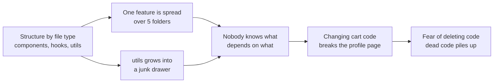

FSD's answer has three ideas:
1. **Group by business meaning first** (cart, user, product), technical type second.
2. **Rank modules by responsibility** (layers) and only allow imports **downward**, so the dependency graph is acyclic and predictable.
3. **Give every module a public API**, so internals can change without breaking callers.

FSD is maintained by a community team at [feature-sliced.design](https://feature-sliced.design/). The current major version is **v2**, with the **2.1** revision adding the "pages first" guidance (Section 9) and the `@x` cross-import notation (Section 8). Check the docs for the latest revision.

---

### Section 2: Layers, Slices, Segments

FSD has exactly three levels of hierarchy:

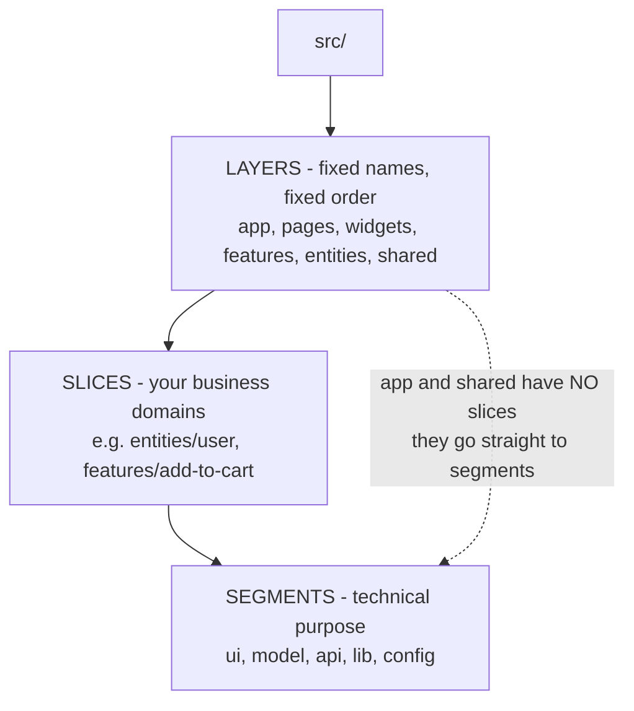

| Level | Names chosen by | Examples | Rule |
|---|---|---|---|
| **Layer** | The methodology (standardised) | `app`, `pages`, `widgets`, `features`, `entities`, `shared` | Import only from layers **below** |
| **Slice** | You (business domain) | `user`, `product`, `cart`, `add-to-cart`, `auth-by-email` | Slices on the **same layer** can't import each other |
| **Segment** | Mostly conventional | `ui`, `model`, `api`, `lib`, `config` | Named by **purpose**, not by file type |

```text
src/
├── app/                    ← layer (no slices)
│   ├── providers/          ← segment
│   ├── routes/
│   └── styles/
├── pages/                  ← layer
│   ├── product-details/    ← slice
│   │   ├── ui/             ← segment
│   │   ├── api/
│   │   └── index.ts        ← public API
│   └── cart/
├── widgets/
│   └── header/
├── features/
│   ├── add-to-cart/
│   └── auth-by-email/
├── entities/
│   ├── product/
│   ├── cart/
│   └── user/
└── shared/                 ← layer (no slices)
    ├── ui/                 ← segment: design-system components
    ├── api/                ← segment: HTTP client, base query
    ├── lib/
    └── config/
```

---

### Section 3: The Seven Layers

Listed from top (most specific, most dependencies) to bottom (most generic, no dependencies):

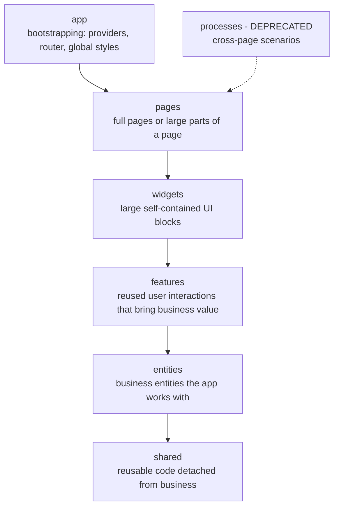

| Layer | Contains | Example slices | Has slices? |
|---|---|---|---|
| **app** | Entry point, providers (query client, theme, i18n), router setup, global styles, error boundaries | — | ❌ segments only |
| **processes** | *Deprecated.* Multi-page flows. Move this code to `features` or `app` | — | — |
| **pages** | Route-level screens; composition of widgets/features/entities; page-specific logic | `home`, `product-details`, `checkout` | ✅ |
| **widgets** | Big, self-sufficient blocks reused across pages, or big blocks of one page | `header`, `product-feed`, `order-summary` | ✅ |
| **features** | Interactions that deliver value and are **reused** | `add-to-cart`, `auth-by-email`, `like-post`, `change-theme` | ✅ |
| **entities** | Business concepts: data types, mappers, API calls, small display components | `user`, `product`, `order`, `comment` | ✅ |
| **shared** | Business-agnostic code: UI kit, API client, utilities, config, route constants, i18n setup | — | ❌ segments only |

**Not every layer is required.** A small app might use only `app`, `pages` and `shared`, and add `entities` / `features` / `widgets` as reuse appears.

Note the link to the [previous note](./component-architecture-and-design-systems.md): your **design system lives in `shared/ui`** (or comes from a package that `shared/ui` re-exports), and it must never import from higher layers.

---

### Section 4: The Import Rule

> **A module in a slice may import only from slices on layers strictly below it.** Slices on the same layer are isolated from each other. `app` and `shared` are the exceptions: they have no slices, so their segments can import each other freely within the layer.

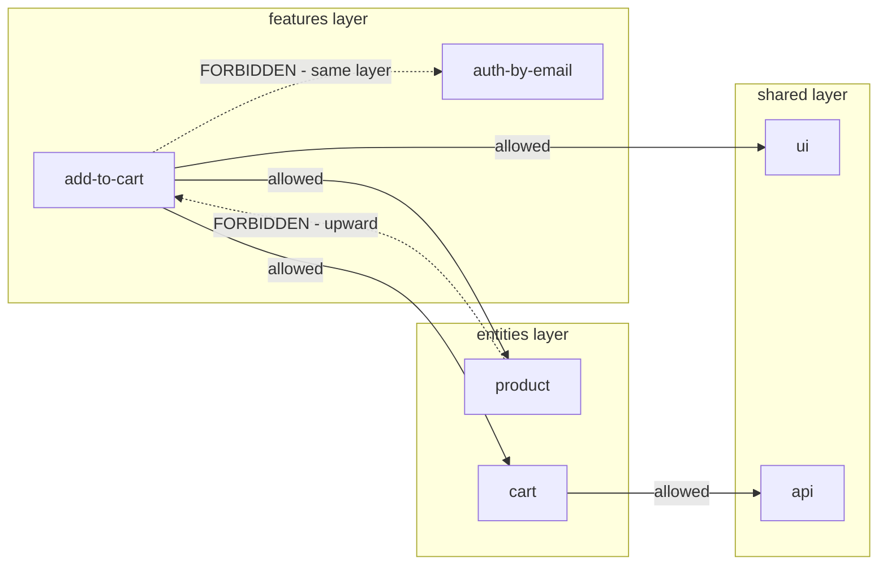

| Import | Allowed? | Why |
|---|---|---|
| `pages/checkout` → `widgets/order-summary` | ✅ | Downward |
| `features/add-to-cart` → `entities/cart` | ✅ | Downward |
| `entities/product` → `shared/ui` | ✅ | Downward |
| `features/add-to-cart` → `features/auth-by-email` | ❌ | Same layer: compose them in a widget or page instead |
| `entities/cart` → `features/add-to-cart` | ❌ | Upward |
| `shared/ui` → `entities/user` | ❌ | Upward: the UI kit would become business-aware |
| `shared/api` → `shared/config` | ✅ | Segments inside `shared` may import each other |
| `entities/order` → `entities/user` | ⚠️ | Only through the explicit `@x` cross-import API (Section 8) |

**Why forbid same-layer imports?** If `add-to-cart` imports `auth-by-email`, deleting or rewriting one breaks the other; over time the layer becomes a web. Composing them in a **higher** layer (a widget or page) keeps each slice independently replaceable.

---

### Section 5: Public API of a Slice

Each slice exposes an `index.ts` (the **public API**). Code outside the slice imports **only** from it.

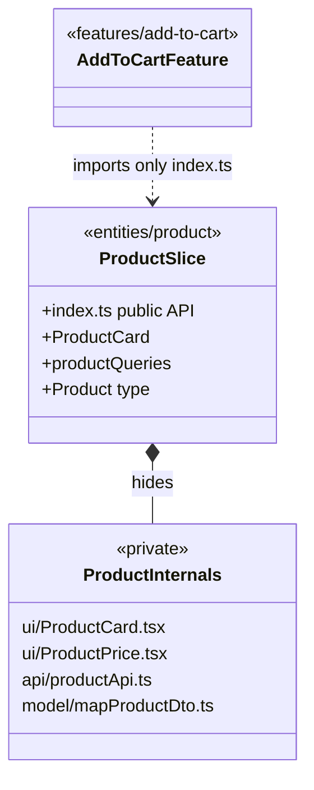

```typescript
// ✅ via public API
import { ProductCard, type Product } from '@/entities/product';

// ❌ deep import: couples you to the internal file layout
import { ProductCard } from '@/entities/product/ui/ProductCard';
```

**Public API guidelines:**
- Export **explicitly** (`export { ProductCard } from './ui/ProductCard'`) instead of `export * from`. You see exactly what's public, and accidental exports don't leak.
- Inside a slice, use **relative** imports. Across slices, use **absolute** aliases (`@/entities/product`).
- For `shared/ui` and `shared/lib`, the FSD docs recommend **one index per component or library** (`@/shared/ui/button`) rather than a single giant barrel. Large barrels can slow dev servers that process every re-exported module, can hurt tree shaking when modules have side effects, and invite circular imports.

---

### Section 6: Segments — What Goes Inside a Slice

| Segment | Holds | Examples |
|---|---|---|
| **`ui`** | Components, styles, formatters used only for display | `ProductCard.tsx`, `ProductCard.module.css` |
| **`api`** | Backend interaction: request functions, DTO types, mappers, query keys/options | `getProduct()`, `productQueries.detail(id)` |
| **`model`** | Data model: schemas, types, stores, selectors, business rules | Zod schema, Zustand/Pinia/NgRx store, `calculateTotal()` |
| **`lib`** | Helper code other modules in this slice need | `formatSku()` |
| **`config`** | Configuration and feature flags for the slice | `MAX_QUANTITY` |

**Avoid file-type segments** like `components/`, `hooks/`, `types/`, `utils/` inside slices. They describe *what a file is*, not *what it's for*, which is the problem FSD set out to fix. Custom segments are fine when they describe purpose (`shared/routes`, `shared/i18n`, `shared/analytics`).

---

### Section 7: Entities vs Features vs Widgets

The most common question in FSD reviews is "which layer does this go in?"

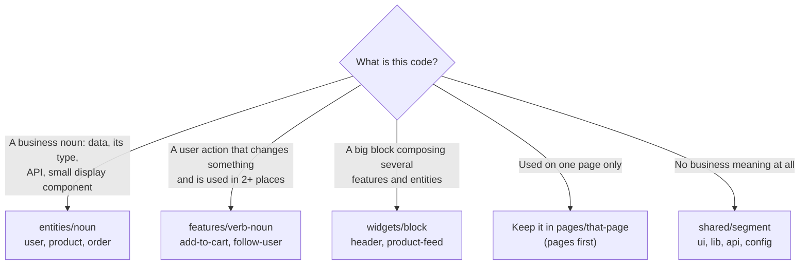

Worked example for an e-commerce product page:

| Code | Layer / slice | Why |
|---|---|---|
| `Product` type, `getProduct()`, `<ProductPrice>` | `entities/product` | The business noun |
| `Cart` type, `cartQueries`, `<CartBadge>` | `entities/cart` | Another noun |
| "Add to cart" button + mutation + optimistic update | `features/add-to-cart` | A reused action (product page, feed, wishlist) |
| "Write a review" form used only on the product page | `pages/product-details/ui` | Used once: pages first |
| Header with logo, search, cart badge, user menu | `widgets/header` | Composes several features/entities, reused on every page |
| `<Button>`, `<Dialog>`, HTTP client, `formatMoney()` | `shared/ui`, `shared/api`, `shared/lib` | No business knowledge |
| Query client provider, router, theme provider | `app/providers` | App-wide setup |

**Rule of thumb for features:** not everything interactive is a feature. The FSD docs warn against making every interaction a feature; a feature is worth extracting when it's **reused** and has its own logic.

---

### Section 8: Cross-Imports Between Entities (`@x`)

Real business entities reference each other: an `Order` has a `User`, a `Song` has an `Artist`. Strict isolation would force you to move these types into `shared` (where they don't belong). FSD 2.1 allows **explicit, narrow cross-imports** between entity slices using the `@x` notation:

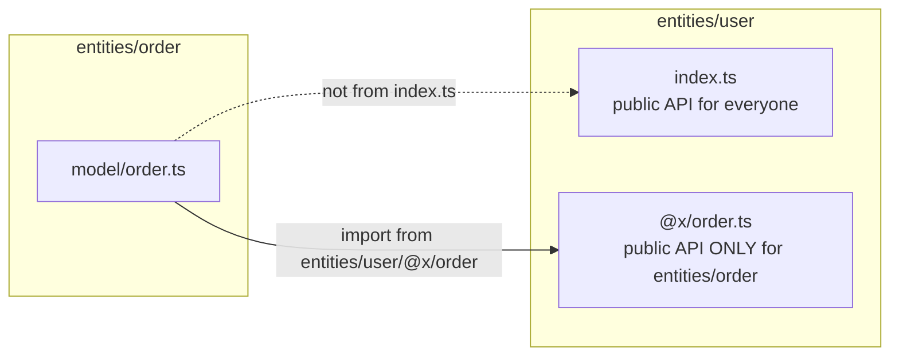

```typescript
// entities/user/@x/order.ts: what order is allowed to know about user
export type { User } from '../model/user';
export { UserAvatar } from '../ui/UserAvatar';
```

```typescript
// entities/order/model/order.ts
import type { User } from '@/entities/user/@x/order';

export interface Order {
  id: string;
  customer: User;
  totalCents: number;
}
```

Guidance from the docs: keep cross-imports **rare and limited to the `entities` layer**. Every `@x` file is a visible, reviewable coupling point; a growing number of them means the entity boundaries are wrong (maybe two entities should be one).

---

### Section 9: Pages First — Don't Slice Too Early

FSD 2.1 changed the recommended workflow: start by putting code **in the page that uses it**, and extract to `widgets` / `features` / `entities` only when reuse actually appears.

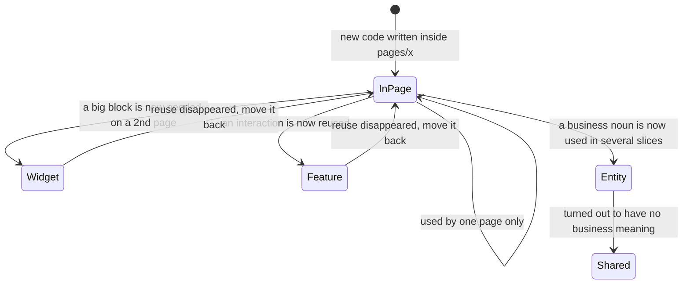

Why this matters:
- **Premature extraction** creates slices with one consumer, artificial names, and "which layer?" debates that slow every PR.
- **Pages are allowed to be big.** A page slice can have its own `ui`, `model` and `api` segments.
- **Moving code down later is cheap** when imports go through public APIs: you move the folder, add an `index.ts`, and update the page import.

This mirrors the "rule of three" for design systems in the [previous note](./component-architecture-and-design-systems.md#section-12-governance-and-component-lifecycle).

---

### Section 10: FSD With Frameworks (Next.js, Nuxt, SvelteKit, Angular)

FSD is framework-agnostic; the friction is that **file-based routers** want their own folders, sometimes named `app` or `pages` — the same names as FSD layers.

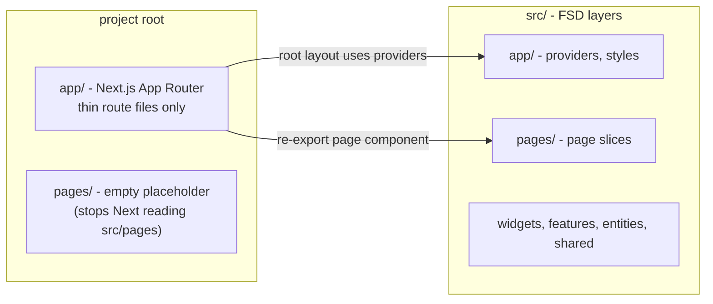

| Framework | Approach (see the FSD guide for each) |
|---|---|
| **Next.js (App Router)** | Keep Next's `app/` folder at the **project root** with thin route files that re-export from `src/pages/*`. The FSD guide suggests an empty root `pages/` folder so Next doesn't treat `src/pages` as Pages Router routes. Server Components and Server Actions live in the slice's `api`/`ui` segments |
| **Nuxt** | Point Nuxt's directory config (`dir.pages`, `components` auto-import) at FSD folders, or keep `pages/` as thin route files; auto-imports can hide cross-layer imports, so many teams disable them for FSD layers |
| **SvelteKit** | `src/routes` stays SvelteKit's; route `+page.svelte` files stay thin and render components from FSD `pages` slices; check the FSD SvelteKit guide for the recommended folder setup |
| **Angular** | No file-based routing conflict. Slices map to standalone components + services; route configs live in `app/routes`, lazy routes point at page slices |
| **Vite + React Router / TanStack Router** | Straightforward: router config in `app/routes`, page components in `pages/*` |

React Native and other mobile codebases can use the same layers; navigation setup lives in `app`, screens in `pages`.

---

### Section 11: Enforcing the Rules

Architecture that isn't checked by tools erodes in months. Options:

| Tool | What it checks | Notes |
|---|---|---|
| **Steiger** | FSD-specific rules: forbidden imports, public API usage, segment naming, "insignificant slice" (slice with one consumer), and more | The official FSD linter; works on any framework |
| **ESLint `no-restricted-imports`** | Block upward and deep imports with path patterns | Built into ESLint, no plugin needed (Example 4) |
| **eslint-plugin-boundaries / eslint-plugin-import (`no-restricted-paths`)** | Element types and allowed dependency directions | More expressive, more config |
| **Nx module boundaries** | Tags on libraries + `@nx/enforce-module-boundaries` | If each slice is an Nx library; see [Monorepo Tooling](./monorepo-tooling-turborepo-nx.md) |
| **dependency-cruiser** | Arbitrary dependency rules + graphs, including cycles | Good for CI reports and visualising the graph |

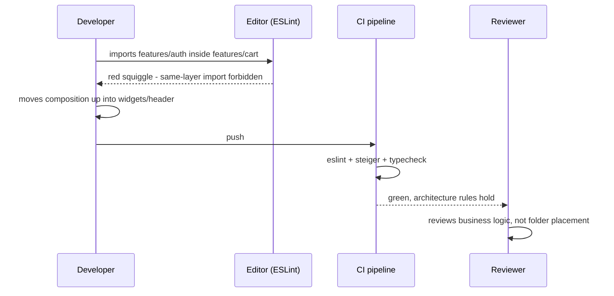

---

### Section 12: FSD vs Other Structures

| Structure | Organising principle | Strength | Weakness |
|---|---|---|---|
| **By file type** (`components/`, `hooks/`) | Technical type | Zero learning curve | Falls apart beyond small apps |
| **Feature folders** (e.g. Bulletproof React's `features/`) | Feature modules + shared folders | Simple, popular, maps to teams | Fewer rules: what may a feature import? Teams must define it |
| **Feature-Sliced Design** | Layers × slices × segments + import rules | Standard vocabulary, enforceable, onboarding is fast | Learning curve; layer debates; boilerplate for small apps |
| **Clean / Hexagonal Architecture** | Domain core, ports and adapters | Testable domain logic, swappable infrastructure | Heavy for UI-centric apps; little guidance on UI composition |
| **Nx/Turborepo domain libraries** | Libraries per domain with tags | Scales to many apps and teams | Tooling overhead; still needs a structure inside each lib |
| **Micro-frontends** | Independently deployed apps | Team autonomy at deploy level | Runtime cost and complexity; see [Micro-Frontends Architecture](./micro-frontends-architecture.md) |

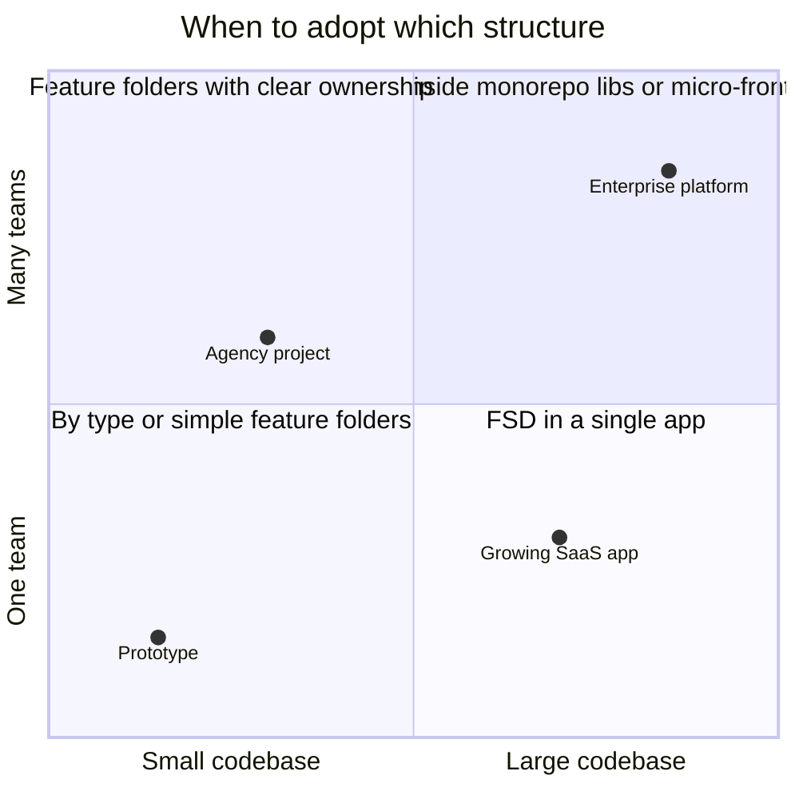

**When FSD is a poor fit:** small apps and prototypes (overhead without payoff), libraries (they're `shared`-like by nature), and teams unwilling to enforce the rules with tooling — a half-adopted FSD is worse than simple feature folders.

**FSD and Domain-Driven Design:** slices in `entities` resemble DDD aggregates and `features` resemble use cases, but FSD is about **code placement and dependency direction**, not domain modelling. You can use both.

---

## Real-World Examples

**Example 1 — An entity slice (React + TanStack Query):**
```typescript
// src/entities/product/api/productQueries.ts
import { queryOptions } from '@tanstack/react-query';
import { apiClient } from '@/shared/api';
import { mapProductDto, type ProductDto } from '../model/mapProductDto';

export const productQueries = {
  all: () => ['products'] as const,
  detail: (id: string) =>
    queryOptions({
      queryKey: [...productQueries.all(), id],
      queryFn: async () => mapProductDto(await apiClient.get<ProductDto>(`/products/${id}`)),
      staleTime: 60_000,
    }),
};
```

```typescript
// src/entities/product/model/mapProductDto.ts
export interface ProductDto { id: string; title: string; price_cents: number; image_url: string }
export interface Product { id: string; title: string; priceCents: number; imageUrl: string }

export const mapProductDto = (dto: ProductDto): Product => ({
  id: dto.id,
  title: dto.title,
  priceCents: dto.price_cents,
  imageUrl: dto.image_url,
});
```

```typescript
// src/entities/product/index.ts: the ONLY file other slices import
export { productQueries } from './api/productQueries';
export type { Product } from './model/mapProductDto';
export { ProductCard } from './ui/ProductCard';
```

**Example 2 — A feature slice that uses two entities:**
```tsx
// src/features/add-to-cart/ui/AddToCartButton.tsx
import { useMutation, useQueryClient } from '@tanstack/react-query';
import { cartQueries, addCartItem } from '@/entities/cart';
import type { Product } from '@/entities/product';
import { Button } from '@/shared/ui/button';

export function AddToCartButton({ product }: { product: Product }) {
  const queryClient = useQueryClient();
  const mutation = useMutation({
    mutationFn: () => addCartItem({ productId: product.id, quantity: 1 }),
    onSettled: () => queryClient.invalidateQueries({ queryKey: cartQueries.all() }),
  });

  return (
    <Button onClick={() => mutation.mutate()} loading={mutation.isPending}>
      Add to cart
    </Button>
  );
}
```

```typescript
// src/features/add-to-cart/index.ts
export { AddToCartButton } from './ui/AddToCartButton';
```

**Example 3 — Composition happens upward (BAD → GOOD):**
```tsx
// ❌ BAD: features/add-to-cart imports another feature (same layer)
import { useAuthModal } from '@/features/auth-by-email';
export function AddToCartButton({ product }: { product: Product }) {
  const { openIfLoggedOut } = useAuthModal();          // hidden coupling
  // ...
}

// ✅ GOOD: the feature exposes a callback; the widget/page composes both features
// src/widgets/product-actions/ui/ProductActions.tsx
import { AddToCartButton } from '@/features/add-to-cart';
import { useAuthModal } from '@/features/auth-by-email';
import type { Product } from '@/entities/product';

export function ProductActions({ product }: { product: Product }) {
  const { requireAuth } = useAuthModal();
  // AddToCartButton gains an optional onBeforeAdd prop instead of knowing about auth
  return <AddToCartButton product={product} onBeforeAdd={requireAuth} />;
}
```

**Example 4 — Enforcing layers with plain ESLint (flat config):**
```javascript
// eslint.config.js (ESM). Checked against ESLint 9's no-restricted-imports (group + regex patterns)
const layers = ['app', 'pages', 'widgets', 'features', 'entities', 'shared'];
const sliced = ['pages', 'widgets', 'features', 'entities'];

// app may import anything below it; every other layer gets three restrictions
const layerRules = layers.slice(1).map((layer, i) => {
  const above = layers.slice(0, i + 1);
  return {
    files: [`src/${layer}/**/*.{ts,tsx}`],
    rules: {
      'no-restricted-imports': ['error', {
        patterns: [
          // 1. No upward imports
          { group: above.map((l) => `@/${l}/*`), message: `"${layer}" may not import from higher layers.` },
          // 2. No imports of sibling slices on the same layer (use relative imports inside your own slice)
          ...(sliced.includes(layer)
            ? [{ regex: `^@/${layer}/[^/]+$`, message: `Slices on "${layer}" may not import each other.` }]
            : []),
          // 3. No deep imports past a slice's public API, except the entities @x cross-import files
          {
            group: [...sliced.map((l) => `@/${l}/*/*`), '!@/entities/*/@x'],
            message: 'Import from the slice public API (index.ts), not its internals.',
          },
        ],
      }],
    },
  };
});

export default [
  // ...your base configs (typescript-eslint, react, etc.)
  ...layerRules,
];
```

> This is a sketch. For full FSD checks (insignificant slices, segment names, `@x` usage), run **Steiger**: `npx steiger ./src` with a `steiger.config.ts` using `@feature-sliced/steiger-plugin`; check the Steiger README for the current config format.

**Example 5 — Next.js App Router route files stay thin:**
```tsx
// app/products/[id]/page.tsx  (Next.js routing folder at the project root)
export { ProductDetailsPage as default } from '@/pages/product-details';
```

```tsx
// src/pages/product-details/ui/ProductDetailsPage.tsx (a Server Component)
import { getProduct } from '../api/getProduct';
import { ProductGallery } from '@/widgets/product-gallery';
import { ProductActions } from '@/widgets/product-actions';

export async function ProductDetailsPage({ params }: { params: Promise<{ id: string }> }) {
  const { id } = await params;              // params is a Promise in recent Next.js versions
  const product = await getProduct(id);
  return (
    <main>
      <ProductGallery images={product.images} />
      <h1>{product.title}</h1>
      <ProductActions product={product} />
    </main>
  );
}
```

**Example 6 — TypeScript path alias for absolute cross-slice imports:**
```json
{
  "compilerOptions": {
    "baseUrl": ".",
    "paths": { "@/*": ["./src/*"] }
  }
}
```

> Vite needs the same alias (`resolve.alias` or the `vite-tsconfig-paths` plugin); Next.js reads `paths` from `tsconfig.json` automatically. Vue/Nuxt, SvelteKit (`kit.alias`) and Angular CLI (TypeScript `paths`) have equivalents.

**Example 7 — The same slice shape in Vue (Pinia) and Angular (signals):**
```typescript
// Vue: src/entities/cart/model/cartStore.ts
import { defineStore } from 'pinia';
import { computed, ref } from 'vue';
import type { CartItem } from './types';

export const useCartStore = defineStore('cart', () => {
  const items = ref<CartItem[]>([]);
  const count = computed(() => items.value.reduce((n, i) => n + i.quantity, 0));
  return { items, count };
});
```

```typescript
// Angular: src/entities/cart/model/cart.store.ts
import { Injectable, computed, signal } from '@angular/core';
import type { CartItem } from './types';

@Injectable({ providedIn: 'root' })
export class CartStore {
  private readonly items = signal<CartItem[]>([]);
  readonly count = computed(() => this.items().reduce((n, i) => n + i.quantity, 0));
  add(item: CartItem) { this.items.update((list) => [...list, item]); }
}
```

---

## Key Points Summary

| Concept | One-Line Explanation |
|---|---|
| **Feature-Sliced Design** | A framework-agnostic methodology: layers × slices × segments with downward-only imports |
| **Layers** | `app`, `pages`, `widgets`, `features`, `entities`, `shared` (and deprecated `processes`) |
| **Slices** | Business-domain folders inside a layer; isolated from siblings |
| **Segments** | Purpose-named folders inside a slice: `ui`, `api`, `model`, `lib`, `config` |
| **Import rule** | Import only from layers strictly below; `app` and `shared` segments may import each other |
| **Public API** | Each slice exposes `index.ts`; no deep imports into internals |
| **`@x` cross-import** | Narrow, explicit API from one entity to another, entities layer only |
| **Pages first** | Keep code in the page until reuse appears, then extract |
| **Features** | Reused user interactions with business value, not every button |
| **Entities** | Business nouns: types, API, mappers, small display components |
| **Widgets** | Large blocks composing features and entities |
| **shared/ui** | Where the design system lives in an FSD app |
| **Steiger** | The official FSD linter |
| **Framework routing** | Keep router folders thin and re-export from FSD page slices |

---

## Test Your Understanding

**Q1 (Basic):**
Name the FSD layers in order from top to bottom, and state the import rule.

<details>
<summary>Answer</summary>

`app` → (`processes`, deprecated) → `pages` → `widgets` → `features` → `entities` → `shared`. A module may import only from **layers strictly below** its own. Slices on the **same layer** may not import each other. `app` and `shared` have no slices, so their segments can import each other within the layer. The rule makes the dependency graph acyclic: lower layers never know about higher ones, so changes flow in one predictable direction.
</details>

**Q2 (Application):**
Where do these go? (a) `formatMoney()`; (b) the `User` type and `getCurrentUser()`; (c) a "Follow" button used on profiles, feed cards and search results; (d) a "Report a bug" form shown only on the Settings page; (e) the app header.

<details>
<summary>Answer</summary>

- (a) `shared/lib` (or `shared/lib/money`): no business meaning.
- (b) `entities/user` (`model` for the type, `api` for the request).
- (c) `features/follow-user`: a reused interaction with business value.
- (d) `pages/settings/ui` (pages first): used once, so extracting it would create a one-consumer slice.
- (e) `widgets/header`: a large block composing several features and entities, reused on every page.
</details>

**Q3 (Tricky):**
`features/checkout` needs to open the login dialog from `features/auth`. A teammate adds `import { openLogin } from '@/features/auth'` inside checkout. What's wrong, and what are the options?

<details>
<summary>Answer</summary>

It's a **same-layer import**, which FSD forbids: the two features become coupled, and you can no longer change or remove `auth` without touching `checkout`. Options:
1. **Compose upward**: the widget or page that renders checkout also uses `auth`, and passes a callback (`onRequireAuth`) or wraps checkout's action.
2. **Move the shared piece down**: if what checkout needs is just "is the user logged in?", that's session data in `entities/user` (or `entities/session`), which checkout may import.
3. **App-level mechanism**: a global auth guard in `app` (router guard or provider) handles redirects before checkout runs.
The right choice depends on whether the dependency is UI composition (1), data (2), or routing policy (3).
</details>

**Q4 (Tricky):**
Your `shared/ui/index.ts` re-exports all 120 design-system components. Developers complain that the dev server is slow and a circular import crashed the app at startup. Why, and what does FSD recommend?

<details>
<summary>Answer</summary>

A single giant barrel means **any** import from `@/shared/ui` makes the tooling load and transform every re-exported module. Dev servers that serve unbundled ES modules (like Vite) feel this most, and test runners pay the same cost. Barrels also make cycles easy: component A imports `@/shared/ui`, which re-exports B, which imports A, so a module can be evaluated before its dependency is initialised. Tree shaking in production can also suffer if any re-exported module has side effects.

FSD's docs recommend **separate public APIs per component or library** in `shared/ui` and `shared/lib` (`@/shared/ui/button`, `@/shared/ui/dialog`), explicit named exports rather than `export *`, and relative imports inside a slice.
</details>

**Q5 (System design):**
You're starting a B2B SaaS frontend with 4 teams (billing, analytics, admin, core) on Next.js. Leadership wants FSD. How do you set it up so it scales and stays enforced?

<details>
<summary>Answer</summary>

- **Routing**: Next's `app/` folder at the root with thin route files re-exporting from `src/pages/*`; FSD layers in `src/`; empty root `pages/` if you need to stop Next from reading `src/pages` (per the FSD Next.js guide).
- **Layers**: start pages first. Shared design system in `shared/ui` (or an internal package re-exported there), API client and auth fetch wrapper in `shared/api`, providers in `app`.
- **Ownership**: map teams to **slices**, not layers (billing owns `pages/billing`, `entities/invoice`, `features/change-plan`). Use CODEOWNERS on those paths.
- **Enforcement**: Steiger + `no-restricted-imports` (or eslint-plugin-boundaries) in CI, TypeScript path aliases, PR template asking "which layer and why?".
- **Cross-entity references** (invoice → customer) via `@x` only.
- **Scaling further**: if teams need independent releases later, slices map cleanly to Nx/Turborepo libraries or, at the extreme, micro-frontends.
</details>

**Q6 (Application):**
Is every interactive element a feature? When would you *not* create `features/toggle-password-visibility`?

<details>
<summary>Answer</summary>

No. A feature is a **reused user interaction with business value**. Toggling password visibility is a UI detail of a password input with no business meaning; it belongs in `shared/ui` as part of a `PasswordInput` component. Creating a feature for it adds a slice, a public API and a layer decision for no gain. The FSD docs warn against turning every interaction into a feature, and Steiger can flag slices that have only one consumer.
</details>

---

## Cheat Sheet

**Key Definitions:**
- **Layer:** Standardised top-level folder ranked by responsibility (`app` … `shared`)
- **Slice:** Business-domain folder inside a layer (`entities/user`)
- **Segment:** Purpose-named folder inside a slice (`ui`, `api`, `model`, `lib`, `config`)
- **Public API:** The slice's `index.ts`; the only allowed entry point from outside
- **`@x` notation:** `entities/A/@x/B.ts` = the part of A that entity B may import
- **Pages first:** Write code in the page; extract when reused
- **Steiger:** Official FSD architecture linter

**Quick Reference:**
```text
Layers (top → bottom):  app → pages → widgets → features → entities → shared
                        (processes: deprecated)
Slices:                 pages, widgets, features, entities   (app and shared have none)
Segments:               ui | api | model | lib | config      (+ purpose-named custom ones)
Imports:                only DOWN; never sideways between slices; only via index.ts
Inside a slice:         relative imports       Across slices: @/layer/slice
Entity ↔ entity:        @/entities/user/@x/order   (rare, entities only)
shared/ui, shared/lib:  one index per component/library, not one giant barrel
Design system:          lives in shared/ui (or a package re-exported there)
Extraction:             one page uses it → keep in page; 2+ consumers → widget/feature/entity
Routing frameworks:     keep router folders thin, re-export from src/pages/*
Enforce:                Steiger + ESLint (no-restricted-imports / boundaries) in CI
```

**Common Mistakes to Avoid:**

| Mistake | Why Wrong | Fix |
|---|---|---|
| Importing one feature from another | Hidden coupling on the same layer | Compose in a widget/page, or move shared data to an entity |
| Deep imports (`@/entities/user/ui/Avatar`) | Couples callers to internal layout | Import from the slice's `index.ts` |
| Every button becomes a feature | Dozens of one-consumer slices, layer debates | Pages first; extract only on reuse |
| Business types in `shared` (`shared/types/order.ts`) | `shared` becomes business-aware | Put them in `entities/order`; use `@x` for references |
| `components/`, `hooks/`, `utils/` segments | Recreates structure-by-type inside slices | Name segments by purpose: `ui`, `model`, `api`, `lib` |
| One giant `shared/ui/index.ts` | Slow dev server and tests, cycles | One public API per component |
| Using `processes` for new code | Deprecated layer | Use `features`, `widgets` or `app` |
| No lint enforcement | Rules erode within months | Steiger + ESLint rules in CI |
| Putting Next.js route logic in FSD layers' names | `app/`/`pages/` name clash, routing bugs | Thin root route files re-exporting FSD pages |
| Adopting FSD for a 10-screen prototype | Overhead without payoff | Simple feature folders; migrate when it grows |

---

## References & Further Reading

**Core docs**
- Feature-Sliced Design: [Overview](https://feature-sliced.design/docs/get-started/overview) · [Tutorial](https://feature-sliced.design/docs/get-started/tutorial)
- FSD reference: [Layers](https://feature-sliced.design/docs/reference/layers) · [Slices and segments](https://feature-sliced.design/docs/reference/slices-segments) · [Public API](https://feature-sliced.design/docs/reference/public-api)
- FSD guides: [Cross-imports](https://feature-sliced.design/docs/guides/issues/cross-imports) · [Usage with Next.js](https://feature-sliced.design/docs/guides/tech/with-nextjs)
- FSD: [Migration from v2.0 to v2.1](https://feature-sliced.design/docs/guides/migration/from-v2-0)
- Steiger: [Official FSD linter (GitHub)](https://github.com/feature-sliced/steiger)

**Tooling docs**
- ESLint: [`no-restricted-imports`](https://eslint.org/docs/latest/rules/no-restricted-imports)
- Nx: [Enforce module boundaries](https://nx.dev/features/enforce-module-boundaries)
- [dependency-cruiser](https://github.com/sverweij/dependency-cruiser)
- TypeScript: [`paths`](https://www.typescriptlang.org/tsconfig/#paths)
- Next.js: [Project structure](https://nextjs.org/docs/app/getting-started/project-structure) · [`src` folder](https://nextjs.org/docs/app/api-reference/file-conventions/src-folder)

**Deep dives**
- [Bulletproof React — project structure](https://github.com/alan2207/bulletproof-react/blob/master/docs/project-structure.md) (a simpler feature-folder alternative)
- Robert C. Martin: [Screaming Architecture](https://blog.cleancoder.com/uncle-bob/2011/09/30/Screaming-Architecture.html)
- [feature-sliced/examples (GitHub)](https://github.com/feature-sliced/examples)

---

> **Previous Topic:** [Component Architecture & Design Systems](./component-architecture-and-design-systems.md)
> — Component layers, composition, tokens and shared design systems

> **Next Topic:** [Module Bundling & Build Systems](./module-bundling-and-build-systems.md)
> — How the modules you just organised get resolved, transformed and bundled for the browser

*Saved on: 2026-11-06 | Repo: Frontend System Design Learning Notes*
