<!-- Generated by scripts/sync-knowledge.js from notes/ and README.md — do not edit here. -->
<!-- sections (line ranges in this file): Table of Contents 19-41 · ELI5 42-55 · Core Concept 56-396 · Decision Matrix 397-424 · Real-World Examples 425-732 · Key Points Summary 733-750 · Test Your Understanding 751-826 · Cheat Sheet 827-870 · References & Further Reading 871-908 -->

# Headless UI / Renderless Components

> **Date:** 2026-11-06 · **Last updated:** 2026-11-06
> **Category:** Frontend System Design
> **Sub-Topic:** Design Systems & Components / Component Patterns
> **Level:** Intermediate · **Reading time:** ~27 min
> **Informs:** build vs adopt a behaviour layer for a design system, headless library choice per framework, accessibility ownership (keyboard, focus, ARIA), styling strategy (data attributes, render-state classes), cross-framework component reuse, copy-in (shadcn/ui) vs dependency, bundle and upgrade cost

> **Pre-requisite:** [Compound Component Pattern](./compound-component-pattern.md) (most headless libraries ship compound parts) and [Component Architecture & Design Systems](./component-architecture-and-design-systems.md) (where the behaviour layer sits).
> This note covers components that ship **behaviour without looks**: state, keyboard handling, focus and ARIA — and leave every pixel to you.

**Previous:** [Compound Component Pattern](./compound-component-pattern.md) · **Next:** [Controlled vs Uncontrolled Components](./controlled-vs-uncontrolled-components.md)

---

## Table of Contents

1. [ELI5 — Simple Explanation](#eli5--simple-explanation)
2. [Section 1: What "Headless" Means](#section-1-what-headless-means)
3. [Section 2: Why Headless Won — the Accessibility Iceberg](#section-2-why-headless-won--the-accessibility-iceberg)
4. [Section 3: The Five Shapes of a Headless API](#section-3-the-five-shapes-of-a-headless-api)
5. [Section 4: Prop Getters and Prop Merging](#section-4-prop-getters-and-prop-merging)
6. [Section 5: Renderless Components — Render Props and Scoped Slots](#section-5-renderless-components--render-props-and-scoped-slots)
7. [Section 6: Framework-Agnostic State Machines](#section-6-framework-agnostic-state-machines)
8. [Section 7: Styling Headless Components](#section-7-styling-headless-components)
9. [Section 8: Owning the Element — asChild, render and Polymorphism](#section-8-owning-the-element--aschild-render-and-polymorphism)
10. [Section 9: The Library Landscape by Stack](#section-9-the-library-landscape-by-stack)
11. [Section 10: The Platform as a Headless Layer](#section-10-the-platform-as-a-headless-layer)
12. [Section 11: What Headless Does NOT Give You](#section-11-what-headless-does-not-give-you)
13. [Decision Matrix — Build, Headless, Styled or Copy-In](#decision-matrix--build-headless-styled-or-copy-in)
14. [Real-World Examples](#real-world-examples)
15. [Key Points Summary](#key-points-summary)
16. [Test Your Understanding (with answers)](#test-your-understanding)
17. [Cheat Sheet](#cheat-sheet)
18. [References & Further Reading](#references--further-reading)

---

## ELI5 — Simple Explanation

Imagine buying a car as a **rolling chassis**: engine, steering, brakes, airbags and all the safety tests are done — but there's **no body, no paint, no seats**. You bolt on whatever body fits your brand: a sports car, a van, a taxi.

- The **chassis** = the headless component: open/close state, keyboard shortcuts, focus movement, screen-reader labels.
- The **body and paint** = your markup and CSS: colours, spacing, icons, animations.
- A **styled library** (e.g. a full Material-look kit) = a finished car. Fast to drive away, but repainting it into your brand means fighting the factory finish.

A **renderless component** is the same idea in component form: it renders **nothing of its own** — it hands its state and actions to you and says "draw it however you like".

> **One-line takeaway: headless components give you the hard, invisible part (behaviour + accessibility) and let you own the visible part (markup + styles) completely.**

---

## Core Concept — Step by Step

### Section 1: What "Headless" Means

Every interactive component has two halves:

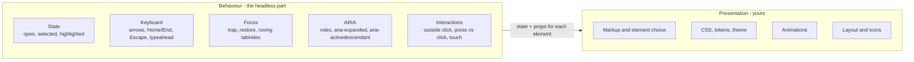

| Term | Meaning |
|---|---|
| **Headless component / library** | Provides behaviour, state and accessibility, with **no styles** (sometimes minimal structural markup) |
| **Renderless component** | A component that renders no DOM of its own; it exposes state through a **render prop** (React) or **scoped slot** (Vue) |
| **Headless hook / composable** | The same logic as a function: `useCombobox()`, `useDisclosure()`; returns state and props to spread on your elements |
| **Unstyled primitives** | Compound parts that **do** render elements (`<Popover.Content>`) with correct roles but zero CSS — Radix, React Aria Components, Headless UI, Base UI, Ark UI |
| **Styled library** | Behaviour + a visual design (MUI, Vuetify, Angular Material, Chakra, Mantine) |

> "Headless" is a spectrum: from **pure logic** (a state machine, a hook) to **unstyled elements** (compound parts). What they share: **no visual design decisions**.

---

### Section 2: Why Headless Won — the Accessibility Iceberg

A dropdown looks like a box and a list. Below the waterline is everything a screen-reader or keyboard user needs:

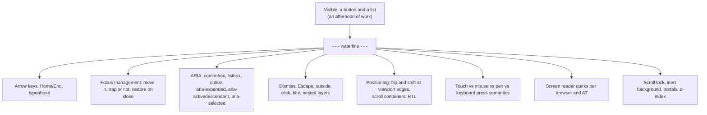

Why teams moved from "build it" and "styled kit" to headless:

| Approach | Problem it hit |
|---|---|
| **Build every widget yourself** | Each team re-implements focus traps and ARIA, usually incompletely; bugs show up only with assistive technology |
| **Styled kit (adopt the look)** | Brand differs from the kit → override wars (`!important`, deep selectors), theme APIs that never cover the case, upgrades break overrides |
| **Headless + your styles** ✅ | Behaviour is shared, tested and maintained by specialists; the look is 100% yours |

The trade: you **write all the CSS and markup**, and you're still responsible for visual accessibility (focus rings, contrast, target size).

---

### Section 3: The Five Shapes of a Headless API

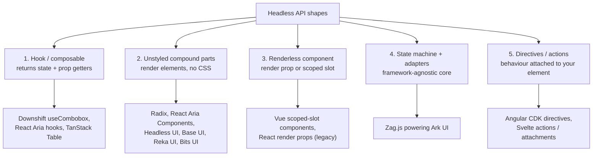

| Shape | You write | Library writes | Best for | Cost |
|---|---|---|---|---|
| **1. Hook** | Every element, spreading returned props | State, handlers, ARIA attributes | Maximum markup control; unusual layouts | Easy to forget to spread a prop → broken a11y |
| **2. Unstyled parts** | Composition + CSS | Elements, roles, focus, portals | Design-system primitives — the **most common** choice | Less control over DOM structure (mitigated by `asChild`/`render`) |
| **3. Renderless component** | Markup inside a render function / slot | State + actions | Vue (scoped slots); older React code | Nesting ("wrapper hell"); hooks/composables usually replace it |
| **4. State machine** | A thin adapter + markup | Logic as an explicit machine; per-framework `normalizeProps` | Supporting many frameworks with one behaviour core | Indirection; learning the machine model |
| **5. Directive / action** | Your element + an attribute | Behaviour attached to that element | Angular (CDK), Svelte | Framework-specific |

---

### Section 4: Prop Getters and Prop Merging

A headless hook can't render your `<button>`, so it gives you **the props that button needs**. Two styles:

```tsx
// Props objects (React Aria hooks)
const { buttonProps } = useButton(props, ref);
return <button {...buttonProps} ref={ref} className="btn">{props.children}</button>;

// Prop getters (Downshift style) — functions that MERGE your props with theirs
<button {...getToggleButtonProps({ onClick: trackOpen, className: 'btn' })}>Open</button>
```

**Why a getter instead of an object?** If you spread the library's props and then add your own `onClick`, **yours replaces theirs** and the widget silently stops working. A getter takes your props and returns a merged set:

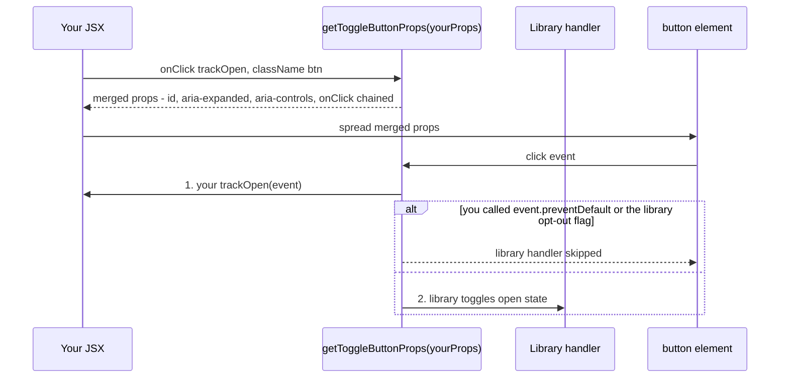

What a good merge does (React Aria's `mergeProps` and Downshift's getters follow these ideas — check each library's docs for exact rules):

| Prop kind | Merge rule |
|---|---|
| Event handlers (`onClick`, `onKeyDown`) | **Chain** both; often yours first, with a way to opt out of the library's default |
| `className` | Concatenate |
| `style` | Shallow-merge objects |
| `id` | Keep one stable ID (React Aria merges IDs so labels still match) |
| `ref` | **Merge refs** — the library needs the DOM node too (callback ref that sets both) |
| ARIA attributes | Library wins unless you deliberately override |

> The most common headless bug: **forgetting to spread a getter** (e.g. `getMenuProps()` on the list) or spreading it on the wrong element. Lint against it with tests that query by role (`getByRole('listbox')`).

---

### Section 5: Renderless Components — Render Props and Scoped Slots

The **renderless component** popularised the idea before hooks existed: a component that owns state but **delegates all rendering** to the caller.

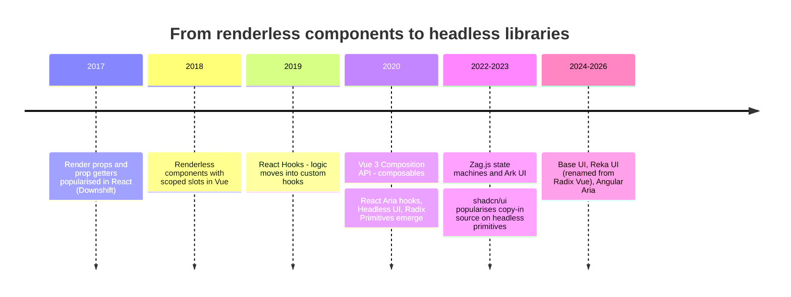

```tsx
// React render prop (renderless) — still works, but hooks replaced it for new code
<Disclosure>
  {({ open, toggle }) => (
    <>
      <button aria-expanded={open} onClick={toggle}>Details</button>
      {open && <p>Hidden content</p>}
    </>
  )}
</Disclosure>
```

| Stack | Renderless form | Modern replacement | Status |
|---|---|---|---|
| React | Render props / function-as-children | Custom hooks; unstyled compound parts | Render props still appear as **styling hooks** (`className={({ isSelected }) => …}`), less as the main API. See [HOCs & Render Props](./higher-order-components-and-render-props.md) |
| Vue | Component whose template is just `<slot :state="..." />` (scoped slot) | Composables (`useDisclosure()`) | Scoped slots still common in libraries for per-item rendering |
| Angular | `ng-template` + `ngTemplateOutlet` with a context object | Directives + signals; CDK behaviours | Templates still used for "render this per item" APIs |
| Svelte 5 | Snippets passed as props with parameters | `.svelte.ts` classes/functions using runes; actions or attachments | Snippets replaced Svelte 4 slot props |

---

### Section 6: Framework-Agnostic State Machines

If you support React **and** Vue **and** Svelte, writing a combobox three times triples the bugs. A **state machine** core describes behaviour once; thin adapters connect it to each framework.

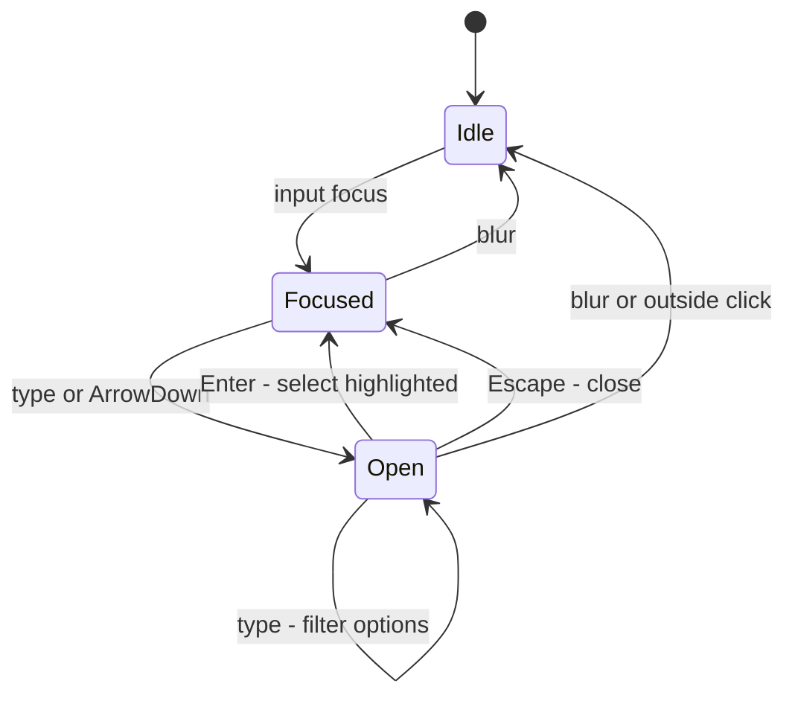

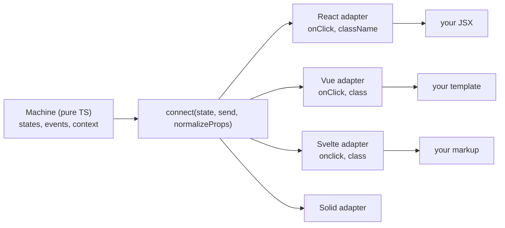

- **Zag.js** is the best-known example: each widget is a machine, `connect()` returns an API (`api.getTriggerProps()`), and `normalizeProps` converts prop names per framework (`onClick` vs `onclick`, `className` vs `class`). **Ark UI** wraps Zag in compound components for React, Vue, Solid and Svelte.
- Machines make edge cases **explicit** ("what happens on blur while open?") and testable without a DOM.
- The same idea appears in **XState** for app logic; widget libraries usually ship their own lighter runtime.

---

### Section 7: Styling Headless Components

Headless components expose **state**, and you map state to styles. Four mechanisms, often combined:

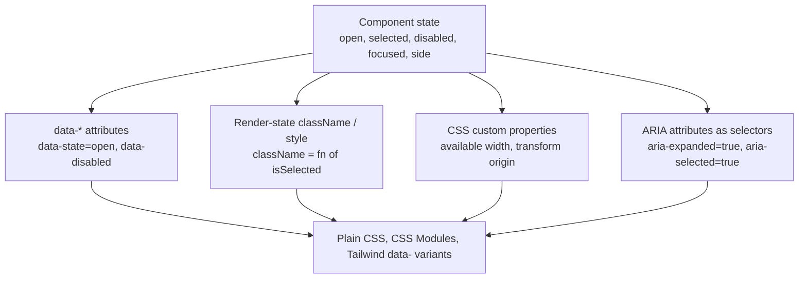

| Mechanism | Example | Libraries |
|---|---|---|
| **`data-*` attributes** | `[data-state="open"] { … }`, Tailwind `data-[state=open]:opacity-100` | Radix (`data-state`, `data-side`, `data-highlighted`), Headless UI v2 (`data-focus`, `data-open`), Base UI, Ark UI |
| **Render-state functions** | `className={({ isFocused, isSelected }) => …}` | React Aria Components (also sets `data-focused`, `data-selected`, …), Headless UI |
| **CSS variables** | Popover content gets its trigger width / available height as a custom property | Radix, Base UI, Ark (names differ — check docs) |
| **ARIA selectors** | `button[aria-expanded="true"] .chevron { rotate: 180deg }` | Any — ARIA states are always present |

**Rules of thumb:**
- Prefer **state attributes over JS-computed classes**: they work with any CSS approach, server rendering, and devtools inspection.
- **Styling via ARIA attributes** keeps visuals and semantics in sync — if it looks open, it's announced as open.
- Keep **design tokens** (CSS custom properties) as the values; the headless layer never knows your colours. See [Design Tokens](./design-tokens.md).
- **Exit animations** need the element to stay mounted until the animation ends — use the library's presence/`forceMount`/transition support instead of unmounting immediately.

---

### Section 8: Owning the Element — asChild, render and Polymorphism

Headless parts render a default element (`Popover.Trigger` → `<button>`). Often you need **your** element — your `Button` component, a router `Link`, an `<a>`:

```tsx
// Radix / Ark UI: asChild merges the part's props and behaviour into the single child element
<Tooltip.Trigger asChild>
  <MyButton variant="ghost">Help</MyButton>
</Tooltip.Trigger>

// Base UI: a render prop receives the props to apply
<Menu.Trigger render={<MyButton variant="ghost" />}>Actions</Menu.Trigger>

// Headless UI: the `as` prop picks the element or component
<MenuButton as={MyButton}>Options</MenuButton>
```

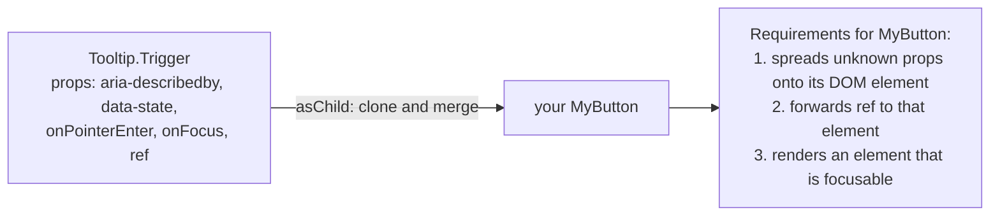

> **Your component must cooperate:** spread the rest props onto the DOM element and forward the ref (in React 19 `ref` is a normal prop for function components; earlier versions need `forwardRef`). If it swallows `onFocus` or the ref, the tooltip silently breaks.

Equivalents: Vue libraries (Reka UI, Ark) also offer `asChild` or an `as` prop; Angular uses **directives on your own element** (`<button cdkMenuItem>`), so the question doesn't arise; Svelte libraries use `child` snippets that receive the props to spread.

---

### Section 9: The Library Landscape by Stack

Status changes fast — check each project's site before choosing.

| Stack | Unstyled primitives / headless | Notes |
|---|---|---|
| **React** | Radix Primitives, React Aria (hooks) + React Aria Components (Adobe), Base UI, Headless UI (Tailwind Labs), Ark UI, Downshift (combobox/select) | React Aria is known for deep internationalization and AT testing; Radix powers shadcn/ui; Base UI is from people behind Radix, Floating UI and Material UI |
| **Vue** | Reka UI (formerly Radix Vue), Ark UI, Headless UI for Vue | Reka UI mirrors Radix's API |
| **Svelte** | Bits UI, Melt UI, Ark UI | Bits UI is used by shadcn-svelte |
| **Angular** | Angular CDK (a11y, overlay, listbox, menu, drag-drop), Angular Aria | Angular Aria is newer — check angular.dev for its stability status |
| **Solid** | Kobalte, Ark UI | |
| **Any framework** | Zag.js (machines), Floating UI (positioning only) | |
| **Data-heavy UI** | TanStack Table, TanStack Virtual, TanStack Form | "Headless" for data: logic and models, you render every cell |
| **Native mobile** | SwiftUI style protocols (`ButtonStyle`, `ToggleStyle`, `LabelStyle`); Jetpack Compose foundation modifiers (`clickable`, `selectable`, `toggleable`) | Platform supplies behaviour + accessibility; you supply the look |

**The copy-in model (shadcn/ui and ports).** A CLI copies **source** of styled components (built on Radix or Base UI + Tailwind) into your repo. It's headless underneath, styled on top, and **you own the code** — no dependency upgrades for the styled layer, but also no automatic fixes. Community ports exist for Vue (shadcn-vue on Reka UI) and Svelte (shadcn-svelte on Bits UI).

---

### Section 10: The Platform as a Headless Layer

Native HTML elements are the original headless components: the browser supplies behaviour and accessibility, you style them. Before adding a library, check whether the platform covers the case:

| Need | Native option | Notes |
|---|---|---|
| Modal dialog | `<dialog>` + `showModal()` | Focus moves in, `Escape` closes, background becomes inert, top layer |
| Non-modal popup / menu shell | `popover` attribute (+ `popovertarget`) | Light dismiss, top layer; you still add menu keyboard behaviour |
| Disclosure / accordion | `details` + `summary` (+ `name` for exclusive accordions) | Check MDN for `name` support |
| Inert background | `inert` attribute | |
| Positioning a popup to its anchor | CSS anchor positioning | Reached all major engines only recently — check MDN compat |
| Styled select | Customizable `<select>` (`appearance: base-select`) | Not in every engine yet — check MDN compat |

> Headless libraries increasingly **use** these primitives internally. Prefer native elements when they meet the requirements; reach for a library for combobox, menu with typeahead, date picker, tree, grid — the widgets with no native equivalent.

---

### Section 11: What Headless Does NOT Give You

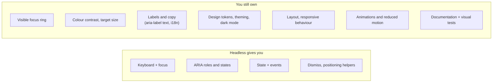

| Gap | Why it matters |
|---|---|
| **Visual accessibility** | A perfectly wired listbox with an invisible focus ring still fails WCAG 2.4.7 (Focus Visible) |
| **Accessible names** | The library can't invent the text for `aria-label`; an icon-only trigger without a label is still inaccessible |
| **Consistency** | Ten teams styling the same primitive ten ways = no design system. Wrap primitives once in your styled layer |
| **Upgrade coupling** | Your styles depend on the library's `data-*` attributes and DOM structure; read changelogs on upgrades |
| **Bundle size** | Usually small per component, but positioning and focus-management code adds up — measure per route |

**Rule:** application teams should consume **your styled components**, not the headless library directly. The headless layer is a **dependency of the design system**, not of every app.

---

## Decision Matrix — Build, Headless, Styled or Copy-In

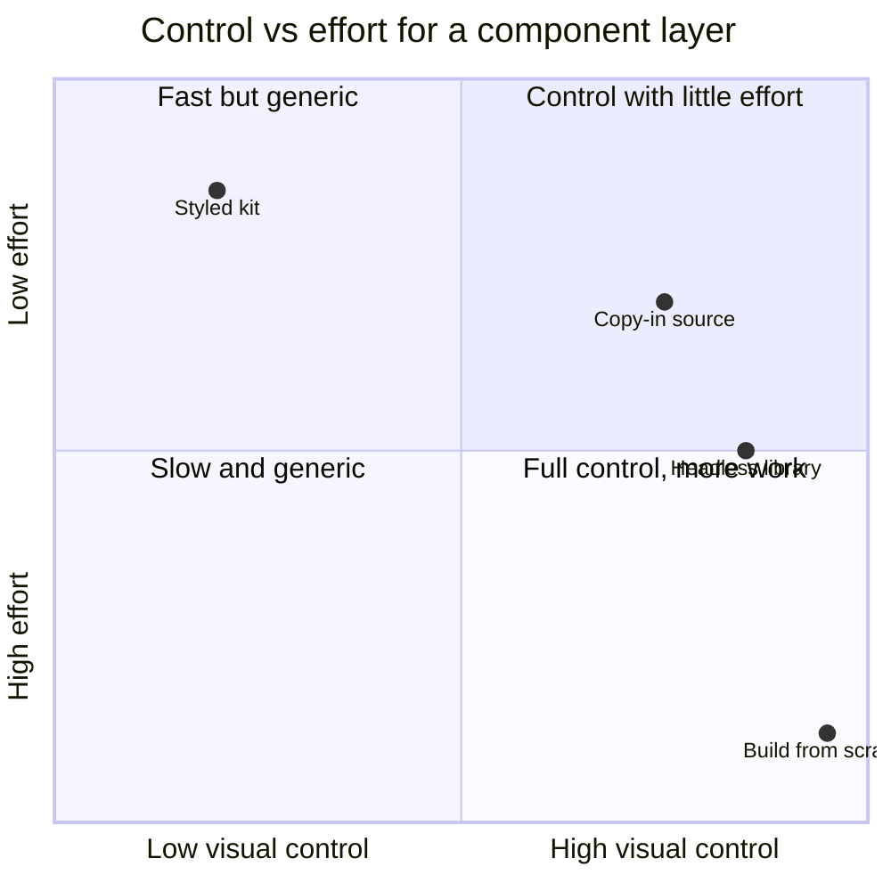

| Situation | Choose | Why |
|---|---|---|
| Internal tool, no brand requirements, tiny team | **Styled kit** (MUI, Vuetify, Angular Material, Mantine…) | Fastest; accessibility already handled |
| Strong brand, a design-system team | **Headless library + your styled layer** | Behaviour from specialists, look 100% yours |
| Product team wants control without a DS team | **Copy-in** (shadcn/ui and ports) | Starts styled, fully editable; you own maintenance |
| Several frameworks must behave identically | **State-machine core** (Zag/Ark) or per-stack libraries with a shared spec | One behaviour model |
| A widget no library covers (custom canvas editor) | **Build**, following the WAI-ARIA APG pattern | Nothing to adopt — budget for AT testing |
| Simple disclosure, dialog, popover | **Native HTML** (`details`, `dialog`, `popover`) | No dependency at all |

---

## Real-World Examples

**Example 1 — Writing a headless hook with prop getters (React + TypeScript):**
```tsx
import { useId, useState, type ButtonHTMLAttributes, type HTMLAttributes, type MouseEvent } from 'react';

export function useDisclosure({ defaultOpen = false }: { defaultOpen?: boolean } = {}) {
  const [open, setOpen] = useState(defaultOpen);
  const id = useId();
  const triggerId = `${id}-trigger`;
  const panelId = `${id}-panel`;

  function getTriggerProps(props: ButtonHTMLAttributes<HTMLButtonElement> = {}) {
    return {
      ...props,
      id: triggerId,
      type: 'button' as const,
      'aria-expanded': open,
      'aria-controls': panelId,
      onClick: (e: MouseEvent<HTMLButtonElement>) => {
        props.onClick?.(e);                       // caller first
        if (!e.defaultPrevented) setOpen((o) => !o); // caller can opt out
      },
    };
  }

  function getPanelProps(props: HTMLAttributes<HTMLDivElement> = {}) {
    return { ...props, id: panelId, 'aria-labelledby': triggerId, hidden: !open };
  }

  return { open, setOpen, getTriggerProps, getPanelProps };
}

// Usage — markup and styles are entirely the caller's
export function ShippingInfo() {
  const { open, getTriggerProps, getPanelProps } = useDisclosure();
  return (
    <section className="faq">
      <h3>
        <button {...getTriggerProps({ className: 'faq__trigger', onClick: () => track('faq_toggle') })}>
          Shipping <span aria-hidden="true">{open ? '−' : '+'}</span>
        </button>
      </h3>
      <div {...getPanelProps({ className: 'faq__panel' })}>Orders ship in 2–4 business days.</div>
    </section>
  );
}
```

**Example 2 — Downshift `useCombobox` (hook with prop getters):**
```tsx
import { useState } from 'react';
import { useCombobox } from 'downshift';

type City = { id: string; name: string };

export function CityCombobox({ cities }: { cities: City[] }) {
  const [items, setItems] = useState(cities);
  const {
    isOpen, highlightedIndex, selectedItem,
    getLabelProps, getInputProps, getToggleButtonProps, getMenuProps, getItemProps,
  } = useCombobox({
    items,
    itemToString: (c) => c?.name ?? '',
    onInputValueChange: ({ inputValue }) =>
      setItems(cities.filter((c) => c.name.toLowerCase().includes((inputValue ?? '').toLowerCase()))),
  });

  return (
    <div className="combo">
      <label {...getLabelProps()}>City</label>
      <div className="combo__field">
        <input {...getInputProps({ className: 'combo__input' })} />
        <button {...getToggleButtonProps()} aria-label="Show cities">▾</button>
      </div>
      {/* The menu element must always be rendered so its ARIA wiring stays valid */}
      <ul {...getMenuProps({ className: 'combo__menu' })}>
        {isOpen &&
          items.map((item, index) => (
            <li
              key={item.id}
              className={`combo__option ${highlightedIndex === index ? 'is-highlighted' : ''} ${selectedItem?.id === item.id ? 'is-selected' : ''}`}
              {...getItemProps({ item, index })}
            >
              {item.name}
            </li>
          ))}
      </ul>
    </div>
  );
}
```

**Example 3 — Unstyled parts styled by state (Radix + plain CSS, React Aria Components):**
```tsx
import * as Popover from '@radix-ui/react-popover';

export function FilterPopover() {
  return (
    <Popover.Root>
      <Popover.Trigger asChild>
        <button className="btn">Filters</button>
      </Popover.Trigger>
      <Popover.Portal>
        <Popover.Content className="popover" sideOffset={8} collisionPadding={8}>
          <FilterForm />
          <Popover.Close className="popover__close" aria-label="Close">×</Popover.Close>
          <Popover.Arrow className="popover__arrow" />
        </Popover.Content>
      </Popover.Portal>
    </Popover.Root>
  );
}
```
```css
.popover {
  background: var(--ds-color-surface-raised);
  border-radius: var(--ds-radius-md);
  box-shadow: var(--ds-shadow-lg);
  padding: var(--ds-space-4);
}
.popover[data-state="open"][data-side="bottom"] { animation: slide-down 150ms ease-out; }
.popover__arrow { fill: var(--ds-color-surface-raised); }
.btn[aria-expanded="true"] { background: var(--ds-color-surface-pressed); }

@media (prefers-reduced-motion: reduce) {
  .popover { animation: none; }
}
```
```tsx
import { Button, Label, ListBox, ListBoxItem, Popover, Select, SelectValue } from 'react-aria-components';

export function AssigneeSelect() {
  return (
    <Select name="assignee" className="select">
      <Label>Assignee</Label>
      <Button className="select__button">
        <SelectValue />
        <span aria-hidden="true">▾</span>
      </Button>
      <Popover className="select__popover">
        <ListBox>
          {['Ana', 'Bilal', 'Chen'].map((name) => (
            <ListBoxItem
              key={name}
              id={name}
              // Render-state function; data-focused / data-selected attributes are set too
              className={({ isFocused, isSelected }) =>
                ['option', isFocused && 'option--focused', isSelected && 'option--selected'].filter(Boolean).join(' ')
              }
            >
              {name}
            </ListBoxItem>
          ))}
        </ListBox>
      </Popover>
    </Select>
  );
}
```

**Example 4 — TanStack Table: headless for data:**
```tsx
import { createColumnHelper, flexRender, getCoreRowModel, useReactTable } from '@tanstack/react-table';

type Order = { id: string; customer: string; total: number };
const col = createColumnHelper<Order>();
const columns = [
  col.accessor('id', { header: 'Order' }),
  col.accessor('customer', { header: 'Customer' }),
  col.accessor('total', { header: 'Total', cell: (info) => `$${info.getValue().toFixed(2)}` }),
];

export function OrdersTable({ data }: { data: Order[] }) {
  const table = useReactTable({ data, columns, getCoreRowModel: getCoreRowModel() });
  return (
    <table className="ds-table">
      <thead>
        {table.getHeaderGroups().map((hg) => (
          <tr key={hg.id}>
            {hg.headers.map((h) => (
              <th key={h.id} scope="col">{flexRender(h.column.columnDef.header, h.getContext())}</th>
            ))}
          </tr>
        ))}
      </thead>
      <tbody>
        {table.getRowModel().rows.map((row) => (
          <tr key={row.id}>
            {row.getVisibleCells().map((cell) => (
              <td key={cell.id}>{flexRender(cell.column.columnDef.cell, cell.getContext())}</td>
            ))}
          </tr>
        ))}
      </tbody>
    </table>
  );
}
```
TanStack Table has adapters for Vue, Angular, Svelte, Solid and Lit — the same headless core, your markup.

**Example 5 — Vue: renderless component (BAD-ish legacy) → composable (GOOD):**
```html
<!-- Disclosure.vue — renderless: renders only its scoped slot -->
<script setup lang="ts">
import { ref } from 'vue';
const open = ref(false);
const toggle = () => { open.value = !open.value; };
</script>
<template>
  <slot :open="open" :toggle="toggle" />
</template>

<!-- Usage -->
<Disclosure v-slot="{ open, toggle }">
  <button :aria-expanded="open" @click="toggle">Details</button>
  <p v-if="open">Hidden content</p>
</Disclosure>
```
```typescript
// useDisclosure.ts — the composable version: no extra component, easy to combine
import { ref, useId } from 'vue'; // useId: Vue 3.5+

export function useDisclosure(initial = false) {
  const open = ref(initial);
  const id = useId();
  const toggle = () => { open.value = !open.value; };
  const triggerAttrs = () => ({ 'aria-expanded': open.value, 'aria-controls': `${id}-panel`, onClick: toggle });
  const panelAttrs = () => ({ id: `${id}-panel`, hidden: !open.value });
  return { open, toggle, triggerAttrs, panelAttrs };
}
// <button v-bind="triggerAttrs()">Details</button>  <div v-bind="panelAttrs()">…</div>
```

**Example 6 — Angular CDK: behaviour as directives on your elements:**
```typescript
import { Component, signal } from '@angular/core';
import { CdkListbox, CdkOption } from '@angular/cdk/listbox';

@Component({
  selector: 'app-size-picker',
  imports: [CdkListbox, CdkOption],
  template: `
    <label id="size-label">Size</label>
    <ul cdkListbox aria-labelledby="size-label" class="ds-listbox"
        [cdkListboxValue]="size()" (cdkListboxValueChange)="size.set($event.value)">
      @for (s of sizes; track s) {
        <li [cdkOption]="s" class="ds-option">{{ s }}</li>
      }
    </ul>`,
  styles: `
    .ds-option[aria-selected='true'] { background: var(--ds-color-selected); }
    .ds-option.cdk-option-active { outline: 2px solid var(--ds-color-focus); }
  `,
})
export class SizePickerComponent {
  readonly sizes = ['S', 'M', 'L'];
  readonly size = signal<readonly string[]>(['M']);
}
```
The CDK adds roles, `aria-selected`, keyboard navigation and typeahead; you supply every element and style. Angular's `hostDirectives` lets your own components compose such behaviour directives.

**Example 7 — Svelte 5: a headless class with runes:**
```typescript
// disclosure.svelte.ts
export class Disclosure {
  open = $state(false);
  readonly id: string;
  constructor(id: string) { this.id = id; }
  toggle = () => { this.open = !this.open; };
  get triggerProps() {
    return { 'aria-expanded': this.open, 'aria-controls': `${this.id}-panel`, onclick: this.toggle };
  }
  get panelProps() {
    return { id: `${this.id}-panel`, hidden: !this.open };
  }
}
```
```html
<script lang="ts">
  import { Disclosure } from './disclosure.svelte';
  const d = new Disclosure($props.id()); // SSR-safe id (Svelte 5.x — check svelte.dev)
</script>
<button class="faq__trigger" {...d.triggerProps}>Shipping</button>
<div class="faq__panel" {...d.panelProps}>Orders ship in 2–4 business days.</div>
```

**Example 8 — Native mobile: SwiftUI keeps behaviour, you supply the look:**
```swift
struct BrandButtonStyle: ButtonStyle {
    func makeBody(configuration: Configuration) -> some View {
        configuration.label
            .padding(.horizontal, 16)
            .padding(.vertical, 10)
            .background(configuration.isPressed ? Color.accentColor.opacity(0.7) : Color.accentColor)
            .foregroundStyle(.white)
            .clipShape(RoundedRectangle(cornerRadius: 8))
    }
}

// Button keeps its action, accessibility traits and pressed state; the style only draws it
Button("Save") { save() }
    .buttonStyle(BrandButtonStyle())
```
Jetpack Compose follows the same split: `foundation` modifiers (`Modifier.clickable`, `selectable`, `toggleable` with a semantic `Role`) provide behaviour and accessibility semantics, while Material components are one styled layer on top.

---

## Key Points Summary

| Concept | One-Line Explanation |
|---|---|
| **Headless** | Behaviour, state and accessibility with no visual design |
| **Renderless component** | Renders nothing itself; exposes state via render prop or scoped slot |
| **Hook / composable** | Headless logic as a function returning state and props to spread |
| **Unstyled parts** | Compound components with correct roles but zero CSS — the most common shape |
| **Prop getters** | Functions that merge your props (handlers, classes, refs) with the library's |
| **State machines** | One behaviour core (e.g. Zag.js) with thin adapters per framework |
| **Styling hooks** | `data-*` state attributes, render-state classNames, CSS variables, ARIA selectors |
| **asChild / render / as** | Let the part's behaviour attach to your own element or component |
| **Native platform** | `dialog`, `popover`, `details`, `inert` are headless primitives built in |
| **Still yours** | Focus visibility, contrast, labels, tokens, layout, motion, docs |
| **Wrap once** | Apps use the design system's styled components, not the headless library directly |

---

## Test Your Understanding

**Q1 (Basic):**
What's the difference between a headless component library and a styled component library? What does each leave for you to do?

<details>
<summary>Answer</summary>

A **headless** library provides **behaviour**: state, keyboard interaction, focus management, ARIA roles and states, dismiss logic, sometimes positioning. It has **no visual design**, so you write all markup choices and styles (and remain responsible for visual accessibility such as focus rings and contrast).

A **styled** library provides behaviour **and** a visual design (MUI, Vuetify, Angular Material). You only configure it, but changing the look beyond its theme API means overriding its CSS, which is fragile and can break on upgrades. Headless trades more styling work for full visual control.
</details>

**Q2 (Application):**
A teammate uses a headless hook and writes `<button {...getToggleButtonProps()} onClick={trackClick}>`. The dropdown stopped opening. Why, and what's the fix?

<details>
<summary>Answer</summary>

In JSX, a later prop **overrides** an earlier one with the same name. The getter returned an `onClick` that toggles the menu; the explicit `onClick={trackClick}` after the spread **replaces** it, so the library never hears the click.

Fix: pass your handler **into** the getter so it's chained: `<button {...getToggleButtonProps({ onClick: trackClick })}>`. That's the whole point of prop getters: they merge handlers, class names and refs. With props-object libraries (React Aria hooks), use their `mergeProps(libraryProps, yourProps)` helper instead of spreading twice.
</details>

**Q3 (Tricky):**
You wrapped Radix `Tooltip.Trigger asChild` around your design-system `IconButton`. The tooltip never appears on hover or focus, and there are no errors. What's wrong with `IconButton`?

<details>
<summary>Answer</summary>

`asChild` doesn't render its own element: it **merges its props** (event handlers like `onPointerEnter`/`onFocus`, `aria-describedby`, `data-state`) **and its ref** into the child. If `IconButton` only picks known props (`icon`, `label`, `variant`) and doesn't **spread the rest** onto its `<button>`, the handlers never reach the DOM. If it doesn't **forward the ref**, the library can't measure or position against the element.

Fix: `IconButton` should accept `...rest` and spread it onto the DOM element, and pass `ref` through (a normal prop in React 19 function components; `forwardRef` in earlier versions). Any component used with `asChild`/`render`/`as` must meet that contract.
</details>

**Q4 (Tricky):**
"We use React Aria, so our app is accessible." An audit still finds failures in focus visibility, contrast, and an icon-only button announced as "button". How can that be?

<details>
<summary>Answer</summary>

Headless libraries cover **behaviour and semantics**, not **visual** or **content** accessibility:
- **Focus visibility (WCAG 2.4.7):** the library tracks focus (and exposes `isFocusVisible` / `data-focus-visible`), but if your CSS removes outlines and adds no replacement, keyboard users can't see focus.
- **Contrast (WCAG 1.4.3 / 1.4.11):** colours are your tokens; the library doesn't know them.
- **Accessible names:** an icon-only button needs a text label (`aria-label` or visually hidden text) that only you can supply.

So headless removes the hardest *engineering* part, but accessibility still needs design review, content, and testing with assistive technology.
</details>

**Q5 (Application):**
A Vue codebase has many renderless components (`<FetchData v-slot="{ data }">`, `<Toggle v-slot="{ open, toggle }">`) nested three or four deep. What's the modern alternative, and why is it better?

<details>
<summary>Answer</summary>

Move the logic into **composables** (`useFetch()`, `useToggle()`), called in `<script setup>`. Renderless components add a component instance and a nesting level per behaviour, and combining several means nesting slot scopes ("slot pyramid") with values only available inside the template. Composables return reactive state you can combine in plain code, use in computed properties and watchers, type more easily, and test without mounting. Scoped slots remain the right tool for **per-item rendering inside a library component** (e.g. a table cell template), not for sharing logic.
</details>

**Q6 (System design):**
You lead a design system serving React (some Next.js), Vue and Angular apps with a strong brand. Product teams currently use three different styled kits and the UI looks inconsistent. Propose an architecture.

<details>
<summary>Answer</summary>

- **Tokens first:** one token source (colours, spacing, type, motion) compiled to CSS custom properties for all stacks. See [Design Tokens](./design-tokens.md).
- **Headless behaviour layer per stack**, chosen for parity: e.g. Radix/React Aria/Base UI for React, Reka UI for Vue, Angular CDK (and Angular Aria once stable) for Angular — or Ark UI/Zag where one machine core across frameworks is preferred.
- **A shared component spec**: anatomy (parts), states and their `data-*`/ARIA attributes, keyboard model (from the WAI-ARIA APG), props naming (`value`/`defaultValue`/`onValueChange`).
- **One CSS layer** keyed on state attributes and tokens, shipped in a cascade layer, so the same stylesheet styles all three implementations.
- **Styled wrappers** per framework that apps consume; apps never import the headless library directly.
- **Native first** for dialog/popover/disclosure where it meets requirements.
- **Quality gates:** keyboard and axe tests per component, visual regression in Storybook, AT smoke tests; changelog review on headless-library upgrades.
- Migrate app by app from the three kits, starting with the most-used components (Button, Input, Select, Dialog).
</details>

---

## Cheat Sheet

**Key Definitions:**
- **Headless:** Logic, state and accessibility without styles
- **Renderless component:** Renders no DOM of its own; exposes state via render prop / scoped slot / snippet
- **Prop getter:** `getXProps(yourProps)` → merged props for one element
- **Unstyled primitive:** A compound part rendering a semantic element with no CSS
- **State machine core:** Framework-agnostic behaviour (Zag.js) plus per-framework adapters
- **asChild / render / as:** Let a part's behaviour attach to your element or component
- **Copy-in:** Component source copied into your repo (shadcn/ui), owned by you

**Quick Reference:**
```text
React     Radix · React Aria (+ Components) · Base UI · Headless UI · Ark UI · Downshift · TanStack Table
Vue       Reka UI · Ark UI · Headless UI for Vue · composables
Svelte    Bits UI · Melt UI · Ark UI · .svelte.ts classes with runes, actions/attachments
Angular   Angular CDK directives · Angular Aria (check status) · hostDirectives
Native    SwiftUI ButtonStyle/ToggleStyle · Compose clickable/selectable/toggleable + Role
Platform  <dialog> showModal · popover · details/summary · inert · anchor positioning (check compat)

Styling hooks:   [data-state="open"] · [data-disabled] · className={({ isSelected }) => …} · [aria-expanded="true"]
Merging:         pass your props INTO the getter, or mergeProps(lib, yours) — never spread then override
asChild child:   spread ...rest onto the DOM element + forward ref + render a focusable element
Layering:        tokens → headless → styled DS components → apps (apps never import headless directly)
Still yours:     focus ring · contrast · labels/i18n · motion + reduced motion · docs · visual tests
```

**Common Mistakes to Avoid:**

| Mistake | Why Wrong | Fix |
|---|---|---|
| Spreading a getter, then adding `onClick` after it | Your handler overrides the library's | Pass handlers into the getter / use `mergeProps` |
| Forgetting to spread a getter (e.g. on the menu list) | Missing roles and IDs → broken ARIA wiring | Spread every getter; test with `getByRole` |
| Custom component used with `asChild` that drops props/ref | Behaviour silently missing | Spread rest props, forward ref |
| `outline: none` on headless parts | Keyboard users lose focus visibility | Style `:focus-visible` / `data-focus-visible` |
| Apps importing the headless library directly | Ten different looks for one component | Wrap once in the design system |
| Unmounting popovers instantly with exit animations | Animation never plays | Use the library's presence / `forceMount` / transition support |
| Rebuilding a combobox from scratch "to avoid a dependency" | Weeks of work, AT bugs | Adopt a headless library; build only what none covers |
| Library for a simple disclosure or dialog | Extra JS for what the platform does | `details`/`summary`, `<dialog>`, `popover` |
| Deeply nested renderless components | Slot/render-prop pyramid, hard to type | Hooks / composables / runes classes |
| Styling via internal class names of the library | Break on upgrade | Style via documented `data-*` / ARIA attributes |

---

## References & Further Reading

**Core docs**
- React Aria: [Documentation (hooks and components)](https://react-spectrum.adobe.com/react-aria/) · [Styling](https://react-spectrum.adobe.com/react-aria/styling.html) · [`mergeProps`](https://react-spectrum.adobe.com/react-aria/mergeProps.html)
- Radix Primitives: [Introduction](https://www.radix-ui.com/primitives/docs/overview/introduction) · [Styling](https://www.radix-ui.com/primitives/docs/guides/styling) · [Composition (`asChild`)](https://www.radix-ui.com/primitives/docs/guides/composition)
- Base UI: [Documentation](https://base-ui.com/)
- Headless UI: [Documentation](https://headlessui.com/)
- Ark UI: [Documentation](https://ark-ui.com/) · Zag.js: [Documentation](https://zagjs.com/)
- Downshift: [`useCombobox`](https://www.downshift-js.com/use-combobox)
- TanStack Table: [Overview (headless)](https://tanstack.com/table/latest/docs/overview)
- Reka UI (Vue): [Documentation](https://reka-ui.com/) · Bits UI (Svelte): [Documentation](https://bits-ui.com/)
- Angular CDK: [Listbox](https://material.angular.dev/cdk/listbox/overview) · Angular: [Directive composition API (`hostDirectives`)](https://angular.dev/guide/directives/directive-composition-api)
- Vue: [Composables](https://vuejs.org/guide/reusability/composables.html) · [Scoped slots / renderless components](https://vuejs.org/guide/components/slots.html#scoped-slots)
- shadcn/ui: [Introduction](https://ui.shadcn.com/docs)

**Accessibility & platform**
- W3C WAI-ARIA APG: [Patterns](https://www.w3.org/WAI/ARIA/apg/patterns/) · [Combobox pattern](https://www.w3.org/WAI/ARIA/apg/patterns/combobox/)
- MDN: [`<dialog>`](https://developer.mozilla.org/en-US/docs/Web/HTML/Reference/Elements/dialog) · [Popover API](https://developer.mozilla.org/en-US/docs/Web/API/Popover_API) · [`inert`](https://developer.mozilla.org/en-US/docs/Web/HTML/Reference/Global_attributes/inert)
- W3C: [WCAG 2.2 — Focus Visible (2.4.7)](https://www.w3.org/WAI/WCAG22/Understanding/focus-visible.html)

**Native**
- Apple: [`ButtonStyle`](https://developer.apple.com/documentation/swiftui/buttonstyle)
- Android: [Compose accessibility semantics](https://developer.android.com/develop/ui/compose/accessibility/semantics)

**Deep dives**
- Adam Wathan: [Renderless Components in Vue.js](https://adamwathan.me/renderless-components-in-vuejs/)
- Kent C. Dodds: [How to give rendering control to users with prop getters](https://kentcdodds.com/blog/how-to-give-rendering-control-to-users-with-prop-getters)
- Adobe React Aria: [Why React Aria?](https://react-spectrum.adobe.com/react-aria/why.html) (the case for a shared, tested behaviour layer)

---

> **Previous Topic:** [Compound Component Pattern](./compound-component-pattern.md)
> — A family of parts sharing hidden state through the root

> **Next Topic:** [Controlled vs Uncontrolled Components](./controlled-vs-uncontrolled-components.md)
> — Who owns the value: the component, the parent, or the DOM

*Saved on: 2026-11-06 | Repo: Frontend System Design Learning Notes*
