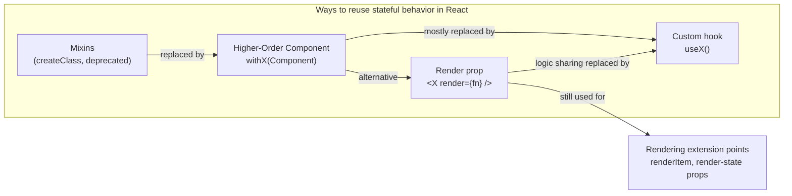
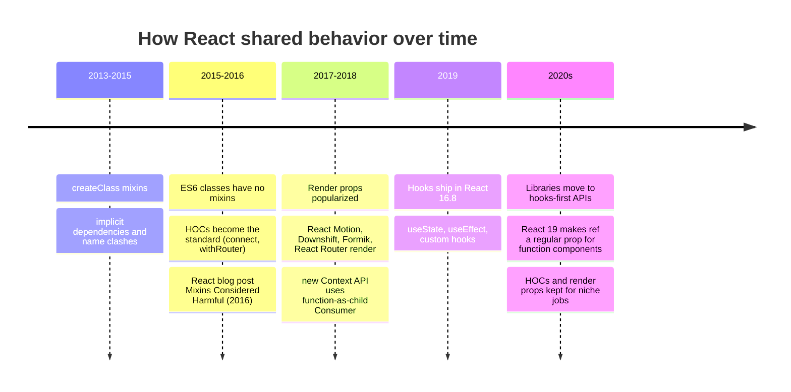
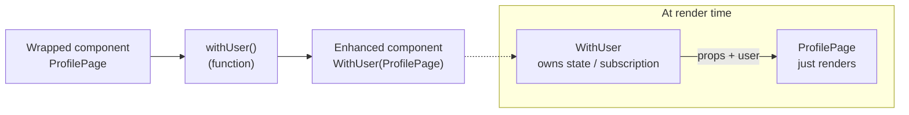
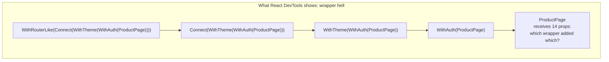
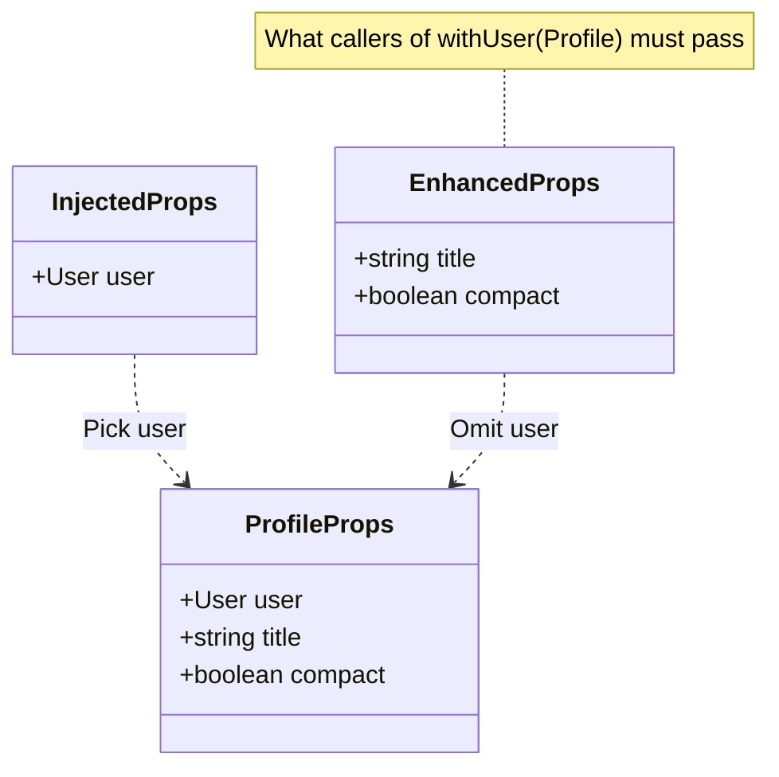
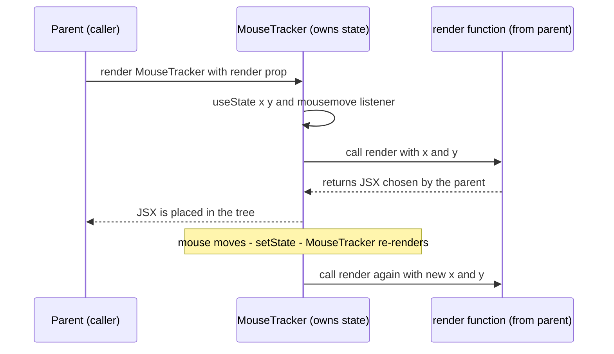
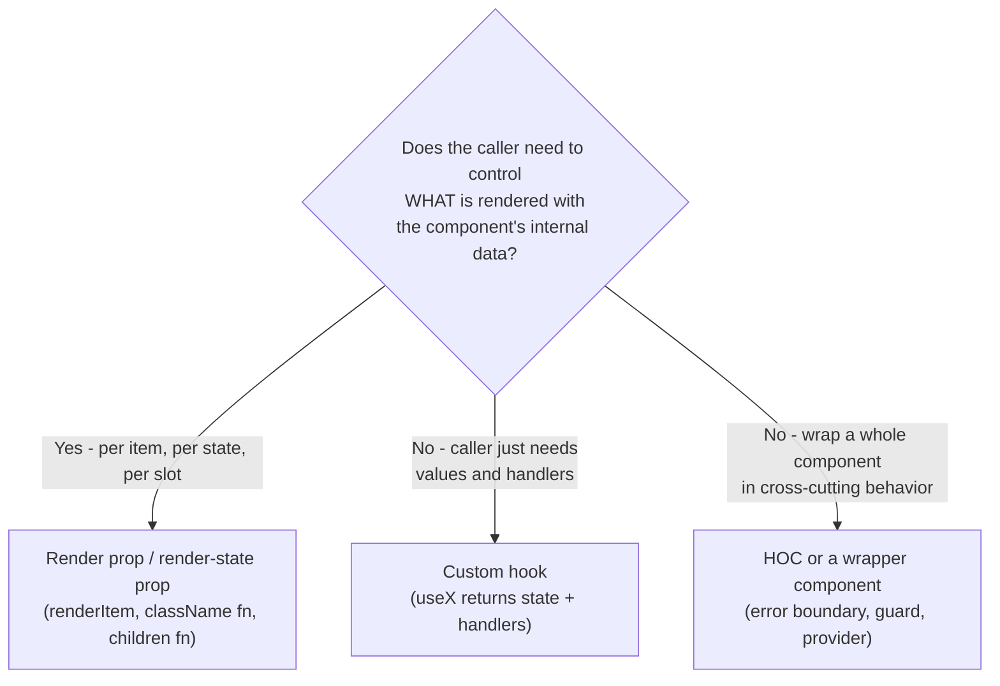
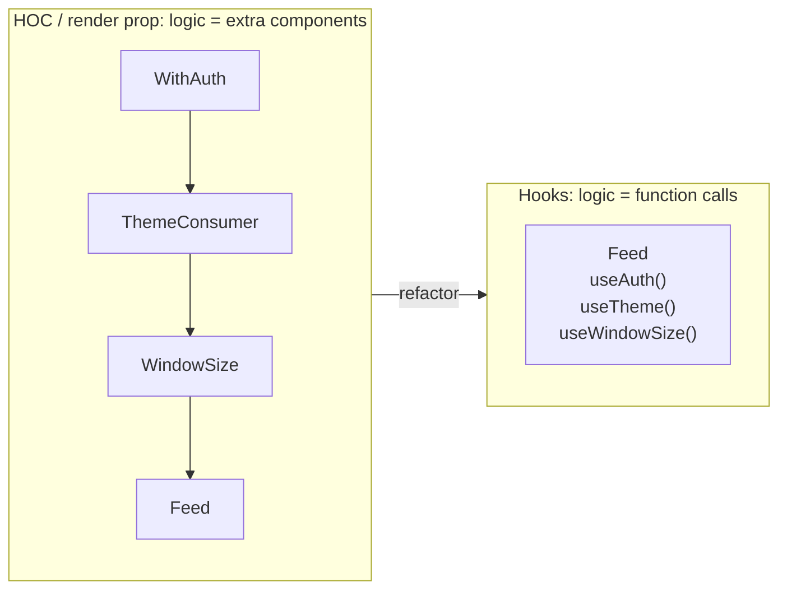
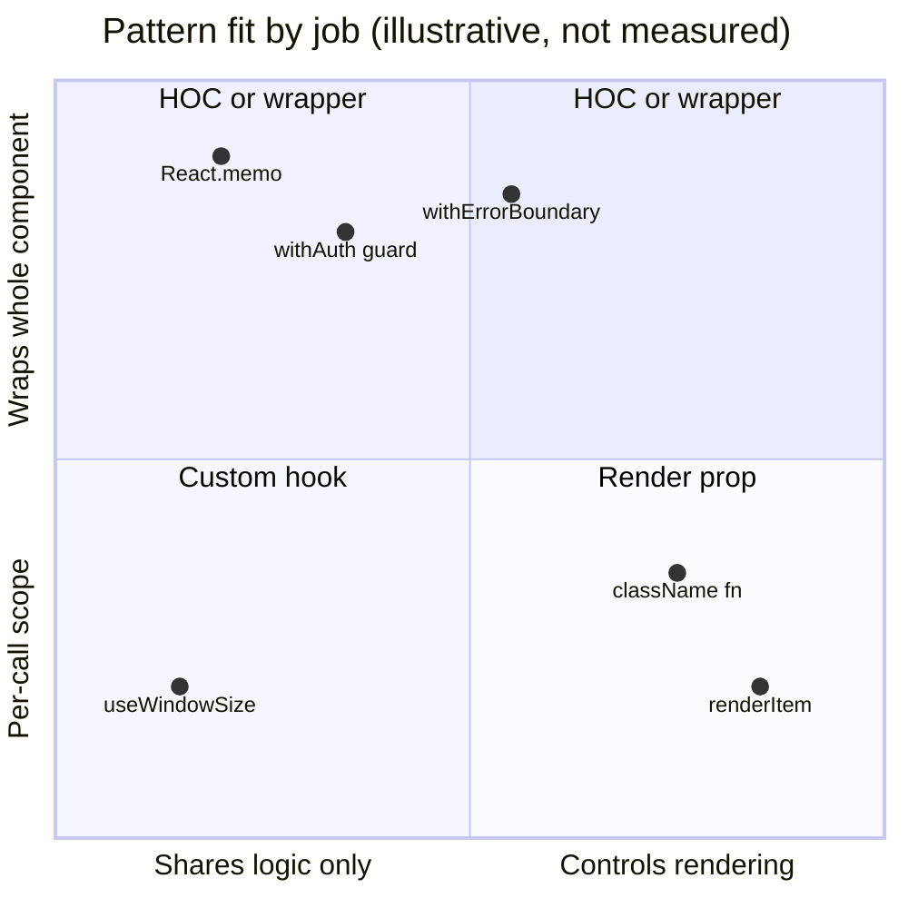

<!-- Generated by scripts/sync-knowledge.js from notes/ and README.md — do not edit here. -->
<!-- sections (line ranges in this file): Table of Contents 19-40 · ELI5 41-52 · Core Concept 53-570 · Decision Matrix 571-585 · Real-World Examples 586-744 · Key Points Summary 745-764 · Test Your Understanding 765-847 · Cheat Sheet 848-897 · References & Further Reading 898-934 -->

# Higher-Order Components & Render Props

> **Date:** 2026-11-06 · **Last updated:** 2026-11-06
> **Category:** Frontend System Design
> **Sub-Topic:** Design Systems & Components / Component Patterns
> **Level:** Intermediate · **Reading time:** ~26 min
> **Informs:** logic-reuse pattern choice (HOC vs render prop vs hook), migrating legacy HOC/render-prop code, design-system extension points (renderItem, slots, render-state props), cross-cutting concerns (auth guards, error boundaries, feature flags), TypeScript typing of wrappers, ref forwarding, cross-framework equivalents (scoped slots, snippets, ng-template)

> **Pre-requisite:** [Component Architecture & Design Systems](./component-architecture-and-design-systems.md) (what a component is and how libraries are layered) and [Controlled vs Uncontrolled Components](./controlled-vs-uncontrolled-components.md) (who owns the state).
> This note covers the two **pre-hooks** React patterns for sharing behavior between components. Neither is the default for new code any more — but both are still all over production code, libraries and interviews, and render props in particular remain the right tool for some extension points.

**Previous:** [Controlled vs Uncontrolled Components](./controlled-vs-uncontrolled-components.md) · **Next:** [Custom Hooks Patterns](./custom-hooks-patterns.md)

---

## Table of Contents

1. [ELI5 — Simple Explanation](#eli5--simple-explanation)
2. [Section 1: The Problem — Sharing Behavior, Not Markup](#section-1-the-problem--sharing-behavior-not-markup)
3. [Section 2: A Short History — Mixins, HOCs, Render Props, Hooks](#section-2-a-short-history--mixins-hocs-render-props-hooks)
4. [Section 3: Higher-Order Components (HOCs)](#section-3-higher-order-components-hocs)
5. [Section 4: HOC Rules and Pitfalls](#section-4-hoc-rules-and-pitfalls)
6. [Section 5: Typing HOCs in TypeScript](#section-5-typing-hocs-in-typescript)
7. [Section 6: Render Props](#section-6-render-props)
8. [Section 7: Render Prop Pitfalls](#section-7-render-prop-pitfalls)
9. [Section 8: Why Hooks Replaced Both (Mostly)](#section-8-why-hooks-replaced-both-mostly)
10. [Section 9: Where Each Pattern Still Wins in 2026](#section-9-where-each-pattern-still-wins-in-2026)
11. [Section 10: Other Frameworks and Native Mobile](#section-10-other-frameworks-and-native-mobile)
12. [Decision Matrix](#decision-matrix)
13. [Real-World Examples](#real-world-examples)
14. [Key Points Summary](#key-points-summary)
15. [Test Your Understanding (with answers)](#test-your-understanding)
16. [Cheat Sheet](#cheat-sheet)
17. [References & Further Reading](#references--further-reading)

---

## ELI5 — Simple Explanation

Imagine you want several plain cakes to all have chocolate frosting.

- **Higher-Order Component (HOC)** = a **frosting machine**. You put a plain cake in, and a frosted cake comes out. The cake doesn't know it went through the machine — it just arrives with extra stuff on it (extra props). Run it through five machines and you get five layers wrapped around one cake, and it's hard to tell which machine added which layer.
- **Render prop** = a **bakery that bakes the sponge but asks you how to decorate it**. You hand over a little instruction card ("when the sponge is ready, put strawberries on it"). The bakery owns the oven (the state); you own the look (the markup).
- **Custom hook** (the modern way, next note) = **a recipe card you follow in your own kitchen**. No machine, no extra layers — you just use the technique directly.

> **HOCs wrap a component to inject behavior; render props hand behavior to a function you supply. Hooks now do the logic-sharing job for most code, but render props are still the best way for a component to let callers control rendering.**

---

## Core Concept — Step by Step

### Section 1: The Problem — Sharing Behavior, Not Markup

Components are great at reusing **markup**: write `<Button>` once, use it everywhere. Reusing **stateful behavior** is harder. Examples of behavior you want in many places:

| Behavior | State / side effect it needs |
|---|---|
| Track mouse position or window size | Event listener + state |
| Show a spinner while data loads | `isLoading`, `error`, `data` |
| Only render for logged-in users | Auth state + redirect |
| Subscribe to a store | Subscription + re-render on change |
| Toggle open/closed with keyboard support | `isOpen`, handlers, ARIA props |
| Catch render errors | An error boundary (class-only in React) |

Before hooks, a **function component could not hold state** and class components could not easily share lifecycle logic. React developers invented patterns to move behavior into a **separate component** and connect it to the UI.



---

### Section 2: A Short History — Mixins, HOCs, Render Props, Hooks



Why each pattern was replaced:

| Pattern | Main problem that led to the next one |
|---|---|
| **Mixins** | Implicit dependencies ("this mixin expects `this.state.x`"), name clashes between mixins, snowballing complexity; not supported by ES6 classes |
| **HOCs** | "Wrapper hell", prop name collisions, unclear where a prop came from, static/ref plumbing, hard to type |
| **Render props** | "Callback pyramid" when nesting several, inline functions defeat memoization, behavior tied to the render tree |
| **Hooks** | (Current default) Must follow the Rules of Hooks; can't be used in class components |

---

### Section 3: Higher-Order Components (HOCs)

A **higher-order component is a function that takes a component and returns a new component.** The name mirrors *higher-order functions* (functions that take or return functions).

```text
const EnhancedComponent = higherOrderComponent(WrappedComponent);
```

It's not a React API — it's a **pattern** that falls out of components being plain functions/classes.



A minimal HOC:

```tsx
import { useEffect, useState, type ComponentType } from 'react';

type WindowSize = { width: number; height: number };

// HOC: injects a `windowSize` prop into any component
export function withWindowSize<P extends { windowSize: WindowSize }>(
  Wrapped: ComponentType<P>,
) {
  function WithWindowSize(props: Omit<P, 'windowSize'>) {
    const [size, setSize] = useState<WindowSize>(() => ({
      width: window.innerWidth,
      height: window.innerHeight,
    }));

    useEffect(() => {
      const onResize = () =>
        setSize({ width: window.innerWidth, height: window.innerHeight });
      window.addEventListener('resize', onResize);
      return () => window.removeEventListener('resize', onResize);
    }, []);

    return <Wrapped {...(props as P)} windowSize={size} />;
  }

  WithWindowSize.displayName = `WithWindowSize(${Wrapped.displayName ?? Wrapped.name ?? 'Component'})`;
  return WithWindowSize;
}

// Usage
function Banner({ windowSize, title }: { windowSize: WindowSize; title: string }) {
  return <h1>{title} — {windowSize.width < 640 ? 'mobile' : 'desktop'}</h1>;
}
export const ResponsiveBanner = withWindowSize(Banner);
// <ResponsiveBanner title="Sale" />   ← caller no longer passes windowSize
```

> Note that the HOC **uses hooks internally**. In modern code an HOC is often just a thin adapter around a hook — which raises the question of why not call the hook directly (Section 8).

**Three flavors of HOC:**

| Flavor | What it does | Example |
|---|---|---|
| **Props injector** | Adds props from state, context, a store | `connect(mapState)(Comp)` (React-Redux), `withWindowSize` |
| **Conditional renderer / guard** | Renders the component, something else, or nothing | `withAuth(Comp)` redirects when logged out; `withFeatureFlag('beta')(Comp)` |
| **Wrapper / decorator** | Wraps the component in another component | `withErrorBoundary(Comp)` (react-error-boundary), `withProviders(Comp)` in tests |

**HOCs you still meet (2026):**
- `React.memo(Component)` and `React.lazy(() => import(...))` — built-in functions that return a component (HOC-shaped, though not usually called HOCs).
- React-Redux `connect` — still supported; the Redux docs recommend the hooks API (`useSelector`, `useDispatch`) as the default.
- MobX `observer(Component)`, `withAuthenticationRequired(Component)` in the Auth0 React SDK, `withErrorBoundary` in `react-error-boundary`.
- `withRouter` — **removed** in React Router v6; use `useNavigate`/`useParams`/`useLocation` instead.

**Composing HOCs** — each wrapper adds a layer, so people use `compose`:

```tsx
// Reads right-to-left: withTheme is applied first, withRouterLike last
const enhance = compose(withRouterLike, connect(mapState), withTheme);
export default enhance(ProductPage);
```

---

### Section 4: HOC Rules and Pitfalls



| Rule / pitfall | What goes wrong | Fix |
|---|---|---|
| **Don't create HOCs inside render** | `const Enhanced = withX(Comp)` inside a component body creates a **new component type every render** → React unmounts and remounts the subtree, losing all state and DOM | Apply HOCs once, at module level |
| **Don't mutate the wrapped component** | Patching `Wrapped.prototype` or its statics leaks into every other use and breaks when two HOCs patch the same thing | Compose: render `<Wrapped {...props} />` |
| **Pass through unrelated props** | Forgetting `{...props}` silently drops props the caller passed | Spread the rest props onto the wrapped component |
| **Prop name collisions** | Two HOCs both inject `data` or `loading` → one overwrites the other with no error | Namespace injected props, or switch to hooks |
| **Refs don't pass through (React ≤ 18)** | `ref` is not a regular prop, so `<Enhanced ref={r} />` points at the wrapper | React 18: `forwardRef`. **React 19:** function components receive `ref` as a prop, so spreading `{...props}` forwards it (class components still don't) |
| **Static methods are lost** | `Enhanced.fetchData` is undefined because the wrapper is a new component | Copy them (`hoist-non-react-statics`) or export statics separately |
| **Bad DevTools names** | Every wrapper shows as `Anonymous` | Set `displayName = 'WithX(Inner)'` |
| **Implicit contract** | The wrapped component must accept props it never sees being passed in its parent | Document it, type it (Section 5), or prefer an explicit hook call |

```tsx
// ❌ BAD: new component type on every render → state of Chart resets each time Dashboard renders
function Dashboard({ data }: { data: Point[] }) {
  const ResponsiveChart = withWindowSize(Chart);
  return <ResponsiveChart data={data} />;
}

// ✅ GOOD: create once at module scope
const ResponsiveChart = withWindowSize(Chart);
function Dashboard({ data }: { data: Point[] }) {
  return <ResponsiveChart data={data} />;
}
```

**Refs through an HOC — React 18 vs React 19:**

```tsx
// React 18 and earlier: ref must be forwarded explicitly
const WithLogging18 = forwardRef<HTMLInputElement, InputProps>((props, ref) => {
  useLogMount('Input');
  return <Input {...props} ref={ref} />;
});

// React 19: ref is a normal prop for function components — spreading props forwards it
function WithLogging19(props: InputProps & { ref?: React.Ref<HTMLInputElement> }) {
  useLogMount('Input');
  return <Input {...props} />;
}
```

> React 19 docs say `forwardRef` is no longer necessary for function components and will be deprecated in a future version. Check the [React 19 release notes](https://react.dev/blog/2024/12/05/react-19) before migrating a library that must also support React 18.

---

### Section 5: Typing HOCs in TypeScript

HOC typing is where most teams give up on HOCs. The goal: the enhanced component should require **the wrapped component's props minus the injected ones**.



```tsx
import type { ComponentType } from 'react';

type User = { id: string; name: string };
type InjectedUserProps = { user: User };

export function withUser<P extends InjectedUserProps>(Wrapped: ComponentType<P>) {
  function WithUser(props: Omit<P, keyof InjectedUserProps>) {
    const user = useCurrentUser();            // the real logic lives in a hook
    if (!user) return <SignInPrompt />;       // guard behavior
    return <Wrapped {...(props as P)} user={user} />;
  }
  WithUser.displayName = `WithUser(${Wrapped.displayName ?? Wrapped.name ?? 'Component'})`;
  return WithUser;
}

// ✅ Type-checked: `user` is injected, `title` is still required
function Profile({ user, title }: { user: User; title: string }) {
  return <h2>{title}: {user.name}</h2>;
}
const ProfileWithUser = withUser(Profile);
// <ProfileWithUser title="Me" />          OK
// <ProfileWithUser />                     error: title is missing
```

Notes:
- The `props as P` cast is the usual escape hatch: TypeScript can't prove that `Omit<P, 'user'> & { user }` equals `P` for a generic `P`.
- Generic wrapped components (e.g. `List<T>`) lose their generic parameter through most HOCs — another reason hooks are preferred for typed design-system code.

---

### Section 6: Render Props

A **render prop** is a prop whose value is a **function that returns UI**. The component owns some state or behavior and calls the function to let the caller decide what to render.

```tsx
<MouseTracker render={({ x, y }) => <Cursor x={x} y={y} />} />

// "Function as child" — the same pattern using the children prop
<MouseTracker>{({ x, y }) => <p>Mouse at {x}, {y}</p>}</MouseTracker>
```



Implementation:

```tsx
import { useState, type ReactNode, type PointerEvent } from 'react';

type Point = { x: number; y: number };
type MouseTrackerProps = {
  children: (point: Point) => ReactNode;   // render prop via children
};

export function MouseTracker({ children }: MouseTrackerProps) {
  const [point, setPoint] = useState<Point>({ x: 0, y: 0 });
  const onPointerMove = (e: PointerEvent<HTMLDivElement>) =>
    setPoint({ x: e.clientX, y: e.clientY });

  return (
    <div onPointerMove={onPointerMove} style={{ height: '100%' }}>
      {children(point)}
    </div>
  );
}
```

**Render props in libraries you'll meet today:**

| Library / API | Render-prop shape | Purpose |
|---|---|---|
| React Hook Form `<Controller>` | `render={({ field, fieldState }) => <Input {...field} />}` | Connect a controlled third-party input to the form |
| React Router `<NavLink>` | `className={({ isActive }) => ...}`, `children={({ isActive }) => ...}` | Style by route state |
| React Aria Components | `className`/`style`/`children` as functions of render state (`isSelected`, `isFocusVisible`, …) | Style headless components by interaction state |
| Headless UI (Tailwind Labs) | `{({ open }) => ...}` children, alongside `data-*` state attributes | Render based on open/active state |
| React Native `FlatList` | `renderItem={({ item }) => <Row item={item} />}` | Caller renders each row; list owns virtualization |
| `Context.Consumer` | `{value => ...}` | Legacy way to read context; `useContext`/`use` replace it |
| Formik `<Formik>` | `{(formik) => <form>...</form>}` | Form state to markup |

**Named render props ("render slots")** generalize the idea — a component can have several:

```tsx
<DataTable
  rows={orders}
  renderRow={(order) => <OrderRow order={order} />}
  renderEmpty={() => <EmptyState title="No orders yet" />}
  renderError={(error, retry) => <ErrorBanner error={error} onRetry={retry} />}
/>
```

---

### Section 7: Render Prop Pitfalls

**1. The callback pyramid** — nesting several render-prop components:

```tsx
// ❌ Each provider of behavior adds an indentation level
<Auth>
  {(user) => (
    <Theme>
      {(theme) => (
        <WindowSize>
          {(size) => (
            <Feed user={user} theme={theme} compact={size.width < 640} />
          )}
        </WindowSize>
      )}
    </Theme>
  )}
</Auth>

// ✅ Hooks flatten it (Section 8)
function FeedContainer() {
  const user = useAuth();
  const theme = useTheme();
  const size = useWindowSize();
  return <Feed user={user} theme={theme} compact={size.width < 640} />;
}
```

**2. Inline functions defeat memoization.** `render={() => ...}` creates a new function every parent render, so a `React.memo`/`PureComponent` render-prop component always sees a "changed" prop. Usually harmless — render props are cheap — but for hot paths, hoist the function or use `useCallback`. The **React Compiler**, when enabled, memoizes such callbacks automatically.

**3. The state lives in the tree.** Behavior provided by a render-prop component is only available **inside** its JSX. You can't use `x, y` in an effect or event handler in the parent's body — a hook can.

**4. `children` type confusion.** If `children` is a function, the component can't also accept normal JSX children. Pick one convention per component and type it.



---

### Section 8: Why Hooks Replaced Both (Mostly)

The React team introduced hooks partly because HOCs and render props force you to **restructure the component tree** to share logic. Hooks share logic **without adding components**.



| Concern | HOC | Render prop | Custom hook |
|---|---|---|---|
| Extra components in the tree | One per HOC | One per provider | **None** |
| Where values come from | Hidden (injected props) | Explicit (function args) | **Explicit** (return value) |
| Name collisions | Possible (props overwrite) | No (you name the args) | **No** (you name the variables) |
| Use values in effects/handlers | Yes (they're props) | No (only inside JSX) | **Yes** |
| TypeScript | Hard (Omit, generics lost) | Easy | **Easy** |
| Works in class components | **Yes** | **Yes** | No |
| Lets the caller control markup | No | **Yes** | Only by returning props |
| Composition | `compose(a, b, c)` | Nesting | **Call one hook from another** |

```tsx
// One piece of logic, three packagings
function useWindowSize() { /* state + resize listener; see next note */ }

// Hook (default)
function Banner() { const { width } = useWindowSize(); return <h1>{width}</h1>; }

// Render prop built ON the hook — for callers that want a JSX API
function WindowSize({ children }: { children: (s: WindowSize) => ReactNode }) {
  return <>{children(useWindowSize())}</>;
}

// HOC built ON the hook — e.g. to support legacy class components
const withWindowSize = <P extends { windowSize: WindowSize }>(C: ComponentType<P>) =>
  function WithWindowSize(props: Omit<P, 'windowSize'>) {
    return <C {...(props as P)} windowSize={useWindowSize()} />;
  };
```

> **Migration rule:** extract the logic into a hook first, then re-implement the existing HOC/render-prop component as a thin adapter around it. Callers can migrate one at a time and nothing breaks. See [Custom Hooks Patterns](./custom-hooks-patterns.md).

---

### Section 9: Where Each Pattern Still Wins in 2026

Hooks are the default for **sharing logic**. But these jobs still fit HOCs or render props better:

**Render props / render-state props still win when:**
- A component owns data **per item** and the caller owns the markup: `renderItem` in lists, virtualized grids, comboboxes (`renderOption`), tables (`renderCell`).
- A styled or headless component exposes **interaction state for styling**: `className={({ isFocusVisible }) => ...}`.
- Behavior must be **scoped to a subtree** (e.g. a `<Measure>` component that observes the element it renders around).
- You're building a design-system extension point that should be usable **without writing a hook** (e.g. in MDX docs or by non-specialists).

**HOCs (or wrapper components) still win when:**
- The concern is **"wrap the whole component"**: error boundaries (class-only in React — `withErrorBoundary` is a convenient wrapper), route/auth guards, feature-flag gates, analytics instrumentation, `Suspense` + lazy wrappers.
- You must support **class components** that can't call hooks.
- A **framework or library API** expects a component, e.g. `React.memo`, `observer()`, `lazy()`.
- Applying the same wrapper to **many route components declaratively**, e.g. `export default withAuth(Page)` across a legacy pages directory.



---

### Section 10: Other Frameworks and Native Mobile

The same two ideas — **wrap to add behavior** and **pass a template to control rendering** — exist everywhere under different names:

| Framework | "Render prop" equivalent | "HOC" equivalent | Modern logic-sharing default |
|---|---|---|---|
| **React** | Render prop / function as child | HOC | Custom hooks |
| **Vue 3** | **Scoped slots** (`<template #item="{ item }">`), renderless components | Possible (`h()` wrappers) but uncommon; Vue 2 used **mixins** (discouraged in Vue 3) | **Composables** (`useX()` with the Composition API) |
| **Angular** | **`ng-template` + `ngTemplateOutlet`** with a context object (`let-item`) | **Directives**, `hostDirectives` composition, DI services | Services + `inject()`, **signals** |
| **Svelte 5** | **Snippets**: `{#snippet row(item)}` passed as props and rendered with `{@render row(item)}` (Svelte 4: slot props, `let:item`) | Wrapper components; **actions** (`use:tooltip`) for DOM behavior | Runes (`$state`, `$derived`) in `.svelte.js` modules |
| **Solid** | Function children / render props | Wrapper components | Custom primitives (`createX`) |
| **React Native** | `renderItem`, `renderSectionHeader`, `ListEmptyComponent` | Same HOCs as React | Custom hooks |
| **SwiftUI** | `@ViewBuilder` closure parameters (`content: (Item) -> Content`) | `ViewModifier` + `.modifier()` | Observable models, property wrappers |
| **Jetpack Compose** | **Slot APIs**: composable lambda params (`content: @Composable (Item) -> Unit`) | `Modifier` chains, wrapper composables | `remember…` state holders, ViewModels |

```html
<!-- Vue 3: scoped slot = render prop -->
<DataList :items="users">
  <template #item="{ item }">
    <UserRow :user="item" />
  </template>
</DataList>

<!-- Angular: ng-template with context = render prop -->
<app-data-list [items]="users" [itemTemplate]="row"></app-data-list>
<ng-template #row let-item>
  <app-user-row [user]="item"></app-user-row>
</ng-template>
```

```html
<!-- Svelte 5: snippet passed as a prop -->
<DataList items={users}>
  {#snippet item(user)}
    <UserRow {user} />
  {/snippet}
</DataList>

<!-- Inside DataList.svelte -->
<script>
  let { items, item } = $props();
</script>
{#each items as entry (entry.id)}
  {@render item(entry)}
{/each}
```

> Vue's docs explicitly compare renderless components with composables and recommend **composables for pure logic reuse** and renderless components (scoped slots) when you need both logic **and** visual composition — the same split as hooks vs render props in React.

---

## Decision Matrix

| You need to… | Use | Why |
|---|---|---|
| Share stateful logic between components (new code) | **Custom hook** | No extra tree nodes, explicit values, easy to type |
| Let the caller render each item/row/option | **Render prop** (`renderItem`) | Component owns data and behavior, caller owns markup |
| Expose interaction state for styling | **Render-state prop** (`className={(s) => ...}`) or `data-*` attributes | Styling without leaking internal state management |
| Catch render errors around a component | **Error boundary** wrapper (component or `withErrorBoundary`) | Error boundaries need a class component; wrapping is the natural API |
| Gate a whole route/page (auth, feature flag) | **Wrapper component or HOC**, or the router's loader/guard | Declarative, applied once per route |
| Support legacy class components | **HOC or render prop over a hook** | Classes can't call hooks |
| Reduce re-renders of a component | **`React.memo`** (or the React Compiler) | Built-in HOC-shaped API |
| Migrate an old HOC | **Extract a hook, keep the HOC as a thin adapter** | Incremental, no big-bang rewrite |

---

## Real-World Examples

**Example 1 — Migrating an HOC to a hook without breaking callers (BAD → GOOD):**
```tsx
// ❌ BEFORE: logic is trapped inside the HOC; collision-prone `data`/`loading` props
export function withProducts<P>(Wrapped: ComponentType<P & { data: Product[]; loading: boolean }>) {
  return function WithProducts(props: P) {
    const [data, setData] = useState<Product[]>([]);
    const [loading, setLoading] = useState(true);
    useEffect(() => {
      let ignore = false;
      fetch('/api/products').then((r) => r.json()).then((json) => {
        if (!ignore) { setData(json); setLoading(false); }
      });
      return () => { ignore = true; };
    }, []);
    return <Wrapped {...props} data={data} loading={loading} />;
  };
}

// ✅ AFTER step 1: the logic becomes a hook (better still: TanStack Query / SWR)
export function useProducts() {
  return useQuery({
    queryKey: ['products'],
    queryFn: () => fetch('/api/products').then((r) => r.json() as Promise<Product[]>),
  });
}

// ✅ AFTER step 2: the HOC is now a thin adapter, kept only for not-yet-migrated callers
/** @deprecated Use useProducts() directly. */
export function withProducts<P>(Wrapped: ComponentType<P & { data: Product[]; loading: boolean }>) {
  return function WithProducts(props: P) {
    const { data = [], isPending } = useProducts();
    return <Wrapped {...props} data={data} loading={isPending} />;
  };
}
```

**Example 2 — Error boundary wrapper (a job HOCs still do well):**
```tsx
import { ErrorBoundary, withErrorBoundary, type FallbackProps } from 'react-error-boundary';

function ChartFallback({ resetErrorBoundary }: FallbackProps) {
  return (
    <div role="alert">
      <p>Chart failed to load.</p>
      <button onClick={resetErrorBoundary}>Retry</button>
    </div>
  );
}

// Component form
<ErrorBoundary FallbackComponent={ChartFallback}>
  <RevenueChart />
</ErrorBoundary>;

// HOC form — handy when exporting a widget that should always be isolated
export const SafeRevenueChart = withErrorBoundary(RevenueChart, {
  FallbackComponent: ChartFallback,
  onError: (error) => reportError(error),
});
```

**Example 3 — A design-system list with render slots:**
```tsx
type ListProps<T> = {
  items: T[];
  getKey: (item: T) => string;
  renderItem: (item: T, state: { index: number; isSelected: boolean }) => ReactNode;
  renderEmpty?: () => ReactNode;
  selectedKey?: string;
};

export function SelectableList<T>({ items, getKey, renderItem, renderEmpty, selectedKey }: ListProps<T>) {
  if (items.length === 0) return <>{renderEmpty?.() ?? <p>No items</p>}</>;
  return (
    <ul role="listbox" aria-label="Results">
      {items.map((item, index) => {
        const key = getKey(item);
        const isSelected = key === selectedKey;
        return (
          <li key={key} role="option" aria-selected={isSelected}>
            {renderItem(item, { index, isSelected })}
          </li>
        );
      })}
    </ul>
  );
}

// Generic T is preserved — something most HOCs lose
<SelectableList
  items={users}
  getKey={(u) => u.id}
  selectedKey={selectedId}
  renderItem={(u, { isSelected }) => <UserRow user={u} highlighted={isSelected} />}
  renderEmpty={() => <EmptyState title="No users match" />}
/>;
```

**Example 4 — Render-state props for styling (React Aria Components style):**
```tsx
import { Button } from 'react-aria-components';

<Button
  className={({ isPressed, isFocusVisible }) =>
    [
      'btn',
      isPressed && 'btn--pressed',
      isFocusVisible && 'btn--focus-ring',
    ].filter(Boolean).join(' ')
  }
>
  Save
</Button>;
// The same library also sets data-pressed / data-focus-visible attributes,
// so plain CSS selectors like .btn[data-pressed] work without a function.
```

**Example 5 — Route guard: HOC vs wrapper component vs router-level guard:**
```tsx
// HOC (common in older codebases)
export default withAuth(SettingsPage);

// Wrapper component (explicit in the route table)
<Route path="/settings" element={<RequireAuth><SettingsPage /></RequireAuth>} />;

function RequireAuth({ children }: { children: ReactNode }) {
  const { user } = useAuth();
  const location = useLocation();
  if (!user) return <Navigate to="/login" state={{ from: location }} replace />;
  return <>{children}</>;
}

// Data routers / meta-frameworks: check auth in a loader or middleware on the server
// so protected data is never sent to the client in the first place.
```

> Client-side guards only control **what renders**. Real authorization must happen on the server (API, loader, middleware). See [Authentication Flows in SPAs](./authentication-flows-in-spas.md).

**Example 6 — React Native `FlatList` render props:**
```tsx
import { FlatList, Text, View } from 'react-native';

<FlatList
  data={messages}
  keyExtractor={(m) => m.id}
  renderItem={({ item }) => (
    <View style={{ padding: 12 }}>
      <Text>{item.text}</Text>
    </View>
  )}
  ListEmptyComponent={<Text>No messages</Text>}
/>;
// FlatList owns windowing/recycling; the caller owns row markup — a textbook render prop.
```

---

## Key Points Summary

| Concept | One-Line Explanation |
|---|---|
| **HOC** | A function `withX(Component)` that returns a new component with extra behavior/props |
| **Render prop** | A prop whose value is a function returning UI; the component calls it with its state |
| **Function as child** | A render prop passed as `children` |
| **Wrapper hell** | Many stacked HOCs → deep tree, unclear prop origins, hard debugging |
| **Prop collision** | Two HOCs inject the same prop name and one silently wins |
| **Callback pyramid** | Nested render props → deep indentation |
| **displayName** | Set `WithX(Inner)` so DevTools and errors show useful names |
| **Ref forwarding** | React ≤ 18 needs `forwardRef`; React 19 passes `ref` as a prop to function components |
| **Never create HOCs in render** | New component type each render → remount and lost state |
| **Hooks replaced both for logic** | Logic reuse without extra components, explicit values, easy typing |
| **Render props still fit** | Per-item rendering (`renderItem`), render-state styling, slots with data |
| **HOCs still fit** | Whole-component wrapping: error boundaries, guards, `memo`, class support |
| **Cross-framework** | Vue scoped slots, Angular `ng-template`, Svelte snippets, Compose slots ≈ render props |

---

## Test Your Understanding

**Q1 (Basic):**
What is a higher-order component, and how does it differ from a render prop in who decides the markup?

<details>
<summary>Answer</summary>

An HOC is a **function that takes a component and returns a new component**, usually injecting props or wrapping it with behavior (`withUser(Profile)`). The **wrapped component** decides the markup; the HOC only feeds it props and may decide *whether* to render it.

A render prop is a **prop whose value is a function returning UI**. The component that owns the behavior calls that function with its state, so the **caller** decides the markup at the call site. The key difference is the direction of control: HOCs push data *into* a fixed component, while render props pull markup *out of* the caller.
</details>

**Q2 (Application):**
A teammate writes this, and the chart's zoom level resets every time the dashboard re-renders. Why, and how do you fix it?

```tsx
function Dashboard(props: Props) {
  const Tracked = withAnalytics(Chart);
  return <Tracked {...props} />;
}
```

<details>
<summary>Answer</summary>

`withAnalytics(Chart)` runs on **every render** of `Dashboard` and returns a **new function component**. React compares element types by reference; a different type means "different component", so it **unmounts the old `Chart` and mounts a new one** each time — losing state (the zoom level), effects re-run, and the DOM is recreated.

Fix: apply the HOC **once at module scope** (`const TrackedChart = withAnalytics(Chart);`) and render `<TrackedChart />` inside. Better still, if `withAnalytics` only adds logic, replace it with a `useAnalytics()` hook called inside `Chart`.
</details>

**Q3 (Tricky):**
Two HOCs are composed: `withLoading(withProducts(ProductGrid))`. Both inject a prop called `loading`. What happens, and what does this tell you about HOCs?

<details>
<summary>Answer</summary>

Each HOC typically spreads the incoming props first and then sets its own (`<Wrapped {...props} loading={...} />`), so whichever HOC sets `loading` **closest to the wrapped component** wins. Here `withProducts` is the inner wrapper and renders `ProductGrid` directly, so its `loading` value overwrites whatever `withLoading` passed through. There's **no error or warning**, and with TypeScript generics the clash is often hidden behind casts.

This is the **prop collision** problem: HOCs communicate through a shared, flat props namespace, and the wrapped component can't tell which wrapper supplied which value. Hooks avoid it because the caller names each returned value: `const { isPending: productsLoading } = useProducts();`.
</details>

**Q4 (Tricky):**
In React 18 a `forwardRef` was needed for `<EnhancedInput ref={inputRef} />` to reach the inner `<input>`. Is it still needed in React 19? Are there exceptions?

<details>
<summary>Answer</summary>

In **React 19, function components receive `ref` as a regular prop**, so an HOC implemented as a function component that spreads `{...props}` onto the inner component forwards the ref without `forwardRef`. The React team has said `forwardRef` will be deprecated in a future version.

Exceptions: **class components** still don't receive `ref` as a prop (the ref points at the class instance). And a **library that supports both React 18 and 19** must keep `forwardRef` (which still works in 19) until it drops React 18 support. Always check the inner component also passes `ref` on to the DOM element.
</details>

**Q5 (Application):**
You're designing a design-system `Combobox`. Product teams need custom option markup (avatar + name + badge) and want to style the highlighted option differently. Which pattern(s) would you expose and why?

<details>
<summary>Answer</summary>

- A **render prop for options**: `renderOption={(option, { isHighlighted, isSelected }) => <UserOption ... />}`. The combobox keeps ownership of filtering, keyboard navigation, `aria-activedescendant` and selection, while teams control markup per option. The generic `T` of the options stays type-safe.
- **Render-state styling**: either `className={({ isHighlighted }) => ...}` or `data-highlighted` attributes, so teams can style states with CSS without re-implementing state.
- Optionally a **headless hook** (`useCombobox`) for teams who need total control, built on the same logic.

An HOC would be the wrong choice: it can't vary markup per option and would hide where state comes from. See [Headless UI / Renderless Components](./headless-ui-renderless-components.md) and [Component API Design](./component-api-design.md).
</details>

**Q6 (System design):**
You inherit a large React 16-era app with ~200 components wrapped in `connect`, `withRouter`, `withTheme` and `withAuth`. You're upgrading to the latest React Router and React. Outline a migration plan.

<details>
<summary>Answer</summary>

1. **Inventory** each HOC: what it injects, who uses it, whether it's used by class components.
2. **Blockers first:** `withRouter` was removed in React Router v6, so write a temporary compatibility HOC built on `useNavigate`/`useLocation`/`useParams` for class components, and migrate function components to the hooks directly.
3. **Extract hooks** for in-house HOCs (`useTheme`, `useAuth`) and turn the HOCs into **deprecated thin adapters** over those hooks, so behavior stays identical while callers migrate one at a time.
4. **`connect` → `useSelector`/`useDispatch`** gradually; `connect` still works, so this isn't a blocker. Watch for re-render differences: `connect` memoizes the wrapped component, and `useSelector` with a new object each time re-renders.
5. **Auth guards** move to the router level (loaders/middleware or a `<RequireAuth>` route wrapper), with server-side checks for real protection.
6. Add **lint rules** (deprecation warnings via JSDoc `@deprecated` and ESLint `no-restricted-imports`) and track the count of remaining HOC usages until it reaches zero.
7. Keep any HOC that wraps whole components for a good reason (e.g. `withErrorBoundary`).
</details>

---

## Cheat Sheet

**Key Definitions:**
- **Higher-order component:** `(Component) => EnhancedComponent`; injects props, guards or wraps.
- **Render prop:** a function prop (`render`, `children`, `renderItem`) the component calls with its state to get UI.
- **Render-state prop:** `className`/`style`/`children` accepting a function of component state.
- **Wrapper hell:** deep trees of anonymous wrappers from stacked HOCs.
- **displayName:** a static string DevTools uses for the component name.
- **Scoped slot / snippet / ng-template:** Vue / Svelte / Angular equivalents of render props.

**Quick Reference:**
```text
HOC skeleton
  function withX<P extends Injected>(C: ComponentType<P>) {
    function WithX(props: Omit<P, keyof Injected>) { const x = useX(); return <C {...(props as P)} x={x} />; }
    WithX.displayName = `WithX(${C.displayName ?? C.name})`;
    return WithX;
  }

HOC rules
  apply at module scope (never inside render) · spread unrelated props · don't mutate the input
  set displayName · copy statics if needed · React ≤18: forwardRef · React 19: ref is a prop

Render prop skeleton
  function Thing({ children }: { children: (state: S) => ReactNode }) { const s = useThing(); return <>{children(s)}</>; }

Choose
  share logic ........................ custom hook
  caller renders each item/state ..... render prop (renderItem, className fn)
  wrap whole component ............... HOC / wrapper component (error boundary, guard, memo)
  class components ................... HOC or render prop built on a hook
```

**Common Mistakes to Avoid:**

| Mistake | Why Wrong | Fix |
|---|---|---|
| Calling an HOC inside a component body | New component type every render → remount, lost state | Apply at module scope |
| Not spreading `{...props}` in the HOC | Caller's props silently disappear | Pass through everything not consumed |
| Two HOCs injecting the same prop | Silent overwrite | Namespace props or migrate to hooks |
| No `displayName` | DevTools full of `Anonymous` | `WithX(Inner)` naming |
| Expecting `ref` to reach the inner component (React ≤ 18) | `ref` isn't a prop before React 19 | `forwardRef`, or upgrade to React 19 semantics |
| Losing static methods | Wrapper is a new component | `hoist-non-react-statics` or export separately |
| Using a render prop just to share logic | Callback pyramid, values unusable outside JSX | Custom hook |
| Inline render functions on a memoized hot path | New function each render defeats `memo` | Hoist, `useCallback`, or the React Compiler |
| Treating a client-side `withAuth` as security | Only hides UI | Enforce on the server; see auth notes |
| Writing new `withRouter`-style HOCs | Removed upstream; hooks are the API | `useNavigate`, `useParams`, `useLocation` |

---

## References & Further Reading

**Core docs**
- React (legacy docs): [Higher-Order Components](https://legacy.reactjs.org/docs/higher-order-components.html)
- React (legacy docs): [Render Props](https://legacy.reactjs.org/docs/render-props.html)
- react.dev: [Reusing Logic with Custom Hooks](https://react.dev/learn/reusing-logic-with-custom-hooks)
- react.dev: [`Children` — alternatives, including calling a render prop](https://react.dev/reference/react/Children#alternatives)
- react.dev: [`forwardRef`](https://react.dev/reference/react/forwardRef) · [`memo`](https://react.dev/reference/react/memo) · [`lazy`](https://react.dev/reference/react/lazy)
- react.dev: [React 19 release — ref as a prop](https://react.dev/blog/2024/12/05/react-19)

**History & rationale**
- React blog: [Mixins Considered Harmful](https://legacy.reactjs.org/blog/2016/07/13/mixins-considered-harmful.html)
- React docs: [Introducing Hooks — motivation](https://legacy.reactjs.org/docs/hooks-intro.html#motivation)

**Libraries mentioned**
- React Redux: [Hooks API](https://react-redux.js.org/api/hooks) · [`connect`](https://react-redux.js.org/api/connect)
- React Router: [`NavLink`](https://reactrouter.com/api/components/NavLink)
- React Hook Form: [`Controller`](https://react-hook-form.com/docs/usecontroller/controller)
- React Aria Components: [Styling](https://react-spectrum.adobe.com/react-aria/styling.html)
- react-error-boundary: [README](https://github.com/bvaughn/react-error-boundary)
- React Native: [`FlatList`](https://reactnative.dev/docs/flatlist)

**Other frameworks**
- Vue: [Scoped slots & renderless components](https://vuejs.org/guide/components/slots.html#scoped-slots) · [Composables vs other patterns](https://vuejs.org/guide/reusability/composables.html#comparisons-with-other-techniques)
- Angular: [`NgTemplateOutlet`](https://angular.dev/api/common/NgTemplateOutlet) · [Directive composition API](https://angular.dev/guide/directives/directive-composition-api)
- Svelte: [Snippets](https://svelte.dev/docs/svelte/snippet) · [`{@render}`](https://svelte.dev/docs/svelte/@render)
- Jetpack Compose: [Slot-based layouts](https://developer.android.com/develop/ui/compose/layouts/basics#slot-based-layouts)

---

> **Previous Topic:** [Controlled vs Uncontrolled Components](./controlled-vs-uncontrolled-components.md)
> — Who owns the state of an input: the component or its parent

> **Next Topic:** [Custom Hooks Patterns](./custom-hooks-patterns.md)
> — The modern way to package and share stateful logic

*Saved on: 2026-11-06 | Repo: Frontend System Design Learning Notes*
