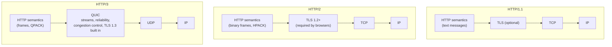
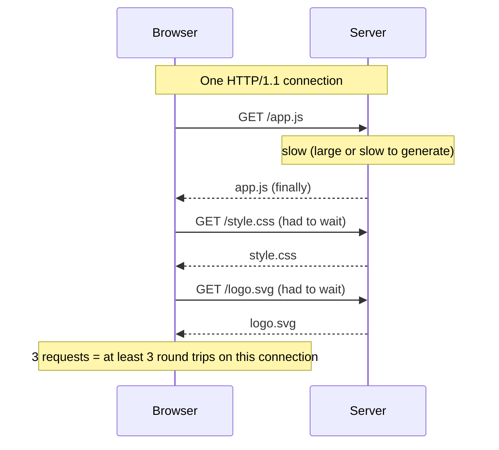
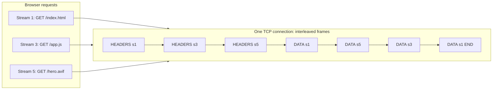
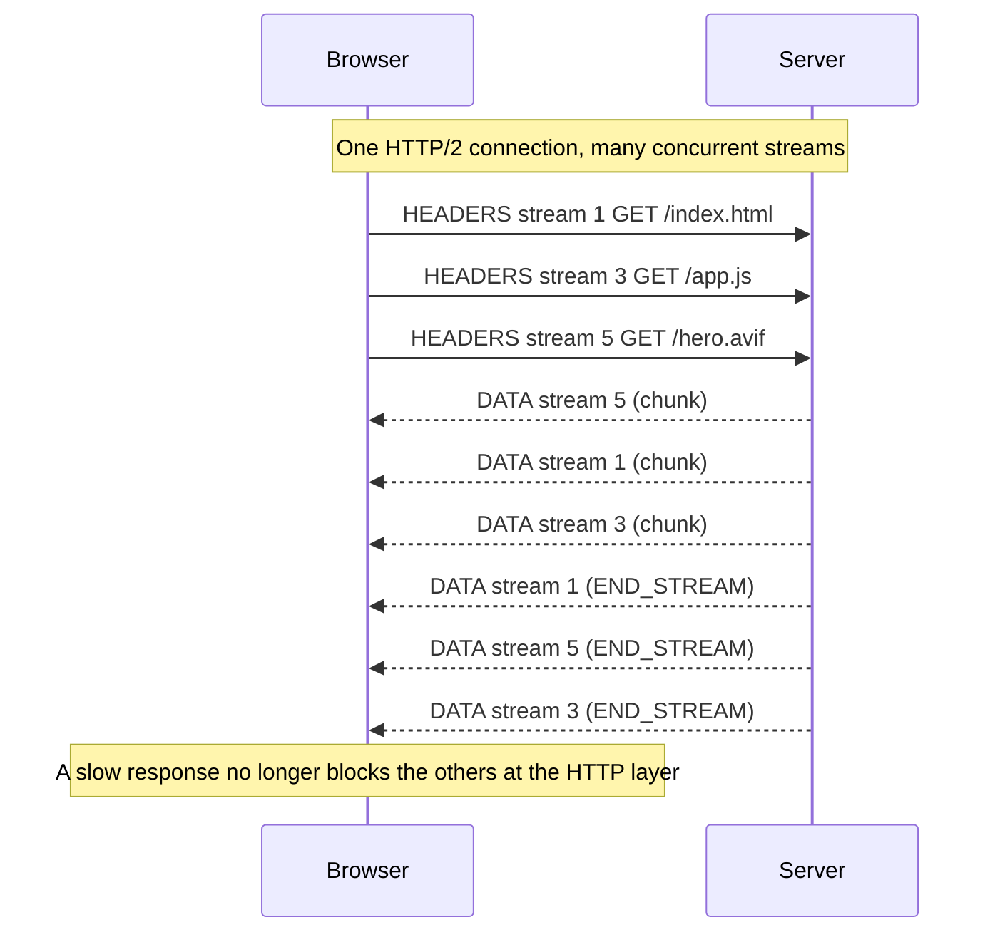
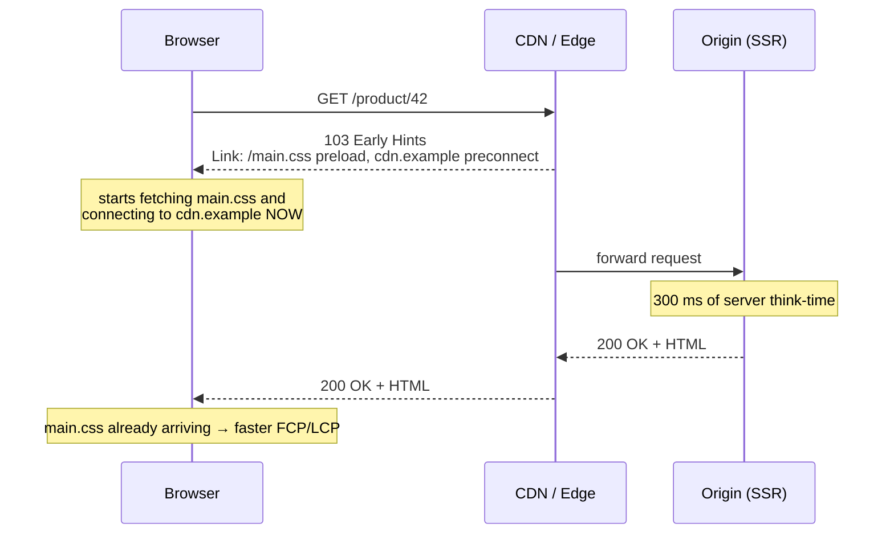
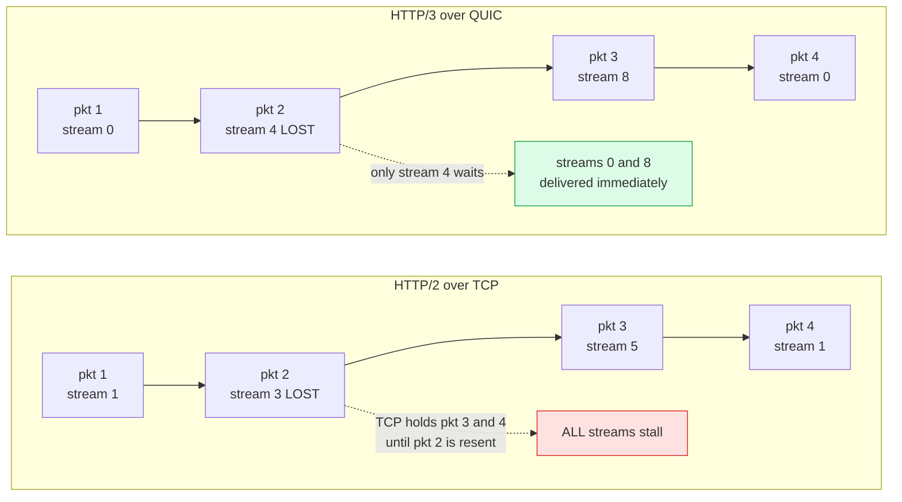
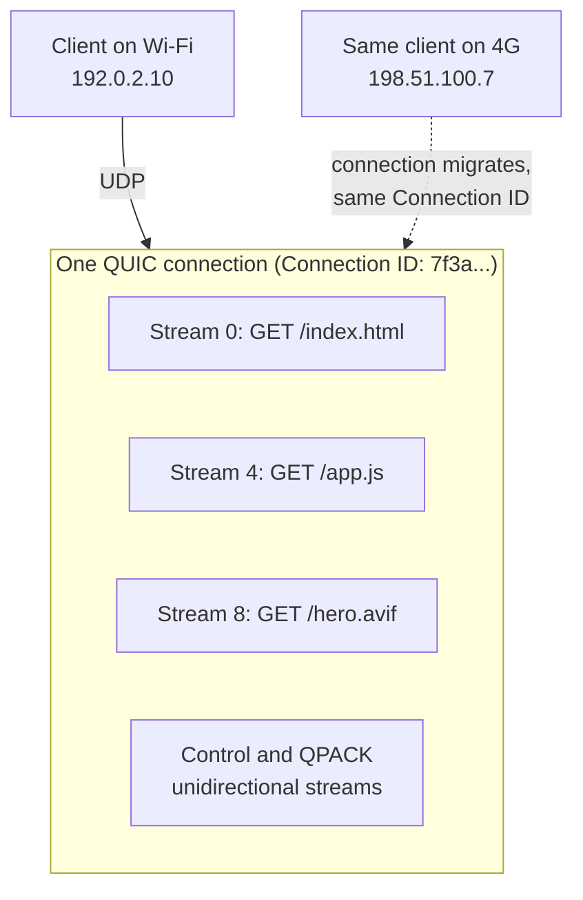
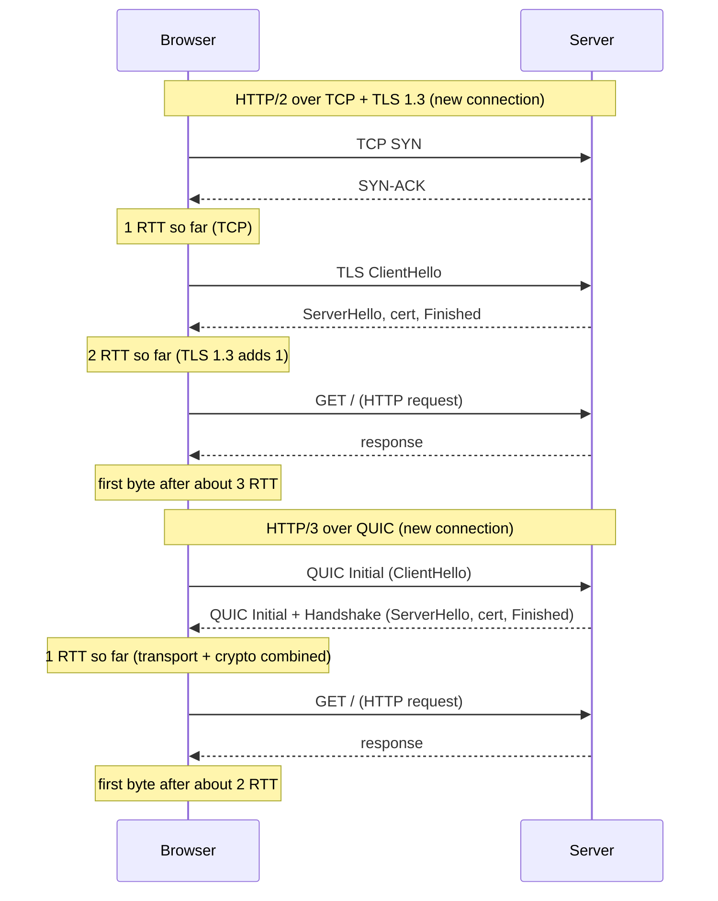
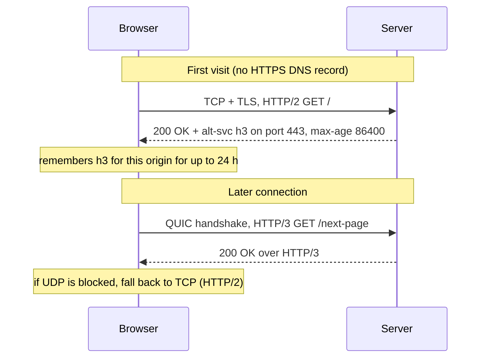
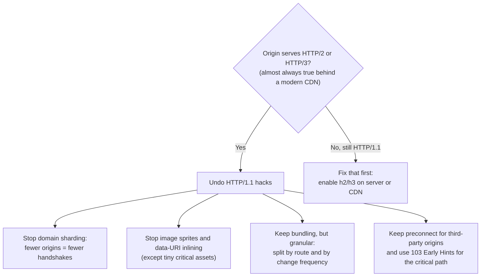

<!-- Generated by scripts/sync-knowledge.js from notes/ and README.md — do not edit here. -->
<!-- sections (line ranges in this file): Table of Contents 19-43 · ELI5 44-55 · Core Concept 56-529 · Full Visual 530-569 · Real-World Examples 570-657 · Key Points Summary 658-680 · Test Your Understanding 681-747 · Cheat Sheet 748-800 · References & Further Reading 801-841 -->

# HTTP/1.1 vs HTTP/2 vs HTTP/3

> **Date:** 2026-11-06 · **Last updated:** 2026-11-06
> **Category:** Frontend System Design
> **Sub-Topic:** Networking / Protocols
> **Level:** Intermediate · **Reading time:** ~35 min
> **Informs:** asset bundling strategy, CDN/protocol choice, connection setup cost, preconnect/early hints

> **Pre-requisite:** [How Browsers Work](./how-browsers-work.md) (navigation and networking) and [Critical Rendering Path](./critical-rendering-path.md) (critical round trips, preload/preconnect).
> This note explains **how the bytes travel** — and which frontend "best practices" exist only because of old protocol limits.

**Previous:** [DOM & Virtual DOM](./dom-and-virtual-dom.md) · **Next:** [DNS Resolution & CDN](./dns-resolution-and-cdn.md)

---

## Table of Contents

1. [ELI5 — Simple Explanation](#eli5--simple-explanation)
2. [Section 1: One Semantics, Three Wire Formats](#section-1-one-semantics-three-wire-formats)
3. [Section 2: HTTP/1.1 — Persistent Connections and Their Limits](#section-2-http11--persistent-connections-and-their-limits)
4. [Section 3: The HTTP/1.1 Performance Hacks](#section-3-the-http11-performance-hacks)
5. [Section 4: HTTP/2 — Binary Framing, Streams & Multiplexing](#section-4-http2--binary-framing-streams--multiplexing)
6. [Section 5: HPACK Header Compression](#section-5-hpack-header-compression)
7. [Section 6: Prioritization — Then and Now](#section-6-prioritization--then-and-now)
8. [Section 7: Server Push Is Gone — Use 103 Early Hints](#section-7-server-push-is-gone--use-103-early-hints)
9. [Section 8: HTTP/2's Remaining Problem — TCP Head-of-Line Blocking](#section-8-http2s-remaining-problem--tcp-head-of-line-blocking)
10. [Section 9: HTTP/3 & QUIC](#section-9-http3--quic)
11. [Section 10: Connection Setup Cost — Handshakes Compared](#section-10-connection-setup-cost--handshakes-compared)
12. [Section 11: Discovering HTTP/3 — Alt-Svc & HTTPS DNS Records](#section-11-discovering-http3--alt-svc--https-dns-records)
13. [Section 12: What Changes for Frontend Optimization](#section-12-what-changes-for-frontend-optimization)
14. [Section 13: Checking the Protocol in DevTools](#section-13-checking-the-protocol-in-devtools)
15. [Full Visual — The Three Protocols Side by Side](#full-visual--the-three-protocols-side-by-side)
16. [Real-World Examples](#real-world-examples)
17. [Key Points Summary](#key-points-summary)
18. [Test Your Understanding (with answers)](#test-your-understanding)
19. [Cheat Sheet](#cheat-sheet)
20. [References & Further Reading](#references--further-reading)

---

## ELI5 — Simple Explanation

Imagine ordering food from a restaurant **by phone**.

- **HTTP/1.1** — each phone line handles **one order at a time**. You say "burger", wait until it arrives, then say "fries". To go faster you call on **six phone lines at once** (the browser's ~6 connections per host). If the burger takes ages, everything behind it on that line waits (**head-of-line blocking**).
- **HTTP/2** — one phone line, but you can **shout all your orders at once** and the kitchen sends dishes back **in any order, interleaved** (multiplexing). Much better… until the **phone line itself crackles** (a lost TCP packet): everyone stops talking until the missing word is repeated — even people whose orders weren't affected.
- **HTTP/3** — instead of one phone line, the kitchen uses **many independent delivery scooters** (QUIC streams over UDP). If one scooter gets a flat tyre, only *that* dish is late; the others keep arriving. And if you **walk from Wi-Fi to 4G**, the scooters still find you (connection migration).

> **One-line takeaway: all three speak the same HTTP "language" (methods, headers, status codes). They differ in how requests share the wire: HTTP/1.1 = one at a time per connection, HTTP/2 = many at once over one TCP connection, HTTP/3 = many at once over QUIC, so one lost packet no longer stalls everything.**

---

## Core Concept — Step by Step

### Section 1: One Semantics, Three Wire Formats

Since 2022 the HTTP specs are split cleanly: **semantics** (what a GET, a 404 or `Cache-Control` *means*) are defined once, and each version is just a different **wire format** for carrying them.

| Spec | What it defines |
|---|---|
| [RFC 9110](https://www.rfc-editor.org/rfc/rfc9110) | **HTTP Semantics** — methods, status codes, headers (shared by all versions) |
| [RFC 9111](https://www.rfc-editor.org/rfc/rfc9111) | HTTP Caching |
| [RFC 9112](https://www.rfc-editor.org/rfc/rfc9112) | **HTTP/1.1** message syntax |
| [RFC 9113](https://www.rfc-editor.org/rfc/rfc9113) | **HTTP/2** (obsoletes RFC 7540) |
| [RFC 7541](https://www.rfc-editor.org/rfc/rfc7541) | HPACK (HTTP/2 header compression) |
| [RFC 9114](https://www.rfc-editor.org/rfc/rfc9114) | **HTTP/3** |
| [RFC 9000](https://www.rfc-editor.org/rfc/rfc9000) / [9001](https://www.rfc-editor.org/rfc/rfc9001) / [9002](https://www.rfc-editor.org/rfc/rfc9002) | **QUIC** transport / QUIC + TLS 1.3 / loss detection & congestion control |
| [RFC 9204](https://www.rfc-editor.org/rfc/rfc9204) | QPACK (HTTP/3 header compression) |
| [RFC 9218](https://www.rfc-editor.org/rfc/rfc9218) | Extensible Prioritization Scheme (HTTP/2 and HTTP/3) |



> **Key consequence:** your application code (`fetch`, headers, caching rules, cookies) doesn't change between versions. What changes is **latency behaviour** — and therefore which frontend optimizations are worth it.

---

### Section 2: HTTP/1.1 — Persistent Connections and Their Limits

HTTP/1.1 (1997, current text in RFC 9112) is a **plain-text, request/response** protocol:

```http
GET /app.js HTTP/1.1
Host: shop.example
Accept-Encoding: gzip, br
Cookie: session=abc123; theme=dark; ab_test=variant-b

HTTP/1.1 200 OK
Content-Type: text/javascript
Content-Encoding: br
Cache-Control: public, max-age=31536000, immutable
Content-Length: 48211

…body bytes…
```

**What HTTP/1.1 improved over 1.0:**

| Feature | Meaning |
|---|---|
| **Persistent connections** (keep-alive by default) | Reuse one TCP/TLS connection for many requests instead of a new handshake per request |
| **`Host` header required** | Many sites can share one IP (virtual hosting) |
| **Chunked transfer encoding** | Stream a response without knowing its length up front |
| **Pipelining** (on paper) | Send several requests without waiting — but responses must come back **in order**. Buggy proxies and HOL blocking meant **no major browser enables it** |

**The core limit:** on one connection, **only one response can be in flight at a time**, and responses come back in request order. A slow response blocks everything queued behind it — **HTTP-level head-of-line (HOL) blocking**.



**The browser workaround: multiple connections.** Browsers open **up to about 6 concurrent connections per host** for HTTP/1.1 (Chrome and Firefox both use 6). Request #7 waits in the browser's own queue — visible as **"Queueing"/"Stalled"** time in DevTools.

```text
HTTP/1.1, 18 assets on one host, 6 connections:

conn 1: [a.js ][b.js ][c.js ]
conn 2: [d.css][e.css][f.css]
conn 3: [img1 ][img2 ][img3 ]
conn 4: [img4 ][img5 ][img6 ]
conn 5: [img7 ][img8 ][img9 ]
conn 6: [img10][img11][img12]
        ↑ each connection paid its own TCP + TLS handshake and slow-start ramp-up
```

Other HTTP/1.1 costs:

- **Verbose, uncompressed headers** repeated on every request (cookies and `User-Agent` can be hundreds of bytes to several KB *per request*).
- Each connection does its own **TCP slow start**, so six cold connections each start with a small congestion window.

---

### Section 3: The HTTP/1.1 Performance Hacks

Because requests were expensive and limited to ~6 at a time, a whole generation of frontend practices appeared:

| Hack | How it works | Cost |
|---|---|---|
| **Domain sharding** | Spread assets over `img1.cdn.example`, `img2.cdn.example`… to get 6 connections **per hostname** | Extra DNS lookups + TCP + TLS handshakes per shard; each connection ramps up separately |
| **Concatenation** | Bundle all JS into one `app.js`, all CSS into one file | Change one line → whole bundle cache-busted |
| **Image spriting** | Many icons in one image, shown with `background-position` | Hard to maintain; download unused icons; whole sprite invalidated on change |
| **Inlining** | Small images as `data:` URIs, CSS/JS inlined into HTML | Not cacheable separately; base64 inflates size by about 33% |
| **Cookie-less domains** | Serve static assets from another domain so cookies aren't sent | Another connection to set up |

> These were *correct* for HTTP/1.1. On HTTP/2+ several of them become **neutral or harmful** (Section 12).

---

### Section 4: HTTP/2 — Binary Framing, Streams & Multiplexing

HTTP/2 (RFC 7540 in 2015, now RFC 9113) keeps HTTP semantics but replaces the text format with a **binary framing layer**. Browsers only use HTTP/2 **over TLS** (negotiated via the TLS **ALPN** extension as `h2`).

**Vocabulary:**

| Term | Meaning |
|---|---|
| **Connection** | One TCP (+TLS) connection per origin, shared by everything |
| **Stream** | One request/response exchange, identified by a stream ID (client-initiated = odd numbers) |
| **Frame** | Smallest unit on the wire: `HEADERS`, `DATA`, `SETTINGS`, `WINDOW_UPDATE`, `RST_STREAM`, `GOAWAY`, `PING`, `PRIORITY` (deprecated), `PUSH_PROMISE`, `CONTINUATION` |
| **Multiplexing** | Frames from many streams are **interleaved** on one connection and reassembled by stream ID |
| **Flow control** | Per-stream and per-connection windows so one stream can't swamp the receiver |
| **Pseudo-headers** | `:method`, `:path`, `:scheme`, `:authority`, `:status` replace the request/status line; header names are lower-case |





What HTTP/2 fixes:

- **No HTTP-level HOL blocking** — a slow `/app.js` doesn't hold up `/hero.avif`.
- **One connection per origin** — one handshake, one congestion window that grows to full speed instead of six cold ones.
- **Many concurrent streams** — limited by the server's `SETTINGS_MAX_CONCURRENT_STREAMS` (RFC 9113 recommends allowing at least 100).
- **Header compression** (HPACK, next section).
- **Connection coalescing** — a browser may reuse one HTTP/2 connection for *different hostnames* if they resolve to the same IP address and the TLS certificate covers both names. (Exact rules differ between browsers.)

---

### Section 5: HPACK Header Compression

Headers are highly repetitive: the same `cookie`, `user-agent`, `accept` on every request. **HPACK** (RFC 7541) compresses them with three tools:

| Mechanism | How it works |
|---|---|
| **Static table** | 61 predefined common header fields (`:method: GET`, `:status: 200`, `accept-encoding: gzip, deflate`…) referenced by index |
| **Dynamic table** | Headers sent earlier on this connection are stored by both sides; repeats become a small index |
| **Huffman coding** | Literal strings are Huffman-encoded |

```text
Request 1:  cookie: session=abc123; theme=dark   → sent literally, added to dynamic table (index 62)
Request 2:  cookie: session=abc123; theme=dark   → sent as "index 62" (1–2 bytes)
```

> HPACK was designed this way (not generic gzip/DEFLATE) to resist **CRIME-style compression side-channel attacks** that broke compression of headers in SPDY. HPACK depends on **in-order delivery** of header blocks — which TCP guarantees — so HTTP/3 needed a different scheme (QPACK).

---

### Section 6: Prioritization — Then and Now

With multiplexing, the server must decide **which stream's bytes to send first** (CSS and the LCP image before a below-the-fold image).

| Era | Mechanism | Status |
|---|---|---|
| RFC 7540 (2015) | **Dependency tree** with weights, via `PRIORITY` frames and `HEADERS` fields | Complex, inconsistently implemented by servers and browsers; **deprecated in RFC 9113** |
| RFC 9218 (2022) | **Extensible Priorities**: `Priority` request header + `PRIORITY_UPDATE` frame with **urgency** `u=0..7` (default 3, lower = more urgent) and **incremental** `i` flag | Used for **HTTP/2 and HTTP/3**; support varies by server/CDN |

```http
priority: u=1, i
```

- Browsers assign priorities from **resource type and position** (render-blocking CSS high, images low until found to be in the viewport, etc.). You influence them with **`fetchpriority="high|low"`**, `<link rel="preload">`, and `async`/`defer` (see [Critical Rendering Path](./critical-rendering-path.md)).
- Prioritization only matters if the **server/CDN honours it** — a poorly prioritizing HTTP/2 server can deliver a hero image *after* dozens of thumbnails. Test your CDN rather than assuming.

---

### Section 7: Server Push Is Gone — Use 103 Early Hints

**HTTP/2 Server Push** let the server send `PUSH_PROMISE` + responses the client hadn't requested yet ("you'll need `style.css`, here it is"). In practice it:

- often pushed resources the browser **already had in cache** (wasted bandwidth),
- competed with more important responses, and was hard to get right,
- showed little or no measurable benefit in Chrome's data.

**Status (state precisely):**

| Browser / spec | Server Push |
|---|---|
| **Chrome / Chromium** | Disabled by default from **Chrome 106** (2022) for HTTP/2; never implemented for HTTP/3 |
| **Firefox** | Removed in **Firefox 132** (2024) |
| **HTTP/3 spec** | Defines push, but major browsers don't use it |
| **Practical verdict** | **Don't build on push.** Treat it as dead for the web |

**The replacement: `103 Early Hints`** ([RFC 8297](https://www.rfc-editor.org/rfc/rfc8297)). While the server is still **thinking** (rendering HTML, querying a DB), it sends an *informational* response with `Link` headers so the browser can **preconnect/preload** immediately. The browser — which knows its cache — decides what to fetch.



```http
HTTP/1.1 103 Early Hints
Link: </assets/main.css>; rel=preload; as=style
Link: <https://cdn.example>; rel=preconnect

HTTP/1.1 200 OK
Content-Type: text/html
Link: </assets/main.css>; rel=preload; as=style
...
```

Caveats:

- Most useful when there is real **server think-time** (SSR, uncached HTML). Many CDNs can generate Early Hints from `Link` headers they saw on earlier responses.
- **Browser support differs:** Chromium honours `preload` and `preconnect` hints for top-level navigations; other browsers' support (and which `rel` values they honour) varies — check [MDN](https://developer.mozilla.org/en-US/docs/Web/HTTP/Reference/Status/103) before relying on it. Chrome only acts on Early Hints received over **HTTP/2 or later**.
- The example above shows HTTP/1.1-style text for readability; on HTTP/2/3 the same fields are sent as frames.

---

### Section 8: HTTP/2's Remaining Problem — TCP Head-of-Line Blocking

HTTP/2 removed HOL blocking at the **HTTP layer**, but all streams still share **one TCP byte stream**. TCP guarantees **in-order delivery**: if one packet is lost, the receiving OS holds back **every later byte** — for **all streams** — until the lost packet is retransmitted.



- On good networks this rarely matters. On **lossy mobile/Wi-Fi networks** it can make HTTP/2 perform **worse than several HTTP/1.1 connections**, because one loss stalls everything *and* shrinks the single connection's congestion window.
- TCP is implemented in OS kernels and middleboxes, so fixing it in TCP itself was impractical → the industry built a new transport: **QUIC**.

---

### Section 9: HTTP/3 & QUIC

**QUIC** (RFC 9000, 2021) is a transport protocol that runs over **UDP** and reimplements what TCP + TLS provided — reliability, ordering *per stream*, congestion control — plus encryption, in **user space**. **HTTP/3** (RFC 9114, 2022) maps HTTP onto QUIC.

| Feature | What it means for you |
|---|---|
| **Runs over UDP (usually port 443)** | Can be deployed without OS/kernel changes; QUIC itself adds reliability on top |
| **TLS 1.3 built in** | Encryption is mandatory; the transport and crypto handshakes are combined → fewer round trips. Most of each packet header is encrypted too, which keeps middleboxes from ossifying the protocol |
| **Independent streams** | Loss on one stream only delays **that** stream — no transport-level HOL blocking across streams |
| **QPACK header compression** (RFC 9204) | Like HPACK, but dynamic-table updates go on separate unidirectional streams, so header decoding doesn't reintroduce HOL blocking |
| **Connection IDs → connection migration** | A connection is identified by an ID, not the IP/port 4-tuple. When a phone switches from Wi-Fi to cellular, the QUIC connection can continue instead of reconnecting |
| **0-RTT resumption** | On a repeat connection, the client can send the request in its very first flight (with replay caveats — Section 10) |
| **Improved loss recovery** | Packet numbers are never reused, avoiding TCP's retransmission ambiguity (RFC 9002) |
| **Fallback** | Some networks block or rate-limit UDP. Browsers fall back to HTTP/2 or HTTP/1.1 over TCP automatically |



Trade-offs worth knowing:

- QUIC runs in user space, and UDP has historically had less hardware/kernel offload than TCP, so **server CPU cost per byte has typically been higher** than TCP+TLS. CDNs absorb this for you.
- Encrypted transport headers make **network-level debugging harder** (packet captures need key logs, e.g. `SSLKEYLOGFILE`).
- Benefits are largest on **high-latency or lossy networks** (mobile, long distances); on fast, clean wired links the difference from HTTP/2 is usually small.
- HTTP/3 is supported by current versions of all major browsers and by the major CDNs (where it's often a toggle or on by default).

---

### Section 10: Connection Setup Cost — Handshakes Compared

Before the first request byte can be sent, a new connection must be set up. Counting **round trips (RTT)** after DNS:



| Scenario | Round trips before the request can be sent |
|---|---|
| TCP + **TLS 1.2** (full handshake) | 3 RTT (1 TCP + 2 TLS) |
| TCP + **TLS 1.3** | 2 RTT (1 TCP + 1 TLS) |
| TCP + TLS 1.3 **resumption with 0-RTT early data** | 1 RTT (TCP still needs its handshake) |
| **QUIC** (new connection) | **1 RTT** |
| **QUIC 0-RTT** (resumed connection) | **0 RTT** — request goes in the first flight |

On a 100 ms mobile RTT, each saved round trip is ~100 ms before the HTML even starts arriving — that's why connection setup matters so much for **TTFB** and **LCP**.

**0-RTT replay caveat:** 0-RTT data is sent before the handshake confirms freshness, so an attacker on the path can **capture and replay** it. Therefore:

- 0-RTT should only carry **safe, idempotent** requests (e.g. `GET` without side effects). Never let a 0-RTT `POST /transfer` be processed twice.
- Servers may reject early data or answer **`425 Too Early`** ([RFC 8470](https://www.rfc-editor.org/rfc/rfc8470)), and the client retries after the handshake.
- 0-RTT is a **server/CDN configuration decision**; frontend code can't opt in per request.

---

### Section 11: Discovering HTTP/3 — Alt-Svc & HTTPS DNS Records

A browser can't know in advance that a server speaks QUIC (it might be blocked, or not supported). Two discovery mechanisms:

1. **`Alt-Svc` response header** ([RFC 7838](https://www.rfc-editor.org/rfc/rfc7838)) — the server, reached over HTTP/1.1 or HTTP/2, advertises "I also speak HTTP/3 on UDP 443":

```http
alt-svc: h3=":443"; ma=86400
```

2. **HTTPS / SVCB DNS records** ([RFC 9460](https://www.rfc-editor.org/rfc/rfc9460)) — DNS can publish `alpn="h3,h2"` so a browser that supports it can try HTTP/3 on the **very first** connection.



> This is why DevTools often shows the **first** request to an origin as `h2` and later ones as `h3`. It's normal, not a misconfiguration.

---

### Section 12: What Changes for Frontend Optimization



| Practice | HTTP/1.1 | HTTP/2 / HTTP/3 |
|---|---|---|
| **Domain sharding** | ✅ More parallel connections | ❌ Extra DNS + handshakes, separate congestion windows, defeats prioritization. Consolidate onto one origin (or ensure coalescing works) |
| **Image sprites** | ✅ Fewer requests | ⚠️ Usually unnecessary; individual images cache independently. (SVG `<symbol>` sprites remain fine for other reasons) |
| **Inlining assets as `data:` URIs** | ✅ Saves a request | ⚠️ Only for tiny, critical assets; inlined bytes can't be cached separately and base64 adds ~33% |
| **Inlining critical CSS** | ✅ | ✅ **Still useful** — it removes a render-blocking round trip ([CRP](./critical-rendering-path.md)) |
| **One giant bundle** | ✅ Fewest requests | ⚠️ Poor caching: one change invalidates everything. Prefer **granular chunks** |
| **Hundreds of unbundled modules** | ❌ | ⚠️ Still not free: per-request overhead and **import waterfalls** (each module is discovered only after its parent is parsed) |
| **Cookie-less static domain** | ✅ | ⚠️ HPACK/QPACK make repeated cookies cheap; the extra connection usually costs more |
| **`preconnect`** | ✅ | ✅ Still useful for **other** origins (fonts, APIs, image CDNs) — cheaper with QUIC but not free |

**Why bundling still matters on HTTP/2/3** (requests are *cheaper*, not *free*):

1. **Compression:** gzip/Brotli work better on larger inputs — many tiny files compress worse in total than a few medium ones.
2. **Discovery waterfalls:** with native ES modules, `main.js` → `import './a.js'` → `import './b.js'` is discovered **one level at a time**, each a round trip. Bundlers flatten this (or use `modulepreload`).
3. **Per-request overhead:** headers, server/CDN processing, browser IPC and cache lookups per resource.
4. **Caching granularity:** this is the counter-force — split vendor code, shared code and route code so a deploy only invalidates what changed.

> **Rule of thumb:** aim for a **moderate number of well-cached chunks** (per route + shared + vendor), not 1 and not 1,000. See web.dev on [granular chunking](https://web.dev/articles/granular-chunking-nextjs) and V8's guidance on [modules in production](https://v8.dev/features/modules#performance).

---

### Section 13: Checking the Protocol in DevTools

**Chrome / Edge:** DevTools → **Network** → right-click any column header → enable **Protocol**. Values: `http/1.1`, `h2`, `h3`.

```text
Name           Status  Protocol  Type        Size    Time
index.html     200     h2        document    14 kB   120 ms   ← first connection (learned alt-svc)
app.js         200     h3        script      82 kB    45 ms   ← later connections use QUIC
hero.avif      200     h3        image       60 kB    60 ms
analytics.js   200     http/1.1  script      30 kB   210 ms   ← third-party still on HTTP/1.1
```

Also useful:

- **Timing tab** of a request: *Queueing/Stalled* (HTTP/1.1 connection limit!), *Initial connection*, *SSL*, *Waiting for server response (TTFB)*.
- **Connection ID** column: many requests sharing one ID = multiplexing on a single connection.
- **Firefox:** the Headers panel shows the version (e.g. `HTTP/3`); the Network panel also has a **Protocol** column.
- **From JS (field data):** `PerformanceResourceTiming.nextHopProtocol`.

```javascript
// Which protocol did each resource use? (cross-origin resources need Timing-Allow-Origin to expose this)
for (const entry of performance.getEntriesByType('resource')) {
  console.log(entry.nextHopProtocol, entry.name);   // "h3", "h2", "http/1.1" or "" if hidden
}
console.log('document:', performance.getEntriesByType('navigation')[0].nextHopProtocol);
```

```bash
# curl: print the negotiated HTTP version
curl -sI --http2 https://example.com -o /dev/null -w '%{http_version}\n'   # → 2
curl -sI --http3 https://example.com -o /dev/null -w '%{http_version}\n'   # → 3 (requires a curl build with HTTP/3)

# See whether the server advertises HTTP/3
curl -sI https://example.com | grep -i alt-svc
```

---

## Full Visual — The Three Protocols Side by Side

```text
Loading index.html + 1 CSS + 1 JS + 1 hero image from one origin (RTT = 100 ms, simplified)

HTTP/1.1 (TLS 1.3)
conn 1:  [TCP][TLS][GET html ][GET css ]
conn 2:                       [TCP][TLS][GET js  ]
conn 3:                       [TCP][TLS][GET img ]
         ← each new connection pays its own handshakes; one response at a time per connection

HTTP/2 (TLS 1.3)
conn 1:  [TCP][TLS][GET html ][css+js+img multiplexed ]
         ← one handshake, everything shares one connection
         ← one lost packet stalls all streams (TCP HOL)

HTTP/3 (QUIC)
conn 1:  [QUIC+TLS][GET html ][css+js+img multiplexed ]
         ← one combined handshake (0-RTT on resumption)
         ← a lost packet stalls only its own stream
```

| | **HTTP/1.1** | **HTTP/2** | **HTTP/3** |
|---|---|---|---|
| Year / RFC | 1997 → RFC 9112 (2022) | 2015 → RFC 9113 (2022) | RFC 9114 (2022) |
| Transport | TCP | TCP | **QUIC over UDP** |
| Encryption | Optional TLS | TLS in practice (browsers require it) | **TLS 1.3 mandatory, built in** |
| Format | Text | Binary frames | Binary frames (on QUIC streams) |
| Concurrency per connection | 1 response at a time | Many multiplexed streams | Many independent streams |
| Typical connections per origin | ~6 | 1 | 1 |
| Header compression | None | HPACK | QPACK |
| HOL blocking | HTTP-level **and** TCP-level | TCP-level only | **None across streams** (per-stream only) |
| New-connection setup (TLS 1.3) | 2 RTT | 2 RTT | **1 RTT** (0-RTT resumed) |
| Connection migration | No | No | **Yes** (connection IDs) |
| Server push | No | Spec'd, **removed from browsers** | Spec'd, **not used by browsers** |
| Prioritization | n/a | RFC 9218 (old tree deprecated) | RFC 9218 |
| DevTools label | `http/1.1` | `h2` | `h3` |

---

## Real-World Examples

**Example 1 — Undo domain sharding:**
```html
<!-- ❌ BAD (HTTP/1.1-era): 4 hostnames = 4 DNS lookups + 4 TCP/TLS handshakes -->


<!-- ✅ GOOD (HTTP/2+): one origin, one connection, multiplexed and prioritized -->


```

**Example 2 — Replace Server Push with 103 Early Hints (Node.js ≥ 18.11):**
```javascript
import http from 'node:http';

http.createServer(async (req, res) => {
  if (req.url === '/') {
    // Sent immediately, before the slow work below
    res.writeEarlyHints({
      link: [
        '</assets/main.css>; rel=preload; as=style',
        '<https://images.shop.example>; rel=preconnect',
      ],
    });
    const html = await renderPage();          // e.g. 300 ms of SSR + DB queries
    res.writeHead(200, { 'Content-Type': 'text/html; charset=utf-8' });
    res.end(html);
  }
}).listen(8080);
// In production, Early Hints usually come from the CDN/edge, which speaks HTTP/2 or HTTP/3 to the browser.
```

**Example 3 — Enable HTTP/2 + HTTP/3 on nginx (1.25+):**
```nginx
server {
    listen 443 ssl;                 # TCP: HTTP/1.1 + HTTP/2
    listen 443 quic reuseport;      # UDP: HTTP/3
    http2 on;

    ssl_certificate     /etc/ssl/shop.example.pem;
    ssl_certificate_key /etc/ssl/shop.example.key;
    ssl_protocols       TLSv1.2 TLSv1.3;   # QUIC itself always uses TLS 1.3

    # Advertise HTTP/3 to clients that arrived over TCP
    add_header Alt-Svc 'h3=":443"; ma=86400' always;
}
# Remember to open UDP 443 in the firewall / security group, not just TCP 443.
```

**Example 4 — Bundle granularly instead of "one file" or "no bundling" (Vite / Rollup):**
```javascript
// vite.config.js
import { defineConfig } from 'vite';

export default defineConfig({
  build: {
    rollupOptions: {
      output: {
        // ❌ HTTP/1.1 habit: everything in one bundle → any change invalidates all users' cache
        // ✅ HTTP/2+: stable vendor chunk + per-route chunks (from dynamic import()) → better cache hit rate
        manualChunks(id) {
          if (id.includes('node_modules')) return 'vendor';
        },
      },
    },
  },
});
```

**Example 5 — Report protocol usage from real users (RUM):**
```javascript
const nav = performance.getEntriesByType('navigation')[0];
navigator.sendBeacon('/rum', JSON.stringify({
  protocol: nav.nextHopProtocol,                         // "h3" | "h2" | "http/1.1"
  connectMs: Math.round(nav.connectEnd - nav.connectStart),
  ttfbMs: Math.round(nav.responseStart - nav.startTime),
}));
// Segment TTFB/LCP by protocol and network type to see where HTTP/3 actually helps your users.
```

---

## Key Points Summary

| Concept | One-Line Explanation |
|---|---|
| **HTTP semantics (RFC 9110)** | Methods, status codes, headers — identical across all versions |
| **Persistent connection** | HTTP/1.1 reuses a TCP connection for many requests (keep-alive) |
| **HTTP-level HOL blocking** | HTTP/1.1: one response at a time per connection; slow ones block the rest |
| **~6 connections per host** | Browser workaround for HTTP/1.1; extra requests queue |
| **Domain sharding / spriting / concatenation** | HTTP/1.1 hacks to beat request limits — mostly unnecessary or harmful on HTTP/2+ |
| **Binary framing** | HTTP/2 splits messages into typed frames tagged with a stream ID |
| **Multiplexing** | Many concurrent streams interleaved over one connection |
| **HPACK / QPACK** | Header compression with static + dynamic tables (QPACK avoids HOL blocking) |
| **RFC 9218 priorities** | `Priority: u=, i` replaces HTTP/2's deprecated dependency tree |
| **Server Push** | Removed from Chrome (106) and Firefox (132) — don't use it |
| **103 Early Hints** | Send preload/preconnect hints during server think-time |
| **TCP HOL blocking** | One lost packet stalls all HTTP/2 streams on that connection |
| **QUIC** | UDP-based transport with built-in TLS 1.3, independent streams, connection IDs |
| **0-RTT** | Resumed QUIC/TLS 1.3 can send data immediately — but it's replayable; idempotent requests only |
| **Alt-Svc / HTTPS RR** | How browsers learn a server supports HTTP/3 |
| **Bundling on HTTP/2+** | Still useful for compression and avoiding import waterfalls; split for caching |

---

## Test Your Understanding

**Q1 (Basic):**
What is head-of-line blocking, and which kind does each HTTP version suffer from?

<details>
<summary>Answer</summary>

HOL blocking = a **slow or lost item at the front of a queue delays everything behind it**, even if those items are ready.

- **HTTP/1.1:** **HTTP-level** HOL (one response at a time per connection, in order) **and** TCP-level HOL. Browsers mitigate with ~6 connections per host.
- **HTTP/2:** fixes HTTP-level HOL with multiplexing, but still has **TCP-level** HOL — a lost packet makes TCP withhold all later bytes, stalling *every* stream on the connection.
- **HTTP/3:** QUIC delivers each stream independently, so a lost packet only delays **the stream(s) whose data it carried**. (Within one stream, data is still ordered.)
</details>

**Q2 (Application):**
A legacy site serves images from `img1`–`img4.cdn.example`, uses a 300 KB icon sprite and a single 2 MB `app.js`. You've just moved it behind a CDN with HTTP/2 and HTTP/3. What would you change and why?

<details>
<summary>Answer</summary>

1. **Remove domain sharding** → one image origin. On HTTP/2+ each extra hostname costs DNS + TCP/TLS (or QUIC) handshakes and its own congestion window, and the browser can't prioritize across connections. (If you must keep hostnames, ensure they share IP and certificate so connections can coalesce.)
2. **Drop the sprite** → individual icons (or an SVG `<symbol>` sprite / inline SVG for the few used on the page). Multiplexing makes many small requests cheap, and icons then cache and update independently.
3. **Split `app.js`** into a vendor chunk, shared chunk and per-route chunks with dynamic `import()`. Requests are cheap on HTTP/2, and a deploy no longer invalidates the whole 2 MB for every user. Don't go to the other extreme (hundreds of unbundled modules) — compression and import waterfalls still favour some bundling.
4. Keep inlined **critical CSS**; add **`fetchpriority="high"`** to the LCP image; consider **103 Early Hints** for the main CSS if HTML has server think-time.
</details>

**Q3 (Application):**
DevTools shows `h2` for the HTML document and `h3` for later requests to the same origin. Is the CDN misconfigured?

<details>
<summary>Answer</summary>

No — that's the normal **Alt-Svc discovery** flow. The browser doesn't know the origin supports HTTP/3 until it has made a TCP-based (HTTP/2) connection and received an `alt-svc: h3=":443"` header. Subsequent connections can then use QUIC. If the domain publishes an **HTTPS DNS record** with `alpn="h3"`, a supporting browser may use HTTP/3 from the first request. If you **never** see `h3`, check that UDP 443 is open, that `Alt-Svc` is sent, and that the network (e.g. corporate firewall) isn't blocking UDP — browsers silently fall back to TCP.
</details>

**Q4 (Tricky):**
Why was HTTP/2 Server Push removed from browsers, and why is 103 Early Hints considered a better design?

<details>
<summary>Answer</summary>

Push let the **server guess** what the client needs and send the bytes immediately. But the server **doesn't know the browser's cache**, so it frequently pushed resources that were already cached (wasted bandwidth that competed with critical responses), it was complex to configure correctly, and measurements showed little benefit. Chrome disabled it (Chrome 106) and Firefox removed it (Firefox 132).

**103 Early Hints** only sends **hints** (`Link: rel=preload / preconnect`) during server think-time. The **browser decides** — it skips anything already cached and applies its normal prioritization. Same goal (use idle time before the HTML arrives), without the wasted bytes.
</details>

**Q5 (Tricky):**
Your team wants to enable QUIC 0-RTT on the CDN "for free speed". What's the risk, and how should it be scoped?

<details>
<summary>Answer</summary>

0-RTT data is sent before the handshake proves freshness, so an on-path attacker can **replay** it to the server. If a non-idempotent request (e.g. `POST /checkout`, or a `GET` that has side effects) is accepted in 0-RTT, it could be **executed twice**. Scope it to **safe, idempotent requests** (static assets, cacheable GETs), make sure the CDN/origin rejects or defers early data for state-changing requests (e.g. `425 Too Early`, RFC 8470), and ensure GET endpoints have no side effects. The gain is one RTT on resumed connections — worthwhile for repeat visitors on high-latency networks, but not at the cost of correctness.
</details>

**Q6 (Tricky):**
On a lossy 3G-like network, an HTTP/2 page sometimes loads slower than it did on HTTP/1.1. How is that possible, and what fixes it?

<details>
<summary>Answer</summary>

HTTP/2 puts **all** streams on **one TCP connection**. Each lost packet (a) stalls every stream until retransmission (TCP HOL blocking) and (b) cuts the congestion window of the only connection, so throughput for the whole page drops. HTTP/1.1's six independent connections spread that risk: a loss on one connection slows only that connection. **HTTP/3** fixes it at the transport level — QUIC streams are delivered independently, so loss only affects the affected stream. Other mitigations: fewer bytes on the critical path, good CDN edge proximity (lower RTT means faster recovery).
</details>

---

## Cheat Sheet

**Key Definitions:**
- **HTTP/1.1:** text protocol over TCP; persistent connections; one response at a time per connection; ~6 connections per host in browsers.
- **HTTP/2:** binary frames + streams multiplexed over one TCP+TLS connection; HPACK; RFC 9113.
- **HTTP/3:** HTTP over QUIC (UDP) with TLS 1.3 built in; independent streams; QPACK; connection migration; RFC 9114.
- **HOL blocking:** a stalled item at the head of a queue blocks the rest (HTTP-level in 1.1, TCP-level in 2, none across streams in 3).
- **ALPN:** TLS extension that negotiates `h2` / `http/1.1`; **Alt-Svc** / **HTTPS DNS records** advertise `h3`.
- **103 Early Hints:** informational response with `Link` preload/preconnect hints before the final response.
- **0-RTT:** sending data in the first flight of a resumed connection — replayable, idempotent requests only.

**Quick Reference:**
```text
HANDSHAKE ROUND TRIPS (before the first request; DNS excluded)
TCP + TLS 1.2 .................... 3 RTT
TCP + TLS 1.3 .................... 2 RTT
QUIC (HTTP/3) .................... 1 RTT
QUIC 0-RTT (resumed) ............. 0 RTT  (replay risk)

HTTP/1.1 HACK → ON HTTP/2+
Domain sharding .................. ❌ remove (consolidate origins)
Image sprites .................... ❌ usually unnecessary
data: URI inlining ............... ⚠️ tiny critical assets only
One giant bundle ................. ⚠️ split: vendor + shared + per-route
No bundling at all ............... ⚠️ import waterfalls + worse compression
Inline critical CSS .............. ✅ still useful
preconnect third-party origins ... ✅ still useful
Server Push ...................... ❌ removed → use 103 Early Hints

CHECK THE PROTOCOL
DevTools Network → right-click header → Protocol (http/1.1 | h2 | h3)
JS: performance.getEntriesByType('navigation')[0].nextHopProtocol
curl -sI --http3 URL -o /dev/null -w '%{http_version}\n'
curl -sI URL | grep -i alt-svc
```

**Common Mistakes to Avoid:**

| Mistake | Why Wrong | Fix |
|---|---|---|
| Keeping domain sharding on HTTP/2+ | Extra handshakes, separate congestion windows, no cross-connection prioritization | One origin (or ensure connection coalescing) |
| "HTTP/2 means no bundling" | Per-request overhead, import waterfalls and worse compression remain | Granular chunks: vendor + shared + per-route |
| Relying on HTTP/2 Server Push | Removed from Chrome and Firefox | 103 Early Hints + `preload` |
| Enabling HTTP/3 but not opening UDP 443 | Clients silently fall back to TCP | Open UDP 443; send `Alt-Svc` |
| Expecting `h3` on the very first request | Browser learns HTTP/3 via `Alt-Svc` (unless HTTPS DNS record) | Normal; publish an HTTPS record if needed |
| Allowing 0-RTT for state-changing requests | Replay → duplicate side effects | Idempotent requests only; `425 Too Early` |
| Assuming the server honours priorities | Many servers/CDNs prioritize poorly | Test LCP resource ordering on your CDN; use `fetchpriority` |
| Too many `preconnect`s | Each opens a real connection and competes for bandwidth | 2–4 critical origins max |
| Thinking HTTP/2 fixed all HOL blocking | TCP-level HOL remains | HTTP/3 for lossy/mobile audiences |
| Inlining everything as `data:` URIs | Not separately cacheable; +33% size | Separate cacheable files except tiny critical assets |

---

## References & Further Reading

**Core docs**
- MDN: [Evolution of HTTP](https://developer.mozilla.org/en-US/docs/Web/HTTP/Guides/Evolution_of_HTTP)
- MDN: [Connection management in HTTP/1.x](https://developer.mozilla.org/en-US/docs/Web/HTTP/Guides/Connection_management_in_HTTP_1.x)
- MDN: [`Alt-Svc` header](https://developer.mozilla.org/en-US/docs/Web/HTTP/Reference/Headers/Alt-Svc) · [`103 Early Hints`](https://developer.mozilla.org/en-US/docs/Web/HTTP/Reference/Status/103)
- MDN: [`PerformanceResourceTiming.nextHopProtocol`](https://developer.mozilla.org/en-US/docs/Web/API/PerformanceResourceTiming/nextHopProtocol)
- web.dev: [Introduction to HTTP/2](https://web.dev/articles/performance-http2)
- Chrome for Developers: [Remove HTTP/2 Server Push from Chrome](https://developer.chrome.com/blog/removing-push)
- Chrome for Developers: [Faster page loads using server think-time with Early Hints](https://developer.chrome.com/docs/web-platform/early-hints)

**Specs**
- IETF: [RFC 9110 — HTTP Semantics](https://www.rfc-editor.org/rfc/rfc9110) · [RFC 9111 — HTTP Caching](https://www.rfc-editor.org/rfc/rfc9111)
- IETF: [RFC 9112 — HTTP/1.1](https://www.rfc-editor.org/rfc/rfc9112)
- IETF: [RFC 9113 — HTTP/2](https://www.rfc-editor.org/rfc/rfc9113) · [RFC 7541 — HPACK](https://www.rfc-editor.org/rfc/rfc7541)
- IETF: [RFC 9114 — HTTP/3](https://www.rfc-editor.org/rfc/rfc9114) · [RFC 9204 — QPACK](https://www.rfc-editor.org/rfc/rfc9204)
- IETF: [RFC 9000 — QUIC](https://www.rfc-editor.org/rfc/rfc9000) · [RFC 9001 — Using TLS to Secure QUIC](https://www.rfc-editor.org/rfc/rfc9001) · [RFC 9002 — QUIC Loss Detection](https://www.rfc-editor.org/rfc/rfc9002)
- IETF: [RFC 9218 — Extensible Prioritization Scheme for HTTP](https://www.rfc-editor.org/rfc/rfc9218)
- IETF: [RFC 8297 — 103 Early Hints](https://www.rfc-editor.org/rfc/rfc8297) · [RFC 7838 — Alt-Svc](https://www.rfc-editor.org/rfc/rfc7838) · [RFC 9460 — SVCB and HTTPS DNS records](https://www.rfc-editor.org/rfc/rfc9460) · [RFC 8470 — Using Early Data in HTTP](https://www.rfc-editor.org/rfc/rfc8470)

**Bundling & loading**
- web.dev: [Improved Next.js and Gatsby page load performance with granular chunking](https://web.dev/articles/granular-chunking-nextjs)
- V8: [JavaScript modules — performance](https://v8.dev/features/modules#performance)
- web.dev: [Optimize resource loading with the Fetch Priority API](https://web.dev/articles/fetch-priority)

**Deep dives**
- Ilya Grigorik: [High Performance Browser Networking — HTTP/2](https://hpbn.co/http2/) · [HTTP/1.x](https://hpbn.co/http1x/)
- Daniel Stenberg: [HTTP/3 explained](https://http3-explained.haxx.se/)
- Robin Marx (Smashing Magazine): [HTTP/3: From A To Z — Core Concepts](https://www.smashingmagazine.com/2021/08/http3-core-concepts-part1/) · [Performance Features](https://www.smashingmagazine.com/2021/08/http3-performance-improvements-part2/)
- Cloudflare: [The Road to QUIC](https://blog.cloudflare.com/the-road-to-quic/)
- HTTP Archive: [Web Almanac — HTTP chapter (2022)](https://almanac.httparchive.org/en/2022/http)

---

> **Previous Topic:** [DOM & Virtual DOM](./dom-and-virtual-dom.md)
> — What the tree your JS manipulates really is, and how frameworks update it

> **Next Topic:** [DNS Resolution & CDN](./dns-resolution-and-cdn.md)
> — How a hostname becomes an IP, and how CDNs bring content closer to users

*Saved on: 2026-11-06 | Repo: Frontend System Design Learning Notes*
