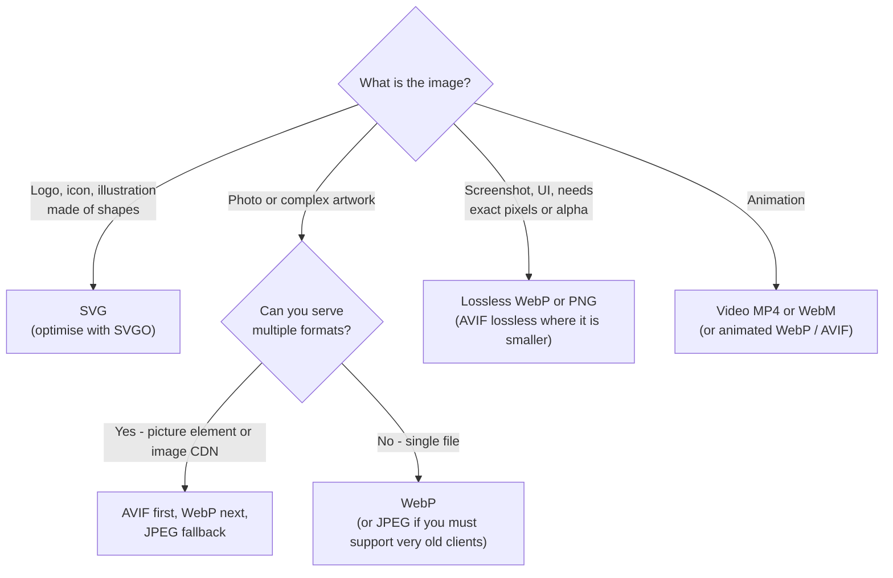
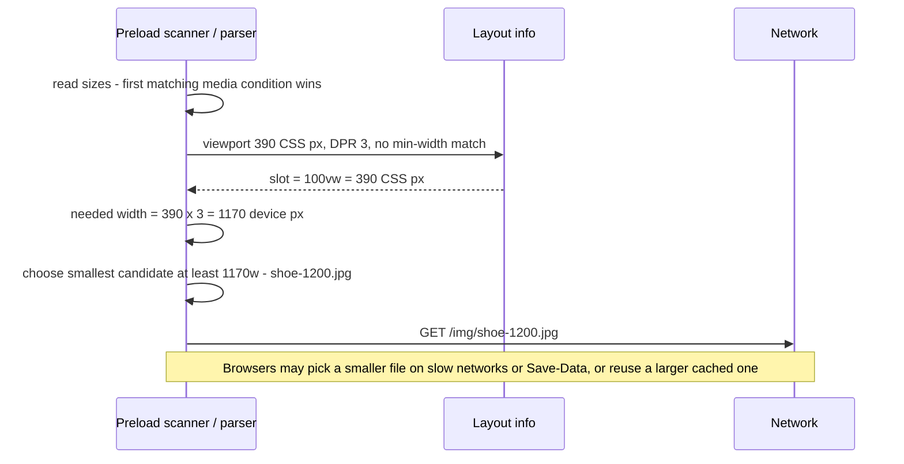
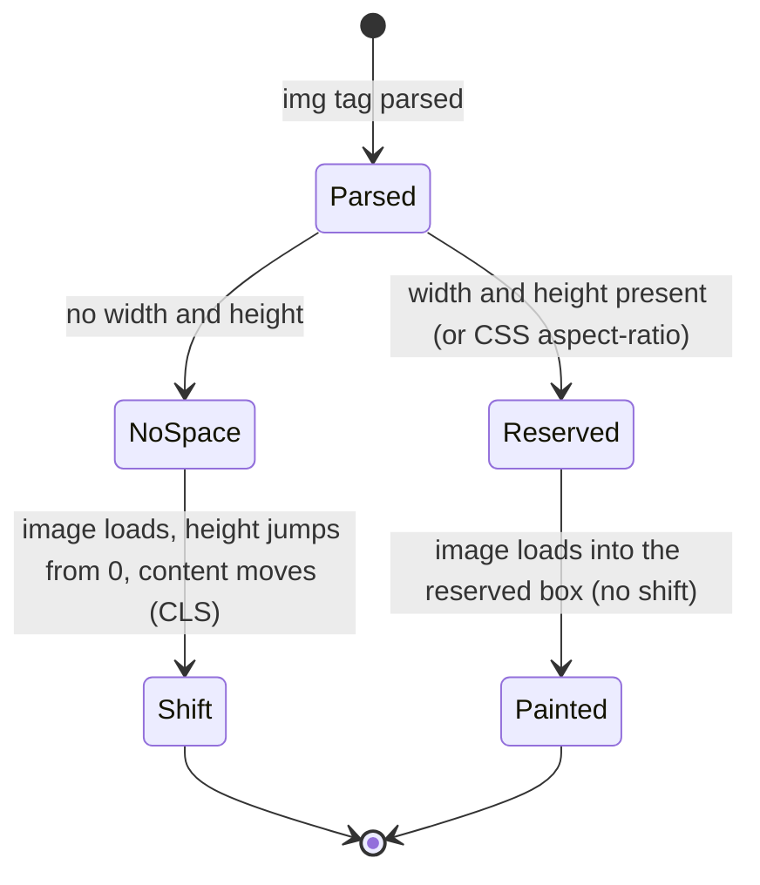
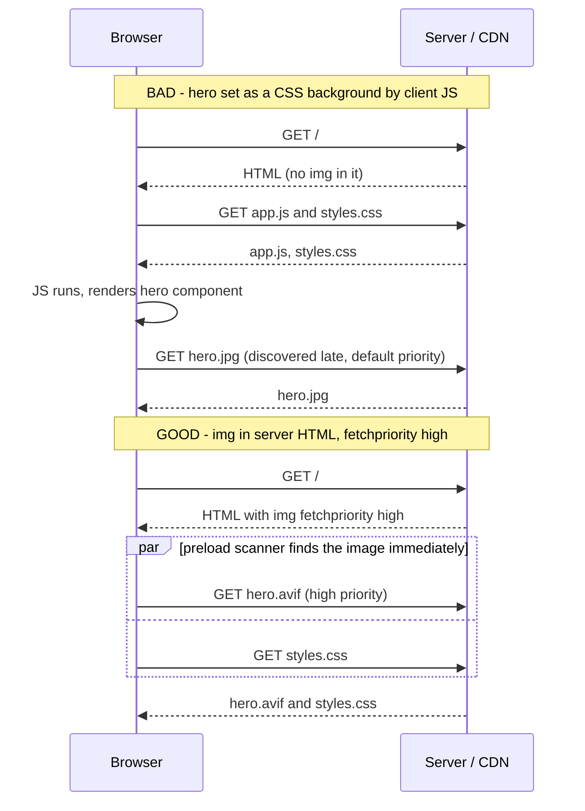
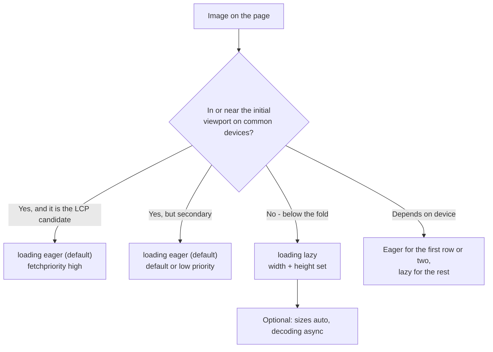
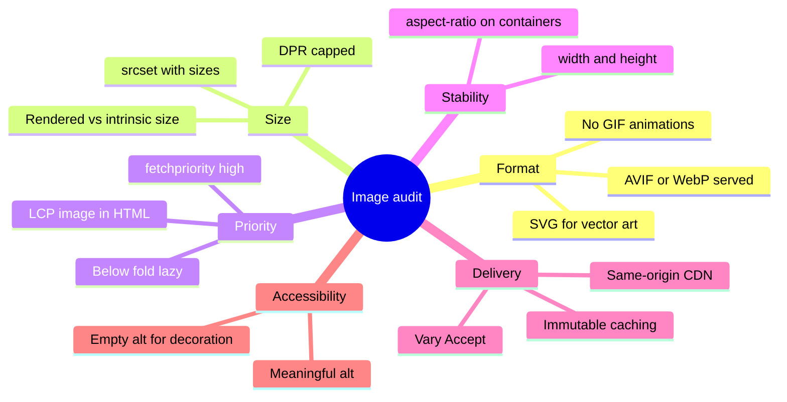
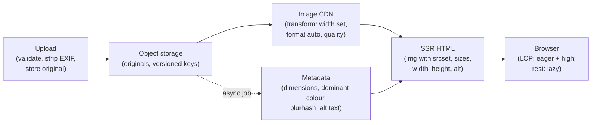

<!-- Generated by scripts/sync-knowledge.js from notes/ and README.md — do not edit here. -->
<!-- sections (line ranges in this file): Table of Contents 19-43 · ELI5 44-57 · Core Concept 58-465 · Framework Comparison 466-482 · System Design Angle 483-509 · Real-World Examples 510-688 · Key Points Summary 689-710 · Test Your Understanding 711-787 · Cheat Sheet 788-836 · References & Further Reading 837-882 -->

# Image Optimization

> **Date:** 2026-11-06 · **Last updated:** 2026-11-06
> **Category:** Frontend System Design
> **Sub-Topic:** Performance Engineering / Loading Performance
> **Level:** Intermediate · **Reading time:** ~32 min
> **Informs:** image format policy (AVIF / WebP / JPEG XL / SVG), responsive `srcset` / `sizes` and art direction, LCP image priority (`fetchpriority`, preload, never lazy), lazy-loading thresholds, CLS-safe sizing, image CDN vs build-time pipeline, placeholder strategy, caching of user uploads, GIF-to-video, alt-text and SVG security policy

> **Pre-requisite:** [Core Web Vitals (LCP, INP, CLS)](./core-web-vitals-lcp-inp-cls.md) (LCP sub-parts, CLS) and [Critical Rendering Path](./critical-rendering-path.md) (preload scanner, priorities). [Browser Caching Strategies](./browser-caching-strategies.md) and [DNS Resolution & CDN](./dns-resolution-and-cdn.md) cover delivery.
> Images are often the **heaviest bytes** on a page and frequently the **LCP element** — this note covers choosing, sizing, delivering and prioritising them.

**Previous:** [Tree Shaking & Dead Code Elimination](./tree-shaking-and-dead-code-elimination.md) · **Next:** [Font Loading Strategies](./font-loading-strategies.md)

---

## Table of Contents

1. [ELI5 — Simple Explanation](#eli5--simple-explanation)
2. [Section 1: The Image Pipeline](#section-1-the-image-pipeline)
3. [Section 2: Choosing a Format](#section-2-choosing-a-format)
4. [Section 3: Compression and Quality](#section-3-compression-and-quality)
5. [Section 4: Responsive Images — `srcset`, `sizes` and the Picture Element](#section-4-responsive-images--srcset-sizes-and-the-picture-element)
6. [Section 5: Layout Stability — Always Reserve Space](#section-5-layout-stability--always-reserve-space)
7. [Section 6: Loading Priority — the LCP Image](#section-6-loading-priority--the-lcp-image)
8. [Section 7: Lazy Loading Everything Else](#section-7-lazy-loading-everything-else)
9. [Section 8: Image CDNs vs Build-Time Pipelines](#section-8-image-cdns-vs-build-time-pipelines)
10. [Section 9: Placeholders and Perceived Performance](#section-9-placeholders-and-perceived-performance)
11. [Section 10: SVG, Icons, Animation and CSS Backgrounds](#section-10-svg-icons-animation-and-css-backgrounds)
12. [Section 11: Accessibility and Security](#section-11-accessibility-and-security)
13. [Section 12: Measuring Image Performance](#section-12-measuring-image-performance)
14. [Framework Comparison](#framework-comparison)
15. [System Design Angle](#system-design-angle)
16. [Real-World Examples](#real-world-examples)
17. [Key Points Summary](#key-points-summary)
18. [Test Your Understanding](#test-your-understanding)
19. [Cheat Sheet](#cheat-sheet)
20. [References & Further Reading](#references--further-reading)

---

## ELI5 — Simple Explanation

Imagine sending holiday photos to your family:

- You wouldn't post a **wall-sized poster** to someone who'll look at it on a **phone** — you'd print the size they need (**responsive images**).
- You'd pick the right **paper**: glossy photo paper for photos, plain paper for a line drawing (**formats**: AVIF/WebP/JPEG for photos, SVG for logos and icons).
- You'd **fold it small** without ruining it (**compression**).
- The photo of grandma on the front of the card goes in the **first envelope**; the 200 photos from the beach can come later in a box, if anyone asks (**priority** and **lazy loading**).
- You'd tell them "there's a 10×15 cm photo coming" so they can leave a **gap on the shelf** — nothing gets knocked over when it arrives (**width/height → no layout shift**).

> **Send the smallest file in the best format at the size it's displayed, reserve its space, load the hero first and everything else when it's about to be seen.**

---

## Core Concept — Step by Step

### Section 1: The Image Pipeline

Every image decision falls into one of six steps:


| Step | Main question | Metric it moves |
|---|---|---|
| Format | Which encoding gives the smallest file at acceptable quality? | LCP (load duration), bytes |
| Dimensions | Does the file match the size it's displayed at, per device? | LCP, bytes, memory |
| Compression | Is the quality setting higher than anyone can see? | Bytes |
| Delivery | Is it served from a nearby, cached, same-origin source? | LCP (load duration + delay) |
| Priority | Does the browser fetch the important image first? | LCP (load delay) |
| Rendering | Is space reserved, and does decoding block anything? | CLS, LCP (render delay) |

> Images affect all three Core Web Vitals indirectly, but mostly **LCP** (the hero image) and **CLS** (unsized images). See [Core Web Vitals](./core-web-vitals-lcp-inp-cls.md) for the LCP sub-parts.

---

### Section 2: Choosing a Format

| Format | Compression | Transparency | Animation | Best for | Browser support (MDN BCD) |
|---|---|---|---|---|---|
| **JPEG** | Lossy | No | No | Photos — universal fallback | Universal |
| **PNG** | Lossless | Yes | (APNG) | Screenshots, UI with sharp edges, images that need exact pixels | Universal |
| **WebP** | Lossy + lossless | Yes | Yes | General replacement for JPEG/PNG/GIF | Chrome 17+, Firefox 65+, Safari 14+, Edge 18+ |
| **AVIF** | Lossy + lossless | Yes | Yes | Photos where bytes matter most; usually smaller than WebP at similar quality, slower to encode | Chrome 85+, Firefox 93+, Safari 16.4+ (iOS 16.1+), Edge 121+ |
| **JPEG XL** | Lossy + lossless, can losslessly recompress existing JPEGs | Yes | Yes | Photo archives, high-fidelity images | Safari 17+; MDN BCD lists Chrome 155+ and Firefox 158+ (very recent) and not Edge — always provide a fallback |
| **SVG** | Vector (text, compresses well with gzip/Brotli) | Yes | Yes (CSS/SMIL) | Logos, icons, illustrations, charts | Universal |
| **GIF** | Lossless, 256 colours | 1-bit | Yes | Nothing new — use video or animated WebP/AVIF | Universal |



**Two ways to serve modern formats with a fallback:**

| Approach | How | Trade-off |
|---|---|---|
| **`<picture>` + `<source type>`** | Browser picks the first `<source>` whose `type` it supports | Works on any static host; more HTML; you must generate every variant |
| **Content negotiation** | Server/CDN reads the `Accept` request header (`image/avif,image/webp,…`) and returns the best format at **one URL** | Clean HTML; requires `Vary: Accept` or CDN cache-key normalisation (see [Browser Caching Strategies](./browser-caching-strategies.md) Section 6) |

---

### Section 3: Compression and Quality

| Lever | What to do |
|---|---|
| **Quality setting** | Quality numbers aren't comparable across encoders or formats — "q=75" in one encoder isn't "q=75" in another. Pick settings by visual comparison or perceptual metrics (SSIM, Butteraugli, DSSIM) on your own content |
| **Encoder choice** | Modern encoders (MozJPEG for JPEG, libavif / libaom / SVT-AV1 for AVIF, libwebp) produce smaller files than naive ones; `sharp` (libvips) bundles good defaults |
| **Strip metadata** | EXIF, camera data and embedded thumbnails add bytes — and GPS coordinates are a **privacy leak** for user uploads. Keep the colour profile (or convert to sRGB) |
| **Chroma subsampling** | Fine for photos; can blur sharp coloured edges (text, UI) — use lossless or full chroma there |
| **Progressive JPEG** | Renders a coarse version early; usually no larger than baseline for photos |
| **Device pixel ratio cap** | Beyond 2x, the visible gain for photos is small while the bytes keep growing — many teams cap `srcset` at 2x for photos |
| **Lossless optimisation** | `oxipng`/`zopflipng` for PNG, SVGO for SVG — no visual change at all |

> **Don't guess — compare.** Tools like Squoosh let you compare formats and quality side by side on your actual images before you pick defaults.

---

### Section 4: Responsive Images — `srcset`, `sizes` and the Picture Element

There are two different problems:

| Problem | Solution |
|---|---|
| **Resolution switching** — same image, different sizes for different screens/DPRs | `srcset` (+ `sizes` for width descriptors) |
| **Art direction** — different crop or composition per layout (wide banner on desktop, tight crop on mobile) | `<picture>` with `<source media>` |
| **Format switching** | `<picture>` with `<source type>` |

**Width descriptors (`w`) + `sizes`** — for images whose display size depends on the layout:

```html

```



Rules for `sizes`:
- `sizes` describes the **slot width in CSS pixels** (`vw`, `px`, `calc()`), not the file. The browser decides **before layout**, which is why it needs this hint.
- Without `sizes`, width descriptors assume `100vw` — on a 3-column grid that downloads roughly three times wider images than needed.
- Media conditions are evaluated in order; the **last** value should have no condition.
- **`sizes="auto"`** lets the browser use the actual laid-out width, but only for **lazy-loaded** images (layout is known by then). MDN BCD lists Chromium 126+, Firefox 150+ and partial Safari support, so include a fallback: `sizes="auto, (min-width: 1024px) 33vw, 100vw"`.

**Density descriptors (`x`)** — for fixed-size images (avatars, logos):

```html

```

**Art direction + format switching with `<picture>`:**

```html
<picture>
  <!-- Art direction: a different crop on narrow screens -->
  <source media="(max-width: 639px)" type="image/avif" srcset="/hero-mobile-640.avif 640w, /hero-mobile-1080.avif 1080w" sizes="100vw" />
  <source media="(max-width: 639px)" srcset="/hero-mobile-640.jpg 640w, /hero-mobile-1080.jpg 1080w" sizes="100vw" />
  <!-- Format switching for the wide crop -->
  <source type="image/avif" srcset="/hero-1280.avif 1280w, /hero-1920.avif 1920w, /hero-2560.avif 2560w" sizes="100vw" />
  <source type="image/webp" srcset="/hero-1280.webp 1280w, /hero-1920.webp 1920w, /hero-2560.webp 2560w" sizes="100vw" />
  
</picture>
```

> The `` inside `<picture>` is required — it's the element that actually renders, carries `alt`, `width`/`height`, `loading` and `fetchpriority`. `<source>` elements only offer candidates.

---

### Section 5: Layout Stability — Always Reserve Space

An image without dimensions takes **zero height** until its bytes arrive, then pushes everything below it down → **CLS**.



| Technique | How it works |
|---|---|
| `width` + `height` attributes | Modern browsers derive `aspect-ratio` from them before the image loads; CSS `width: 100%; height: auto` still makes it responsive |
| CSS `aspect-ratio: 16 / 9` | For containers, CSS backgrounds, or when dimensions are unknown in HTML |
| `object-fit: cover` | Fill a fixed box without distortion (crop); pair with `object-position` |
| Framework image components | Usually **require** `width`/`height` (or a `fill` mode in a sized parent) for this reason |

```css
img {
  max-width: 100%;
  height: auto; /* keeps the attribute-derived aspect ratio while scaling */
}
.card-media {
  aspect-ratio: 4 / 3;
  object-fit: cover;
  width: 100%;
}
```

> The attributes describe the **aspect ratio**, not the rendered size — CSS still controls the size. With `<picture>` art direction where crops have different ratios, set `width`/`height` on each `<source>` (Chrome 90+, Firefox 108+, Safari 15+ per MDN BCD) or use CSS `aspect-ratio` per breakpoint.

---

### Section 6: Loading Priority — the LCP Image

The hero image is often the **LCP element**. Its biggest enemy is usually not size — it's **late discovery** and **low priority** (the "resource load delay" sub-part).



**The LCP image checklist:**

| Do | Why |
|---|---|
| Put an `` for it **in the server-rendered HTML** | The preload scanner discovers it before CSS/JS run |
| `fetchpriority="high"` | Browsers otherwise start images at a lower priority until layout shows they're in the viewport; supported in Chrome 101+, Firefox 132+, Safari 17.2+ (MDN BCD) |
| **Never** `loading="lazy"` on it | Lazy images wait for layout — that adds load delay to the most important paint |
| `<link rel="preload" as="image" imagesrcset imagesizes>` **only if** it can't be in the HTML (CSS background, JS-rendered) | Gives late-discovered images an early start; a preload for an image already in the HTML is redundant |
| Serve it from **your own origin / CDN hostname** already in use | A new third-party origin adds DNS + TCP + TLS before the first byte |
| Size it right with `srcset` + `sizes` | Load duration is proportional to bytes |
| Avoid hiding it behind JS (carousels that render slide 1 after hydration, A/B test anti-flicker snippets) | Element render delay |
| Optionally `103 Early Hints` with a preload `Link` header | Starts the fetch while the server is still generating HTML |

```html
<!-- Only needed when the hero is NOT an  in the HTML (e.g. CSS background) -->
<link
  rel="preload"
  as="image"
  imagesrcset="/hero-1280.avif 1280w, /hero-1920.avif 1920w"
  imagesizes="100vw"
  type="image/avif"
  fetchpriority="high"
/>
```

> **Don't over-prioritise.** One or two `fetchpriority="high"` images per page. Marking every image high makes the hint meaningless and steals bandwidth from CSS and fonts. Conversely, `fetchpriority="low"` is useful for images that are in the viewport but unimportant (e.g. the hidden slides of a carousel).

`decoding="async"` hints that the image can be decoded off the critical path; its effect varies by browser and it's not a substitute for any of the above. `HTMLImageElement.decode()` returns a promise you can await before inserting an image to avoid a blank frame when swapping images in JS.

---

### Section 7: Lazy Loading Everything Else

Images that are **not** in the initial viewport should not compete with the hero.

| Method | How | Notes |
|---|---|---|
| **Native** `loading="lazy"` | Browser defers the fetch until the image is near the viewport | Chrome 77+, Firefox 75+, Safari 15.4+ (MDN BCD). The distance threshold is browser-defined and may depend on connection type |
| `IntersectionObserver` | Your code swaps in `src` when it enters a `rootMargin` | For custom thresholds, or for non-`` content; see [Web APIs](./web-apis-intersection-observer-resizeobserver.md) |
| Iframes `loading="lazy"` | Same for embeds | Chrome 77+, Firefox 121+, Safari 16.4+ |
| Facades | Static thumbnail; load the heavy embed on click | YouTube/Maps embeds, chat widgets |



Practical rules:
- In grids and lists, render the **first few items eager** and the rest lazy — "the first N" is a simple, robust rule because you don't know the user's viewport at render time.
- Lazy images **must** have dimensions, otherwise they collapse to zero height and many enter the "near viewport" zone at once.
- Lazy loading doesn't help if the images are inside a container hidden with `display: none` — nothing is "near the viewport" until it's shown, which is usually what you want for tabs and carousels.
- For carousels: eager for the first visible slide, lazy (or `fetchpriority="low"`) for the rest.

---

### Section 8: Image CDNs vs Build-Time Pipelines

You need **many variants** (widths × formats) of every image. Generate them at build time or on demand.


| | Build-time (sharp, `vite-imagetools`, Astro assets, `@sveltejs/enhanced-img`) | Image CDN / on-demand (Cloudinary, imgix, Cloudflare Images, Vercel/Netlify image optimisation, self-hosted imgproxy/thumbor) |
|---|---|---|
| Best for | Marketing pages, icons, design assets in the repo | User-generated content, product catalogues, CMS images |
| Cost | Longer builds as image count grows | Per-transform or bandwidth pricing; first request per variant is slower |
| Caching | Hashed filenames, `immutable` | Edge cache per variant; versioned URLs for changed originals |
| Risk | Repo bloat | Open transform URLs can be abused — restrict allowed widths/params or sign URLs |

**Caching rules for images** (see [Browser Caching Strategies](./browser-caching-strategies.md)):
- Build assets: content-hashed name + `Cache-Control: public, max-age=31536000, immutable`.
- User uploads: put a **version or hash in the URL** (`/u/123/avatar-v7.jpg`) so you can cache long and still change the image.
- Content negotiation: `Vary: Accept` (or the CDN's built-in format normalisation) — otherwise an AVIF can be served to a browser that asked for JPEG.
- **Restrict allowed widths** to a fixed set (e.g. your breakpoints). Arbitrary `?w=` values fragment the cache and let attackers force expensive transforms.

---

### Section 9: Placeholders and Perceived Performance

While the real image loads, show *something* that occupies the right space.

| Placeholder | How | Cost / note |
|---|---|---|
| **Solid / dominant colour** | `background-color` on the container | Near zero bytes; simple and robust |
| **CSS gradient** | Extracted at build time | Tiny |
| **Blurred LQIP** (low-quality image placeholder) | A tiny inline image (data URI) scaled up and blurred | A few hundred bytes per image inlined into HTML — adds up on long lists |
| **BlurHash / ThumbHash** | Short string decoded to a blurred preview (needs a small decoder in JS) | Compact, but decoding runs on the client |
| **Skeleton** | Grey box with the right aspect ratio | Common in lists and cards |

- Chromium **ignores very low-entropy images** (like blurred placeholders) as LCP candidates, so a placeholder doesn't fake a good LCP — the real image's paint counts. Make the real image fast.
- Fade-in animations on load delay the moment the image is *fully* visible; keep them short and respect `prefers-reduced-motion`.

---

### Section 10: SVG, Icons, Animation and CSS Backgrounds

**SVG and icons**

| Option | When | Note |
|---|---|---|
| `` | Static logos and illustrations | Cached separately; can't be styled with page CSS; scripts inside don't run |
| Inline `<svg>` | Icons that need `currentColor`, hover states, animation | Adds to HTML/JS size on every page; no separate caching |
| SVG sprite (`<use href="/sprite.svg#icon-x">`) | Many repeated icons | One cached file; same-origin requirement for external `<use>` |
| Icon fonts | Legacy | Accessibility and rendering problems, FOIT; prefer SVG |

Run **SVGO** (or your framework's equivalent) — exported SVGs often contain editor metadata, hidden layers and excessive precision.

**Animated content**
- Replace GIFs with `<video autoplay muted loop playsinline>` (MP4/WebM) — far smaller for the same content — or with animated WebP/AVIF.
- Respect `prefers-reduced-motion`: pause or show a still frame.

**CSS background images**
- Invisible to the preload scanner until the CSS is downloaded and the rule matches → late discovery. Fine for decoration; **content images belong in ``** (they also get `alt`, `srcset` and `loading`).
- For responsive backgrounds use `image-set()` (Chrome 113+, Firefox 89+, Safari 17+ unprefixed per MDN BCD):

```css
.banner {
  background-image: image-set(
    url('/banner.avif') type('image/avif'),
    url('/banner.webp') type('image/webp'),
    url('/banner.jpg') type('image/jpeg')
  );
}
```

---

### Section 11: Accessibility and Security

**Accessibility**

| Rule | Example |
|---|---|
| Informative images need meaningful `alt` | `alt="Red running shoe, side view"` |
| Decorative images use **empty** `alt` | `alt=""` — screen readers skip it (omitting `alt` entirely makes some read the filename) |
| Functional images (inside links/buttons) describe the **action** | `<a href="/"></a>` |
| Don't put essential text inside images | It can't be resized, translated or read by assistive tech reliably |
| Complex images (charts) need a text alternative | Caption, data table or `aria-describedby` |
| Respect `prefers-reduced-motion` for animated images | Pause videos/animations |

**Security and privacy**
- **User-uploaded SVG can contain scripts.** In `` they don't run, but if the file is opened directly from your origin it can execute (XSS). Sanitise SVGs, rasterise them, or serve uploads from a separate sandbox domain with `Content-Disposition`/CSP restrictions.
- **Strip EXIF** from uploads — GPS location and device details leak user privacy.
- **Restrict image-CDN transforms** (allowed widths/formats, signed URLs) to prevent cost and denial-of-service abuse.
- Hotlinked third-party images can track users and add a new origin — host or proxy them.

---

### Section 12: Measuring Image Performance

| Tool | Look for |
|---|---|
| **Lighthouse / PageSpeed Insights** | Image delivery issues (oversized, wrong format, not compressed), the LCP element, lazy-loaded LCP image, missing `fetchpriority`, unsized images causing CLS |
| **Chrome DevTools Network** | Priority column, initiator (was it discovered late?), transferred size vs rendered size |
| **Chrome DevTools Performance panel** | LCP marker and its sub-parts; layout shifts |
| **RUM** (`web-vitals` attribution build) | Real LCP element URL and sub-parts per page and device — see [Core Web Vitals](./core-web-vitals-lcp-inp-cls.md) |
| **CrUX** | Field LCP/CLS for your origin |
| **CI budgets** | Max bytes per image type, total image bytes per route — see [Performance Budgets](./performance-budgets.md) |



---

## Framework Comparison

| Stack | Component / tool | What it automates | Watch out for |
|---|---|---|---|
| **Next.js** | `next/image` | `srcset` generation, format conversion (WebP by default; AVIF via `images.formats`), lazy loading by default, required dimensions or `fill`, blur placeholders for static imports | Mark the LCP image (`priority`; newer versions have been reworking this into `preload`/`fetchPriority`-style options — check your version's docs); configure `remotePatterns`; give `sizes` for `fill`/responsive images |
| **Nuxt** | `@nuxt/image` (`<NuxtImg>`, `<NuxtPicture>`) | Provider-based (local IPX or CDNs), `sizes` shorthand per breakpoint, formats, `preload` | Configure providers and allowed domains |
| **Angular** | `NgOptimizedImage` (`ngSrc`) | Enforces `width`/`height` or `fill`, `priority` attribute (eager + high priority), lazy by default, `srcset` generation with CDN loaders, dev-mode warnings (e.g. LCP image not prioritised) | Requires a loader for automatic `srcset` |
| **Astro** | `astro:assets` `<Image>` / `<Picture>` | Build-time optimisation, inferred dimensions for local images, multiple formats with `<Picture>` | Remote images need authorised domains |
| **SvelteKit** | `@sveltejs/enhanced-img` (`<enhanced:img>`) | Build-time formats and sizes, intrinsic dimensions | Static images only; use a CDN for dynamic ones |
| **Vue / React SPA (Vite)** | `vite-imagetools`, `unpic` components | Build-time variants via import queries; `unpic` generates `srcset` for many image CDNs | You still write `sizes` and priority correctly |
| **Gatsby / others** | Framework image plugins | Similar build-time processing | Check maintenance status |
| **React Native** | `<Image>`, `expo-image` | `expo-image` adds disk/memory caching, placeholders (BlurHash/ThumbHash), modern formats | Request appropriately sized images from your CDN — the device still decodes full bitmaps |
| **Android** | Coil / Glide, vector drawables, density buckets (`mdpi` … `xxxhdpi`) | Downsampling to view size, caching | Large bitmaps cause out-of-memory errors |
| **iOS** | Asset catalogs (`@1x/@2x/@3x`), SF Symbols, PDF/SVG vectors | Per-device asset slicing via App Store app thinning | Decode large images off the main thread / downsample |

---

## System Design Angle

When an interviewer says "design an e-commerce product page / news feed / gallery", images are usually the largest performance lever. A strong answer covers:



| Decision | Recommendation |
|---|---|
| Where are variants generated? | Image CDN for user/catalogue content; build-time for static assets |
| What does the API return? | Image **ID + dimensions + placeholder** (colour or hash) + alt text — not a single URL — so the client can build `srcset` and reserve space |
| Which widths? | A fixed set aligned with breakpoints and DPR 1–2 (e.g. 320, 640, 960, 1280, 1920); reject others |
| Which formats? | AVIF → WebP → JPEG via negotiation or `<picture>` |
| Hero / LCP? | Server-rendered ``, `fetchpriority="high"`, never lazy, same origin |
| Lists / feeds? | First row eager, rest lazy; virtualise very long lists ([Virtual Scrolling](./virtual-scrolling-and-windowing.md)) |
| Caching? | Immutable for hashed/versioned URLs; edge cache per variant; `Vary: Accept` |
| Offline / slow networks? | Smaller candidates are chosen automatically by some browsers on Save-Data; service worker can cache viewed images ([Offline-First Architecture](./offline-first-architecture.md)) |

---

## Real-World Examples

**Example 1 — Hero image (BAD → GOOD):**
```html
<!-- ❌ BAD: lazy-loaded LCP image, no dimensions, one huge JPEG for every device -->


<!-- ✅ GOOD: modern formats, responsive, reserved space, high priority, eager -->
<picture>
  <source type="image/avif" srcset="/hero-960.avif 960w, /hero-1440.avif 1440w, /hero-1920.avif 1920w" sizes="100vw" />
  <source type="image/webp" srcset="/hero-960.webp 960w, /hero-1440.webp 1440w, /hero-1920.webp 1920w" sizes="100vw" />
  
</picture>
```

**Example 2 — Product grid: first row eager, rest lazy (React/TSX):**
```tsx
type Product = { id: string; name: string; imageId: string; width: number; height: number };

const WIDTHS = [240, 360, 480, 720, 960] as const;
const cdn = (id: string, w: number) => `https://img.example.com/${id}?w=${w}&fm=auto&q=auto`;

export function ProductGrid({ products }: { products: Product[] }) {
  return (
    <ul className="grid">
      {products.map((p, i) => {
        const aboveFold = i < 4; // first row on common layouts
        return (
          <li key={p.id}>
             `${cdn(p.imageId, w)} ${w}w`).join(', ')}
              sizes="(min-width: 1024px) 25vw, (min-width: 640px) 33vw, 50vw"
              width={p.width}
              height={p.height}
              loading={aboveFold ? 'eager' : 'lazy'}
              decoding="async"
              alt={p.name}
            />
          </li>
        );
      })}
    </ul>
  );
}
```

**Example 3 — Next.js, Angular and Nuxt:**
```tsx
// Next.js (App Router)
import Image from 'next/image';
import hero from './hero.jpg'; // static import → width, height and blurDataURL inferred

export default function Page() {
  return (
    <Image
      src={hero}
      alt="Hikers on a ridge at sunrise"
      sizes="100vw"
      placeholder="blur"
      priority // LCP image: eager + high priority (check your Next.js version's docs for its replacement)
    />
  );
}
```

```html
<!-- Angular: NgOptimizedImage (import NgOptimizedImage in the standalone component) -->


<!-- Nuxt: @nuxt/image (use <NuxtPicture format="avif,webp"> when you want several formats) -->
<NuxtImg src="/hero.jpg" width="1920" height="800" sizes="100vw lg:1920px" format="webp" preload fetchpriority="high" alt="Hikers on a ridge at sunrise" />
```

```svelte
<!-- SvelteKit: build-time variants -->
<enhanced:img src="./hero.jpg" sizes="100vw" fetchpriority="high" alt="Hikers on a ridge at sunrise" />
```

**Example 4 — Build-time variants with `sharp` (Node.js):**
```typescript
import sharp from 'sharp';
import { mkdir } from 'node:fs/promises';

const WIDTHS = [640, 960, 1280, 1920];

export async function buildVariants(input: string, outDir: string, name: string) {
  await mkdir(outDir, { recursive: true });
  const meta = await sharp(input).metadata();

  await Promise.all(
    WIDTHS.filter((w) => !meta.width || w <= meta.width).flatMap((w) => {
      const base = sharp(input).rotate().resize({ width: w, withoutEnlargement: true }); // rotate() applies EXIF orientation
      return [
        base.clone().avif({ quality: 50 }).toFile(`${outDir}/${name}-${w}.avif`),
        base.clone().webp({ quality: 75 }).toFile(`${outDir}/${name}-${w}.webp`),
        base.clone().jpeg({ quality: 78, mozjpeg: true }).toFile(`${outDir}/${name}-${w}.jpg`),
      ];
    })
  );
  // sharp drops EXIF/GPS metadata by default unless you call withMetadata()
  return { width: meta.width, height: meta.height };
}
```

> The quality numbers above are illustrative starting points, not recommendations — tune them by comparing output on your own images.

**Example 5 — Content negotiation at the edge (pseudo-config, Express):**
```javascript
import express from 'express';

const app = express();
const ALLOWED_WIDTHS = new Set([320, 640, 960, 1280, 1920]);

app.get('/img/:id', async (req, res) => {
  const width = Number(req.query.w);
  if (!ALLOWED_WIDTHS.has(width)) return res.status(400).send('unsupported width'); // protect the cache

  const accept = req.get('Accept') ?? '';
  const format = accept.includes('image/avif') ? 'avif' : accept.includes('image/webp') ? 'webp' : 'jpeg';

  const body = await renderVariant(req.params.id, width, format); // cached transform
  res.set({
    'Content-Type': `image/${format}`,
    'Cache-Control': 'public, max-age=31536000, immutable', // id is versioned
    Vary: 'Accept',
  });
  res.send(body);
});
```

**Example 6 — Replace a GIF with video:**
```html
<!-- ❌ BAD: large animated GIF -->


<!-- ✅ GOOD: muted looping video, same visual effect, much smaller -->
<video autoplay muted loop playsinline width="640" height="360" poster="/demo-poster.jpg" aria-label="Dragging a card between columns">
  <source src="/demo.webm" type="video/webm" />
  <source src="/demo.mp4" type="video/mp4" />
</video>
```

```javascript
// Respect reduced motion: stop autoplaying decorative videos (run early, before playback starts)
const reduceMotion = window.matchMedia('(prefers-reduced-motion: reduce)');
if (reduceMotion.matches) {
  document.querySelectorAll('video[autoplay]').forEach((v) => {
    v.removeAttribute('autoplay');
    v.pause();
  });
}
```

**Example 7 — Swap an image without a blank frame:**
```typescript
export async function swapImage(img: HTMLImageElement, nextSrc: string) {
  const next = new Image();
  next.src = nextSrc;
  try {
    await next.decode(); // resolves when the image is decoded and ready to paint
  } catch {
    return; // failed to load or decode — keep the current image
  }
  img.src = nextSrc;
}
```

---

## Key Points Summary

| Concept | One-Line Explanation |
|---|---|
| **AVIF / WebP** | Modern formats — usually much smaller than JPEG/PNG; serve with a fallback |
| **JPEG XL** | Supported in Safari; very recent elsewhere — fallback required |
| **SVG** | Vector format for logos, icons and illustrations — optimise with SVGO |
| **`srcset` + `sizes`** | Lets the browser pick the right resolution for the slot and DPR |
| **`<picture>`** | Art direction (`media`) and format fallback (`type`) |
| **`sizes="auto"`** | Uses the real laid-out width for lazy images — partial support, include a fallback |
| **`width` / `height`** | Reserve space via aspect ratio → no CLS |
| **`fetchpriority="high"`** | Boosts the LCP image's priority |
| **Never lazy-load the LCP image** | Lazy images wait for layout → load delay |
| **Preload** | Only for LCP images not discoverable in HTML (CSS backgrounds, JS-rendered) |
| **`loading="lazy"`** | Native deferral for below-the-fold images and iframes |
| **Image CDN** | On-demand variants, format negotiation, edge caching — restrict widths |
| **Placeholders** | Colour, LQIP, BlurHash — perceived speed, not a real LCP win |
| **GIF → video** | Much smaller animation; respect reduced motion |
| **Alt text** | Meaningful for content, empty for decoration |

---

## Test Your Understanding

**Q1 (Basic):**
What's the difference between `srcset` with `w` descriptors and with `x` descriptors, and when do you need `sizes`?

<details>
<summary>Answer</summary>

- **`x` descriptors** (`avatar-64.png 1x, avatar-128.png 2x`) are for **fixed-size** images: the browser picks by device pixel ratio only. No `sizes` needed.
- **`w` descriptors** (`shoe-400.jpg 400w, …`) state each file's **intrinsic width**. The browser combines the **slot width** with the DPR to choose. Because it decides before layout, it needs `sizes` to know the slot width; without `sizes` it assumes `100vw`, which over-downloads for images in columns.

Use `w` + `sizes` for anything whose display size depends on the layout (most content images).
</details>

**Q2 (Application):**
A landing page's LCP is poor. The hero is a `<div>` with a CSS `background-image` set by a React component after hydration, served from a third-party image host as a 2.5 MB JPEG. List the fixes in priority order.

<details>
<summary>Answer</summary>

1. **Make it discoverable:** render a real `` in the server HTML (SSR/SSG) instead of a JS-set background. That removes most of the resource load delay. If it must stay a background, add `<link rel="preload" as="image" imagesrcset … fetchpriority="high">` in the HTML head.
2. **Prioritise it:** `fetchpriority="high"`, no `loading="lazy"`.
3. **Shrink it:** AVIF/WebP with JPEG fallback, `srcset` + `sizes="100vw"`, quality tuned visually — a 2.5 MB file is far beyond what any viewport needs.
4. **Serve it from your own origin/CDN hostname** (or `preconnect` to the image host) to avoid a new DNS + TCP + TLS setup.
5. **Reserve space** with `width`/`height` or `aspect-ratio` to avoid CLS.

Then confirm with the LCP sub-parts in the Performance panel and in RUM.
</details>

**Q3 (Tricky):**
After adding `loading="lazy"` to *every* `` on the site, LCP got worse on product pages and CLS increased on article pages. Explain both.

<details>
<summary>Answer</summary>

- **LCP:** the product photo (the LCP element) is now lazy. Lazy images aren't fetched until the browser has done layout and confirmed they're near the viewport, so the fetch starts later than the preload scanner would have started it. Fix: eager + `fetchpriority="high"` for the LCP image, and eager for the first few items in grids.
- **CLS:** the article images had no `width`/`height`. When eager, they often arrived before the reader scrolled; now they load as the user scrolls and push content down while the user is reading. Fix: always set dimensions (or `aspect-ratio`) so space is reserved.
</details>

**Q4 (Tricky):**
You set `fetchpriority="high"` on all 12 images in a carousel to "make it faster". The LCP of the first slide got worse. Why?

<details>
<summary>Answer</summary>

Priority is **relative**. Marking 12 images high means they all compete equally with each other — and with CSS and fonts — for bandwidth, so the first slide's image gets only a share of it. Fix: `fetchpriority="high"` on the **first visible slide only**, `fetchpriority="low"` or `loading="lazy"` on hidden slides, and make sure the first slide is rendered in the server HTML rather than after the carousel's JS hydrates.
</details>

**Q5 (System design):**
Design the image pipeline for a marketplace where sellers upload photos (millions of listings) that appear in search grids, listing pages and emails.

<details>
<summary>Answer</summary>

- **Upload:** direct-to-object-storage with signed URLs; validate type and size; strip EXIF/GPS; reject or rasterise SVG uploads; store the original under a versioned key; an async job extracts dimensions, dominant colour/BlurHash, and queues moderation.
- **Transform & deliver:** image CDN generating variants on demand from the original — a **fixed allow-list of widths** (aligned with grid/listing breakpoints at DPR 1–2), `format=auto` (AVIF → WebP → JPEG via `Accept`, with `Vary: Accept`), long-lived immutable caching because the URL is versioned; signed transform URLs or strict param validation.
- **API contract:** return `imageId`, `width`, `height`, `placeholder`, `alt` — the client builds `srcset` and reserves space.
- **Client:** search grid — first row eager, rest lazy, correct `sizes`; listing page — main photo server-rendered, `fetchpriority="high"`, gallery thumbnails lazy; virtualise long result lists.
- **Emails:** email clients don't support `srcset`/modern formats reliably → fixed-width JPEG/PNG variants.
- **Observability:** RUM LCP attribution by template, CDN hit ratio and transform cost dashboards, budgets per template.
</details>

**Q6 (Application):**
When should you use `<picture>` instead of ``? Give two concrete cases and one case where `<picture>` is unnecessary.

<details>
<summary>Answer</summary>

Use `<picture>` when the browser must pick **by criteria other than size**:
1. **Art direction** — a different crop/composition per breakpoint (`<source media="(max-width: 639px)">` with a portrait crop of the hero).
2. **Format fallback without server negotiation** — `<source type="image/avif">`, `<source type="image/webp">`, then the `` JPEG fallback.

It's unnecessary when you only need **different resolutions of the same image** in one format (plain `` does that), or when an image CDN already negotiates the format from the `Accept` header at a single URL.
</details>

---

## Cheat Sheet

**Key Definitions:**
- **Resolution switching:** Same image at several sizes; the browser picks via `srcset`/`sizes`
- **Art direction:** Different crops per layout via `<picture><source media>`
- **Content negotiation:** Server picks the format from the `Accept` header at one URL (`Vary: Accept`)
- **LCP image:** The largest image in the viewport — must be discoverable, prioritised and not lazy
- **LQIP / BlurHash:** Tiny placeholders shown while the real image loads
- **Facade:** Static preview standing in for a heavy embed until interaction
- **DPR:** Device pixel ratio — device pixels per CSS pixel

**Quick Reference:**
```text
Formats         → photos: AVIF > WebP > JPEG fallback · vector: SVG (SVGO) · UI/screenshots: lossless WebP/PNG · animation: video
Responsive      → 
Fixed size      → srcset="x-64.png 1x, x-128.png 2x"
Art direction   → <picture><source media=... srcset=...></picture>
Space           → width + height attributes (or CSS aspect-ratio) on every image
LCP image       → in server HTML · fetchpriority="high" · NOT lazy · same origin · right size
Preload         → only if not in HTML: <link rel="preload" as="image" imagesrcset imagesizes fetchpriority="high">
Below the fold  → loading="lazy" (+ sizes="auto, <fallback>") · first grid row eager
Backgrounds     → decorative only; image-set() for formats; preload if it is the LCP
Caching         → hashed/versioned URLs + immutable · Vary: Accept for negotiation · fixed width allow-list
Uploads         → strip EXIF · sanitise/rasterise SVG · signed transform URLs
A11y            → meaningful alt · alt="" for decoration · no text in images · reduced motion
Measure         → Lighthouse image audits · Network priority column · LCP sub-parts · RUM attribution
```

**Common Mistakes to Avoid:**

| Mistake | Why Wrong | Fix |
|---|---|---|
| `loading="lazy"` on the LCP image | Fetch waits for layout → slower LCP | Eager + `fetchpriority="high"` |
| Missing `width`/`height` | Layout shift when the image loads | Always set them, or `aspect-ratio` |
| `srcset` with `w` but no `sizes` | Browser assumes `100vw` → oversized downloads | Write accurate `sizes` (or `sizes="auto"` for lazy images) |
| One huge image for every device | Wasted bytes on phones | Generate widths; `srcset` |
| Hero as a JS-set CSS background | Discovered late, low priority | `` in server HTML, or preload |
| `fetchpriority="high"` on many images | Priority becomes meaningless; bandwidth contention | One or two images only |
| Serving AVIF without `Vary: Accept` at one URL | CDN serves AVIF to clients that can't decode it | `Vary: Accept` or CDN format normalisation |
| Arbitrary `?w=` widths on the image CDN | Cache fragmentation, transform abuse | Fixed allow-list of widths; signed URLs |
| Animated GIFs | Very large files | `<video autoplay muted loop playsinline>` |
| Keeping EXIF on uploads | Leaks GPS/location | Strip metadata on ingest |
| Serving user SVG from the main origin | Opened directly, it can run scripts (XSS) | Sanitise, rasterise, or use a sandbox domain |
| Missing or filename-like `alt` | Inaccessible, poor SEO | Descriptive `alt`, or `alt=""` for decoration |
| Upscaled low-res images or DPR 3+ variants for photos | Blurry or unnecessarily large | Match intrinsic size to slot × DPR; cap at 2x for photos |
| Counting on placeholders for LCP | Chromium ignores low-entropy placeholders as LCP | Make the real image fast |

---

## References & Further Reading

**Core docs**
- MDN: [Responsive images](https://developer.mozilla.org/en-US/docs/Web/HTML/Guides/Responsive_images)
- MDN: [``](https://developer.mozilla.org/en-US/docs/Web/HTML/Reference/Elements/img) · [`<picture>`](https://developer.mozilla.org/en-US/docs/Web/HTML/Reference/Elements/picture)
- MDN: [Image file type and format guide](https://developer.mozilla.org/en-US/docs/Web/Media/Guides/Formats/Image_types)
- MDN: [`HTMLImageElement.fetchPriority`](https://developer.mozilla.org/en-US/docs/Web/API/HTMLImageElement/fetchPriority) · [`HTMLImageElement.decode()`](https://developer.mozilla.org/en-US/docs/Web/API/HTMLImageElement/decode)
- MDN: [`image-set()`](https://developer.mozilla.org/en-US/docs/Web/CSS/image/image-set) · [`aspect-ratio`](https://developer.mozilla.org/en-US/docs/Web/CSS/aspect-ratio)

**web.dev / Chrome**
- web.dev: [Learn Images](https://web.dev/learn/images)
- web.dev: [Optimize Largest Contentful Paint](https://web.dev/articles/optimize-lcp)
- web.dev: [Optimize resource loading with the Fetch Priority API](https://web.dev/articles/fetch-priority)
- web.dev: [Browser-level image lazy loading](https://web.dev/articles/browser-level-image-lazy-loading)
- web.dev: [Optimize Cumulative Layout Shift](https://web.dev/articles/optimize-cls)
- web.dev: [Replace animated GIFs with video](https://web.dev/articles/replace-gifs-with-videos)
- web.dev: [Use image CDNs to optimize images](https://web.dev/articles/image-cdns)

**Specs**
- WHATWG HTML: [Images (`srcset`, `sizes`, `<picture>`)](https://html.spec.whatwg.org/multipage/images.html)
- WHATWG HTML: [Lazy loading attributes](https://html.spec.whatwg.org/multipage/urls-and-fetching.html#lazy-loading-attributes)

**Framework docs**
- Next.js: [Image component](https://nextjs.org/docs/app/api-reference/components/image)
- Angular: [Getting started with `NgOptimizedImage`](https://angular.dev/guide/image-optimization)
- Nuxt Image: [Docs](https://image.nuxt.com/)
- Astro: [Images](https://docs.astro.build/en/guides/images/)
- SvelteKit: [Images](https://svelte.dev/docs/kit/images)
- Expo: [`expo-image`](https://docs.expo.dev/versions/latest/sdk/image/)
- Android: [Loading large bitmaps efficiently](https://developer.android.com/topic/performance/graphics/load-bitmap)

**Tools**
- [Squoosh](https://squoosh.app/) — compare formats and quality visually
- [sharp](https://sharp.pixelplumbing.com/) — Node.js image processing
- [SVGO](https://github.com/svg/svgo) — SVG optimiser
- [BlurHash](https://blurha.sh/) · [ThumbHash](https://evanw.github.io/thumbhash/)

---

> **Previous Topic:** [Tree Shaking & Dead Code Elimination](./tree-shaking-and-dead-code-elimination.md)
> — Making sure unused JavaScript never ships

> **Next Topic:** [Font Loading Strategies](./font-loading-strategies.md)
> — Getting text on screen fast without layout shifts or invisible text

*Saved on: 2026-11-06 | Repo: Frontend System Design Learning Notes*
