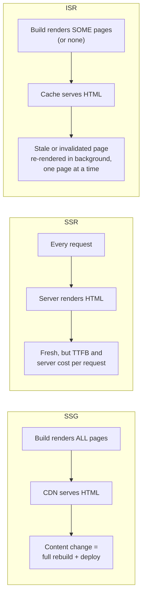
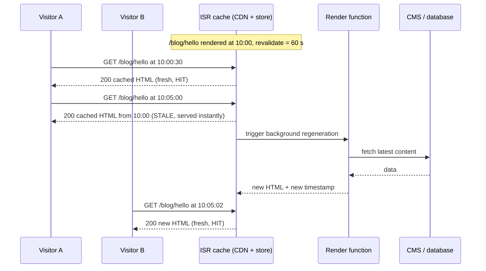
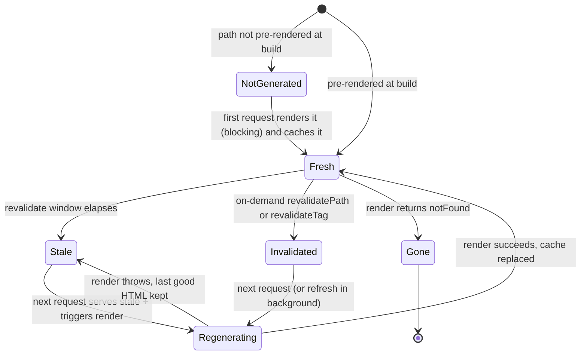
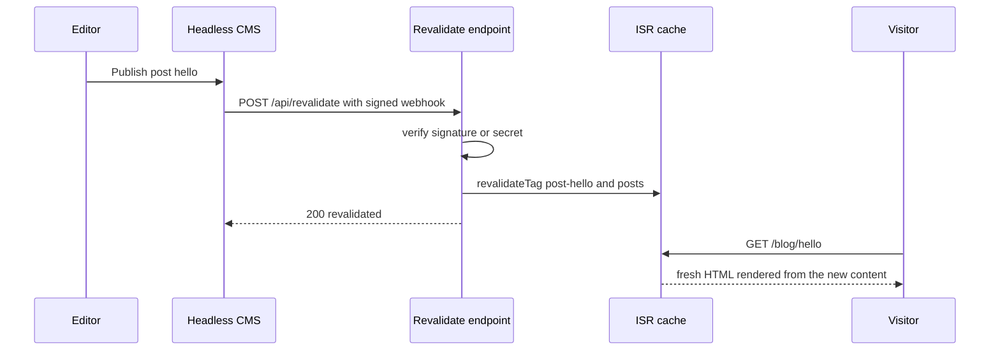
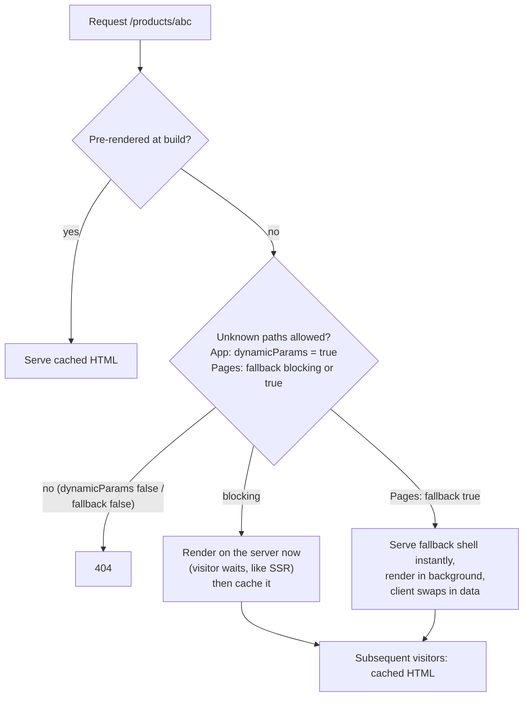
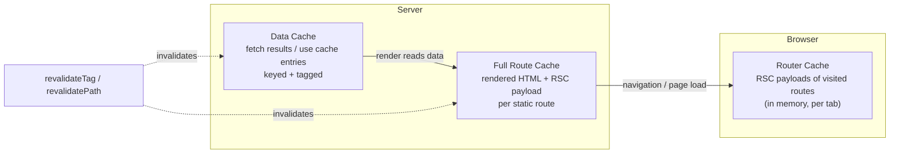
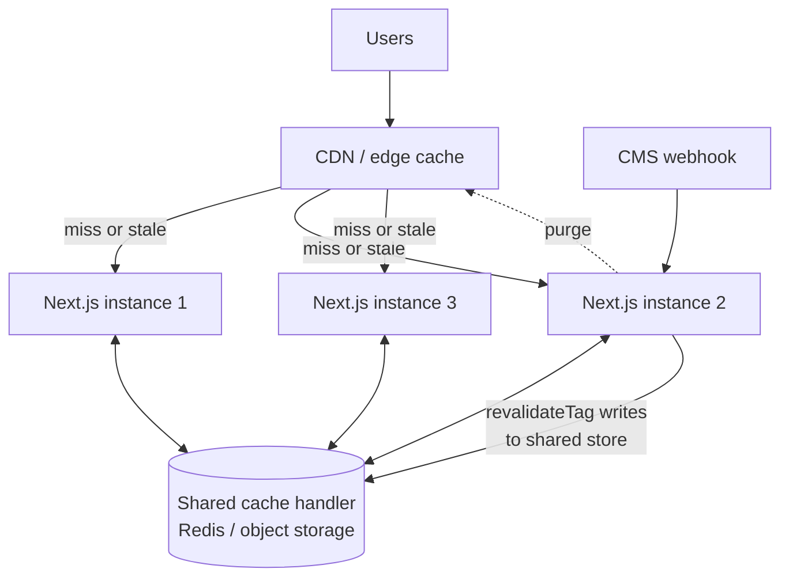
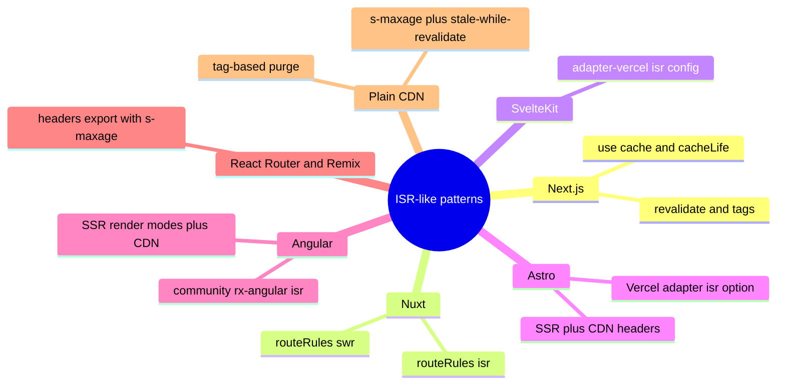
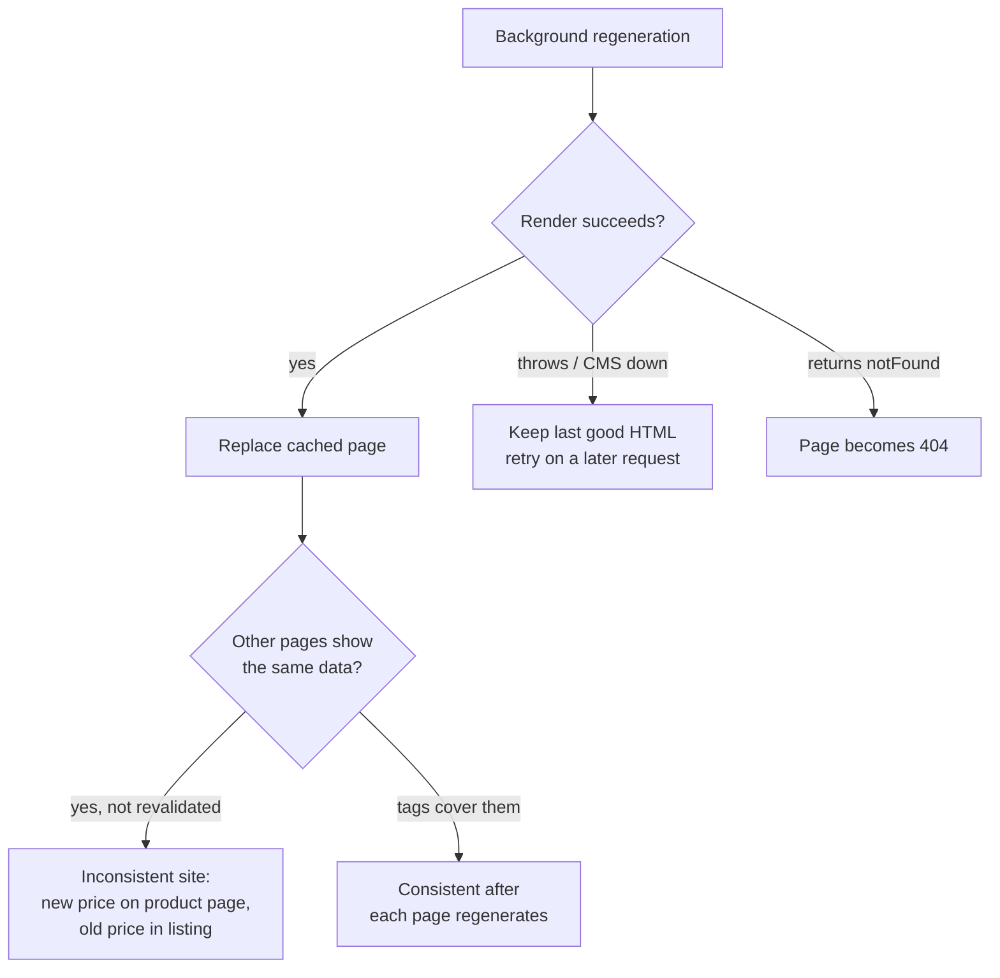

<!-- Generated by scripts/sync-knowledge.js from notes/ and README.md — do not edit here. -->
<!-- sections (line ranges in this file): Table of Contents 19-41 · ELI5 42-54 · Core Concept 55-392 · Decision Matrix 393-422 · Real-World Examples 423-630 · Key Points Summary 631-650 · Test Your Understanding 651-726 · Cheat Sheet 727-784 · References & Further Reading 785-822 -->

# Incremental Static Regeneration (ISR)

> **Date:** 2026-11-06 · **Last updated:** 2026-11-06
> **Category:** Frontend System Design
> **Sub-Topic:** Rendering & Architecture / Rendering Patterns
> **Level:** Intermediate · **Reading time:** ~28 min
> **Informs:** rendering strategy per route, content freshness SLA, build time for large catalogs, CMS webhook → on-demand revalidation, CDN/origin load, self-hosted cache topology (shared cache handler), TTFB for content pages

> **Pre-requisite:** [Static Site Generation (SSG)](./static-site-generation-ssg.md) and [Server-Side Rendering (SSR)](./server-side-rendering-ssr.md); the `stale-while-revalidate` model from [Browser Caching Strategies](./browser-caching-strategies.md).
> ISR sits **between** SSG and SSR: static HTML served from a cache, regenerated on the server after it is published.

**Previous:** [Static Site Generation (SSG)](./static-site-generation-ssg.md) · **Next:** [Streaming SSR & React Server Components](./streaming-ssr-and-react-server-components.md)

---

## Table of Contents

1. [ELI5 — Simple Explanation](#eli5--simple-explanation)
2. [Section 1: The Problem ISR Solves](#section-1-the-problem-isr-solves)
3. [Section 2: The Stale-While-Revalidate Model](#section-2-the-stale-while-revalidate-model)
4. [Section 3: The Life of an ISR Page](#section-3-the-life-of-an-isr-page)
5. [Section 4: Time-Based Revalidation](#section-4-time-based-revalidation)
6. [Section 5: On-Demand Revalidation](#section-5-on-demand-revalidation)
7. [Section 6: Build Time vs First Request](#section-6-build-time-vs-first-request)
8. [Section 7: ISR in the Next.js App Router](#section-7-isr-in-the-nextjs-app-router)
9. [Section 8: ISR in the Next.js Pages Router](#section-8-isr-in-the-nextjs-pages-router)
10. [Section 9: Where the Cache Lives — Hosting and Self-Hosting](#section-9-where-the-cache-lives--hosting-and-self-hosting)
11. [Section 10: ISR Beyond Next.js](#section-10-isr-beyond-nextjs)
12. [Section 11: Failure Modes and Consistency](#section-11-failure-modes-and-consistency)
13. [Decision Matrix](#decision-matrix)
14. [Real-World Examples](#real-world-examples)
15. [Key Points Summary](#key-points-summary)
16. [Test Your Understanding (with answers)](#test-your-understanding)
17. [Cheat Sheet](#cheat-sheet)
18. [References & Further Reading](#references--further-reading)

---

## ELI5 — Simple Explanation

Think of a **bakery window**:

- **SSG** = the baker makes every cake at 5 a.m. and puts them all in the window. Fast to buy, but if the recipe changes at noon, the window is wrong until tomorrow morning — and with 2 million cake types, 5 a.m. turns into "all night".
- **SSR** = every customer waits while a cake is baked just for them. Always fresh, always slow, and the oven melts at rush hour.
- **ISR** = cakes sit in the window with a **"fresh for 1 hour"** sticker. When a customer arrives and the sticker has expired, they **still get the cake from the window right away**, and the baker quietly bakes a new one in the back. The *next* customer gets the new cake. If the shop owner phones and says "the price changed", the baker replaces that one cake immediately (**on-demand revalidation**).
- Cakes nobody ever orders are **not baked at 5 a.m.** at all — the first customer who asks for one waits once, and from then on it sits in the window too.

> **ISR = static speed for every request, with pages rebuilt one at a time in the background — after a timer expires or when your CMS says so — instead of rebuilding the whole site.**

---

## Core Concept — Step by Step

### Section 1: The Problem ISR Solves

Classic SSG has two scaling walls: **build time grows with the number of pages**, and **content is frozen until the next deploy**. SSR fixes both but pays a render on every request.



| Property | SSG | ISR | SSR |
|---|---|---|---|
| **TTFB** | Lowest (CDN file) | Lowest on a cache hit; one slow render per page on a cold miss | Server render on every request (unless CDN-cached) |
| **Freshness** | Until next build | Bounded: `revalidate` window, or seconds with on-demand | Per request |
| **Build time** | O(all pages) | O(pages you choose to pre-render) | None for pages |
| **Origin load** | ~0 | ~1 render per page per revalidation | 1 render per request |
| **Personalization** | No (client-side only) | No (same HTML for everyone) | Yes |
| **Needs a server/runtime** | No (any static host) | **Yes** — something must regenerate and store pages | Yes |

ISR was introduced in **Next.js 9.5 (2020)** and the name is still mostly associated with Next.js, but the *pattern* — "serve cached HTML, regenerate it in the background, invalidate on demand" — exists in Nuxt, SvelteKit, Astro adapters and plain CDN configurations (Section 10).

---

### Section 2: The Stale-While-Revalidate Model

ISR applies **stale-while-revalidate** to whole rendered pages. The first request after the revalidation window **still gets the stale page instantly**; it only *triggers* a regeneration.



Three consequences people forget:

1. **`revalidate: 60` does not mean "rebuilt every 60 s".** It means "after 60 s, the *next request* may trigger a rebuild". A page nobody visits is never regenerated.
2. **The visitor who triggers the rebuild sees the old version.** Worst-case staleness for a visitor = time since the last regeneration, which can be far longer than the window on low-traffic pages.
3. **Regeneration happens off the request path**, so the expensive render never adds to the visitor's TTFB (except the very first render of a page that was never generated — Section 6).

```text
revalidate = 60, traffic is sparse

10:00  page rendered (v1)
10:00–10:01  requests → v1 (fresh)
10:01–11:59  no visitors
12:00  visitor → gets v1 (2 hours old!) + triggers regeneration → v2
12:00:02  next visitor → v2
```

---

### Section 3: The Life of an ISR Page



| State | What a visitor gets | Origin work |
|---|---|---|
| **Not generated** | Waits for a full server render once (like SSR), or a fallback shell (Pages Router `fallback: true`) | One render |
| **Fresh** | Cached HTML | None |
| **Stale** | Cached HTML (old) | One background render, deduplicated per page by the framework/platform |
| **Invalidated** | Depends on API and version: stale-while-refreshing or wait-for-fresh (Section 5) | One render |
| **Regeneration failed** | Last successful HTML keeps being served | Retried on a later request |

---

### Section 4: Time-Based Revalidation

Time-based ISR is a **staleness budget**, not a schedule. Pick it from the business question "how stale may this page be?":

| Content | Typical window | Why |
|---|---|---|
| Marketing / docs pages | `false` (until next deploy or on-demand) or hours | Changes are rare and usually come with a deploy or a CMS webhook |
| Blog posts | 1 hour – 1 day + on-demand on publish | Edits are rare; a webhook handles the urgent ones |
| Product detail (price, stock) | 1–10 minutes **+ on-demand**, with stock/price fetched client-side if it must be exact | A stale price is a business problem |
| Listings / category pages | 1–5 minutes | Many inputs change; exact freshness rarely matters |
| News home page | ~30–60 s + on-demand for breaking news | High traffic means the window is the real staleness |

**Rules of thumb:**
- In the Next.js App Router, the **lowest** `revalidate` among a route's layouts, page and fetches wins for that route — one `fetch` with `revalidate: 10` makes the whole page regenerate every 10 s.
- Very short windows (a few seconds) on high-traffic pages approach SSR's origin cost while still serving stale data. If you need per-request freshness, use SSR or a dynamic hole (Section 7) instead.
- `revalidate: false` / no time limit + **on-demand** invalidation is often the best combination for CMS-driven content: zero needless renders, near-instant updates.

---

### Section 5: On-Demand Revalidation

Time-based windows force a trade-off between freshness and origin load. **On-demand revalidation** removes it: the system that *knows* content changed (CMS, admin panel, back-office job) tells the app to invalidate specific pages or data.



| Mechanism | Granularity | Next.js API | When |
|---|---|---|---|
| **By path** | One URL (or a layout and everything under it) | `revalidatePath('/blog/hello')`, `revalidatePath('/blog/[slug]', 'page')` | You know exactly which URL changed |
| **By tag** | Every cached fetch / function tagged with that name, across all pages | `revalidateTag('posts', 'max')` (Next.js 16), `revalidateTag('posts')` (≤15) | One record appears on many pages (author bio, product shown in listings) |
| **Read-your-own-writes** | Tagged data, expired immediately | `updateTag('posts')` (Next.js 16, Server Actions only) | The user who made the change must see it on the next render |
| **Pages Router** | One path | `res.revalidate('/blog/hello')` in an API route | Legacy apps |

**Version note — verify against the docs for your version:**
- **Next.js 13–15:** `revalidatePath` / `revalidateTag(tag)` invalidate the entry; the next request re-renders it.
- **Next.js 16:** `revalidateTag` takes a second argument — a `cacheLife` profile (`'max'` is recommended) or `{ expire: N }` — and **marks** tagged data stale: the next request is served stale content while it revalidates, until the profile's `expire` window passes. `revalidateTag(tag, { expire: 0 })` expires immediately (the next request blocks on a fresh render) — use it from webhooks that need the old data gone. The single-argument form is deprecated and behaves like `{ expire: 0 }`. **`updateTag`** (Server Actions only) expires the entry immediately so the next read waits for fresh data.
- In every version, revalidation is **triggered by the next request**, not by the call itself: pages using a tag regenerate as they are visited, not all at once.

**Tag design is the real work.** Tag by entity (`product-123`), by collection (`products`), and by relationship (`author-7`), so one webhook can invalidate exactly the pages that show that entity.

---

### Section 6: Build Time vs First Request

ISR lets you choose **which pages to pre-render at build** and render the rest **on first request**, then cache them.



**Strategy for big catalogs** (e.g. 2 million products):
- Pre-render the **top N by traffic** at build (from analytics) — build stays fast and the important pages never have a cold miss.
- Leave the long tail to **render on first request**.
- Return an empty list from `generateStaticParams` (App Router) to pre-render **nothing** and build in seconds — every page is rendered and cached on first visit. (In Next.js, returning an empty array still makes the route ISR-eligible; omitting `generateStaticParams` on a dynamic route makes it render dynamically unless other config says otherwise.)

**Cache lifetime vs deploys:** on most platforms a new deployment starts with a fresh page cache, so the long tail goes cold again after every deploy. Pre-render the pages whose first-visit latency matters.

---

### Section 7: ISR in the Next.js App Router

In the App Router, "ISR" is not a separate API — it is what you get when a route is **statically rendered** and has a **revalidation** rule. Next.js has several cache layers; ISR touches the first two:



| Next.js version | How you express ISR |
|---|---|
| **13–15 (and 16 without Cache Components)** | `export const revalidate = 3600` in a page/layout, or `fetch(url, { next: { revalidate: 3600, tags: ['posts'] } })`; `generateStaticParams` + `dynamicParams` |
| **16 with `cacheComponents: true`** | The `'use cache'` directive on a page, component or function, with `cacheLife('hours')` and `cacheTag('posts')`. Route-segment options like `revalidate` and `dynamic` are replaced by this model |

**Things that silently turn ISR off** (the route becomes dynamic, rendered per request):
- Reading request data: `cookies()`, `headers()`, `searchParams` or `connection()`.
- `fetch(url, { cache: 'no-store' })` or `export const dynamic = 'force-dynamic'`.
- With Cache Components, uncached data access outside `<Suspense>` errors at build time instead of silently going dynamic — a deliberate change to make the boundary visible.

**ISR with Cache Components:** for params not returned by `generateStaticParams`, Next.js renders on demand and stores the completed result in the ISR cache. With the `partialPrefetching` option, recent 16.x releases (16.3+, per the docs) serve the prerendered **App Shell** (Suspense fallbacks) instantly for an unlisted URL and upgrade it in the background — the Cache Components equivalent of Pages Router `fallback: true`. Without it, the first request waits for the full render (like `fallback: 'blocking'`). This area is moving fast — check the "ISR with Cache Components" guide for your version.

**Partial Prerendering (PPR)** — the static shell of a page is prerendered (and can be ISR-revalidated) while personalized "holes" wrapped in `<Suspense>` stream in per request. In Next.js 16 this is the behavior of Cache Components rather than a separate experimental flag. It is how you combine ISR-cached product content with a per-user cart badge on one page. See [Streaming SSR & React Server Components](./streaming-ssr-and-react-server-components.md).

**Defaults changed over time:** in Next.js 15, `fetch` requests and `GET` Route Handlers stopped being cached by default, so a page you expected to be ISR may now be dynamic unless you opt in. Always check the build output (`○` static, `ƒ` dynamic) rather than assuming.

---

### Section 8: ISR in the Next.js Pages Router

The original ISR API — still supported, common in existing codebases:

| API | Role |
|---|---|
| `getStaticProps` returning `revalidate: N` | Page is static, regenerated at most every N seconds (on request) |
| `getStaticProps` returning `notFound: true` | Page becomes a 404 (combine with `revalidate` so a deleted item drops out) |
| `getStaticPaths` → `paths` | Which paths to pre-render at build |
| `fallback: false` | Unknown paths → 404 |
| `fallback: 'blocking'` | Unknown paths render on the server on first request (no loading state) |
| `fallback: true` | Unknown paths get a fallback page immediately (`router.isFallback === true`), then props load |
| `res.revalidate('/path')` | On-demand revalidation from an API route (stable since Next.js 12.2) |

The Pages Router has no data-level cache or tags: revalidation is **per path**, so when one product changes you must know every URL that shows it.

---

### Section 9: Where the Cache Lives — Hosting and Self-Hosting

ISR needs three things the static-file model does not have: **a place to store generated pages**, **a runtime to regenerate them**, and **a way to invalidate CDN copies**.



| Deployment | How ISR works | Watch out for |
|---|---|---|
| **Vercel** | Managed, globally distributed ISR cache; regeneration deduplicated; on-demand revalidation propagates across regions | Cost/limits are platform-specific — read the current docs |
| **Netlify, Cloudflare, AWS (via adapters such as OpenNext)** | Adapter maps ISR onto the platform's cache and functions | Feature parity varies by adapter and Next.js version |
| **Self-hosted `next start`, one instance** | Pages and data cached on the local filesystem and in memory | Works out of the box |
| **Self-hosted, many instances (Kubernetes, autoscaling)** | Each instance has **its own** filesystem cache unless you configure a shared `cacheHandler` (and `cacheHandlers` for `'use cache'` in Next.js 16) | Users see different versions per pod; `revalidateTag` on one pod doesn't reach the others |
| **`output: 'export'`** (pure static) | **ISR is not supported** — there is no server to regenerate | Use rebuild-on-publish or client-side fetching |
| **Edge runtime routes** | ISR requires the **Node.js runtime** in Next.js | Keep ISR routes on Node.js |

**HTTP headers a self-hosted Next.js ISR page sends:** `Cache-Control: s-maxage=<revalidate>, stale-while-revalidate=<…>` so a CDN in front can cache it, and an `x-nextjs-cache` header (`HIT`, `STALE`, `MISS`, or `REVALIDATED` after on-demand revalidation) that tells you what happened (Vercel adds its own `x-vercel-cache`). The `stale-while-revalidate` window is configurable via `expireTime` in recent versions. Remember the CDN layer when you revalidate: invalidating the Next.js cache does not purge a third-party CDN by itself.

> **Testing:** ISR does not run in `next dev` (pages render on every request). Test with `next build && next start`. Setting `NEXT_PRIVATE_DEBUG_CACHE=1` logs cache hits, misses and revalidations.

---

### Section 10: ISR Beyond Next.js



| Framework | How | Notes |
|---|---|---|
| **Nuxt (Vue)** | `routeRules: { '/blog/**': { isr: 3600 } }` or `{ swr: 3600 }` in `nuxt.config` | `swr` caches in Nitro's server cache; `isr` additionally uses the platform CDN cache where supported (Vercel, Netlify). `isr: true` = cached until next deploy |
| **SvelteKit** | `export const config = { isr: { expiration: 60, bypassToken } }` in a route (adapter-vercel) | On-demand: request the URL with the `x-prerender-revalidate: <bypassToken>` header. Other adapters: use CDN headers |
| **Astro** | `@astrojs/vercel` adapter option `isr: true` or `isr: { expiration: 60 }` with `output: 'server'` | Otherwise: SSR + `Cache-Control` headers on a CDN |
| **Angular** | Angular SSR server routes with `RenderMode.Prerender` / `RenderMode.Server`, cached by a CDN via headers | No built-in ISR; the community library `@rx-angular/isr` adds it |
| **React Router v7 / Remix** | `headers()` export returning `Cache-Control: s-maxage=60, stale-while-revalidate=86400` | "ISR by HTTP": the CDN is the cache, purge via the CDN API |
| **Gatsby** | Deferred Static Generation (DSG) — render on first request, then cache | Similar idea to on-demand first render; Gatsby sees far less adoption today |
| **Native mobile** | Not applicable to the app shell; the same idea applies to API responses (serve cached, refresh in background) | See [Browser Caching Strategies](./browser-caching-strategies.md) |

**"ISR without a framework":** any SSR app behind a CDN can get most of ISR with `Cache-Control: s-maxage=N, stale-while-revalidate=M` plus the CDN's purge-by-tag API (`Cache-Tag` / `Surrogate-Key` style headers on some CDNs). The differences from framework ISR: CDN caches are usually **per point of presence** (a cold POP renders again), may evict rarely-requested pages, and there is no data-level cache.

---

### Section 11: Failure Modes and Consistency



| Failure mode | Cause | Mitigation |
|---|---|---|
| **Cross-page inconsistency** | Each page regenerates independently, at different times | Tag-based invalidation for shared entities; accept eventual consistency |
| **Error silently masked** | A failing render keeps serving old HTML — users see stale content, nobody notices | Log/alert on regeneration errors; expose `generatedAt` in the page or a header |
| **Error cached as content** | Catching the CMS error and rendering "Something went wrong" *successfully* | Let the render **throw** so the last good version stays |
| **Deleted content lingers** | Page stays cached forever with `revalidate: false` | `notFound()` / `notFound: true` + on-demand revalidation on delete |
| **Thundering herd on cold cache** | Many first requests for the same un-generated page (after deploy) | Pre-render hot pages; platforms dedupe concurrent regeneration per page |
| **Personalized data leaks** | Rendering user-specific data into an ISR page — now everyone sees it | Keep ISR pages user-agnostic; personalize client-side or in a dynamic hole |
| **Multi-instance drift** | Per-pod filesystem cache | Shared cache handler |
| **Draft previews show stale content** | Editors hit the ISR cache | Next.js **Draft Mode** (`draftMode()`) bypasses the cache for editors |

---

## Decision Matrix


| Requirement | Pick | Why |
|---|---|---|
| Content same for everyone, updates a few times a day, thousands+ of pages | **ISR + on-demand** | Static speed, small builds, updates in seconds |
| Content same for everyone, updates only with code | **SSG** | No runtime needed |
| Must reflect data **at request time** (stock, auctions, prices that must be exact) | **SSR** or ISR shell + **client/streamed fresh data** for the volatile part | ISR always serves at least one stale response per change |
| Per-user page | **SSR** / **CSR** / PPR dynamic holes | ISR caches one version for everyone |
| Must deploy as pure static files (S3, GitHub Pages) | **SSG** + rebuild on publish | ISR needs a server |
| Self-hosting on many pods | ISR **only with a shared cache handler** | Otherwise inconsistent versions |

---

## Real-World Examples

**Example 1 — App Router blog with time-based + tag-based ISR (Next.js 14–16 without Cache Components):**
```tsx
// app/blog/[slug]/page.tsx
import { notFound } from 'next/navigation';

export const revalidate = 3600;     // at most 1 h stale (time-based fallback)
export const dynamicParams = true;  // unknown slugs render on first request, then cached

type Post = { slug: string; title: string; html: string; updatedAt: string };

export async function generateStaticParams() {
  // Pre-render only the 50 most-read posts at build; the long tail is on-demand
  const top: Post[] = await fetch('https://cms.example.com/posts?sort=views&limit=50')
    .then((r) => r.json());
  return top.map((p) => ({ slug: p.slug }));
}

async function getPost(slug: string): Promise<Post | null> {
  const res = await fetch(`https://cms.example.com/posts/${slug}`, {
    next: { tags: ['posts', `post-${slug}`] },   // targets for on-demand revalidation
  });
  if (res.status === 404) return null;
  if (!res.ok) throw new Error(`CMS ${res.status}`); // throw → keep last good page
  return res.json();
}

export default async function PostPage({ params }: { params: Promise<{ slug: string }> }) {
  const { slug } = await params;          // params is a Promise in Next.js 15+
  const post = await getPost(slug);
  if (!post) notFound();
  return (
    <article>
      <h1>{post.title}</h1>
      <div dangerouslySetInnerHTML={{ __html: post.html }} /> {/* sanitize CMS HTML upstream */}
      <footer>Updated {new Date(post.updatedAt).toLocaleDateString()}</footer>
    </article>
  );
}
```

**Example 2 — CMS webhook → on-demand revalidation (Route Handler):**
```typescript
// app/api/revalidate/route.ts
import { revalidateTag } from 'next/cache';
import { timingSafeEqual } from 'node:crypto';

function validSecret(received: string | null): boolean {
  const expected = process.env.REVALIDATE_SECRET ?? '';
  if (!received || received.length !== expected.length) return false;
  return timingSafeEqual(Buffer.from(received), Buffer.from(expected));
}

export async function POST(req: Request) {
  if (!validSecret(req.headers.get('x-webhook-secret'))) {
    return Response.json({ error: 'invalid secret' }, { status: 401 });
  }
  const { slug } = (await req.json()) as { slug?: string };

  // Next.js 16: second argument = cacheLife profile ('max' = stale-while-revalidate),
  // or { expire: 0 } to expire immediately. Next.js 13–15: revalidateTag('posts').
  revalidateTag('posts', 'max');                 // listings, home page, RSS
  if (slug) revalidateTag(`post-${slug}`, 'max'); // the post itself

  return Response.json({ revalidated: true, at: Date.now() });
}
```

**Example 3 — Next.js 16 Cache Components (`'use cache'`):**
```tsx
// next.config.ts
import type { NextConfig } from 'next';
const nextConfig: NextConfig = { cacheComponents: true };
export default nextConfig;

// app/products/[id]/data.ts
import { cacheLife, cacheTag } from 'next/cache';

export async function getProduct(id: string) {
  'use cache';
  cacheTag('products', `product-${id}`);
  cacheLife('hours');            // built-in profile; custom profiles go in next.config
  const res = await fetch(`https://api.example.com/products/${id}`);
  if (!res.ok) throw new Error(`API ${res.status}`);
  return res.json() as Promise<{ id: string; name: string; price: number }>;
}

// app/products/actions.ts — admin edits a price and must see it immediately
'use server';
import { updateTag } from 'next/cache';
import { db } from '@/lib/db';
export async function savePrice(id: string, price: number) {
  await db.product.update({ where: { id }, data: { price } });
  updateTag(`product-${id}`);    // read-your-own-writes: expire now
}
```

**Example 4 — Pages Router (legacy, still supported):**
```tsx
// pages/products/[id].tsx
import type { GetStaticPaths, GetStaticProps } from 'next';

type Props = { product: { id: string; name: string; price: number } };

export const getStaticPaths: GetStaticPaths = async () => {
  const top = await getTopProductIds(500);              // from analytics
  return { paths: top.map((id) => ({ params: { id } })), fallback: 'blocking' };
};

export const getStaticProps: GetStaticProps<Props> = async ({ params }) => {
  const product = await getProduct(params!.id as string);
  if (!product) return { notFound: true, revalidate: 60 }; // deleted → 404 after revalidation
  return { props: { product }, revalidate: 300 };           // at most 5 min stale
};

export default function ProductPage({ product }: Props) {
  return <h1>{product.name}</h1>;
}

// pages/api/revalidate.ts
import type { NextApiRequest, NextApiResponse } from 'next';
export default async function handler(req: NextApiRequest, res: NextApiResponse) {
  if (req.headers['x-webhook-secret'] !== process.env.REVALIDATE_SECRET) {
    return res.status(401).json({ error: 'invalid secret' });
  }
  try {
    await res.revalidate(`/products/${req.body.id}`);
    return res.json({ revalidated: true });
  } catch {
    return res.status(500).send('Error revalidating');
  }
}
```

**Example 5 — Nuxt, SvelteKit and Astro equivalents:**
```typescript
// nuxt.config.ts (Vue)
export default defineNuxtConfig({
  routeRules: {
    '/': { prerender: true },          // SSG at build
    '/blog/**': { isr: 3600 },         // CDN-cached on Vercel/Netlify, 1 h
    '/products/**': { swr: 600 },      // Nitro server cache, stale-while-revalidate
    '/account/**': { ssr: false },     // client-only (personalized)
  },
});
```

```typescript
// src/routes/blog/[slug]/+page.server.ts (SvelteKit + @sveltejs/adapter-vercel)
import { BYPASS_TOKEN } from '$env/static/private';

export const config = {
  isr: {
    expiration: 60,          // seconds; false = never expire
    bypassToken: BYPASS_TOKEN,
    allowQuery: ['page'],    // other query params are ignored in the cache key
  },
};
```

```javascript
// astro.config.mjs (Astro + Vercel adapter)
import { defineConfig } from 'astro/config';
import vercel from '@astrojs/vercel';

export default defineConfig({
  output: 'server',
  adapter: vercel({ isr: { expiration: 60 } }),
});
```

**Example 6 — Personalization in an ISR page (BAD → GOOD):**
```tsx
// ❌ BAD: reading cookies makes the route dynamic (ISR gone) —
// or, in setups that cache anyway, one user's name is served to everyone.
import { cookies } from 'next/headers';
export default async function Home() {
  const user = (await cookies()).get('user')?.value;
  const deals = await getDeals();
  return <><Greeting name={user} /><Deals items={deals} /></>;
}

// ✅ GOOD: the page stays static/ISR; the per-user part loads on the client
// (or is a Suspense-wrapped dynamic hole with Partial Prerendering / Cache Components).
export const revalidate = 300;
export default async function Home() {
  const deals = await getDeals();
  return <><UserGreeting /* 'use client', fetches /api/me */ /><Deals items={deals} /></>;
}
```

**Example 7 — Checking ISR behavior from the terminal:**
```bash
next build && next start   # ISR does not run in `next dev`

curl -sI http://localhost:3000/blog/hello | grep -iE 'x-nextjs-cache|cache-control'
# x-nextjs-cache: HIT
# cache-control: s-maxage=3600, stale-while-revalidate=...

# Trigger on-demand revalidation
curl -X POST http://localhost:3000/api/revalidate \
  -H "x-webhook-secret: $REVALIDATE_SECRET" -H 'content-type: application/json' \
  -d '{"slug":"hello"}'
```

---

## Key Points Summary

| Concept | One-Line Explanation |
|---|---|
| **ISR** | Static pages served from a cache and regenerated individually after publish |
| **Stale-while-revalidate** | The request after expiry gets the old page and triggers a background rebuild |
| **`revalidate` window** | A staleness budget, not a schedule — no traffic means no regeneration |
| **On-demand revalidation** | CMS/webhook invalidates specific paths or tags immediately |
| **Tags** | Name data by entity so one change invalidates every page that shows it |
| **`generateStaticParams` / `getStaticPaths`** | Choose which pages are pre-rendered at build; the rest render on first request |
| **`dynamicParams` / `fallback`** | Whether unknown paths 404, block-render, or show a fallback |
| **Failed regeneration** | Last good HTML keeps being served |
| **Needs a server** | ISR is impossible with a pure static export |
| **Multi-instance self-hosting** | Requires a shared cache handler or versions drift per instance |
| **Dynamic APIs** | `cookies()`/`headers()`/`no-store` turn the route dynamic — ISR silently lost |
| **`'use cache'` + `cacheLife` + `cacheTag`** | Next.js 16 Cache Components model of the same idea |
| **Other frameworks** | Nuxt `isr`/`swr` route rules, SvelteKit/Astro Vercel adapter `isr`, CDN `s-maxage` + SWR |

---

## Test Your Understanding

**Q1 (Basic):**
A blog post uses `revalidate: 60`. Nobody visits it for two hours after it was generated. The author edited it an hour ago. What do the next two visitors see, and why?

<details>
<summary>Answer</summary>

The **first visitor gets the two-hour-old page** — instantly, from the cache — because ISR serves stale content while it regenerates. Their request only **triggers** a background regeneration, which fetches the edited post. The **second visitor** (once that render finishes, usually within a second or two) gets the new version.

`revalidate: 60` means "this page may be regenerated on a request at least 60 s after its last generation", not "rebuild every 60 s". On low-traffic pages the real staleness is bounded by traffic, not by the window — which is why CMS-driven sites add on-demand revalidation on publish.
</details>

**Q2 (Application):**
An e-commerce site has 2 million product pages. Full SSG takes 9 hours to build. Prices change several times a day; stock changes every minute. Design the rendering strategy.

<details>
<summary>Answer</summary>

- **ISR for product pages.** Pre-render the top few thousand products by traffic at build (`generateStaticParams` / `getStaticPaths`), let the long tail render on first request (`dynamicParams: true` / `fallback: 'blocking'`). The build drops from hours to minutes.
- **Tag the data** (`product-<id>`, `category-<slug>`) and have the pricing system call a revalidation endpoint when a price changes, so price updates appear within seconds without short time windows. Keep a moderate time window (e.g. minutes to an hour) as a safety net.
- **Stock** changes too often for ISR to be accurate — every change would be at least one stale response. Fetch availability client-side or render it in a dynamic, Suspense-wrapped hole (Partial Prerendering / Cache Components), and **always re-check price and stock at checkout** on the server.
- Cart, recommendations and greetings are per-user → client-side or dynamic holes, never in the ISR HTML.
</details>

**Q3 (Tricky):**
You self-host a Next.js app on Kubernetes with 4 pods behind a load balancer. After an editor publishes, some reloads show the new article and others the old one, and the webhook said `revalidated: true`. What's wrong?

<details>
<summary>Answer</summary>

Each pod has its **own filesystem/in-memory ISR cache** by default. The webhook hit one pod, which revalidated its own cache; the other three still have the old page and will only regenerate when their own window expires. The load balancer spreads reloads across pods, so users see versions flip.

Fix: configure a **shared cache handler** (`cacheHandler` in `next.config`, and `cacheHandlers` for `'use cache'` in Next.js 16) backed by Redis or similar so every pod reads and invalidates the same entries — or use a platform/adapter that provides a shared ISR cache. If a CDN sits in front, also purge it.
</details>

**Q4 (Tricky):**
A developer adds a "Welcome back, Sam" banner to the root layout by reading `cookies()`. The next build shows every route as `ƒ (Dynamic)`, server CPU jumps, and TTFB worsens. Why, and how should it have been built?

<details>
<summary>Answer</summary>

`cookies()` is a **request-time API**. Using it in the root layout makes every route under it depend on the request, so Next.js can no longer render them once and cache them — every page is rendered per request (SSR). ISR is silently lost site-wide.

Build it so the cached HTML stays user-agnostic: render the banner in a **client component** that reads the user from an API (or a non-HttpOnly display cookie), or wrap it in `<Suspense>` as a dynamic hole with Partial Prerendering / Cache Components, so the shell stays static and only the banner streams per request. The general rule: request-specific data must never decide the content of a shared cached page.
</details>

**Q5 (System design):**
A news site wants breaking-news updates on article pages within 5 seconds of an editor pressing Publish, and the home page must survive a traffic spike of millions of requests. Would you use `revalidate: 5`? Design it.

<details>
<summary>Answer</summary>

No — `revalidate: 5` still serves **at least one stale response per page** after each change, renders every hot page every 5 s whether it changed or not, and on rarely-visited pages doesn't guarantee 5 s at all.

Better:
- **On-demand revalidation** from the CMS on publish/update/unpublish, invalidating the article tag and the collection tags (`home`, `section-politics`). Updates become visible within the regeneration time.
- A **longer time-based window** (e.g. minutes) as a safety net in case a webhook is lost.
- The ISR cache + CDN absorbs the spike: millions of requests hit cached HTML; the origin does roughly one render per page per change.
- For a truly live element (live blog, scores), add a **client-side live channel** (SSE/WebSocket or polling) on top of the static page rather than shrinking the window — see [WebSockets & SSE & Long Polling](./websockets-sse-long-polling.md).
- Make the webhook endpoint authenticated and idempotent, and alert on regeneration failures.
</details>

**Q6 (Tricky):**
During a CMS outage, background regenerations fail for an hour. What do users see? Now the developer "improves" the code by catching the fetch error and rendering an "Content unavailable" message. What changes?

<details>
<summary>Answer</summary>

With the original code, a failed regeneration **throws**, and the framework keeps serving the **last successfully generated HTML**. Users see slightly stale content and never notice the outage — ISR is a resilience feature here. It retries on later requests.

With the "improvement", the render **succeeds** — it just produces an error page. That error page **replaces the good cached HTML** and is served to everyone until the next successful regeneration (which, with `revalidate: false` and on-demand-only invalidation, might be never). Let data errors throw inside ISR renders; handle "not found" explicitly with `notFound()`, and monitor regeneration errors instead of hiding them.
</details>

---

## Cheat Sheet

**Key Definitions:**
- **ISR:** Pre-rendered pages cached and regenerated per page after deployment
- **Revalidation window:** Minimum age before a request may trigger regeneration
- **On-demand revalidation:** Explicit invalidation by path or tag (webhooks, actions)
- **Cache tag:** A label attached to cached data used to invalidate it from anywhere
- **Fallback / dynamicParams:** Behavior for paths not pre-rendered at build
- **Data Cache / Full Route Cache:** Next.js server caches for fetched data and rendered routes
- **Cache handler:** Pluggable storage for Next.js caches — required for shared caches across instances
- **Draft Mode:** Bypasses static/ISR caches for CMS previews

**Quick Reference:**
```text
Next.js App Router (13–16, no Cache Components)
  export const revalidate = 3600            page/layout time window (lowest in route wins)
  fetch(url, { next: { revalidate, tags } }) per-request window + tags
  generateStaticParams()                    pre-render these paths ([] = none at build)
  export const dynamicParams = true         unknown paths render on first request
  revalidatePath('/blog/x') / revalidateTag('posts')   on-demand (16: revalidateTag(tag, 'max' | { expire: 0 }))

Next.js 16 Cache Components (cacheComponents: true)
  'use cache' + cacheLife('hours') + cacheTag('posts')
  revalidateTag('posts', 'max')   stale-while-revalidate
  updateTag('posts')              Server Actions only, expire now (read-your-writes)

Next.js Pages Router
  getStaticProps → { props, revalidate: 60 } | { notFound: true }
  getStaticPaths → { paths, fallback: false | 'blocking' | true }
  res.revalidate('/path')         on-demand in an API route

Nuxt        routeRules: { '/blog/**': { isr: 3600 } } or { swr: 3600 }
SvelteKit   export const config = { isr: { expiration: 60, bypassToken } }   (adapter-vercel)
Astro       vercel({ isr: { expiration: 60 } })
Any CDN     Cache-Control: s-maxage=60, stale-while-revalidate=86400 + purge by tag

Debug       next build && next start · x-nextjs-cache: HIT|STALE|MISS|REVALIDATED · NEXT_PRIVATE_DEBUG_CACHE=1
```

**Common Mistakes to Avoid:**

| Mistake | Why Wrong | Fix |
|---|---|---|
| Treating `revalidate: 60` as a cron job | Regeneration only happens on a request; first visitor sees stale | On-demand revalidation for timely updates |
| Very short windows for "real-time" | Still stale once per change, near-SSR origin cost | On-demand + client live updates for volatile parts |
| `cookies()` / `headers()` in a shared layout | Every route becomes dynamic; ISR silently lost | Client component or Suspense dynamic hole |
| Rendering user data into ISR HTML | Cached once, shown to everyone | Keep ISR pages user-agnostic |
| Catching data errors and rendering an error message | Error page replaces the good cached page | Throw; keep the last good version |
| Multi-pod self-hosting with default cache | Pods serve different versions; webhooks hit one pod | Shared `cacheHandler` (Redis etc.) |
| Expecting ISR with `output: 'export'` or edge runtime | No Node.js server to regenerate | Node.js runtime or rebuild-on-publish |
| Testing ISR in `next dev` | Dev renders every request | `next build && next start` |
| Revalidating only the changed page | Listings, home and related pages still show old data | Tag shared entities; revalidate collections too |
| Unauthenticated revalidation endpoint | Anyone can force renders (DoS, cost) | Secret/signature check, rate limit |
| Pre-rendering nothing for hot pages | Cold-cache herd after every deploy | Pre-render the top pages by traffic |
| Forgetting the CDN in front | Next.js cache invalidated, CDN still serves old copy | Respect `s-maxage` or purge the CDN too |

---

## References & Further Reading

**Core docs (Next.js)**
- Next.js: [Incremental Static Regeneration (ISR) guide](https://nextjs.org/docs/app/guides/incremental-static-regeneration)
- Next.js: [ISR with Cache Components](https://nextjs.org/docs/app/guides/incremental-static-regeneration-cache-components) · [Caching](https://nextjs.org/docs/app/getting-started/caching) · [How revalidation works](https://nextjs.org/docs/app/guides/how-revalidation-works)
- Next.js: [`revalidatePath`](https://nextjs.org/docs/app/api-reference/functions/revalidatePath) · [`revalidateTag`](https://nextjs.org/docs/app/api-reference/functions/revalidateTag) · [`updateTag`](https://nextjs.org/docs/app/api-reference/functions/updateTag)
- Next.js: [`generateStaticParams`](https://nextjs.org/docs/app/api-reference/functions/generate-static-params) · [Route Segment Config](https://nextjs.org/docs/app/api-reference/file-conventions/route-segment-config)
- Next.js: [`use cache` directive](https://nextjs.org/docs/app/api-reference/directives/use-cache) · [`cacheLife`](https://nextjs.org/docs/app/api-reference/functions/cacheLife) · [`cacheTag`](https://nextjs.org/docs/app/api-reference/functions/cacheTag)
- Next.js: [Self-hosting — caching and ISR](https://nextjs.org/docs/app/guides/self-hosting) · [`cacheHandler`](https://nextjs.org/docs/app/api-reference/config/next-config-js/incrementalCacheHandlerPath)
- Next.js (Pages Router): [ISR](https://nextjs.org/docs/pages/guides/incremental-static-regeneration) · [`getStaticPaths` fallback](https://nextjs.org/docs/pages/api-reference/functions/get-static-paths)
- Next.js blog: [Next.js 16](https://nextjs.org/blog/next-16) · [Next.js 15](https://nextjs.org/blog/next-15)

**Other frameworks**
- Nuxt: [Rendering modes — hybrid rendering and route rules](https://nuxt.com/docs/guide/concepts/rendering#hybrid-rendering)
- SvelteKit: [adapter-vercel — Incremental Static Regeneration](https://svelte.dev/docs/kit/adapter-vercel#Incremental-Static-Regeneration)
- Astro: [@astrojs/vercel — ISR](https://docs.astro.build/en/guides/integrations-guide/vercel/#isr)
- Angular: [Server and hybrid rendering (render modes)](https://angular.dev/guide/ssr)
- Vercel: [Incremental Static Regeneration](https://vercel.com/docs/incremental-static-regeneration)

**Specs & HTTP**
- IETF: [RFC 5861 — `stale-while-revalidate`](https://www.rfc-editor.org/rfc/rfc5861)
- IETF: [RFC 9111 — HTTP Caching (`s-maxage`)](https://www.rfc-editor.org/rfc/rfc9111)
- MDN: [`Cache-Control`](https://developer.mozilla.org/en-US/docs/Web/HTTP/Reference/Headers/Cache-Control)

**Deep dives**
- web.dev: [Rendering on the Web](https://web.dev/articles/rendering-on-the-web)
- web.dev: [Keeping things fresh with stale-while-revalidate](https://web.dev/articles/stale-while-revalidate)
- OpenNext: [Self-hosting Next.js on AWS / Cloudflare](https://opennext.js.org/)

---

> **Previous Topic:** [Static Site Generation (SSG)](./static-site-generation-ssg.md)
> — Rendering every page at build time and serving files from a CDN

> **Next Topic:** [Streaming SSR & React Server Components](./streaming-ssr-and-react-server-components.md)
> — Sending HTML in chunks as data resolves, and rendering components only on the server

*Saved on: 2026-11-06 | Repo: Frontend System Design Learning Notes*
