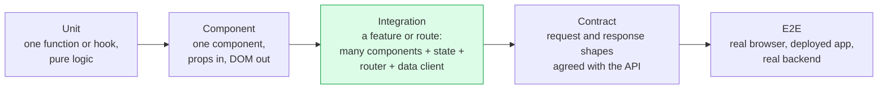
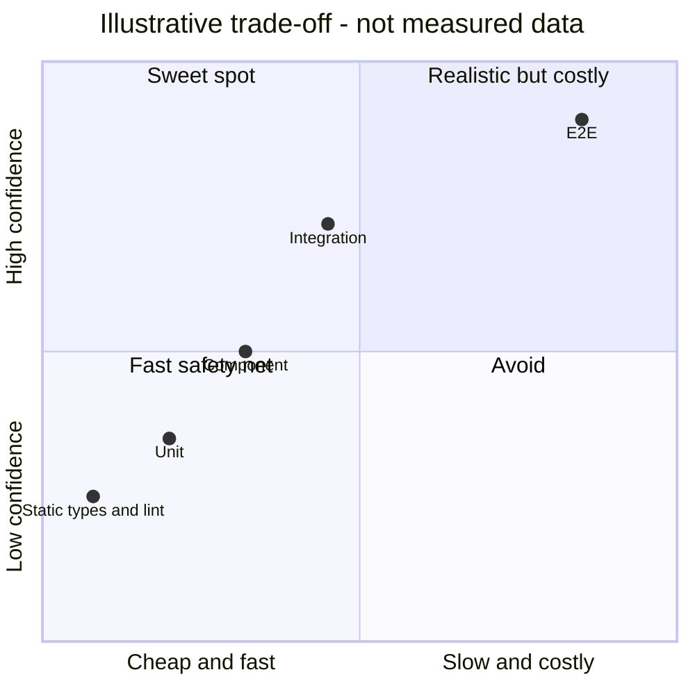
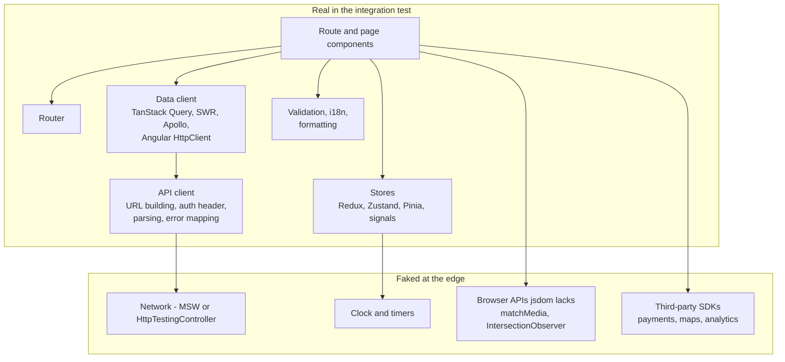
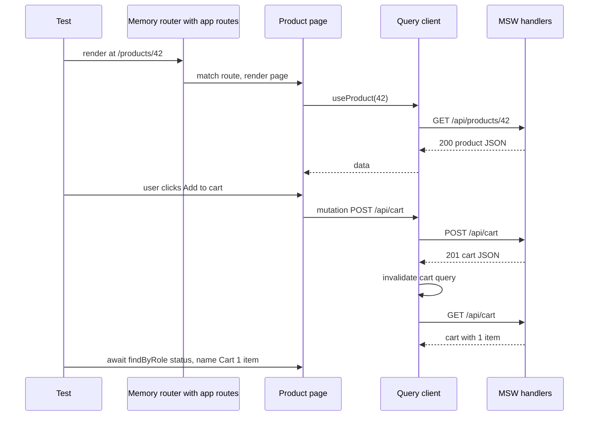
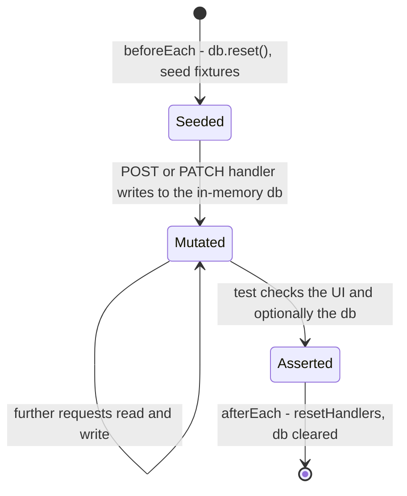
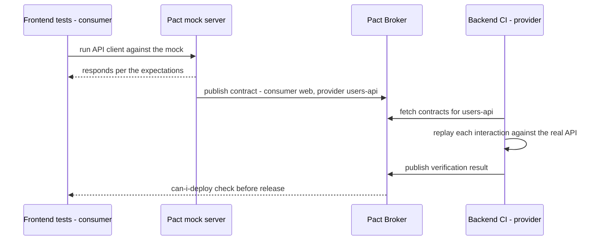
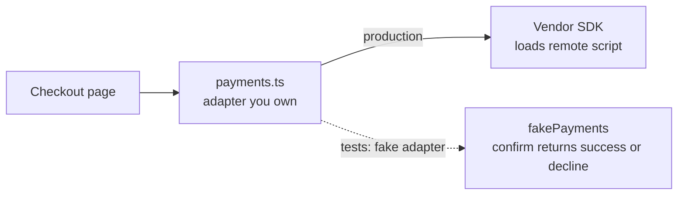
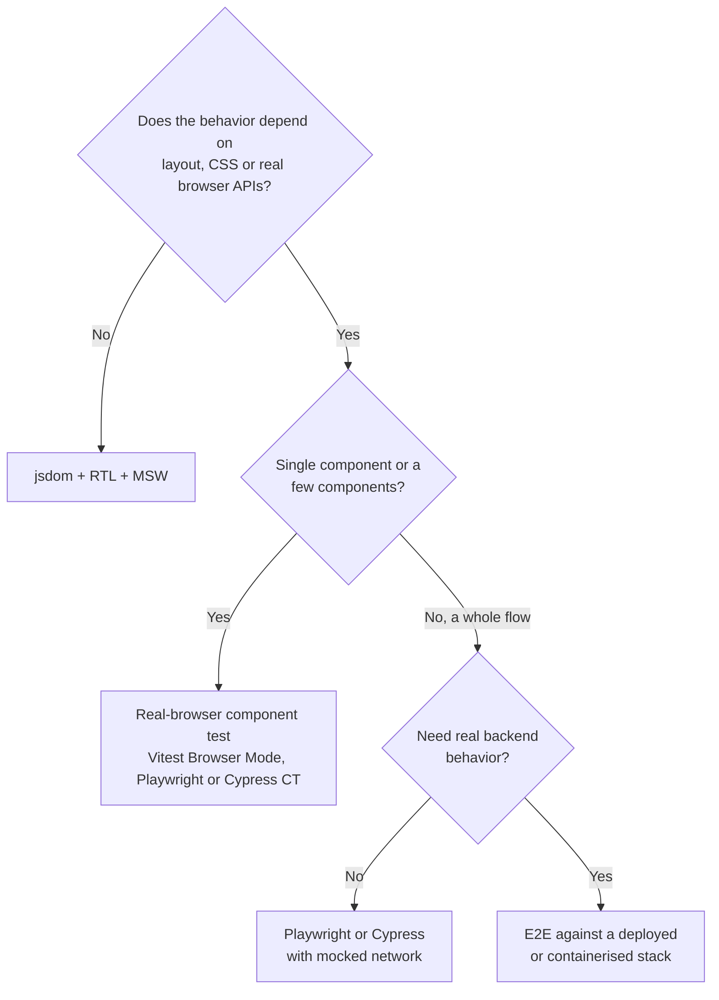
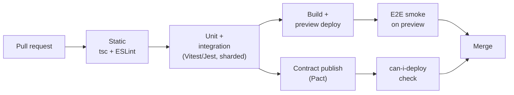
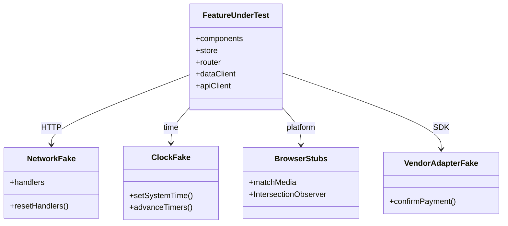

<!-- Generated by scripts/sync-knowledge.js from notes/ and README.md — do not edit here. -->
<!-- sections (line ranges in this file): Table of Contents 19-40 · ELI5 41-54 · Core Concept 55-405 · Framework Comparison 406-451 · Real-World Examples 452-647 · Key Points Summary 648-667 · Test Your Understanding 668-747 · Cheat Sheet 748-790 · References & Further Reading 791-825 -->

# Integration Testing

> **Date:** 2026-11-06 · **Last updated:** 2026-11-06
> **Category:** Frontend System Design
> **Sub-Topic:** Testing / Integration Testing
> **Level:** Intermediate · **Reading time:** ~28 min
> **Informs:** test boundary and mocking policy (what is real vs faked), network mocking with MSW, mock-vs-API drift and contract testing, feature- and route-level test design, test data factories, jsdom vs real-browser test environment, CI stage layout for integration suites, cross-framework integration patterns (Vue, Angular, Svelte, React Native, Flutter)

> **Pre-requisite:** [React Testing Library Patterns](./react-testing-library-patterns.md) (queries, user-event, MSW basics) and [Server State vs Client State](./server-state-vs-client-state.md) (the data layers an integration test exercises).
> This note covers **testing several real units together** — components, state, router and data client — with only the outside world faked, and how to keep those fakes honest. For how integration tests fit the overall mix, see [Testing Strategies & Pyramid](./testing-strategies-and-pyramid.md).

**Previous:** [React Testing Library Patterns](./react-testing-library-patterns.md) · **Next:** [E2E Testing (Playwright, Cypress)](./e2e-testing-playwright-cypress.md)

---

## Table of Contents

1. [ELI5 — Simple Explanation](#eli5--simple-explanation)
2. [Section 1: What "Integration" Means in Frontend](#section-1-what-integration-means-in-frontend)
3. [Section 2: Why Integration Tests Carry So Much Weight](#section-2-why-integration-tests-carry-so-much-weight)
4. [Section 3: Choosing the Boundary — What Is Real, What Is Faked](#section-3-choosing-the-boundary--what-is-real-what-is-faked)
5. [Section 4: Rendering a Feature or a Route](#section-4-rendering-a-feature-or-a-route)
6. [Section 5: Network Fakes That Behave Like a Server](#section-5-network-fakes-that-behave-like-a-server)
7. [Section 6: Keeping Mocks Honest — Contracts and Schemas](#section-6-keeping-mocks-honest--contracts-and-schemas)
8. [Section 7: Faking the Browser, Time and Third Parties](#section-7-faking-the-browser-time-and-third-parties)
9. [Section 8: Where Integration Tests Run](#section-8-where-integration-tests-run)
10. [Section 9: Determinism and Flakiness](#section-9-determinism-and-flakiness)
11. [Section 10: Organising Suites and CI](#section-10-organising-suites-and-ci)
12. [Framework Comparison](#framework-comparison)
13. [Real-World Examples](#real-world-examples)
14. [Key Points Summary](#key-points-summary)
15. [Test Your Understanding](#test-your-understanding)
16. [Cheat Sheet](#cheat-sheet)
17. [References & Further Reading](#references--further-reading)

---

## ELI5 — Simple Explanation

Think about building a bicycle.

- **Unit tests** check each part on a workbench: the brake lever squeezes, the chain is the right length, the bell rings.
- **Integration tests** bolt the parts together and put the bike on a **training stand**: pedal, change gear, squeeze the brake, and check that the back wheel actually slows down. The road is fake (the stand), but the bike is real.
- **E2E tests** take the finished bike out on a **real road** with real traffic. Very convincing, but slow, and a pothole (a flaky network) can fail the ride even when the bike is fine.

Lots of bikes have perfect parts that don't work together: the brake cable is too short, or the gear lever turns the wrong way. Only the training stand catches those problems cheaply.

> **An integration test runs your real components, state and data code together and fakes only what's outside your app: the network, time and third-party services.**

---

## Core Concept — Step by Step

### Section 1: What "Integration" Means in Frontend

"Integration test" means different things to different teams. Before you argue about how many to write, agree on what the word means.



| Level | What is real | What is faked | Typical tools |
|---|---|---|---|
| **Unit** | One function, reducer, hook or util | Everything it calls | Vitest, Jest |
| **Component** | One component and its children | Providers, data, network | RTL, Vue/Angular/Svelte Testing Library |
| **Integration** (this note) | A **feature or route**: components, stores, router, data client, API client, validation | **Network** (MSW), time, browser APIs jsdom lacks, third-party SDKs | RTL + MSW, Vitest Browser Mode, Storybook tests, Angular `HttpTestingController` |
| **Contract** | The request and response shapes | The other side of the API | Pact, OpenAPI schema validation |
| **E2E** | Browser, deployed frontend, backend, database | Usually nothing (sometimes payment or email providers) | Playwright, Cypress |

There are two common uses of the term, and both are valid:
- **Frontend-internal integration** (the main topic here): several **units of your own app** working together, with the network as the boundary.
- **Frontend-to-backend integration**: your app's API client against a **real** API, often a local or containerised backend. It's slower and sits closer to E2E (Section 6).

> **Platform naming differs.** In Flutter, the `integration_test` package runs the **whole app on a device or emulator**, which other stacks would call E2E. Android and iOS docs also use "instrumented" and "UI tests" for on-device tests. Check what a team means before comparing numbers.

---

### Section 2: Why Integration Tests Carry So Much Weight

The test pyramid says "mostly unit tests". Kent C. Dodds's **Testing Trophy** (and the line he popularised from Guillermo Rauch, *"Write tests. Not too many. Mostly integration."*) argues that, for UI code, **integration tests give the best confidence for their cost**. Static analysis (TypeScript, ESLint) forms the base of the trophy.



Why frontend bugs gather at the seams:

| Bug | Unit test catches it? | Integration test catches it? |
|---|---|---|
| Form submits `quantity` as a string; API client expects a number | ❌ each side is fine alone | ✅ |
| Mutation succeeds, but the list doesn't refresh (missing cache invalidation) | ❌ | ✅ |
| Route param renamed `:id` → `:productId`; page reads the old name | ❌ | ✅ |
| Error from the API never reaches the toast because a hook swallows it | ❌ | ✅ |
| Button disabled state wired to the wrong store selector | ❌ | ✅ |
| `formatPrice(1234.5, 'de-DE')` returns the wrong separator | ✅ | ✅ (but slower to find) |

The right mix depends on the product, so don't treat any shape as a law. Pure-logic libraries are mostly unit tests. Feature-heavy UIs lean on integration tests. Critical revenue paths also get E2E. See [Testing Strategies & Pyramid](./testing-strategies-and-pyramid.md).

---

### Section 3: Choosing the Boundary — What Is Real, What Is Faked

**Rule: fake at the edges of your app, never in the middle.** Everything you own and ship stays real.



| Fake it? | Thing | Why |
|---|---|---|
| ✅ Fake | HTTP and WebSocket traffic | Slow, non-deterministic, needs a backend; MSW keeps your client code real |
| ✅ Fake | Time (`Date`, timers) | Deterministic tests for debounce, expiry, "2 minutes ago" |
| ✅ Fake | Browser APIs jsdom doesn't implement | Otherwise the component crashes on mount |
| ✅ Fake | Third-party SDKs (Stripe, maps, analytics) | You don't test their code; their scripts need the network |
| ✅ Fake | Randomness (UUIDs, `Math.random`) | Stable IDs and assertions |
| ❌ Keep real | Your components, hooks, stores, router, data client | That's exactly the wiring you're testing |
| ❌ Keep real | Your API client and error mapping | Bugs often live here |
| ⚠️ Rarely | Feature flags | Set them explicitly through a test provider; don't mock the flag module |

**Test doubles, briefly:** a *stub* returns canned data, a *spy* records calls, a *mock* asserts on calls, and a *fake* is a working lightweight implementation (an in-memory "server"). Integration tests prefer **fakes** at the network edge, because fakes let multi-step flows (create, then list) behave realistically.

---

### Section 4: Rendering a Feature or a Route

The natural unit for an integration test is **a route** (or a self-contained feature), rendered with the **same providers and route config as production**.



```tsx
// src/test/render-route.tsx
import { createMemoryRouter, RouterProvider } from 'react-router';
import { QueryClient, QueryClientProvider } from '@tanstack/react-query';
import { render } from '@testing-library/react';
import userEvent from '@testing-library/user-event';
import { routes } from '../app/routes'; // the SAME route config production uses

export function renderRoute(path: string) {
  const queryClient = new QueryClient({ defaultOptions: { queries: { retry: false } } });
  const router = createMemoryRouter(routes, { initialEntries: [path] });
  const user = userEvent.setup();
  render(
    <QueryClientProvider client={queryClient}>
      <RouterProvider router={router} />
    </QueryClientProvider>,
  );
  return { user, router, queryClient };
}
```

**Design rules:**
- **Use production route config and providers.** A test-only route tree drifts from the real one and tests a different app.
- **Assert user-visible outcomes**, including after navigation ("the Order confirmed heading is shown"), not `navigate` calls.
- **One scenario per test**, written as a user story: *given* (data in the fake server), *when* (user actions), *then* (what they see).
- **Cover the unhappy paths here.** Errors, empty states, slow responses, 401s and validation failures are cheap to produce with a network fake and expensive in E2E.

---

### Section 5: Network Fakes That Behave Like a Server

Simple MSW handlers return fixed JSON. For multi-step flows, make the fake **stateful**, so a `POST` changes what the next `GET` returns.



```typescript
// src/test/fake-api.ts — a tiny in-memory backend for tests
import { http, HttpResponse } from 'msw';

type Todo = { id: string; title: string; done: boolean };
const db = new Map<string, Todo>();
let nextId = 1;

export const fakeDb = {
  reset() { db.clear(); nextId = 1; },
  seed(...todos: Omit<Todo, 'id'>[]) { todos.forEach((t) => { const id = String(nextId++); db.set(id, { id, ...t }); }); },
  all: () => [...db.values()],
};

export const todoHandlers = [
  http.get('https://api.test/todos', () => HttpResponse.json(fakeDb.all())),
  http.post('https://api.test/todos', async ({ request }) => {
    const body = (await request.json()) as { title?: string };
    if (!body.title?.trim()) {
      return HttpResponse.json({ error: 'Title is required' }, { status: 422 });
    }
    const todo = { id: String(nextId++), title: body.title, done: false };
    db.set(todo.id, todo);
    return HttpResponse.json(todo, { status: 201 });
  }),
];
```

**Good handler habits:**
- `server.listen({ onUnhandledRequest: 'error' })` so a request the test didn't plan for fails loudly.
- **Validate input in handlers** (422 for a bad body). Tests then catch the UI sending the wrong payload.
- **Reset state** in `beforeEach`/`afterEach`. Shared fake state between tests causes order-dependent failures.
- **Share handlers** between tests, Storybook and local development, so there's one definition of fake API behaviour.
- For larger apps, libraries such as `@mswjs/data` model entities and relations, and code generators can produce typed MSW handlers from an OpenAPI spec.

**GraphQL and WebSockets:** MSW handles GraphQL (`graphql.query('GetUser', …)`, `graphql.mutation(…)`) and, in recent versions, WebSocket connections (`ws.link(…)`). Check the MSW docs for the WebSocket API in your version.

---

### Section 6: Keeping Mocks Honest — Contracts and Schemas

The weakness of network fakes is **drift**: the backend renames `total` to `totalAmount`, the fake still returns `total`, every test stays green, and production breaks.



Ways to keep fakes truthful, from cheapest to strongest:

| Technique | How it works | Catches | Cost |
|---|---|---|---|
| **Shared types** | Frontend and backend import the same TypeScript types (monorepo) or generated ones | Renamed or removed fields at compile time | Low, but types aren't runtime checks |
| **Generate types and fakes from OpenAPI / GraphQL schema** | Codegen produces the client types and the mock handlers | Drift whenever the schema is updated | Low to medium |
| **Validate fixtures with runtime schemas** | Parse every handler response with the same Zod or Valibot schema the app uses | Fixtures that the real parser would reject | Low |
| **Consumer-driven contract tests (Pact)** | Frontend records expected interactions; backend CI verifies them against the real API | Breaking backend changes **before** deploy | Medium: needs a broker and backend buy-in |
| **A few integration tests against a real API** | Run the API client against a local or containerised backend (e.g. Docker Compose, Testcontainers) | Real auth, serialisation and status-code behaviour | High: slower, needs data setup |
| **E2E smoke tests** | Critical journeys against a deployed stack | Everything, late | Highest |

> A common, balanced setup: generated types + schema-validated MSW fixtures for every PR, contract tests for APIs owned by other teams, and a handful of E2E smoke tests on preview deployments.

---

### Section 7: Faking the Browser, Time and Third Parties

jsdom implements the DOM, not a full browser. Features a component relies on may be missing.

| Missing or partial in jsdom | Symptom | Test setup |
|---|---|---|
| `window.matchMedia` | `TypeError: window.matchMedia is not a function` | Stub returning `{ matches: false, addEventListener() {}, … }` |
| `IntersectionObserver`, `ResizeObserver` | `ReferenceError` on mount | Minimal class stub; trigger callbacks manually when the test needs it |
| Layout (`getBoundingClientRect`, `offsetWidth`) | Always zeros, so virtual lists render nothing | Stub sizes, or move the test to a real browser |
| `Element.prototype.scrollIntoView` | `scrollIntoView is not a function` | `Element.prototype.scrollIntoView = vi.fn()` |
| Canvas, WebGL, media playback | No-ops or errors | Mock the library or test in a real browser |

**Time:** use fake timers (`vi.useFakeTimers()` / `jest.useFakeTimers()`) for debounce, polling and expiry, and pin the date (`vi.setSystemTime(new Date('2026-01-15T10:00:00Z'))`) so "Today" and relative times are stable. Also pin the **time zone** (e.g. `TZ=UTC` in the test script) and the **locale** your formatting tests assume.

**Third-party SDKs:** wrap each one in a thin adapter you own (`payments.ts`, `analytics.ts`), and fake the adapter in tests. Your code depends on your interface, and the test doesn't load vendor scripts.



---

### Section 8: Where Integration Tests Run

| Environment | Speed | Fidelity | Good for | Watch out for |
|---|---|---|---|---|
| **jsdom / happy-dom** (Vitest, Jest) | Fast | DOM only, no layout or paint | Most feature and route tests | Missing APIs (Section 7), layout-dependent UI |
| **Real browser component tests** (Vitest Browser Mode, Playwright component testing, Cypress component testing) | Slower | Real rendering, CSS, layout, events | Virtual lists, drag-and-drop, focus, CSS-driven behaviour | Browser install in CI; check each tool's maturity status in its docs |
| **Storybook interaction tests** (play functions, run via Storybook's test tooling) | Medium | Real browser | Design-system components and their states | Need stories to be kept up to date |
| **Full app against a fake API** (Playwright + MSW or `page.route`) | Slow | Real app and browser, fake backend | Cross-route flows with controlled data | Overlaps with E2E; keep the number small |



---

### Section 9: Determinism and Flakiness

Integration tests touch more moving parts, so they need more discipline than unit tests.

| Source of flakiness | Fix |
|---|---|
| Shared state between tests (query cache, store, fake db, `localStorage`) | Fresh instances per test; reset fakes and `localStorage` in `afterEach` |
| Not waiting for the final UI | `await findBy…`; never fixed `sleep`s |
| Real timers and dates | Fake timers, pinned system time, pinned time zone and locale |
| Unplanned network requests | `onUnhandledRequest: 'error'` |
| Order dependence hidden by always running in the same order | Run with shuffled order now and then (Vitest `--sequence.shuffle`; Jest `--randomize`) |
| Leaked timers, sockets or subscriptions after a test | Unmount (RTL auto-cleanup), clear timers, close sockets in effect cleanups |
| Tests that pass alone but fail in parallel | Avoid global singletons; don't share files, ports or env variables between workers |

**Policy for flaky tests:** a flaky test is a bug in the test or the app. Quarantine it with an owner and a deadline, fix the root cause, and track flake rates in CI. Don't let automatic retries hide the problem for good.

---

### Section 10: Organising Suites and CI

```text
src/
  features/checkout/
    CheckoutPage.tsx
    checkout.api.ts
    checkout.integration.test.tsx     ← route-level scenarios with MSW
    cart.utils.test.ts                ← unit tests next to the code
  test/
    setup.ts                          ← jest-dom, MSW server, browser API stubs
    server.ts                         ← setupServer(...handlers)
    handlers/                         ← shared with Storybook and local dev
    factories.ts                      ← buildUser(), buildOrder(...)
    render-route.tsx                  ← production providers + memory router
```

**Factories, not giant fixtures:** a builder that returns a valid default object with overrides (`buildOrder({ status: 'refunded' })`) keeps each test's important data visible and survives schema changes in one place.

**CI layout:**



- Run unit and integration tests on **every PR**; they should finish in minutes. Shard them across CI machines when they don't (`vitest --shard=1/4`, `jest --shard=1/4`).
- Split suites with **Vitest projects** (earlier called *workspaces*) or **Jest `projects`**, so integration tests can use a different environment and setup from Node-only unit tests.
- Integration tests usually provide most of the meaningful **coverage** for UI code. Treat coverage as a map of untested code, not a target to game.

---

## Framework Comparison

The idea is the same everywhere: real app code, fake edges. The tooling differs.

| Stack | Render a feature | Fake the network | State and routing |
|---|---|---|---|
| **React** | RTL `render` with production providers | MSW | Real store; `createMemoryRouter` with app routes |
| **Vue** | Vue Testing Library `render(Page, { global: { plugins: [router, pinia] } })` | MSW | Real Pinia, or `createTestingPinia({ stubActions: false })` to keep actions real; `createRouter` with `createMemoryHistory()` |
| **Angular** | `TestBed` / Angular Testing Library `render` | `provideHttpClientTesting()` + `HttpTestingController`, or MSW | Real services; `RouterTestingHarness` for routed components |
| **Svelte / SvelteKit** | Svelte Testing Library `render` | MSW | Test `load` functions as plain functions plus the page component; full routing in Playwright |
| **React Native** | React Native Testing Library `render` inside a `NavigationContainer` | MSW (`msw/native` with the required polyfills) | Real navigation stack and stores |
| **Flutter** | `testWidgets` with `pumpWidget(MyApp(...))` | Fake repository or a mock HTTP client injected through DI | `integration_test` package runs the full app on a device (closer to E2E) |
| **Native Android / iOS** | Compose UI tests / XCUITest | Local mock server (e.g. OkHttp `MockWebServer` on Android) or injected fakes | Real navigation in instrumented tests |



---

## Real-World Examples

**Example 1 — Route-level checkout test (React + TanStack Query + MSW):**
```tsx
import { screen, within } from '@testing-library/react';
import { http, HttpResponse } from 'msw';
import { server } from '../../test/server';
import { renderRoute } from '../../test/render-route';
import { buildProduct } from '../../test/factories';

test('adds a product to the cart and shows the updated total', async () => {
  const product = buildProduct({ id: '42', name: 'Desk Lamp', price: 39.5 });
  let cart: { items: { productId: string; qty: number }[] } = { items: [] };

  server.use(
    http.get('https://api.test/products/:id', () => HttpResponse.json(product)),
    http.get('https://api.test/cart', () => HttpResponse.json(cart)),
    http.post('https://api.test/cart/items', async ({ request }) => {
      const body = (await request.json()) as { productId: string; qty: number };
      if (typeof body.qty !== 'number') return HttpResponse.json({ error: 'qty must be a number' }, { status: 400 });
      cart = { items: [...cart.items, body] };
      return HttpResponse.json(cart, { status: 201 });
    }),
  );

  const { user } = renderRoute('/products/42');

  await user.click(await screen.findByRole('button', { name: 'Add Desk Lamp to cart' }));
  const badge = await screen.findByRole('status', { name: /cart/i });
  expect(badge).toHaveTextContent('1 item');

  await user.click(screen.getByRole('link', { name: /view cart/i }));
  const summary = await screen.findByRole('region', { name: 'Order summary' });
  expect(within(summary).getByText('$39.50')).toBeInTheDocument();
});
```

**Example 2 — The unhappy path is cheap here (BAD → GOOD):**
```tsx
// ❌ BAD: mocks the app's own hook — skips the API client, error mapping and the query cache
vi.mock('../useCheckout', () => ({ useCheckout: () => ({ error: new Error('Payment failed') }) }));

// ✅ GOOD: the network fails; the real code path maps it to a message
test('shows a declined-card message and keeps the form editable', async () => {
  server.use(
    http.post('https://api.test/checkout', () =>
      HttpResponse.json({ code: 'card_declined' }, { status: 402 }),
    ),
  );
  const { user } = renderRoute('/checkout');

  await user.click(await screen.findByRole('button', { name: 'Pay now' }));
  expect(await screen.findByRole('alert')).toHaveTextContent('Your card was declined');
  expect(screen.getByRole('button', { name: 'Pay now' })).toBeEnabled();
});
```

**Example 3 — Browser API stubs in the shared setup file:**
```typescript
// src/test/setup.ts
import '@testing-library/jest-dom/vitest';
import { server } from './server';

beforeAll(() => server.listen({ onUnhandledRequest: 'error' }));
afterEach(() => { server.resetHandlers(); localStorage.clear(); });
afterAll(() => server.close());

Object.defineProperty(window, 'matchMedia', {
  writable: true,
  value: (query: string) => ({
    matches: false, media: query, onchange: null,
    addEventListener: vi.fn(), removeEventListener: vi.fn(), dispatchEvent: vi.fn(),
    addListener: vi.fn(), removeListener: vi.fn(), // deprecated API some libraries still call
  }),
});

class IO { observe = vi.fn(); unobserve = vi.fn(); disconnect = vi.fn(); takeRecords = () => []; }
vi.stubGlobal('IntersectionObserver', IO);
vi.stubGlobal('ResizeObserver', class { observe = vi.fn(); unobserve = vi.fn(); disconnect = vi.fn(); });
Element.prototype.scrollIntoView = vi.fn();
```

**Example 4 — Schema-validated fixtures so fakes can't drift silently:**
```typescript
// src/api/schemas.ts — the SAME schema the app uses to parse responses
import { z } from 'zod';
export const OrderSchema = z.object({
  id: z.string(),
  status: z.enum(['pending', 'paid', 'refunded']),
  totalAmount: z.number(),
});

// src/test/factories.ts
import { OrderSchema } from '../api/schemas';
export function buildOrder(overrides: Partial<z.infer<typeof OrderSchema>> = {}) {
  // parse() throws if a fixture no longer matches the real contract
  return OrderSchema.parse({ id: 'ord_1', status: 'pending', totalAmount: 120, ...overrides });
}
```

**Example 5 — Consumer contract test with Pact (JS):**
```typescript
import { PactV3, MatchersV3 } from '@pact-foundation/pact';
import { getUser } from '../api/users';

const provider = new PactV3({ consumer: 'web-app', provider: 'users-api' });

test('getUser matches the users-api contract', async () => {
  provider
    .given('user 42 exists')
    .uponReceiving('a request for user 42')
    .withRequest({ method: 'GET', path: '/users/42' })
    .willRespondWith({
      status: 200,
      headers: { 'Content-Type': 'application/json' },
      body: MatchersV3.like({ id: '42', name: 'Ada Lovelace' }),
    });

  await provider.executeTest(async (mockServer) => {
    const user = await getUser('42', { baseUrl: mockServer.url });
    expect(user.name).toBe('Ada Lovelace');
  });
});
```

**Example 6 — Angular: real service + component, faked HTTP:**
```typescript
import { TestBed } from '@angular/core/testing';
import { provideHttpClient } from '@angular/common/http';
import { HttpTestingController, provideHttpClientTesting } from '@angular/common/http/testing';
import { render, screen } from '@testing-library/angular';
import { UserProfileComponent } from './user-profile.component';

test('loads and shows the user', async () => {
  await render(UserProfileComponent, {
    providers: [provideHttpClient(), provideHttpClientTesting()],
  });
  const http = TestBed.inject(HttpTestingController);

  http.expectOne('/api/users/me').flush({ id: '42', name: 'Ada Lovelace' });

  expect(await screen.findByRole('heading', { name: 'Ada Lovelace' })).toBeInTheDocument();
  http.verify(); // no unexpected requests
});
```

**Example 7 — Vue: real Pinia store and router:**
```typescript
import { render, screen } from '@testing-library/vue';
import userEvent from '@testing-library/user-event';
import { createPinia } from 'pinia';
import { createRouter, createMemoryHistory } from 'vue-router';
import App from '../App.vue';
import { routes } from '../router/routes';

test('navigates to the cart after adding an item', async () => {
  const router = createRouter({ history: createMemoryHistory(), routes });
  router.push('/products/42');
  await router.isReady();

  const user = userEvent.setup();
  render(App, { global: { plugins: [router, createPinia()] } });

  await user.click(await screen.findByRole('button', { name: /add to cart/i }));
  await user.click(screen.getByRole('link', { name: /view cart/i }));
  expect(await screen.findByRole('heading', { name: 'Your cart' })).toBeInTheDocument();
});
```

**Example 8 — Splitting suites with Vitest projects:**
```typescript
// vitest.config.ts
import { defineConfig } from 'vitest/config';

export default defineConfig({
  test: {
    projects: [
      { extends: true, test: { name: 'unit', include: ['src/**/*.test.ts'], environment: 'node' } },
      {
        extends: true,
        test: {
          name: 'integration',
          include: ['src/**/*.integration.test.tsx'],
          environment: 'jsdom',
          globals: true,
          setupFiles: ['./src/test/setup.ts'],
        },
      },
    ],
  },
});
// Run one suite: npx vitest --project integration
```

---

## Key Points Summary

| Concept | One-Line Explanation |
|---|---|
| **Integration test** | Several real units of your app (components, state, router, data client) tested together |
| **Boundary rule** | Fake the edges (network, time, browser gaps, vendors); keep everything you own real |
| **Testing Trophy** | For UI code, integration tests usually give the best confidence for their cost |
| **Route-level rendering** | Use production routes and providers with a memory router |
| **Stateful network fake** | An in-memory "server" so POSTs affect later GETs |
| **`onUnhandledRequest: 'error'`** | Unplanned requests fail the test instead of passing silently |
| **Mock drift** | Fakes go stale when the API changes; tests stay green while production breaks |
| **Contract testing** | Consumer records expectations; provider CI verifies them (Pact) |
| **Schema-validated fixtures** | Parse fixtures with the app's runtime schema so drift fails fast |
| **jsdom gaps** | No layout, no `matchMedia`/observers; stub or move to a real browser |
| **Vendor adapters** | Wrap third-party SDKs in your own interface and fake that |
| **Determinism** | Fresh state, fake time, pinned TZ/locale, shuffled order to expose leaks |
| **Platform naming** | Flutter's `integration_test` = on-device full app (E2E-like) |

---

## Test Your Understanding

**Q1 (Basic):**
What makes a test an "integration test" in a frontend codebase, and how is it different from a component test and an E2E test?

<details>
<summary>Answer</summary>

An integration test runs **several real units of your app together**: typically a route or feature with its components, stores, router, data client and API client. Only things outside the app are faked (network, time, missing browser APIs, third-party SDKs).

A **component test** focuses on one component with its props and usually stubs providers and data. An **E2E test** runs the deployed app in a real browser against a real backend, with nothing (or very little) faked. Integration tests sit between them: they catch wiring bugs between your units at close to unit-test speed, but they can't catch real-backend or real-browser problems.
</details>

**Q2 (Application):**
A product page test mocks `useProduct` and `useAddToCart` with `vi.mock`. It passes, but in production the cart badge doesn't update after adding an item. Why did the test miss it, and how would you rewrite it?

<details>
<summary>Answer</summary>

By mocking the hooks, the test removed exactly the code with the bug. The likely cause is a missing cache invalidation (the mutation doesn't invalidate or update the `cart` query). With hooks mocked, the test never runs the mutation, the query cache or the refetch.

Rewrite it as an integration test: render the route with a real `QueryClient` and production providers, fake only the **network** with MSW (a stateful handler where `POST /cart/items` changes what `GET /cart` returns), click "Add to cart", and `await` the badge showing "1 item". The test now fails until the invalidation is fixed.
</details>

**Q3 (Tricky):**
All integration tests are green, but a release breaks the order history page: the backend renamed `total` to `totalAmount`. What process gap allowed this, and what would you add?

<details>
<summary>Answer</summary>

The MSW fixtures were hand-written and still returned `total`, so the fakes **drifted** from the real API. Integration tests only prove the frontend works against the fake.

Add layers that tie fakes to the real contract:
1. **Generate types and fixtures from the API schema** (OpenAPI/GraphQL), so a renamed field breaks compilation or codegen.
2. **Parse fixtures with the app's runtime schema** (Zod/Valibot), so a stale fixture throws.
3. For APIs owned by another team, **consumer-driven contract tests** (Pact). The backend's CI verifies the frontend's expectations before deploying, and `can-i-deploy` blocks the breaking release.
4. Keep a small **E2E smoke suite** on preview deployments as the last net.
</details>

**Q4 (Tricky):**
An infinite-scroll list test renders zero rows in jsdom, though it works in the browser. Stubbing `IntersectionObserver` stopped the crash, but the "load more" still never fires. What's going on, and what are your options?

<details>
<summary>Answer</summary>

jsdom has **no layout**. Element sizes are zero and nothing is ever "in view", so a no-op `IntersectionObserver` stub never calls back. If the list is virtualised, it may also compute that zero rows fit in a zero-height viewport.

Options:
- Make the stub **controllable**: capture the callback and trigger it with `isIntersecting: true` from the test, and stub the container size the virtualiser reads.
- Move this test to a **real browser** (Vitest Browser Mode, Playwright or Cypress component testing), where layout and observers really work. That's usually the better choice for layout-driven behaviour.
- Keep the data logic (cursor handling, page merging) covered by fast integration tests that don't depend on scroll.
</details>

**Q5 (Application):**
Integration tests pass locally but fail randomly on CI, mostly in tests that show dates and in tests that run after a "logout" test. What would you check?

<details>
<summary>Answer</summary>

- **Dates:** CI runs in a different **time zone or locale**, and tests use the real clock. Pin `TZ` (e.g. `TZ=UTC`) and the locale in the test script, and use `vi.setSystemTime` for "today".
- **Order dependence:** the logout test probably leaves state behind: `localStorage` tokens, a module-level store, a shared `QueryClient`, or fake-server data. CI may also order or parallelise files differently. Reset all of these in `afterEach`, create fresh clients per test, and run locally with `--sequence.shuffle` (Vitest) or `--randomize` (Jest) to reproduce.
- Confirm `onUnhandledRequest: 'error'` is on, so a test isn't silently relying on a request another test triggered.
</details>

**Q6 (System design):**
You own testing for a large e-commerce frontend (React web, React Native app) that talks to six backend services owned by other teams. Design the integration-testing approach.

<details>
<summary>Answer</summary>

- **Boundary:** integration tests render real routes and screens with production providers. Only the network (MSW on web and `msw/native` on React Native), time, missing platform APIs and vendor SDKs (payments, maps, analytics, behind adapters) are faked.
- **Fake API:** one shared, typed handler set per service, **generated from each OpenAPI spec**, with stateful in-memory stores for flows like cart and checkout. The same handlers power Storybook and local development.
- **Drift control:** fixtures are parsed by the app's runtime schemas. **Pact contracts** cover each of the six services, verified in their CI, with `can-i-deploy` gating both sides.
- **Scenarios:** every route covers loading, empty, error (4xx/5xx/network), auth-expired and success states. Critical journeys (search → product → cart → checkout) also get a few **E2E** tests on preview deployments.
- **Environment:** jsdom for most tests; real-browser component tests for virtualised lists, drag-and-drop and layout.
- **CI:** static checks → sharded unit+integration on every PR (target: a few minutes) → contract publish/verify → E2E smoke on preview. Flaky tests are quarantined with owners, and order shuffling runs nightly.
</details>

---

## Cheat Sheet

**Key Definitions:**
- **Integration test:** Real units of your app tested together, with external dependencies faked
- **Boundary:** The line where real code stops and fakes begin; for frontend usually the network
- **Fake:** A working lightweight implementation (an in-memory API) rather than canned answers
- **Mock drift:** Fakes no longer matching the real API, so tests pass while production fails
- **Consumer-driven contract:** Expectations recorded by the API consumer and verified by the provider
- **Factory / builder:** Function returning a valid default object with overrides for one test

**Quick Reference:**
```text
REAL:  components · hooks · stores · router · data client · API client · validation · i18n
FAKE:  network (MSW / HttpTestingController) · clock · TZ/locale · jsdom gaps · vendor SDKs · randomness

Render:   production routes + providers, memory router, fresh QueryClient/store per test
Network:  server.listen({ onUnhandledRequest: 'error' }) · resetHandlers() in afterEach · stateful fake db
Drift:    generated types/handlers from OpenAPI · Zod-parsed fixtures · Pact for other teams' APIs
jsdom:    stub matchMedia, IntersectionObserver, ResizeObserver, scrollIntoView · no layout
Time:     vi.useFakeTimers() · vi.setSystemTime(...) · TZ=UTC
Flaky:    fresh state · await findBy · shuffle order (vitest --sequence.shuffle / jest --randomize)
Suites:   Vitest projects / Jest projects · shard in CI (--shard=1/4)
Scenarios per route: loading · empty · error (4xx/5xx/network) · auth expired · success
```

**Common Mistakes to Avoid:**

| Mistake | Why Wrong | Fix |
|---|---|---|
| Mocking your own hooks, stores or child components | Removes the wiring the test should check | Fake only at the network and other edges |
| Test-only route tree or providers | Tests a different app from production | Import production routes and providers |
| Hand-written fixtures nobody updates | Mock drift: green tests, broken prod | Generate from schemas; parse with runtime schemas; contracts |
| Stateless handlers for multi-step flows | POST doesn't affect the next GET; flow can't be tested | Stateful in-memory fake, reset per test |
| Silent unhandled requests | Tests depend on accidental behaviour | `onUnhandledRequest: 'error'` |
| Shared `QueryClient`, store or fake db across tests | Order-dependent failures | Fresh instances per test |
| Real clock, TZ and locale | Passes locally, fails in CI | Fake timers, pinned TZ and locale |
| Testing layout-driven UI in jsdom | No layout, so tests lie or need heavy stubs | Real-browser component tests |
| Only happy paths | Error and empty states ship broken | Cover 4xx/5xx/network/empty for each route |
| Calling vendor SDKs in tests | Network, flakiness, cost | Adapter you own + fake adapter |
| Replacing all E2E with integration tests | Real backend, auth and browser issues go unseen | Keep a small E2E smoke suite |

---

## References & Further Reading

**Core docs**
- MSW: [Documentation](https://mswjs.io/docs/) · [Node.js integration](https://mswjs.io/docs/integrations/node) · [React Native integration](https://mswjs.io/docs/integrations/react-native)
- Testing Library: [React Testing Library](https://testing-library.com/docs/react-testing-library/intro) · [Vue Testing Library](https://testing-library.com/docs/vue-testing-library/intro) · [Angular Testing Library](https://testing-library.com/docs/angular-testing-library/intro)
- TanStack Query: [Testing](https://tanstack.com/query/latest/docs/framework/react/guides/testing)
- React Router: [Testing](https://reactrouter.com/start/framework/testing)
- Vitest: [Test projects](https://vitest.dev/guide/projects) · [Browser Mode](https://vitest.dev/guide/browser/) · [Mocking](https://vitest.dev/guide/mocking)
- Angular: [Testing services and HTTP requests](https://angular.dev/guide/http/testing)
- Pinia: [Testing stores](https://pinia.vuejs.org/cookbook/testing.html)

**Contracts**
- Pact: [Introduction](https://docs.pact.io/) · [Pact JS](https://docs.pact.io/implementation_guides/javascript)
- OpenAPI Initiative: [OpenAPI Specification](https://spec.openapis.org/oas/latest.html)
- Testcontainers: [Testcontainers for Node.js](https://node.testcontainers.org/)

**Mobile**
- Flutter: [Integration testing](https://docs.flutter.dev/testing/integration-tests)
- Android: [Test your app](https://developer.android.com/training/testing)

**Deep dives**
- Kent C. Dodds: [The Testing Trophy and Testing Classifications](https://kentcdodds.com/blog/the-testing-trophy-and-testing-classifications)
- Kent C. Dodds: [Write tests. Not too many. Mostly integration.](https://kentcdodds.com/blog/write-tests)
- Kent C. Dodds: [Stop mocking fetch](https://kentcdodds.com/blog/stop-mocking-fetch)
- Martin Fowler: [Contract Test](https://martinfowler.com/bliki/ContractTest.html) · [Integration Test](https://martinfowler.com/bliki/IntegrationTest.html)

---

> **Previous Topic:** [React Testing Library Patterns](./react-testing-library-patterns.md)
> — Queries, user-event, async utilities and providers for component tests

> **Next Topic:** [E2E Testing (Playwright, Cypress)](./e2e-testing-playwright-cypress.md)
> — Testing the deployed app in real browsers against a real backend

*Saved on: 2026-11-06 | Repo: Frontend System Design Learning Notes*
