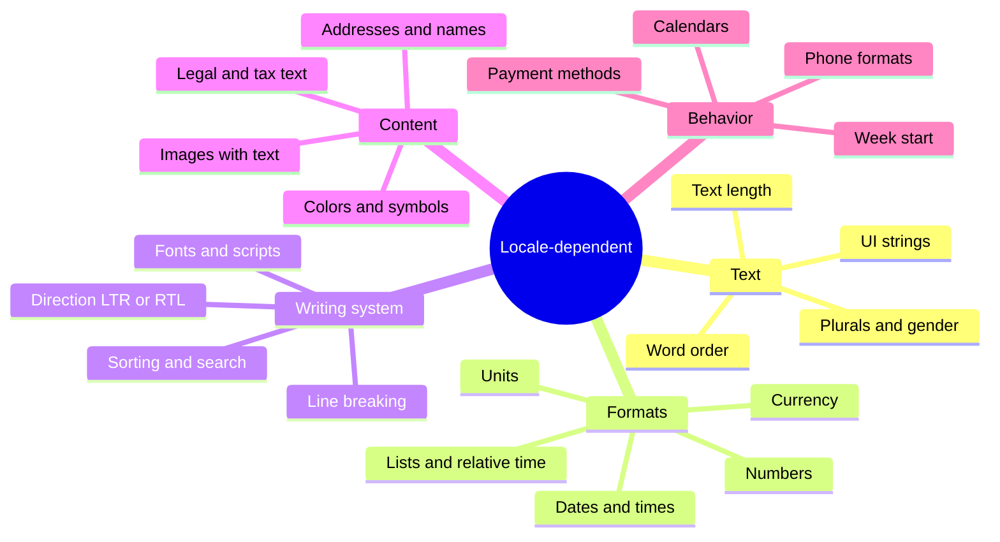
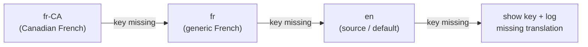
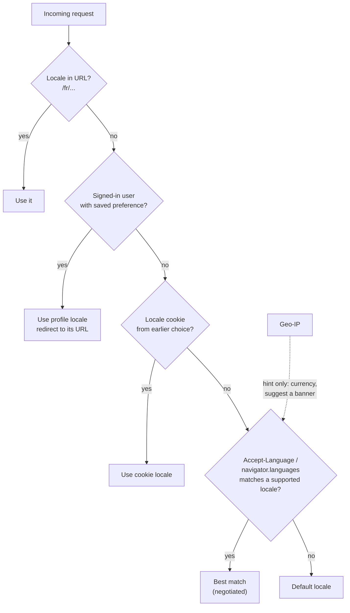
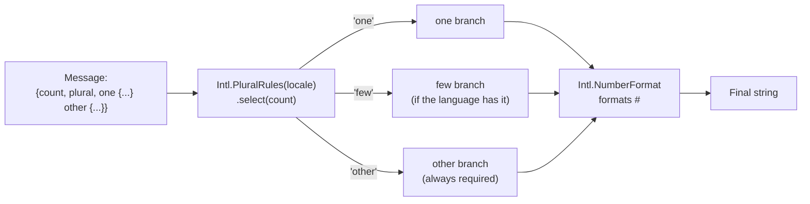
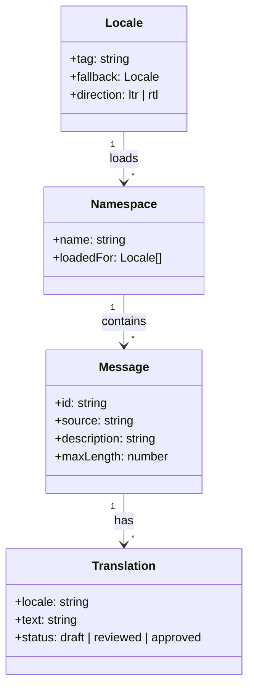
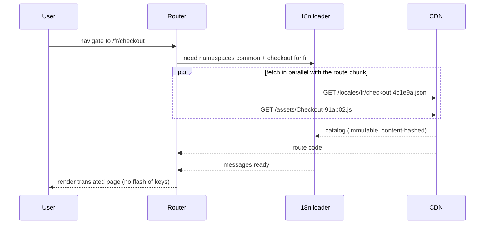
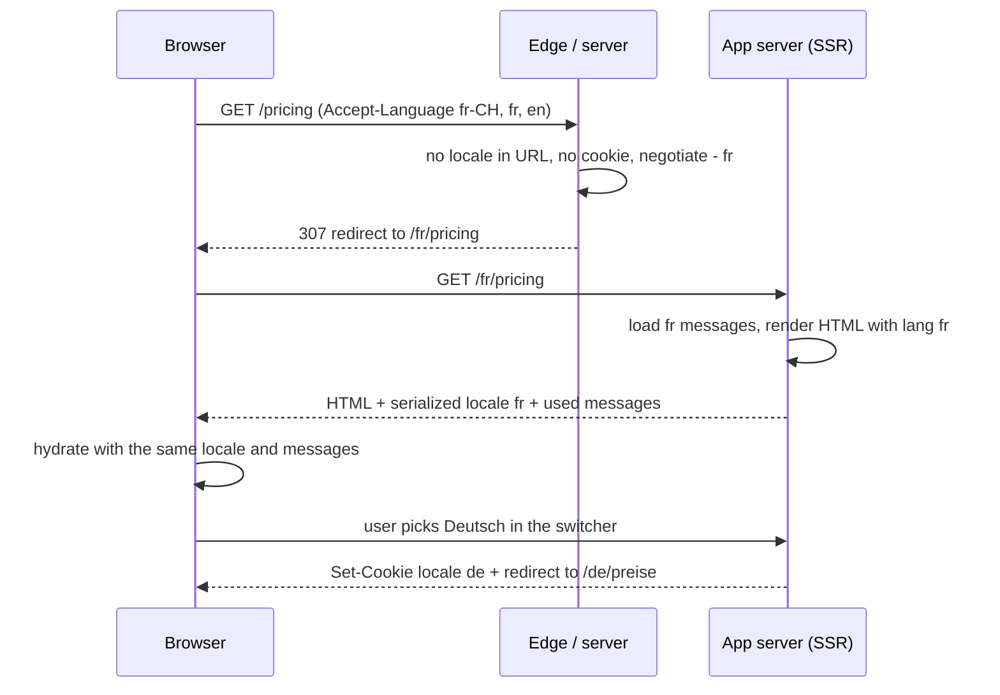
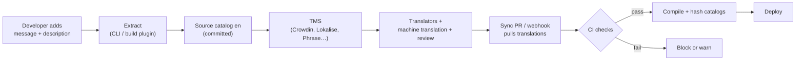
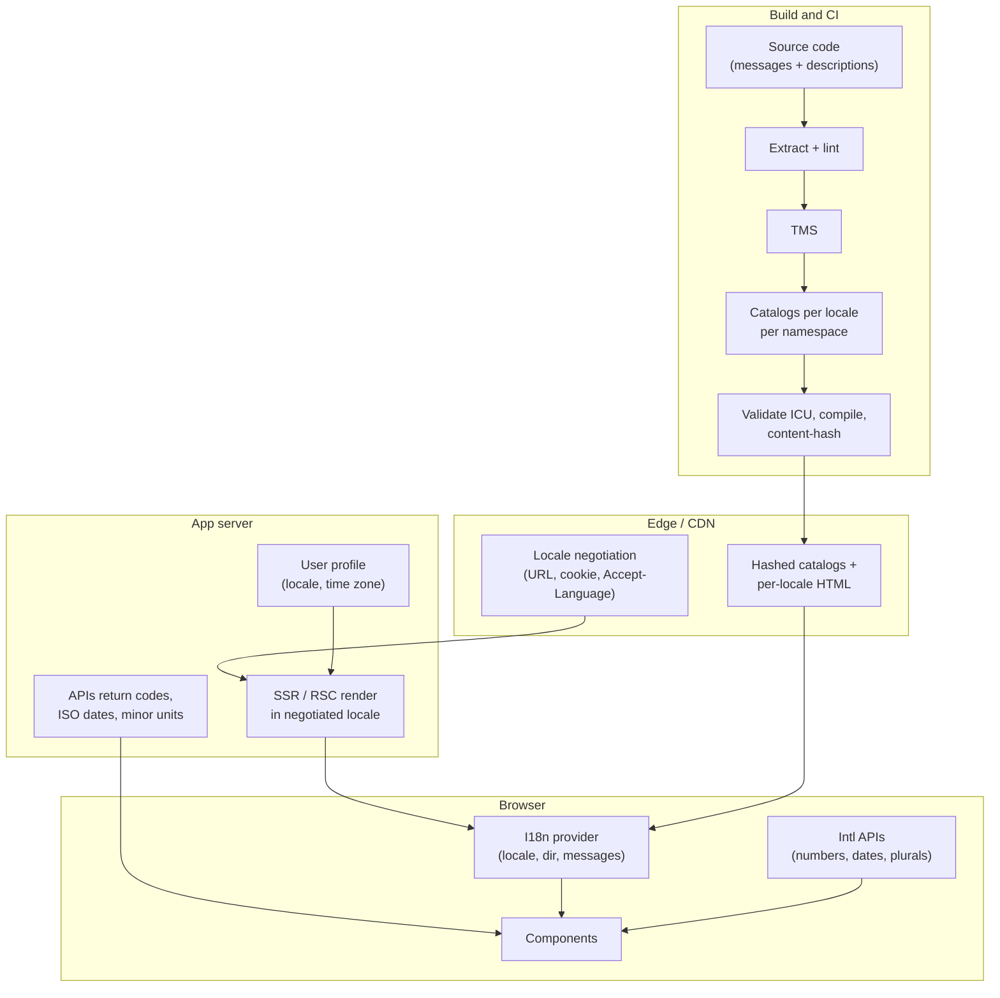

<!-- Generated by scripts/sync-knowledge.js from notes/ and README.md — do not edit here. -->
<!-- sections (line ranges in this file): Table of Contents 19-42 · ELI5 43-56 · Core Concept 57-490 · Framework Comparison 491-505 · Full Visual 506-552 · Real-World Examples 553-747 · Key Points Summary 748-768 · Test Your Understanding 769-849 · Cheat Sheet 850-899 · References & Further Reading 900-935 -->

# Internationalization (i18n) Architecture

> **Date:** 2026-11-06 · **Last updated:** 2026-11-06
> **Category:** Frontend System Design
> **Sub-Topic:** Internationalization / Architecture
> **Level:** Intermediate · **Reading time:** ~30 min
> **Informs:** locale negotiation and persistence, localized URL strategy and hreflang SEO, message format (ICU) and key strategy, translation catalog loading and code splitting, SSR/SSG per locale and hydration safety, translation pipeline (TMS, CI checks, pseudo-localization), i18n library choice per framework, server API contract for localized content

> **Pre-requisite:** [Server-Side Rendering (SSR)](./server-side-rendering-ssr.md) (where locale-specific HTML is produced) and [Code Splitting & Lazy Loading](./code-splitting-and-lazy-loading.md) (how catalogs are loaded).
> This note is the **architecture** of a multi-language app. The two notes after it go deeper on [RTL Layout Support](./rtl-layout-support.md) and [Date, Number & Currency Formatting](./date-number-and-currency-formatting.md).

**Previous:** [Automated A11y Testing (axe, Lighthouse)](./automated-a11y-testing-axe-lighthouse.md) · **Next:** [RTL Layout Support](./rtl-layout-support.md)

---

## Table of Contents

1. [ELI5 — Simple Explanation](#eli5--simple-explanation)
2. [Section 1: i18n, l10n and What Actually Varies](#section-1-i18n-l10n-and-what-actually-varies)
3. [Section 2: Locale Identifiers (BCP 47) and Fallback Chains](#section-2-locale-identifiers-bcp-47-and-fallback-chains)
4. [Section 3: Locale Detection and Negotiation](#section-3-locale-detection-and-negotiation)
5. [Section 4: URL Strategy and SEO](#section-4-url-strategy-and-seo)
6. [Section 5: Messages — Never Concatenate, Use ICU MessageFormat](#section-5-messages--never-concatenate-use-icu-messageformat)
7. [Section 6: Keys, Catalogs and Namespaces](#section-6-keys-catalogs-and-namespaces)
8. [Section 7: Loading Translations Without Bloating the Bundle](#section-7-loading-translations-without-bloating-the-bundle)
9. [Section 8: Rendering Strategy, SSR and Hydration](#section-8-rendering-strategy-ssr-and-hydration)
10. [Section 9: The Translation Pipeline](#section-9-the-translation-pipeline)
11. [Section 10: Layout, Fonts and Content That Must Adapt](#section-10-layout-fonts-and-content-that-must-adapt)
12. [Section 11: The Server API Contract](#section-11-the-server-api-contract)
13. [Framework Comparison](#framework-comparison)
14. [Full Visual — Reference Architecture](#full-visual--reference-architecture)
15. [Real-World Examples](#real-world-examples)
16. [Key Points Summary](#key-points-summary)
17. [Test Your Understanding](#test-your-understanding)
18. [Cheat Sheet](#cheat-sheet)
19. [References & Further Reading](#references--further-reading)

---

## ELI5 — Simple Explanation

Imagine a theatre company touring the world with one play.

- The **script** is written once, but every line the actors speak is a **numbered cue** ("cue 42") instead of fixed words.
- Each country gets a **cue book** in its own language. Before the show, the stage manager hands the actors the right book — and only that book, not all 40 of them.
- Some lines change shape, not just words: in one language "1 ticket / 2 tickets", in another there are six plural forms. The cue says *"ticket count = N"*, and the local cue book knows how to say it.
- Posters, prices, dates and even which side of the stage the actors enter from (Arabic and Hebrew read right to left) are all adjusted locally.
- Doing this **from the start** (i18n) is cheap. Retro-fitting it after the play has been performed 500 times in English (hard-coded strings everywhere) is very expensive.

> **Internationalization is designing the app so that language and regional conventions are data, chosen per request — localization is then just supplying that data.**

---

## Core Concept — Step by Step

### Section 1: i18n, l10n and What Actually Varies

| Term | Meaning | Who does it |
|---|---|---|
| **i18n** (internationalization) | Engineering the product so it *can* be adapted: no hard-coded strings, locale-aware formatting, flexible layout | Engineers |
| **l10n** (localization) | Adapting it for one locale: translating, local formats, imagery, legal text | Translators, content, legal |
| **g11n** (globalization) | The business umbrella over both | Product / business |
| **Locale** | Language + region (+ script, calendar, numbering system…) that drives all of the above | Data |

Translation is the smallest part. This is what changes with the locale:



> Phases of this roadmap that touch i18n: layout direction ([RTL Layout Support](./rtl-layout-support.md)), formatting ([Date, Number & Currency Formatting](./date-number-and-currency-formatting.md)), fonts ([Font Loading Strategies](./font-loading-strategies.md)) and SEO ([SEO for SPAs & Dynamic Content](./seo-for-spas-and-dynamic-content.md)).

---

### Section 2: Locale Identifiers (BCP 47) and Fallback Chains

Locales are identified with **BCP 47 language tags** — the same strings `<html lang>`, `Accept-Language` and `Intl` all use.

```text
zh-Hant-TW-u-ca-roc-nu-hanidec
│  │    │  └─ Unicode extensions: calendar = roc, numbering system = hanidec
│  │    └──── region   (ISO 3166-1 alpha-2 or UN M.49, e.g. 419 = Latin America)
│  └───────── script   (ISO 15924: Hant = Traditional Han, Latn, Cyrl, Arab…)
└──────────── language (ISO 639: zh, en, pt, ar…)
```

```javascript
const loc = new Intl.Locale('zh-Hant-TW');
loc.language;              // 'zh'
loc.script;                // 'Hant'
loc.region;                // 'TW'
new Intl.Locale('en').maximize().toString(); // 'en-Latn-US' (likely subtags)
Intl.getCanonicalLocales('EN-us');           // ['en-US']
```

**Rules that prevent subtle bugs:**
- Use a hyphen (`pt-BR`), not an underscore (`pt_BR` is POSIX/Java style). Normalize anything coming from the OS or a backend.
- **Language ≠ country.** Switzerland has four national languages; Spanish is spoken in ~20 countries. Don't use a flag as a language picker, and don't derive language from the country.
- **Script can matter more than region:** `zh-Hans` vs `zh-Hant`, `sr-Cyrl` vs `sr-Latn`.

**Fallback chain** — every lookup walks from most to least specific, then to a default:



Design decisions:
- Write regional catalogs as **deltas** over the base language (`fr-CA` only overrides what differs from `fr`).
- Decide the default deliberately: falling back to English is fine for many products; for others (e.g. legal text) a missing translation should **block the release**.
- **Log missing keys in production** (rate-limited) — they're bugs.

---

### Section 3: Locale Detection and Negotiation

Detection answers *"which locale should this request get?"*. Use a **priority order**, strongest signal first:



| Signal | Reliability | Notes |
|---|---|---|
| **Explicit URL** (`/de/…`) | Highest | Shareable, cacheable, crawlable |
| **User profile** | High | Follows the user across devices; also needed for emails and push notifications |
| **Cookie** (`NEXT_LOCALE`, `locale`) | High | Remembers a manual choice for anonymous users |
| **`Accept-Language` header / `navigator.languages`** | Medium | The browser/OS language list; good first guess |
| **Geo-IP** | Low for language | Travelers, VPNs, multilingual countries. Use it for **region** defaults (currency, shipping), not language |

**Negotiation** means matching the user's ordered list against the locales you support:

```http
Accept-Language: fr-CH, fr;q=0.9, en;q=0.8, de;q=0.7, *;q=0.5
```

```text
Supported: en, en-GB, fr, de      Requested: fr-CH, fr, en, de
→ fr-CH not supported → "fr" is the best match (same language)  → serve fr
```

**Rules:**
- **Never trap users.** Always render a visible language switcher, and an explicit choice must beat detection forever after.
- **Don't auto-redirect on every request based on headers or IP.** Search crawlers usually send no `Accept-Language` and crawl from a few locations, so they would only ever see one version. Redirect only at the bare root (`/` → `/fr/`), or show a "View this page in French?" banner instead.
- If the same URL varies by `Accept-Language`, caches must be told with `Vary: Accept-Language` — which fragments CDN caches badly (see [Browser Caching Strategies](./browser-caching-strategies.md)). Locale in the URL avoids this.
- In the browser, `navigator.languages` gives the ordered list and the `languagechange` event fires when it changes.

---

### Section 4: URL Strategy and SEO

| Strategy | Example | Pros | Cons |
|---|---|---|---|
| **Path prefix** ✅ (most common) | `example.com/fr/pricing` | One domain, one deploy, one cert; easy routing and CDN rules | Root `/` needs a policy (redirect, default, or picker) |
| **Subdomain** | `fr.example.com/pricing` | Separate hosting per market possible | More DNS/cert/cookie scope work |
| **Country-code TLD** | `example.fr/pricing` | Strongest regional signal to users | Expensive; per-country domains, ops overhead |
| **Query parameter** ❌ | `example.com/pricing?lang=fr` | Easy to bolt on | Poor for SEO and caching; easy to drop when linking |
| **Cookie / header only** ❌ | `example.com/pricing` | No URL changes | Crawlers see one language; can't share a link in a language; needs `Vary` |

**Localized slugs** (`/fr/tarifs` vs `/fr/pricing`) help users and search, but every route now needs a mapping table, and switching language must map to the equivalent page, not the home page.

**The SEO contract for each localized page:**

```html
<html lang="fr-FR" dir="ltr">
<head>
  <link rel="canonical" href="https://example.com/fr/tarifs" />
  <!-- one alternate per language version, including itself; every version lists all of them -->
  <link rel="alternate" hreflang="en" href="https://example.com/en/pricing" />
  <link rel="alternate" hreflang="fr" href="https://example.com/fr/tarifs" />
  <link rel="alternate" hreflang="de" href="https://example.com/de/preise" />
  <link rel="alternate" hreflang="x-default" href="https://example.com/" />
</head>
```

- `hreflang` annotations must be **reciprocal** (each version links to all the others); one-way annotations may be ignored.
- `x-default` names the page for users who match none of the languages (often a language picker or the default locale).
- The **canonical** of each language version points to **itself**, not to the English page — otherwise the translations look like duplicates.
- `<html lang>` matters for screen readers (pronunciation), hyphenation, font selection and spell-checking. Mark inline foreign phrases with `<span lang="es">`. (Google documents that it determines a page's language from visible content rather than `lang`, so `lang` is primarily for users and browsers.)

---

### Section 5: Messages — Never Concatenate, Use ICU MessageFormat

The core rule: **a translatable unit is a whole sentence with placeholders**, not fragments glued together in code.

```text
❌ t('you_have') + ' ' + count + ' ' + t('new_messages')
   → word order is fixed to English; plural form is wrong for count = 1; "new" can't agree in gender
✅ t('inbox.newMessages', { count })
   → "{count, plural, one {You have # new message} other {You have # new messages}}"
```

**Plurals are not "singular vs plural".** CLDR defines the categories `zero`, `one`, `two`, `few`, `many`, `other`, and each language uses a subset:

| Language | Cardinal categories (CLDR) | Example |
|---|---|---|
| English | one, other | 1 file / 2 files |
| Japanese, Chinese | other | No grammatical plural |
| Russian, Ukrainian | one, few, many, other | 1 файл / 2 файла / 5 файлов |
| Polish | one, few, many, other | 1 plik / 2 pliki / 5 plików |
| Arabic | zero, one, two, few, many, other | Six forms |

```javascript
new Intl.PluralRules('ar-EG').resolvedOptions().pluralCategories;
// ['zero', 'one', 'two', 'few', 'many', 'other']
new Intl.PluralRules('en-US', { type: 'ordinal' }).select(22); // 'two' → "22nd"
```

**ICU MessageFormat** (the de facto standard; used by FormatJS/react-intl, Lingui, Angular's `i18n`, next-intl, svelte-i18n, and many TMS tools):

```text
Simple argument:   Hello, {name}!
Plural:            {count, plural, =0 {No items} one {# item} other {# items}}
Select (gender…):  {gender, select, female {She replied} male {He replied} other {They replied}}
Ordinal:           {place, selectordinal, one {#st} two {#nd} few {#rd} other {#th}}
Nested:            {host} invited {guests, plural, one {# guest} other {# guests}} to {gender, select, female {her} male {his} other {their}} party.
Formatted args:    Due {due, date, medium} · Total {total, number, ::currency/EUR}
```

`#` is replaced by the locale-formatted number. `=0` matches the exact value; `one` matches the **category**, which in some languages includes numbers other than 1.



**Rich text** — don't split a sentence around a link; use tags inside the message so translators can move them:

```text
"By continuing you accept our <terms>Terms</terms> and <privacy>Privacy Policy</privacy>."
```

**Status of the next standard:** Unicode **MessageFormat 2** (MF2) is a newer, more regular syntax (`.input {$count :number} .match $count one {{…}} * {{…}}`). Unicode declared the MF2 specification stable in 2025 as part of LDML/CLDR; a native `Intl.MessageFormat` is still a **TC39 proposal**, not a shipped browser API. Most production libraries use ICU MessageFormat 1 syntax today — check your library's docs before adopting MF2.

**Other formats you'll meet:** i18next's own JSON format (`{{name}}` interpolation, plural keys like `item_one` / `item_other`, ICU via a plugin), vue-i18n's syntax (`{name}`, pipe-separated plurals `no apples | one apple | {count} apples`), gettext `.po` (`msgid`/`msgstr`, `ngettext`), Android `strings.xml` `<plurals>`, Apple String Catalogs (`.xcstrings`), Flutter ARB (ICU syntax).

---

### Section 6: Keys, Catalogs and Namespaces

**Key strategy** — two schools:

| Approach | Example | Pros | Cons |
|---|---|---|---|
| **Semantic keys** | `t('checkout.payButton')` + `en.json: "Pay now"` | Stable when English copy changes; easy to namespace | Developers must invent keys; source text lives elsewhere, so code is harder to read |
| **Source text as key** (gettext, Lingui default) | `` t`Pay now` `` | Readable code; extraction is trivial | Changing English copy changes the key → retranslation; same English, different meaning collides (`"Open"` the verb vs adjective) |
| **Hybrid** (FormatJS) | `id` (often auto-hashed) + `defaultMessage` + `description` | Readable code + stable IDs + translator context | Needs the extraction/compile tooling |

Whatever you choose, give translators **context**: a description, a screenshot, and max-length limits. "Post" (noun) vs "Post" (verb) is a classic mistranslation.

**Catalog layout:**

```text
locales/
├── en/                     ← source locale (written by developers / UX writers)
│   ├── common.json         ← shared: buttons, errors, nav
│   ├── checkout.json       ← one namespace per feature / route
│   └── settings.json
├── fr/
│   ├── common.json
│   └── ...
└── fr-CA/                  ← regional deltas only
    └── common.json
```



**Type safety:** most modern libraries can type keys from the source catalog (i18next with TypeScript resources, next-intl, vue-i18n schemas, Paraglide's generated functions), so `t('chekout.pay')` fails at compile time instead of rendering a key in production.

---

### Section 7: Loading Translations Without Bloating the Bundle

A catalog for 40 locales × 3,000 strings is far too big to ship to everyone. Options, from worst to best:

| Strategy | What ships to the user | When to use |
|---|---|---|
| **All locales in the main bundle** ❌ | Every language | Tiny apps / prototypes only |
| **One locale, whole catalog, lazy-loaded** | All namespaces of one language | Small/medium SPAs |
| **One locale, per-namespace per-route** ✅ | Only the strings this route uses | Large SPAs |
| **Server-rendered strings** ✅ (RSC, SSR-only templates, islands) | Only the rendered HTML; zero catalog JS for server-only parts | Content-heavy apps, Next.js App Router, Astro |
| **Compiled per-locale builds / tree-shaken message functions** ✅ | Strings inlined into JS at build time; unused messages removed | Angular `--localize`, Paraglide, Lingui's compiled catalogs |



**Rules:**
- Load the catalog **in parallel** with the route chunk (preload it in the route loader), never after the component mounts — otherwise users see a flash of untranslated keys or English.
- **Content-hash catalog files** and cache them with `immutable`, exactly like JS ([Browser Caching Strategies](./browser-caching-strategies.md)). A new translation → new hash.
- Use the bundler's dynamic import so each locale is its own chunk: `import(\`./locales/${locale}/checkout.json\`)` (Vite and webpack both split this per file).
- **Don't ship locale data the platform already has.** Number, date, plural and list rules come from the browser's `Intl` (CLDR data). Old libraries (e.g. Moment locales) bundled this data; with `Intl` you don't need to.
- Over-the-air translation updates (fetching catalogs from a TMS CDN at runtime) let content teams fix copy without a deploy, at the cost of a runtime dependency and versioning risk — pin catalog versions to app versions.

---

### Section 8: Rendering Strategy, SSR and Hydration

| Rendering | How locale is handled | Watch out for |
|---|---|---|
| **CSR** | Detect on the client, load catalog, render | Blank/English flash before the catalog loads; crawlers may see the default only |
| **SSR** | Server negotiates (URL → cookie → `Accept-Language`), renders HTML in that locale, serializes locale + used messages into the page | Must hydrate with **the same** locale, messages and time zone |
| **SSG** | Build every route × every locale (`/en/…`, `/fr/…`) | Build time grows with locales × pages; use ISR/on-demand for long tails |
| **Edge** | Negotiation and redirect at the edge, cached HTML per locale path | Keep the locale in the cache key (URL), not in a header |
| **RSC / server-only** | Translate in Server Components; messages never reach the client bundle | Pass only the needed messages to Client Components |

**Hydration mismatches** are the classic i18n SSR bug. The server and the browser must agree on:
1. **Locale** — serialize the negotiated locale; don't re-detect on the client.
2. **Messages** — inline the exact catalog the server used.
3. **Time zone** — a server in UTC and a browser in `Asia/Tokyo` format the same instant differently. Format with an explicit `timeZone` (the user's, from profile/cookie), or render "local time" only on the client. See [Date, Number & Currency Formatting](./date-number-and-currency-formatting.md).
4. **ICU data** — Node.js and browsers ship full ICU today, but CLDR versions differ slightly between runtimes (e.g. a space character in French number formatting changed between CLDR versions). Don't compare formatted strings in tests across environments.



> **Next.js note:** the Pages Router has a built-in `i18n` config; the App Router does not, and the docs show locale handling with a `[lang]` dynamic segment plus request interception (the `middleware.ts` file convention, renamed `proxy.ts` in Next.js 16). Libraries such as next-intl wrap this pattern. Check the docs for your version.

---

### Section 9: The Translation Pipeline



**CI checks worth automating:**
- Every key used in code exists in the source catalog; **no unused keys** linger.
- Every translation is **valid ICU** and uses the **same placeholders** as the source (a translator deleting `{name}` breaks at runtime).
- Plural messages contain every category the target language needs (`other` always).
- Required locales are complete (or above a threshold) before release.
- Lint for hard-coded strings in JSX/templates (e.g. `eslint-plugin-i18next`'s `no-literal-string`, `eslint-plugin-formatjs`).

**Pseudo-localization** — generate a fake locale from the source to catch problems *before* any translator is involved:

```text
Source:   "Save changes"
Pseudo:   "[Šåṽé çĥåñĝéš one two]"
           │  │               │    └─ brackets reveal truncated / concatenated strings
           │  └ accents test fonts and encoding
           └─ padding simulates ~30–40% longer text
Pseudo-RTL: wraps strings in RTL markers to test bidi layout
```

Any English text still visible in the pseudo-locale is a hard-coded string. FormatJS, Android (`en-XA`, `ar-XB`), Apple's Xcode schemes and many TMS tools can generate pseudo-locales.

---

### Section 10: Layout, Fonts and Content That Must Adapt

- **Text expansion.** Translations are often longer than English, and short strings expand proportionally the most (see W3C's *Text size in translation*). German compound words and Finnish are frequent offenders. Avoid fixed widths on buttons and tabs; let flex/grid wrap; test truncation with the pseudo-locale.
- **Text contraction and height.** CJK text is often shorter but may need larger font sizes; scripts like Thai, Devanagari and Arabic need more line height for marks above/below.
- **Direction.** Arabic, Hebrew, Persian and Urdu need mirrored layouts — the whole of [RTL Layout Support](./rtl-layout-support.md).
- **Fonts.** A Latin web font has no Cyrillic, Greek, Arabic or CJK glyphs. Use `unicode-range` subsets so each user downloads only their script, and set `lang` so the browser picks the right regional glyphs (Han characters differ between `ja`, `zh-Hans`, `zh-Hant`, `ko`). See [Font Loading Strategies](./font-loading-strategies.md).
- **No text in images.** Each locale would need its own asset. Use HTML text over images, or a localized asset map.
- **Line breaking and word boundaries.** Thai, Lao, Khmer, Japanese and Chinese don't separate words with spaces. Truncation, "read more" and word counts must use `Intl.Segmenter`, not `split(' ')`.
- **Sorting and search.** `['z', 'ä', 'a'].sort()` sorts by UTF-16 code unit. Use `Intl.Collator(locale)` — German puts `ä` near `a`, Swedish puts it after `z`. For case- and accent-insensitive search use `new Intl.Collator(locale, { sensitivity: 'base' })`.
- **Names, addresses, phone numbers.** Don't force "First / Last name" (many cultures don't fit), or a US-shaped address form. W3C's *Personal names around the world* is the reference; libraries like libphonenumber handle phone formats.
- **Culture.** Colors, icons (a mailbox, a check mark), hand gestures and example data (names, currencies) can be confusing or offensive elsewhere — l10n review, not engineering, but leave room for per-locale assets.

---

### Section 11: The Server API Contract

Where does localization happen — client or server? Usually **both**, with clear rules:

| Data | Contract | Why |
|---|---|---|
| UI chrome (labels, buttons) | Client catalogs | Static, cacheable, versioned with the app |
| Errors and statuses | API returns **codes + parameters** (`{ "code": "CART_ITEM_OUT_OF_STOCK", "params": { "sku": "A1" } }`) | The client translates; the same API serves every locale and platform |
| User-generated content | Stored as written; tagged with its language if known | Rendered with `lang` / `dir="auto"` |
| CMS / product content | Server localizes by locale (`?locale=fr` or `Accept-Language` → `Content-Language`) | The content lives in the CMS per locale |
| Instants (timestamps) | ISO 8601 / RFC 3339 in UTC (`2026-11-06T09:30:00Z`) | Format on the client in the user's time zone |
| Money | Integer minor units or decimal string + ISO 4217 code | Never floats; formatting is the client's job |
| Emails, push, SMS, PDFs | Server renders using the **stored user locale** | No browser is involved — the profile must hold the locale |

> The last row is a common design gap: if the locale only exists in the browser (localStorage), your server can't send a correctly translated email. Persist it on the user profile.

---

## Framework Comparison

| Stack | Common libraries | Message syntax | Loading model | Notes |
|---|---|---|---|---|
| **React** | react-intl (FormatJS), i18next + react-i18next, Lingui, next-intl (Next.js) | ICU (FormatJS, Lingui, next-intl); i18next format by default | Runtime catalogs; Lingui/FormatJS can precompile | Pick one; provide locale via context; server components translate on the server |
| **Vue** | vue-i18n (Composition API: `useI18n`) | vue-i18n syntax (`{name}`, `\|` plurals); ICU via a custom compiler | Runtime; lazy-load per locale; build plugin precompiles messages | `n()` / `d()` for numbers and dates with named formats |
| **Angular** | `@angular/localize` (built in); Transloco or ngx-translate for runtime switching | ICU inside templates; `i18n` attributes; `$localize` tagged templates | **Compile-time:** one build per locale (`ng build --localize`) | Switching language = loading a different build (URL per locale) |
| **Svelte / SvelteKit** | Paraglide JS (inlang), svelte-i18n | Paraglide compiles messages to functions; svelte-i18n uses ICU | Paraglide: tree-shaken per message; svelte-i18n: runtime | Paraglide fits SSR + small bundles |
| **iOS** | String Catalogs (`.xcstrings`), `String(localized:)` | Catalog with plural/device variants | Bundled per app | Per-app language setting in iOS Settings |
| **Android** | `res/values-<lang>/strings.xml`, `<plurals>` | Android resources | Bundled; per-app language via `AppCompatDelegate.setApplicationLocales` | Android 13+ has system per-app language settings |
| **Flutter** | `flutter_localizations`, `gen_l10n` with ARB files | ICU in ARB | Generated Dart classes | `Localizations.localeOf(context)` |
| **React Native** | i18next / FormatJS + `react-native-localize` or `expo-localization` | Same as React | Bundled or remote | `Intl` availability depends on the JS engine configuration (Hermes ships Intl support) |

---

## Full Visual — Reference Architecture



**Decision matrix:**

| If you… | Prefer |
|---|---|
| Need SEO in several languages | Locale path prefix + SSR/SSG + reciprocal `hreflang` |
| Have a logged-in app with no SEO | Profile locale + CSR is fine; still keep locale in the URL if links are shared |
| Ship 20+ locales and a large catalog | Per-route namespaces or compiled/tree-shaken messages |
| Use Angular and rarely switch language at runtime | Built-in `@angular/localize` per-locale builds |
| Need copy fixes without deploys | TMS over-the-air delivery, pinned to app versions |
| Send emails/notifications | Store locale + time zone on the user profile |

---

## Real-World Examples

**Example 1 — Concatenation and hard-coded plurals (BAD → GOOD), React + react-intl:**
```tsx
import { FormattedMessage, useIntl } from 'react-intl';

// ❌ BAD: English word order, English plural rule, untranslatable fragments
function InboxBad({ count }: { count: number }) {
  return <p>You have {count} new {count === 1 ? 'message' : 'messages'}</p>;
}

// ✅ GOOD: one ICU message, the locale's plural rules, a description for translators
function Inbox({ count }: { count: number }) {
  return (
    <p>
      <FormattedMessage
        id="inbox.newMessages"
        description="Inbox header; count = number of unread messages"
        defaultMessage="{count, plural, =0 {No new messages} one {You have # new message} other {You have # new messages}}"
        values={{ count }}
      />
    </p>
  );
}

// Imperative API for attributes (aria-label, placeholder, title)
function SearchBox() {
  const intl = useIntl();
  return (
    <input
      type="search"
      aria-label={intl.formatMessage({ id: 'search.label', defaultMessage: 'Search products' })}
    />
  );
}
```

**Example 2 — Locale negotiation on the server (framework-agnostic):**
```typescript
// npm i negotiator @formatjs/intl-localematcher
import Negotiator from 'negotiator';
import { match } from '@formatjs/intl-localematcher';

export const LOCALES = ['en', 'en-GB', 'fr', 'de', 'ar'] as const;
export type AppLocale = (typeof LOCALES)[number];
export const DEFAULT_LOCALE: AppLocale = 'en';

export function resolveLocale(req: {
  url: string;
  headers: Record<string, string | undefined>;
  cookies: Record<string, string | undefined>;
  user?: { locale?: string };
}): AppLocale {
  // 1. Explicit URL segment: /fr/...
  const fromUrl = new URL(req.url, 'http://x').pathname.split('/')[1];
  if (isSupported(fromUrl)) return fromUrl;

  // 2. Saved profile preference, 3. cookie from a previous manual choice
  for (const candidate of [req.user?.locale, req.cookies.locale]) {
    if (candidate && isSupported(candidate)) return candidate;
  }

  // 4. Accept-Language negotiation (best fit, language fallback: fr-CH → fr)
  const requested = new Negotiator({ headers: { 'accept-language': req.headers['accept-language'] } })
    .languages()
    .filter((tag) => tag !== '*'); // the wildcard is not a valid BCP 47 tag
  try {
    return match(requested, LOCALES as unknown as string[], DEFAULT_LOCALE) as AppLocale;
  } catch {
    return DEFAULT_LOCALE; // malformed header
  }
}

function isSupported(value: string | undefined): value is AppLocale {
  return !!value && (LOCALES as readonly string[]).includes(value);
}
```

**Example 3 — Lazy-loading namespaces per route with i18next:**
```typescript
// i18n.ts
import i18next from 'i18next';
import { initReactI18next } from 'react-i18next';
import resourcesToBackend from 'i18next-resources-to-backend';

await i18next
  .use(initReactI18next)
  .use(
    // Each locale/namespace pair becomes its own lazily loaded chunk
    resourcesToBackend((lng: string, ns: string) => import(`./locales/${lng}/${ns}.json`)),
  )
  .init({
    lng: document.documentElement.lang || 'en', // locale chosen by the server
    fallbackLng: { 'fr-CA': ['fr', 'en'], default: ['en'] },
    ns: ['common'],
    defaultNS: 'common',
    interpolation: { escapeValue: false }, // React already escapes output
  });

// Route loader: load the namespace in parallel with the route code
export async function checkoutLoader() {
  await i18next.loadNamespaces('checkout');
  return null;
}

// Checkout.tsx
import { useTranslation } from 'react-i18next';
export function PayButton({ total }: { total: string }) {
  const { t } = useTranslation('checkout');
  // locales/en/checkout.json: { "pay": "Pay {{total}}" }
  return <button type="submit">{t('pay', { total })}</button>;
}
```

**Example 4 — Plurals in i18next's JSON format (keys use CLDR categories):**
```json
{
  "cart_zero": "Your cart is empty",
  "cart_one": "{{count}} item in your cart",
  "cart_other": "{{count}} items in your cart"
}
```
```json
{
  "cart_one": "{{count}} товар в корзине",
  "cart_few": "{{count}} товара в корзине",
  "cart_many": "{{count}} товаров в корзине",
  "cart_other": "{{count}} товара в корзине"
}
```
`t('cart', { count: 5 })` picks `cart_many` in Russian via `Intl.PluralRules`. (`_zero` is an i18next special case for `count === 0` in languages without a `zero` category.)

**Example 5 — Vue (vue-i18n), Angular and Svelte equivalents:**
```typescript
// Vue 3 + vue-i18n (Composition API)
import { createI18n, useI18n } from 'vue-i18n';
export const i18n = createI18n({
  legacy: false,
  locale: 'fr',
  fallbackLocale: 'en',
  messages: { en: { cart: 'no items | one item | {count} items' } },
});
// in <script setup>:  const { t, n, d } = useI18n();  t('cart', 3)  → "3 items"
```
```html
<!-- Angular (@angular/localize): marked at compile time, one build per locale -->
<h1 i18n="Page title on the cart page@@cartTitle">Your cart</h1>
<p i18n="@@cartCount">{count, plural, =0 {No items} =1 {One item} other {{{count}} items}}</p>
<!-- extract: ng extract-i18n   ·   build: ng build --localize -->
```
```svelte
<!-- SvelteKit + Paraglide JS: messages are compiled to tree-shakable functions -->
<script lang="ts">
  import { m } from '$lib/paraglide/messages.js'; // generated; path depends on project setup
  let { name } = $props();
</script>
<h1>{m.greeting({ name })}</h1>
```

**Example 6 — Sorting, searching and truncating correctly:**
```typescript
const names = ['Zoë', 'Émile', 'adam', 'Ängel'];

// ❌ BAD: code-unit order puts lowercase and accented letters in surprising places
names.slice().sort();

// ✅ GOOD: locale collation (reuse the instance — construction is not free)
const collator = new Intl.Collator('de', { sensitivity: 'base' });
names.slice().sort(collator.compare);
const matches = (q: string, s: string) => collator.compare(q, s.slice(0, q.length)) === 0; // "emile" matches "Émile"

// ✅ Truncate by user-perceived characters, not UTF-16 units (emoji, combining marks)
function truncate(text: string, max: number, locale: string) {
  const graphemes = [...new Intl.Segmenter(locale, { granularity: 'grapheme' }).segment(text)];
  return graphemes.length <= max ? text : graphemes.slice(0, max).map((g) => g.segment).join('') + '…';
}
```

**Example 7 — Keep `<html lang dir>` in sync on a client-side locale switch:**
```typescript
const RTL = new Set(['ar', 'he', 'fa', 'ur', 'ps', 'sd', 'ckb', 'yi', 'dv', 'ug']);

export async function switchLocale(next: string) {
  await i18next.changeLanguage(next);                     // loads catalogs first
  const lang = new Intl.Locale(next).language;
  document.documentElement.lang = next;
  document.documentElement.dir = RTL.has(lang) ? 'rtl' : 'ltr';
  document.cookie = `locale=${next}; Path=/; Max-Age=31536000; SameSite=Lax`;
  await fetch('/api/me/locale', { method: 'PUT', body: JSON.stringify({ locale: next }) }); // for emails
  history.replaceState(null, '', localizedPath(location.pathname, next));                 // keep URL truthful
}
```

---

## Key Points Summary

| Concept | One-Line Explanation |
|---|---|
| **i18n vs l10n** | i18n makes the app adaptable; l10n supplies a specific locale's content |
| **BCP 47 tag** | `language-Script-REGION-u-extensions`, e.g. `zh-Hant-TW`, `ar-EG-u-nu-latn` |
| **Fallback chain** | `fr-CA → fr → default`, with missing keys logged |
| **Negotiation order** | URL → profile → cookie → `Accept-Language` → default; geo-IP is only a hint |
| **Locale in the URL** | Shareable, crawlable, cacheable — beats cookie/header-only |
| **hreflang** | Reciprocal alternates per language + `x-default`; self-referencing canonicals |
| **ICU MessageFormat** | Whole sentences with `plural`/`select`/`selectordinal`; never concatenate |
| **CLDR plural categories** | `zero one two few many other`; `other` always required |
| **Namespaces** | Split catalogs per feature/route to load only what's needed |
| **Catalog loading** | Lazy per locale + namespace, parallel with route code, content-hashed |
| **SSR hydration** | Same locale, messages and time zone on server and client |
| **Pseudo-localization** | Fake locale that exposes hard-coded strings, truncation and font issues |
| **API contract** | Codes not sentences; ISO dates in UTC; money in minor units + currency |
| **Profile locale** | Needed for server-rendered emails, push and PDFs |

---

## Test Your Understanding

**Q1 (Basic):**
What's the difference between i18n and l10n? Give two examples of each.

<details>
<summary>Answer</summary>

**i18n** is engineering work that makes adaptation *possible*: extracting strings into catalogs with ICU messages, formatting dates/numbers through `Intl` instead of hand-written code, using CSS logical properties so layouts can mirror, and storing the user's locale. **l10n** is adapting for *one* locale: translating the French catalog, choosing Brazil-specific payment copy, replacing an image that contains English text, reviewing legal wording for Germany.

The distinction matters for planning: i18n is done once by engineers and is cheap early and expensive late; l10n is repeated per locale, mostly by non-engineers, and only works if i18n was done.
</details>

**Q2 (Application):**
A product manager wants to auto-redirect every visitor to a language based on their IP address. What do you recommend instead, and why?

<details>
<summary>Answer</summary>

IP location says where someone is, not what language they read: travelers, expats, VPN users and multilingual countries (Switzerland, Canada, Belgium, India) all get the wrong language. Redirecting on every request also hides other versions from crawlers, which usually crawl from a few locations without `Accept-Language`.

Recommend: put the locale in the URL (`/fr/…`), negotiate only when no locale is present (bare `/`), using `Accept-Language` rather than IP, show a dismissible "View in French?" banner instead of forcing redirects on localized URLs, always offer a visible switcher, and persist an explicit choice (cookie + profile) so it beats detection. Geo-IP is fine for **region defaults** like currency or shipping country.
</details>

**Q3 (Tricky):**
This passes code review in English: ``t('deleted') + ' ' + count + ' ' + (count === 1 ? t('file') : t('files'))``. List everything wrong with it.

<details>
<summary>Answer</summary>

1. **Concatenation fixes English word order.** Many languages put the verb last or the number elsewhere; translators can't reorder fragments.
2. **`count === 1` is English's plural rule.** Russian/Polish need `few`/`many`, Arabic has six forms, Japanese has none, and French treats 0 as `one`.
3. **Fragments lack context.** "deleted" could need gender/number agreement with "file", which the translator of an isolated word can't see.
4. **The number isn't localized.** `count` is inserted raw instead of through `Intl.NumberFormat` (e.g. `1 234` vs `1,234`, or Arabic-Indic digits).
5. **Spaces are hard-coded.** Chinese and Japanese don't use spaces between words.

Fix: one message, `"{count, plural, one {Deleted # file} other {Deleted # files}}"`, translated as a whole with `Intl.PluralRules` choosing the branch and `#` formatted by the locale.
</details>

**Q4 (Tricky):**
Your SSR app shows a React hydration warning only for users in Asia, on a "Last updated 3:00 PM" label. The text is identical for European users. What's going on, and how do you fix it?

<details>
<summary>Answer</summary>

The server formats the timestamp in **its** time zone (often UTC), and the browser re-formats during hydration in the **user's** time zone. For users whose offset makes the formatted time differ (most of Asia), the server HTML and the client render disagree, so React reports a mismatch. (European users near UTC may get the same output by coincidence, or only at certain times of year.)

Fixes: format with an explicit `timeZone` that both sides know (the user's IANA zone stored in the profile or a cookie, set on first visit), or render a neutral value on the server (date only, or an ISO string in a `<time datetime>`) and switch to local time after mount. Also make sure the locale itself is serialized from the server, not re-detected in the client.
</details>

**Q5 (Application):**
Your SPA supports 30 locales and its translation JSON is large. Users complain about load time, and sometimes see raw keys like `checkout.pay` for a moment. Design the loading strategy.

<details>
<summary>Answer</summary>

- **Split by locale and namespace**: `locales/<lng>/<ns>.json`, loaded with dynamic `import()` so each is its own chunk. The user downloads one locale and only the namespaces for the current route plus `common`.
- **Load in parallel with the route**: trigger `loadNamespaces('checkout')` in the route loader (or preload hints), and don't render the route until both code and messages are ready. That removes the flash of raw keys.
- **Inline the first route's messages in the SSR HTML** (or render server-side) so first paint never waits for a catalog request.
- **Content-hash catalogs** and cache them `immutable`; HTML stays `no-cache`.
- **Remove unused keys** in CI, and consider compiled messages (Lingui/FormatJS precompile, Paraglide) to skip runtime parsing and enable tree-shaking.
- Don't bundle number/date locale data — the browser's `Intl` has it.
</details>

**Q6 (System design):**
Design i18n for an e-commerce site in 12 countries / 8 languages, with SEO, a logged-in account area, and order-confirmation emails. What are the key decisions?

<details>
<summary>Answer</summary>

- **Separate language from market.** Locale (`fr-CH`) drives text and formats; market/region drives currency, prices, tax, shipping and payment methods. Swiss users can choose French or German and still pay in CHF.
- **URLs:** `example.com/<locale>/…` (e.g. `/de-ch/`, `/fr-ch/`), localized slugs for product/category pages, reciprocal `hreflang` + `x-default`, self-canonicals.
- **Rendering:** SSG/ISR for catalog pages per locale, SSR for search and cart; negotiate only at `/`; locale in the CDN cache key via the URL (no `Vary: Accept-Language`).
- **Messages:** ICU MessageFormat, semantic keys with descriptions, namespaces per area (catalog, checkout, account), TMS pipeline with ICU and placeholder validation in CI, pseudo-locale in staging.
- **Data contract:** API returns error codes, ISO 8601 UTC timestamps, prices as minor units + ISO 4217 currency; CMS content per locale.
- **Profile:** store locale **and** time zone; order emails, invoices (PDF) and push notifications are rendered server-side from the profile, not from the browser.
- **Layout:** logical CSS from day one (RTL-ready even if Arabic launches later), fonts subset per script, no text in images.
</details>

---

## Cheat Sheet

**Key Definitions:**
- **i18n:** Making software adaptable to languages and regions without code changes
- **l10n:** Supplying the content and conventions for one locale
- **Locale (BCP 47):** `language[-Script][-REGION][-u-ext]`, e.g. `pt-BR`, `sr-Latn`, `ar-EG-u-nu-latn`
- **CLDR:** Unicode's locale data (plural rules, formats, names) behind `Intl`, ICU and most libraries
- **ICU MessageFormat:** Message syntax with `plural`, `select`, `selectordinal` and formatted arguments
- **Namespace:** A catalog slice (feature/route) loaded independently
- **TMS:** Translation Management System — where translators work and catalogs sync
- **Pseudo-localization:** Auto-generated fake locale for testing i18n readiness

**Quick Reference:**
```text
Negotiation:   URL locale → profile → cookie → Accept-Language / navigator.languages → default
               geo-IP = region hint only · always show a switcher · explicit choice wins forever
URLs:          /<locale>/path  + <html lang dir> + rel=alternate hreflang (reciprocal) + x-default
               self-referencing canonical per language
Messages:      whole sentences · ICU plural/select · 'other' always · # = formatted number
               rich text via tags <link>…</link> · description + max length for translators
Catalogs:      locales/<lng>/<namespace>.json · regional files are deltas · type-safe keys
Loading:       lazy per locale + namespace · parallel with route chunk · content-hashed + immutable
               SSR: serialize locale + used messages · RSC: translate on the server
Hydration:     same locale, same messages, explicit timeZone on server and client
Formatting:    Intl.NumberFormat / DateTimeFormat / PluralRules / Collator / Segmenter
API:           error codes + params · ISO 8601 UTC · money = minor units + ISO 4217
Profile:       store locale + time zone → emails, push, PDFs
CI:            missing/unused keys · ICU validity · placeholder parity · plural categories · literal-string lint
```

**Common Mistakes to Avoid:**

| Mistake | Why Wrong | Fix |
|---|---|---|
| Concatenating translated fragments | Locks English word order and grammar | One ICU message per sentence |
| `count === 1 ? 'item' : 'items'` | English-only plural rule | ICU `plural` / `Intl.PluralRules` |
| Language picked from geo-IP, forced redirects | Wrong for travelers and multilingual countries; hides pages from crawlers | URL locale + `Accept-Language` at root + banner + switcher |
| Locale only in a cookie or header | Unshareable, uncrawlable, needs `Vary` | Locale in the URL path |
| Flags as language selectors | Languages ≠ countries | Language names in their own language ("Deutsch", "Français") |
| Shipping all locales in the main bundle | Huge download for one language | Lazy-load per locale + namespace |
| Loading catalogs after mount | Flash of keys / English | Load in the route loader, inline on SSR |
| Server formats dates in its own time zone | Hydration mismatch, wrong times | Explicit `timeZone` from the profile, or format on the client |
| Text baked into images or fixed-width buttons | Can't translate; truncation in long languages | HTML text, flexible layouts, pseudo-locale testing |
| `array.sort()` / `split(' ')` on user text | Wrong order; no word boundaries in Thai/CJK | `Intl.Collator`, `Intl.Segmenter` |
| API returns English error sentences | Every client must show English, or parse it | Error codes + params |
| Locale kept only in localStorage | Server can't localize emails/push | Persist locale + time zone on the profile |
| Same key reused for different meanings | "Open" verb vs adjective mistranslated | Separate keys + descriptions |

---

## References & Further Reading

**Core docs**
- MDN: [`Intl`](https://developer.mozilla.org/en-US/docs/Web/JavaScript/Reference/Global_Objects/Intl) · [`Intl.Locale`](https://developer.mozilla.org/en-US/docs/Web/JavaScript/Reference/Global_Objects/Intl/Locale) · [`Intl.PluralRules`](https://developer.mozilla.org/en-US/docs/Web/JavaScript/Reference/Global_Objects/Intl/PluralRules)
- MDN: [`Intl.Collator`](https://developer.mozilla.org/en-US/docs/Web/JavaScript/Reference/Global_Objects/Intl/Collator) · [`Intl.Segmenter`](https://developer.mozilla.org/en-US/docs/Web/JavaScript/Reference/Global_Objects/Intl/Segmenter)
- MDN: [`lang` global attribute](https://developer.mozilla.org/en-US/docs/Web/HTML/Reference/Global_attributes/lang) · [`Accept-Language`](https://developer.mozilla.org/en-US/docs/Web/HTTP/Reference/Headers/Accept-Language) · [`navigator.languages`](https://developer.mozilla.org/en-US/docs/Web/API/Navigator/languages)
- W3C Internationalization: [Choosing a language tag](https://www.w3.org/International/questions/qa-choosing-language-tags) · [Text size in translation](https://www.w3.org/International/articles/article-text-size) · [Personal names around the world](https://www.w3.org/International/questions/qa-personal-names)
- Google Search Central: [Managing multi-regional and multilingual sites](https://developers.google.com/search/docs/specialty/international/managing-multi-regional-sites) · [Localized versions of your pages (hreflang)](https://developers.google.com/search/docs/specialty/international/localized-versions) · [Locale-adaptive pages](https://developers.google.com/search/docs/specialty/international/locale-adaptive-pages)

**Specs & standards**
- IETF: [BCP 47 — Tags for Identifying Languages](https://www.rfc-editor.org/info/bcp47)
- Unicode: [CLDR Language Plural Rules](https://www.unicode.org/cldr/charts/latest/supplemental/language_plural_rules.html) · [MessageFormat 2 (LDML Part 9)](https://www.unicode.org/reports/tr35/tr35-messageFormat.html)
- ICU: [Formatting Messages (ICU MessageFormat)](https://unicode-org.github.io/icu/userguide/format_parse/messages/)
- ECMA-402: [ECMAScript Internationalization API Specification](https://tc39.es/ecma402/) · TC39: [Intl.MessageFormat proposal](https://github.com/tc39/proposal-intl-messageformat)

**Framework docs**
- FormatJS: [react-intl](https://formatjs.github.io/docs/react-intl/) · [Message syntax](https://formatjs.github.io/docs/core-concepts/icu-syntax/)
- i18next: [Plurals](https://www.i18next.com/translation-function/plurals) · [react-i18next](https://react.i18next.com/)
- Lingui: [Documentation](https://lingui.dev/) · next-intl: [Documentation](https://next-intl.dev/docs/getting-started)
- Next.js: [Internationalization (App Router)](https://nextjs.org/docs/app/guides/internationalization)
- Vue I18n: [Guide](https://vue-i18n.intlify.dev/guide/introduction.html) · [Pluralization](https://vue-i18n.intlify.dev/guide/essentials/pluralization.html)
- Angular: [Internationalization (i18n)](https://angular.dev/guide/i18n)
- Paraglide JS: [inlang Paraglide](https://inlang.com/m/gerre34r/library-inlang-paraglideJs)
- Apple: [Localizing and varying text with a string catalog](https://developer.apple.com/documentation/xcode/localizing-and-varying-text-with-a-string-catalog)
- Android: [Localize your app](https://developer.android.com/guide/topics/resources/localization) · [Per-app language preferences](https://developer.android.com/guide/topics/resources/app-languages)
- Flutter: [Internationalizing Flutter apps](https://docs.flutter.dev/ui/accessibility-and-internationalization/internationalization)

---

> **Previous Topic:** [Automated A11y Testing (axe, Lighthouse)](./automated-a11y-testing-axe-lighthouse.md)
> — Catching accessibility regressions automatically in CI and audits

> **Next Topic:** [RTL Layout Support](./rtl-layout-support.md)
> — Mirroring layouts for Arabic, Hebrew, Persian and Urdu with logical CSS and bidi-safe text

*Saved on: 2026-11-06 | Repo: Frontend System Design Learning Notes*
