<!-- Generated by scripts/sync-knowledge.js from notes/ and README.md — do not edit here. -->
<!-- sections (line ranges in this file): Table of Contents 19-40 · ELI5 41-53 · Core Concept 54-372 · Decision Matrix 373-399 · Real-World Examples 400-606 · Key Points Summary 607-625 · Test Your Understanding 626-709 · Cheat Sheet 710-762 · References & Further Reading 763-800 -->

# Island Architecture

> **Date:** 2026-11-06 · **Last updated:** 2026-11-06
> **Category:** Frontend System Design
> **Sub-Topic:** Rendering & Architecture / Rendering Patterns
> **Level:** Intermediate · **Reading time:** ~28 min
> **Informs:** framework choice for content-heavy sites (Astro, Fresh, Eleventy), JS budget and INP, hydration strategy per component (load / idle / visible / media / only), cross-island state sharing, MPA vs SPA navigation, server islands vs Partial Prerendering for personalized fragments

> **Pre-requisite:** [Server-Side Rendering (SSR)](./server-side-rendering-ssr.md) (hydration) and [Streaming SSR & React Server Components](./streaming-ssr-and-react-server-components.md); [Web APIs (Intersection Observer, ResizeObserver)](./web-apis-intersection-observer-resizeobserver.md) explains the visibility trigger most islands use.
> Islands answer one question: **"Why hydrate a whole page when only three widgets on it are interactive?"**

**Previous:** [Streaming SSR & React Server Components](./streaming-ssr-and-react-server-components.md) · **Next:** [Edge Rendering](./edge-rendering.md)

---

## Table of Contents

1. [ELI5 — Simple Explanation](#eli5--simple-explanation)
2. [Section 1: The Problem — Full-Page Hydration](#section-1-the-problem--full-page-hydration)
3. [Section 2: The Islands Model](#section-2-the-islands-model)
4. [Section 3: Hydration Strategies Compared](#section-3-hydration-strategies-compared)
5. [Section 4: Hydration Triggers (Directives)](#section-4-hydration-triggers-directives)
6. [Section 5: How an Island Boots in the Browser](#section-5-how-an-island-boots-in-the-browser)
7. [Section 6: Sharing State Between Islands](#section-6-sharing-state-between-islands)
8. [Section 7: Server Islands — Dynamic Holes in Static Pages](#section-7-server-islands--dynamic-holes-in-static-pages)
9. [Section 8: Navigation — MPA, View Transitions and Persisted Islands](#section-8-navigation--mpa-view-transitions-and-persisted-islands)
10. [Section 9: Islands Across Frameworks](#section-9-islands-across-frameworks)
11. [Section 10: Trade-offs and When Islands Don't Fit](#section-10-trade-offs-and-when-islands-dont-fit)
12. [Decision Matrix](#decision-matrix)
13. [Real-World Examples](#real-world-examples)
14. [Key Points Summary](#key-points-summary)
15. [Test Your Understanding (with answers)](#test-your-understanding)
16. [Cheat Sheet](#cheat-sheet)
17. [References & Further Reading](#references--further-reading)

---

## ELI5 — Simple Explanation

Think of a **printed newspaper with a few gadgets glued on**:

- Most of the page is **ink on paper** — articles, photos, headlines. It never changes after printing, and it needs no batteries (**static HTML, zero JavaScript**).
- Glued on top are a few **gadgets with their own batteries**: a tiny calculator, a weather dial, a puzzle (**interactive islands**). Each gadget works on its own; if one is broken, the rest of the paper still reads fine.
- Some gadgets only switch on **when you look at them** (`client:visible`), or **when you're not busy** (`client:idle`) — no need to power a puzzle on page 12 while you're reading page 1.
- A classic SPA is the opposite: the **whole newspaper is a tablet**. Even the plain article text needs the tablet to boot before you can scroll it reliably.

> **Islands = server-rendered static HTML as the default, with small, independent, individually hydrated interactive components — so you ship JavaScript only for the parts that need it.**

---

## Core Concept — Step by Step

### Section 1: The Problem — Full-Page Hydration

A typical SSR framework (classic Next.js Pages Router, Nuxt, SvelteKit, Angular SSR) renders HTML on the server, then **hydrates the entire page**: it downloads the code for *every* component on it, re-runs them in the browser, and attaches event listeners — even for a footer that will never change.

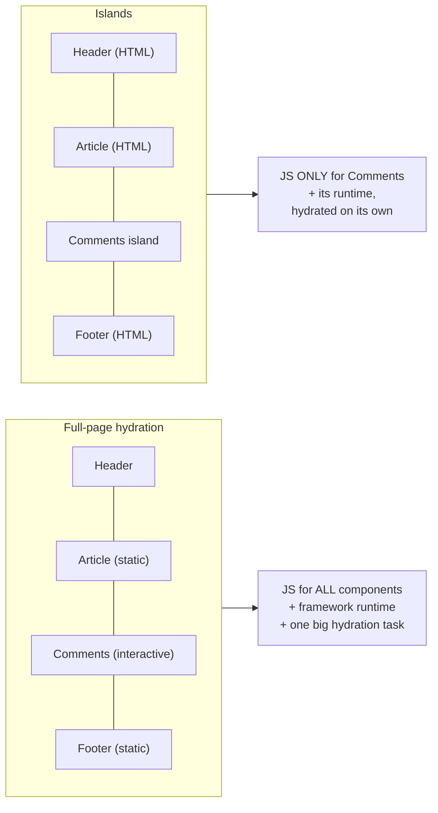

The cost of full-page hydration:
- **Bytes:** JS for static content is downloaded, parsed and compiled anyway.
- **Main-thread time:** hydration runs as long tasks → worse **TBT** and **INP** (see [JavaScript Runtime & Event Loop](./javascript-runtime-event-loop.md)).
- **Uncanny valley:** the page *looks* ready (server HTML) but doesn't respond to clicks until hydration finishes.
- **Data twice:** the data used to render the page is embedded again (as JSON) so the client can re-render it.

For **content-heavy** sites (blogs, docs, marketing, e-commerce listings, news) most of the page is static — that's the opportunity islands exploit.

---

### Section 2: The Islands Model

The term "component island" was coined by **Katie Sylor-Miller** (Etsy) in 2019 and popularized by **Jason Miller** (creator of Preact) in his August 2020 post *Islands Architecture*. Astro made it mainstream.

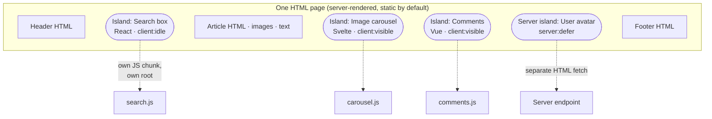

Core principles:

| Principle | Meaning |
|---|---|
| **Static by default** | Components render to HTML on the server (or at build) and ship **no JS** unless opted in |
| **Opt-in interactivity** | A component becomes an island only when you mark it (`client:*` in Astro, `islands/` folder in Fresh) |
| **Independent roots** | Each island is hydrated as its **own app root**, with its own props; no global app tree |
| **Per-island loading** | Each island's JS is a separate chunk, loaded and hydrated on its own trigger |
| **Failure isolation** | One island throwing doesn't break the static page or other islands |
| **Server-rendered HTML first** | Islands are usually still SSR'd, so content and SEO don't depend on JS (except client-only islands) |

---

### Section 3: Hydration Strategies Compared

"Islands" sits in a family of techniques that all try to make hydration cheaper. They are often confused:

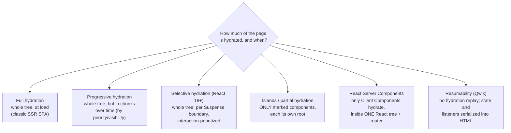

| Strategy | JS shipped | Who decides what's interactive | Single app tree? | Client-side routing | Examples |
|---|---|---|---|---|---|
| **Full hydration** | Everything on the page | Implicit (all) | Yes | Yes | Classic SPA + SSR |
| **Progressive / lazy hydration** | Everything, deferred | Developer per component | Yes | Yes | Vue 3.5 lazy hydration, Nuxt `hydrate-on-*`, Angular `@defer (hydrate on …)` |
| **Selective hydration** | Everything (split by `lazy`) | React, by Suspense boundaries and interaction | Yes | Yes | React 18+ |
| **Islands** | Only islands | Developer opts **in** per component | **No** — many roots | No by default (MPA) | Astro, Fresh, Eleventy `<is-land>`, Marko |
| **RSC** | Only Client Components | Developer opts in with `'use client'` | Yes | Yes | Next.js App Router, other RSC frameworks |
| **Resumability** | Tiny loader; handlers fetched on interaction | Framework (fine-grained) | Yes | Yes | Qwik |

**Islands vs RSC** in one sentence: both ship JS only for interactive components, but **islands are separate mini-apps on a multi-page site**, while **RSC keeps one React tree** — Client Components share context, state survives client-side navigation, and the server can re-render parts of the tree in place.

---

### Section 4: Hydration Triggers (Directives)

Islands are hydrated on a **trigger** you choose. Astro's directives are the reference vocabulary:

| Directive | Loads and hydrates… | Priority | Use for |
|---|---|---|---|
| `client:load` | Immediately on page load | High | Above-the-fold controls the user will touch first (buy button, nav menu) |
| `client:idle` | After initial load, when `requestIdleCallback` fires (`{{ timeout: 500 }}` option, Astro 4.15+) | Medium | Lower-priority widgets (search box, newsletter form) |
| `client:visible` | When the element enters the viewport (`{{ rootMargin: "200px" }}` option, Astro 4.1+) | Low | Below-the-fold widgets (comments, carousels, charts) |
| `client:media="(max-width: 50em)"` | When the media query matches | Low | Mobile-only menu toggles, desktop-only sidebars |
| `client:only="react"` | On page load, **without SSR** | — | Components that can't render on the server (canvas, `window`-dependent libs); needs a `slot="fallback"` placeholder |
| *(no directive)* | Never — HTML only | — | Everything static |

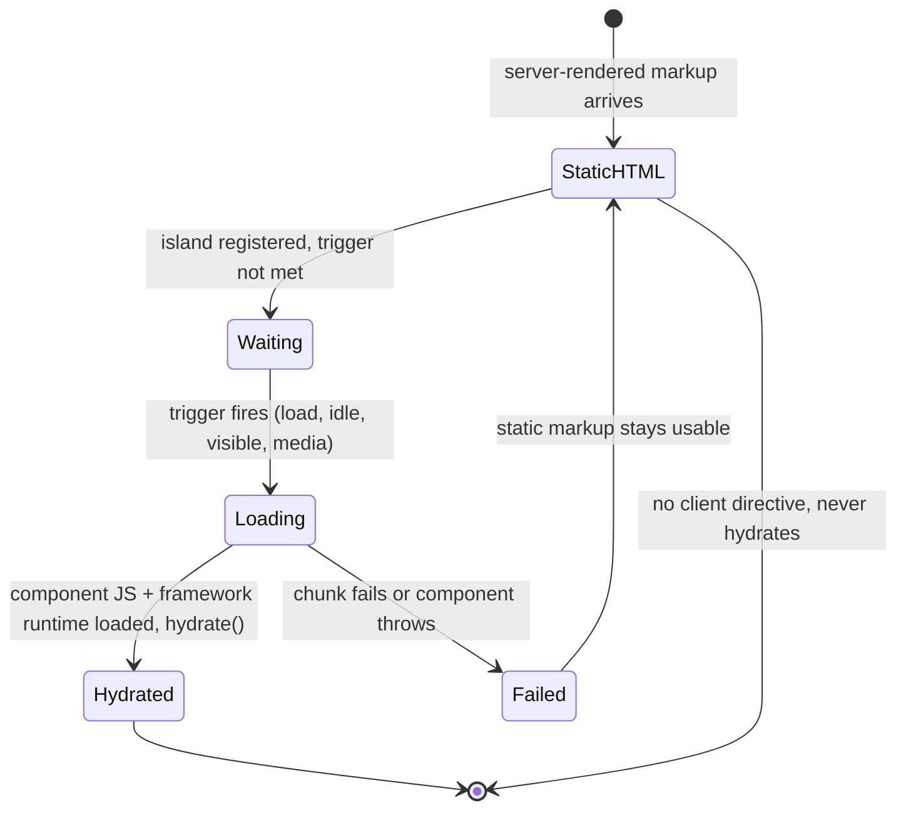

**Choosing triggers well:**
- `client:visible` on something the user clicks **immediately on arrival** creates a first-interaction delay (the JS starts loading only when it's visible, i.e. now). Use `client:load` for above-the-fold controls; add `rootMargin` so below-the-fold islands start loading *before* they scroll into view.
- Prefer **progressive enhancement**: render a working `<form>` or `<a>` in the static HTML so the control works (maybe less smoothly) before or without hydration.

---

### Section 5: How an Island Boots in the Browser

Astro renders each island as an `<astro-island>` custom element carrying the component URL, renderer URL, serialized props and the trigger. A small inline loader script handles the rest.

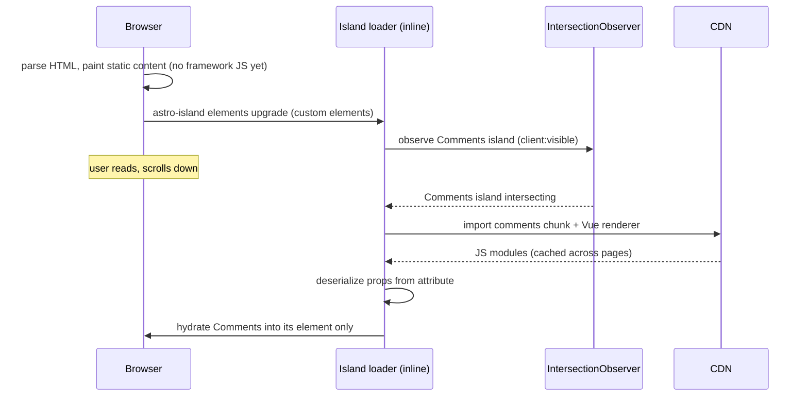

Implications:
- **Props are serialized** into the HTML. They must be serializable (no functions or class instances), and big props cost bytes — pass IDs or small objects, not whole datasets.
- **Each island is its own root.** React context, Vue `provide/inject` or a Svelte context set in one island is **not** visible in another. Shared state needs a store outside the framework (Section 6).
- **Framework runtimes load once per framework**, not per island — but mixing React, Vue and Svelte islands on one page ships three runtimes.
- **Static children:** content passed into an island as children/slots is rendered on the server and passed as HTML, so it doesn't add component JS.

---

### Section 6: Sharing State Between Islands

Because islands are separate roots, they communicate through something **outside** any one framework:

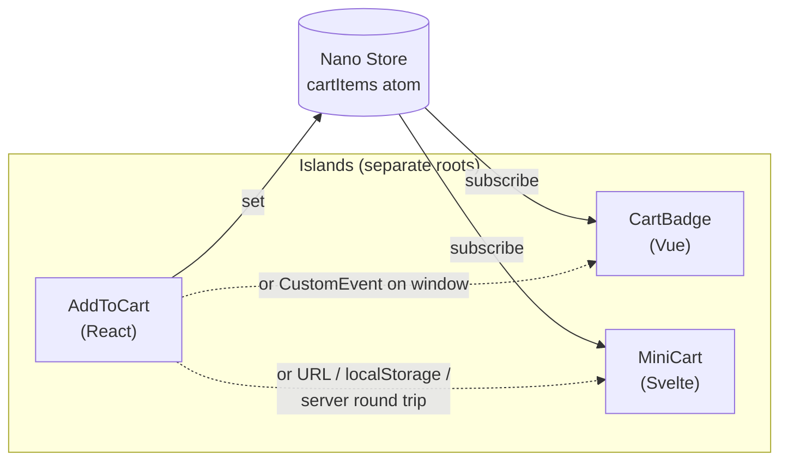

| Mechanism | Good for | Notes |
|---|---|---|
| **Framework-agnostic store** (Nano Stores — Astro's recommendation; or Preact signals in Fresh) | Shared UI state (cart, theme, filters) | Adapters for React, Vue, Svelte, Solid, Preact |
| **`CustomEvent` on `window`/`document`** | Fire-and-forget notifications | Zero dependencies; no "current value" for late subscribers |
| **URL (search params)** | Filters, tabs, pagination | Shareable, survives reload, server can read it |
| **`localStorage` + `storage` event** | Persisted preferences across tabs/pages | Synchronous API; see [Browser Storage Mechanisms](./browser-storage-mechanisms.md) |
| **Server as source of truth** | Cart, auth state | Each island fetches; consistent across page loads |

If you find yourself wiring **many** islands to **lots** of shared state, the page is really an app — consider an SPA/RSC route for it (Section 10).

---

### Section 7: Server Islands — Dynamic Holes in Static Pages

Client islands add interactivity. **Server islands** (Astro's `server:defer`, stable since Astro 5) add **dynamic, per-request server-rendered content** to an otherwise static, cacheable page — e.g. the user's avatar, a personalized price, "recently viewed".

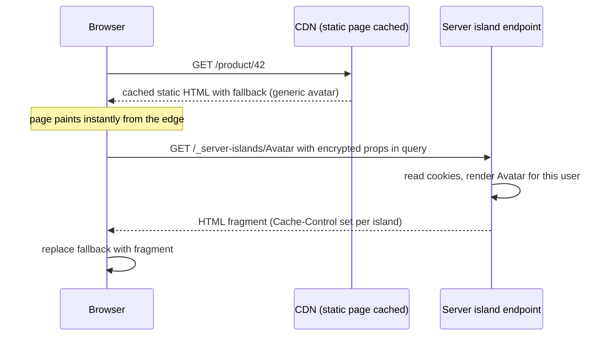

How Astro's server islands work (per the Astro docs):
- At build, each `server:defer` component becomes its **own route**; the page gets a fallback (`slot="fallback"`) plus a small script.
- The browser fetches each island **separately**, so a slow island doesn't block the page or other islands.
- Props travel **encrypted** in the GET query (POST if the URL exceeds 2,048 bytes — and POST isn't cached by browsers). The key is random per build; for rolling deploys, multi-region or CDN-cached old pages, set a stable `ASTRO_KEY` (`astro create-key`).
- Inside the island, `Astro.url` is the island endpoint, not the page — read the page URL from the `Referer` header if needed.
- Needs an adapter (a server runtime) for the deferred rendering.

**Compare:**

| | Server islands (Astro) | Partial Prerendering / Cache Components (Next.js) |
|---|---|---|
| Static shell | Cached HTML page | Prerendered shell |
| Dynamic part delivered | **Separate request per island** after page load | **Streamed in the same response** |
| Extra round trip | Yes (one per island, parallel) | No |
| Per-island HTTP caching | Yes (`Cache-Control` per island) | Via the framework's cache APIs |

---

### Section 8: Navigation — MPA, View Transitions and Persisted Islands

Island sites are usually **multi-page apps (MPA)**: each link is a full document navigation. That's simple and robust (no client router, browser handles history and scroll), but island state is lost on every navigation.

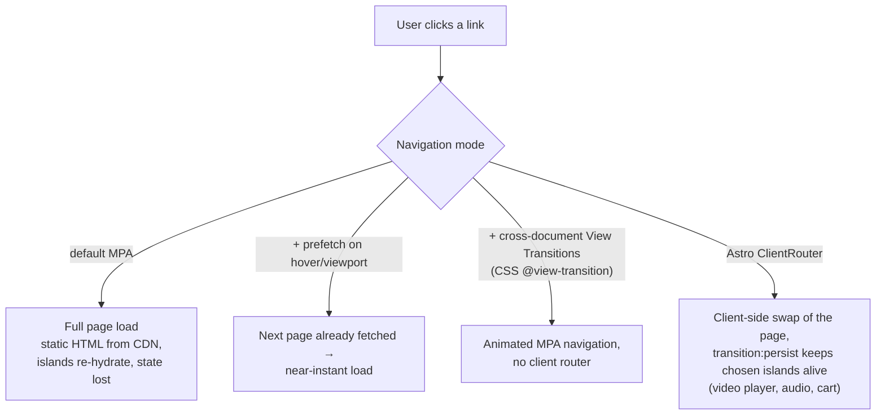

Tools:
- **Prefetching** (`<link rel="prefetch">`, Speculation Rules, Astro's `prefetch` option) hides most of the navigation cost.
- **Cross-document View Transitions** (`@view-transition { navigation: auto; }`) animate between pages without a client router — browser support differs; check MDN.
- **Astro `<ClientRouter />`** (named `<ViewTransitions />` before Astro 5) intercepts navigations and swaps the DOM, enabling `transition:persist` to keep an island (and its state) alive across pages.
- **Persist important state** (cart, preferences) in the server, URL or storage rather than relying on island memory.

---

### Section 9: Islands Across Frameworks

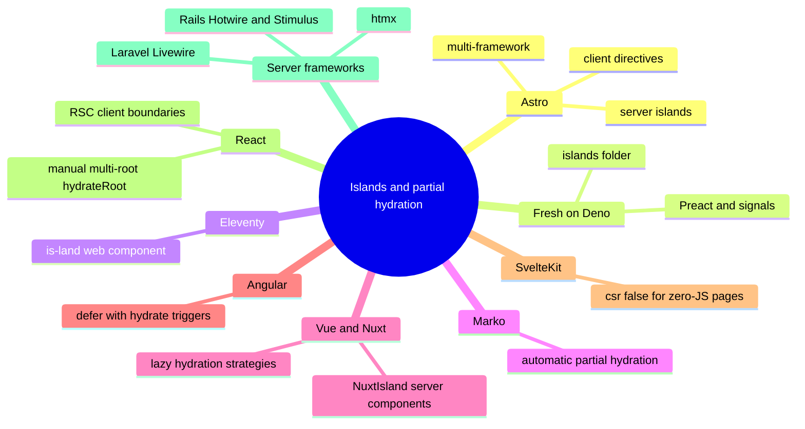

| Stack | How to get islands (or the closest thing) |
|---|---|
| **Astro** | Native: `.astro` components are static; framework components + `client:*` become islands; `server:defer` for server islands. Supports React, Preact, Svelte, Vue and Solid — mixed on one page |
| **Fresh (Deno, Preact)** | Components in the `islands/` directory are hydrated; everything else renders to static HTML. Props must be serializable |
| **Eleventy** | `<is-land on:visible on:idle on:interaction on:media>` web component (`@11ty/is-land`) wraps any framework or vanilla component |
| **Marko (eBay)** | Compiler detects which components are interactive and ships JS only for those — partial hydration without manual markers |
| **Vue 3.5+** | Lazy hydration for async components: `defineAsyncComponent({ loader, hydrate: hydrateOnVisible() })` (also `hydrateOnIdle`, `hydrateOnInteraction`, `hydrateOnMediaQuery`) — still one app tree |
| **Nuxt** | `hydrate-on-visible` / `hydrate-on-idle` / `hydrate-on-interaction` props on `Lazy*` components (Nuxt 3.16+); server components and `<NuxtIsland>` render HTML-only parts (check the experimental flags for your version) |
| **Angular (v19+)** | `@defer (hydrate on viewport)` (also `on idle`, `on interaction`, `on hover`, `on immediate`, `on timer(…)`, `hydrate when <cond>`, `hydrate never`) with `withIncrementalHydration()` — incremental hydration inside one app; event replay captures early clicks |
| **SvelteKit** | No per-component islands; `export const csr = false` in a page renders it with **zero JS**. For mixed pages, Svelte components work as islands inside Astro |
| **React (without Astro)** | RSC (`'use client'` leaves) is the idiomatic answer; or render widgets separately and call `hydrateRoot` on each island container (Example 3) |
| **Server-rendered backends** | Hotwire (Turbo + Stimulus), Livewire, htmx — "HTML over the wire" with small sprinkles of JS; same philosophy: server HTML first, minimal client code |
| **Native mobile** | Not applicable as such; the analogous pattern is a native screen embedding a few web views or server-driven UI fragments |

---

### Section 10: Trade-offs and When Islands Don't Fit

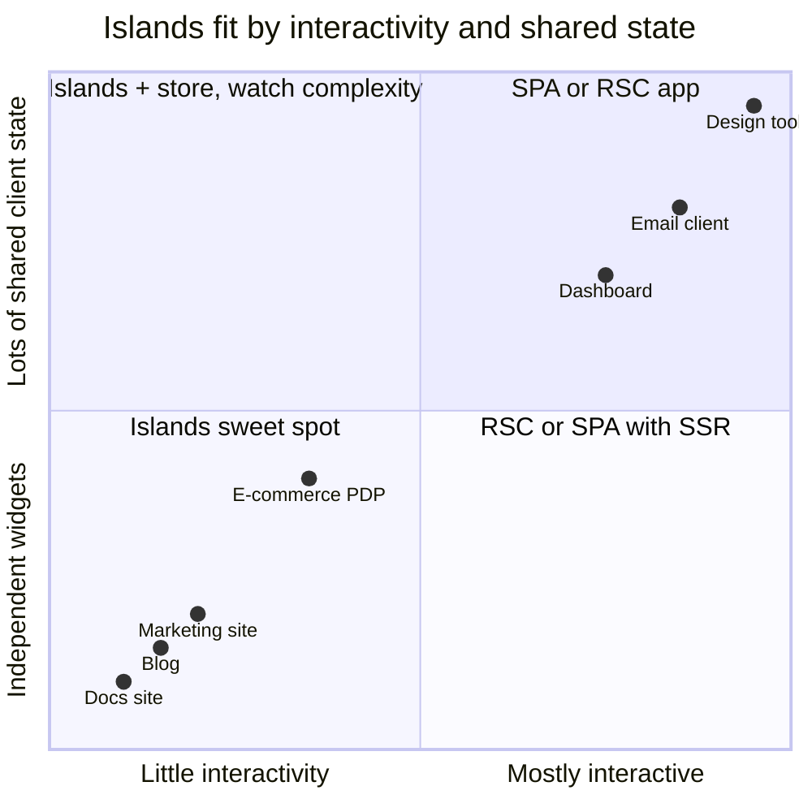

| Strength | Weakness |
|---|---|
| Very little JS for content pages → good INP/TBT and LCP | Shared state across islands needs extra plumbing |
| HTML works without JS (SEO, resilience, low-end devices) | No shared framework context between islands |
| Islands load lazily and fail independently | MPA navigations lose island state (unless persisted) |
| Static pages cache perfectly on a CDN | Hydration-trigger delay if triggers are badly chosen |
| Framework-agnostic (migrate component by component) | Mixing frameworks ships several runtimes |
| Simple mental model: HTML first | Highly interactive apps end up as "one giant island" — no benefit |

**Red flags that you've outgrown islands:** most of the page is wrapped in `client:load`; islands constantly sync through a store; you're re-implementing a client router; users expect app-like transitions with preserved state everywhere. That's an SPA or an RSC app (see [Client-Side Rendering (CSR)](./client-side-rendering-csr.md) and [Streaming SSR & React Server Components](./streaming-ssr-and-react-server-components.md)).

---

## Decision Matrix

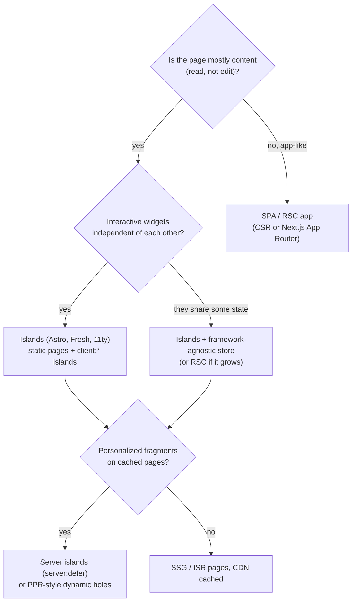

| Requirement | Recommendation |
|---|---|
| Docs, blog, marketing, landing pages | **Islands** (Astro/Fresh/11ty) with SSG |
| Content site + a few rich widgets (search, comments, configurator) | **Islands** with `client:idle` / `client:visible` |
| Cached pages with a per-user header | **Server islands** or PPR |
| E-commerce catalog with cart across pages | Islands + **store + server cart**, or RSC; decide by how app-like checkout is |
| Dashboard / editor / real-time collaboration | **SPA or RSC** — not islands |
| Existing React app wanting less JS | **RSC** (`'use client'` leaves) rather than a rewrite to islands |
| Existing Vue/Nuxt or Angular app | **Lazy / incremental hydration** (`hydrate-on-*`, `@defer (hydrate on …)`) |

---

## Real-World Examples

**Example 1 — An Astro product page with client and server islands:**
```astro
---
// src/pages/product/[id].astro
import Layout from '../../layouts/Layout.astro';
import Gallery from '../../components/Gallery.svelte';
import AddToCart from '../../components/AddToCart.tsx';
import Reviews from '../../components/Reviews.vue';
import SearchBox from '../../components/SearchBox.tsx';
import UserMenu from '../../components/UserMenu.astro';
import { getProduct } from '../../lib/api';

export const prerender = false;              // server-rendered per request (or cache at CDN)
const product = await getProduct(Astro.params.id!);
if (!product) return Astro.redirect('/404');
---
<Layout title={product.name}>
  <header>
    <SearchBox client:idle />                                 <!-- not urgent -->
    <UserMenu server:defer>                                   <!-- per-user server island -->
      
    </UserMenu>
  </header>

  <main>
    <h1>{product.name}</h1>                                   <!-- static HTML, 0 KB JS -->
    <Gallery images={product.images} client:visible={{ rootMargin: '200px' }} />
    <p set:html={product.descriptionHtml} />
    <AddToCart productId={product.id} price={product.price} client:load />  <!-- above the fold -->
    <Reviews productId={product.id} client:visible />         <!-- below the fold -->
  </main>
</Layout>
```

```astro
---
// src/components/UserMenu.astro — rendered per request, separately from the cached page
const session = Astro.cookies.get('session')?.value;
const user = session ? await getUserFromSession(session) : null;
Astro.response.headers.set('Cache-Control', 'private, no-store');
---
{user ? <a href="/account"></a>
      : <a href="/login">Sign in</a>}
```

**Example 2 — Sharing state between islands of different frameworks (Nano Stores):**
```typescript
// src/stores/cart.ts
import { atom, computed } from 'nanostores';

export type CartItem = { id: string; qty: number; price: number };
export const cartItems = atom<CartItem[]>([]);
export const cartCount = computed(cartItems, (items) => items.reduce((n, i) => n + i.qty, 0));

export function addItem(item: CartItem) {
  cartItems.set([...cartItems.get(), item]);
}
```

```tsx
// src/components/AddToCart.tsx (React island)
import { addItem } from '../stores/cart';

export default function AddToCart({ productId, price }: { productId: string; price: number }) {
  // A real form: still works (server-side) before hydration or without JS
  return (
    <form method="post" action="/api/cart"
      onSubmit={(e) => { e.preventDefault(); addItem({ id: productId, qty: 1, price }); }}>
      <input type="hidden" name="productId" value={productId} />
      <button type="submit">Add to cart</button>
    </form>
  );
}
```

```html
<!-- src/components/CartBadge.vue (Vue island) -->
<script setup lang="ts">
import { useStore } from '@nanostores/vue';
import { cartCount } from '../stores/cart';
const count = useStore(cartCount);
</script>
<template><span aria-live="polite">Cart ({{ count }})</span></template>
```

**Example 3 — Islands in plain React (no Astro): one `hydrateRoot` per island:**
```tsx
// server: render static page + island placeholders with serialized props
import { renderToString } from 'react-dom/server';
import { Counter } from './islands/Counter';

const escapeAttr = (v: string) =>
  v.replace(/&/g, '&amp;').replace(/"/g, '&quot;').replace(/</g, '&lt;').replace(/>/g, '&gt;');

function island(name: string, Component: React.ComponentType<any>, props: object) {
  const html = renderToString(<Component {...props} />);
  // Props travel in the HTML: keep them small, serializable and escaped
  return `<div data-island="${name}" data-props="${escapeAttr(JSON.stringify(props))}">${html}</div>`;
}

export const page = `
  <article><h1>Static article</h1><p>No JS needed here.</p></article>
  ${island('Counter', Counter, { start: 3 })}
  <script type="module" src="/islands.js"></script>`;
```

```tsx
// islands.ts (client): hydrate each island when it becomes visible
import { hydrateRoot } from 'react-dom/client';

const loaders: Record<string, () => Promise<{ default: React.ComponentType<any> }>> = {
  Counter: () => import('./islands/Counter'),
};

const io = new IntersectionObserver((entries) => {
  for (const entry of entries) {
    if (!entry.isIntersecting) continue;
    io.unobserve(entry.target);
    const el = entry.target as HTMLElement;
    const props = JSON.parse(el.dataset.props ?? '{}');
    loaders[el.dataset.island!]().then(({ default: C }) => hydrateRoot(el, <C {...props} />));
  }
}, { rootMargin: '200px' });

document.querySelectorAll('[data-island]').forEach((el) => io.observe(el));
```

**Example 4 — Framework-agnostic island with a web component (Eleventy `<is-land>`):**
```html
<script type="module" src="/is-land.js"></script>

<is-land on:visible on:idle>
  <!-- server-rendered fallback / progressive enhancement -->
  <a href="/comments">Read comments</a>
  <template data-island>
    <script type="module">
      import { mountComments } from '/js/comments.js';
      mountComments(document.querySelector('#comments'));
    </script>
  </template>
</is-land>
```

**Example 5 — Lazy hydration in Vue 3.5+, Nuxt and Angular (one app, island-like loading):**
```typescript
// Vue 3.5+
import { defineAsyncComponent, hydrateOnVisible, hydrateOnIdle } from 'vue';

export const Comments = defineAsyncComponent({
  loader: () => import('./Comments.vue'),
  hydrate: hydrateOnVisible({ rootMargin: '200px' }),
});
export const Newsletter = defineAsyncComponent({
  loader: () => import('./Newsletter.vue'),
  hydrate: hydrateOnIdle(),
});
```

```html
<!-- Nuxt (3.16+): built-in lazy hydration on Lazy* components -->
<LazyComments hydrate-on-visible />
<LazyNewsletter hydrate-on-idle />

<!-- Angular (v19+, with provideClientHydration(withIncrementalHydration())) -->
@defer (hydrate on viewport) {
  <app-comments [postId]="postId" />
}
```

**Example 6 — Choosing triggers (BAD → GOOD):**
```astro
<!-- ❌ BAD: everything hydrates immediately — you rebuilt a SPA with extra steps -->
<Header client:load />
<Article client:load />          <!-- static text does not need JS -->
<Footer client:load />
<BuyButton client:visible />     <!-- above the fold: first click waits for JS -->

<!-- ✅ GOOD: static by default, urgency matches position and importance -->
<Header />
<Article />
<Footer />
<BuyButton client:load />                                  <!-- first thing users click -->
<Comments client:visible={{ rootMargin: '300px' }} />     <!-- starts loading before it scrolls in -->
<MobileNav client:media="(max-width: 48em)" />            <!-- no JS on desktop -->
<Chart client:only="react"><div slot="fallback" style="height:320px">Loading chart…</div></Chart>
```

**Example 7 — Persist an island across navigations (Astro ClientRouter):**
```astro
---
// src/layouts/Layout.astro
import { ClientRouter } from 'astro:transitions';
import AudioPlayer from '../components/AudioPlayer.tsx';
---
<html lang="en">
  <head><ClientRouter /></head>
  <body>
    <slot />
    <AudioPlayer client:load transition:persist />  <!-- keeps playing between pages -->
  </body>
</html>
```

---

## Key Points Summary

| Concept | One-Line Explanation |
|---|---|
| **Island architecture** | Static server HTML with small, independently hydrated interactive components |
| **Partial hydration** | Only marked components are hydrated; static content ships no JS |
| **Independent roots** | Each island is its own app root — no shared framework context |
| **Hydration triggers** | `load`, `idle`, `visible`, `media`, `only` decide when an island's JS loads |
| **`client:only`** | Skip SSR for components that can't run on the server; provide a fallback |
| **Serialized props** | Island props are embedded in HTML — keep them small and serializable |
| **Cross-island state** | Use framework-agnostic stores, events, URL or the server |
| **Server islands** | `server:defer` renders personalized fragments in separate requests on cached pages |
| **MPA navigation** | Full page loads; prefetch, View Transitions, ClientRouter + `transition:persist` |
| **Islands vs RSC** | Both ship JS only for interactive parts; RSC keeps one tree and client routing |
| **Lazy/incremental hydration** | Vue/Nuxt/Angular defer hydration inside one app — island-like loading |
| **Fit** | Content-first sites; not dashboards or editors |

---

## Test Your Understanding

**Q1 (Basic):**
What's the difference between **partial hydration (islands)** and **progressive hydration**? Which ships less JavaScript?

<details>
<summary>Answer</summary>

**Progressive hydration** still hydrates the **whole** component tree — it only spreads the work over time (e.g. hydrate below-the-fold parts later). All component code is eventually downloaded and executed.

**Partial hydration / islands** hydrates **only the components marked interactive**. Static components are rendered to HTML on the server and their code is **never shipped**. So islands ship less JS. Progressive hydration improves *when* the cost is paid, islands reduce *how much* is paid. They can be combined: islands with `client:visible` are both partial and progressive.
</details>

**Q2 (Application):**
A documentation site built as a React SPA with SSR has poor INP on mid-range phones, and 90% of each page is static Markdown. The interactive parts are a search box, a theme toggle, a code-copy button and a feedback widget. Propose an architecture.

<details>
<summary>Answer</summary>

Move to an **islands framework** (e.g. Astro, keeping React for the existing interactive components) with SSG:
- Markdown pages render to **static HTML** with zero component JS, cached on a CDN.
- **Search box:** `client:idle` (or `client:load` if it's the main entry point). Load the search index lazily on focus.
- **Theme toggle:** a tiny inline script in `<head>` to apply the saved theme before paint (avoids a flash), plus a small island or vanilla script for the button.
- **Code-copy buttons:** a few lines of vanilla JS using event delegation, not a framework island per code block.
- **Feedback widget:** `client:visible`, since it sits at the bottom of the page.
- Navigation: MPA with prefetch and optionally cross-document View Transitions.

The result: far less JS, no full-page hydration long task, better INP. Content and SEO work without JS.
</details>

**Q3 (Tricky):**
An Astro page has a React `<CartButton client:load />` in the header and a React `<AddToCart client:visible />` in the body. Both use a `CartContext` provider wrapped around each of them. Clicking "Add" doesn't update the header count. Why, and how do you fix it?

<details>
<summary>Answer</summary>

Each island is a **separate React root**. Wrapping each in its own `CartContext.Provider` creates **two independent context instances**, and context never crosses roots. The two islands share no state.

Fix: move the shared state **outside** React — e.g. a Nano Stores atom (`cartItems`) imported by both islands (`useStore` from `@nanostores/react`), or a `CustomEvent` the header listens to, or the server cart as the source of truth (re-fetch after mutation). If many components need tightly shared state, that part of the UI may be better as one larger island or an RSC/SPA route.
</details>

**Q4 (Tricky):**
Users report that the "Buy now" button on product pages "does nothing" for a second or two on slow phones, then works. The button is an island with `client:visible`. What's going on, and what are two fixes?

<details>
<summary>Answer</summary>

`client:visible` starts loading the island's JS only when the element **enters the viewport**. The button is above the fold, so it's visible immediately, and the download + parse + hydrate only *begins* when the user arrives. On a slow phone that takes long enough for the first tap to land on non-hydrated HTML, which does nothing.

Fixes:
1. Use **`client:load`** for above-the-fold, primary actions so loading starts as early as possible (and keep the island small).
2. **Progressive enhancement:** render the button inside a real `<form method="post" action="/cart">` so a tap before hydration still submits and works. Hydration then upgrades it to the smoother client behavior.

Also consider preloading the island's chunk and checking that it doesn't pull in a heavy dependency.
</details>

**Q5 (System design):**
A news site serves fully static, CDN-cached article pages. Product wants to add (a) the logged-in user's avatar in the header, (b) a "recommended for you" rail, and (c) live comment counts — without losing CDN caching. Design it.

<details>
<summary>Answer</summary>

Keep the article HTML **user-agnostic and CDN-cached** (SSG/ISR). Add the personalized parts as separately loaded fragments:
- **(a) Avatar:** a **server island** (`server:defer`) with a generic-avatar fallback of the same size (no CLS). It reads the session cookie and returns `Cache-Control: private, no-store`. (Alternative: a tiny client island calling `/api/me`.)
- **(b) Recommendations:** a server island below the fold, or a client island with `client:visible` calling a recommendations API. Reserve its height. A failure shows nothing rather than breaking the page.
- **(c) Live comment counts:** a client island that fetches counts once (`client:visible`) and optionally subscribes to updates via SSE (see [WebSockets & SSE & Long Polling](./websockets-sse-long-polling.md)). Counts can also be served from a short-TTL public API cached at the edge, since they're the same for all users.
- Use a stable **`ASTRO_KEY`** so CDN-cached old pages can still call server islands after a deploy.

The page stays a cache hit for everyone. Only small fragments hit the origin, in parallel, after first paint.
</details>

**Q6 (Application):**
A team wants to "move our Next.js App Router e-commerce app to Astro islands to ship less JS". It has a cart drawer, filters synced to the URL, client-side transitions between product listings and a multi-step checkout. Is that a good idea?

<details>
<summary>Answer</summary>

Probably not as a blanket move. With the App Router they already have **React Server Components**: static parts ship no JS, and only `'use client'` leaves hydrate, which is the islands benefit inside **one React tree** with client-side routing and shared state. Their app-like features (persistent cart drawer, URL-synced filters with smooth transitions, a stateful multi-step checkout) are exactly where islands get awkward: separate roots, MPA navigation and cross-island stores.

Better: audit where the JS comes from (`'use client'` too high in the tree, heavy libraries in client components, large props serialized to the client) and push client boundaries down. Islands might make sense for a **separate content property** (blog, help center, marketing pages), possibly on a subdomain or path served by Astro.
</details>

---

## Cheat Sheet

**Key Definitions:**
- **Island:** An interactive component hydrated independently inside static server-rendered HTML
- **Partial hydration:** Hydrating only selected components; the rest ships no JS
- **Progressive / lazy hydration:** Hydrating a whole app gradually, by priority or trigger
- **Resumability:** Continuing server execution in the browser without a hydration replay (Qwik)
- **Server island:** A per-request server-rendered fragment fetched separately into a cached page (Astro `server:defer`)
- **Client directive:** Astro attribute that turns a component into an island and sets its trigger
- **Nano Stores:** Tiny framework-agnostic state library used to share state between islands

**Quick Reference:**
```text
Astro directives
  (none)                     static HTML, 0 KB JS
  client:load                hydrate immediately           above-the-fold primary actions
  client:idle                requestIdleCallback ({timeout})  secondary widgets
  client:visible             in viewport ({rootMargin})    below-the-fold widgets
  client:media="(query)"     when media query matches      mobile/desktop-only UI
  client:only="react"        no SSR, hydrate on load       window/canvas-dependent; add slot="fallback"
  server:defer               server island + slot="fallback"   personalized fragments on cached pages
  transition:persist         keep island alive across pages (with <ClientRouter />)

Other stacks
  Fresh        islands/ directory (Preact)
  Eleventy     <is-land on:visible on:idle on:interaction on:media>
  Vue 3.5+     defineAsyncComponent({ loader, hydrate: hydrateOnVisible() })
  Nuxt 3.16+   <LazyX hydrate-on-visible | hydrate-on-idle | hydrate-on-interaction />
  Angular 19+  @defer (hydrate on viewport) + withIncrementalHydration()
  SvelteKit    export const csr = false  (zero-JS page)
  React        RSC 'use client' leaves, or one hydrateRoot per island

Cross-island state: nanostores · CustomEvent · URL params · storage · server
```

**Common Mistakes to Avoid:**

| Mistake | Why Wrong | Fix |
|---|---|---|
| `client:load` on everything | Recreates full-page hydration | Static by default; hydrate only what's interactive |
| `client:visible` on above-the-fold primary buttons | First tap lands before JS loads | `client:load` + progressive enhancement |
| Sharing React/Vue context across islands | Each island is a separate root | Framework-agnostic store, events, URL or server |
| Passing large datasets as island props | Serialized into HTML, bloats the page | Pass IDs; fetch inside the island |
| Mixing many UI frameworks on one page | Each framework runtime is shipped | Standardize on one (or Preact) for islands |
| `client:only` without a sized fallback | Empty space, then layout shift | `slot="fallback"` with reserved dimensions |
| Personalized content in the cached page | Leaks one user's data / kills caching | Server islands or client islands for user data |
| No stable `ASTRO_KEY` with CDN-cached pages | Old pages can't decrypt server-island props after deploy | `astro create-key` → `ASTRO_KEY` |
| Using islands for an app-like product | Store spaghetti, lost state on navigation | SPA or RSC for app routes |
| Buttons that only work after hydration | Dead UI on slow devices / JS failure | Real forms and links underneath |
| Island per tiny element (each copy button) | Many roots and chunks for trivial behavior | Vanilla JS with event delegation |

---

## References & Further Reading

**Core docs**
- Astro: [Islands architecture](https://docs.astro.build/en/concepts/islands/)
- Astro: [Template directives reference (`client:*`, `server:defer`)](https://docs.astro.build/en/reference/directives-reference/)
- Astro: [Server islands](https://docs.astro.build/en/guides/server-islands/)
- Astro: [Share state between islands](https://docs.astro.build/en/recipes/sharing-state-islands/)
- Astro: [View transitions and `<ClientRouter />`](https://docs.astro.build/en/guides/view-transitions/)
- Fresh: [Islands](https://fresh.deno.dev/docs/concepts/islands)
- Eleventy: [`<is-land>`](https://www.11ty.dev/docs/plugins/partial-hydration/)

**Framework equivalents**
- Vue: [Lazy hydration for async components](https://vuejs.org/guide/components/async.html#lazy-hydration)
- Nuxt: [Lazy hydration of components](https://nuxt.com/docs/guide/directory-structure/components#delayed-or-lazy-hydration)
- Angular: [Incremental hydration](https://angular.dev/guide/incremental-hydration)
- SvelteKit: [Page options — `csr`](https://svelte.dev/docs/kit/page-options#csr)
- Qwik: [Resumable vs hydration](https://qwik.dev/docs/concepts/resumable/)
- Nano Stores: [GitHub](https://github.com/nanostores/nanostores)

**Web platform**
- MDN: [View Transition API](https://developer.mozilla.org/en-US/docs/Web/API/View_Transition_API) · [`@view-transition`](https://developer.mozilla.org/en-US/docs/Web/CSS/@view-transition)
- MDN: [Speculation Rules API](https://developer.mozilla.org/en-US/docs/Web/API/Speculation_Rules_API)
- MDN: [Using custom elements](https://developer.mozilla.org/en-US/docs/Web/API/Web_components/Using_custom_elements)

**Deep dives**
- Jason Miller: [Islands Architecture](https://jasonformat.com/islands-architecture/) (2020)
- patterns.dev: [Islands Architecture](https://www.patterns.dev/vanilla/islands-architecture/)
- web.dev: [Rendering on the Web](https://web.dev/articles/rendering-on-the-web)

---

> **Previous Topic:** [Streaming SSR & React Server Components](./streaming-ssr-and-react-server-components.md)
> — Streaming HTML by Suspense boundary and components that ship no JavaScript

> **Next Topic:** [Edge Rendering](./edge-rendering.md)
> — Running rendering logic in CDN points of presence close to the user

*Saved on: 2026-11-06 | Repo: Frontend System Design Learning Notes*
