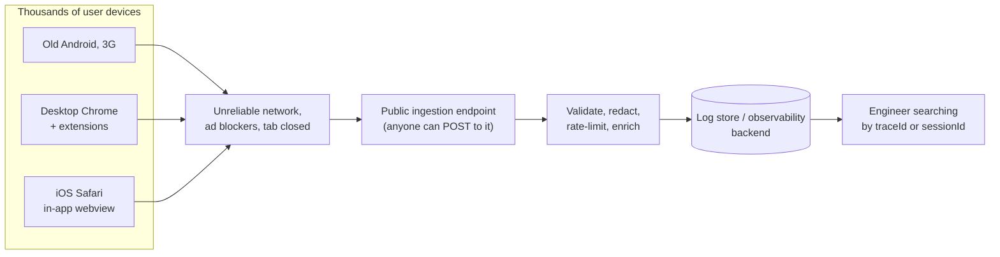
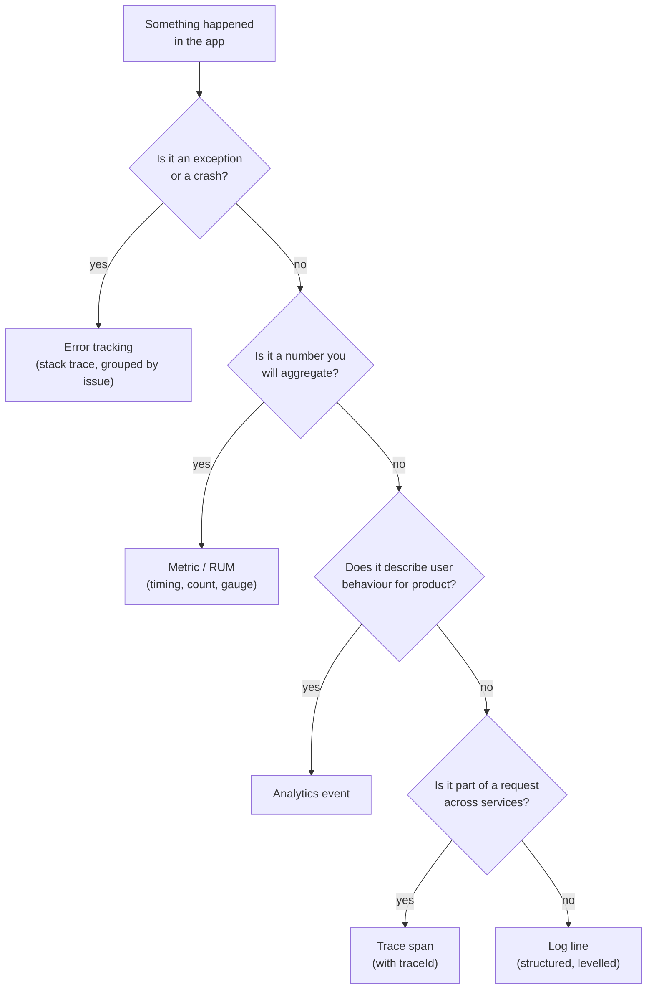
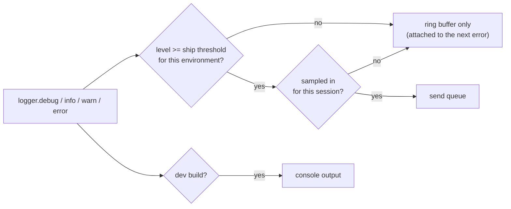
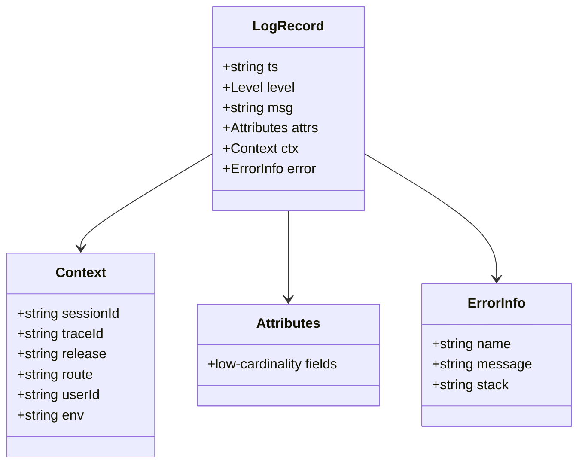
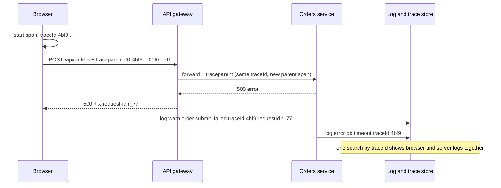
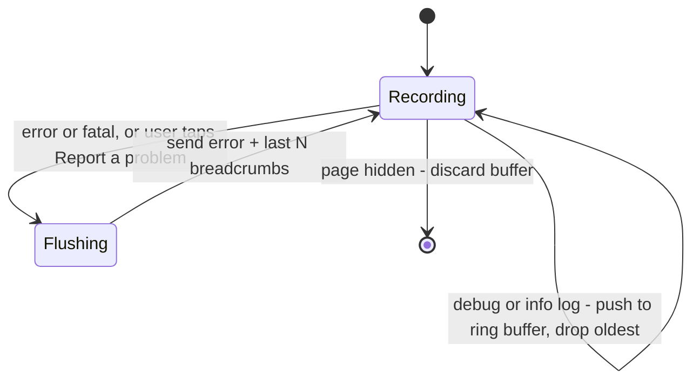
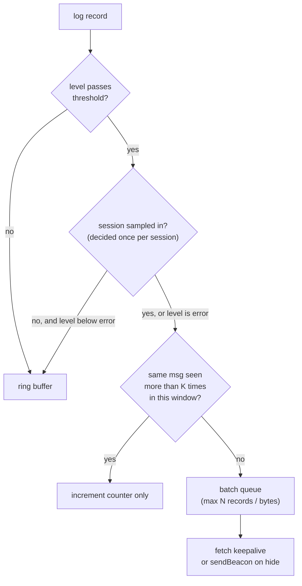
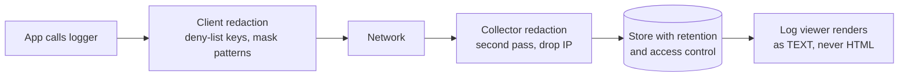
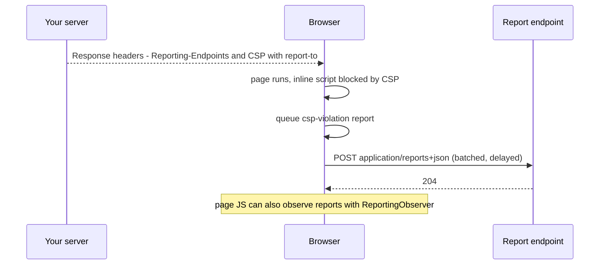
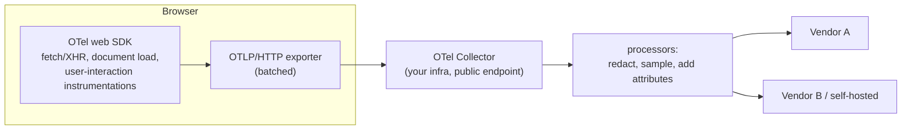

<!-- Generated by scripts/sync-knowledge.js from notes/ and README.md — do not edit here. -->
<!-- sections (line ranges in this file): Table of Contents 19-42 · ELI5 43-56 · Core Concept 57-421 · Framework Comparison 422-435 · Real-World Examples 436-703 · Key Points Summary 704-723 · Test Your Understanding 724-807 · Cheat Sheet 808-855 · References & Further Reading 856-894 -->

# Logging Best Practices

> **Date:** 2026-11-06 · **Last updated:** 2026-11-06
> **Category:** Frontend System Design
> **Sub-Topic:** Monitoring & Observability / Logging
> **Level:** Intermediate · **Reading time:** ~28 min
> **Informs:** client log levels per environment, structured log schema, frontend-to-backend correlation (trace context, request IDs), breadcrumb ring buffer vs shipped logs, log sampling and rate limits, PII redaction, console stripping in production builds, Reporting API (CSP, deprecations), SSR logging, observability vendor choice

> **Pre-requisite:** [Error Boundaries & Global Error Handling](./error-boundaries-and-global-error-handling.md) (catching errors) and [Analytics Architecture](./analytics-architecture.md) (batching, beacons, consent — the same transport ideas apply here).
> This note covers **what to log in a frontend, how to shape it, how to get it off the device, and how to connect it to the backend** — without leaking user data or flooding your bill.

**Previous:** [Analytics Architecture](./analytics-architecture.md) · **Next:** [Progressive Web Apps (PWA)](./progressive-web-apps-pwa.md)

---

## Table of Contents

1. [ELI5 — Simple Explanation](#eli5--simple-explanation)
2. [Section 1: Why Frontend Logging Is Different](#section-1-why-frontend-logging-is-different)
3. [Section 2: Logs, Errors, Metrics and Traces](#section-2-logs-errors-metrics-and-traces)
4. [Section 3: Log Levels](#section-3-log-levels)
5. [Section 4: Structured Logging](#section-4-structured-logging)
6. [Section 5: Context and Correlation](#section-5-context-and-correlation)
7. [Section 6: Breadcrumbs and the Ring Buffer](#section-6-breadcrumbs-and-the-ring-buffer)
8. [Section 7: Transport, Sampling and Cost](#section-7-transport-sampling-and-cost)
9. [Section 8: Privacy and Security](#section-8-privacy-and-security)
10. [Section 9: The Console in Production](#section-9-the-console-in-production)
11. [Section 10: Browser-Generated Reports](#section-10-browser-generated-reports)
12. [Section 11: SSR and Edge Logging](#section-11-ssr-and-edge-logging)
13. [Section 12: OpenTelemetry in the Browser](#section-12-opentelemetry-in-the-browser)
14. [Framework Comparison](#framework-comparison)
15. [Real-World Examples](#real-world-examples)
16. [Key Points Summary](#key-points-summary)
17. [Test Your Understanding (with answers)](#test-your-understanding)
18. [Cheat Sheet](#cheat-sheet)
19. [References & Further Reading](#references--further-reading)

---

## ELI5 — Simple Explanation

Imagine you're a **mechanic for thousands of cars you can never see**. The cars drive around the world; when one breaks, the driver just says "it stopped working".

- A **flight recorder** in each car keeps the last few minutes of what happened (speed, gear, warnings). When something goes wrong, it sends you that recording. That's a **breadcrumb ring buffer**.
- The recorder writes **fill-in-the-form entries** ("time, part, reading, car ID"), not scribbled notes, so you can search all cars at once for "brake pressure low". That's **structured logging**.
- Every entry is stamped with the **trip number**, which the garage's own records also use, so you can line up the car's story with the garage's story. That's **correlation / trace IDs**.
- You don't want the driver's **home address or credit card** in the recordings. That's **redaction**.
- You can't ship every second of every trip — it'd cost a fortune. You keep the important bits and a **sample** of the rest. That's **levels, sampling and rate limiting**.

> **Frontend logging = structured, levelled events with enough context to correlate with the backend, sent sparingly from devices you don't control, and scrubbed of anything private.**

---

## Core Concept — Step by Step

### Section 1: Why Frontend Logging Is Different

On a server you own the machine, the disk and the log pipeline. In the browser you own none of that.



| Server logging | Frontend logging |
|---|---|
| You control the runtime | Unknown browsers, extensions, devices, locales |
| Logs written to local disk/stdout, shipped by an agent | Must be sent over the user's network, which may vanish mid-send |
| Volume scales with servers | Volume scales with **users × actions** — can explode |
| Endpoint is internal | Ingestion endpoint is **public** — can be spammed or forged |
| Operators see logs | Logs may contain **user data** typed into the page |
| Errors are mostly your code | Many errors come from **extensions, third-party scripts, old browsers** — noise |

So the rules are: **log less, log structured, log with context, redact early, and treat every client log as untrusted input.**

---

### Section 2: Logs, Errors, Metrics and Traces



| Signal | Shape | Best for | Related note |
|---|---|---|---|
| **Log** | Timestamped structured record | "What happened just before?" | This note |
| **Error** | Exception + stack + context, grouped | "What broke, how often, since which release?" | [Error Tracking (Sentry, Datadog RUM)](./error-tracking-sentry-datadog-rum.md) |
| **Metric** | Number aggregated over time | Dashboards, SLOs, alerts | [Real User Monitoring (RUM)](./real-user-monitoring-rum.md) |
| **Trace** | Tree of timed spans sharing a `traceId` | Latency across browser → API → services | Section 5 |
| **Analytics event** | Business event per tracking plan | Product decisions | [Analytics Architecture](./analytics-architecture.md) |

> A common anti-pattern: using logs to compute metrics ("count lines containing `checkout ok`"). Emit a metric or an analytics event instead — it's cheaper and doesn't break when someone edits the message.

---

### Section 3: Log Levels

| Level | Meaning in a frontend | Shipped in production? | Example |
|---|---|---|---|
| `trace` | Very fine-grained flow | ❌ Never | "render ProductCard 42" |
| `debug` | Developer diagnostics | ❌ Kept in the **ring buffer** only | "cache hit for /api/cart" |
| `info` | Notable, expected milestones | ⚠️ Sparingly / sampled | "service worker updated to v57" |
| `warn` | Unexpected but handled; degraded experience | ✅ Rate-limited | "payment SDK slow, fell back to redirect flow" |
| `error` | An operation failed for the user | ✅ Always (usually via error tracking) | "checkout request failed: 502" |
| `fatal` | The app can't continue | ✅ Always | "root render crashed, showing fallback" |

OpenTelemetry maps levels to **severity numbers** (TRACE 1–4, DEBUG 5–8, INFO 9–12, WARN 13–16, ERROR 17–20, FATAL 21–24), which helps when different libraries use different level names.



**Rules:**
- **Thresholds per environment**: `debug` to console in dev, `warn`+ shipped in prod, `info` shipped for a small sample or when a support "debug mode" is switched on.
- **Runtime-adjustable**: let support enable verbose logging for one session (a query flag, a feature flag, or a signed cookie) instead of redeploying.
- **A `warn` must be actionable.** If nobody would ever act on it, it's `debug`.

---

### Section 4: Structured Logging

```text
❌ console.log('User ' + user.email + ' failed to load cart ' + cartId + ' after ' + ms + 'ms')

✅ logger.warn('cart.load_failed', { cartId, durationMs: ms, status: res.status })
   → {"ts":"2026-11-06T10:15:02.113Z","level":"warn","msg":"cart.load_failed",
      "cartId":"c_81","durationMs":5012,"status":503,
      "sessionId":"s_9f..","traceId":"4bf92f3577b34da6a3ce929d0e0e4736",
      "release":"web@2026.11.06-3","route":"/cart","ua":"..."}
```



**Guidelines:**
- **Stable event names** (`cart.load_failed`) — a constant you can search and alert on. Put variable data in **fields**, not in the message string.
- **Consistent field names and units** across the app (`durationMs`, `status`, `route`) — agree on a small schema, ideally aligned with OpenTelemetry semantic conventions.
- **Mind cardinality**: fields you'll group by (route template `/products/:id`, status) should have few distinct values. Put high-cardinality values (IDs) in fields you filter by, not in metric labels.
- **Serialize errors explicitly**: `JSON.stringify(new Error('x'))` gives `{}` because `name`, `message` and `stack` aren't enumerable. Copy them (and `error.cause`) into fields.
- **Use route templates**, not raw URLs, so `/users/123` and `/users/456` group together — and so IDs or tokens in the URL don't leak.

---

### Section 5: Context and Correlation

The most valuable thing a frontend log can carry is an ID that **joins it to the backend's story**.



| ID | Scope | Who creates it | Where it lives |
|---|---|---|---|
| **sessionId** | One visit / tab session | Client (random) | In-memory or `sessionStorage` |
| **traceId** | One end-to-end operation | Client or edge, per W3C Trace Context | `traceparent` header |
| **requestId** | One HTTP request at the server | Server / gateway | Response header (e.g. `x-request-id`) |
| **userId** | Logged-in user | Your backend | Internal opaque ID only |
| **release** | Deployed build | CI | Injected at build time (also used for source maps) |

**W3C Trace Context** standardises the `traceparent` header: `version-traceid-parentid-flags`, e.g. `00-4bf92f3577b34da6a3ce929d0e0e4736-00f067aa0ba902b7-01`. Most observability vendors and OpenTelemetry read it.

**CORS gotcha:** `traceparent` is **not** a CORS-safelisted header. Adding it to a cross-origin `fetch` triggers a **preflight**, and the server must list it in `Access-Control-Allow-Headers` or the request fails. That's why SDKs make you configure an allow-list of URLs to propagate to (e.g. Sentry's `tracePropagationTargets`, Datadog's `allowedTracingUrls`). **Never send trace headers to third-party origins** — it leaks IDs and breaks their CORS. To read `x-request-id` from a cross-origin response, the server must also send `Access-Control-Expose-Headers: x-request-id`. See [CORS & Same-Origin Policy](./cors-and-same-origin-policy.md).

**SSR handoff:** if the HTML is server-rendered, embed the server's `traceId`/`requestId` in the page (a `<meta>` tag or the serialized state) so client logs from the first load can be joined with the SSR request.

---

### Section 6: Breadcrumbs and the Ring Buffer

Shipping every `debug` log is expensive. But when an error happens, you want to know what led to it. The answer: **keep the last N log records in memory and only send them when something goes wrong.**



```text
Ring buffer (capacity 50)
┌───────────────────────────────────────────────────────────────┐
│ nav /cart → click "Checkout" → fetch /api/cart 200 → ...       │
│ ... → fetch /api/orders 500 → warn order.retry → ERROR thrown  │
└───────────────────────────────────────────────────────────────┘
          ↑ oldest dropped when full          ↑ sent with the error
```

- Error-tracking SDKs do this automatically ("breadcrumbs": navigations, clicks, console calls, fetch/XHR). Configure what they capture and **scrub** it.
- A **"Report a problem"** button that uploads the buffer (with consent) is a powerful support tool.
- Keep the buffer **bounded** (count and bytes) — an unbounded array of log objects is a memory leak ([Memory Leaks in Frontend Apps](./memory-leaks-in-frontend-apps.md)).

---

### Section 7: Transport, Sampling and Cost

The transport is the same as analytics: **queue → batch → flush**, using `fetch` with `keepalive` normally and `navigator.sendBeacon` on `visibilitychange → hidden` (see [Analytics Architecture](./analytics-architecture.md#section-8-transport--queue-batch-flush)).



**Cost controls (client side):**
- **Session-based (head) sampling** — decide once per session (e.g. 5% get `info` logs). Sampling per *record* gives incomplete, useless stories.
- **Always keep errors** (or sample them separately at a much higher rate).
- **Dedupe and rate-limit** — an error inside a `requestAnimationFrame` loop can produce thousands of identical records per minute. Collapse repeats into a count.
- **Cap batch size and bytes**; truncate long strings and stacks.
- **Kill switch** — a remote config/feature flag to lower the level or stop shipping during an incident.

**Cost controls (server side):** authenticate with a public client key (it can't be secret — it ships in the bundle), **rate-limit per IP/session**, **cap body size**, validate the schema, drop unknown fields, and set **retention** by level (e.g. shorter for `info`). Some vendors offer tail-based sampling at a collector, which can keep whole traces that contain errors.

---

### Section 8: Privacy and Security



**Never log:**
- Passwords, one-time codes, **access/refresh tokens**, session cookies, API keys, `Authorization` headers.
- Full request/response bodies by default (forms contain personal data).
- Payment card data — this would bring your logging system into PCI DSS scope.
- Raw URLs with tokens or emails in query strings (password reset, magic links, OAuth `code`).
- Free text the user typed (search, chat, support messages).

**Do:**
- Redact by **key name** (`password`, `token`, `authorization`, `secret`, `cookie`, `email`, `phone`) and by **pattern** (emails, card-like digit runs, JWT-like `eyJ...` strings) — on the client **and** again at the collector.
- Use **internal IDs** instead of names/emails.
- Set **retention** and **access control** on the log store; support deletion requests where the law requires it.
- Apply the **same consent decisions** as analytics where logs include identifiers or are used beyond strictly-necessary operations — check with your privacy team.

**Security issues specific to logs:**
- **Log forging / injection**: user input with newlines can fake extra lines in plain-text logs. Structured JSON logs encode it safely.
- **Stored XSS in the log viewer**: client logs are attacker-controlled. If an internal dashboard renders them as HTML, an attacker can target your engineers. Render as text.
- **Forged logs**: anyone can POST to the ingestion endpoint. Never trust client logs for audit or security decisions — those must come from the server.
- **Information disclosure**: verbose console output in production (internal URLs, feature-flag names, stack traces with secrets) is readable by anyone who opens DevTools.

---

### Section 9: The Console in Production

`console.*` is for developers. In production it:
- Exposes internals to anyone who opens DevTools.
- Costs time when objects are formatted, and logged objects can be kept alive while DevTools is open (watch memory snapshots).
- Isn't collected anywhere — users don't send you their console.

**Strategy:**
- Route all logging through **your logger**; in prod it ships `warn`+ and keeps `debug` in the ring buffer.
- **Strip debug calls at build time** so they cost nothing:

| Tool | Option |
|---|---|
| esbuild (also used by Vite's default minifier in many versions) | `drop: ['console', 'debugger']` or `pure: ['console.log', 'console.debug']` |
| Terser | `compress: { drop_console: true }` or `pure_funcs: ['console.debug']` |
| SWC (Next.js) | `compiler.removeConsole: { exclude: ['error', 'warn'] }` in `next.config` |
| Babel | `babel-plugin-transform-remove-console` |
| Android (R8/ProGuard) | `-assumenosideeffects class android.util.Log { ... }` |

Build tooling changes quickly (for example, newer Vite versions move to Rolldown/Oxc) — check your bundler's docs for the current option name.

- Lint with ESLint's `no-console` rule (allowing `warn`/`error` if you route them through the logger).
- If you keep `console.error` in prod, make sure it's **also** captured by your error tracker (most SDKs instrument it as a breadcrumb).

---

### Section 10: Browser-Generated Reports

The browser itself can tell you about problems your code never sees: **CSP violations, deprecated API usage, interventions** (the browser blocked something), **crashes**, and **COOP/COEP** violations. The **Reporting API** delivers them.



```http
Reporting-Endpoints: default="https://reports.example.com/r", csp="https://reports.example.com/csp"
Content-Security-Policy: default-src 'self'; script-src 'self'; report-to csp; report-uri https://reports.example.com/csp-legacy
```

| Mechanism | Status (verify on MDN) |
|---|---|
| `Reporting-Endpoints` header | Current way to name endpoints; supported in Chromium, Safari and (per MDN's data) recent Firefox — report types vary by browser |
| `Report-To` header (JSON groups) | **Deprecated** — older Chromium syntax; prefer `Reporting-Endpoints` |
| CSP `report-to` directive | Uses the Reporting API; support arrived in different browsers at different times |
| CSP `report-uri` directive | **Deprecated** but still widely supported — send **both** during the transition |
| `ReportingObserver` (JS) | Observe deprecation/intervention/CSP reports in-page and forward them to your logger |
| `securitypolicyviolation` event | Fires on the element/document when CSP blocks something; good for local logging |
| Network Error Logging (`NEL` header) | Chromium only, experimental — reports DNS/TCP/TLS failures that JS can't see |

**Why it matters:** rolling out a strict CSP with `Content-Security-Policy-Report-Only` + reporting tells you what would break before you enforce it. Deprecation reports warn you before a browser removes an API you use.

---

### Section 11: SSR and Edge Logging

With SSR, part of "the frontend" runs on a server. Use server logging practices there:

- **Structured JSON to stdout** (e.g. `pino` in Node). The platform's log drain collects it.
- **Request-scoped context**: use `AsyncLocalStorage` (Node) to attach `requestId`/`traceId` to every log in a request without passing it through every function.
- **Framework hooks**: Next.js `instrumentation.ts` (`register()` and `onRequestError` for server errors), SvelteKit `handleError` in `hooks.server.ts`, Nuxt server plugins / Nitro hooks, Angular SSR's server entry, Remix/React Router server handlers.
- **Hydration mismatches** are reported in the browser (React 19 surfaces them via `onRecoverableError`) — log them with the route and release; they often signal non-deterministic rendering.
- **Edge runtimes** (Cloudflare Workers, Vercel Edge, Deno Deploy) have limited Node APIs, so check whether your logger works there; logs are usually streamed via the platform's tail/drain features.
- **Don't log full request headers** — they contain cookies and `Authorization`.

---

### Section 12: OpenTelemetry in the Browser

OpenTelemetry (OTel) is the vendor-neutral standard for traces, metrics and logs. Backends from many vendors accept its **OTLP** format.



- **Status:** OTel's JavaScript **browser** support is less mature than its Node support, and parts of it (including browser logs and some instrumentations) are still marked experimental. Check the status table on opentelemetry.io before committing to it.
- **Why it's attractive:** one instrumentation, any backend; standard `traceparent` propagation; semantic conventions for field names.
- **Trade-offs:** bundle size of the SDK + instrumentations, and you need a collector endpoint that's safe to expose publicly.
- Many teams use a **vendor RUM/error SDK** in the browser (which already propagates `traceparent`) and OTel on the backend — that also gives end-to-end traces.

---

## Framework Comparison

| Stack | Global error / log hooks | Request correlation | Notes |
|---|---|---|---|
| **React 19** | Error boundaries + `createRoot(el, { onCaughtError, onUncaughtError, onRecoverableError })` | Wrap `fetch` or use a TanStack Query/axios interceptor to add `traceparent` | `onRecoverableError` sees hydration mismatches |
| **Next.js** | `error.tsx` / `global-error.tsx`; `instrumentation.ts` (`onRequestError`) on the server | Vendor SDKs propagate trace headers; server logs to stdout | `compiler.removeConsole` strips console calls |
| **Vue 3** | `app.config.errorHandler`, `app.config.warnHandler` (dev only), `onErrorCaptured` | Axios/fetch wrapper, Nuxt `$fetch` interceptors (`onRequest`) | Nuxt: `vue:error` and `app:error` hooks |
| **Angular** | Custom `ErrorHandler` provider | `HttpInterceptor` (functional `HttpInterceptorFn`) adds headers to every request | `isDevMode()` to gate verbose logs |
| **SvelteKit** | `handleError` in `hooks.client.ts` and `hooks.server.ts` | `handleFetch` (server) and fetch wrappers (client) | `$app/environment` `dev` flag for levels |
| **iOS (Swift)** | `Logger` (Unified Logging) with privacy annotations (`privacy: .private`) | `URLSession` request headers | Dynamic strings are redacted by default in persisted logs unless marked `.public` |
| **Android (Kotlin)** | `Log` / Timber with a release `Tree` that forwards to your backend | OkHttp interceptor adds headers | Strip `Log.d/v` in release with R8 rules |

---

## Real-World Examples

**Example 1 — A small structured logger with levels, context, redaction, ring buffer and sampling:**
```typescript
// observability/logger.ts
type Level = 'debug' | 'info' | 'warn' | 'error' | 'fatal';
const RANK: Record<Level, number> = { debug: 10, info: 20, warn: 30, error: 40, fatal: 50 };

interface LogRecord {
  ts: string;
  level: Level;
  msg: string;
  attrs?: Record<string, unknown>;
  error?: { name: string; message: string; stack?: string; cause?: string };
  ctx: Record<string, string | undefined>;
}

const SHIP_LEVEL: Level = import.meta.env.DEV ? 'debug' : 'warn';
const INFO_SAMPLE_RATE = 0.05;
const RING_CAPACITY = 50;
const REDACT_KEYS = /pass(word)?|token|secret|authorization|cookie|email|phone|card/i;
const REDACT_VALUES = [
  /[\w.+-]+@[\w-]+\.[\w.]+/g,                          // emails
  /\beyJ[\w-]+\.[\w-]+\.[\w-]+\b/g,                    // JWT-like
  /\b(?:\d[ -]?){13,19}\b/g,                           // card-like digit runs
];

const sessionId = crypto.randomUUID();
const sampledIn = Math.random() < INFO_SAMPLE_RATE;   // decided once per session
const ring: LogRecord[] = [];
const outbox: LogRecord[] = [];
const seen = new Map<string, number>();
const ctx: Record<string, string | undefined> = {
  sessionId,
  release: import.meta.env.VITE_RELEASE,
  env: import.meta.env.MODE,
};

export function setLogContext(next: Record<string, string | undefined>) {
  Object.assign(ctx, next); // e.g. { route: '/products/:id', userId: 'u_123' }
}

function redact(value: unknown, depth = 0): unknown {
  if (depth > 4) return '[depth]';
  if (typeof value === 'string') {
    let v = value.slice(0, 1000);
    for (const re of REDACT_VALUES) v = v.replace(re, '[redacted]');
    return v;
  }
  if (Array.isArray(value)) return value.slice(0, 20).map((v) => redact(v, depth + 1));
  if (value && typeof value === 'object') {
    return Object.fromEntries(
      Object.entries(value).map(([k, v]) => [k, REDACT_KEYS.test(k) ? '[redacted]' : redact(v, depth + 1)]),
    );
  }
  return value;
}

function serializeError(err: unknown): LogRecord['error'] {
  if (err instanceof Error) {
    return {
      name: err.name,
      message: String(redact(err.message)),
      stack: err.stack?.slice(0, 4000),
      cause: err.cause instanceof Error ? err.cause.message : undefined,
    };
  }
  return { name: 'NonError', message: String(redact(String(err))) };
}

function log(level: Level, msg: string, attrs?: Record<string, unknown>, err?: unknown) {
  const record: LogRecord = {
    ts: new Date().toISOString(),
    level,
    msg,
    attrs: attrs && (redact(attrs) as Record<string, unknown>),
    error: err === undefined ? undefined : serializeError(err),
    ctx: { ...ctx },
  };

  if (import.meta.env.DEV) console[level === 'fatal' ? 'error' : level](msg, attrs ?? '', err ?? '');

  ring.push(record);
  if (ring.length > RING_CAPACITY) ring.shift();

  const ship = RANK[level] >= RANK[SHIP_LEVEL] || (level === 'info' && sampledIn);
  if (!ship) return;

  const count = (seen.get(msg) ?? 0) + 1;              // simple per-message rate limit
  seen.set(msg, count);
  if (count > 20) return;

  if (RANK[level] >= RANK.error) outbox.push(...ring.slice(0, -1).map((r) => ({ ...r, attrs: { ...r.attrs, breadcrumb: true } })));
  outbox.push(record);
  scheduleFlush();
}

let timer: ReturnType<typeof setTimeout> | undefined;
function scheduleFlush() { timer ??= setTimeout(() => flush(false), 3000); }

function flush(useBeacon: boolean) {
  clearTimeout(timer);
  timer = undefined;
  if (!outbox.length) return;
  const body = JSON.stringify(outbox.splice(0, 100));
  if (useBeacon && navigator.sendBeacon('/api/logs', new Blob([body], { type: 'text/plain' }))) return;
  fetch('/api/logs', { method: 'POST', body, keepalive: true }).catch(() => { /* never log a logging failure in a loop */ });
}

document.addEventListener('visibilitychange', () => {
  if (document.visibilityState === 'hidden') flush(true);
});
setInterval(() => seen.clear(), 60_000);             // reset the rate-limit window

export const logger = {
  debug: (msg: string, attrs?: Record<string, unknown>) => log('debug', msg, attrs),
  info: (msg: string, attrs?: Record<string, unknown>) => log('info', msg, attrs),
  warn: (msg: string, attrs?: Record<string, unknown>) => log('warn', msg, attrs),
  error: (msg: string, err: unknown, attrs?: Record<string, unknown>) => log('error', msg, attrs, err),
  fatal: (msg: string, err: unknown, attrs?: Record<string, unknown>) => log('fatal', msg, attrs, err),
};
```

> In production most teams use their error-tracking/RUM vendor's SDK (Sentry, Datadog, New Relic, Grafana Faro, etc.), which provides most of this. The point is to know which knobs to configure: levels, sampling, breadcrumbs, redaction (`beforeSend`-style hooks) and propagation targets.

**Example 2 — Unstructured vs structured (BAD → GOOD):**
```typescript
// ❌ BAD: PII and a token in a free-text string; unsearchable; leaks in DevTools
console.log(`Login failed for ${email} with token ${accessToken} at ${location.href}`);

// ✅ GOOD: stable name, fields, internal IDs, route template, no secrets
logger.warn('auth.login_failed', { reason: 'invalid_credentials', route: '/login', attempt: 3 });
```

**Example 3 — Propagating trace context only to your own APIs:**
```typescript
// observability/fetch.ts
const PROPAGATE_TO = [location.origin, 'https://api.example.com'];

function hex(bytes: number) {
  const a = crypto.getRandomValues(new Uint8Array(bytes));
  return Array.from(a, (b) => b.toString(16).padStart(2, '0')).join('');
}

export async function tracedFetch(input: string | URL, init: RequestInit = {}) {
  const url = new URL(input, location.href);
  const headers = new Headers(init.headers);
  const traceId = hex(16);                      // 32 hex chars
  const spanId = hex(8);                        // 16 hex chars

  if (PROPAGATE_TO.includes(url.origin)) {      // never to third parties
    headers.set('traceparent', `00-${traceId}-${spanId}-01`);
  }

  const started = performance.now();
  try {
    const res = await fetch(url, { ...init, headers });
    if (!res.ok) {
      logger.warn('http.non_ok', {
        method: init.method ?? 'GET',
        route: url.pathname.replace(/\/\d+(?=\/|$)/g, '/:id'), // template, not raw IDs
        status: res.status,
        durationMs: Math.round(performance.now() - started),
        traceId,
        requestId: res.headers.get('x-request-id') ?? undefined, // needs Access-Control-Expose-Headers cross-origin
      });
    }
    return res;
  } catch (err) {
    logger.error('http.network_error', err, { route: url.pathname, traceId });
    throw err;
  }
}
```

```http
# api.example.com must allow the header for cross-origin calls
Access-Control-Allow-Origin: https://app.example.com
Access-Control-Allow-Headers: content-type, traceparent, tracestate
Access-Control-Expose-Headers: x-request-id
```

**Example 4 — Collecting browser reports (CSP, deprecations):**
```typescript
// Forward in-page reports to your logger (feature-detect: support differs by browser)
if ('ReportingObserver' in window) {
  const observer = new ReportingObserver(
    (reports) => {
      for (const r of reports) {
        logger.warn(`browser_report.${r.type}`, { url: r.url, body: r.body?.toJSON?.() ?? null });
      }
    },
    { types: ['deprecation', 'intervention', 'csp-violation'], buffered: true },
  );
  observer.observe();
}

// CSP violations also fire a DOM event
document.addEventListener('securitypolicyviolation', (e) => {
  logger.warn('csp.violation', { directive: e.effectiveDirective, blocked: e.blockedURI, sample: e.sample });
});
```

```typescript
// Express endpoint for header-delivered reports (Reporting API + legacy report-uri)
// rateLimit from express-rate-limit — runs before the body is parsed
app.post('/csp', rateLimit({ windowMs: 60_000, limit: 100 }),
  express.json({ type: ['application/reports+json', 'application/csp-report'], limit: '64kb' }),
  (req, res) => {
    const reports = Array.isArray(req.body) ? req.body : [req.body]; // reports+json is an array
    for (const r of reports.slice(0, 50)) serverLogger.info({ msg: 'csp.report', report: r });
    res.sendStatus(204);
  });
```

**Example 5 — Stripping console calls at build time:**
```typescript
// vite.config.ts (esbuild-based minification) — check your Vite version's docs for the current option
import { defineConfig } from 'vite';

export default defineConfig(({ mode }) => ({
  esbuild: mode === 'production' ? { drop: ['debugger'], pure: ['console.log', 'console.debug', 'console.info'] } : {},
}));
```

```javascript
// next.config.mjs
export default {
  compiler: {
    removeConsole: process.env.NODE_ENV === 'production' ? { exclude: ['error', 'warn'] } : false,
  },
};
```

**Example 6 — Framework hooks feeding the same logger:**
```tsx
// React 19 — main.tsx
import { createRoot } from 'react-dom/client';
createRoot(document.getElementById('root')!, {
  onUncaughtError: (error, info) => logger.fatal('react.uncaught', error, { componentStack: info.componentStack }),
  onCaughtError: (error, info) => logger.error('react.caught', error, { componentStack: info.componentStack }),
  onRecoverableError: (error) => logger.warn('react.recoverable', { message: String(error) }), // e.g. hydration mismatch
}).render(<App />);

// Vue 3
app.config.errorHandler = (err, instance, info) => logger.error('vue.error', err, { info });

// Angular
@Injectable()
export class LoggingErrorHandler implements ErrorHandler {
  handleError(error: unknown) { logger.error('angular.error', error); }
}
// providers: [{ provide: ErrorHandler, useClass: LoggingErrorHandler }]

// SvelteKit — src/hooks.client.ts
import type { HandleClientError } from '@sveltejs/kit';
export const handleError: HandleClientError = ({ error, status, message }) => {
  logger.error('sveltekit.error', error, { status, message });
  return { message: 'Something went wrong' }; // never expose internals to the UI
};

// Anywhere — last-resort global handlers
addEventListener('error', (e) => logger.error('window.error', e.error ?? e.message));
addEventListener('unhandledrejection', (e) => logger.error('promise.unhandled', e.reason));
```

---

## Key Points Summary

| Concept | One-Line Explanation |
|---|---|
| **Structured logs** | Stable event name + typed fields, not concatenated strings |
| **Levels** | `debug` stays local, `warn`+ ships in prod, `info` sampled |
| **Ring buffer** | Keep the last N records in memory; send them only with an error |
| **Session sampling** | Decide once per session so sampled stories are complete |
| **Rate limiting / dedupe** | Collapse repeats so one bug can't flood the pipeline |
| **traceparent** | W3C header that joins browser and server logs by `traceId` |
| **Propagation allow-list** | Only add trace headers to your own APIs (CORS + privacy) |
| **Redaction** | Deny-list keys and patterns, on the client and again at the collector |
| **Untrusted input** | Client logs can be forged; render as text; never use for audit |
| **Console in prod** | Strip at build time; route through the logger |
| **Reporting API** | Browser sends CSP, deprecation and intervention reports to your endpoint |
| **SSR logging** | JSON to stdout with request-scoped context (`AsyncLocalStorage`) |
| **OpenTelemetry** | Vendor-neutral standard; browser support still maturing |

---

## Test Your Understanding

**Q1 (Basic):**
Why is `logger.warn('cart.load_failed', { cartId, status })` better than `console.log('cart ' + cartId + ' failed with ' + status)`?

<details>
<summary>Answer</summary>

- **Searchable and aggregatable**: the stable name `cart.load_failed` lets you count, alert and group. Variable data in fields means `status = 503` can be filtered without regex.
- **Levelled**: `warn` can be shipped in production while `debug` stays local; `console.log` has no routing.
- **Contextual**: the logger adds `sessionId`, `traceId`, `release` and `route` automatically.
- **Safe**: the logger redacts sensitive keys and patterns; string concatenation happily embeds an email or token.
- **Collected**: `console.log` only exists in the user's DevTools — you never see it.
</details>

**Q2 (Application):**
A user reports "checkout failed" at 14:02. How should your logging be designed so support can find the root cause in minutes?

<details>
<summary>Answer</summary>

- Show a **short reference** in the error UI (e.g. the `sessionId` or `traceId` prefix) that the user can quote, or attach it automatically to "Report a problem".
- Client logs carry **`sessionId`, `traceId`, `release`, route template** and an internal `userId`.
- The checkout `fetch` sends **`traceparent`** to your API; the API logs with the same `traceId` and returns `x-request-id`.
- On the error, the client ships the error **plus the ring-buffer breadcrumbs** (navigation, clicks, requests and statuses).
- Support searches by `traceId` and sees browser and backend records on one timeline — e.g. the client's 502 and the payment service's timeout.
</details>

**Q3 (Tricky):**
After adding `traceparent` to all `fetch` calls, requests to your own API work, but calls to a third-party maps API start failing with CORS errors. Why, and what's the fix?

<details>
<summary>Answer</summary>

`traceparent` isn't a CORS-safelisted request header. Adding it makes the browser send an **OPTIONS preflight** asking whether `traceparent` is allowed. Your API is configured to allow it; the maps provider isn't, so the preflight fails and the real request is never sent.

Fix: propagate trace headers **only to an allow-list of your own origins** (as Sentry's `tracePropagationTargets` / Datadog's `allowedTracingUrls` do). This also avoids leaking your trace IDs to third parties.
</details>

**Q4 (Tricky):**
A bug causes an exception inside a `requestAnimationFrame` loop. Within an hour your logging bill spikes and the ingestion endpoint starts returning 429s — so other, real errors are lost. What should have prevented this?

<details>
<summary>Answer</summary>

Every frame (~60 times a second per affected user) produced an identical error record, and nothing collapsed them.

Prevention, layered:
- **Client dedupe / rate limit**: per message, ship the first K occurrences per window, then only a counter.
- **Batch caps** in records and bytes.
- **Remote kill switch** to lower the ship level or sampling during an incident.
- **Server-side limits** per session/IP so one client can't starve others, and separate quotas for `error` vs `info`.
- Error trackers group by fingerprint, which helps the UI but not the ingestion volume — you still need client-side limits.
</details>

**Q5 (System design):**
Your security team asks whether it's safe to put client logs in the same store used for audit trails ("user X changed their email"). What's your answer?

<details>
<summary>Answer</summary>

No. Client logs are **untrusted input**: anyone can POST forged records to a public ingestion endpoint with any `userId`, and a modified client can lie. Audit events must be produced **server-side**, at the point where the action is authorised and committed, and stored with integrity controls and stricter access.

Keep client logs in an observability store with **shorter retention**, **redaction**, and a viewer that renders values as **text** (client logs could contain script payloads aimed at your engineers' browsers).
</details>

**Q6 (System design):**
Design logging for a large SSR e-commerce site (Next.js or Nuxt) with a mobile app, multiple backend services and a strict privacy policy.

<details>
<summary>Answer</summary>

- **Schema**: one shared structured schema (OTel-style severity and field names), with a stable event-name catalogue.
- **Browser**: a vendor RUM/error SDK (or a thin logger) with `warn`+ shipped, `info` for ~5% of sessions, `debug` in a ring buffer sent with errors. Client-side redaction plus a `beforeSend`-style hook. Console stripped in production builds.
- **Correlation**: `traceparent` added only to first-party API origins; the API returns `x-request-id`; SSR embeds its `traceId` in the HTML so first-load client logs join the server request.
- **SSR server**: JSON logs to stdout via `pino` with `AsyncLocalStorage` request context; `instrumentation.ts` `onRequestError` (Next.js) or Nitro hooks (Nuxt).
- **Mobile**: same schema; iOS `Logger` with privacy annotations, Android Timber release tree; same propagation rules.
- **Pipeline**: first-party collector or OTel Collector → second redaction pass, IP dropped, schema validation, per-session rate limits → log store with retention by level and role-based access.
- **Browser reports**: `Reporting-Endpoints` + CSP `report-to` (and `report-uri` as a fallback) feeding the same pipeline.
- **Operations**: remote config for levels and sampling, alerts on error rates per release, and dashboards keyed by route template.
</details>

---

## Cheat Sheet

**Key Definitions:**
- **Structured log:** a record with a stable name and typed fields (usually JSON)
- **Log level / severity:** importance of a record; controls whether and where it's shipped
- **Breadcrumbs / ring buffer:** recent records kept in memory and sent with an error
- **Head sampling:** deciding up front (per session/trace) whether to keep data
- **traceparent:** W3C Trace Context header `version-traceid-parentid-flags`
- **Request ID:** server-generated ID for one HTTP request, returned in a response header
- **Reporting API:** browser mechanism that POSTs CSP, deprecation, intervention (and other) reports
- **OTLP:** OpenTelemetry's wire protocol for traces, metrics and logs

**Quick Reference:**
```text
Shape:        logger.<level>('domain.event_name', { field: value })    → JSON with ts, level, msg, attrs, ctx
Context:      sessionId · traceId · requestId · release · route TEMPLATE · internal userId · env
Levels:       debug → ring buffer · info → sampled sessions · warn/error/fatal → always (rate-limited)
Transport:    batch → fetch keepalive · visibilitychange hidden → sendBeacon · never unload
Limits:       per-message dedupe · batch byte cap · server rate limit per session/IP · kill switch
Propagation:  traceparent ONLY to own origins · server: Access-Control-Allow-Headers: traceparent
              Access-Control-Expose-Headers: x-request-id
Redaction:    keys (password, token, authorization, cookie, email, phone, card) + patterns, client AND server
Never log:    tokens, cookies, passwords, OTPs, card data, raw bodies, URLs with secrets, user free text
Console:      strip at build (esbuild drop/pure, terser drop_console, Next removeConsole) + ESLint no-console
Reports:      Reporting-Endpoints + CSP report-to (+ report-uri fallback) · ReportingObserver
SSR:          pino JSON to stdout · AsyncLocalStorage request context · embed traceId in HTML
```

**Common Mistakes to Avoid:**

| Mistake | Why Wrong | Fix |
|---|---|---|
| String-concatenated messages | Unsearchable, embeds PII | Stable names + fields |
| Shipping every `debug` log | Cost and noise | Ring buffer; ship `warn`+ |
| Per-record random sampling | Incomplete stories | Sample per session/trace |
| No dedupe/rate limit | One loop floods the pipeline and hides real errors | Per-message limits, batch caps, kill switch |
| `JSON.stringify(error)` | Produces `{}` | Copy `name`, `message`, `stack`, `cause` |
| Logging raw URLs and headers | Leaks tokens, cookies, emails | Route templates; redact headers |
| `traceparent` on every request | CORS failures and ID leakage to third parties | Allow-list of own origins |
| Not exposing `x-request-id` | JS can't read it cross-origin | `Access-Control-Expose-Headers` |
| Rendering client logs as HTML | Stored XSS against engineers | Render as text |
| Trusting client logs for audit | Anyone can forge them | Server-side audit events |
| `console.log` left in prod | Leaks internals, wastes CPU, never collected | Logger + build-time stripping |
| Only CSP `report-to` | Older browsers ignore it | Send `report-to` and `report-uri` |
| Logging on `unload` | Unreliable; blocks bfcache | `visibilitychange` + `sendBeacon` |

---

## References & Further Reading

**Core docs**
- MDN: [Reporting API](https://developer.mozilla.org/en-US/docs/Web/API/Reporting_API) · [`ReportingObserver`](https://developer.mozilla.org/en-US/docs/Web/API/ReportingObserver)
- MDN: [`Reporting-Endpoints`](https://developer.mozilla.org/en-US/docs/Web/HTTP/Reference/Headers/Reporting-Endpoints) · [CSP `report-to`](https://developer.mozilla.org/en-US/docs/Web/HTTP/Reference/Headers/Content-Security-Policy/report-to) · [CSP `report-uri`](https://developer.mozilla.org/en-US/docs/Web/HTTP/Reference/Headers/Content-Security-Policy/report-uri)
- MDN: [`Access-Control-Expose-Headers`](https://developer.mozilla.org/en-US/docs/Web/HTTP/Reference/Headers/Access-Control-Expose-Headers) · [CORS-safelisted request header](https://developer.mozilla.org/en-US/docs/Glossary/CORS-safelisted_request_header)
- MDN: [`Navigator.sendBeacon()`](https://developer.mozilla.org/en-US/docs/Web/API/Navigator/sendBeacon)
- Chrome for Developers: [Monitor your web application with the Reporting API](https://developer.chrome.com/docs/capabilities/web-apis/reporting-api)
- OWASP: [Logging Cheat Sheet](https://cheatsheetseries.owasp.org/cheatsheets/Logging_Cheat_Sheet.html)

**Specs & standards**
- W3C: [Trace Context](https://www.w3.org/TR/trace-context/)
- W3C: [Reporting API](https://w3c.github.io/reporting/)
- OpenTelemetry: [Logs data model (severity numbers)](https://opentelemetry.io/docs/specs/otel/logs/data-model/) · [Semantic conventions](https://opentelemetry.io/docs/specs/semconv/)

**OpenTelemetry & vendors**
- OpenTelemetry: [JavaScript — browser getting started](https://opentelemetry.io/docs/languages/js/getting-started/browser/) · [JavaScript status](https://opentelemetry.io/docs/languages/js/)
- Sentry: [Distributed tracing — `tracePropagationTargets`](https://docs.sentry.io/platforms/javascript/tracing/distributed-tracing/)
- Datadog: [Connect RUM and traces](https://docs.datadoghq.com/real_user_monitoring/correlate_with_other_telemetry/apm/)

**Frameworks**
- React: [`createRoot` options (`onCaughtError`, `onUncaughtError`, `onRecoverableError`)](https://react.dev/reference/react-dom/client/createRoot)
- Next.js: [Instrumentation](https://nextjs.org/docs/app/guides/instrumentation) · [`compiler.removeConsole`](https://nextjs.org/docs/architecture/nextjs-compiler#remove-console)
- Vue: [`app.config.errorHandler`](https://vuejs.org/api/application.html#app-config-errorhandler)
- Angular: [`ErrorHandler`](https://angular.dev/api/core/ErrorHandler) · [HTTP interceptors](https://angular.dev/guide/http/interceptors)
- SvelteKit: [Hooks (`handleError`, `handleFetch`)](https://svelte.dev/docs/kit/hooks)
- esbuild: [`drop` and `pure` options](https://esbuild.github.io/api/#drop)
- Node.js: [`AsyncLocalStorage`](https://nodejs.org/api/async_context.html#class-asynclocalstorage) · [pino](https://getpino.io/)
- Apple: [Generating log messages from your code (`Logger`)](https://developer.apple.com/documentation/os/generating-log-messages-from-your-code)

---

> **Previous Topic:** [Analytics Architecture](./analytics-architecture.md)
> — Event taxonomy, consent, batching and the pipeline from click to warehouse

> **Next Topic:** [Progressive Web Apps (PWA)](./progressive-web-apps-pwa.md)
> — Phase 10 begins: installable, offline-capable web apps

*Saved on: 2026-11-06 | Repo: Frontend System Design Learning Notes*
