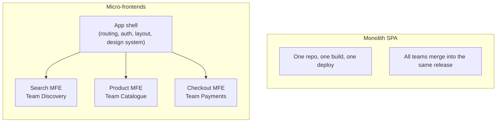
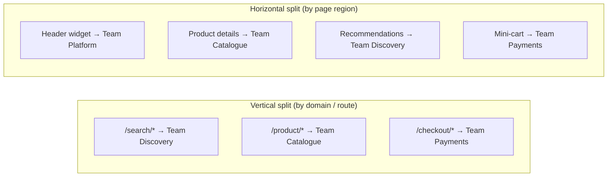
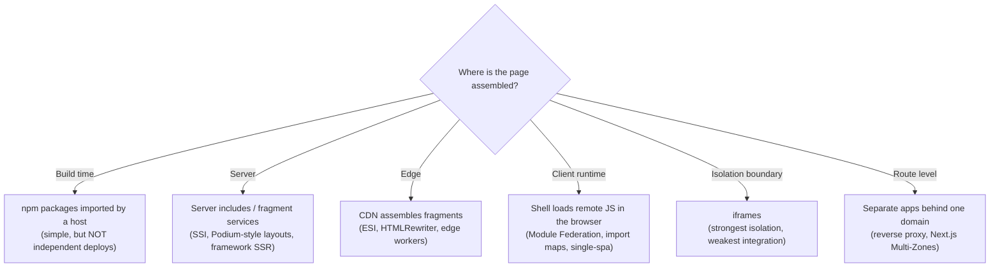
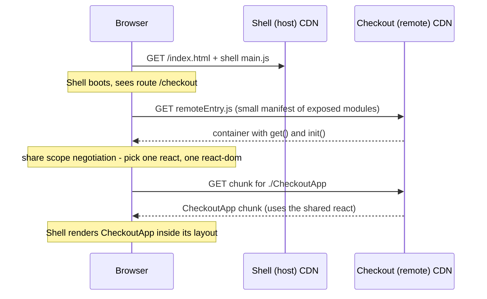
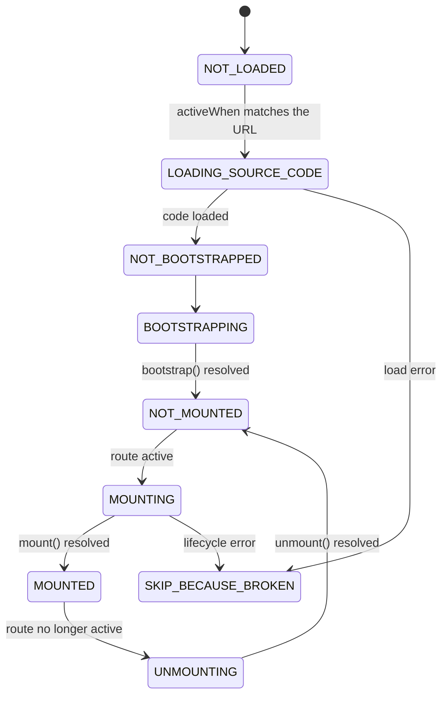
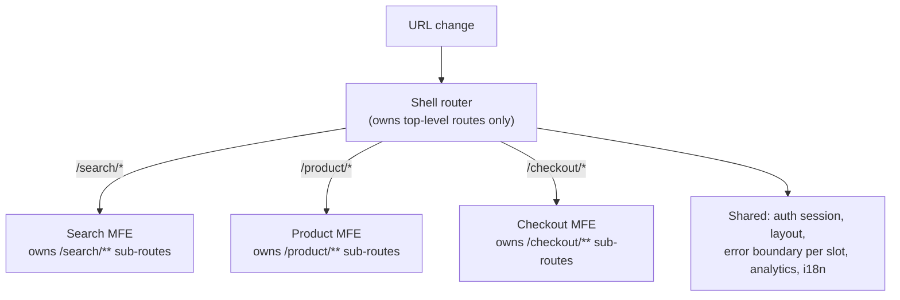
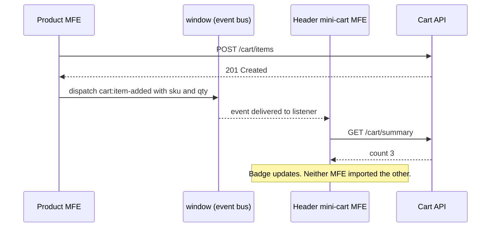
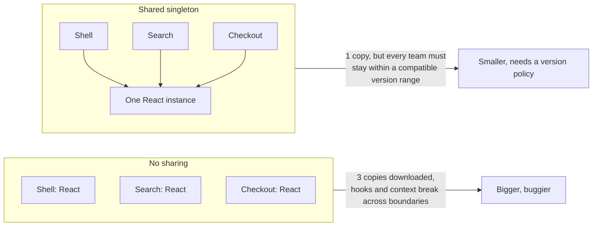
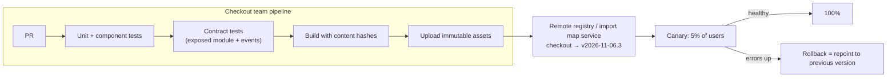
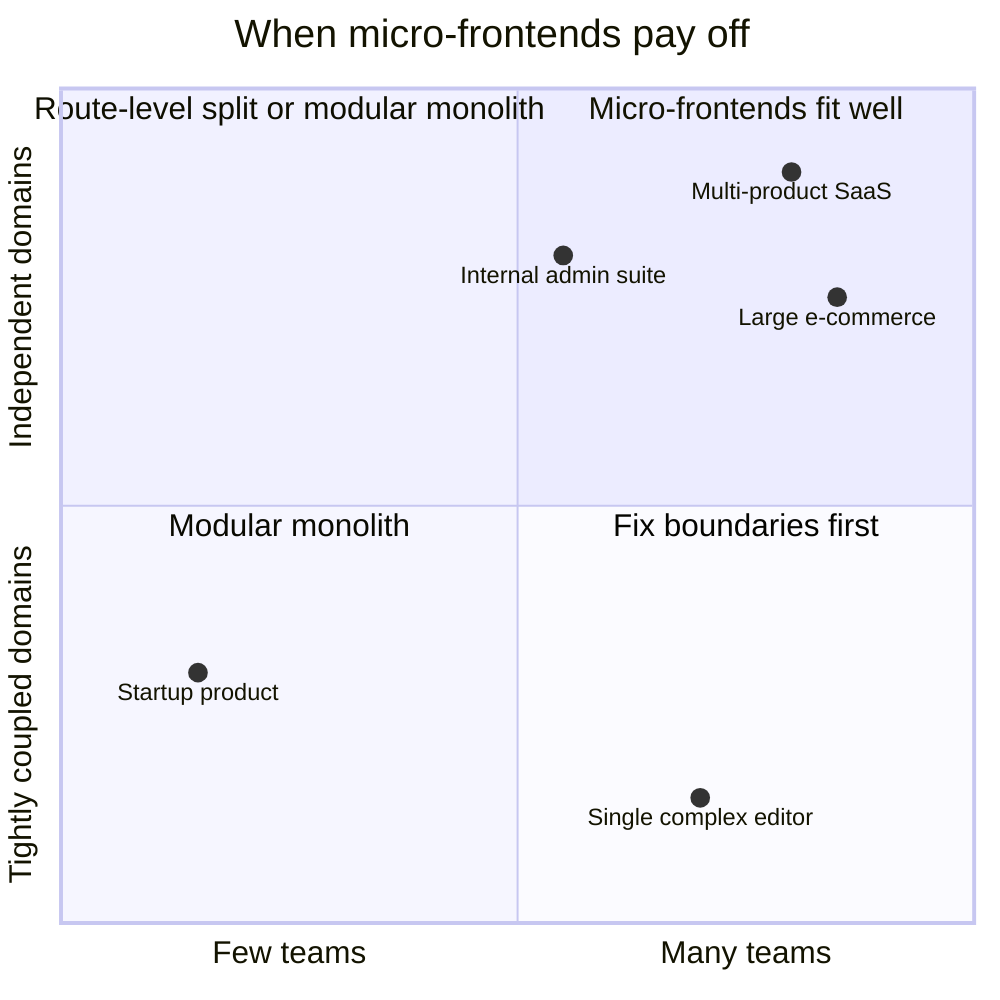

<!-- Generated by scripts/sync-knowledge.js from notes/ and README.md — do not edit here. -->
<!-- sections (line ranges in this file): Table of Contents 19-41 · ELI5 42-55 · Core Concept 56-388 · Framework Comparison 389-400 · Decision Matrix 401-430 · Real-World Examples 431-643 · Key Points Summary 644-662 · Test Your Understanding 663-733 · Cheat Sheet 734-777 · References & Further Reading 778-814 -->

# Micro-Frontends Architecture

> **Date:** 2026-11-06 · **Last updated:** 2026-11-06
> **Category:** Frontend System Design
> **Sub-Topic:** Rendering & Architecture / Architecture
> **Level:** Advanced · **Reading time:** ~30 min
> **Informs:** splitting a frontend across teams, composition strategy (build-time vs server vs edge vs client runtime), Module Federation vs import maps vs iframes, shared dependency and version policy, cross-app communication, CSS isolation, independent deployment and rollback

> **Pre-requisite:** [Edge Rendering](./edge-rendering.md) (server- and edge-side composition) and [Client-Side Rendering (CSR)](./client-side-rendering-csr.md) (what an app shell is).
> This note covers **how to split one user-facing product into pieces that different teams build, test and deploy independently** — and the real costs of doing it.

**Previous:** [Edge Rendering](./edge-rendering.md) · **Next:** [Mono-repo vs Multi-repo](./mono-repo-vs-multi-repo.md)

---

## Table of Contents

1. [ELI5 — Simple Explanation](#eli5--simple-explanation)
2. [Section 1: What Micro-Frontends Are (and Are Not)](#section-1-what-micro-frontends-are-and-are-not)
3. [Section 2: How to Split — Vertical vs Horizontal](#section-2-how-to-split--vertical-vs-horizontal)
4. [Section 3: Composition Strategies](#section-3-composition-strategies)
5. [Section 4: Module Federation](#section-4-module-federation)
6. [Section 5: Import Maps, single-spa and Web Components](#section-5-import-maps-single-spa-and-web-components)
7. [Section 6: Routing and the App Shell](#section-6-routing-and-the-app-shell)
8. [Section 7: Communication Between Micro-Frontends](#section-7-communication-between-micro-frontends)
9. [Section 8: Shared Dependencies and Version Skew](#section-8-shared-dependencies-and-version-skew)
10. [Section 9: Styling Isolation and the Design System](#section-9-styling-isolation-and-the-design-system)
11. [Section 10: Deployment, Testing and Observability](#section-10-deployment-testing-and-observability)
12. [Framework Comparison](#framework-comparison)
13. [Decision Matrix — Should You Use Micro-Frontends?](#decision-matrix--should-you-use-micro-frontends)
14. [Real-World Examples](#real-world-examples)
15. [Key Points Summary](#key-points-summary)
16. [Test Your Understanding (with answers)](#test-your-understanding)
17. [Cheat Sheet](#cheat-sheet)
18. [References & Further Reading](#references--further-reading)

---

## ELI5 — Simple Explanation

Think of a **shopping mall**.

- A **monolith** is one giant department store: one owner, one set of opening hours, one renovation schedule. Repainting the shoe section means closing the whole store.
- **Micro-frontends** are separate **shops inside a mall**. Each shop has its own staff, stock and refit schedule. The shoe shop can renovate on Tuesday without the café closing.
- The **mall itself** (the **app shell**) provides corridors, signs, toilets and security — things every shop needs and nobody should rebuild.
- Shops agree on **mall rules** (the design system and contracts): same signage style, same opening hours, no blocking corridors.
- But a mall has costs: shoppers walk further between shops, every shop pays for its own till, and if each shop picks its own signage the mall looks chaotic.

> **Micro-frontends split a frontend by team ownership so teams can ship independently. You buy organisational scale and pay with runtime overhead, duplication and coordination on shared contracts.**

---

## Core Concept — Step by Step

### Section 1: What Micro-Frontends Are (and Are Not)

The term appeared on the ThoughtWorks Technology Radar in 2016 and was popularised by Cam Jackson's 2019 article on martinfowler.com. The idea extends microservices to the UI: **independently deliverable frontend applications composed into a greater whole**.



| Characteristic | Micro-frontend | Just "components" or "packages" |
|---|---|---|
| **Owned by** | One team, end to end (often UI + BFF/API) | Anyone |
| **Deployed** | Independently, without redeploying the shell or siblings | With the app that imports them |
| **Integrated** | Usually at **runtime** (or at the server/edge) | At **build time** |
| **Coupling** | Through explicit contracts (URL, events, props) | Through imports and shared state |

> **The defining property is independent deployment.** If every "micro-frontend" must be released together, you have a distributed monolith with extra overhead.

**Why teams adopt them:**
- Many teams (often several squads) working on one product, blocked by a shared release train.
- Different parts of the product have **different change rates** and risk profiles.
- Incremental migration off a legacy framework (strangler fig: new routes in the new stack, old routes untouched).
- Acquisitions or platform products where separately built apps must appear as one.

**Why teams regret them:** extra infrastructure, duplicated dependencies, harder debugging, inconsistent UX, and complexity that a team of ten never needed. Conway's law cuts both ways: micro-frontends **mirror** your org chart — if the org chart is wrong, so is the architecture.

---

### Section 2: How to Split — Vertical vs Horizontal



| Split | How it works | Pros | Cons |
|---|---|---|---|
| **Vertical** (one MFE per route / business domain) | The shell routes each URL space to one MFE | Simple; one MFE on screen at a time; few shared-state problems | Cross-cutting UI (header, cart badge) still needs ownership |
| **Horizontal** (several MFEs on one page) | The page composes fragments owned by different teams | Fine-grained ownership; reuse fragments across pages | More runtime coordination, layout shifts, duplicated deps on one page |

**Rules of thumb:**
- Split by **business capability** (search, catalogue, checkout, account), never by technical layer ("the forms MFE", "the tables MFE").
- Start **vertical**. Add horizontal fragments only for genuinely cross-cutting widgets.
- One team owns one MFE. Shared ownership defeats the point.

---

### Section 3: Composition Strategies

Where do the pieces get stitched together?



| Strategy | Independent deploy? | SEO / first paint | Isolation | Typical tools |
|---|---|---|---|---|
| **Build-time packages** | ❌ host must rebuild | Good | Low | npm workspaces, private registry |
| **Route-level separate apps** | ✅ | Good (each app SSRs) | High (full page loads between apps) | Reverse proxy, CDN path routing, Next.js Multi-Zones |
| **Server-side composition** | ✅ | Good — HTML arrives assembled | Medium | SSI, ESI, Podium, framework SSR fetching fragments |
| **Edge composition** | ✅ | Good | Medium | ESI on CDNs that support it, Cloudflare `HTMLRewriter` |
| **Client runtime composition** | ✅ | Weaker unless combined with SSR | Low–medium (same JS realm) | Module Federation, Native Federation, import maps, single-spa |
| **iframes** | ✅ | Poor for SEO; extra document cost | Very high (separate realm, CSP, sandbox) | `<iframe sandbox>`, `postMessage` |
| **Web Components** | ✅ (when loaded at runtime) | Needs SSR support (Declarative Shadow DOM) | Medium (Shadow DOM for CSS) | Custom Elements, Lit, Angular Elements, Vue `defineCustomElement` |

> **Route-level splits are the most underrated option.** If teams own whole URL spaces, separate apps behind one domain give independent deploys with almost none of the runtime complexity. Navigations between them are full page loads — often fine, and smoother with the View Transitions API for cross-document navigations where supported.

---

### Section 4: Module Federation

**Module Federation** (introduced in webpack 5) lets one build (the **host**) load modules **exposed** by another, separately deployed build (a **remote**) at runtime, and **share** dependencies such as React between them.



| Concept | Meaning |
|---|---|
| **Host** | The app that consumes remote modules (often the shell) |
| **Remote** | A build that **exposes** modules, e.g. `./CheckoutApp` |
| **`remoteEntry.js`** | Small runtime file a remote publishes, describing what it exposes; fetched by the host at runtime |
| **Shared** | Dependencies negotiated at runtime so hosts and remotes reuse one copy |
| **`singleton: true`** | Only one version may be loaded — required for React, React DOM, Vue, Angular core, router libraries with global state |
| **`requiredVersion` / `strictVersion`** | Semver range a consumer needs; `strictVersion` fails instead of warning on a mismatch |
| **Async boundary** | The entry must `import('./bootstrap')` so shared modules can be negotiated before app code runs |

**Module Federation 2.0** (the `@module-federation/*` packages, developed by the Module Federation maintainers together with ByteDance's web infrastructure team) moved the runtime out of webpack so it works across bundlers, and added a JSON **manifest**, runtime plugins, dynamic remotes via a runtime API, TypeScript type sharing and devtools.

| Bundler / ecosystem | Federation support |
|---|---|
| **webpack 5** | Built-in `container.ModuleFederationPlugin`; MF 2.0 via `@module-federation/enhanced` |
| **Rspack / Rsbuild** | Built-in support plus MF 2.0 plugins |
| **Vite** | `@module-federation/vite` |
| **Angular (esbuild builder)** | **Native Federation** (`@angular-architects/native-federation`) — same mental model, built on browser-native ESM and import maps |
| **Nx** | Generators and executors for federated React and Angular hosts/remotes |
| **Next.js** | The `nextjs-mf` plugin does not support the App Router and its maintainers have wound down active development (see its README); prefer **Multi-Zones** for Next.js |
| **React Native** | Re.Pack (Callstack) supports Module Federation for "super app" style mobile apps |

**What federation does not solve:** contracts between teams, CSS conflicts, version policy, SSR (possible but significantly harder), and the cost of loading several remotes on one page.

---

### Section 5: Import Maps, single-spa and Web Components

#### Import maps — the browser-native option

An **import map** maps bare specifiers (`"react"`, `"@acme/checkout"`) to URLs, so native ES modules can be loaded by name. Supported in all modern browsers (Baseline since 2023).

```html
<script type="importmap">
{
  "imports": {
    "react": "https://cdn.acme.com/shared/react@19/react.js",
    "react-dom/client": "https://cdn.acme.com/shared/react@19/react-dom-client.js",
    "@acme/checkout": "https://cdn.acme.com/checkout/2026-11-05.4/main.js",
    "@acme/search": "https://cdn.acme.com/search/2026-11-06.1/main.js"
  }
}
</script>
```

Deploying a new version of checkout = **update one URL in the import map** (often generated by a small import-map service). Rolling back = point it back. Historically a page could have only one import map, defined before any module loads; newer browsers relax this — check MDN for current support before relying on multiple or dynamically added maps.

#### single-spa — a router for whole applications

**single-spa** is a framework-agnostic "meta-router": each registered application exposes lifecycle functions and single-spa mounts/unmounts it based on the URL.



Helpers such as `single-spa-react`, `single-spa-vue`, `single-spa-angular` and `single-spa-svelte` produce those lifecycles from a root component. single-spa is often combined with import maps (or Module Federation) for loading.

#### Web Components — a framework-neutral contract

A custom element is a **framework-agnostic public API**: attributes/properties in, DOM events out. Each team can wrap its React, Vue, Angular or Svelte app in a custom element, and the shell just uses `<acme-checkout cart-id="42">`.

| Strength | Weakness |
|---|---|
| Standard browser API, works in any host | Passing rich data needs properties, not attributes |
| Shadow DOM isolates CSS | Shadow DOM complicates global styles, fonts, portals/modals and some a11y patterns (e.g. `aria-labelledby` across shadow roots) |
| Clear lifecycle (`connectedCallback`/`disconnectedCallback`) | SSR needs Declarative Shadow DOM support in your framework |

See *Web Components & Shadow DOM* (Phase 10) for the details.

---

### Section 6: Routing and the App Shell



**What the shell owns** (keep it thin — it's the one thing everybody depends on):
- Top-level routing (`/search/*` → search MFE), 404 page.
- Authentication session and token refresh (expose a `getAccessToken()` function, not the token in global state).
- Global layout, navigation, design-system CSS and fonts.
- A per-MFE **error boundary** and loading fallback, so one failing remote doesn't blank the page.
- Cross-cutting telemetry (performance marks per MFE, error tagging with MFE name and version).

**What each MFE owns:** its sub-routes (nested routing), data fetching, state, and its BFF/API where possible.

**Routing rule:** one source of truth for the URL — the browser's `history`. Each MFE's router reads it; the shell never passes routes down as props.

---

### Section 7: Communication Between Micro-Frontends

Less is more: every channel between MFEs is a contract that can break.

| Mechanism | Use for | Coupling |
|---|---|---|
| **URL / query string** | Navigation and shareable state (`/search?q=shoes`) | Lowest — survives reloads |
| **Props / attributes from the shell** | Context like `locale`, `userId`, feature flags | Low — explicit input |
| **DOM CustomEvents** | Fire-and-forget notifications (`cart:item-added`) | Low — publish/subscribe |
| **Shared tiny services from the shell** | Auth token getter, analytics, toasts | Medium — versioned API |
| **`BroadcastChannel`** | Sync across tabs (logout everywhere) | Low |
| **Server / backend** | Real shared data (cart contents) — each MFE asks its API | Low — the backend is the source of truth |
| **Shared global store** (one Redux store for all) | ⚠️ Avoid | **High** — reintroduces the monolith at runtime |



**Make events a typed, versioned contract** — publish the event names and payload types as a tiny shared package, and treat changing them like changing a public API (add fields, don't rename or remove without a deprecation window).

---

### Section 8: Shared Dependencies and Version Skew



| Problem | Symptom | Mitigation |
|---|---|---|
| **Duplicate framework copies** | Bigger bundles; "Invalid hook call"; React context not shared across MFEs | Share as `singleton`; or isolate completely (separate roots, no shared context) |
| **Incompatible versions** | Runtime warnings or failures after one team upgrades | A platform-wide **version policy** (allowed major per framework), `requiredVersion`, upgrade windows |
| **Shell–remote skew** | Shell expects `./CheckoutApp` props v2, remote serves v1 | Version the exposed module contract; keep old exports during migration |
| **Stale remotes** | Users with an open tab load a new remote with an old shell | Keep old remote assets available; reload on chunk-load errors (see [Browser Caching Strategies](./browser-caching-strategies.md)) |
| **Shared design system drift** | Five visually different buttons | Design tokens + a shared component library with a support policy |

> **Major framework upgrades are the hardest moment.** With a shared singleton, everyone upgrades together (coordination) — or you temporarily allow two majors by isolating some MFEs (bigger bundles). Plan for this before you start.

---

### Section 9: Styling Isolation and the Design System

| Technique | Isolation | Notes |
|---|---|---|
| **Naming convention / prefixes** (`.checkout-…`) | Weak — by discipline | Cheap; enforce with lint rules |
| **CSS Modules / scoped styles** (Vue SFC `scoped`, Angular emulated encapsulation, Svelte component styles) | Strong for class names | Global element selectors still leak |
| **CSS-in-JS with prefixes** | Strong for class names | Runtime cost for runtime libraries; check SSR support |
| **Cascade layers (`@layer`)** | Controls priority, not scope | Put design-system base styles in a low layer so MFE styles win predictably |
| **`@scope`** | Scopes selectors to a subtree | Newer; check browser support on MDN |
| **Shadow DOM** | Strongest in-page isolation | Inherited properties and **CSS custom properties pass through** the shadow boundary — ideal for design tokens |
| **iframes** | Complete | At the cost of layout, a11y and performance |

> **Design tokens as CSS custom properties** are the glue: the shell defines `--color-primary`, `--space-2`, fonts; every MFE (with or without Shadow DOM) consumes them. See *Design Tokens* (Phase 6).

---

### Section 10: Deployment, Testing and Observability



- **Version registry:** keep a mapping of MFE → deployed version URL (an import map, MF manifest URL, or config service). Deploy and **rollback = change a pointer**, not rebuild.
- **Immutable assets:** never overwrite a version; keep old ones for open tabs.
- **Contract tests:** test that the remote still exposes what hosts consume (module names, prop types, event payloads). Consumer-driven contract testing works well here.
- **Integration environment:** an end-to-end smoke suite runs against "latest of everything" on every MFE deploy.
- **Observability:** tag every error and performance mark with the MFE name and version. Without this, a regression in a shared page has no owner.
- **Performance budget per MFE:** each team owns its JS budget; the shell measures total page cost. See [Performance Budgets](./performance-budgets.md).
- **Security:** remote code runs with the shell's privileges (same origin, same cookies). Load remotes only from trusted origins, lock them down in CSP `script-src`, and consider [Subresource Integrity](./subresource-integrity-sri.md) for pinned URLs.

---

## Framework Comparison

| Stack | Runtime composition | Wrapping as a custom element | Route-level / SSR option |
|---|---|---|---|
| **React** | Module Federation (webpack/Rspack/Vite), single-spa-react | Small wrapper calling `createRoot` in `connectedCallback` | Next.js **Multi-Zones** (separate Next apps under one domain via rewrites); React Router / Remix apps behind a proxy |
| **Vue** | Module Federation via Vite/webpack, single-spa-vue | `defineCustomElement()` built into Vue | Nuxt apps behind a proxy; Nuxt Layers for build-time sharing |
| **Angular** | **Native Federation** (esbuild builder) or MF with the webpack builder; single-spa-angular | `@angular/elements` `createCustomElement()` | Separate Angular apps behind a proxy; Nx tooling for both |
| **Svelte** | Module Federation via Vite; single-spa-svelte | `customElement` compiler option + `<svelte:options customElement="…">` | SvelteKit apps behind a proxy |
| **Native mobile** | Re.Pack (React Native + Module Federation), "mini-app" / super-app platforms | — | Server-driven UI owned by different teams |

---

## Decision Matrix — Should You Use Micro-Frontends?



| Situation | Recommendation |
|---|---|
| 1–3 teams, one product | **Modular monolith** — one deploy, enforced module boundaries (see [Feature-Sliced Design](./feature-sliced-design.md), [Mono-repo vs Multi-repo](./mono-repo-vs-multi-repo.md)) |
| Teams own whole URL spaces | **Route-level split** (separate apps behind a proxy / Multi-Zones) |
| Many teams contribute widgets to the same pages | **Runtime composition** (Module Federation / import maps) with a strict shell and contracts |
| Migrating a legacy app incrementally | **Strangler fig**: new routes as new apps, legacy behind the same domain; optionally single-spa to mount both on one page during transition |
| Embedding untrusted or third-party UI | **iframes** with `sandbox` and `postMessage` |
| SEO-critical, content-heavy pages | **Server or edge composition** so HTML arrives complete |
| One tightly coupled screen (editor, spreadsheet) | **Don't split it** — the coordination cost exceeds any benefit |

---

## Real-World Examples

**Example 1 — Module Federation host and remote (webpack + MF 2.0 plugin):**
```javascript
// checkout/webpack.config.js — the REMOTE
const { ModuleFederationPlugin } = require('@module-federation/enhanced/webpack');

module.exports = {
  output: { publicPath: 'auto', uniqueName: 'checkout' },
  plugins: [
    new ModuleFederationPlugin({
      name: 'checkout',
      filename: 'remoteEntry.js',
      exposes: {
        './CheckoutApp': './src/CheckoutApp.tsx', // the public contract of this team
      },
      shared: {
        react: { singleton: true, requiredVersion: '^19.0.0' },
        'react-dom': { singleton: true, requiredVersion: '^19.0.0' },
      },
    }),
  ],
};
```
```javascript
// shell/webpack.config.js — the HOST
const { ModuleFederationPlugin } = require('@module-federation/enhanced/webpack');

module.exports = {
  plugins: [
    new ModuleFederationPlugin({
      name: 'shell',
      remotes: {
        // URL comes from config per environment; a manifest URL is also supported in MF 2.0
        checkout: 'checkout@https://checkout.cdn.acme.com/remoteEntry.js',
      },
      shared: {
        react: { singleton: true, requiredVersion: '^19.0.0' },
        'react-dom': { singleton: true, requiredVersion: '^19.0.0' },
      },
    }),
  ],
};
```
```typescript
// shell/src/index.ts — the async boundary that lets shared deps be negotiated first
import('./bootstrap');
```

**Example 2 — Loading a remote safely in the shell (React):**
```tsx
// shell/src/routes/CheckoutRoute.tsx
import { lazy, Suspense } from 'react';
import { ErrorBoundary } from 'react-error-boundary';

const CheckoutApp = lazy(() => import('checkout/CheckoutApp'));

export function CheckoutRoute() {
  return (
    <ErrorBoundary
      fallback={<p role="alert">Checkout is temporarily unavailable. Please refresh.</p>}
      onError={(error) => reportError(error, { mfe: 'checkout' })}
    >
      <Suspense fallback={<CheckoutSkeleton />}>
        <CheckoutApp locale={useLocale()} getAccessToken={auth.getAccessToken} />
      </Suspense>
    </ErrorBoundary>
  );
}
```
```typescript
// shell/src/remotes.d.ts — until you adopt MF 2.0 type sharing
declare module 'checkout/CheckoutApp' {
  import type { ComponentType } from 'react';
  export interface CheckoutAppProps {
    locale: string;
    getAccessToken: () => Promise<string>;
  }
  const CheckoutApp: ComponentType<CheckoutAppProps>;
  export default CheckoutApp;
}
```

**Example 3 — BAD → GOOD: cross-MFE communication:**
```typescript
// ❌ BAD: the product MFE imports the header's store directly
import { headerStore } from 'header/store'; // runtime coupling + version lock-step
headerStore.dispatch({ type: 'cart/increment' });
```
```typescript
// ✅ GOOD: a tiny, versioned event contract published as its own package
// @acme/mfe-events
export interface MfeEvents {
  'cart:item-added': { sku: string; quantity: number };
  'auth:logged-out': Record<string, never>;
}

export function emit<K extends keyof MfeEvents>(type: K, detail: MfeEvents[K]): void {
  window.dispatchEvent(new CustomEvent(type, { detail }));
}

export function on<K extends keyof MfeEvents>(
  type: K,
  handler: (detail: MfeEvents[K]) => void,
): () => void {
  const listener = (e: Event) => handler((e as CustomEvent<MfeEvents[K]>).detail);
  window.addEventListener(type, listener);
  return () => window.removeEventListener(type, listener); // always return an unsubscribe
}

// Product MFE
emit('cart:item-added', { sku: 'SHOE-42', quantity: 1 });

// Header MFE (React)
useEffect(() => on('cart:item-added', () => refetchCartSummary()), []);
```

**Example 4 — Wrapping a React MFE as a custom element:**
```tsx
// checkout/src/element.tsx
import { createRoot, type Root } from 'react-dom/client';
import { CheckoutApp } from './CheckoutApp';

class AcmeCheckout extends HTMLElement {
  static observedAttributes = ['cart-id', 'locale'];
  #root: Root | null = null;

  connectedCallback() {
    this.#root = createRoot(this);
    this.#render();
  }
  attributeChangedCallback() {
    this.#render();
  }
  disconnectedCallback() {
    this.#root?.unmount(); // prevent leaks when the shell navigates away
    this.#root = null;
  }
  #render() {
    this.#root?.render(
      <CheckoutApp
        cartId={this.getAttribute('cart-id') ?? ''}
        locale={this.getAttribute('locale') ?? 'en'}
        onComplete={(orderId) =>
          this.dispatchEvent(new CustomEvent('checkout:complete', { detail: { orderId }, bubbles: true }))
        }
      />,
    );
  }
}

if (!customElements.get('acme-checkout')) customElements.define('acme-checkout', AcmeCheckout);
```
```typescript
// The same idea in other frameworks
// Vue:     import { defineCustomElement } from 'vue';  customElements.define('acme-search', defineCustomElement(SearchCe));
// Angular: import { createCustomElement } from '@angular/elements';
//          customElements.define('acme-account', createCustomElement(AccountComponent, { injector }));
// Svelte:  <svelte:options customElement="acme-reviews" />  with the customElement compiler option enabled
```

**Example 5 — single-spa root config with import maps:**
```html
<!-- index.html of the root config -->
<script type="importmap">
{
  "imports": {
    "single-spa": "https://cdn.acme.com/shared/single-spa/single-spa.js",
    "@acme/navbar": "https://cdn.acme.com/navbar/1.42.0/main.js",
    "@acme/search": "https://cdn.acme.com/search/3.8.1/main.js"
  }
}
</script>
<script type="module">
  import { registerApplication, start } from 'single-spa';

  registerApplication({
    name: '@acme/navbar',
    app: () => import('@acme/navbar'),
    activeWhen: ['/'], // always mounted
  });
  registerApplication({
    name: '@acme/search',
    app: () => import('@acme/search'),
    activeWhen: ['/search'],
  });

  start();
</script>
```

**Example 6 — Route-level split with Next.js Multi-Zones:**
```typescript
// next.config.ts of the main zone
import type { NextConfig } from 'next';

const nextConfig: NextConfig = {
  async rewrites() {
    return [
      // /blog is a separately built and deployed Next.js app owned by the content team
      { source: '/blog', destination: `${process.env.BLOG_DOMAIN}/blog` },
      { source: '/blog/:path+', destination: `${process.env.BLOG_DOMAIN}/blog/:path+` },
    ];
  },
};

export default nextConfig;
// The blog zone sets an assetPrefix so its static assets don't collide with the main zone's.
// Links between zones should be plain <a> tags (full navigation), not next/link.
```

---

## Key Points Summary

| Concept | One-Line Explanation |
|---|---|
| **Micro-frontend** | A team-owned slice of the UI that is built, tested and deployed independently |
| **App shell** | Thin host owning top-level routing, auth, layout and error isolation |
| **Vertical split** | One MFE per route/domain — simplest and most common |
| **Horizontal split** | Several MFEs on one page — fine-grained, more coordination |
| **Composition** | Build-time, server, edge, client runtime, iframe or route level |
| **Module Federation** | Runtime loading of modules exposed by separately deployed builds, with shared deps |
| **Import maps** | Browser-native mapping of bare specifiers to URLs; deploy = update a URL |
| **single-spa** | Framework-agnostic router that mounts/unmounts whole apps by URL |
| **Shared singleton** | One copy of React/Vue/Angular across MFEs — needs a version policy |
| **Contracts** | URL, props, typed events — versioned like public APIs |
| **Design tokens** | CSS custom properties pass through Shadow DOM and keep MFEs consistent |
| **Independent deploy** | The defining benefit; rollback = repoint a version |

---

## Test Your Understanding

**Q1 (Basic):**
What makes something a micro-frontend rather than just a shared component library?

<details>
<summary>Answer</summary>

**Independent deployment by an owning team.** A component library is imported at build time, so consumers must rebuild and redeploy to pick up changes; the release is coupled. A micro-frontend is integrated at runtime (or at the server/edge or by URL routing), so its team can ship, canary and roll back without the shell or other teams redeploying. It also usually owns a whole business capability end to end, not just reusable UI.
</details>

**Q2 (Application):**
A company has 4 developers on one React SPA. The CTO wants micro-frontends "to be future-proof". What do you recommend?

<details>
<summary>Answer</summary>

Don't adopt micro-frontends yet. They solve an **organisational** problem (many teams blocked by one release) that a four-person team doesn't have, and they add real costs: shell infrastructure, version policies, duplicated dependencies, cross-app debugging and contract maintenance.

Build a **modular monolith** instead: clear domain folders (or Feature-Sliced Design), lint-enforced import boundaries, route-level code splitting and possibly a monorepo with internal packages. If the org grows, well-bounded modules can later be extracted into route-level apps or federated remotes with much less effort.
</details>

**Q3 (Tricky):**
After integrating a federated remote, the app crashes with "Invalid hook call" whenever the remote's component renders. Both builds use React. What's wrong?

<details>
<summary>Answer</summary>

Two copies of React are loaded: the host's and the remote's. The remote's component calls hooks from **its** React while being rendered by the host's React DOM, so the dispatcher isn't set. Typical causes: `react`/`react-dom` not declared in `shared` on both sides, not marked `singleton`, mismatched `requiredVersion` ranges causing a fallback to the local copy, or a missing async boundary (`import('./bootstrap')`) so shared modules were consumed eagerly before negotiation.

Fix: share `react` and `react-dom` as singletons with compatible ranges in host and remote, add the async boundary, and agree a platform-wide React version policy.
</details>

**Q4 (Tricky):**
The product MFE and the header MFE both need the cart count. A developer proposes a shared global Redux store exposed by the shell. Why is that risky, and what's better?

<details>
<summary>Answer</summary>

A shared store couples every MFE to the same state shape, action names and library version. Any change becomes a coordinated release across teams — the monolith comes back at runtime, without compile-time safety. It also makes ownership unclear (who may change the cart slice?).

Better: the **cart API** is the source of truth. The product MFE adds the item through the API, then emits a typed `cart:item-added` event. The header MFE listens and refetches its summary from the API. Each MFE owns its own state; the event contract is small, versioned and additive.
</details>

**Q5 (System design):**
Design the frontend architecture for a large e-commerce site with teams for Discovery (search, listings), Catalogue (product pages), Checkout, and Account. SEO matters for listings and product pages.

<details>
<summary>Answer</summary>

- **Split vertically by route:** `/search` and `/c/*` → Discovery, `/p/*` → Catalogue, `/checkout/*` → Checkout, `/account/*` → Account.
- **SEO-critical routes** (listings, products) are **server-rendered apps** owned by their teams, routed by a CDN/reverse proxy (route-level split or Multi-Zones). HTML arrives complete; navigation between zones is a full page load, which is acceptable at domain boundaries.
- **Cross-cutting header** (search box, mini-cart, account menu): owned by a platform team, delivered as a server-included fragment or a small federated module/custom element in every app; the cart badge reads the cart API and listens for `cart:item-added`.
- **Checkout and Account** (no SEO, high interactivity) can be CSR apps; Checkout gets strict CSP and minimal third-party scripts.
- **Shared foundations:** design tokens + component library with a version support policy; a shared auth session (cookie on the parent domain, BFF per team); a typed event contract package; per-MFE error and performance tagging; per-MFE performance budgets.
- **Deploy:** each team ships independently with immutable assets; rollback = repoint the route or remote version.
</details>

**Q6 (Application):**
Teams use Shadow DOM for isolation. The design team changes the brand colour, but only some MFEs update. Global CSS in the shell sets `.btn-primary { background: #0047ff }`. Why, and how should theming work?

<details>
<summary>Answer</summary>

Selectors in the shell's global stylesheet **don't cross shadow boundaries**, so `.btn-primary` inside a shadow root never matches. Only MFEs without Shadow DOM picked up the change.

**CSS custom properties are inherited through shadow roots**, so theming should be token-based: the shell defines `--color-primary: #0047ff` on `:root`, and every MFE's components use `background: var(--color-primary)`. Changing the token updates every MFE, with or without Shadow DOM. Ship the tokens from the design-system package so names stay consistent.
</details>

---

## Cheat Sheet

**Key Definitions:**
- **Micro-frontend:** Independently deployable, team-owned part of a web UI
- **App shell / host:** Thin container that routes to and composes MFEs
- **Remote:** A separately deployed build exposing modules to hosts (Module Federation)
- **Shared singleton:** A dependency that must exist exactly once at runtime (React, Vue, Angular core)
- **Import map:** `<script type="importmap">` mapping bare module names to URLs
- **single-spa:** A meta-router with bootstrap/mount/unmount lifecycles per application
- **Strangler fig:** Incrementally replacing a legacy app route by route
- **Multi-Zones:** Next.js pattern for serving several Next.js apps under one domain

**Quick Reference:**
```text
Default choice:   modular monolith → route-level split → runtime composition (in that order)
Split by:         business capability (search, product, checkout), never by technical layer
One MFE:          one team · own repo or package · own pipeline · own budget · own errors
Shell owns:       top-level routes · auth session · layout · design tokens · error boundary per slot
Communicate via:  URL > props/attributes > typed CustomEvents > backend APIs   (avoid a shared global store)
Module Federation: shared { react: { singleton: true, requiredVersion } } on BOTH sides + import('./bootstrap')
Import maps:      deploy/rollback = change one URL; generate the map from a version registry
Styling:          tokens as CSS custom properties (pass through Shadow DOM) · scoped CSS · @layer
Deploy:           immutable versioned assets · canary · rollback = repoint · keep old versions for open tabs
Security:         remotes run with the shell's privileges → trusted origins only, CSP script-src
```

**Common Mistakes to Avoid:**

| Mistake | Why Wrong | Fix |
|---|---|---|
| Adopting MFEs with one or two teams | All the cost, none of the organisational benefit | Modular monolith with enforced boundaries |
| Splitting by technical layer | Every feature touches every MFE → coordinated releases | Split by business domain / route |
| Shared global state store | Runtime coupling, lock-step releases | API as source of truth + typed events |
| Not sharing React as a singleton | Duplicate copies, "Invalid hook call", bigger bundles | `singleton` + compatible `requiredVersion` on both sides |
| No version policy for frameworks | One team's upgrade breaks others | Platform-wide allowed majors and upgrade windows |
| A thick shell with business logic | The shell becomes the new monolith | Keep it to routing, auth, layout, error isolation |
| No error boundary per MFE | One failing remote blanks the whole page | Boundary + fallback per slot, tagged telemetry |
| Overwriting deployed assets | Open tabs break on chunk loads | Immutable versions; rollback by pointer |
| Global CSS selectors for theming | Leaks across MFEs; blocked by Shadow DOM | Design tokens via CSS custom properties |
| Many horizontal MFEs on one page | Duplicate deps, waterfalls, layout shift | Prefer vertical splits; budget per page |
| Loading remotes from anywhere | Remote code has full page privileges | Allow-listed origins, CSP, SRI where URLs are pinned |

---

## References & Further Reading

**Concepts**
- martinfowler.com: [Micro Frontends (Cam Jackson)](https://martinfowler.com/articles/micro-frontends.html)
- micro-frontends.org: [Micro Frontends — extending the microservice idea to frontend development (Michael Geers)](https://micro-frontends.org/)
- martinfowler.com: [Strangler Fig Application](https://martinfowler.com/bliki/StranglerFigApplication.html)

**Module Federation**
- webpack: [Module Federation](https://webpack.js.org/concepts/module-federation/)
- Module Federation: [Official docs (MF 2.0)](https://module-federation.io/)
- Rspack: [Module Federation](https://rspack.rs/guide/features/module-federation)
- Angular Architects: [Native Federation](https://www.npmjs.com/package/@angular-architects/native-federation)
- Nx: [Module Federation and Micro Frontends](https://nx.dev/concepts/module-federation/module-federation-and-nx)

**Browser-native building blocks**
- MDN: [`<script type="importmap">`](https://developer.mozilla.org/en-US/docs/Web/HTML/Reference/Elements/script/type/importmap)
- MDN: [Using custom elements](https://developer.mozilla.org/en-US/docs/Web/API/Web_components/Using_custom_elements)
- MDN: [Using shadow DOM](https://developer.mozilla.org/en-US/docs/Web/API/Web_components/Using_shadow_DOM)
- MDN: [`CustomEvent`](https://developer.mozilla.org/en-US/docs/Web/API/CustomEvent) · [`BroadcastChannel`](https://developer.mozilla.org/en-US/docs/Web/API/BroadcastChannel)

**Frameworks & tools**
- single-spa: [Getting started](https://single-spa.js.org/docs/getting-started-overview) · [Application lifecycle](https://single-spa.js.org/docs/building-applications)
- Next.js: [Multi-Zones](https://nextjs.org/docs/app/guides/multi-zones)
- Vue: [Vue and Web Components](https://vuejs.org/guide/extras/web-components.html)
- Angular: [Angular elements overview](https://angular.dev/guide/elements)
- Svelte: [Custom elements](https://svelte.dev/docs/svelte/custom-elements)
- Re.Pack: [Module Federation for React Native](https://re-pack.dev/)

---

> **Previous Topic:** [Edge Rendering](./edge-rendering.md)
> — Running server code in CDN PoPs, and why data locality decides whether it helps

> **Next Topic:** [Mono-repo vs Multi-repo](./mono-repo-vs-multi-repo.md)
> — How to organise the code of many apps and packages: one repository or many

*Saved on: 2026-11-06 | Repo: Frontend System Design Learning Notes*
