<!-- Generated by scripts/sync-knowledge.js from notes/ and README.md — do not edit here. -->
<!-- sections (line ranges in this file): Table of Contents 19-43 · ELI5 44-57 · Core Concept 58-491 · Decision Matrix 492-521 · Real-World Examples 522-687 · Key Points Summary 688-709 · Test Your Understanding 710-779 · Cheat Sheet 780-828 · References & Further Reading 829-861 -->

# Module Bundling & Build Systems

> **Date:** 2026-11-06 · **Last updated:** 2026-11-06
> **Category:** Frontend System Design
> **Sub-Topic:** Rendering & Architecture / Build Tools
> **Level:** Intermediate · **Reading time:** ~32 min
> **Informs:** bundler choice per framework, dev server and HMR speed, chunking and code-splitting strategy, tree shaking, browser targets and polyfills, source maps in production, environment variables and secrets, library packaging (ESM/CJS, exports), monorepo build orchestration and caching

> **Pre-requisite:** [Browser Caching Strategies](./browser-caching-strategies.md) (content-hashed filenames) and [HTTP/1.1 vs HTTP/2 vs HTTP/3](./http1-vs-http2-vs-http3.md) (why request count still matters).
> This note explains **what a bundler and a build system actually do**, how today's tools (Vite, webpack, Rspack, Turbopack, esbuild, Rolldown) differ, and the build decisions that shape performance. Deep dives on the outputs follow in [Code Splitting](./code-splitting-and-lazy-loading.md), [Tree Shaking](./tree-shaking-and-dead-code-elimination.md) and [JavaScript Bundle Optimization](./javascript-bundle-optimization.md).

**Previous:** [Feature-Sliced Design](./feature-sliced-design.md) · **Next:** [Client State Management Patterns](./client-state-management-patterns.md)

---

## Table of Contents

1. [ELI5 — Simple Explanation](#eli5--simple-explanation)
2. [Section 1: Why Bundle at All?](#section-1-why-bundle-at-all)
3. [Section 2: Module Formats — ESM, CommonJS and Friends](#section-2-module-formats--esm-commonjs-and-friends)
4. [Section 3: The Bundling Pipeline](#section-3-the-bundling-pipeline)
5. [Section 4: Resolution — How `import 'x'` Finds a File](#section-4-resolution--how-import-x-finds-a-file)
6. [Section 5: Transforms — Loaders, Plugins and Compilers](#section-5-transforms--loaders-plugins-and-compilers)
7. [Section 6: Chunking and Code Splitting](#section-6-chunking-and-code-splitting)
8. [Section 7: Tree Shaking, Scope Hoisting, Minification](#section-7-tree-shaking-scope-hoisting-minification)
9. [Section 8: Dev Server and Hot Module Replacement](#section-8-dev-server-and-hot-module-replacement)
10. [Section 9: Targets, Polyfills and Environment Variables](#section-9-targets-polyfills-and-environment-variables)
11. [Section 10: Source Maps and Build Output](#section-10-source-maps-and-build-output)
12. [Section 11: The Tool Landscape in 2026](#section-11-the-tool-landscape-in-2026)
13. [Section 12: Bundling Libraries vs Applications](#section-12-bundling-libraries-vs-applications)
14. [Section 13: Build Systems — Orchestration and Caching](#section-13-build-systems--orchestration-and-caching)
15. [Decision Matrix — Choosing a Bundler](#decision-matrix--choosing-a-bundler)
16. [Real-World Examples](#real-world-examples)
17. [Key Points Summary](#key-points-summary)
18. [Test Your Understanding (with answers)](#test-your-understanding)
19. [Cheat Sheet](#cheat-sheet)
20. [References & Further Reading](#references--further-reading)

---

## ELI5 — Simple Explanation

Think of **moving house**:

- Your app is hundreds of small items (modules) scattered across rooms, and many items need other items ("the lamp needs its bulb").
- A **bundler** is the moving company. It starts at the front door (**entry point**), follows every "needs" link to find everything you actually use (**the module graph**), throws away what nothing uses (**tree shaking**), translates labels the new house can't read (**transpiling TypeScript/JSX**), and packs everything into a few well-labelled boxes (**chunks**), each with a unique label that changes only if its contents change (**content hash**).
- Boxes you need on day one go on the first truck (**entry chunk**); the garden furniture comes later when you ask for it (**lazy chunks**).
- While you're still **decorating** (development), the movers don't pack anything: they hand you each item the moment you ask for it, and swap a single item without moving you out (**dev server + HMR**).
- A **build system** (Turborepo, Nx) is the moving coordinator for a whole **street** of houses: it decides which house moves first and never repeats a move that was already done (**task graph + caching**).

> **A bundler turns a graph of source modules into a small number of optimised, cache-friendly files for the browser; a build system orchestrates and caches many such tasks across a codebase.**

---

## Core Concept — Step by Step

### Section 1: Why Bundle at All?

Browsers have run native ES modules (`<script type="module">`) for years, and HTTP/2+ multiplexes requests. So why still bundle for production?

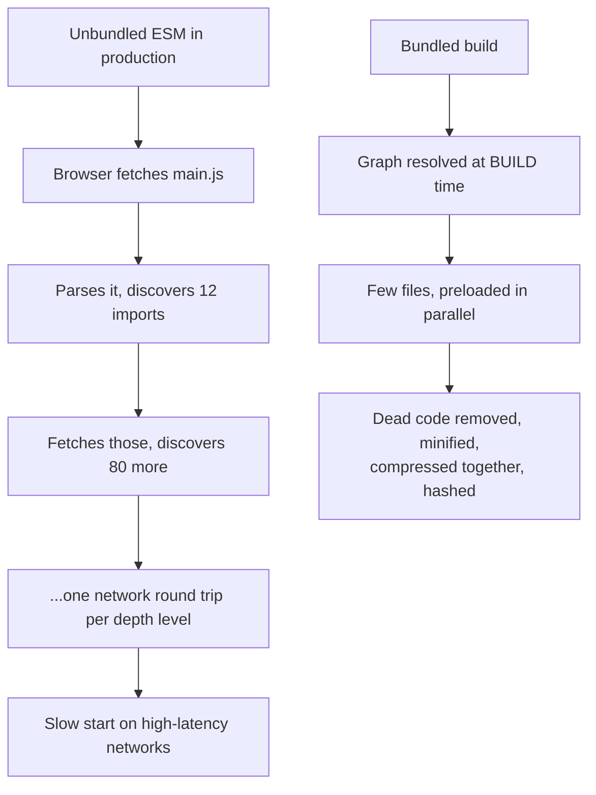

| Reason | Explanation |
|---|---|
| **Import waterfalls** | The browser only learns about a module's imports after downloading and parsing it. A deep graph means many sequential round trips. HTTP/2 multiplexing doesn't fix discovery |
| **Tree shaking & minification** | Need the whole graph to know what's unused |
| **Compression** | Brotli/gzip compress one large file better than many small ones |
| **Non-JS sources** | TypeScript, JSX, Vue SFCs, Svelte components, CSS Modules, images must be compiled anyway |
| **npm packages** | Bare specifiers (`import 'react'`) don't resolve in the browser without an import map; many packages still ship CommonJS |
| **Caching** | Content-hashed chunks give "cache forever" URLs ([Browser Caching](./browser-caching-strategies.md#section-7-cache-forever-and-rename)) |

**But don't over-bundle:** one giant file defeats caching (any change invalidates everything) and makes users download code for pages they never visit. The goal is **a few well-split chunks**, not one.

> **Unbundled production** is possible with native ESM + [import maps](https://developer.mozilla.org/en-US/docs/Web/HTML/Reference/Elements/script/type/importmap) (Rails' importmap-rails is one example). It suits small or server-rendered apps with little JS; large SPAs still bundle.

---

### Section 2: Module Formats — ESM, CommonJS and Friends

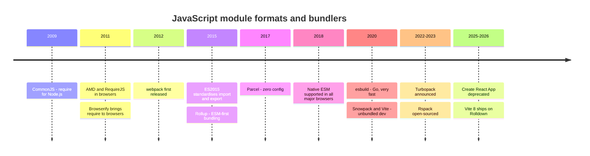

| Format | Syntax | Static? | Where it lives today |
|---|---|---|---|
| **ESM** | `import` / `export` | ✅ Imports are static, analysable at build time | Browsers, Node, Deno, Bun — **the standard** |
| **CommonJS (CJS)** | `require()` / `module.exports` | ❌ `require` is a runtime call | Older Node packages; still common on npm |
| **UMD** | Wrapper that works as AMD, CJS or global | ❌ | Legacy browser libraries (`<script>` tag builds) |
| **AMD** | `define([...], fn)` | ❌ | Legacy (RequireJS) |
| **IIFE** | `(function () { ... })()` | — | Output format for plain `<script>` widgets/snippets |

**Why ESM matters for bundlers:** `import` and `export` can only appear at the top level with string-literal specifiers, so the bundler can build the **complete dependency graph without running code**. That's what makes tree shaking reliable. CJS is dynamic (`require(cond ? 'a' : 'b')`, `module.exports[name] = …`), so bundlers must be conservative with it.

**Dynamic `import()`** is the ESM way to load code on demand. Bundlers treat it as a **split point** and create a separate chunk.

---

### Section 3: The Bundling Pipeline

Every bundler (webpack, Rollup, Rolldown, esbuild, Rspack, Turbopack, Parcel) follows the same broad pipeline, though the internals differ a lot.

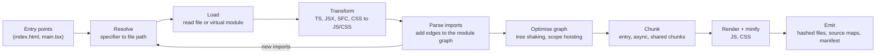

| Stage | Question it answers | Example |
|---|---|---|
| **Resolve** | Which file is `'@/shared/ui/button'`? | tsconfig `paths` alias → `src/shared/ui/button/index.ts` |
| **Load** | What are its contents? | Read from disk, or generate a virtual module |
| **Transform** | How do we turn it into standard JS/CSS? | TypeScript → JS (types stripped), JSX → `jsx()` calls, `.vue` → render function |
| **Graph** | What depends on what? | `main.tsx → App.tsx → Button.tsx → button.module.css` |
| **Optimise** | What can be removed or merged? | Drop unused exports, concatenate modules |
| **Chunk** | How do we group modules into files? | One entry chunk, one chunk per lazy route, shared vendor chunk |
| **Emit** | What files do we write? | `assets/index-3f9a1c.js`, `.map` files, `manifest.json` |

---

### Section 4: Resolution — How `import 'x'` Finds a File

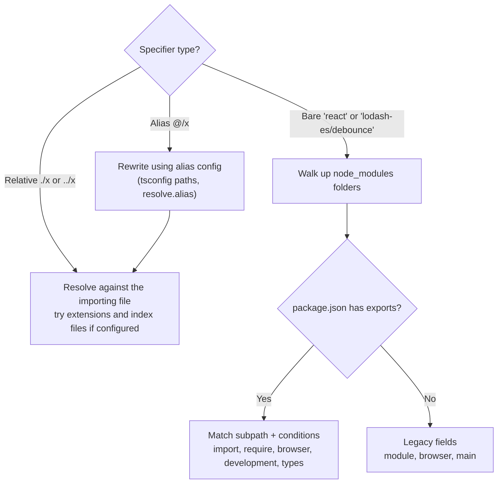

**Package `exports` and conditions** are the modern contract between a library and bundlers:

```json
{
  "name": "@acme/utils",
  "type": "module",
  "exports": {
    ".": {
      "types": "./dist/index.d.ts",
      "import": "./dist/index.js",
      "require": "./dist/index.cjs"
    },
    "./debounce": "./dist/debounce.js",
    "./package.json": "./package.json"
  },
  "sideEffects": false
}
```

- `exports` **encapsulates** the package: subpaths not listed can't be imported.
- **Conditions** are matched in object order; common ones are `types`, `import`, `require`, `browser`, `node`, `development`/`production`, plus framework-specific ones (`react-server` for RSC).
- In TypeScript, use `"moduleResolution": "bundler"` for apps compiled by a bundler, and `"node16"`/`"nodenext"` for code Node runs directly or for libraries that must satisfy Node's rules.

---

### Section 5: Transforms — Loaders, Plugins and Compilers

The heavy lifting of turning TS/JSX/SFCs into JS is done by **compilers**, which bundlers call through **loaders** (webpack/Rspack) or **plugins** (Rollup/Vite/Rolldown).

| Compiler | Language | Typical use |
|---|---|---|
| **Babel** | JS | Long-standing transform ecosystem; still needed for some plugins (e.g. React Compiler's Babel plugin, custom macros) |
| **TypeScript `tsc`** | TS | **Type checking** and `.d.ts` generation; most bundlers strip types without checking them |
| **SWC** | Rust | Transforms and minification in Next.js, Rspack, Parcel and others |
| **esbuild** | Go | Fast transforms, minification and bundling; used inside many tools |
| **Oxc** | Rust | Parser, transformer, minifier and linter (oxlint); used by Rolldown and therefore Vite |
| **Lightning CSS** | Rust | CSS parsing, transpiling for targets, minification |
| **Framework compilers** | — | `@vue/compiler-sfc`, the Svelte compiler, Angular's compiler (via `@angular/build`), React Compiler |

> **Bundlers don't type-check.** Vite, esbuild, SWC and Rolldown strip types per file for speed. Run `tsc --noEmit` (or `vue-tsc`, `svelte-check`, Angular's build which does type-check) in CI and your editor.

**Plugin hooks** (the Rollup-style API that Vite and Rolldown share, simplified):

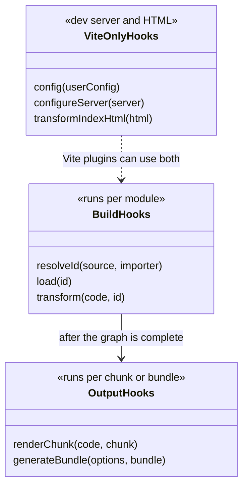

webpack and Rspack use **loaders** for per-file transforms (`ts-loader`, `babel-loader`, `builtin:swc-loader` in Rspack) and **plugins** that tap into a large compiler lifecycle.

---

### Section 6: Chunking and Code Splitting

The bundler decides which modules go into which output file.

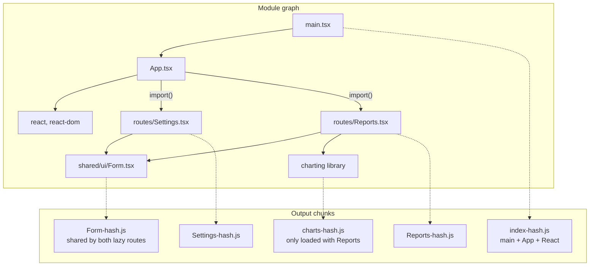

| Chunk type | Created by | Loaded |
|---|---|---|
| **Entry chunk** | Each entry point | Immediately (`<script type="module">`) |
| **Async (lazy) chunk** | Each dynamic `import()` | On demand, e.g. on route change |
| **Shared chunk** | Modules used by several chunks | With the first chunk that needs it |
| **Vendor chunk** (optional) | Manual grouping of `node_modules` | Changes rarely → long cache life |
| **CSS chunk** | CSS imported by a JS chunk | With its JS chunk (bundler injects `<link>` or preloads) |

**Trade-offs:**
- **Too few chunks:** users download code for routes they never visit; every deploy invalidates the whole bundle.
- **Too many tiny chunks:** more requests and less compression efficiency; can create load waterfalls (chunk A loads, then discovers it needs B). Bundlers mitigate this with **modulepreload** hints for a chunk's dependencies.
- **Unstable vendor chunks:** if a vendor chunk's hash changes on every deploy (because module IDs shift), you lose the caching benefit. Modern bundlers use deterministic IDs by default.

Details and React/Vue/Angular/Svelte lazy-loading APIs: [Code Splitting & Lazy Loading](./code-splitting-and-lazy-loading.md).

---

### Section 7: Tree Shaking, Scope Hoisting, Minification

| Optimisation | What it does | Requires |
|---|---|---|
| **Tree shaking** | Removes exports nobody imports, and modules with no used exports and no side effects | ESM; correct `"sideEffects"` in package.json; `/*#__PURE__*/` annotations for calls that look side-effectful |
| **Scope hoisting** (module concatenation) | Puts many modules into one function scope instead of wrapping each in a function | ESM; done by Rollup/Rolldown by default, webpack in production mode |
| **Minification** | Renames variables, removes whitespace, folds constants, drops dead branches (`if (false)`) | Terser, esbuild, SWC, Oxc minifier |
| **Dead branch elimination** | `if (import.meta.env.DEV) { ... }` is removed in production builds | Compile-time constants replaced before minification |

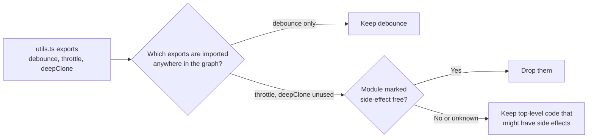

Common tree-shaking killers: importing a CommonJS build of a library (`lodash` instead of `lodash-es` or per-method imports), `export default { a, b, c }` objects (an object is used as a whole), top-level code with side effects, and missing or wrong `"sideEffects"` (CSS imports must be listed, or the bundler may drop them). Full coverage: [Tree Shaking & Dead Code Elimination](./tree-shaking-and-dead-code-elimination.md).

---

### Section 8: Dev Server and Hot Module Replacement

Dev servers optimise for **fast startup and fast updates**, not small output. Two designs dominate:

| Design | Used by | Startup | Update |
|---|---|---|---|
| **Bundle first, then serve** (in-memory bundle) | webpack-dev-server, Rspack dev server | Grows with app size (Rspack much faster than webpack thanks to Rust) | Rebuild affected modules, push update |
| **Serve native ESM on demand** | Vite (and tools built on it: SvelteKit, Nuxt, Angular CLI's dev server, Astro, React Router framework mode) | Near-constant: only pre-bundles dependencies, transforms source files when the browser asks | Transform one file, push update |
| **Incremental bundling with fine-grained caching** | Turbopack (Next.js) | Compiles only what the requested routes need | Function-level incremental recomputation |

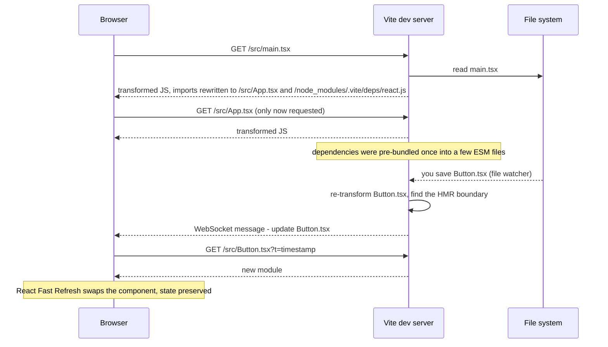

**HMR boundaries:** a module that calls `import.meta.hot.accept()` (or a framework plugin that does it for you: React Fast Refresh, Vue and Svelte plugins, Angular's HMR) can swap itself in place. If an update reaches the root without finding a boundary, the page **fully reloads**.

**Dev ≠ prod:** the dev server serves unbundled modules; production is bundled and minified. Bugs can differ (CSS order, CJS interop, chunk loading). Always test a **production build locally** (`vite preview`, `next build && next start`) before release. Vite 8 narrowed this gap by using one bundler (Rolldown) for both dependency pre-bundling and production.

---

### Section 9: Targets, Polyfills and Environment Variables

**Targets** tell the compiler which syntax it may leave untouched.

| Setting | Tool | Effect |
|---|---|---|
| `build.target` | Vite | Syntax lowering target; recent Vite versions default to a "Baseline widely available" browser set |
| `browserslist` | Babel, Autoprefixer, Lightning CSS, SWC, webpack | Shared browser query (`"> 0.5%, last 2 versions, not dead"`) |
| `target` in `tsconfig.json` | `tsc` | Output syntax when `tsc` emits JS |

**Syntax vs APIs:** compilers **lower syntax** (`?.`, `??`, class fields) but don't add missing **APIs** (`Array.prototype.findLast`, `structuredClone`). Those need **polyfills** (core-js via Babel `useBuiltIns: 'usage'`, or `@vitejs/plugin-legacy` for old browsers). Polyfilling for browsers you don't support costs every user bytes, so align targets with your real audience (analytics + [Baseline](https://web.dev/baseline)).

**Environment variables are compile-time string replacement:**

```text
import.meta.env.VITE_API_URL   → replaced with "https://api.example.com" in the bundle
process.env.NEXT_PUBLIC_X      → replaced in client bundles (Next.js)
```

| Framework | Exposed to client code only if prefixed with |
|---|---|
| Vite (React, Vue, Svelte, etc.) | `VITE_` (configurable via `envPrefix`) |
| Next.js | `NEXT_PUBLIC_` |
| Nuxt | runtime config `public` keys (`NUXT_PUBLIC_*` env overrides) |
| SvelteKit | `PUBLIC_` (via `$env/static/public` / `$env/dynamic/public`) |
| Angular | No env-var convention: `environment.ts` files swapped with `fileReplacements`, or `define` in the build options |

> **Anything in a client bundle is public.** The prefix rule exists so you don't accidentally inline secrets. API keys for paid services, database URLs and signing secrets must stay on the server.

---

### Section 10: Source Maps and Build Output

A typical Vite production build:

```text
dist/
├── index.html                      ← references hashed entry files; serve with Cache-Control: no-cache
├── assets/
│   ├── index-B3f9a1cD.js           ← entry chunk (content hash in name)
│   ├── index-C8b2e44E.css
│   ├── Settings-D7d1e9bF.js        ← lazy route chunk
│   ├── Form-A91cd02G.js            ← shared chunk
│   └── logo-E5a0b3cH.svg
└── .vite/manifest.json             ← (if build.manifest) maps source entries → output files, for SSR/backends
```

**Source maps** map minified output back to source for debugging and error tracking.

| Option | Map file emitted? | `sourceMappingURL` comment? | Use for |
|---|---|---|---|
| Full (`sourcemap: true`, webpack `source-map`) | ✅ | ✅ | Open-source apps, internal tools |
| **Hidden** (`sourcemap: 'hidden'`, webpack `hidden-source-map`) | ✅ | ❌ | **Upload to the error tracker** (Sentry, Datadog) without serving them publicly |
| Inline | Embedded in JS | — | Dev only (bloats files) |
| None | ❌ | ❌ | When you never need stack traces (rare) |

Production best practice: generate hidden source maps, upload them to your error tracker in CI tied to the **release** version, and don't deploy `.map` files to the public CDN unless you're comfortable exposing your source. See [Error Tracking](./error-tracking-sentry-datadog-rum.md).

---

### Section 11: The Tool Landscape in 2026

| Tool | Written in | What it is | Typical users |
|---|---|---|---|
| **Vite** | TS + Rust (via Rolldown) | Dev server + build tool; Vite 8 (2026) uses **Rolldown** for both pre-bundling and production, replacing the earlier esbuild + Rollup pair | Vue, Svelte/SvelteKit, Nuxt, Astro, React SPAs, React Router, TanStack Start, Angular's dev server |
| **Rolldown** | Rust | Bundler with a Rollup-compatible plugin API, built on Oxc | Through Vite; also usable directly |
| **Rollup** | JS (Rust parser) | ESM-first bundler | Libraries; Vite ≤ 7 production builds |
| **webpack** | JS | The most configurable bundler; huge plugin/loader ecosystem; Module Federation | Large existing apps; Next.js opt-out path |
| **Rspack** (+ Rsbuild) | Rust | webpack-compatible API and loaders, much faster | webpack migrations; Module Federation users |
| **Turbopack** | Rust | Incremental bundler built for Next.js; default for dev and build in recent Next.js versions (webpack still available via a flag) | Next.js apps |
| **esbuild** | Go | Very fast bundler/transformer/minifier with a deliberately small API | Scripts, libraries, tooling; Angular's application builder |
| **Parcel** | JS + Rust | Zero-config bundler | Small/medium apps; RSC experiments |
| **Metro** | JS | React Native bundler | React Native, Expo |
| **Bun** | Zig | Runtime with a built-in bundler | Bun-based projects |

**Deprecated:** **Create React App** was deprecated by the React team in February 2025 for new apps. Use a framework (Next.js, React Router, Expo) or a build tool (Vite, Parcel, Rsbuild) instead. Snowpack is no longer maintained.

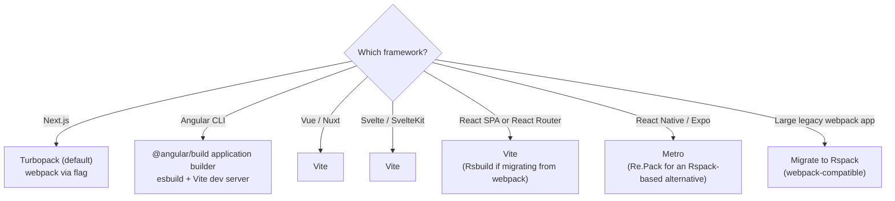

> Defaults move quickly in this space. Treat the table as a snapshot and confirm against each framework's docs (and the `package.json` of a freshly scaffolded project) before deciding.

---

### Section 12: Bundling Libraries vs Applications

| Concern | Application | Library (npm package) |
|---|---|---|
| **Dependencies** | Bundle them | **Don't bundle** framework/peer deps; mark them external |
| **Output format** | Browser chunks (ESM) | ESM (plus CJS only if your consumers need it) |
| **Minify?** | Yes | Usually no; the app's bundler will minify |
| **Code splitting** | Per route | Per entry point (`exports` subpaths) |
| **CSS** | Extracted, hashed | Ship CSS files and list them in `"sideEffects"` |
| **Types** | Not shipped | Ship `.d.ts` (via `tsc`, `tsdown`, `tsup`, or `vite-plugin-dts`) |
| **Tools** | Vite, Next/Turbopack, Rspack, Angular CLI | tsdown, tsup, Rollup, Vite library mode, `ng-packagr` (Angular libraries), `@sveltejs/package` |

**Dual ESM/CJS packages** are less necessary than they used to be: recent Node versions can `require()` synchronous ES modules, which removes much of the reason to ship CJS. Shipping both formats also risks the **dual-package hazard** (two copies of the same module with separate state). Check Node's docs for the exact versions that support `require(esm)` if you still support older Node.

---

### Section 13: Build Systems — Orchestration and Caching

A bundler builds **one app or package**. A **build system / task runner** decides **which tasks run, in what order, and which can be skipped** across a repo.

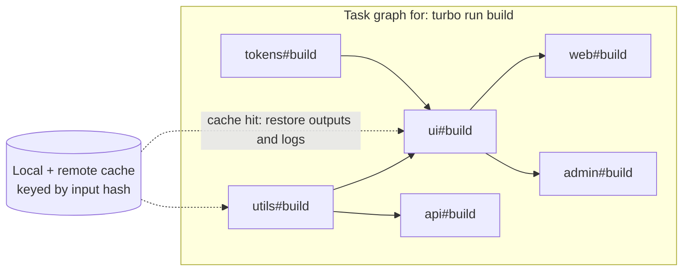

| Concept | Meaning |
|---|---|
| **Task graph** | Tasks ordered by package dependencies (`ui` builds before `web`) |
| **Input hashing** | Hash of source files, dependencies, env vars and config; unchanged hash = skip |
| **Remote cache** | Share build outputs across CI runs and developers |
| **Affected** | Run tasks only for packages changed since a base commit (`nx affected`, Turborepo filters) |

Tools: **Turborepo**, **Nx**, Bazel (polyglot, large orgs), Rush, Moon, plus package-manager workspaces (pnpm, npm, Yarn, Bun) for linking. See [Mono-repo vs Multi-repo](./mono-repo-vs-multi-repo.md) and [Monorepo Tooling](./monorepo-tooling-turborepo-nx.md).

**CI pipeline for a frontend app** (the build is one step among several):

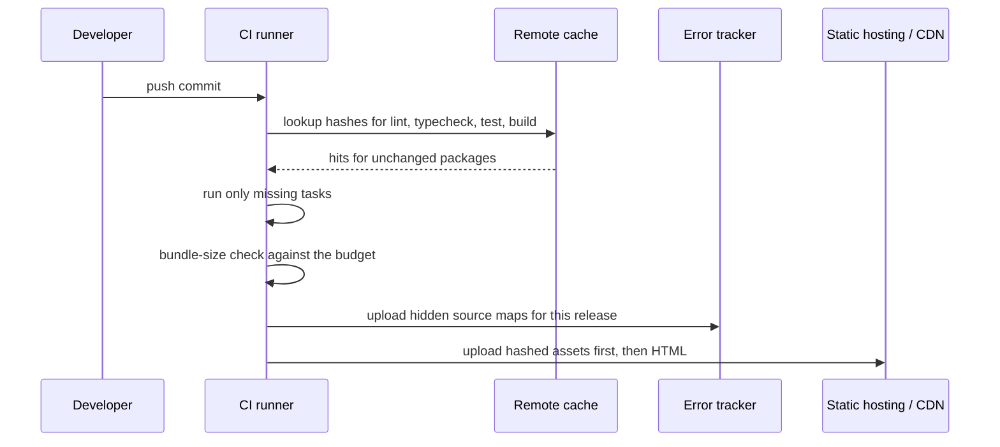

---

## Decision Matrix — Choosing a Bundler

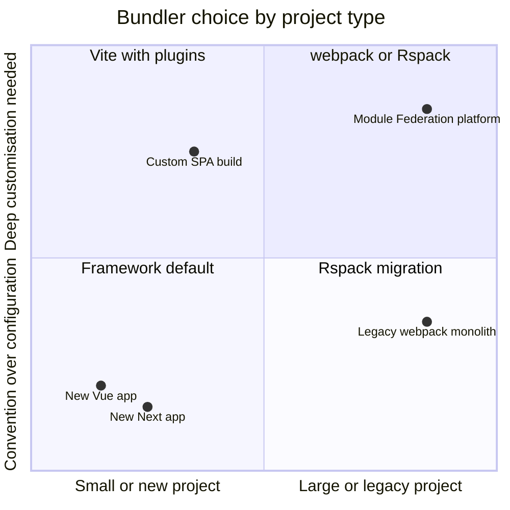

| Situation | Recommended | Why |
|---|---|---|
| Using a meta-framework (Next, Nuxt, SvelteKit, Angular CLI, Astro) | **The framework's default** | Integrated SSR, routing, RSC, HMR; least maintenance |
| New React SPA without a meta-framework | **Vite** | Fast dev, simple config, large plugin ecosystem |
| Large webpack app, slow builds | **Rspack** | Reuses most webpack config and loaders; big speed gains |
| Micro-frontends with Module Federation | **Rspack or webpack** (MF 2.0); Vite via plugins | Most mature Module Federation support; see [Micro-Frontends](./micro-frontends-architecture.md) |
| Publishing a TS library | **tsdown / tsup / Rollup / Vite library mode** | ESM + types, externals, no minification |
| Scripts, CLIs, edge functions | **esbuild** (or the runtime's own bundler) | Tiny API, very fast |
| React Native | **Metro** | Platform default |

---

## Real-World Examples

**Example 1 — Vite config for a React SPA:**
```typescript
// vite.config.ts
import { defineConfig } from 'vite';
import react from '@vitejs/plugin-react';
import { fileURLToPath, URL } from 'node:url';

export default defineConfig({
  plugins: [react()],                     // JSX transform + React Fast Refresh
  resolve: {
    alias: { '@': fileURLToPath(new URL('./src', import.meta.url)) },
  },
  build: {
    sourcemap: 'hidden',                  // emit .map files without the sourceMappingURL comment
    manifest: true,                       // .vite/manifest.json for SSR or backend integration
  },
  server: {
    proxy: { '/api': 'http://localhost:3000' },   // avoid CORS in dev
  },
});
```

> Vue (`@vitejs/plugin-vue`), Svelte (`@sveltejs/vite-plugin-svelte`, or SvelteKit's `sveltekit()` plugin) and Solid use the same config shape with their own plugin. Manual chunk grouping options differ between Rollup-based (Vite ≤ 7: `build.rollupOptions.output.manualChunks`) and Rolldown-based Vite 8; check the Vite docs for your version before configuring it.

**Example 2 — Route-level code splitting (React, Vue, Angular, Svelte):**
```tsx
// React: each lazy() + import() becomes a separate chunk
import { lazy, Suspense } from 'react';
const Reports = lazy(() => import('./routes/Reports'));

export function App() {
  return (
    <Suspense fallback={<p>Loading…</p>}>
      <Reports />
    </Suspense>
  );
}
```

```typescript
// Vue Router
const routes = [{ path: '/reports', component: () => import('./views/Reports.vue') }];

// Angular (standalone components)
export const routes = [
  { path: 'reports', loadComponent: () => import('./reports/reports.component').then((m) => m.ReportsComponent) },
];

// SvelteKit: every route in src/routes is code-split automatically
```

**Example 3 — A small Vite/Rolldown/Rollup plugin (virtual module):**
```typescript
// plugins/build-info.ts: exposes build metadata as `import info from 'virtual:build-info'`
import type { Plugin } from 'vite';

export function buildInfo(): Plugin {
  const virtualId = 'virtual:build-info';
  const resolvedId = '\0' + virtualId;         // \0 prefix = "not a real file", other plugins skip it

  return {
    name: 'build-info',
    resolveId(id) {
      if (id === virtualId) return resolvedId;
    },
    load(id) {
      if (id === resolvedId) {
        return `export default ${JSON.stringify({
          version: process.env.npm_package_version,
          builtAt: new Date().toISOString(),
          commit: process.env.GIT_COMMIT ?? 'local',
        })};`;
      }
    },
  };
}
```

```typescript
// src/vite-env.d.ts: give the virtual module a type
declare module 'virtual:build-info' {
  const info: { version: string; builtAt: string; commit: string };
  export default info;
}
```

**Example 4 — Environment variables (BAD → GOOD):**
```typescript
// ❌ BAD: a secret with the public prefix is inlined into the JS every visitor downloads
const stripe = new Stripe(import.meta.env.VITE_STRIPE_SECRET_KEY);

// ✅ GOOD: only publishable values in the client; secrets stay on the server
const stripePromise = loadStripe(import.meta.env.VITE_STRIPE_PUBLISHABLE_KEY);
// server/payments.ts (never bundled for the browser)
const stripeServer = new Stripe(process.env.STRIPE_SECRET_KEY!);
```

**Example 5 — webpack → Rspack (mostly the same config):**
```javascript
// rspack.config.mjs
import { defineConfig } from '@rspack/cli';

export default defineConfig({
  entry: { main: './src/main.tsx' },
  output: {
    filename: '[name].[contenthash].js',
    chunkFilename: '[name].[contenthash].js',
  },
  resolve: { extensions: ['.ts', '.tsx', '.js'] },
  module: {
    rules: [
      {
        test: /\.tsx?$/,
        // builtin SWC loader replaces babel-loader / ts-loader
        loader: 'builtin:swc-loader',
        options: { jsc: { parser: { syntax: 'typescript', tsx: true }, transform: { react: { runtime: 'automatic' } } } },
        type: 'javascript/auto',
      },
    ],
  },
  optimization: {
    splitChunks: { chunks: 'all' },   // same option names as webpack
  },
});
```

> In practice most teams use **Rsbuild** (the higher-level tool on top of Rspack) or the framework's integration instead of a raw config; check the Rspack migration guide for which webpack plugins have built-in replacements.

**Example 6 — Inspecting what's in the bundle:**
```bash
# Vite / Rollup / Rolldown: generate a treemap of the production bundle
npx vite-bundle-visualizer

# webpack / Rspack: emit stats and open the analyzer
npx webpack --profile --json > stats.json && npx webpack-bundle-analyzer stats.json

# Any bundler with source maps: attribute bytes to source files
npx source-map-explorer 'dist/assets/*.js'

# Next.js: the official analyzer integration (see the Next.js docs for the current setup)
```

**Example 7 — Turborepo pipeline with caching:**
```json
{
  "$schema": "https://turborepo.com/schema.json",
  "tasks": {
    "build": {
      "dependsOn": ["^build"],
      "inputs": ["src/**", "package.json", "tsconfig.json", "vite.config.ts"],
      "outputs": ["dist/**"],
      "env": ["VITE_API_URL"]
    },
    "typecheck": { "dependsOn": ["^build"] },
    "test": { "dependsOn": ["^build"], "outputs": ["coverage/**"] },
    "dev": { "cache": false, "persistent": true }
  }
}
```

> `"^build"` means "build my dependencies first". Listing `env` keys matters: an env var that changes the bundle but isn't part of the hash produces **stale cache hits**.

---

## Key Points Summary

| Concept | One-Line Explanation |
|---|---|
| **Bundler** | Turns a module graph into optimised, hashed files for the browser |
| **Why still bundle** | Import waterfalls, tree shaking, compression, non-JS sources, npm resolution |
| **ESM** | Static `import`/`export`; makes reliable tree shaking possible |
| **CommonJS** | Dynamic `require`; harder to optimise, still common on npm |
| **Resolution** | Relative, alias, or bare specifier via `node_modules` + `package.json` `exports` conditions |
| **Transforms** | Compilers (SWC, esbuild, Oxc, Babel, framework compilers) via loaders or plugins |
| **Chunks** | Entry, async (per `import()`), shared and vendor files |
| **Tree shaking** | Drops unused ESM exports; needs correct `"sideEffects"` |
| **Scope hoisting** | Concatenates modules into one scope for smaller, faster output |
| **Dev server** | Unbundled ESM on demand (Vite) or incremental bundling (Turbopack, Rspack) |
| **HMR** | Swap changed modules at runtime; falls back to a full reload without a boundary |
| **Targets & polyfills** | Compilers lower syntax; missing APIs need polyfills |
| **Env vars** | Compile-time replacement; prefixed vars are public |
| **Hidden source maps** | Upload to the error tracker, don't serve publicly |
| **Build system** | Task graph + input hashing + remote cache across a repo (Turborepo, Nx) |

---

## Test Your Understanding

**Q1 (Basic):**
All modern browsers support ES modules and HTTP/2 multiplexes requests. Why do production apps still bundle?

<details>
<summary>Answer</summary>

Because **discovery** is sequential: the browser only learns a module's imports after downloading and parsing it, so a deep import graph becomes a chain of round trips, which multiplexing doesn't fix. Bundling also enables **tree shaking** and **minification** across the whole graph, compresses better, compiles non-JS sources (TS, JSX, SFCs, CSS Modules), resolves npm bare specifiers and CommonJS packages, and produces **content-hashed** files for long-term caching. The goal is a few well-split chunks, not one huge file. Unbundled ESM with import maps is viable for apps with little JS.
</details>

**Q2 (Application):**
Your Vite React app's main chunk is 900 KB. The analyzer shows a charting library (used only on `/reports`), all of `lodash`, and a date library with every locale. What do you change?

<details>
<summary>Answer</summary>

1. **Lazy-load `/reports`** with `lazy(() => import('./routes/Reports'))` (or the router's lazy route API) so the charting library lands in an async chunk that only that route loads.
2. Replace `lodash` (CommonJS, not tree-shakable) with **`lodash-es`** or per-function imports, or native equivalents (`structuredClone`, `Array.prototype.toSorted`, `Object.groupBy` where your targets support them).
3. Import only the **locales you need**, or switch to `Intl.DateTimeFormat`/`Intl.RelativeTimeFormat`, which ship with the browser.
4. Add a **bundle-size budget** in CI so it doesn't regress (see [Performance Budgets](./performance-budgets.md)).
</details>

**Q3 (Tricky):**
A developer puts `VITE_OPENAI_KEY=sk-...` in `.env` and calls the API from React. "It's in `.env`, so it's not in Git, so it's safe." Is it?

<details>
<summary>Answer</summary>

No. Vite replaces `import.meta.env.VITE_*` with the **literal value at build time**, so the key is in the JavaScript every visitor downloads and can be read in DevTools in seconds. Keeping `.env` out of Git only protects the repo, not the build output. The `VITE_` (or `NEXT_PUBLIC_`, `PUBLIC_`) prefix literally means "make this public". Secrets must stay on a server: call your own backend endpoint (or a BFF / serverless function) which holds the key, applies auth and rate limits, and proxies to the provider. Rotate the leaked key.
</details>

**Q4 (Tricky):**
After switching a library to ESM with `"sideEffects": false`, an app's styles disappear in production but work in dev. Why?

<details>
<summary>Answer</summary>

The library's components do `import './button.css'`. That import has **no bindings**; it exists only for its side effect (injecting CSS). With `"sideEffects": false`, the bundler is told *every* file is side-effect free, so in production it **drops** imports whose exports are unused, including the CSS. Dev servers don't tree-shake, so it works there. Fix: `"sideEffects": ["**/*.css"]` (and any other files with real side effects, like polyfills or global registrations). This is also why you should always test production builds locally.
</details>

**Q5 (System design):**
A company has a 6-year-old webpack 4 SPA: 4-minute production builds, 40-second dev startup, and HMR that takes several seconds. Plan the migration.

<details>
<summary>Answer</summary>

1. **Measure first**: record build time, dev startup, HMR time and bundle sizes so you can prove improvement.
2. **Upgrade path choice**:
   - **Rspack/Rsbuild** if the config relies on many custom webpack loaders/plugins or Module Federation. It keeps most config and loader compatibility, so the migration is incremental and low-risk.
   - **Vite** if the app is a fairly standard React/Vue SPA. Bigger change (index.html as entry, `import.meta.env` instead of `process.env`, CJS-only dependencies and `require()` calls need fixes), but simpler config afterwards.
3. **Replace slow transforms**: Babel/ts-loader → SWC/Oxc-based transforms, and move type checking into a separate `tsc --noEmit` step.
4. **Fix structural issues**: remove CommonJS imports of large libraries, add route-level code splitting, check `"sideEffects"`.
5. **Keep deploy safety**: content-hashed filenames, hidden source maps uploaded to the error tracker, assets uploaded before HTML.
6. **Roll out** behind a CI job that builds both ways until outputs match, compare bundle analyzer output, run E2E tests on the new build, then switch.
</details>

**Q6 (Application):**
Your monorepo CI builds all 14 packages on every PR and takes 25 minutes. What does a build system add on top of the bundler, and how would you speed this up?

<details>
<summary>Answer</summary>

The bundler builds one package; a **build system** (Turborepo, Nx) models the **task graph** between packages, hashes each task's **inputs** (source, deps, env, config), and **skips or restores** tasks whose hash is unchanged, from a local or **remote cache** shared by CI and developers. It also runs independent tasks in parallel and can limit work to **affected** packages since the base branch.

Steps: define `build`/`test`/`typecheck` tasks with correct `dependsOn`, `inputs`, `outputs` and `env`; enable remote caching; use `--affected`/filters in PR pipelines; parallelise across CI agents if needed. Watch for undeclared inputs (env vars, generated files), which cause **incorrect cache hits**.
</details>

---

## Cheat Sheet

**Key Definitions:**
- **Module graph:** All modules reachable from the entry points, with their import edges
- **Chunk:** An output file containing one or more modules
- **Split point:** A dynamic `import()` that starts a new async chunk
- **Tree shaking:** Removing unused ESM exports and side-effect-free unused modules
- **Scope hoisting:** Concatenating modules into a single scope
- **HMR boundary:** A module that can accept updates without a full reload
- **Conditions:** Keys in `package.json` `exports` (`import`, `require`, `browser`, `types`…) chosen by the resolver
- **Build system:** Task graph + caching orchestration across packages (Turborepo, Nx, Bazel)

**Quick Reference:**
```text
Pipeline        entry → resolve → load → transform → graph → optimise → chunk → minify → emit
Formats         ESM (static, tree-shakable) ≫ CJS (dynamic) > UMD/AMD (legacy)
Split           import() per route/heavy widget; avoid hundreds of tiny chunks
Tree shaking    ESM + "sideEffects": false or ["**/*.css"] + /*#__PURE__*/ + no CJS libs
Types           bundlers strip types; run tsc --noEmit (vue-tsc, svelte-check) in CI
Targets         syntax lowering ≠ polyfills; target your real audience (Baseline)
Env vars        VITE_ / NEXT_PUBLIC_ / PUBLIC_ = PUBLIC; secrets stay on the server
Source maps     hidden + upload to error tracker per release
Output          hashed assets: cache forever; index.html: no-cache; upload assets before HTML
Defaults 2026   Next → Turbopack · Vue/Svelte/Nuxt/SvelteKit/React SPA → Vite (Rolldown in v8)
                Angular → @angular/build (esbuild + Vite dev server) · webpack apps → Rspack · RN → Metro
Libraries       ESM + .d.ts, externalise peers, no minify (tsdown/tsup/Rollup/Vite lib mode)
Monorepo        turbo/nx: dependsOn ^build, declare inputs/outputs/env, remote cache, affected
Deprecated      Create React App (Feb 2025), Snowpack
```

**Common Mistakes to Avoid:**

| Mistake | Why Wrong | Fix |
|---|---|---|
| One giant bundle | Users download unused routes; every deploy busts the cache | Route-level `import()` + shared chunks |
| Hundreds of micro-chunks | Request overhead, worse compression, waterfalls | Let the bundler group; split by route/feature |
| Importing CJS `lodash` / `moment` | Not tree-shakable, large | `lodash-es`, per-function imports, `Intl` APIs |
| `"sideEffects": false` with CSS imports | CSS dropped in production | `"sideEffects": ["**/*.css"]` |
| Secrets in `VITE_` / `NEXT_PUBLIC_` vars | Inlined into public JS | Keep secrets server-side |
| Assuming the bundler type-checks | Type errors ship to production | `tsc --noEmit` in CI |
| Public `.map` files by accident | Exposes source code | Hidden source maps + upload to the error tracker |
| Only testing in dev | Dev is unbundled; prod bugs differ | Run `vite preview` / production build locally and in E2E |
| Over-broad `browserslist` / polyfill everything | Extra bytes for every user | Target your real audience; differential or legacy plugin only if needed |
| Bundling React into a component library | Duplicate React, "Invalid hook call" | Externalise peers |
| Undeclared env/inputs in Turborepo/Nx | Wrong cache hits ship stale builds | Declare `inputs`, `outputs`, `env` |
| Starting new apps on Create React App | Deprecated, unmaintained toolchain | Vite, a framework, Rsbuild or Parcel |

---

## References & Further Reading

**Core docs**
- MDN: [JavaScript modules](https://developer.mozilla.org/en-US/docs/Web/JavaScript/Guide/Modules) · [`import()`](https://developer.mozilla.org/en-US/docs/Web/JavaScript/Reference/Operators/import) · [Import maps](https://developer.mozilla.org/en-US/docs/Web/HTML/Reference/Elements/script/type/importmap)
- Node.js: [Packages — `exports` and conditions](https://nodejs.org/api/packages.html#conditional-exports) · [Modules: ECMAScript modules](https://nodejs.org/api/esm.html)
- TypeScript: [Modules reference (`moduleResolution: bundler`)](https://www.typescriptlang.org/docs/handbook/modules/reference.html)
- web.dev: [Baseline](https://web.dev/baseline)

**Tools**
- Vite: [Why Vite](https://vite.dev/guide/why) · [Features](https://vite.dev/guide/features) · [Env variables and modes](https://vite.dev/guide/env-and-mode) · [Plugin API](https://vite.dev/guide/api-plugin) · [Building for production](https://vite.dev/guide/build)
- [Rolldown](https://rolldown.rs/) · [Rollup plugin development](https://rollupjs.org/plugin-development/) · [Oxc](https://oxc.rs/)
- webpack: [Concepts](https://webpack.js.org/concepts/) · [Tree shaking](https://webpack.js.org/guides/tree-shaking/) · [`devtool` (source maps)](https://webpack.js.org/configuration/devtool/)
- Rspack: [Introduction](https://rspack.rs/guide/start/introduction) · [Migrate from webpack](https://rspack.rs/guide/migration/webpack) · [Rsbuild](https://rsbuild.rs/)
- Next.js: [Turbopack](https://nextjs.org/docs/app/api-reference/turbopack) · [Environment variables](https://nextjs.org/docs/app/guides/environment-variables)
- Angular: [Angular CLI build system (application builder)](https://angular.dev/tools/cli/build-system-migration)
- [esbuild](https://esbuild.github.io/) · [SWC](https://swc.rs/) · [Parcel](https://parceljs.org/) · [Metro](https://metrobundler.dev/)
- Turborepo: [Configuring tasks](https://turborepo.com/docs/crafting-your-repository/configuring-tasks) · Nx: [Caching](https://nx.dev/features/cache-task-results)

**Deep dives**
- React blog: [Sunsetting Create React App](https://react.dev/blog/2025/02/14/sunsetting-create-react-app)
- web.dev: [Reduce JavaScript payloads with code splitting](https://web.dev/articles/reduce-javascript-payloads-with-code-splitting)
- Tobias Koppers et al.: [webpack Module Federation](https://webpack.js.org/concepts/module-federation/)
- Sentry: [Source maps](https://docs.sentry.io/platforms/javascript/sourcemaps/)

---

> **Previous Topic:** [Feature-Sliced Design](./feature-sliced-design.md)
> — Organising the modules a bundler consumes into layers, slices and segments

> **Next Topic:** [Client State Management Patterns](./client-state-management-patterns.md)
> — Phase 3 begins: where UI state lives and how it flows

*Saved on: 2026-11-06 | Repo: Frontend System Design Learning Notes*
