<!-- Generated by scripts/sync-knowledge.js from notes/ and README.md — do not edit here. -->
<!-- sections (line ranges in this file): Table of Contents 19-40 · ELI5 41-54 · Core Concept 55-428 · Decision Matrix 429-468 · Framework and Platform Notes 469-482 · Real-World Examples 483-672 · Key Points Summary 673-693 · Test Your Understanding 694-760 · Cheat Sheet 761-819 · References & Further Reading 820-858 -->

# Monorepo Tooling (Turborepo, Nx)

> **Date:** 2026-11-06 · **Last updated:** 2026-11-06
> **Category:** Frontend System Design
> **Sub-Topic:** Advanced Topics / Build Tooling & CI
> **Level:** Advanced · **Reading time:** ~30 min
> **Informs:** monorepo task runner choice (Turborepo vs Nx vs Bazel/Rush/moon), CI duration and affected-only builds, cache-key correctness (inputs, outputs, env vars), remote cache hosting and cache-poisoning risk, module boundary enforcement, code generation and automated migrations, Docker images for one app out of many

> **Pre-requisite:** [Mono-repo vs Multi-repo](./mono-repo-vs-multi-repo.md) (why one repository, workspaces, ownership) and [Module Bundling & Build Systems](./module-bundling-and-build-systems.md) (what a single package's build does).
> That note decides **whether** to use a monorepo. This one is about the **tools that make a monorepo fast and safe**: task graphs, content-addressed caching, remote caches, affected detection and boundaries.

**Previous:** [CDN Architecture & Edge Caching](./cdn-architecture-and-edge-caching.md) · **Next:** [Design a News Feed (Facebook/Twitter)](./design-a-news-feed-facebook-twitter.md)

---

## Table of Contents

1. [ELI5 — Simple Explanation](#eli5--simple-explanation)
2. [Section 1: What a Monorepo Tool Adds on Top of Workspaces](#section-1-what-a-monorepo-tool-adds-on-top-of-workspaces)
3. [Section 2: Package Graph and Task Graph](#section-2-package-graph-and-task-graph)
4. [Section 3: Content-Addressed Caching](#section-3-content-addressed-caching)
5. [Section 4: Remote Caching and Its Security Model](#section-4-remote-caching-and-its-security-model)
6. [Section 5: Affected Detection](#section-5-affected-detection)
7. [Section 6: Turborepo in Depth](#section-6-turborepo-in-depth)
8. [Section 7: Nx in Depth](#section-7-nx-in-depth)
9. [Section 8: Distributed Execution and CI Shape](#section-8-distributed-execution-and-ci-shape)
10. [Section 9: Shipping One App — Pruning and Docker](#section-9-shipping-one-app--pruning-and-docker)
11. [Decision Matrix](#decision-matrix)
12. [Framework and Platform Notes](#framework-and-platform-notes)
13. [Real-World Examples](#real-world-examples)
14. [Key Points Summary](#key-points-summary)
15. [Test Your Understanding](#test-your-understanding)
16. [Cheat Sheet](#cheat-sheet)
17. [References & Further Reading](#references--further-reading)

---

## ELI5 — Simple Explanation

Imagine the **central kitchen of a restaurant chain** that cooks for twenty branches.

- **Recipes depend on each other.** The tomato sauce must be ready before the lasagne and the pizza. A good head chef draws a **map of which dish needs which** (the **task graph**) and cooks independent dishes at the same time on different stoves (**parallelism**).
- **The chef keeps a freezer with labels.** Each label lists *exactly* which ingredients, in which amounts, went into the dish. If today's order has the **identical ingredient list**, the chef takes the dish out of the freezer instead of cooking it (**local cache**).
- **All branches share one big freezer** (the **remote cache**). If the night shift already made that exact sauce, the morning shift reuses it.
- When one ingredient changes (new tomatoes), the chef only re-cooks **the sauce and the dishes that use it** (**affected detection**), not the whole menu.
- **Danger:** if a stranger can put a dish in the shared freezer with a fake label, every branch serves it. So only trusted cooks may **write** to the freezer (**cache poisoning**).

> **A monorepo tool is a smart head chef: it knows what depends on what, never cooks the same thing twice, and only cooks what changed. Its labels (cache keys) must list every ingredient, or it serves the wrong dish.**

---

## Core Concept — Step by Step

### Section 1: What a Monorepo Tool Adds on Top of Workspaces

A monorepo has **layers**. The package manager links packages; the monorepo tool decides **what to run, in which order, and whether it needs to run at all**.

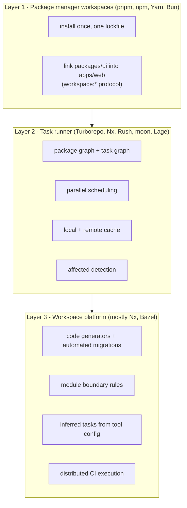

| Without a task runner | With a task runner |
|---|---|
| `pnpm -r build` builds every package, in topological order but with no caching | `turbo run build` / `nx run-many -t build` skips anything whose inputs didn't change |
| CI time grows with **repo size** | CI time grows with **change size** (when caching works) |
| Each developer rebuilds what CI already built | Developers download CI's outputs from the remote cache |
| Nothing stops `apps/web` importing `apps/admin/src/...` | Boundary rules (Nx tags, Turborepo `boundaries`) fail the lint |

**The two dominant JavaScript tools:**

| | **Turborepo** | **Nx** |
|---|---|---|
| Maintainer | Vercel (acquired the project in 2021) | Nx (formerly Nrwl), founded by former Angular team members |
| Implementation | Rust (migrated from Go) | TypeScript core with performance-critical parts (hashing, file watching) in Rust |
| Philosophy | **Small and focused**: run `package.json` scripts fast, cache them, stay out of the way | **Platform**: graph, cache, generators, migrations, boundaries, plugins, CI orchestration |
| Config | `turbo.json` (root + optional per-package files) | `nx.json` + optional `project.json` / `package.json` `"nx"` field; plugins can **infer** tasks |
| Task source | Scripts in each package's `package.json` | Scripts, explicit targets, or targets **inferred** from `vite.config.ts`, `next.config.js`, `jest.config.ts`, ... |
| Paid / hosted layer | Vercel Remote Cache (free on all Vercel plans per the docs) | Nx Cloud (remote cache, distributed execution, CI insights) |

> Others worth knowing: **Bazel** (hermetic, polyglot, steep learning curve), **Rush** (Microsoft, strict publishing workflows), **moon** (Rust, polyglot), **Lage** (Microsoft, lightweight), **Lerna** (historic JS monorepo tool, maintained by the Nx team since 2022 and now running on Nx's task runner).

---

### Section 2: Package Graph and Task Graph

Both tools first build a **package (project) graph** from workspace dependencies, then expand it into a **task graph** using rules such as "a package's `build` needs its dependencies' `build` first".

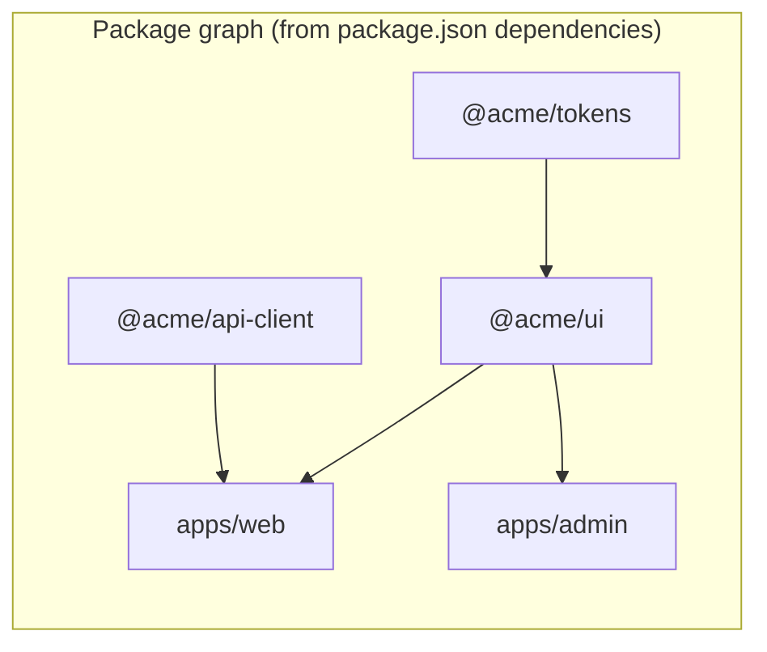

With `"build": { "dependsOn": ["^build"] }` (the caret means **"the same task in my dependencies"**), `turbo run build lint` becomes:

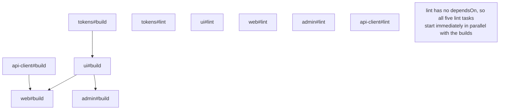

| `dependsOn` value | Meaning | Example |
|---|---|---|
| `"^build"` | Run `build` in all **dependencies** first | Library outputs must exist before the app compiles |
| `"build"` | Run **this package's** `build` first | `test` that runs against `dist/` |
| `"web#build"` (Turborepo) / `{ "projects": ["web"], "target": "build" }` (Nx) | A specific task in a specific package | e2e needs the web app built |
| *(empty)* | No ordering; maximum parallelism | `lint`, `typecheck` with project references off |

**Rules of thumb:**
- Keep graphs **wide, not deep**: many small packages that depend on a few foundations parallelise well; a long chain (`a → b → c → d → app`) is a serial critical path.
- **Circular dependencies break the graph.** Both tools report cycles; fix them by extracting the shared part into a third package.
- Visualise the graph before optimising: `turbo run build --graph=graph.html` or `nx graph`.

---

### Section 3: Content-Addressed Caching

A task is cached under a **hash of everything that could change its output**. Same hash → replay the stored outputs and terminal logs instead of running the task.

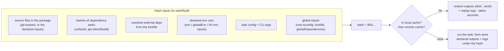

**The two declarations you must get right:**

| Declaration | If it is too broad | If it is too narrow |
|---|---|---|
| **Inputs** (files, env vars that affect the result) | Needless cache misses (editing `README.md` rebuilds the app) | **Wrong cache hits**: a stale or wrong-environment build is replayed |
| **Outputs** (files the task produces) | Huge artifacts, slow upload/download | Cache "hits" but the files aren't restored → later steps fail or use old files |

```text
Correctness rule:  hash(inputs) must change whenever the output would change.
Speed rule:        hash(inputs) should NOT change when the output would not change.
Correctness wins.  A slow cache costs minutes; a wrong cache ships the wrong code.
```

**Classic correctness bugs:**
- **Undeclared env var.** `NEXT_PUBLIC_API_URL` (or `VITE_API_URL`) is inlined into the bundle at build time. If it isn't in the hash, a staging build can be replayed for production. Turborepo's default **strict env mode** hides undeclared variables from the task, so the build fails or uses a default instead of silently caching the wrong value.
- **Non-deterministic outputs.** Timestamps or random IDs baked into builds make outputs differ for identical inputs. That doesn't break correctness but defeats downstream caching and makes debugging confusing.
- **Tasks with side effects** (`deploy`, `db:migrate`, `dev`) must have caching **off**. Replaying the log of a deploy doesn't deploy anything.
- **Tool versions outside the lockfile.** A global CLI or a different Node major can change outputs. Nx supports **runtime inputs** (e.g. `node --version`); in Turborepo, pin Node in CI and consider adding a version marker to `globalEnv` or `globalDependencies` (e.g. `.nvmrc`).

---

### Section 4: Remote Caching and Its Security Model

A remote cache shares artifacts across machines: CI fills it, developers and other CI jobs read from it.

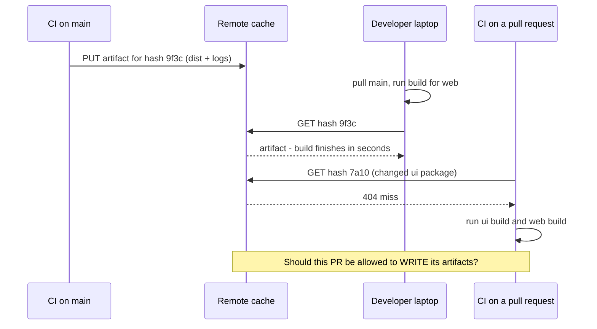

**Cache poisoning** is the core risk: if an attacker can write an artifact under a hash that trusted builds will later compute, the trusted pipeline replays **attacker-controlled output**. Nx disclosed this class of flaw for bucket-based self-hosted caches as **CVE-2025-36852 ("CREEP")**: a pull request can change only the CI workflow (which isn't part of the task hash), compute the same hash that `main` will compute, upload first, and poison `main`'s later cache hit. As of 2026 the Nx docs mark the bucket-based packages (`@nx/s3-cache`, `@nx/gcs-cache`, `@nx/azure-cache`, `@nx/shared-fs-cache`) as **deprecated** for this reason. The same reasoning applies to **any** DIY remote cache, for any tool.

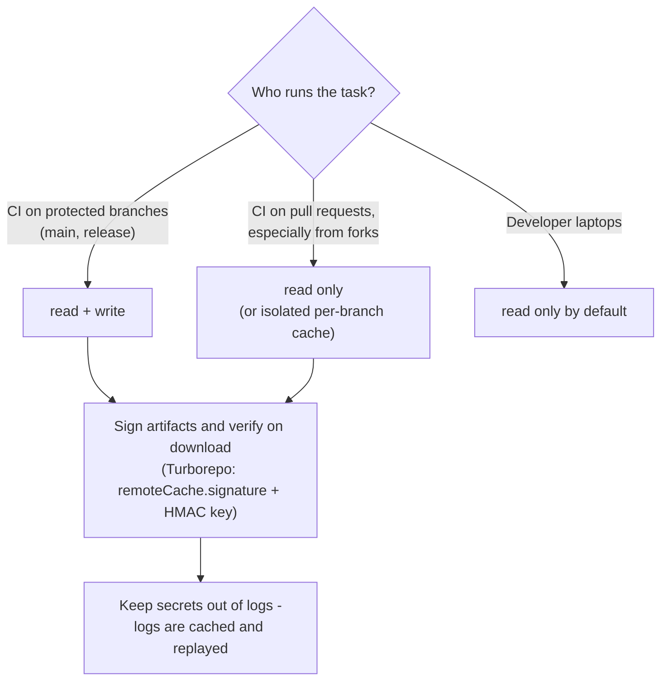

| Control | Turborepo | Nx |
|---|---|---|
| Managed cache | Vercel Remote Cache (`turbo login`, `turbo link`) | Nx Cloud (`npx nx connect`) |
| Self-hosted | Any server implementing the published **Remote Cache API** (OpenAPI spec); community servers exist | A server implementing Nx's **remote cache OpenAPI spec**; the bucket-based packages are deprecated (see above) |
| Read-only runs | `--cache=local:rw,remote:r` | Read-only tokens / access settings (check current Nx Cloud docs) |
| Integrity | `"remoteCache": { "signature": true }` + `TURBO_REMOTE_CACHE_SIGNATURE_KEY` (HMAC-SHA256; failed verification = cache miss) | Handled by Nx Cloud's access model; for self-hosted, your server must enforce it |

> Signing proves an artifact came from **someone holding the key**. It does not help if untrusted PR jobs also get the key — read-only access for untrusted runs is the real fix.

---

### Section 5: Affected Detection

"Affected" = packages whose files changed between a **base** and a **head** commit, **plus everything that depends on them**.

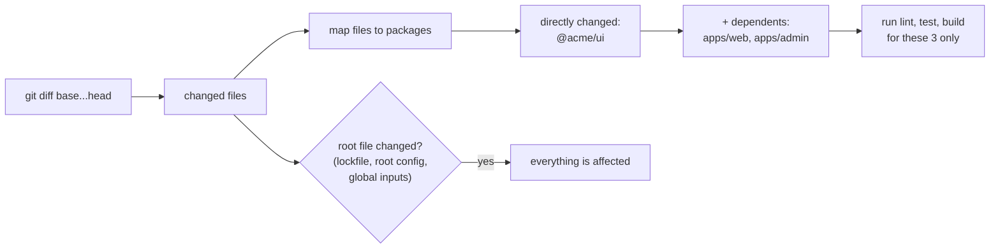

| Tool | Command | Default base |
|---|---|---|
| Turborepo | `turbo run test --affected` (equivalent to `--filter=...[main...HEAD]`) | `main`; override with `TURBO_SCM_BASE` / `TURBO_SCM_HEAD` |
| Turborepo (explicit) | `turbo run test --filter="...[origin/main]"` | the git ref you pass |
| Nx | `nx affected -t lint test build` | `defaultBase` in `nx.json`; override with `--base` / `--head` or `NX_BASE` / `NX_HEAD` |
| pnpm only | `pnpm --filter "...[origin/main]" test` | the git ref you pass (no caching) |

**Gotchas:**
- **Shallow clones break it.** CI checkouts often fetch one commit; the base commit isn't there. Use `fetch-depth: 0` (GitHub Actions) or fetch the base ref explicitly.
- **Pick the right base on `main`.** After merge, "affected since `main`" is empty. Compare with the **last successful CI run on main** — the `nrwl/nx-set-shas` GitHub Action does this for Nx; Turborepo users usually rely on the remote cache instead (unchanged tasks hit).
- **Affected is an optimisation, caching is the safety net.** Running everything with a warm cache gives the same result as affected-only — just with more cache lookups.
- **Root changes affect everything** by design (lockfile, root `tsconfig`, `turbo.json`, `nx.json`). Keep root config stable and split shared config into packages where possible.
- Turborepo has **future flags** that make filtering follow task inputs instead of whole packages (e.g. a `README.md` change that is excluded from `build` inputs doesn't select `build`). Check the configuration reference before relying on them.

---

### Section 6: Turborepo in Depth

Turborepo runs **the scripts you already have**. A task called `build` in `turbo.json` runs the `build` script of every package that has one.

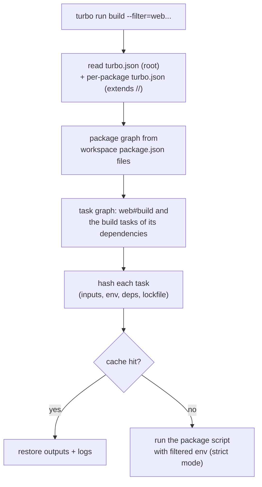

**Key configuration** (`turbo.json`; `turbo.jsonc` also works for comments):

| Key | Purpose |
|---|---|
| `tasks.<name>.dependsOn` | Ordering: `^build`, `build`, `pkg#task` |
| `tasks.<name>.inputs` | Files in the hash; default = all git-tracked files in the package. `$TURBO_DEFAULT$` + exclusions such as `!README.md` |
| `tasks.<name>.outputs` | Globs to cache, e.g. `dist/**`, `.next/**`, `!.next/cache/**` |
| `tasks.<name>.env` | Env vars that affect this task's hash **and** are passed to it (wildcards allowed, e.g. `NEXT_PUBLIC_*`) |
| `tasks.<name>.passThroughEnv` | Env vars passed to the task but **not** hashed (tokens that don't affect output) |
| `tasks.<name>.cache` / `persistent` | `false` for side-effect tasks; `persistent: true` for long-running `dev` servers |
| `globalEnv` / `globalDependencies` | Env vars / files that affect **every** task's hash |
| `envMode` | `strict` (default — only declared vars are visible) or `loose` |
| `remoteCache.signature` | Sign and verify remote artifacts |
| `extends: ["//"]` | In a package's own `turbo.json`: inherit root config and override (**Package Configurations**) |
| `tags` + root `boundaries` | **Experimental** `turbo boundaries` rules (allow/deny dependencies by tag) |

**Filters** select which packages run:

```text
--filter=web            only web
--filter=web...         web + its dependencies
--filter=...web         web + its dependents
--filter=...^web        only web's dependents (not web itself)
--filter=./apps/*       by directory
--filter=[main]         packages changed since main
--filter=...[main]      changed since main + their dependents
--filter=!docs          exclude docs
--affected              shorthand for --filter=...[main...HEAD]
```

**Other commands:** `turbo watch dev` (re-runs tasks when dependencies change), `turbo prune` (Section 9), `turbo gen` (code generators), `turbo run build --dry=json` (what would run, with hashes), `--summarize` (writes a JSON run summary to `.turbo/runs`), `--graph` (svg, html, mermaid, dot).

**Internal package strategies** (from the Turborepo docs):

| Strategy | What the package exports | Trade-off |
|---|---|---|
| **Just-in-time** | TypeScript source; the app's bundler compiles it | No build step, simplest; the app's bundler must handle TS/JSX, and the package can't be cached separately |
| **Compiled** | Built JS + `.d.ts` in `dist/` | Cacheable build, faster app builds; one more task in the graph |
| **Publishable** | Compiled + versioned + published to a registry | Needed for external consumers; versioning overhead (Changesets) |

> **Config is still evolving.** Turborepo 2.x renamed `pipeline` to `tasks`, made strict env mode the default, and the docs describe future flags (for example moving global keys under a `global` object) aimed at a future major. Copy config from the current [configuration reference](https://turborepo.dev/docs/reference/configuration), not from old blog posts.

---

### Section 7: Nx in Depth

Nx builds a **project graph** from your workspace and from **plugins** that read tool config files and **infer** targets. It adds a layer of workspace management on top of task running.

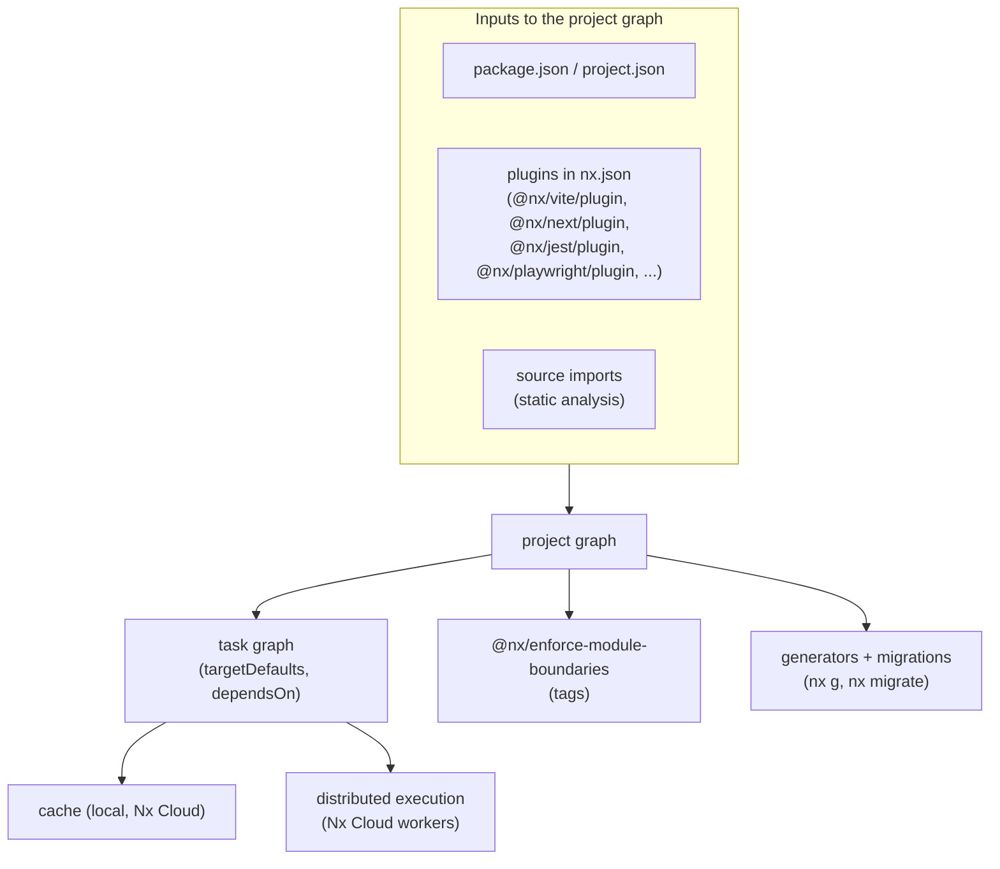

| Feature | What it does | Command / config |
|---|---|---|
| **Inferred tasks** | A plugin sees `vite.config.ts` and adds `build`, `serve`, `test` targets with correct inputs/outputs | `plugins` array in `nx.json`; inspect with `nx show project web` |
| **Named inputs** | Reusable input sets: `default`, `production` (excludes tests), `sharedGlobals` | `namedInputs` in `nx.json`; `^production` = dependencies' production files |
| **Non-file inputs** | Env vars, runtime command output, external dependency versions | `{ "env": "API_URL" }`, `{ "runtime": "node --version" }`, `{ "externalDependencies": ["vite"] }` |
| **Generators** | Scaffold apps/libs/components with consistent config | `nx g @nx/react:library packages/ui` |
| **Migrations** | Update Nx, plugins and framework config with codemods | `nx migrate latest` → review `migrations.json` → `nx migrate --run-migrations` |
| **Module boundaries** | Lint rule restricting imports by project tags | `@nx/enforce-module-boundaries` (see the [repo-strategy note](./mono-repo-vs-multi-repo.md)) |
| **Sync generators** | Keep derived files (e.g. TypeScript project references) in sync with the graph | `nx sync`, `nx sync:check` in CI |
| **Release** | Version, changelog and publish packages | `nx release` |
| **Import** | Move an existing repo in, keeping git history | `nx import` |
| **Editor + AI tooling** | Nx Console (VS Code / JetBrains) and an Nx MCP server expose the graph to editors and coding agents | — |

**Nx in two flavours:**
- **Package-based**: each package has its own `package.json` scripts; Nx only adds caching and the task graph — very close to Turborepo.
- **Integrated / plugin-driven**: Nx plugins own build config, generators and migrations — more leverage, more coupling to Nx's upgrade cadence.

> **Supply-chain note:** monorepo tools run with access to your whole repo and CI secrets. Pin versions via the lockfile, review release notes before upgrading, and limit the secrets available to CI jobs. The `nx` npm packages themselves were hit by a supply-chain attack in August 2025 ("s1ngularity"): a GitHub Actions injection leaked the npm publish token, malicious versions stole credentials at install time, and Nx moved publishing to npm trusted publishing (OIDC) afterwards. Read the [postmortem](https://nx.dev/blog/s1ngularity-postmortem) — the lessons apply to any repo's CI.

---

### Section 8: Distributed Execution and CI Shape

Caching removes repeated work; **distribution** spreads the remaining work across machines. The illustrative timeline below compares one PR's CI on three setups (durations are made-up units, not measurements):

```mermaid
gantt
    title One PR in CI - illustrative units, not a benchmark
    dateFormat X
    axisFormat %s
    section 1 machine, no cache
    lint all          :a1, 0, 6
    test all          :a2, after a1, 14
    build all         :a3, after a2, 22
    section 1 machine, affected + cache
    lint affected     :b1, 0, 2
    test affected     :b2, after b1, 5
    build affected    :b3, after b2, 8
    section 3 machines, distributed
    agent 1 tests     :c1, 0, 3
    agent 2 builds    :c2, 0, 4
    agent 3 lint      :c3, 0, 2
```

| Approach | How work is split | Weakness |
|---|---|---|
| **Static sharding** (CI matrix: `--shard=1/4`) | Fixed split decided before the run | Unbalanced shards; one slow shard holds up the run; ignores the task graph |
| **Binning by task type** (one job lints, one tests, one builds) | Fixed split | Same imbalance; repeated installs per job |
| **Dynamic distribution** (Nx Cloud workers, Bazel remote execution) | A coordinator hands tasks to machines as they free up, respecting the graph | Needs a coordinator service (usually paid/hosted) |

> Nx Cloud's distributed execution was branded **"Nx Agents"** and is documented as **"workers"** in current docs; setup commands have changed over time. Follow the [current guide](https://nx.dev/docs/features/ci-features/distribute-task-execution) rather than copying older CI snippets.

**A sensible CI shape for a JS monorepo:**

```text
1. Checkout with full history (or fetch the base ref)       → affected detection works
2. Install with the frozen lockfile + package-manager cache  → deterministic deps
3. Remote cache: read-write on main, read-only on PRs        → speed without poisoning
4. Run lint, typecheck, test, build for affected projects    → time scales with the change
5. e2e only for affected apps; split large suites            → slowest step contained
6. Deploy: one job per affected app (turbo prune / pnpm deploy for images)
```

---

### Section 9: Shipping One App — Pruning and Docker

A Docker image for `apps/web` shouldn't contain the whole monorepo, and a change in `apps/admin` shouldn't invalidate `web`'s `npm install` layer.

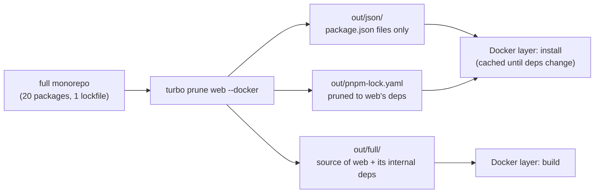

| Need | Turborepo | Nx | Package manager only |
|---|---|---|---|
| Subset of the repo for one app | `turbo prune <app> --docker` | Build with the plugin's `generatePackageJson`-style options, or use package manager tools | `pnpm deploy --filter <app>` (copies the package with its production deps) |
| Pruned lockfile | Yes (`out/`) | Depends on the plugin/executor | `pnpm deploy` installs from the root lockfile |

---

## Decision Matrix

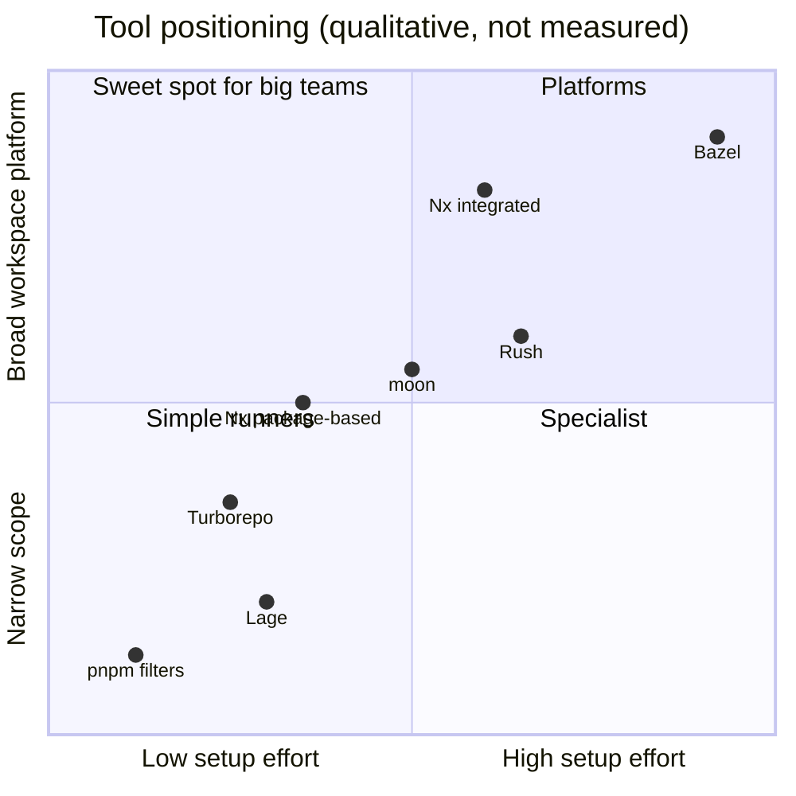

| Situation | Recommendation | Why |
|---|---|---|
| Few apps + shared UI package, JS/TS only, small team | **Turborepo** (or Nx package-based) | Minimal config on top of existing scripts; fast to adopt |
| Next.js apps deployed on Vercel | **Turborepo** is the natural default | First-party integration and free Vercel Remote Cache |
| Angular, or many teams needing scaffolding and enforced architecture | **Nx** (integrated) | Generators, migrations, boundaries, Angular heritage |
| CI is the bottleneck even with caching (huge e2e suites) | **Nx + Nx Cloud** distribution, or **Bazel** | Dynamic distribution across machines |
| Polyglot (JS + Go/Java/Python) with strict hermeticity needs | **Bazel** (or moon / Nx with Gradle/Maven/.NET plugins) | One graph across languages; Bazel gives the strongest cache guarantees |
| Libraries published to npm with strict review policies | **Rush**, or Nx/Turborepo + **Changesets** | Mature publishing and versioning workflows |
| Existing repo that only needs "build affected" today | **Turborepo** or `nx init` in package-based mode | Both adopt incrementally; you can grow into more later |

**Questions to ask before choosing:**
1. Is CI time dominated by **repeated** work (→ caching) or by **unique** work (→ distribution)?
2. Who may write to the remote cache, and where is it hosted (data residency, CREEP-style risk)?
3. Do teams need **generated, consistent** project setups and automated upgrades, or do they prefer owning their config?
4. Which frameworks and languages must the graph understand?
5. What happens if the vendor's hosted service is down — can CI fall back to local execution?

---

## Framework and Platform Notes

| Stack | Turborepo | Nx |
|---|---|---|
| **React / Next.js** | Official examples; Next.js compiles workspace packages via `transpilePackages`; cache `.next/**` but exclude `.next/cache/**` | `@nx/react`, `@nx/next` plugins with inferred targets |
| **Vue / Nuxt** | Works through package scripts (Vite / Nuxt CLI) | `@nx/vue`, `@nx/nuxt` plugins |
| **Angular** | Works via `ng build` scripts; the Angular CLI also has native multi-project workspaces | `@nx/angular` — Nx grew out of the Angular ecosystem and supports Angular CLI-style builders |
| **Svelte / SvelteKit** | Works via package scripts (Vite) | No first-party Svelte plugin listed in the Nx docs; the Vite plugin infers tasks, community plugins exist |
| **React Native / Expo** | Works, but Metro must resolve hoisted/symlinked packages; recent Expo SDKs configure Metro for monorepos automatically | `@nx/react-native`, `@nx/expo` plugins |
| **Native iOS / Android** | Wrap Gradle/Xcode builds in package scripts; declare outputs carefully | `@nx/gradle` for Android/JVM; Xcode via scripts |
| **Backend in the same repo** | Any language via scripts (no language awareness) | Node, Nest, Express plugins plus Gradle, Maven, .NET support |

---

## Real-World Examples

**Example 1 — Turborepo: root config with correct env handling:**
```json
{
  "$schema": "https://turborepo.dev/schema.json",
  "ui": "tui",
  "globalDependencies": [".nvmrc", "tsconfig.base.json"],
  "globalEnv": ["NODE_ENV"],
  "remoteCache": { "signature": true },
  "tasks": {
    "build": {
      "dependsOn": ["^build"],
      "inputs": ["$TURBO_DEFAULT$", "!**/*.md", "!**/*.test.*"],
      "outputs": ["dist/**", ".next/**", "!.next/cache/**", "!.next/dev/**"],
      "env": ["NEXT_PUBLIC_*", "VITE_*"],
      "passThroughEnv": ["SENTRY_AUTH_TOKEN"]
    },
    "typecheck": { "dependsOn": ["^build"] },
    "lint": {},
    "test": { "dependsOn": ["^build"], "outputs": ["coverage/**"] },
    "dev": { "cache": false, "persistent": true },
    "deploy": { "dependsOn": ["build"], "cache": false }
  }
}
```
> `NEXT_PUBLIC_*` / `VITE_*` are inlined into bundles, so they **must** be hashed. `SENTRY_AUTH_TOKEN` only uploads source maps, so it is passed through without changing the hash (and must never be printed — logs are cached).

**Example 2 — Turborepo Package Configuration (one package overrides the root):**
```json
{
  "$schema": "https://turborepo.dev/schema.json",
  "extends": ["//"],
  "tags": ["app"],
  "tasks": {
    "build": {
      "outputs": ["$TURBO_EXTENDS$", "storybook-static/**"]
    }
  }
}
```
> Lives at `apps/web/turbo.json`. `$TURBO_EXTENDS$` keeps the root's outputs and appends to them; without it, the array replaces the root's value.

**Example 3 — Nx: `nx.json` with named inputs, defaults and an inferred-task plugin:**
```json
{
  "$schema": "./node_modules/nx/schemas/nx-schema.json",
  "defaultBase": "main",
  "namedInputs": {
    "sharedGlobals": ["{workspaceRoot}/tsconfig.base.json", "{workspaceRoot}/.nvmrc"],
    "default": ["{projectRoot}/**/*", "sharedGlobals"],
    "production": [
      "default",
      "!{projectRoot}/**/*.spec.ts?(x)",
      "!{projectRoot}/**/*.stories.tsx",
      { "env": "VITE_API_URL" }
    ]
  },
  "targetDefaults": {
    "build": {
      "dependsOn": ["^build"],
      "inputs": ["production", "^production"],
      "cache": true
    },
    "test": { "inputs": ["default", "^production"], "cache": true },
    "deploy": { "dependsOn": ["build"], "cache": false }
  },
  "plugins": [
    { "plugin": "@nx/vite/plugin", "options": { "buildTargetName": "build", "testTargetName": "test" } },
    { "plugin": "@nx/eslint/plugin", "options": { "targetName": "lint" } }
  ]
}
```
```bash
nx show project web          # see inferred targets, inputs and outputs
nx graph                     # interactive project/task graph in the browser
nx affected -t lint test build
nx g @nx/react:library packages/feature-cart --tags=type:feature,scope:shop
nx migrate latest && nx migrate --run-migrations
```

**Example 4 — CI: read-write cache on main, read-only on PRs (GitHub Actions + Turborepo):**
```yaml
name: ci
on:
  push:
    branches: [main]
  pull_request:

jobs:
  check:
    runs-on: ubuntu-latest
    env:
      TURBO_TOKEN: ${{ secrets.TURBO_TOKEN }}
      TURBO_TEAM: ${{ vars.TURBO_TEAM }}
      TURBO_REMOTE_CACHE_SIGNATURE_KEY: ${{ secrets.TURBO_SIGNATURE_KEY }}
    steps:
      - uses: actions/checkout@v4
        with:
          fetch-depth: 0
      - uses: pnpm/action-setup@v4
      - uses: actions/setup-node@v4
        with:
          node-version-file: .nvmrc
          cache: pnpm
      - run: pnpm install --frozen-lockfile
      # PRs: read the remote cache but never write to it
      - if: github.event_name == 'pull_request'
        run: pnpm turbo run lint typecheck test build --affected --cache=local:rw,remote:r
      # main: full read-write, so later PRs and laptops get hits
      - if: github.ref == 'refs/heads/main'
        run: pnpm turbo run lint typecheck test build
```
> Secrets aren't exposed to workflows triggered from **forks** by default, so fork PRs run without the remote cache at all — the safe default. Never switch to `pull_request_target` just to give forks cache access.

**Example 5 — Docker image for one app with `turbo prune`:**
```dockerfile
FROM node:22-alpine AS base
RUN corepack enable

FROM base AS pruner
WORKDIR /repo
COPY . .
RUN npx turbo prune web --docker

FROM base AS builder
WORKDIR /repo
# 1) install layer: only package.json files + pruned lockfile → cached until deps change
COPY --from=pruner /repo/out/json/ .
RUN pnpm install --frozen-lockfile
# 2) source layer
COPY --from=pruner /repo/out/full/ .
RUN pnpm turbo run build --filter=web

FROM base AS runner
WORKDIR /app
COPY --from=builder /repo/apps/web/.next/standalone ./
COPY --from=builder /repo/apps/web/.next/static ./apps/web/.next/static
CMD ["node", "apps/web/server.js"]
```
> The `standalone` output requires `output: 'standalone'` in `next.config`. For Vite SPAs, copy `dist/` into an nginx or CDN upload step instead.

**Example 6 — BAD → GOOD cache configuration:**
```json
{
  "tasks": {
    "build": { "outputs": [] },
    "dev": {},
    "test": { "dependsOn": ["^build"] },
    "deploy": { "dependsOn": ["build"] }
  }
}
```
```text
❌ build has no outputs        → "cache hit" restores nothing; the next step finds no dist/
❌ dev is cacheable            → turbo may try to cache a never-ending process
❌ deploy is cacheable         → a cache hit replays the log and deploys NOTHING
❌ no env declared for build   → strict mode hides NEXT_PUBLIC_API_URL; loose mode caches the wrong one
```
```json
{
  "tasks": {
    "build": { "dependsOn": ["^build"], "outputs": ["dist/**"], "env": ["NEXT_PUBLIC_*"] },
    "dev": { "cache": false, "persistent": true },
    "test": { "dependsOn": ["^build"], "outputs": ["coverage/**"] },
    "deploy": { "dependsOn": ["build"], "cache": false }
  }
}
```

**Example 7 — Debugging an unexpected cache miss (or hit):**
```bash
# Turborepo: compare two runs' hashes and inputs
pnpm turbo run build --filter=web --dry=json > run-a.json
#   ...change something...
pnpm turbo run build --filter=web --dry=json > run-b.json
diff <(jq '.tasks[] | {taskId, hash, inputs, environmentVariables}' run-a.json) \
     <(jq '.tasks[] | {taskId, hash, inputs, environmentVariables}' run-b.json)

# Full run summary (timings, hashes, cached files) in .turbo/runs/
pnpm turbo run build --summarize

# Nx: inspect a project's resolved inputs/outputs, then run verbosely
nx show project web --json | jq '.targets.build | {inputs, outputs, cache}'
nx build web --verbose --skip-nx-cache   # force execution once to compare
nx reset                                  # clear local cache and stop the daemon
```

---

## Key Points Summary

| Concept | One-Line Explanation |
|---|---|
| **Workspaces vs task runner** | Package manager links packages; the task runner decides what to run, in what order, and whether to skip it |
| **Task graph** | Package graph + `dependsOn` rules (`^build` = dependencies' build first) |
| **Content-addressed cache** | Hash of inputs → stored outputs + logs; identical hash replays instead of running |
| **Inputs** | Everything that can change the output — files, env vars, deps, tool versions |
| **Outputs** | Files to store and restore; missing outputs = empty cache hits |
| **Strict env mode** | Turborepo's default: tasks only see declared env vars |
| **Remote cache** | Shares artifacts between CI and laptops; writes must be restricted to trusted runs |
| **CREEP / cache poisoning** | Untrusted runs that can write the cache can poison trusted builds (CVE-2025-36852) |
| **Affected** | Changed packages + their dependents since a base commit; needs full git history |
| **Turborepo** | Rust, focused, runs `package.json` scripts, Vercel Remote Cache |
| **Nx** | Graph platform: inferred tasks, generators, migrations, boundaries, Nx Cloud |
| **Distributed execution** | Coordinator assigns tasks to machines dynamically, beating static shards |
| **`turbo prune --docker`** | Minimal monorepo subset + pruned lockfile for one app's image |
| **Side-effect tasks** | `dev`, `deploy`, migrations: caching off |

---

## Test Your Understanding

**Q1 (Basic):** What does `"dependsOn": ["^build"]` mean, and how is it different from `"dependsOn": ["build"]`?

<details>
<summary>Answer</summary>

`^build` means "before running this task in package X, run `build` in **every package X depends on**". It encodes the fact that a library's compiled output must exist before its consumers compile. `build` (no caret) means "run **this same package's** `build` first", e.g. a `test` task that tests the built `dist/`. The caret walks the package graph; the plain name stays inside one package. Getting this wrong leads to either race conditions (app builds before the library) or needless serialisation.
</details>

**Q2 (Application):** After enabling remote caching, production occasionally shows the staging API URL even though "all builds pass". What is the root cause and the fix in Turborepo and in Nx?

<details>
<summary>Answer</summary>

The API URL is a **build-time env var inlined into the bundle** (`NEXT_PUBLIC_API_URL`, `VITE_API_URL`), but it is **not part of the task hash**. A staging build and a production build therefore have the same hash, and whichever ran first is replayed for the other.

- **Turborepo:** list it in `tasks.build.env` (or `globalEnv`), e.g. `"env": ["NEXT_PUBLIC_*"]`. Keep `envMode: "strict"` so undeclared vars aren't even visible to the task, which turns this silent bug into a visible failure.
- **Nx:** add `{ "env": "VITE_API_URL" }` to the `production` named input (or the target's `inputs`).

General lesson: **a cache is only as correct as its inputs.** Anything that changes output must be in the hash.
</details>

**Q3 (Tricky):** Your PR pipeline uses the same remote-cache token as `main`. A contributor opens a PR that changes only `.github/workflows/ci.yml` to replace the build step with a script that writes a malicious `dist/`. Why could this reach production even though the PR is never merged?

<details>
<summary>Answer</summary>

The workflow file is **not an input** to the `build` task hash, and the package sources are unchanged, so the PR computes **the same hash** that the next `main` build will compute. If the PR job uploads its (malicious) artifact first, `main` gets a **cache hit** and replays the poisoned output into the deployment — the PR never needed to be merged. This is the CREEP class of vulnerability (CVE-2025-36852) that led Nx to deprecate its bucket-based cache packages, and it applies to any shared read-write cache.

Fixes: **read-only cache for untrusted runs** (`--cache=local:rw,remote:r` in Turborepo, read-only tokens elsewhere), write access only from protected branches, a cache service that isolates artifacts by trust level (e.g. Nx Cloud's model), artifact signing with a key PR jobs can't access, and never exposing secrets to fork PRs.
</details>

**Q4 (Tricky):** `nx affected -t test` runs nothing on `main` after merges, and on PRs it sometimes runs everything. Explain both.

<details>
<summary>Answer</summary>

**Nothing on main:** affected compares `base...head`. On `main` after a merge, if the base is `main` itself (or `HEAD~1` in a shallow clone that lacks history), the diff is empty or wrong. Use the **last successful CI commit on main** as the base (`nrwl/nx-set-shas` sets `NX_BASE`/`NX_HEAD`) and fetch full history.

**Everything on PRs:** a **root-level input** changed — the lockfile (any dependency bump), `nx.json`, root `tsconfig.base.json`, or anything in `sharedGlobals`. These feed every project's hash, so every project is affected. It's correct behaviour; reduce it by keeping root config stable, moving shared config into packages, and relying on the remote cache so "affected" projects with unchanged effective inputs still hit.
</details>

**Q5 (Application):** A startup has a Next.js marketing site, a Vite React dashboard and a shared `ui` package, all on Vercel, with three engineers. A new hire suggests Bazel "because Google uses it". What do you recommend and why?

<details>
<summary>Answer</summary>

**Turborepo** (or Nx in package-based mode). The repo is small, JS/TS-only and already deploys on Vercel, so Turborepo adds caching and a task graph on top of existing `package.json` scripts with one `turbo.json`, and Vercel Remote Cache is available without extra infrastructure. Bazel's value — hermetic, polyglot builds and remote execution at very large scale — doesn't pay off here, while its cost (BUILD files, rule sets for the JS toolchain, a dedicated build-infra skill set) does. Revisit if the repo becomes polyglot, CI time is dominated by unique (not repeated) work, or many teams need enforced architecture (then Nx integrated, or Bazel).
</details>

**Q6 (System design):** Design the build/CI architecture for 40 engineers in 6 teams: 3 Next.js apps, 1 Angular admin, 1 Expo mobile app, a design system published to npm, and a 45-minute Playwright suite. Cover tool choice, caching, security, boundaries and deploys.

<details>
<summary>Answer</summary>

- **Repo + tool:** one pnpm monorepo with **Nx** — the Angular admin and Expo app benefit from first-party plugins, generators keep project setups consistent across 6 teams, and `nx migrate` handles framework upgrades. Turborepo + Changesets would also work if teams prefer owning their config; then add boundaries via ESLint rules.
- **Graph hygiene:** `packages/tokens → ui → feature-* → apps`, tagged `type:*` and `scope:*`, enforced by `@nx/enforce-module-boundaries`; `CODEOWNERS` per team.
- **Caching:** `production` named inputs exclude tests/stories; build-time env vars (`NEXT_PUBLIC_*`, `EXPO_PUBLIC_*`) are declared inputs; `deploy`/`dev` uncached.
- **Remote cache security:** managed service (Nx Cloud) or an OpenAPI-compliant server that isolates writes; **only `main`/release pipelines write**; PRs read-only; no secrets for fork PRs; nothing secret printed to logs.
- **CI time:** affected-only on PRs with `nx-set-shas`; distribute tasks across machines, and split the Playwright suite into per-file tasks so it spreads too; run e2e only for affected apps.
- **Release + deploy:** design system published with `nx release` (or Changesets); each app deploys independently when affected; Docker/standalone builds use pruned installs; the Expo app ships through EAS with its own pipeline.
- **Ops:** pin tool versions in the lockfile, use Renovate for upgrades, track CI duration and cache hit rate per pipeline as the health metrics.
</details>

---

## Cheat Sheet

**Key Definitions:**
- **Package / project graph:** which workspace packages depend on which.
- **Task graph:** package graph × task rules (`dependsOn`); scheduled in parallel where possible.
- **Inputs / outputs:** what goes into a task's hash / what gets stored and restored.
- **Cache hit:** same hash seen before → restore outputs and replay logs.
- **Remote cache:** shared artifact store for CI and developers.
- **Cache poisoning (CREEP):** an untrusted writer stores an artifact under a hash trusted builds will use.
- **Affected:** changed packages + dependents between base and head.
- **Inferred tasks (Nx):** plugins derive targets from tool config files.
- **Package Configuration (Turborepo):** per-package `turbo.json` that `extends: ["//"]`.

**Quick Reference:**
```text
Turborepo
  turbo run build lint test               run tasks across the graph
  turbo run build --filter=web...         web + dependencies
  turbo run test --affected               changed since main + dependents
  turbo run build --cache=local:rw,remote:r   read-only remote cache
  turbo run build --dry=json | --summarize | --graph=graph.html
  turbo prune web --docker                minimal subset for an image
  turbo watch dev  ·  turbo gen  ·  turbo boundaries (experimental)
  turbo.json: tasks.dependsOn ["^build"] · outputs · inputs ($TURBO_DEFAULT$) · env · passThroughEnv
              globalEnv · globalDependencies · envMode strict · remoteCache.signature

Nx
  nx run-many -t build                    all projects
  nx affected -t lint test build          changed + dependents (NX_BASE / NX_HEAD)
  nx graph  ·  nx show project web        visualise / inspect inferred config
  nx g @nx/react:library <dir>            generate
  nx migrate latest                       automated upgrades
  nx sync  ·  nx release  ·  nx import  ·  nx reset
  nx.json: namedInputs (default, production, ^production) · targetDefaults · plugins · defaultBase

Always
  outputs declared · build-time env vars hashed · dev/deploy uncached
  PR cache = read-only · fetch-depth 0 · pin Node + package manager
```

**Common Mistakes to Avoid:**

| Mistake | Why Wrong | Fix |
|---|---|---|
| Build-time env var not in the hash | Wrong-environment builds replayed from cache | `env` / `globalEnv` (Turborepo), `{ "env": ... }` input (Nx); keep strict env mode |
| Missing or wrong `outputs` | Cache hit restores nothing; later steps fail or use stale files | Declare every produced directory; exclude caches like `.next/cache/**` |
| Caching `deploy`, `dev`, migrations | Replaying logs doesn't perform side effects | `"cache": false`; `persistent: true` for dev servers |
| PR jobs with write access to the remote cache | Cache poisoning of `main` builds | Read-only on PRs, write only from protected branches, sign artifacts |
| Secrets printed in task logs | Logs are cached, uploaded and replayed to others | Never echo secrets; use `passThroughEnv` for tokens |
| Shallow clone + affected | Base commit missing → wrong or empty affected set | `fetch-depth: 0` or fetch the base ref; `nx-set-shas` |
| Long dependency chains | Serial critical path; little parallelism | Wider graph: split foundations, avoid "god" packages |
| Over-broad inputs (README, stories in prod build) | Needless cache misses | `$TURBO_DEFAULT$` + exclusions; Nx `production` named input |
| Copying `pipeline` configs from old posts | Turborepo 2.x uses `tasks`; keys keep evolving | Use the current configuration reference |
| Using deprecated bucket-based Nx cache packages | Vulnerable to CREEP by design, no further fixes | Nx Cloud or a hardened server implementing the OpenAPI spec |
| Installing the whole monorepo in every app image | Huge images; any change busts the install layer | `turbo prune --docker`, `pnpm deploy` |
| Unpinned tool versions | Same hash, different output across machines | Lockfile, `packageManager`/`devEngines`, `.nvmrc` as a global input |

---

## References & Further Reading

**Turborepo (official)**
- Turborepo: [Package and task graphs](https://turborepo.dev/docs/core-concepts/package-and-task-graph)
- Turborepo: [Caching](https://turborepo.dev/docs/crafting-your-repository/caching) · [Remote Caching](https://turborepo.dev/docs/core-concepts/remote-caching)
- Turborepo: [Using environment variables](https://turborepo.dev/docs/crafting-your-repository/using-environment-variables)
- Turborepo: [Configuration reference (`turbo.json`)](https://turborepo.dev/docs/reference/configuration) · [`turbo run` reference](https://turborepo.dev/docs/reference/run)
- Turborepo: [Internal packages](https://turborepo.dev/docs/core-concepts/internal-packages) · [Constructing CI](https://turborepo.dev/docs/crafting-your-repository/constructing-ci)
- Turborepo: [`turbo prune`](https://turborepo.dev/docs/reference/prune) · [Docker guide](https://turborepo.dev/docs/guides/tools/docker) · [`turbo boundaries` (experimental)](https://turborepo.dev/docs/reference/boundaries) · [`turbo watch`](https://turborepo.dev/docs/reference/watch) · [`turbo gen`](https://turborepo.dev/docs/reference/generate)

**Nx (official)**
- Nx: [Mental model](https://nx.dev/docs/concepts/mental-model) · [How caching works](https://nx.dev/docs/concepts/how-caching-works) · [Configure inputs](https://nx.dev/docs/guides/tasks--caching/configure-inputs)
- Nx: [Inferred tasks](https://nx.dev/docs/concepts/inferred-tasks) · [Run tasks](https://nx.dev/docs/features/run-tasks) · [Explore the graph](https://nx.dev/docs/features/explore-graph)
- Nx: [Run affected tasks](https://nx.dev/docs/features/ci-features/affected) · [Remote caching](https://nx.dev/docs/features/ci-features/remote-cache) · [Distribute task execution](https://nx.dev/docs/features/ci-features/distribute-task-execution)
- Nx: [Enforce module boundaries](https://nx.dev/docs/features/enforce-module-boundaries) · [Generate code](https://nx.dev/docs/features/generate-code) · [Automate updating dependencies](https://nx.dev/docs/features/automate-updating-dependencies) · [Manage releases](https://nx.dev/docs/features/manage-releases)
- Nx: [`nx.json` reference](https://nx.dev/docs/reference/nx-json) · [Remote cache plugins](https://nx.dev/docs/reference/remote-cache-plugins)

**Security**
- Nx blog: [CVE-2025-36852 — critical cache poisoning vulnerability (CREEP)](https://nx.dev/blog/cve-2025-36852-critical-cache-poisoning-vulnerability-creep)
- Nx: [Deprecated self-hosted cache packages](https://nx.dev/docs/reference/deprecated/self-hosted-cache-packages)
- Nx blog: [s1ngularity postmortem (August 2025 npm supply-chain attack)](https://nx.dev/blog/s1ngularity-postmortem)
- GitHub Docs: [Security hardening for GitHub Actions](https://docs.github.com/en/actions/security-for-github-actions/security-guides/security-hardening-for-github-actions)

**Other tools & background**
- pnpm: [Workspaces](https://pnpm.io/workspaces) · [Filtering](https://pnpm.io/filtering) · [`pnpm deploy`](https://pnpm.io/cli/deploy)
- [Bazel](https://bazel.build/) · [Rush](https://rushjs.io/) · [moon](https://moonrepo.dev/) · [Lerna](https://lerna.js.org/)
- [monorepo.tools](https://monorepo.tools/) — feature comparison of monorepo tools (maintained by the Nx team, so read with that in mind)
- Next.js: [`transpilePackages`](https://nextjs.org/docs/app/api-reference/config/next-config-js/transpilePackages) · [`output: 'standalone'`](https://nextjs.org/docs/app/api-reference/config/next-config-js/output)
- Expo: [Work with monorepos](https://docs.expo.dev/guides/monorepos/)

---

> **Previous Topic:** [CDN Architecture & Edge Caching](./cdn-architecture-and-edge-caching.md)
> — Getting bytes close to users: POPs, cache keys, purging and edge compute

> **Next Topic:** [Design a News Feed (Facebook/Twitter)](./design-a-news-feed-facebook-twitter.md)
> — Phase 11 begins: full frontend system design cases, starting with an infinite, real-time feed

*Saved on: 2026-11-06 | Repo: Frontend System Design Learning Notes*
